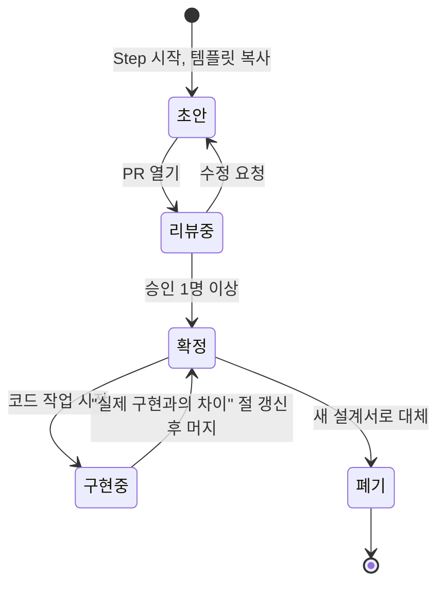

# 기능 설계서 운영 방식

기능 설계서(SPEC)는 "무엇을, 왜, 어떻게 만들 것인가"를 구현 전에 적는 문서다. 여러 개발자가 같은 그림을 보고 일하게 하고, 구현 뒤에는 "실제로 어떻게 만들어졌는가"를 남긴다.

- 상태: 확정
- 최종 갱신: 2026-10-14 (운영 중 사이트 onulsai.site 공개 문구가 답을 준 질문에 "site-facts 참조" 메모, SPEC-009 · 010 번호 예약(가칭 · 작성 예정), SPEC-009 범위는 2026-10-14 결정 Q2(회원제 유지 · 소셜 로그인)대로. 그 전: 2026-10-01 SPEC-004 확정 — 운영자 답변 반영, 결제 질문의 답 기록. 그 전: 2026-09-29 SPEC-003 구현 완료, Step 3 완료. 그 전: 2026-09-28 SPEC-003 구현 완료 · 검증 중. 그 전: 2026-09-24 SPEC-003 확정 — 운영자 답변 반영, 참가 신청 질문의 답 기록)
- 템플릿: [TEMPLATE.md](./TEMPLATE.md)

## 1. 언제 쓰나

- **로드맵 Step을 시작할 때** 쓴다. 코드보다 먼저다.
- 한 Step에 설계서 하나가 기본이다. Step이 크면 둘 이상으로 나눌 수 있다.
- 작은 버그 수정, 리팩터링, 문구 수정에는 쓰지 않는다.
- 설계서 없이 구현이 먼저 진행됐다면, 머지 전에 설계서를 채워 넣는다. 예외를 만들지 않는다.

## 2. 번호와 파일명

- 형식: `SPEC-001-kebab-slug.md`. 번호는 3자리, 뒤는 영어 kebab-case.
- 001~008은 로드맵 Step 순서로 미리 예약했다(아래 4절). 009부터는 필요한 순서대로 부여한다.
- 한 Step을 둘로 나누면 009 이후 새 번호를 쓰고, 메타 절의 "관련 Step"에 같은 Step을 적는다.
- 번호는 재사용하지 않는다. 폐기된 번호도 비워 둔다.

## 3. 생명주기

| 단계         | 하는 일                                                                                      | 문서 상태 |
| ------------ | -------------------------------------------------------------------------------------------- | --------- |
| 작성         | `TEMPLATE.md`를 복사해 채운다. 모르는 것은 "미결 사항"에 적는다                              | 초안      |
| 리뷰         | 설계서만 담은 PR을 올린다. 리뷰어 1명 이상이 승인한다                                        | 초안      |
| 확정         | 머지한다. 이후 이 문서를 기준으로 구현한다                                                   | 확정      |
| 구현 중 변경 | 설계와 다르게 가야 한다면 코드 PR에서 설계서를 함께 고친다. 큰 방향 전환은 리뷰어에게 알린다 | 확정      |
| 구현 완료    | "실제 구현과의 차이" 절을 채운다. 미결 사항 중 해결된 것을 정리한다                          | 확정      |
| 대체         | 기능을 다시 설계하면 새 번호로 쓰고, 옛 문서는 상태를 폐기로 바꾸고 새 문서 링크를 남긴다    | 폐기      |

## 4. 리뷰 관점

리뷰어는 최소한 아래를 본다. 문장 다듬기보다 이 항목이 우선이다.

| 관점           | 확인 질문                                                                                       |
| -------------- | ----------------------------------------------------------------------------------------------- |
| 서비스 경계    | 이 기능의 데이터와 책임이 한 서비스 안에 머무는가. 다른 서비스 DB를 읽고 있지 않은가            |
| 동기 vs 비동기 | 실패해도 원래 요청의 성공 응답을 돌려줄 수 있는 작업을 REST로 묶어 두지 않았는가                |
| 계약           | 서비스 간 공유는 `packages/contracts`의 타입만인가. 비즈니스 로직이 공유 패키지로 새지 않았는가 |
| 동시성·실패    | 정원, 결제, 선택처럼 동시에 몰리는 지점의 처리 방식이 적혀 있는가                               |
| 개인정보       | 이름, 출생연도, 연락처, 신분증 확인 결과 등 민감한 데이터의 저장·노출 범위가 적혀 있는가        |
| 제품 사실      | 팜플렛과 운영 방침에 없는 기능을 만들어 내지 않았는가. 미정이면 "결정 예정"으로 두었는가        |
| 단순함         | 지금 요구에 없는 확장 포인트, 기술 과시용 구현이 없는가                                         |

## 5. 다른 문서와의 관계

| 문서               | 설계서와의 관계                                                                                    |
| ------------------ | -------------------------------------------------------------------------------------------------- |
| ADR                | 설계서 안의 결정 중 **되돌리기 어려운 것만** ADR로 따로 뺀다. 설계서는 ADR 번호를 참조한다         |
| 기능 소개서        | 설계서가 확정되면 사용자 관점 요약을 `docs/overview/features/`에 초안으로 쓴다                     |
| API·DB·이벤트 문서 | 구현이 끝나면 이 세 문서를 코드에 맞춰 갱신한다. 설계서는 "왜"를, 이 문서들은 "현재 무엇"을 담는다 |
| 용어 사전          | 설계서의 "용어" 절에 새 용어가 생기면 용어 사전에도 올린다                                         |
| 진행 상황판        | 설계서 확정과 구현 완료 시점에 상황판을 갱신한다                                                   |

## 6. 예약된 설계서 목록

로드맵 Step에 맞춰 번호를 예약한다. **파일은 해당 Step을 시작할 때 만든다.** 아래 "다뤄야 할 질문"은 팜플렛과 현재 운영 방식에서 나온 것이며, 답은 설계서에서 정한다.

| 번호     | 파일명(예정)                                                   | 주제                                                                                                                                                                                                                                                                                         | Step      | 주요 서비스                                     | 상태                                                                                                        |
| -------- | -------------------------------------------------------------- | -------------------------------------------------------------------------------------------------------------------------------------------------------------------------------------------------------------------------------------------------------------------------------------------- | --------- | ----------------------------------------------- | ----------------------------------------------------------------------------------------------------------- |
| SPEC-001 | [`SPEC-001-member-auth.md`](./SPEC-001-member-auth.md)         | 회원 가입, 로그인, 인증, 프로필, 계정 상태                                                                                                                                                                                                                                                   | 1         | member-service, api-gateway                     | 확정(2026-09-22) · 구현 완료(2026-09-23, 17절)                                                              |
| SPEC-002 | [`SPEC-002-meetup-schedule.md`](./SPEC-002-meetup-schedule.md) | 소개팅 상품과 일정(Meetup, Schedule): 성별 정원 · 참가비 · 연령대 · 장소 안내, 공개 일정 조회                                                                                                                                                                                                | 2         | event-service, api-gateway, web, admin          | 확정 · 구현 완료(2026-09-23, 17절)                                                                          |
| SPEC-003 | [`SPEC-003-application.md`](./SPEC-003-application.md)         | 참가 신청과 정원 관리(성별 정원 동시성)                                                                                                                                                                                                                                                      | 3         | event-service, member-service, web, admin       | 확정 · 구현 완료(2026-09-29, 17절)                                                                          |
| SPEC-004 | [`SPEC-004-payment.md`](./SPEC-004-payment.md)                 | 결제와 참가 확정. 첫 Kafka 이벤트                                                                                                                                                                                                                                                            | 4         | payment-service, event-service, web, admin      | 확정(2026-10-01)                                                                                            |
| SPEC-005 | `SPEC-005-onsite-operation.md`                                 | 현장 운영: 체크인, 로테이션 진행                                                                                                                                                                                                                                                             | 5         | event-service                                   | 작성 예정                                                                                                   |
| SPEC-006 | `SPEC-006-matching.md`                                         | 매칭: 당일 호감 선택, 상호 선택, ONE MORE, AFTER                                                                                                                                                                                                                                             | 6         | matching-service                                | 작성 예정                                                                                                   |
| SPEC-007 | `SPEC-007-notification.md`                                     | 알림: 카카오 알림톡, Push, 발송 이력                                                                                                                                                                                                                                                         | 7         | notification-service                            | 작성 예정                                                                                                   |
| SPEC-008 | `SPEC-008-operations.md`                                       | 운영 준비: K8s 배포, 모니터링, 로그                                                                                                                                                                                                                                                          | 8         | infra                                           | 작성 예정                                                                                                   |
| SPEC-009 | `SPEC-009-social-login-application-form.md`(가칭)              | 소셜 로그인 · 신청 폼 확장 · Turnstile: 소셜 로그인(카카오 · 네이버 · 구글, 이메일 · 비밀번호는 보조) · 신청 폼 확장(키 · 직업 · 직업 확인 방법 · 인스타그램 ID · 유입 경로 · 동의 5종 — 기본 정보는 가입 항목으로 대신) · Turnstile(가입 경로). 참가자 식별은 회원제 유지, 신청은 로그인 뒤 | 결정 예정 | member-service, event-service, api-gateway, web | 작성 예정(번호 가칭 · 예약) — 2026-10-14 결정 Q2, [site-facts](../overview/site-facts.md) 1절 12~14번 · 3절 |
| SPEC-010 | `SPEC-010-after-profile.md`(가칭)                              | 1대1 맞춤 소개팅 프로필 등록(AFTER — 누구나 등록, 사진 · 증빙 · 원하는 상대 조건, matching-service 소유)                                                                                                                                                                                     | 결정 예정 | matching-service, api-gateway, web, admin       | 작성 예정(번호 가칭 · 예약) — 2026-10-14 결정 Q5, [site-facts](../overview/site-facts.md) 1절 15~20번       |

### 각 설계서가 다뤄야 할 질문

**SPEC-001 회원/인증**

- 현장에서 출생연도와 신분증으로 본인을 확인한다. 그렇다면 온라인 가입 시 본인 확인은 어디까지 하는가. → SPEC-001이 답함: 온라인에서는 확인하지 않고 실명 · 출생연도를 받아 둘 뿐이며, 확인 기록은 event-service 체크인(SPEC-005)이 갖는다. 온라인 본인인증은 결정 예정 (Step 1 이후).
- 프로필에 어떤 정보를 받는가. 최소 수집 원칙을 어떻게 지키는가. → SPEC-001이 답함: 이메일 · 비밀번호 · 실명 · 출생연도 · 성별 · 휴대폰 · 동의 2개만. 닉네임 · 매칭용 항목은 용도가 정해지는 Step에서.

**SPEC-002 상품/일정**

- 카페에서 열리는 한 일정을 어떻게 모델링하는가(Meetup, Schedule). → SPEC-002가 답함: 상품(`Meetup`)은 제목 · 설명만 가진 틀이고, 참가비 · 성별 정원 · 연령대 · 장소 · 신청 마감은 회차(`Schedule`)마다 운영자가 정한다. 참가자에게는 지역만 공개하고 정확한 장소는 운영자 전용으로 둔다(D1 · D4).
- 한 사람이 7명을 만나는 구조를 만족하는 정원과 성비 규칙은 무엇인가. → SPEC-002가 답함: 회차마다 남 · 여 정원(화면 기본값 7 · 7, 1~50)을 운영자가 정한다(D2). 남녀를 다르게 넣을 수 있다(운영자 두 번째 답변 — 웬만하면 1:1이지만 맞지 않을 수 있다, 다르면 화면이 경고만 한다). 정원이 7 · 7이 아닐 때의 로테이션 구성과 문구는 결정 예정 (Step 5). 남은 자리 계산 · 동시성은 Step 3.
- NEXT(재참가 혜택)를 상품 관점에서 어떻게 표현하는가. → SPEC-002가 답함: Step 2의 상품 · 회차에는 정가만 둔다. 혜택의 내용은 결정 예정이다(D3). → SPEC-003(M): Step 3 신청에는 넣지 않았다. 신청 조건이면 SPEC-003을 고쳐 더한다. → SPEC-004(U): Step 4 결제에도 넣지 않았고, 혜택의 내용은 결정 예정 (Step 6)이다. 금액 혜택이면 그때 결제 금액 계산을 SPEC-004 개정으로 더한다.

**SPEC-003 참가 신청**

- 정원이 찼을 때 동시에 들어온 신청을 어떻게 처리하는가(동시성). → SPEC-003이 답함: 신청할 때 회차 행을 잠그고(대기 상한 2초) 판정한 뒤 같은 성별의 활성 신청 수를 별도 문장으로 세어 정원 미만일 때만 넣는다. 카운터 열 · 재시도는 두지 않고, 요청이 실제로 잠금을 기다리게 만든 통합 테스트로 확인한다(D3 · 11절 · 13절).
- 신청 상태: 신청 → 입금 대기 → 참가 확정 → (취소) 흐름을 어떻게 정의하는가. → SPEC-003이 답함: Step 3의 신청 상태는 입금 대기(`PENDING`) · 취소(`CANCELLED`) 둘이고, 취소되지 않은 신청이 자리를 잡는다. 참가 확정은 입금 확인과 함께 Step 4(SPEC-004)가 더하며, 신청 기능은 Step 4와 함께 실제 운영에 쓴다(D2 · 확인 요청 A). → SPEC-004(S): 참가 확정(`CONFIRMED`)은 Step 4가 더하고, 신청 · 입금 확인 · 참가 확정을 실제 운영에 쓰는 시점은 결정 예정 (Step 8)이다.
- 신청자의 성별 · 출생연도(성별은 좌석 계산 · 참가비 · 연령대 검사 대상 판정에, 출생연도는 남성 신청자의 연령대 검사에 필요, member_db에만 있음)를 event-service가 어떻게 얻는가 — 내부 REST vs 토큰 클레임 · 헤더(ADR-009 헤더 계약 개정 필요), 신청에 스냅샷으로 보관할지. (SPEC-002 16절에서 넘어옴) → SPEC-003이 답함: event-service가 member-service `GET /api/v1/members/me`를 받은 호출자 헤더 그대로 위임 호출한다(ADR-011 — 5b PR에서 작성. 토큰 클레임 · 헤더 방식은 쓰지 않는다). 회원 정보 중에서는 성별만 신청에 스냅샷으로 남기고(참가비도 스냅샷), 출생연도는 남성 판정에만 쓰고 저장하지 않는다(D5 · D1).
- 신청이 생긴 뒤 회차의 정원 · 참가비 · 일시 · 연령대 변경을 어디까지 허용하는가. 정원을 신청 수 아래로 줄이는 요청을 어떻게 막는가. (SPEC-002 9 · 16절에서 넘어옴) → SPEC-003이 답함: 정원은 회차를 잠근 뒤 센 신청 수 아래로 줄일 수 없다(409 `CAPACITY_BELOW_APPLICATIONS`). 참가비는 신청에 스냅샷이라 바꿔도 이미 한 신청은 그대로이고, 일시 · 신청 마감 · 장소는 바꿀 수 있고 신청자가 있으면 저장 전에 안내를 확인한다. 연령대는 바꿀 수 있고 기존 신청은 그대로다(D8 · 확인 요청 H).

**SPEC-004 결제**

- 초기에는 계좌이체 입금을 운영자가 확인한다. 이 "입금 확인" 행위를 어떻게 기록하고 참가 확정으로 이어 가는가. → SPEC-004가 답함: 운영자가 신청 목록에서 "입금 확인"을 누르면 payment-service가 payment_db에 결제 기록(`Payment`, `COMPLETED`)과 보낼 이벤트(`OutboxEvent`)를 한 트랜잭션에 남기고, `payment.completed.v1`을 받은 event-service가 신청을 입금 대기에서 참가 확정(`CONFIRMED`)으로 바꾼다. payment-service는 신청을 조회하지 않고, 신청의 존재 · 회원 · 상태는 소비자가 자기 DB에서 판정한다(D1 · D3 · 6절).
- PG 연동은 이후 단계다. 입금 확인 기반 → PG 기반으로 넘어갈 때 상태 모델이 버티는가. → SPEC-004가 답함: 버틴다. PG 때는 결제 상태(`PENDING` · `FAILED` 등)와 열(결제 수단 · PG사 · PG 거래 ID)을 더하지만, 소비자가 보는 사실은 `COMPLETED`(`payment.completed.v1`) 하나라 계약이 그대로다. 지금은 만들지 않고 모양만 적었다(9절 "PG 때 더할 것").
- 첫 Kafka 이벤트(예: `payment.completed`)를 여기서 발행한다. 발행 실패와 중복을 어떻게 다루는가. → SPEC-004가 답함: 발행 실패는 transactional outbox + 같은 프로세스의 폴링 relay로 다룬다 — 브로커가 멈춰도 입금 확인 기록은 남고 복구되면 다시 보낸다(D4). 중복은 소비자가 처리한 이벤트 ID(`ProcessedEvent`)를 상태 변경과 같은 트랜잭션에 넣어 거른다. 소비자는 커밋된 오프셋이 없으면 처음부터 읽고, 소비가 실패하면 기본적으로 다시 시도한다(D5 · 8절). 결정은 ADR-012 "이벤트 발행 · 소비 신뢰성"에 적는다.

**SPEC-005 현장 운영**

- 체크인: 출생연도와 신분증을 현장에서 확인한다. 운영자 화면에서 무엇을 기록하는가.
- 로테이션: 7명과 1:1로 만나는 자리 배치와 순서를 어떻게 만들고 진행하는가.
- site-facts 참조([site-facts](../overview/site-facts.md) 1절 6 · 9 · 10번): 행사는 "남여 5:5부터" 진행되고 최소 인원 미달이면 취소 · 전액 환불한다(미달 판단 시점은 운영자에게 물을 것 — 2절 4번). 신분증은 "현장에서 확인만 하며 촬영하거나 보관하지 않습니다" — 체크인 기록의 제약. 직업 확인(명함 등)은 당일이 아니라 참가 가능 안내 뒤 개별 안내이므로 신청 검토 단계(SPEC-003 개정)의 일이다.

**SPEC-006 매칭**

- TODAY: 당일 호감 선택을 받고, 서로 선택한 경우에만 연결한다.
- ONE MORE: 당일 만난 사람 중 딱 한 사람에게 한 번 더 마음을 전달한다. 상대방도 원할 때만 연결한다. 기한과 횟수 제한은 결정 예정 (Step 6).
- AFTER: 희망하는 참가자만 등록한다. 새 참가자 중 조건이 맞는 사람이 있으면 오늘사이가 다시 소개를 제안한다. 양쪽 모두 원할 때만 연결한다. "조건"의 범위는 결정 예정 (Step 6).
- 매칭 결과를 상대에게 어디까지 보여 주는가(개인정보).
- site-facts 참조([site-facts](../overview/site-facts.md) 1절 11 · 15 · 17 · 25번): TODAY 결과 공개 범위의 답 — "행사 후 서로 선택한 경우에만 두 참가자의 휴대폰 번호를 상대방에게 전달합니다. 일방 선택 결과는 공개하지 않습니다." AFTER는 2026-10-14 결정(Q5)으로 누구나 등록하는 1대1 맞춤 소개팅 프로필이며 matching-service가 소유한다(SPEC-010, 위 AFTER 줄의 "희망하는 참가자만"은 개정 대상). "조건"의 범위는 사이트 폼의 7조건(출생연도 · 키 · 지역 · 흡연 · 음주 · 종교 · 학력 — 각각 지정/상관없음 + 중요도) · 성향 · 자유 서술이 출발점. 사진 · 프로필은 상대별 공유 의사를 확인한 뒤에만 공유하고 증빙은 상대에게 전달하지 않는다.

**SPEC-007 알림**

- 참가 확정 알림톡 문구는 이미 있다. 템플릿과 변수(이름, 날짜, 시간)를 어떻게 관리하는가.
- 어떤 이벤트를 구독해 어떤 채널(알림톡, Push, SMS, Email)로 보내는가.
- 발송 실패와 재시도, 발송 이력 보존 기간.
- site-facts 참조([site-facts](../overview/site-facts.md) 1절 7 · 8 · 9번): 입금 확인 뒤 참가 확정 알림톡 앞에 운영자가 보내는 "참가 가능 안내"(직업 확인 방법 포함)와 "결제 안내 메시지"(환불 기준 — "자세한 환불 기준은 결제 안내 메시지에서 다시 안내드립니다." 계좌 전달 방식은 [추정], 2절 2번)가 있다 — 템플릿 목록에 더한다. 원문 · 발송 수단은 운영자에게 물을 것(2절 2번).

**SPEC-008 운영 준비**

- K8s 매니페스트(Kustomize), 모니터링 지표, 로그 수집. 각 서비스의 `/health`를 어떻게 쓰는가.
- 배포 절차와 되돌리기 절차.
