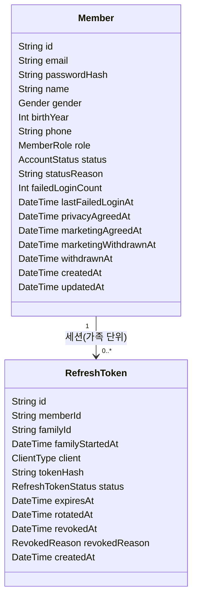
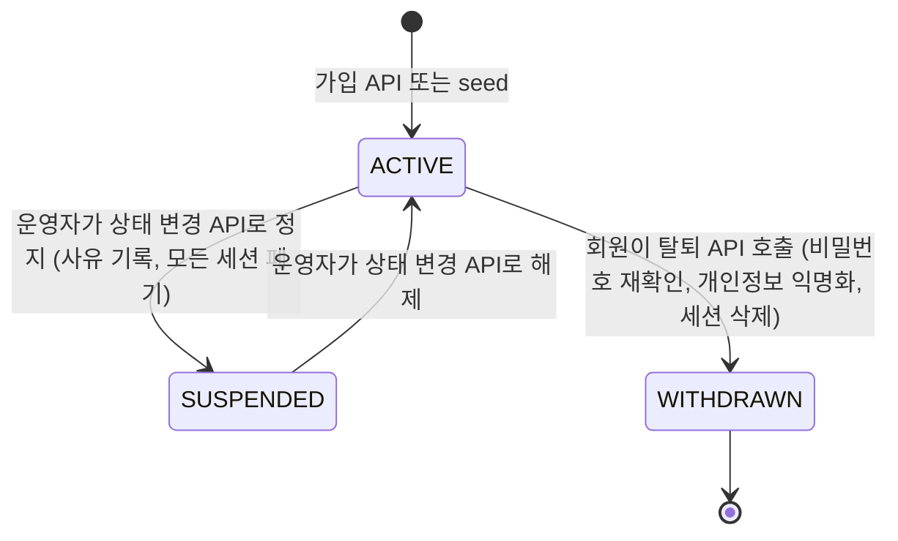
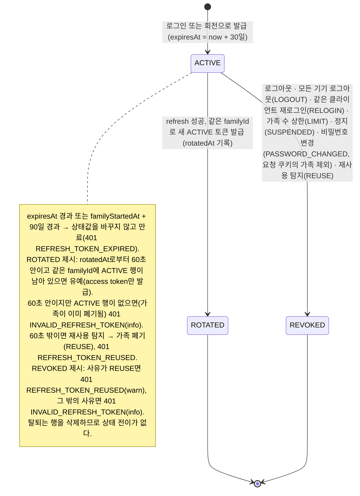
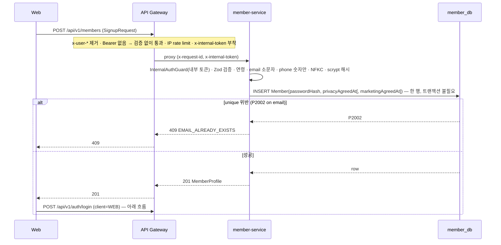
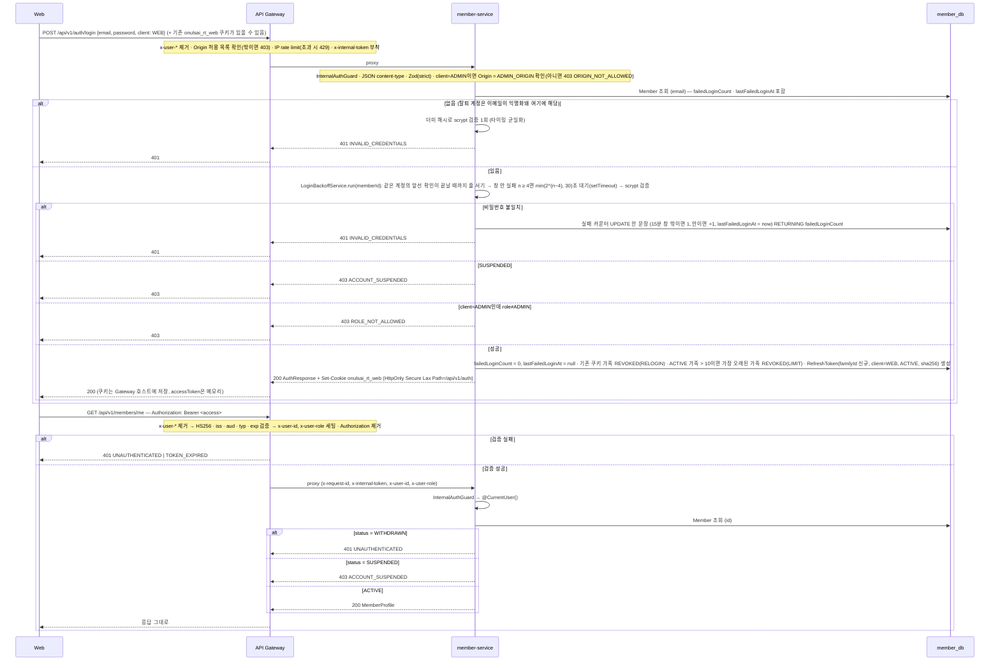
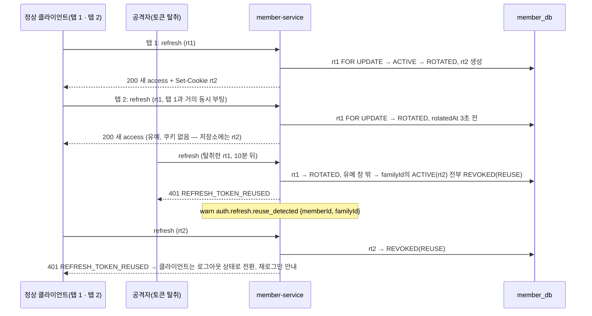

# SPEC-001 회원/인증 — 가입, 로그인, 인증, 프로필, 계정 상태

## 0. 메타

| 항목        | 값                                                                                                                                                                                                                                                                                                               |
| ----------- | ---------------------------------------------------------------------------------------------------------------------------------------------------------------------------------------------------------------------------------------------------------------------------------------------------------------- |
| 번호        | SPEC-001                                                                                                                                                                                                                                                                                                         |
| 상태        | 확정 (2026-09-22 ★A · ★B · ★C 승인)                                                                                                                                                                                                                                                                              |
| 작성자      | Yongjae Kwon                                                                                                                                                                                                                                                                                                     |
| 작성일      | 2026-09-22                                                                                                                                                                                                                                                                                                       |
| 최종 갱신   | 2026-09-23 — 구현 완료, 17절 "실제 구현과의 차이" 채움. (2026-09-22: 보안 · 경계 · 제품 리뷰 → 리드 결정 D1~D14 반영 → 2차 리뷰 반영: refresh · logout 클라이언트 판정을 본문 `client`로, 백오프를 검증 전 지연 + 계정 직렬화로, 유예는 가족에 `ACTIVE`가 남았을 때만, 로그인 CSRF 차단, seed 리셋 시 세션 폐기) |
| 관련 Step   | Step 1                                                                                                                                                                                                                                                                                                           |
| 관련 ADR    | ADR-004, ADR-005, [ADR-009 인증 방식](../adr/ADR-009-authentication.md) (다룬 결정 항목은 16절)                                                                                                                                                                                                                  |
| 주요 서비스 | member-service / api-gateway / web / admin                                                                                                                                                                                                                                                                       |
| 리뷰어      | Yongjae Kwon (1인 개발 셀프 리뷰 — `docs/guides/pull-requests.md` 4절의 예외)                                                                                                                                                                                                                                    |

## 0.1 확인 요청 사항

리뷰(보안 · 경계 · 제품 세 관점)에서 나온 제안은 리드가 아래 "리드 결정 기록"대로 정리했고, 본문(1~16절)은 그 결정으로 고정했다. 사람이 확인할 것은 아래 세 가지뿐이다. 체크한 뒤 설계서 PR을 머지하고 구현에 들어간다. 이 절의 자리는 `docs/specs/TEMPLATE.md`의 "0.1 확인 요청 사항"이며 같은 PR에서 템플릿에 추가한다(D12).

- [x] **★A 새 의존성 · CI 변경 승인** — member-service: `jose`(JWT, ESM 네이티브, 의존성 0), `cookie-parser` + `@types/cookie-parser`. api-gateway: `jose`. 모두 빌드 스크립트가 없어 `pnpm-workspace.yaml`의 `allowBuilds` 변경은 없다. CI: `.github/workflows/ci.yml`에 `postgres:17` service container + `DATABASE_URL` + `prisma migrate deploy` + member-service `test:integration` 잡. CLAUDE.md 9장("지시 없이 의존성 추가 · 설정 파일 변경 금지")에 따라 여기서 승인받는다(15절 3 · 4 · 5번 PR).
- [x] **★B 가입 가능 연령 만 19세 이상** — `birthYear ≤ 현재 연도 − 19`(만 19세의 보수적 근사). 출생연도만 받으므로 최대 1년 오차가 있고 현장 신분증(SPEC-005 체크인)이 최종 확인이다. 만 14세 미만은 법정대리인 동의 없이 개인정보 수집 자체가 불가(개인정보 보호법 제22조의2)하므로 어떤 값으로 확정되든 14세 하한은 유지한다. 본문은 19로 쓴다(7 · 12절).
- [x] **★C 알림톡 방향** — 참가 확정 · 행사 전 안내는 계약 이행 정보이므로 정보성 알림톡 템플릿으로 전환한다(운영 작업, Step 7에서 확정). 마케팅 수신 동의는 **선택**이며 실제 광고에만 쓴다. "마케팅 동의를 신청의 전제로 둔다"는 안은 선택 동의 거부를 이유로 서비스 제공을 거부할 수 없다는 개인정보 보호법 제22조 제5항에 어긋나 선택지에서 뺐다. 선택으로 모은 동의를 나중에 필수로 소급할 수 없으므로 동의 수집 방식은 지금 확정한다(12절, 용어 사전 '알림톡' 행).

### 리드 결정 기록

리뷰에서 대안이 나왔던 항목이다. 본문은 모두 "결정" 열대로 쓰여 있다. 바꾸려면 "바뀐 절"을 함께 고친다.

| #   | 결정                                                                                                                                                                                                                                                                                                                                                                                                                                                                                                                                                                                     | 이유                                                                                                                                                                                                                                                                                                                                                                                                                                                                                                                                                                                                                                                                              | 바뀐 절                                            |
| --- | ---------------------------------------------------------------------------------------------------------------------------------------------------------------------------------------------------------------------------------------------------------------------------------------------------------------------------------------------------------------------------------------------------------------------------------------------------------------------------------------------------------------------------------------------------------------------------------------- | --------------------------------------------------------------------------------------------------------------------------------------------------------------------------------------------------------------------------------------------------------------------------------------------------------------------------------------------------------------------------------------------------------------------------------------------------------------------------------------------------------------------------------------------------------------------------------------------------------------------------------------------------------------------------------- | -------------------------------------------------- |
| D1  | `Credential` 테이블을 두지 않는다. `Member`에 `passwordHash`(NOT NULL, scrypt) · `failedLoginCount` · `lastFailedLoginAt`을 직접 둔다. 카카오 로그인 · 휴대폰 OTP는 결정 예정 (Step 1 이후)이며, 도입이 결정되면 그때 `Credential`로 분리하는 마이그레이션이 정상 경로다                                                                                                                                                                                                                                                                                                                 | 테이블 분리의 유일한 근거가 "결정 예정"인 두 번째 provider였다 — 지금 요구에 없는 확장 포인트(CLAUDE.md 원칙 6). 지금은 1:1이라 관계 · 가입 트랜잭션 · 응답 중첩이 모두 불필요했다                                                                                                                                                                                                                                                                                                                                                                                                                                                                                                | 3 · 5 · 6 · 9 · 10 · 11 · 12 · 13                  |
| D2  | Step 1에서 현장 본인확인 기록(`identityVerifiedAt/By`, `IdentityVerifiedBy`, `PATCH /members/:id/identity-verification`, admin 버튼, 응답 필드 · 로그 · 테스트)을 전부 뺀다. 가입 시 `name` · `birthYear` · `gender` 입력은 유지한다. 현장 확인은 SPEC-005에서 event-service가 참가자 · 일정 단위 `CheckIn`으로 소유한다(ADR-004). 온라인 본인인증(PROVIDER)은 결정 예정 (Step 1 이후)                                                                                                                                                                                                   | ADR-004와 개요 소개서 4장 · 용어 사전 '본인 확인' 행이 체크인을 event-service 소유로 명시한다. Step 1에는 이 기록을 읽는 소비자가 없고, 회원 단위의 영구 "확인 완료" 플래그는 팜플렛 · 운영 메시지에 없는 제품 사실이다(매 행사 신분증 지참). "확인됐는가"의 진실이 두 DB에 생기는 것을 막는다                                                                                                                                                                                                                                                                                                                                                                                    | 1 · 2 · 3 · 4 · 5 · 7 · 9 · 11 · 12 · 13 · 14 · 16 |
| D3  | 모바일 로그인을 SPEC-005(첫 앱 기능)로 이월한다. Step 1은 `apps/web` + `apps/admin`만. `ClientType`은 `WEB` · `ADMIN`, refresh · logout은 쿠키 방식만, `AuthResponse`에 `refreshToken` 없음, `expo-secure-store` 없음, mobile PR 없음. "웹이 주(가입 · 신청 · 결제), 앱은 당일(체크인 · 라운드 · 호감 선택) 중심"이라는 역할 분담은 유지하며, SPEC-005에서 본문 방식(refresh · logout 본문 `{ refreshToken }` 선택 필드, 하위 호환)을 추가한다                                                                                                                                           | Step 1의 앱은 로그인 · 읽기 전용 프로필 · 로그아웃뿐이라 어떤 사용자 흐름도 완성하지 못하면서 클라이언트 분기 · 의존성 · PR · 수동 테스트를 늘렸다(원칙 6)                                                                                                                                                                                                                                                                                                                                                                                                                                                                                                                        | 0 · 2 · 3 · 4 · 7 · 9 · 10 · 12 · 13 · 15 · 16     |
| D4  | 웹 토큰 저장 유지: access는 메모리, refresh는 Gateway 도메인의 `httpOnly · Secure` 쿠키. 참가자 웹 `onulsai_rt_web`(`SameSite=Lax`), 운영자 웹 `onulsai_rt_admin`(`SameSite=Strict` + `Origin` 확인). 토큰 행에 `client` 저장, `CORS_ORIGINS`, CSP. 2차 리뷰로 정리한 것: 두 쿠키는 같은 호스트 · 같은 `Path`라 브라우저가 항상 둘 다 보내므로, refresh · logout도 login처럼 본문 `client`로 앱을 밝히고 서버는 그 이름의 쿠키만 읽는다. 앱 경계의 원천은 `client: 'ADMIN'` 요청의 `Origin` 확인(login · refresh · logout 모두)과 토큰 행 `client` 대조이며, 쿠키 이름은 저장 분리용이다 | 세션을 밖으로 들고 나갈 수 없다. 두 앱의 쿠키를 나눠 참가자 웹 XSS 한 번으로 ADMIN 세션을 얻는 경로를 막는다(보안 리뷰 must). "쿠키 이름으로 클라이언트를 정한다"는 초안 규칙은 쿠키가 둘일 때 성립하지 않았다(2차 리뷰 must)                                                                                                                                                                                                                                                                                                                                                                                                                                                     | 3 · 4 · 5 · 7 · 10 · 11 · 12 · 13                  |
| D5  | refresh 회전 유지: 조회 · 판정 · 회전을 `SELECT ... FOR UPDATE` 한 트랜잭션에서 직렬화 + 회전 직후 60초 유예 창 + 유예 창 밖 재사용 탐지 시 가족 폐기. 2차 리뷰로 더한 조건: 유예는 같은 가족에 `ACTIVE` 토큰이 남아 있을 때만 — 가족이 이미 폐기됐으면 60초 안이라도 401                                                                                                                                                                                                                                                                                                                | 다중 탭 경합에서 정상 사용자를 로그아웃시키지 않으면서 탈취 재사용은 잡는다. 폐기 직후 60초 동안 옛 토큰으로 새 access token을 받는 구멍을 막는다. 회전 없음 대안은 16절 "검토한 대안"                                                                                                                                                                                                                                                                                                                                                                                                                                                                                            | 3 · 6 · 10 · 12 · 13                               |
| D6  | 계정 잠금을 두지 않는다. 계정 단위 지수 백오프: 15분 창 안에 실패가 4회 쌓인 뒤의 시도(5번째)부터 그 계정의 비밀번호 확인을 **검증 전에** `min(2^(k−5), 30)`초(k = 창 안 시도 순번) 기다리게 하고, 같은 계정의 확인은 직렬로 처리한다 — 성공 · 실패 무관. 마지막 실패로부터 15분 지나면 카운터 초기화, 성공 시 초기화. ADMIN · MEMBER 동일. 423 `ACCOUNT_LOCKED` · `lockedUntil` · 잠금 해제 API · admin 잠금 해제 화면 제거. Gateway IP 단위 제한은 단일 인스턴스 인메모리 버킷으로 시작하고 분산(Redis) 제한은 결정 예정 (Step 8)                                                      | 이메일만 알면 아무 계정이나(행사 당일 운영자 포함) 잠글 수 있는 가용성 공격을 없앤다. 잠금 해제 API · 화면이 필요 없다. 리드 원문은 "실패 응답을 지연"이었으나 2차 보안 리뷰(must)에서 실패에만 붙는 지연은 응답 시간으로 정오를 가르는 타이밍 오라클이고 병렬 추측에 상한이 없다는 점이 드러나, 규칙(5회 · 15분 · 30초) · 테이블 · API는 그대로 두고 형태만 "검증 전 지연 + 계정 단위 직렬화"로 바꿨다(12절). IP 제한도 리드 원문은 "결정 예정 (Step 8, Redis)"였고, 인메모리 버킷은 scrypt 폭주 방어(12절)를 위해 Step 1에 선행한다 — 리드가 Step 1에서 빼기로 하면 2 · 7 · 10 · 12 · 13 · 15절의 429 · `rateLimitMiddleware`를 빼고 12절 폭주 방어를 (b) · (c)만으로 다시 쓴다 | 1 · 2 · 3 · 4 · 5 · 7 · 9 · 10 · 11 · 12 · 13 · 14 |
| D7  | 비밀번호 변경 `POST /api/v1/auth/password`를 Step 1 범위에 넣는다(로그인 상태, 현재 비밀번호 확인, 성공 시 요청 쿠키의 가족을 뺀 다른 refresh 토큰 가족 전부 폐기). 비밀번호 재설정(발송 채널 필요)은 결정 예정 (Step 7)                                                                                                                                                                                                                                                                                                                                                                 | 크리덴셜 유출을 알아챈 회원이 스스로 끊을 수단이 필요하다. 재설정은 발송 채널 없이 만들 수 없다                                                                                                                                                                                                                                                                                                                                                                                                                                                                                                                                                                                   | 2 · 4 · 6 · 7 · 10 · 11 · 12 · 13 · 14             |
| D8  | 모든 기기에서 로그아웃 `POST /api/v1/auth/logout-all`을 Step 1 범위에 넣는다(회원의 모든 refresh 토큰 폐기)                                                                                                                                                                                                                                                                                                                                                                                                                                                                              | D7과 같은 이유. 운영자 정지 외에 회원이 세션을 전부 끊는 유일한 수단                                                                                                                                                                                                                                                                                                                                                                                                                                                                                                                                                                                                              | 2 · 4 · 6 · 7 · 10 · 11 · 12 · 13 · 14             |
| D9  | `PATCH /api/v1/members/me`에서 `phone`을 바꿀 때 `currentPassword` 필수. 다른 필드(마케팅 동의)는 불필요                                                                                                                                                                                                                                                                                                                                                                                                                                                                                 | 휴대폰은 알림톡 수신처라 XSS로 얻은 access token만으로 바꿀 수 없어야 한다                                                                                                                                                                                                                                                                                                                                                                                                                                                                                                                                                                                                        | 4 · 7 · 11 · 12 · 13                               |
| D10 | 탈퇴는 즉시 익명화(유예 기간 없음). 법령상 보관 대상은 Step 4에서 payment-service가 자기 DB에 분리 보관한다                                                                                                                                                                                                                                                                                                                                                                                                                                                                              | 개인정보 보호법 제21조의 기본값이 지체 없는 파기다. 16절에 법무 확인 권장 한 줄                                                                                                                                                                                                                                                                                                                                                                                                                                                                                                                                                                                                   | 6 · 12 · 16                                        |
| D11 | 이름 · 성별 · 출생연도 정정은 Step 1 동안 운영자 수동(`psql` UPDATE, 변경 로그 없음)으로 받아들인다. 정정 API는 결정 예정 (Step 5). 회원 화면(W4)에는 "정정은 문의" 안내 문구를 둔다                                                                                                                                                                                                                                                                                                                                                                                                     | Step 1에 정정 요청이 생길 빈도가 낮고, 정정 API는 상태 변경 이력 테이블과 함께 Step 5에서 설계하는 편이 낫다                                                                                                                                                                                                                                                                                                                                                                                                                                                                                                                                                                      | 2 · 4 · 16                                         |
| D12 | `docs/specs/TEMPLATE.md`에 "0.1 확인 요청 사항" 절을 0절 바로 아래에 추가하고, 이 설계서의 절 제목도 맞춘다                                                                                                                                                                                                                                                                                                                                                                                                                                                                              | 리드 기본값 · 대안 · 사람 확인 항목을 두는 자리를 템플릿에 고정한다                                                                                                                                                                                                                                                                                                                                                                                                                                                                                                                                                                                                               | 0.1 · 15                                           |

## 1. 배경과 목표

오늘사이의 모든 기능은 "누가" 신청하고, 입금하고, 현장에 왔는지에서 시작한다. 참가 신청(Step 3)에는 성별 정원이 있어 성별이 필요하고, 참가 확정 알림톡(Step 4 · 7)에는 이름과 휴대폰 번호가 필요하며, 현장 체크인(Step 5)에서는 출생연도와 신분증으로 본인을 확인한다. 즉 회원 서비스는 다른 모든 Step이 참조하는 회원 식별자와 최소 정보의 원천이다(ADR-004). 이 설계서는 그 원천을 만든다: 가입, 로그인, Gateway 인증, 내 프로필, 비밀번호 변경, 계정 상태, 운영자 조회. 현장 본인 확인의 기록은 이 설계서의 것이 아니다 — SPEC-005에서 event-service의 체크인이 맡는다(D2).

목표:

- 회원이 참가자 웹에서 가입 · 로그인을 마치고 내 프로필을 볼 수 있다. 가입 폼은 팜플렛과 운영 메시지에 근거한 항목만 받는다(이메일 · 비밀번호 · 이름 · 출생연도 · 성별 · 휴대폰 · 동의 2개). 용도가 정해지지 않은 항목(닉네임 등)은 받지 않는다.
- Gateway가 access token을 검증해 `x-user-id` · `x-user-role`을 서비스에 넘기고, 클라이언트가 보낸 `x-user-*` 헤더는 반드시 버리며, 서비스는 Gateway만 아는 내부 토큰이 붙은 요청만 받는다. 이후 모든 Step의 서비스가 이 헤더만으로 호출자를 안다.
- 회원이 비밀번호를 바꾸면 다른 기기의 세션이 끊기고, 모든 기기에서 로그아웃할 수 있다(D7 · D8).
- 비밀번호를 여러 번 틀려도 계정이 잠기지 않는다 — 다섯 번째 시도부터 응답이 느려질 뿐이며, 맞는 비밀번호도 같은 시간을 기다린 뒤 통과한다. 남이 내 계정(운영자 계정 포함)을 잠글 수 없다(D6).
- 운영자가 운영자 웹에서 회원을 찾고, 계정을 정지 · 해제할 수 있다. 회원 개인정보를 본 기록(누가 · 언제 · 누구를)이 로그에 남는다.
- "가입 → 로그인 → refresh 회전 → 재사용 탐지 → 로그아웃" 흐름과 "다중 탭 동시 refresh 후 모두 로그인 유지"가 실제 Postgres 위의 통합 테스트로 CI에서 검증된다.

## 2. 범위와 비범위

| 범위(만든다)                                                                                                                                                                                                     | 비범위(이번엔 안 만든다)                                                                                                                                                                      |
| ---------------------------------------------------------------------------------------------------------------------------------------------------------------------------------------------------------------- | --------------------------------------------------------------------------------------------------------------------------------------------------------------------------------------------- |
| 이메일+비밀번호 가입 · 로그인 · 로그아웃 · 모든 기기 로그아웃 · 비밀번호 변경, access(JWT 15분)/refresh(불투명 30일, 회전 · 유예 창 · 재사용 탐지) 토큰                                                          | 카카오 로그인 · 휴대폰 OTP → 결정 예정 (Step 1 이후. 도입 시 `Credential` 테이블 분리 마이그레이션이 정상 경로). 비밀번호 재설정(발송 채널 필요) → 결정 예정 (Step 7)                         |
| Gateway: Bearer 검증, `x-user-*` 헤더 세팅 · 제거, 내부 토큰 부착, CORS(credentials), `POST /api/v1/auth/*`의 `Origin` 허용 목록 확인, IP 단위 인메모리 rate limit(로그인 · 가입 · refresh · 비밀번호 확인 경로) | 분산 rate limit(Redis) → 결정 예정 (Step 8). 정지 · 탈퇴 즉시 access token 차단(거부 목록) → 결정 예정 (Step 8)                                                                               |
| `Member`(비밀번호 해시 · 실패 카운터 포함) · `RefreshToken` 모델, 첫 마이그레이션 `init_member`, ADMIN seed                                                                                                      | 온라인 본인인증(PASS 등) 연동 → 결정 예정 (Step 1 이후). 현장 본인 확인 기록 → SPEC-005 event-service `CheckIn`(ADR-004)                                                                      |
| 내 프로필 조회 · 수정(휴대폰 — 비밀번호 재확인, 마케팅 동의), 탈퇴(즉시 익명화)                                                                                                                                  | 매칭용 프로필 항목(직업 · 거주지 등) → 결정 예정 (Step 6). 로테이션 표시명(닉네임) → 결정 예정 (Step 5). 이름 · 성별 · 출생연도 정정 API → 결정 예정 (Step 5. 그때까지 운영자 수동 정정, D11) |
| 운영자: 회원 목록 · 상세(조회 기록 로그), 계정 상태 변경(ACTIVE↔SUSPENDED)                                                                                                                                       | 운영자에 의한 강제 탈퇴 · 프로필 정정 · 상태 변경 이력 테이블 → 결정 예정 (Step 5). 계정 잠금 · 잠금 해제 → 만들지 않는다(지수 백오프로 대체, 12절)                                           |
| 필수 동의(개인정보 수집 · 이용) · 선택 동의(마케팅 수신) 시각 기록                                                                                                                                               | 약관 · 개인정보 처리방침 본문 → 사람이 작성, 결정 예정 (Step 1 확인 시). 약관 개정 이력 테이블 → 약관이 실제로 개정될 때                                                                      |
| web: 가입 · 로그인 · 내 프로필 · 비밀번호 변경 · 모든 기기 로그아웃 · 탈퇴 · 로그아웃 + CSP. admin: 로그인 · 회원 목록 · 상세 + CSP                                                                              | 참가자 앱(`apps/mobile`) 로그인 → SPEC-005(첫 앱 기능)에서 본문 방식 refresh를 선택 필드로 추가(D3). 가입 환영 알림 등 팜플렛 · 운영 메시지에 없는 알림은 만들지 않는다                       |
| 단위 테스트 + 실제 Postgres 통합 테스트(CI service container ★A)                                                                                                                                                 | Kafka 이벤트 발행(`member.created.v1` 등) → Step 4에서 outbox 도입 여부와 함께 결정 예정. 서비스 간 REST → Step 3/5에서 결정 예정                                                             |

## 3. 용어

이 표의 새 용어는 용어 사전(`docs/overview/glossary.md`)에 같은 PR에서 추가한다. 행위자를 가리킬 때는 "회원"이라고 쓴다 — Step 1에는 일정이 없으므로 "참가자"(특정 일정에 확정된 사람, event-service)는 아직 존재하지 않는다(용어 사전 5장). "참가자 웹 · 참가자 앱"은 앱 이름이므로 그대로 쓴다.

| 용어            | 코드 식별자                                                                              | 뜻                                                                                                                                                                                                                                                                       |
| --------------- | ---------------------------------------------------------------------------------------- | ------------------------------------------------------------------------------------------------------------------------------------------------------------------------------------------------------------------------------------------------------------------------ |
| 회원            | `Member`                                                                                 | 오늘사이에 가입한 사람. 역할이 `MEMBER`(일반 회원)이거나 `ADMIN`(운영자)이다. 같은 테이블을 쓴다                                                                                                                                                                         |
| 역할            | `MemberRole` (`MEMBER`, `ADMIN`)                                                         | 회원이 할 수 있는 일의 범위. ADMIN은 가입 API로 만들 수 없고 seed 스크립트로만 만든다                                                                                                                                                                                    |
| 계정 상태       | `AccountStatus` (`ACTIVE`, `SUSPENDED`, `WITHDRAWN`)                                     | 활성 / 운영자 정지 / 탈퇴(행은 남기고 개인정보는 익명화)                                                                                                                                                                                                                 |
| 성별            | `Gender` (`MALE`, `FEMALE`)                                                              | 성별 정원(Step 3) 계산용                                                                                                                                                                                                                                                 |
| 비밀번호 해시   | `Member.passwordHash` (scrypt)                                                           | 회원 행에 직접 둔 scrypt 해시. 인증 수단은 이메일+비밀번호 하나이므로 별도 테이블이 없다(D1). 카카오 · 휴대폰 OTP는 결정 예정 (Step 1 이후)                                                                                                                              |
| 액세스 토큰     | access token (JWT, HS256)                                                                | 15분짜리 서명 토큰. member-service가 서명하고 Gateway가 검증한다. 클라이언트는 `Authorization: Bearer` 헤더로 보낸다                                                                                                                                                     |
| 리프레시 토큰   | `RefreshToken` (`RefreshTokenStatus`: `ACTIVE`, `ROTATED`, `REVOKED`)                    | 30일짜리 불투명 랜덤 토큰. DB에는 SHA-256 해시만 저장한다. 새 액세스 토큰을 받을 때 쓴다                                                                                                                                                                                 |
| 토큰 회전       | rotation                                                                                 | refresh 요청 때마다 리프레시 토큰을 새로 발급하고 옛 토큰을 `ROTATED`로 표시하는 것(D5)                                                                                                                                                                                  |
| 유예 창         | grace window (60초)                                                                      | 회전 직후 옛 토큰이 다시 오면 재사용이 아니라 다중 탭 경합으로 보고 access token만 새로 주는 시간. 같은 가족에 `ACTIVE` 토큰이 남아 있을 때만 — 가족이 이미 폐기됐으면 유예도 없다                                                                                       |
| 세션(토큰 가족) | `RefreshToken.familyId`                                                                  | 로그인 한 번으로 시작해 회전으로 이어지는 토큰의 묶음. 재사용이 탐지되면 가족 전체를 폐기한다. 절대 수명 90일                                                                                                                                                            |
| 재사용 탐지     | reuse detection                                                                          | 유예 창이 지난 `ROTATED` 토큰이 다시 제시되는 것. 토큰 유출의 신호로 보고 가족을 통째로 끊는다                                                                                                                                                                           |
| 폐기 사유       | `RevokedReason` (`LOGOUT`, `RELOGIN`, `LIMIT`, `SUSPENDED`, `PASSWORD_CHANGED`, `REUSE`) | 토큰이 `REVOKED`가 된 이유. `LOGOUT`은 로그아웃과 모든 기기 로그아웃, `PASSWORD_CHANGED`는 비밀번호 변경으로 다른 가족을 끊은 것. `REUSE`만 경보 대상이다                                                                                                                |
| 클라이언트 종류 | `ClientType` (`WEB`, `ADMIN`)                                                            | 로그인 · refresh · logout 요청이 본문으로 밝히는 "어느 앱에서 왔는가". 읽을 쿠키 이름 · ADMIN 전용 `Origin` 확인을 정하고 토큰 행에 저장된다. 앱용 값은 SPEC-005에서 추가한다(D3)                                                                                        |
| 리프레시 쿠키   | `onulsai_rt_web`, `onulsai_rt_admin`                                                     | 앱별로 이름이 다른 httpOnly 쿠키. 둘 다 Gateway 호스트 · `Path=/api/v1/auth`에 저장되므로 브라우저는 어느 앱의 요청에든 둘 다 보낸다 — 서버는 요청 본문 `client`가 가리키는 이름만 읽고 다른 쿠키는 무시한다. 그래서 한 브라우저에서 두 앱에 따로 로그인할 수 있다       |
| 로그인 백오프   | `Member.failedLoginCount`, `lastFailedLoginAt`                                           | 15분 창 안에서 비밀번호 확인 실패가 4회 쌓이면 그 계정의 다음 확인(5번째 시도)부터 검증 **전에** `min(2^(k−5), 30)`초(k = 시도 순번)를 기다리게 하고 같은 계정의 확인을 직렬로 처리하는 것. 맞는 비밀번호도 같은 시간을 기다린다. 계정을 잠그지 않는다(D6). ADMIN도 같다 |
| 동의 기록       | `Member.privacyAgreedAt`, `marketingAgreedAt`, `marketingWithdrawnAt`                    | 개인정보 수집 · 이용 동의(필수)와 마케팅 수신 동의(선택)에 언제 동의 · 철회했는지                                                                                                                                                                                        |
| 내부 헤더       | `x-user-id`, `x-user-role` (접두사 `x-user-`)                                            | Gateway가 검증 후 서비스에 넘기는 호출자 정보. 외부에서 온 `x-user-*`는 Gateway가 모두 버린다                                                                                                                                                                            |
| 내부 토큰       | `x-internal-token` (env `INTERNAL_API_TOKEN`)                                            | Gateway가 프록시하는 모든 요청에 붙이는 공유 비밀. 서비스는 이 값이 맞는 요청만 받는다                                                                                                                                                                                   |
| 에러 코드       | `ApiErrorResponse.code`                                                                  | 클라이언트가 분기할 수 있는 기계용 코드(7절 표). 사람이 읽는 `message`와 별개                                                                                                                                                                                            |

### 용어 사전 · 개요 소개서에서 고친 기존 행 (설계서 PR, 적용 완료)

아래 행은 설계서 PR에서 이미 고쳤다. "초안 시점" 열은 고치기 전 문구를 기록으로 남긴 것이다. 마지막 행(Gateway 책임)만 Gateway PR(15절 4번)에서 고친다.

| 문서 · 행                                                                                              | 초안 시점                                                                  | 고친 내용                                                                                                                                                                                                        |
| ------------------------------------------------------------------------------------------------------ | -------------------------------------------------------------------------- | ---------------------------------------------------------------------------------------------------------------------------------------------------------------------------------------------------------------- |
| 용어 사전 2장 '운영자'                                                                                 | 권한 모델은 결정 예정(1단계)                                               | `MemberRole.ADMIN` — 회원과 같은 테이블, seed로만 생성                                                                                                                                                           |
| 용어 사전 2장 '본인 확인'                                                                              | 현장은 `CheckIn`(event-service), 온라인은 member-service(결정 예정, 1단계) | 현장 부분은 그대로(SPEC-005). 온라인 부분만 "결정 예정 (1단계 이후)"로(D2)                                                                                                                                       |
| 용어 사전 2장 '잠금' (초안이 먼저 추가한 행)                                                           | `Credential.lockedUntil`, 잠금 해제 API                                    | '로그인 백오프'로 바꾼다 — 잠금 없음, `Member.failedLoginCount` · `lastFailedLoginAt`(D6)                                                                                                                        |
| 용어 사전 2장 '알림톡'                                                                                 | 광고가 아닌 정보성 메시지                                                  | 현재 운영 문구에는 광고형 템플릿의 "(광고)" 표기가 있다. 참가 확정 안내는 정보성 템플릿으로 전환하는 것을 전제로 하며(전환 작업은 Step 7), 마케팅 동의는 실제 광고에만 쓴다 — 이 설계서 초안에서 미리 고쳤다(★C) |
| 용어 사전 3장 '인증 수단' (초안이 먼저 추가한 행)                                                      | `Credential` 테이블                                                        | `Member.passwordHash`, 별도 테이블 없음, 두 번째 수단 도입 시 분리(D1)                                                                                                                                           |
| 개요 소개서 2장 여정 1행                                                                               | 가입 요건은 결정 예정(1단계)                                               | 이메일 · 실명 · 출생연도(만 19세 이상, ★B) · 성별 · 휴대폰 · 필수 동의                                                                                                                                           |
| 개요 소개서 4장 참가자 앱                                                                              | 웹과의 역할 분담은 결정 예정(1단계)                                        | 웹이 주(가입 · 신청 · 결제), 앱은 당일 중심. 앱 로그인은 SPEC-005(D3)                                                                                                                                            |
| 개요 소개서 4장 회원 서비스                                                                            | 온라인 본인인증(결정 예정, 1단계)                                          | "결정 예정 (Step 1 이후)"로 옮긴다. 현장 확인 문장(이벤트 서비스의 체크인)은 그대로(D2)                                                                                                                          |
| 아키텍처 개요 2장 api-gateway 책임, CLAUDE.md 3장 · 9장, `apps/api-gateway/README.md` (Gateway PR에서) | 인증 전달(passthrough)                                                     | 인증 **검증**(Bearer → `x-user-*`) + 내부 토큰 부착 + IP rate limit + `Origin` 허용 목록 확인. 이 책임 변경은 [ADR-009](../adr/ADR-009-authentication.md)에서 결정 항목으로 다뤘다(16절)                         |

## 4. 사용자 흐름

이번 Step에는 알림(알림톡 · Push)이 없다. 팜플렛 · 운영 메시지에 가입 관련 알림이 없기 때문이다. 보호된 데이터는 모두 **클라이언트 컴포넌트에서 TanStack Query로** 조회한다(7절 클라이언트 규칙) — refresh 쿠키는 Gateway 호스트 전용이고 access token은 브라우저 메모리에만 있어 Next 서버 컴포넌트 · Route Handler는 Gateway를 호출할 수 없다. 429 `TOO_MANY_REQUESTS`(Gateway IP 제한)는 어느 화면에서든 같은 문구다: "요청이 많아 잠시 후 다시 시도해 주세요."

### 참가자 웹 (`apps/web`)

1. **W1 가입** (`/signup`) — 이메일, 비밀번호, 이름(실명), 성별, 출생연도, 휴대폰 번호, 동의 2개(개인정보 수집 · 이용 필수, 마케팅 수신 선택). 안내 문구: "행사 당일 신분증으로 이름과 출생연도를 확인합니다. 신분증과 같게 적어 주세요." 마케팅 동의 옆: "수신 거부는 내 프로필에서 언제든 할 수 있습니다." 제출 → `POST /api/v1/members` → 201이면 바로 `POST /api/v1/auth/login`을 호출해 로그인 상태로 W3로 이동한다. 409면 "이미 가입된 이메일입니다. 로그인해 주세요." 400 `AGE_NOT_ALLOWED`면 "오늘사이는 만 19세 이상만 가입할 수 있습니다." 429면 "요청이 많아 잠시 후 다시 시도해 주세요."
2. **W2 로그인** (`/login`) — 이메일, 비밀번호. `client: 'WEB'`으로 호출한다. 실패 문구는 하나다: "이메일 또는 비밀번호가 맞지 않습니다." 15분 안에 4회 틀린 뒤로는 다섯 번째 시도부터 응답이 점점 늦어진다(12절 백오프) — 맞는 비밀번호를 넣어도 같은 시간을 기다린 뒤 로그인되며, 문구는 같고, 화면은 버튼을 비활성화한 채 응답을 기다린다. 정지(403): "이용이 정지된 계정입니다. 오늘사이에 문의해 주세요." 429는 W1과 같다. 성공 → W3.
3. **W3 내 프로필** (`/me`) — 이메일, 이름, 성별, 출생연도, 휴대폰, 마케팅 수신 여부. 버튼: 수정, 비밀번호 변경, 로그아웃, 모든 기기에서 로그아웃, 탈퇴. 부팅 refresh가 끝날 때까지는 로딩 상태를 보여 준다(깜빡임 없이 로그인 여부를 판정한 뒤 렌더).
4. **W4 프로필 수정** (`/me` 안의 편집 모드) — 휴대폰, 마케팅 수신 동의만 바꿀 수 있다. 휴대폰을 바꿀 때는 현재 비밀번호를 함께 입력한다(D9. 알림톡 수신처가 바뀌는 작업이라 재확인한다). 이름 · 성별 · 출생연도는 신분증 대조 항목이고 성별은 정원 계산(Step 3)에 쓰이므로 화면에서 잠근다. 문구: "이름 · 성별 · 출생연도 변경은 오늘사이에 문의해 주세요."(D11 — Step 1 동안 운영자가 수동으로 정정) → `PATCH /api/v1/members/me`. 401 `INVALID_CREDENTIALS`면 "비밀번호가 맞지 않습니다."
5. **W5 비밀번호 변경** (`/me/password`) — 현재 비밀번호, 새 비밀번호, 새 비밀번호 확인(일치 여부는 화면에서 검사). → `POST /api/v1/auth/password` → 204 → "비밀번호를 바꿨습니다. 다른 기기에서는 다시 로그인해야 합니다." → W3. 현재 탭은 로그인 상태를 유지한다(요청에 실린 쿠키의 세션은 남는다). 401 `INVALID_CREDENTIALS`면 "현재 비밀번호가 맞지 않습니다."(로그인과 같은 실패 카운터가 올라간다). 400이면 새 비밀번호 규칙(8~64자) 안내.
6. **W6 탈퇴** (`/me` → 확인 모달) — 비밀번호를 다시 입력하고 확인 → `DELETE /api/v1/members/me` → 204 → 로그아웃 상태로 홈 이동. 문구: "탈퇴하면 다시 로그인할 수 없고, 이름 · 연락처 등 개인정보는 바로 삭제됩니다. 자세한 내용은 개인정보 처리방침을 따릅니다." 비밀번호가 틀리면 로그인과 같은 실패 카운터가 올라가고, 다섯 번째 시도부터는 맞든 틀리든 응답이 늦어진다.
7. **로그아웃** — `POST /api/v1/auth/logout`(본문 `{ client: 'WEB' }`) → 메모리의 access token을 지우고 홈으로.
8. **모든 기기에서 로그아웃** — W3 버튼 → 확인 모달("다른 기기 · 브라우저의 로그인도 모두 끊깁니다.") → `POST /api/v1/auth/logout-all` → 204 → 로그아웃 상태로 홈 이동(D8).
9. **페이지 새로 고침** — 앱 부팅 시 `POST /api/v1/auth/refresh`(본문 `{ client: 'WEB' }`, 쿠키 자동 전송)를 한 번 호출해 access token을 메모리에 채운다. 401이면 로그아웃 상태로 본다. 여러 탭이 동시에 부팅해도 유예 창 덕분에 모두 로그인 상태를 유지한다.

### 운영자 웹 (`apps/admin`)

1. **A1 로그인** (`/login`) — 이메일, 비밀번호. `client: 'ADMIN'`으로 호출하며, 부팅 refresh · 로그아웃도 본문 `{ client: 'ADMIN' }`이다. 세 요청 모두 `Origin`이 운영자 웹(`ADMIN_ORIGIN`)이어야 하고 아니면 403 `ORIGIN_NOT_ALLOWED`(화면에는 나타나지 않는 경로 — 다른 사이트 · 다른 앱에서의 호출을 막는 장치다). 역할이 ADMIN이 아니면 403 `ROLE_NOT_ALLOWED`이며 토큰을 받지 않는다. 문구: "운영자 계정이 아닙니다." 백오프는 회원과 같다(운영자 계정도 잠기지 않는다).
2. **A2 회원 목록** (`/members`) — 검색어(이메일 · 이름 부분 일치, 휴대폰 앞자리 일치), 상태 · 역할 필터, 페이지네이션. 한 줄에 이름, 이메일, 휴대폰, 성별, 출생연도, 상태, 가입일 → `GET /api/v1/members?query=...`. 휴대폰은 unique가 아니므로 같은 번호로 검색하면 중복 가입이 함께 보인다.
3. **A3 회원 상세** (`/members/[id]`) — 프로필 전체, 동의 시각, 로그인 실패 횟수 · 마지막 실패 시각(읽기 전용), 현재 상태와 사유. `WITHDRAWN` 회원은 익명화된 값만 보인다. 동작은 하나다:
   - **계정 상태 변경**: "정지" 또는 "정지 해제" 버튼 + 사유 입력 → `PATCH /api/v1/members/:id/status`. 정지하면 그 회원의 모든 세션이 끊긴다는 안내를 보여 준다.
   - 현장 본인 확인은 여기서 기록하지 않는다 — SPEC-005의 체크인 화면(event-service)이 참가자 · 일정 단위로 기록한다(D2). 이름 · 성별 · 출생연도 정정은 Step 1 동안 운영자가 DB에서 직접 고친다(`psql` UPDATE, 변경 로그 없음). 정정 화면 · API는 결정 예정 (Step 5, D11).

### 참가자 앱 (`apps/mobile`)

이번 Step에는 없다(D3). "웹이 주(가입 · 신청 · 결제), 앱은 당일(체크인 · 라운드 · 호감 선택) 중심"이라는 역할 분담은 유지하며, 앱 로그인은 첫 앱 기능인 SPEC-005에서 다룬다 — `ClientType`에 앱용 값을 추가하고 refresh · logout 본문에 `{ refreshToken }`을 선택 필드로 넣는(API 8.4 하위 호환) 방식이다. 가입은 앱에서 하지 않는다는 방향도 그대로다.

## 5. 도메인 모델

모든 엔티티는 member-service가 소유하고 `member_db`에만 있다. 다른 서비스의 데이터는 참조하지 않는다.



- `Member.passwordHash`는 NOT NULL이다. 인증 수단은 이메일+비밀번호 하나이므로 별도 테이블을 두지 않는다(D1). 카카오 로그인 · 휴대폰 OTP는 결정 예정 (Step 1 이후)이며, 도입이 결정되면 그때 `Credential` 테이블로 분리하는 마이그레이션이 정상 경로다. 탈퇴하면 로그인에 쓸 수 없는 표식값으로 덮어쓴다(12절 익명화).
- `Member.name` · `gender` · `birthYear` · `phone`은 DB에서 nullable이다. 역할이 `MEMBER`이고 상태가 `WITHDRAWN`이 아니면 반드시 값이 있어야 하고(가입 API의 Zod + DB CHECK 제약, 9절), `ADMIN`은 seed로 만들며 성별 · 출생연도 · 휴대폰을 받지 않는다(운영자의 것을 수집할 이유가 없다). 탈퇴하면 네 값이 null이 된다(12절 익명화).
- `phone`은 **unique가 아니다.** 휴대폰 unique는 팜플렛 · 운영 메시지에 근거가 없고, 공개 가입 API에서 409로 "이 번호 주인이 오늘사이 회원인가"를 답하는 열거 통로가 된다. 휴대폰 본인확인(OTP)이 생기는 시점(Step 7 이후)에 unique로 올린다.
- 닉네임은 없다. 로테이션 표시명이 필요한지는 결정 예정 (Step 5)이며, 용도가 없는 개인정보는 받지 않는다(최소 수집). 필요해지면 선택 열 추가는 하위 호환 변경이다.
- 현장 본인 확인 결과는 `Member`에 없다(D2). 참가자 · 일정 단위의 기록이므로 SPEC-005에서 event-service `CheckIn`이 소유한다(ADR-004). 온라인 본인인증이 도입되면(결정 예정, Step 1 이후) 그때 회원 단위 검증 상태를 추가한다.
- 동의는 별도 테이블 대신 `Member`의 세 시각 열이다. `privacyAgreedAt`은 가입 시각과 같고 탈퇴로만 끝난다. `marketingAgreedAt`은 동의 중이면 값이 있고 철회하면 `marketingWithdrawnAt`을 찍고 `marketingAgreedAt`을 null로 둔다(동의 → 철회 → 재동의는 시각을 덮어쓴다). 약관 본문이 아직 없고 개정 이력 요구도 없으므로 버전 · 이력 테이블은 약관이 실제로 개정될 때 추가한다.
- 로그인 실패 카운터는 별도 `LoginAttempt` 테이블 대신 `Member`의 두 열(`failedLoginCount`, `lastFailedLoginAt`)이다. 필요한 것은 "15분 창 안에 몇 번 실패했나"뿐이고 이력은 로그(14절)로 남기기 때문이다. 잠금 시각은 없다(D6).
- `RefreshToken.familyId`는 로그인 한 번이 만드는 세션의 식별자다. 회전할 때마다 같은 `familyId` · `familyStartedAt` · `client`로 새 행을 만든다. `client`는 발급한 앱이며 refresh · logout에서 요청 본문의 `client`와 같아야 한다(서버는 본문 `client`가 가리키는 이름의 쿠키만 읽는다 — 7절).

## 6. 상태 머신

### 계정 상태 `AccountStatus`



| 전이                  | 누가   | 조건                                                                                                                                 | 부수 효과                                                                                                                                                                                                                                                                                         |
| --------------------- | ------ | ------------------------------------------------------------------------------------------------------------------------------------ | ------------------------------------------------------------------------------------------------------------------------------------------------------------------------------------------------------------------------------------------------------------------------------------------------- |
| → ACTIVE              | 시스템 | 가입 성공, seed                                                                                                                      | 없음                                                                                                                                                                                                                                                                                              |
| ACTIVE → SUSPENDED    | 운영자 | 자기 자신은 불가(400)                                                                                                                | `statusReason` 저장, 해당 회원의 `ACTIVE` refresh token 전부 `REVOKED`(`SUSPENDED`). 남은 access token은 최대 15분 유효하지만 회원 API가 상태를 다시 확인해 403을 낸다(11절)                                                                                                                      |
| SUSPENDED → ACTIVE    | 운영자 | —                                                                                                                                    | `statusReason` 갱신(해제 사유)                                                                                                                                                                                                                                                                    |
| ACTIVE → WITHDRAWN    | 회원   | 비밀번호 일치                                                                                                                        | `withdrawnAt` 기록, 이메일 · 이름 · 성별 · 출생연도 · 휴대폰 익명화, `passwordHash`를 표식값으로 덮어쓰기, `failedLoginCount = 0` · `lastFailedLoginAt = null`, `RefreshToken` 행 삭제, `marketingAgreedAt` null · `marketingWithdrawnAt` 기록. 동의 시각과 `withdrawnAt`은 증빙으로 남는다(12절) |
| SUSPENDED → WITHDRAWN | —      | 정지 상태에서는 로그인이 안 되고 남은 access token으로 불러도 403이므로 회원이 호출할 수 없다. 운영자 강제 탈퇴는 결정 예정 (Step 5) | —                                                                                                                                                                                                                                                                                                 |
| WITHDRAWN → *         | —      | 없음(종료 상태). 익명화로 이메일이 비므로 같은 이메일 재가입은 새 회원 생성이다. 탈퇴한 ADMIN도 복구하지 않고 seed가 새 행을 만든다  | —                                                                                                                                                                                                                                                                                                 |

같은 상태로의 변경 요청(예: ACTIVE인 회원에게 ACTIVE)은 아무것도 바꾸지 않고 200을 준다. 표에 없는 전이는 409 `INVALID_STATUS_TRANSITION`.

### 리프레시 토큰 `RefreshTokenStatus`



## 7. API 변경

공통 규칙:

- 모든 경로는 Gateway(:4000) 경유. 서비스 간 REST는 이번 Step에 없다(다른 서비스가 회원 정보를 필요로 하는 시점은 Step 3/5이며, 그때 `GET /internal/...` 또는 이벤트로 결정 예정).
- 성공 응답은 래핑하지 않고 리소스 객체를 그대로 준다. 목록은 `{ items, total, page, pageSize }`. 이 결정은 구현 시 `docs/api/README.md` 4절에 기록한다.
- 에러는 `ApiErrorResponse`. 이번에 선택 필드 **`code?: string`** 을 추가한다(하위 호환). 클라이언트가 401의 원인(만료/무효)이나 400의 원인(검증/연령/동의)을 구분하려면 사람이 읽는 `message`만으로는 부족하기 때문이다. `docs/api/README.md` 4절의 인터페이스 · 예시를 고치고 "코드 값 목록은 각 설계서와 Swagger"라고 적는다.
- 에러 `path`는 query string을 뗀 `pathname`이다(`new URL(originalUrl, 'http://x').pathname`). 현재 Gateway 필터의 `request.originalUrl`은 운영자 검색어(`?query=010...`)를 응답과 로그에 남기므로 함께 고친다(12절).
- 요청 검증은 `packages/contracts`의 Zod 스키마를 member-service의 `ZodValidationPipe`가 실행한다. 모든 요청 스키마는 `strict`(모르는 필드 → 400). 실패는 400 `VALIDATION_FAILED`, `message`는 `issue.path`와 `issue.code`만으로 만든 고정 문구(예: `phone: 형식`, `birthYear: 범위`)를 `, `로 이어 붙인다 — Zod 기본 메시지는 입력값(`received 'x'`)을 되돌려 주므로 쓰지 않는다.
- 본문을 받는 `/api/v1/auth/*`(login · refresh · logout · password)와 `POST /api/v1/members`는 **`Content-Type: application/json`만 받는다.** member-service는 urlencoded 파서를 켜지 않고, 이 경로에 다른 content-type이 오면 본문을 파싱하지 않고 400 `VALIDATION_FAILED`(`message`: `content-type: application/json`)를 낸다. 이유는 로그인 CSRF다: `SameSite`는 쿠키를 **보내는** 조건이지 **저장하는** 조건이 아니라서, 다른 사이트의 HTML form이 공격자 계정으로 `POST /auth/login`을 제출하면 CORS는 응답 열람만 막고 `Set-Cookie`는 그대로 처리돼 피해자 브라우저에 공격자의 `onulsai_rt_web`이 심긴다. form은 `application/json`을 preflight 없이 보낼 수 없고, preflight는 허용 목록 밖 origin에서 거부된다(12절).
- 인증이 필요한 경로에 유효한 토큰이 없으면 401. Bearer가 있는데 틀리면 **Gateway가**, Bearer 자체가 없으면 **서비스가**(내부 헤더 없음) 401을 준다. 역할이 맞지 않으면 **서비스가** 403을 준다. Gateway에 역할 규칙과 경로별 인증 정책을 두지 않는다.

### Gateway 라우팅 표 변경 (`docs/api/README.md` 3절, `apps/api-gateway/src/proxy/routes.ts`)

| 경로 prefix       | 대상 서비스    | 포트 | 변경                                                                                                                                     |
| ----------------- | -------------- | ---- | ---------------------------------------------------------------------------------------------------------------------------------------- |
| `/api/v1/members` | member-service | 4001 | pathFilter를 `['/api/v1/members', '/api/v1/members/**']`로 — `POST /api/v1/members`(끝에 슬래시 없음)가 `/**` 글롭에 잡히지 않을 수 있다 |
| `/api/v1/auth`    | member-service | 4001 | **추가** `['/api/v1/auth/**']`                                                                                                           |

라우팅 표는 순수 라우팅 표로 남긴다(prefix → 서비스). **어느 엔드포인트가 인증을 요구하는지는 서비스의 `@Public()` 데코레이터가 원천**이며, 문서로는 `docs/api/README.md` 8.3 엔드포인트 인덱스에 "인증" 열을 추가해 적는다. Gateway는 경로를 판단하지 않는다:

1. 들어온 `x-user-` 접두사 헤더를 모두 지운다(공개 · 보호 구분 없이, 모든 요청).
2. `Authorization: Bearer`가 **있으면** 검증한다. 실패 → 401(`UNAUTHENTICATED` 또는 `TOKEN_EXPIRED`). 성공 → `x-user-id` · `x-user-role`을 채우고 `Authorization` 헤더는 지운다(서비스 로그에 토큰이 새지 않게).
3. `Authorization`이 **없으면** 헤더를 채우지 않고 그대로 프록시한다. 보호 경로면 서비스가 401을 낸다.
4. 프록시하는 모든 요청에 `x-internal-token: <INTERNAL_API_TOKEN>`을 붙인다.
5. 비밀번호 확인이 일어나거나 인증 없이 scrypt를 태울 수 있는 여섯 경로 — `POST /api/v1/auth/login` · `POST /api/v1/auth/refresh` · `POST /api/v1/members` · `POST /api/v1/auth/password` · `PATCH /api/v1/members/me` · `DELETE /api/v1/members/me` — 에는 IP 단위 인메모리 토큰 버킷(분당 `RATE_LIMIT_AUTH_PER_MINUTE`, 기본 10)을 적용한다. 초과 → 429 `TOO_MANY_REQUESTS` + `Retry-After`. 뒤의 세 경로는 Bearer가 있어도 대상이다 — 탈취한 access token 하나로 비밀번호 확인 오라클을 IP 제한 없이 돌릴 수 없게 한다. Gateway의 "에러 정책" 범위이고 단일 인스턴스 동안은 Redis 없이 충분하다. 분산(Redis) 제한과 로드밸런서 뒤의 클라이언트 IP(`trust proxy`)는 결정 예정 (Step 8).
6. `Origin` 헤더가 있는 `POST /api/v1/auth/*` 요청은 그 값이 `CORS_ORIGINS`에 있을 때만 통과시킨다(아니면 403 `ORIGIN_NOT_ALLOWED`). `Origin`이 없는 비브라우저 호출은 그대로 둔다. CORS는 응답 열람만 막고 요청 자체는 막지 않으므로, 다른 사이트의 form 제출이 로그인 · 로그아웃에 닿지 못하게 하는 Gateway 쪽 장치다(서비스 쪽 장치는 위 공통 규칙의 JSON content-type 요구).

이 규칙 덕분에 Step 2에서 공개 일정 조회가 생겨도 Gateway PR이 필요 없다. api-client는 `POST /api/v1/auth/login` · `refresh` · `logout`과 `POST /api/v1/members`에 `Authorization`을 붙이지 않는다(만료 토큰이 공개 경로에서 401을 만들지 않게). `/auth/password` · `/auth/logout-all`은 보호 경로이므로 붙인다. refresh · logout 호출은 본문에 자기 앱의 `client`를 싣는다(web `WEB`, admin `ADMIN`).

인증이 필요 없는 엔드포인트(`@Public()`): `POST /api/v1/members`, `POST /api/v1/auth/login`, `POST /api/v1/auth/refresh`, `POST /api/v1/auth/logout`(access token이 만료돼도 로그아웃할 수 있어야 한다. refresh token으로 식별). `/health` · `/docs`는 `/api/v1` 밖이며 내부 토큰 검사도 하지 않는다(K8s 프로브가 서비스를 직접 부른다).

### 엔드포인트 요약

| 메서드 | 경로                         | 인증  | 요청                             | 응답                                                     | 에러                    | 호출자     |
| ------ | ---------------------------- | ----- | -------------------------------- | -------------------------------------------------------- | ----------------------- | ---------- |
| POST   | `/api/v1/members`            | 공개  | `SignupRequest`                  | 201 `MemberProfile`                                      | 400, 409, 429           | Web        |
| POST   | `/api/v1/auth/login`         | 공개  | `LoginRequest` (+ 기존 쿠키)     | 200 `AuthResponse` (+ Set-Cookie)                        | 400, 401, 403, 429      | Web, Admin |
| POST   | `/api/v1/auth/refresh`       | 공개  | `RefreshRequest` + 쿠키          | 200 `AuthResponse` (+ Set-Cookie, 유예 응답은 쿠키 없음) | 400, 401, 403, 429      | Web, Admin |
| POST   | `/api/v1/auth/logout`        | 공개  | `LogoutRequest` + 쿠키           | 204 (+ 쿠키 삭제)                                        | 400                     | Web, Admin |
| POST   | `/api/v1/auth/logout-all`    | 회원  | (쿠키)                           | 204 (+ 쿠키 삭제)                                        | 401, 403                | Web        |
| POST   | `/api/v1/auth/password`      | 회원  | `ChangePasswordRequest` (+ 쿠키) | 204                                                      | 400, 401, 403, 429      | Web        |
| GET    | `/api/v1/members/me`         | 회원  | —                                | 200 `MemberProfile`                                      | 401, 403                | Web, Admin |
| PATCH  | `/api/v1/members/me`         | 회원  | `UpdateMyProfileRequest`         | 200 `MemberProfile`                                      | 400, 401, 403, 429      | Web        |
| DELETE | `/api/v1/members/me`         | 회원  | `WithdrawRequest`                | 204 (+ 쿠키 삭제)                                        | 400, 401, 403, 429      | Web        |
| GET    | `/api/v1/members`            | ADMIN | query `MemberListQuery`          | 200 `{ items: MemberSummary[], total, page, pageSize }`  | 400, 401, 403           | Admin      |
| GET    | `/api/v1/members/:id`        | ADMIN | —                                | 200 `MemberDetail`                                       | 400, 401, 403, 404      | Admin      |
| PATCH  | `/api/v1/members/:id/status` | ADMIN | `UpdateMemberStatusRequest`      | 200 `MemberDetail`                                       | 400, 401, 403, 404, 409 | Admin      |

Nest 라우팅 순서: `/members/me`를 `/members/:id`보다 먼저 선언한다. `:id`는 UUID 형식이 아니면 400. 모든 "회원" 경로(`/auth/password` · `/auth/logout-all` 포함)는 `x-user-id`의 회원 상태를 함께 읽어 `WITHDRAWN`이면 401 `UNAUTHENTICATED`, `SUSPENDED`면 403 `ACCOUNT_SUSPENDED`를 낸다(어차피 Member를 조회하므로 비용이 없다). ADMIN 경로도 호출한 운영자의 상태가 `ACTIVE`가 아니면 403이다. `/auth/password` · `/auth/logout-all`은 ADMIN도 본인 계정에 대해 호출할 수 있지만 운영자 웹 화면은 두지 않는다(운영 ADMIN 비밀번호 교체는 seed 리셋 플래그로 충분하다 — 리셋은 그 계정의 세션도 전부 끊는다, 9절. 화면은 결정 예정 (Step 5)).

### 요청 · 응답 필드 (`packages/contracts`의 Zod 스키마 이름과 같다)

**공통 enum**: `Gender = 'MALE' | 'FEMALE'`, `MemberRole = 'MEMBER' | 'ADMIN'`, `AccountStatus = 'ACTIVE' | 'SUSPENDED' | 'WITHDRAWN'`, `ClientType = 'WEB' | 'ADMIN'`(앱용 값은 SPEC-005에서 추가).

**`SignupRequest`** (strict)

| 필드                 | 타입 · 규칙                                                                                                                               |
| -------------------- | ----------------------------------------------------------------------------------------------------------------------------------------- |
| `email`              | 문자열, 이메일 형식, 254자 이하. 서버가 trim + 소문자 정규화 후 저장                                                                      |
| `password`           | 8자 이상 64자 이하, 공백만으로 이루어지면 안 됨. 서버가 NFKC 정규화 후 해시. 그 외 조합 규칙 없음(12절)                                   |
| `name`               | 실명. trim 후 1~50자. 신분증 대조용이므로 안내 문구를 화면에 둔다                                                                         |
| `gender`             | `Gender`                                                                                                                                  |
| `birthYear`          | 정수. 1900 미만은 Zod 실패 → 400 `VALIDATION_FAILED`. **현재 연도 − 19 초과**(너무 어림)는 400 `AGE_NOT_ALLOWED`(★B. 만 14세 하한은 법정) |
| `phone`              | 하이픈 · 공백 제거 후 `^01[016789]\d{7,8}$`. 숫자만 저장                                                                                  |
| `consents.privacy`   | 반드시 `true`. `false`면 400 `CONSENT_REQUIRED`                                                                                           |
| `consents.marketing` | boolean                                                                                                                                   |

`role`은 받지 않는다(strict → 400).

**`MemberProfile`** (본인용 응답): `id`, `email`, `name`, `gender`, `birthYear`, `phone`, `role`, `status`, `marketingConsent`(boolean), `createdAt`(ISO 8601). `gender` · `birthYear` · `phone`은 **ADMIN이면 null**이다 — Zod 스키마와 클라이언트 타입을 nullable로 정의하고, 13절 단위 테스트에 ADMIN 응답 케이스를 둔다.

**`LoginRequest`** (strict): `email`, `password`, `client: ClientType`.

**`AuthResponse`**: `accessToken`(JWT), `expiresIn`(초, 900), `member: MemberProfile`. refresh token은 본문에 싣지 않고 `Set-Cookie`로만 준다(D3. 앱용 선택 필드는 SPEC-005에서 추가).

- 쿠키: `WEB` → `onulsai_rt_web` `HttpOnly; Secure; SameSite=Lax; Path=/api/v1/auth; Max-Age=<REFRESH_TTL>`. `ADMIN` → `onulsai_rt_admin` `HttpOnly; Secure; SameSite=Strict; Path=/api/v1/auth; Max-Age=<REFRESH_TTL>`. Domain 속성 없음(응답한 호스트 = Gateway 호스트 전용). `Path=/api/v1/auth`이므로 `/auth/password` · `/auth/logout-all` 요청에도 실린다. 두 쿠키는 호스트 · `Path`가 같아 브라우저가 어느 앱의 `/api/v1/auth/*` 요청에든 **둘 다** 보낸다 — 서버는 본문 `client`가 가리키는 이름만 읽는다(아래 "refresh / logout 입력"). 지우기: 로그아웃은 `client`의 쿠키를, 모든 기기 로그아웃은 요청에 실린 이 회원의 쿠키를, 탈퇴는(`Path=/api/v1/members`라 요청에 쿠키가 실리지 않으므로) `onulsai_rt_web` · `onulsai_rt_admin` 두 이름 모두 `Max-Age=0; Path=/api/v1/auth`로 지운다. 유예 응답은 `Set-Cookie`를 보내지 않는다.
- `client: 'ADMIN'` 요청(login · refresh · logout)은 `Origin` 헤더가 env `ADMIN_ORIGIN`과 같을 때만 처리한다. 없거나 다르면 login · refresh는 403 `ORIGIN_NOT_ALLOWED`, logout은 폐기 없이 204 + 쿠키 삭제(멱등). 앱 경계의 원천은 이 확인과 토큰 행 `client` 대조이며, 쿠키 이름은 저장을 나누기 위한 것이다(12절).
- 로그인 요청에 같은 클라이언트의 유효한 refresh 쿠키가 실려 오면 그 가족을 `REVOKED`(`RELOGIN`)로 바꾼 뒤 새 가족을 발급한다(고아 가족 방지). 회원당 `ACTIVE` 가족이 10개를 넘으면 가장 오래된 가족을 `REVOKED`(`LIMIT`)로 바꾼다.
- JWT 클레임: `sub`(memberId), `role`, `iss: 'oneul-sai'`, `aud: 'oneul-sai-api'`, `typ: 'at+jwt'`(헤더), `iat`, `exp`. 알고리즘 HS256 고정. Gateway는 `iss` · `aud` · `typ`을 확인하고 `clockTolerance: 30`초를 둔다.

**refresh / logout 입력** — **`RefreshRequest`** · **`LogoutRequest`** (둘 다 strict): `{ client: ClientType }`. 요청의 클라이언트는 이 값으로 정해진다(쿠키 이름으로 정하지 않는다 — 두 쿠키가 늘 함께 오기 때문). 서버는 `client`가 가리키는 이름의 쿠키(`WEB` → `onulsai_rt_web`, `ADMIN` → `onulsai_rt_admin`)만 읽고 다른 쿠키는 무시한다. 그 쿠키가 없으면 400 `VALIDATION_FAILED`. 읽은 토큰 행의 `client`가 요청의 `client`와 다르면 401 `INVALID_REFRESH_TOKEN`(logout은 폐기하지 않고 204 + 쿠키 삭제). `client: 'ADMIN'`이면 위 `Origin` 규칙이 먼저 적용된다. SPEC-005는 같은 객체에 `refreshToken?`을 선택 필드로 더한다(하위 호환, D3).

**`ChangePasswordRequest`** (`POST /auth/password` 본문, strict): `{ currentPassword, newPassword }`. 둘 다 필수 — 한쪽만 오면 400 `VALIDATION_FAILED`. `newPassword`는 가입과 같은 규칙(8~64자, 공백만 금지, NFKC). `currentPassword` 확인은 로그인과 같은 백오프(검증 전 지연 · 계정 직렬화) 안에서 하며, 불일치는 401 `INVALID_CREDENTIALS` + 실패 카운터. 성공 시 한 트랜잭션에서 `passwordHash` 갱신 · 카운터 0 · **현재 가족을 제외한** 이 회원의 `ACTIVE` 토큰 전부 `REVOKED`(`PASSWORD_CHANGED`). 현재 가족은 요청에 실린 refresh 쿠키(두 이름 중 이 회원 소유인 것)의 토큰이 `ACTIVE`이거나 `ROTATED`(유예 창 안, `rotatedAt ≥ now − 60초`)일 때 그 `familyId`다 — 다른 탭이 방금 회전시킨 정상 상황에서도 현재 탭이 끊기지 않게 `familyId` 기준으로 남긴다. 쿠키가 없거나 다른 회원의 것이거나 `REVOKED` · 만료면 제외 없이 전부 폐기한다(현재 탭은 다음 refresh에서 401 → 재로그인). 204, `Set-Cookie` 없음(현재 가족 유지). 현재와 같은 비밀번호를 막는 규칙은 두지 않는다.

**`POST /auth/logout-all`**: 본문 없음. 이 회원의 `ACTIVE` 토큰 전부 `REVOKED`(`LOGOUT`), 클라이언트 불문. 204 + 요청에 실린 이 회원의 refresh 쿠키 삭제(두 앱에 같은 회원으로 로그인돼 있으면 둘 다). 폐기할 토큰이 없어도 204.

**`UpdateMyProfileRequest`** (strict): `phone?`(가입과 같은 규칙), `marketingConsent?`(boolean — `true`면 `marketingAgreedAt = now`(이미 동의 중이면 바꾸지 않는다, 멱등), `false`면 `marketingWithdrawnAt = now` · `marketingAgreedAt = null`(이미 철회 상태면 바꾸지 않는다)), `currentPassword?`(**`phone`이 있으면 필수**, `phone` 없이 오면 400 `VALIDATION_FAILED` — Zod refine, D9). `phone` · `marketingConsent` 중 최소 한 필드 필요. `currentPassword` 불일치는 401 `INVALID_CREDENTIALS` + 실패 카운터 · 백오프. `name` · `gender` · `birthYear` · `email`은 받지 않는다(있으면 400).

**`WithdrawRequest`** (`DELETE /members/me` 본문, strict): `{ password }`. fetch는 DELETE 본문을 지원한다. 비밀번호 확인은 로그인과 같은 백오프 안에서 하고, 불일치는 401 `INVALID_CREDENTIALS`이며 **로그인과 같은 `failedLoginCount` · `lastFailedLoginAt`에 반영**한다(다섯 번째 시도부터 검증 전 지연). access token만 가진 공격자가 제한 없이 비밀번호를 추측하는 오라클을 막기 위해서이며, 같은 이유로 Gateway IP 제한 대상이다(위 5번).

**`MemberListQuery`**: `query?`(100자 이하, 이메일 · 이름 부분 일치 + 휴대폰 앞자리 일치), `status?: AccountStatus`, `role?: MemberRole`, `page`(기본 1), `pageSize`(기본 20, 최대 100). 정렬은 `createdAt` 내림차순 고정.

**`MemberSummary`** (운영자 목록): `id`, `email`, `name`, `gender`, `birthYear`, `phone`, `role`, `status`, `createdAt`. `name` · `gender` · `birthYear` · `phone`은 null 가능(ADMIN 또는 WITHDRAWN).

**`MemberDetail`** (운영자 상세) = `MemberSummary` + `statusReason`, `withdrawnAt`, `updatedAt`, `privacyAgreedAt`, `marketingAgreedAt`, `marketingWithdrawnAt`, `failedLoginCount`, `lastFailedLoginAt`(WITHDRAWN이면 0 · null). 비밀번호 해시는 어떤 응답에도 싣지 않는다 — Prisma `select`로 명시 선택한다(13절).

**`UpdateMemberStatusRequest`** (strict): `status: 'ACTIVE' | 'SUSPENDED'`(`WITHDRAWN`은 받지 않는다), `reason?`(200자 이하, `SUSPENDED`일 때 필수).

### 에러 코드 표

| HTTP | `error`             | `code`                      | 언제                                                                                                                                                                                                                                 | 어디서           |
| ---- | ------------------- | --------------------------- | ------------------------------------------------------------------------------------------------------------------------------------------------------------------------------------------------------------------------------------ | ---------------- |
| 400  | Bad Request         | `VALIDATION_FAILED`         | Zod 실패(모르는 필드, `phone` 있는데 `currentPassword` 없음, `ChangePasswordRequest` 한쪽 누락, `birthYear < 1900` 포함), UUID 아님, 본문 `client`가 가리키는 refresh 쿠키 없음, 본문 경로에 `Content-Type: application/json`이 아님 | 서비스           |
| 400  | Bad Request         | `AGE_NOT_ALLOWED`           | `birthYear > 현재 연도 − 19`                                                                                                                                                                                                         | 서비스           |
| 400  | Bad Request         | `CONSENT_REQUIRED`          | `consents.privacy !== true`                                                                                                                                                                                                          | 서비스           |
| 400  | Bad Request         | `SELF_STATUS_CHANGE`        | 운영자가 자기 계정 상태 변경                                                                                                                                                                                                         | 서비스           |
| 401  | Unauthorized        | `UNAUTHENTICATED`           | Bearer 서명 · `iss` · `aud` · `typ` 불일치 · 형식 오류(**Gateway**) / 보호 경로인데 `x-user-*` 없음 또는 형식 오류(UUID · enum 아님), `WITHDRAWN` 회원의 호출(서비스)                                                                | Gateway · 서비스 |
| 401  | Unauthorized        | `TOKEN_EXPIRED`             | access token `exp` 경과 → 클라이언트는 refresh 후 1회 재시도                                                                                                                                                                         | **Gateway**      |
| 401  | Unauthorized        | `INTERNAL_TOKEN_INVALID`    | `x-internal-token` 없음 · 불일치(Gateway 우회 또는 설정 오류). `/health` · `/docs` 제외 모든 경로                                                                                                                                    | 서비스           |
| 401  | Unauthorized        | `INVALID_CREDENTIALS`       | 로그인 시 이메일 없음 · 비밀번호 불일치(같은 message) / 탈퇴 · 비밀번호 변경 · 휴대폰 변경 시 현재 비밀번호 불일치. 모두 실패 카운터 · 백오프 대상(12절)                                                                             | 서비스           |
| 401  | Unauthorized        | `INVALID_REFRESH_TOKEN`     | 해시가 DB에 없음, 토큰 행 `client`가 본문 `client`와 불일치, `REVOKED`(사유 `REUSE` 제외), 유예 창 안의 `ROTATED`인데 가족에 `ACTIVE`가 없음(가족이 이미 폐기됨), `WITHDRAWN` 회원의 토큰(행이 삭제되므로 "없음"과 같다)             | 서비스           |
| 401  | Unauthorized        | `REFRESH_TOKEN_EXPIRED`     | `expiresAt` 경과 또는 `familyStartedAt + 90일` 경과                                                                                                                                                                                  | 서비스           |
| 401  | Unauthorized        | `REFRESH_TOKEN_REUSED`      | 유예 창 밖의 `ROTATED` 제시 → 가족 폐기(`REUSE`), 또는 `REUSE`로 이미 폐기된 토큰 제시                                                                                                                                               | 서비스           |
| 403  | Forbidden           | `FORBIDDEN`                 | 역할 부족(예: MEMBER가 운영자 API)                                                                                                                                                                                                   | 서비스           |
| 403  | Forbidden           | `ROLE_NOT_ALLOWED`          | `client: 'ADMIN'`인데 역할이 ADMIN 아님(운영자 쿠키를 일반 회원에게 발급하지 않기 위해)                                                                                                                                              | 서비스           |
| 403  | Forbidden           | `ORIGIN_NOT_ALLOWED`        | 서비스: `client: 'ADMIN'`인 login · refresh의 `Origin`이 없거나 `ADMIN_ORIGIN`과 다름(logout은 204 멱등). Gateway: `Origin`이 있는 `POST /api/v1/auth/*`인데 `CORS_ORIGINS`에 없음                                                   | Gateway · 서비스 |
| 403  | Forbidden           | `ACCOUNT_SUSPENDED`         | 비밀번호는 맞지만 `SUSPENDED`. refresh · 회원 API 호출 시에도                                                                                                                                                                        | 서비스           |
| 404  | Not Found           | `MEMBER_NOT_FOUND`          | 운영자 API의 `:id` 없음(`WITHDRAWN`은 404가 아니라 익명화된 상세를 보여 준다)                                                                                                                                                        | 서비스           |
| 409  | Conflict            | `EMAIL_ALREADY_EXISTS`      | Prisma `P2002` on `email`                                                                                                                                                                                                            | 서비스           |
| 409  | Conflict            | `INVALID_STATUS_TRANSITION` | 6절 표에 없는 전이(예: WITHDRAWN 회원 정지)                                                                                                                                                                                          | 서비스           |
| 429  | Too Many Requests   | `TOO_MANY_REQUESTS`         | IP 단위 토큰 버킷 초과(login · refresh · 가입 · `POST /auth/password` · `PATCH/DELETE /members/me`). `Retry-After` 포함                                                                                                              | **Gateway**      |
| 503  | Service Unavailable | `SERVICE_BUSY`              | scrypt 동시 실행 · 대기 큐 상한 초과(12절). `Retry-After: 1`                                                                                                                                                                         | 서비스           |

423(잠금)은 없다 — 계정을 잠그지 않는다(D6). 백오프 지연은 검증 앞에 붙으므로 지연 뒤의 응답은 평소와 같다(맞으면 200, 틀리면 401 `INVALID_CREDENTIALS`). 지연을 알리는 별도 코드 · 헤더는 없다.

### 내부 신뢰 규칙 (Gateway ↔ 서비스)

- Gateway는 **모든 요청에서** `x-user-` 접두사 헤더를 먼저 지운다(`packages/constants`의 `INTERNAL_HEADER_PREFIX`). 이름을 열거하지 않고 접두사로 지우므로 내부 헤더가 늘어도 목록을 빠뜨릴 수 없다. Bearer가 있고 검증에 성공했을 때만 `x-user-id` · `x-user-role`을 채운다.
- Gateway는 프록시하는 모든 요청에 `x-internal-token`을 붙인다. 서비스의 전역 가드 `InternalAuthGuard`는 (1) `x-internal-token`을 `timingSafeEqual`로 가장 먼저 확인하고(`@Public()` 포함 모든 핸들러, 실패 → 401 `INTERNAL_TOKEN_INVALID`), (2) `@Public()`이 아닌 핸들러에서는 `x-user-id`가 UUID이고 `x-user-role`이 `MemberRole`일 때만 통과시킨다(아니면 401 `UNAUTHENTICATED`). `@CurrentUser()`가 `{ id, role }`을 준다. `@Roles('ADMIN')` + `RolesGuard`가 403을 낸다.
- 내부 토큰은 헤더 위조의 전제를 "서비스 포트에 도달"에서 "비밀 유출"로 올리는 두 번째 장치다. 네트워크 격리(Step 8, K8s `ClusterIP`) 전까지 **서비스 포트(4001)를 어떤 환경에서도 외부에 열지 않는다**는 규칙은 그대로다. 로컬에서 서비스를 직접 부를 때는 `.env.example`의 개발용 토큰을 헤더에 실어야 한다(Swagger "Try it out"도 같다).

### 클라이언트 (`packages/api-client`, 앱)

- `ApiClientOptions`에 `credentials?: RequestCredentials`(web/admin은 `'include'`)와 `onTokenExpired?: () => Promise<string | null>`을 추가한다. 401 + `code: 'TOKEN_EXPIRED'`면 refresh를 **한 번만** 호출해 재시도하고, 같은 탭 안에서 동시에 여러 요청이 만료를 맞으면 refresh 호출을 하나로 합친다(single-flight). 탭 사이의 경합은 서버의 유예 창이 흡수한다. `POST /api/v1/auth/login` · `refresh` · `logout`과 `POST /api/v1/members`에는 `Authorization`을 붙이지 않는다. 앱이 넘기는 `onTokenExpired`는 `POST /auth/refresh`를 본문 `{ client }`(web `'WEB'`, admin `'ADMIN'`)로 호출한다 — 쿠키는 두 앱 것이 함께 실리므로 본문이 없으면 서버가 어느 것을 읽을지 정할 수 없다.
- web/admin: access token은 모듈 스코프 메모리(React 상태가 아니라 `let` 변수 + 구독). 새로 고침 시 `POST /auth/refresh`로 복구. **보호 데이터는 모두 클라이언트 컴포넌트에서 TanStack Query로 조회한다**(서버 컴포넌트 · Route Handler에서 Gateway 호출 금지). 페이지 뼈대만 서버 렌더. 프로덕션 도메인 결정(Step 8)이 SSR 인증을 요구하면 BFF 여부를 [ADR-009](../adr/ADR-009-authentication.md)에서 다룬다.
- admin: 로그인 응답의 `member.role`이 ADMIN이 아니면 서버가 403을 주지만, 화면도 같은 문구("운영자 계정이 아닙니다.")를 보여 준다.
- 관련 문서 갱신: `docs/api/README.md` 3절 라우팅 표(`/api/v1/auth` 행), 4절(`code?` 필드 · 예시 · `path` 규칙), 8.3 인덱스 표(+ 인증 열), `apps/api-gateway/README.md`, `packages/contracts`, `packages/api-client`.

## 8. 이벤트

이번 Step에는 Kafka 발행이 없다(Kafka는 Step 4에서 도입, ADR-005 · 006). 토픽 이름과 payload 후보만 예약한다. 발행 시점과 outbox 도입 여부는 Step 4에서 함께 결정 예정.

| 방향       | 토픽                  | 발행/구독 서비스 | 발행 시점                                     | 파티션 키  | payload 요약                                                                            |
| ---------- | --------------------- | ---------------- | --------------------------------------------- | ---------- | --------------------------------------------------------------------------------------- |
| 발행(예약) | `member.created.v1`   | member-service   | 결정 예정 (Step 4, 커밋 후. outbox 여부 포함) | `memberId` | `memberId`, `role`, `gender`, `birthYear`, `createdAt` — 성별은 Step 3 정원 계산용 후보 |
| 발행(예약) | `member.withdrawn.v1` | member-service   | 결정 예정 (Step 4)                            | `memberId` | `memberId`, `withdrawnAt` — 다른 서비스가 신청 · 매칭 기록을 정리하는 신호              |
| 구독       | 해당 없음             |                  |                                               |            |                                                                                         |

`docs/events/README.md` 3절의 후보 목록에 `member.withdrawn`을 추가한다. `packages/contracts`에 payload 타입은 **발행을 구현할 때** 넣는다.

## 9. DB 변경

`apps/member-service/prisma/schema.prisma` 전체. Prisma 7 규칙(datasource에 url 없음, `prisma-client` generator)을 그대로 따른다. 인증 수단 · 본인확인 테이블 · 열은 없다(D1 · D2). `ClientType`은 웹 두 개뿐이다(D3).

```prisma
generator client {
  provider = "prisma-client"
  output   = "../src/generated/prisma"
}

datasource db {
  provider = "postgresql"
}

enum Gender {
  MALE
  FEMALE
}

enum MemberRole {
  MEMBER
  ADMIN
}

enum AccountStatus {
  ACTIVE
  SUSPENDED
  WITHDRAWN
}

// 앱용 값은 SPEC-005에서 추가한다 (D3)
enum ClientType {
  WEB
  ADMIN
}

enum RefreshTokenStatus {
  ACTIVE
  ROTATED
  REVOKED
}

enum RevokedReason {
  LOGOUT
  RELOGIN
  LIMIT
  SUSPENDED
  PASSWORD_CHANGED
  REUSE
}

model Member {
  id                   String        @id @default(uuid())
  email                String        @unique
  passwordHash         String // scrypt. 카카오 · OTP 도입 시 Credential 테이블로 분리 (D1, 결정 예정 Step 1 이후)
  name                 String?
  gender               Gender?
  birthYear            Int?
  phone                String?
  role                 MemberRole    @default(MEMBER)
  status               AccountStatus @default(ACTIVE)
  statusReason         String?
  failedLoginCount     Int           @default(0)
  lastFailedLoginAt    DateTime?
  privacyAgreedAt      DateTime
  marketingAgreedAt    DateTime?
  marketingWithdrawnAt DateTime?
  withdrawnAt          DateTime?
  createdAt            DateTime      @default(now())
  updatedAt            DateTime      @updatedAt

  refreshTokens RefreshToken[]

  @@index([status])
  @@index([createdAt])
  @@index([phone])
}

model RefreshToken {
  id              String             @id @default(uuid())
  memberId        String
  familyId        String
  familyStartedAt DateTime
  client          ClientType
  tokenHash       String             @unique
  status          RefreshTokenStatus @default(ACTIVE)
  expiresAt       DateTime
  rotatedAt       DateTime?
  revokedAt       DateTime?
  revokedReason   RevokedReason?
  createdAt       DateTime           @default(now())

  member Member @relation(fields: [memberId], references: [id])

  @@index([memberId, status])
  @@index([familyId, status])
}
```

- 마이그레이션: `<timestamp>_init_member` — `prisma migrate dev --create-only --name init_member`로 만든 뒤 아래 CHECK 제약을 `migration.sql` 끝에 손으로 추가하고 `prisma migrate dev`로 적용한다. Prisma 스키마는 CHECK를 표현하지 못하지만 마이그레이션 SQL에 있는 제약은 drift로 잡지 않는다.

  ```sql
  -- 탈퇴(익명화)하지 않은 회원은 이름이 있어야 하고, 그중 MEMBER는 성별 · 출생연도 · 휴대폰도 있어야 한다.
  -- ADMIN은 seed로 만들며 세 값을 비워 둔다.
  ALTER TABLE "Member"
    ADD CONSTRAINT "Member_required_fields"
    CHECK (
      "status" = 'WITHDRAWN'
      OR (
        "name" IS NOT NULL
        AND ("role" <> 'MEMBER' OR ("gender" IS NOT NULL AND "birthYear" IS NOT NULL AND "phone" IS NOT NULL))
      )
    );
  ```

- 되돌리기: 적용 전(개발 DB)은 `prisma migrate reset`, 적용 후는 forward fix(15절). 별도 `down.sql`은 두지 않는다 — 아무 도구도 실행 · 검증하지 않는 파일을 관례로 만들지 않는다.
- 유니크: `Member.email`, `RefreshToken.tokenHash`. **`Member.phone`은 unique가 아니다**(5절). 중복 가입의 최종 방어선은 `email` 제약이다(11절).
- 인덱스: `Member(status)` · `Member(createdAt)` · `Member(phone)`은 운영자 목록 · 검색용. `RefreshToken(memberId, status)`는 정지 · 재로그인 · 가족 상한 · 비밀번호 변경 · 모든 기기 로그아웃 처리용, `RefreshToken(familyId, status)`는 가족 폐기(`UPDATE ... WHERE familyId = ? AND status = 'ACTIVE'`)용. 이름 부분 검색은 회원 수천 명 규모까지 인덱스 없이 충분하고, 필요해지면 Step 8에서 본다.
- 테이블 이름은 Prisma 기본(모델명 그대로)을 쓴다. `@@map`으로 snake_case를 강제하지 않는다 — 다른 서비스가 이 테이블을 볼 일이 없다(ADR-007).
- seed: `src/seed/seed-admin.ts` → 빌드 후 `node dist/seed/seed-admin.js`. 스크립트 이름 `db:seed`, `prisma.config.ts`의 `migrations.seed`에도 같은 명령을 등록한다. 입력: `SEED_ADMIN_EMAIL`, `SEED_ADMIN_NAME`, 비밀번호는 **`SEED_ADMIN_PASSWORD_FILE`(파일 경로) 또는 stdin**을 우선 지원하고 env `SEED_ADMIN_PASSWORD`는 로컬 전용이다(셸 히스토리 · CI 로그 · 프로세스 목록에 평문이 남지 않게). 비밀번호에는 12절의 같은 Zod 규칙(8~64자)을 적용한다. **upsert가 아니라 분기한다**:
  - 이메일로 행 없음 → ADMIN 생성(`privacyAgreedAt = now`, `passwordHash` = scrypt 해시).
  - 있고 `role = ADMIN` → `SEED_ADMIN_RESET_PASSWORD=true`일 때만 한 트랜잭션에서 `passwordHash` 갱신 + 그 회원의 `ACTIVE` refresh 토큰 전부 `REVOKED`(`PASSWORD_CHANGED`) + `failedLoginCount = 0` · `lastFailedLoginAt = null`(운영 ADMIN 비밀번호 교체 절차 — 교체의 흔한 이유가 유출 의심이므로 `POST /auth/password`처럼 기존 세션을 끊는다. 예외 가족은 없다), 아니면 아무것도 하지 않고 종료.
  - 있고 `role ≠ ADMIN` → **에러로 중단**(누군가 같은 이메일로 먼저 가입한 것이므로 사람이 확인한다. upsert였다면 그 행이 ADMIN으로 승격됐을 것이다).
  - 탈퇴한 ADMIN은 이메일이 익명화돼 "행 없음"으로 보이므로 새 행을 만든다. `WITHDRAWN → ACTIVE` 복구 경로는 없다.
- `docs/database/README.md` 4절("마이그레이션은 실제 도메인 모델을 추가하는 단계에서 시작")을 이 마이그레이션이 첫 사례임을 적어 갱신한다.

## 10. 서비스 간 상호작용

이번 Step의 REST는 모두 클라이언트 → Gateway → member-service다. Kafka 구간은 없다(점선 없음).

### 가입



### 로그인, Gateway 검증, 헤더 전달



백오프의 지연은 검증 **앞에** 있고 결과와 무관하게 적용되므로 응답 시간으로 정오를 가를 수 없다. 같은 계정의 확인은 `LoginBackoffService`의 인메모리 체인(`Map<memberId, Promise<void>>`)으로 직렬화해, 병렬로 쏟아지는 추측도 앞선 요청의 지연 뒤에 줄을 선다(12절). 실패 카운터 UPDATE는 한 문장이다(`$queryRaw`). 읽고-더하기가 아니므로 동시 실패가 서로를 덮어쓰지 않는다(11절):

```sql
UPDATE "Member"
SET "failedLoginCount" = CASE
      WHEN "lastFailedLoginAt" IS NULL OR "lastFailedLoginAt" < now() - interval '15 minutes' THEN 1
      ELSE "failedLoginCount" + 1
    END,
    "lastFailedLoginAt" = now()
WHERE "id" = $1
RETURNING "failedLoginCount";
```

### refresh — 처리 순서, 유예 창, 재사용 탐지

refresh는 아래 순서를 **하나의 트랜잭션에서 `SELECT ... FOR UPDATE`로 행을 잠근 채** 처리한다. 같은 토큰으로 온 두 요청은 직렬화되어, 늦은 쪽은 앞선 쪽의 결과(`ROTATED`)를 본다. "영향 행 0" 같은 타이밍 의존 경로가 없다.

1. 본문 `RefreshRequest`(`{ client }`, strict)를 검증한다. `client: 'ADMIN'`이면 `Origin = ADMIN_ORIGIN` 확인(없거나 다르면 403 `ORIGIN_NOT_ALLOWED`). `client`가 가리키는 이름의 쿠키만 읽는다(다른 쿠키는 무시). 없으면 400 `VALIDATION_FAILED`.
2. `RefreshToken where tokenHash = sha256(token)`을 `FOR UPDATE`로 조회. 없음 → 401 `INVALID_REFRESH_TOKEN`.
3. 행의 `client`가 요청의 클라이언트와 다르면 401 `INVALID_REFRESH_TOKEN`(로그 warn `auth.refresh.client_mismatch`).
4. 회원 상태: `SUSPENDED` → 403 `ACCOUNT_SUSPENDED`(재사용 판정 없이 종료). `WITHDRAWN`은 행이 삭제돼 2번에서 끝난다.
5. 토큰 상태가 `REVOKED`: 사유 `REUSE` → 401 `REFRESH_TOKEN_REUSED`(warn). 그 밖(`LOGOUT` · `RELOGIN` · `LIMIT` · `SUSPENDED` · `PASSWORD_CHANGED`) → 401 `INVALID_REFRESH_TOKEN`(info `auth.refresh.revoked_presented` — 다른 탭이 로그아웃했거나 다른 기기에서 비밀번호를 바꾼 뒤 남은 탭이 부르는 정상 상황이라 경보하지 않는다).
6. 토큰 상태가 `ROTATED`: `rotatedAt ≥ now − 60초`이고 **같은 `familyId`에 `ACTIVE` 행이 하나 이상 있으면**(같은 트랜잭션의 `SELECT 1 ... WHERE familyId = ? AND status = 'ACTIVE'`, `(familyId, status)` 인덱스) **유예** — 새 access token만 발급하고 `Set-Cookie`는 보내지 않는다(브라우저 쿠키 저장소에는 앞선 탭이 받은 새 토큰이 이미 있다). info `auth.refresh.grace_hit`. 60초 안이지만 `ACTIVE` 행이 없으면 가족이 이미 폐기된 것(로그아웃 · 모든 기기 로그아웃 · 비밀번호 변경 · 정지 · 재사용 탐지 직후)이므로 401 `INVALID_REFRESH_TOKEN`, info `auth.refresh.revoked_presented` — 폐기 직후 60초 동안 옛 토큰으로 새 access token을 받는 창을 막는다. 유예 창 밖이면 **재사용 탐지** — 같은 트랜잭션에서 `familyId`의 `ACTIVE` 전부를 `REVOKED`(`REUSE`)로 바꾸고 401 `REFRESH_TOKEN_REUSED`, warn `auth.refresh.reuse_detected`.
7. `expiresAt < now` 또는 `familyStartedAt + 90일 < now` → 401 `REFRESH_TOKEN_EXPIRED`.
8. 회전: 현재 행 `ROTATED` · `rotatedAt = now`, 같은 `familyId` · `familyStartedAt` · `client`로 새 `ACTIVE` 행, 새 access token, `Set-Cookie`. info `auth.refresh.rotated`.



공격자가 정상 클라이언트보다 **먼저** rt1을 회전시킨 경우: 정상 클라이언트의 다음 refresh(최대 15분 뒤, access 만료 시)가 유예 창 밖의 `ROTATED` rt1을 제시하므로 그때 가족이 폐기되고 공격자의 세션도 끊긴다. 탐지가 최대 "access 수명 + 유예 창"만큼 늦어지는 것이 유예 창의 비용이다.

### 비밀번호 변경 · 모든 기기 로그아웃 (D7 · D8)

둘 다 Bearer가 필요한 회원 경로다(Gateway가 `x-user-id`를 채운다). 쿠키 `Path=/api/v1/auth` 덕분에 요청에 refresh 쿠키가 함께 실린다.

`POST /api/v1/auth/password`:

1. 회원 상태 확인(`WITHDRAWN` → 401, `SUSPENDED` → 403).
2. `LoginBackoffService.run(memberId)` 안에서 `currentPassword`를 scrypt로 검증(로그인과 같다: 계정 직렬화 → 창 안 실패 n ≥ 4면 검증 전 대기 → 검증). 실패 → 실패 카운터 UPDATE → 401 `INVALID_CREDENTIALS`.
3. 한 트랜잭션: `passwordHash` = 새 해시, `failedLoginCount = 0` · `lastFailedLoginAt = null`, **현재 가족을 제외한** 이 회원의 `ACTIVE` 토큰 전부 `REVOKED`(`PASSWORD_CHANGED`). 현재 가족 = 요청에 실린 쿠키(두 이름 중 이 회원 소유인 것)의 토큰이 `ACTIVE`이거나 `ROTATED`(`rotatedAt ≥ now − 60초`)일 때 그 `familyId`. 쿠키가 없거나 다른 회원의 것이거나 `REVOKED` · 만료면 제외 없이 전부 폐기한다.
4. 204. `Set-Cookie` 없음(현재 가족 유지). info `auth.password.changed` {memberId, revokedFamilies}.

`POST /api/v1/auth/logout-all`:

1. 회원 상태 확인.
2. 이 회원의 `ACTIVE` 토큰 전부 `REVOKED`(`LOGOUT`), 클라이언트 불문. 0건이어도 성공.
3. 204 + 요청에 실린 이 회원의 refresh 쿠키 삭제(`Max-Age=0`). info `auth.logout_all` {memberId, revokedFamilies}.

`POST /api/v1/auth/logout` (공개, 완전 멱등 — 어떤 경우에도 204):

1. 본문 `LogoutRequest`(`{ client }`, strict) 검증. 실패 → 400(유일한 에러).
2. `client: 'ADMIN'`인데 `Origin ≠ ADMIN_ORIGIN` → 폐기하지 않고 204 + `onulsai_rt_admin` 삭제.
3. `client`의 쿠키가 없거나, 토큰 행이 없거나, `ACTIVE`가 아니거나, 행의 `client`가 다르면 → 폐기하지 않고 204 + 그 이름의 쿠키 삭제.
4. 그 밖(이 `client`의 `ACTIVE` 토큰) → 같은 `familyId`의 `ACTIVE` 전부 `REVOKED`(`LOGOUT`) → 204 + 쿠키 삭제. info `auth.logout` {memberId, familyId}.

### member-service 내부 구조(구현 기준)

| 경로                                                                                                      | 역할                                                                                                                                                                                                                                                                                                                                                                                                                                                                                                                        |
| --------------------------------------------------------------------------------------------------------- | --------------------------------------------------------------------------------------------------------------------------------------------------------------------------------------------------------------------------------------------------------------------------------------------------------------------------------------------------------------------------------------------------------------------------------------------------------------------------------------------------------------------------- |
| `src/auth/auth.controller.ts` · `auth.service.ts`                                                         | login · refresh · logout · logout-all · password. 본문 `client` → 읽을 쿠키 선택, `client: 'ADMIN'`의 `Origin` 판정, JSON content-type 확인                                                                                                                                                                                                                                                                                                                                                                                 |
| `src/auth/password.service.ts`                                                                            | scrypt 해시 · 검증, 더미 검증, 형식이 아닌 저장값(탈퇴 표식) 처리, NFKC 정규화, 동시 실행 상한 · 대기 큐(12절)                                                                                                                                                                                                                                                                                                                                                                                                              |
| `src/auth/login-backoff.service.ts`                                                                       | `run(memberId, verify)`: 인메모리 `Map<memberId, Promise<void>>` 체인으로 같은 계정의 "지연 → 검증 → 카운터 갱신"을 직렬화(체인이 비면 항목 삭제, 단일 인스턴스 범위) → 창 안 실패 n(`lastFailedLoginAt`이 15분 안일 때의 `failedLoginCount`, 아니면 0)으로 지연 `n < 4 ? 0 : min(2^(n−4), 30)`초를 **검증 전에** `setTimeout`(`node:timers/promises`)으로 대기 → `verify()` → 실패면 카운터 UPDATE 한 문장(`$queryRaw`), 성공이면 0 · null. 로그인 · 탈퇴 · 비밀번호 변경 · 휴대폰 변경이 함께 쓴다(members 모듈에 export) |
| `src/auth/token.service.ts`                                                                               | JWT 서명(`jose`), refresh 토큰 생성(`randomBytes(32)` base64url) · SHA-256 해시, `FOR UPDATE` 회전, 유예 판정, 가족 폐기(사유별), 가족 상한                                                                                                                                                                                                                                                                                                                                                                                 |
| `src/auth/auth.constants.ts`                                                                              | `LOGIN_BACKOFF_THRESHOLD = 5`, `LOGIN_BACKOFF_WINDOW_SECONDS = 900`, `LOGIN_BACKOFF_MAX_DELAY_SECONDS = 30`, `REFRESH_GRACE_SECONDS = 60`, `REFRESH_FAMILY_MAX_AGE_DAYS = 90`, `REFRESH_FAMILIES_PER_MEMBER = 10`, `SCRYPT_MAX_CONCURRENCY = 4`, `SCRYPT_MAX_QUEUE = 32`, 쿠키 이름 · 경로                                                                                                                                                                                                                                  |
| `src/auth/guards/internal-auth.guard.ts` · `roles.guard.ts` · `decorators/{public,roles,current-user}.ts` | 내부 토큰 · 내부 헤더 신뢰 규칙, 헤더 형식 검증                                                                                                                                                                                                                                                                                                                                                                                                                                                                             |
| `src/members/members.controller.ts` · `members.service.ts`                                                | 가입, me(상태 확인 포함), 프로필 수정(휴대폰 변경 시 비밀번호 재확인), 탈퇴(익명화), 운영자 API(조회 로그 포함), 동의 처리                                                                                                                                                                                                                                                                                                                                                                                                  |
| `src/common/zod-validation.pipe.ts` · `src/filters/http-exception.filter.ts`                              | 400 변환(입력값 없는 고정 문구), `ApiErrorResponse`(+`code`, query 없는 `path`) 변환. 필터는 Gateway의 것을 복사해 `code`를 얹는다. 서비스가 늘면 공용 패키지로 뺄지 결정 예정 (Step 2)                                                                                                                                                                                                                                                                                                                                     |
| `src/common/mask.ts`                                                                                      | `maskEmail` · `maskPhone`(12절)                                                                                                                                                                                                                                                                                                                                                                                                                                                                                             |
| `src/seed/seed-admin.ts`                                                                                  | ADMIN 생성 · 비밀번호 리셋(9절 분기)                                                                                                                                                                                                                                                                                                                                                                                                                                                                                        |

api-gateway 변경: `src/middleware/auth.middleware.ts`(`x-user-*` 접두사 제거 → Bearer가 있으면 `jose.jwtVerify`(`algorithms: ['HS256']`, `issuer`, `audience`, `typ`, `clockTolerance: 30`) → 헤더 세팅 · `Authorization` 제거, 실패 시 `ApiErrorResponse` JSON 직접 응답), `src/middleware/origin-check.middleware.ts`(`Origin`이 있는 `POST /api/v1/auth/*`가 `CORS_ORIGINS` 밖이면 403 `ORIGIN_NOT_ALLOWED`), `src/middleware/rate-limit.middleware.ts`(IP 단위 인메모리 토큰 버킷, 대상 경로 여섯 개 — 7절 5번), 프록시 `proxyReq`에서 `x-internal-token` 부착, `main.ts`에서 `enableCors({ origin: CORS_ORIGINS, credentials: true, exposedHeaders: ['x-request-id'] })`를 프록시보다 **앞에** 등록(OPTIONS preflight가 프록시로 가지 않도록). 요청 로거와 예외 필터는 query string을 뺀 `pathname`만 남기고 `Cookie` · `Set-Cookie` · `Authorization` · `x-internal-token` 헤더는 어떤 레벨에서도 남기지 않는다. http-proxy-middleware v3의 `logger` 옵션은 지정하지 않는다(지정하면 프록시 대상 URL을 query 포함 자체 로그로 남긴다 — 쓰려면 pathname만 남기는 래퍼를 준다)(12절).

## 11. 동시성 · 실패 · 재시도

| 지점                                                                        | 문제                                                                                                   | 처리                                                                                                                                                                                                                                                                                                                                 |
| --------------------------------------------------------------------------- | ------------------------------------------------------------------------------------------------------ | ------------------------------------------------------------------------------------------------------------------------------------------------------------------------------------------------------------------------------------------------------------------------------------------------------------------------------------ |
| 같은 이메일 동시 가입                                                       | 두 요청이 동시에 "없음"을 확인하고 둘 다 INSERT                                                        | 사전 조회를 하지 않는다. DB unique 제약이 최종 방어. Prisma `P2002`(`meta.target = email`) → 409. 휴대폰은 unique가 아니므로 충돌이 없다                                                                                                                                                                                             |
| 비밀번호 확인 실패 카운트 경합(로그인 · 탈퇴 · 비밀번호 변경 · 휴대폰 변경) | 동시 실패 요청이 카운트를 덮어씀                                                                       | 같은 계정의 확인은 `LoginBackoffService`가 직렬화하므로 단일 인스턴스에서는 경합이 없고, 그래도 카운터 갱신은 읽고-더하기 대신 10절의 UPDATE 한 문장(`CASE`로 15분 창 판정 + 증가, `RETURNING`)이라 다중 인스턴스(Step 8)에서도 덮어쓰지 않는다. 잠금 상태가 없으므로 "잠금 판정 순서" 문제 자체가 없다                              |
| 같은 계정 병렬 추측                                                         | 한 계정에 동시에 수십 건의 비밀번호 확인을 보내 지연을 우회                                            | `LoginBackoffService.run(memberId)`이 같은 `memberId`의 "지연 → 검증 → 카운터 갱신"을 인메모리 `Promise` 체인으로 직렬화한다. 병렬 요청은 앞선 요청의 지연 뒤에 줄을 서므로 열 번째 시도부터는 계정당 30초에 1회, 즉 순차 · 병렬 모두 시간당 약 120회로 묶인다(단일 인스턴스. 분산은 결정 예정 Step 8). 다른 계정은 서로 영향이 없다 |
| 백오프 지연                                                                 | 지연 중 요청이 스레드 · 커넥션을 점유                                                                  | `setTimeout` 대기라 이벤트 루프 · DB 커넥션을 잡지 않는다(카운터는 Member 조회에서 이미 읽었고 트랜잭션은 열려 있지 않다). 지연은 검증 앞에, 성공 · 실패 무관하게 붙으므로 응답 시간이 정오를 드러내지 않는다. 계정을 모르는(없는 이메일) 요청과 전역 처리량은 Gateway IP 제한과 scrypt 큐(아래)가 제한한다(12절)                    |
| refresh 동시 호출(같은 토큰)                                                | 두 탭이 동시에 부팅하거나 만료를 맞아 같은 rt로 refresh                                                | `FOR UPDATE`로 직렬화. 앞선 요청이 회전, 늦은 요청은 `ROTATED` + 유예 창 안 → access token만 발급. 같은 탭 안의 경합은 api-client single-flight가 예방한다(7절). 유예 창 60초는 "부팅 경합은 초 단위, 탈취 재사용은 분 단위"라는 가정이며 관측 후 Step 8에서 조정                                                                    |
| 회전 원자성                                                                 | 옛 토큰 ROTATED 처리와 새 토큰 INSERT 사이의 부분 실패                                                 | 하나의 `$transaction`(`FOR UPDATE` 포함). 실패하면 둘 다 롤백, 클라이언트는 옛 토큰으로 재시도 가능                                                                                                                                                                                                                                  |
| 정지 · 탈퇴 직후                                                            | 15분 이내 access token은 Gateway를 통과한다                                                            | 거부 목록 없이, 회원 API가 Member를 읽을 때 상태를 확인해 `WITHDRAWN` → 401, `SUSPENDED` → 403(7절). refresh는 10절 순서대로 4번에서 끝난다. Gateway 단의 즉시 차단은 결정 예정 (Step 8)                                                                                                                                             |
| 가입                                                                        | 부분 생성                                                                                              | `Member` 한 행 INSERT뿐이라 트랜잭션이 필요 없다(D1). 외부 호출 없음                                                                                                                                                                                                                                                                 |
| 탈퇴                                                                        | 상태 변경 · 익명화 · 토큰 삭제 부분 실패                                                               | 하나의 `$transaction`(Member UPDATE + RefreshToken deleteMany). 멱등: 이미 `WITHDRAWN`이면 회원 API 진입에서 401이라 도달하지 않는다                                                                                                                                                                                                 |
| 비밀번호 변경                                                               | 해시 갱신과 다른 가족 폐기 사이의 부분 실패 / 두 기기에서 동시에 변경                                  | 하나의 `$transaction`. 동시 변경은 마지막 쓰기가 이기고, 각 요청은 자기 쿠키의 가족만 남기므로 결과적으로 한쪽(또는 양쪽 모두)이 재로그인한다 — 드문 경우이며 허용한다                                                                                                                                                               |
| 모든 기기 로그아웃                                                          | 두 번 누름 · 폐기할 토큰 없음                                                                          | 멱등: `UPDATE ... WHERE memberId = ? AND status = 'ACTIVE'` 0행이어도 204                                                                                                                                                                                                                                                            |
| 마케팅 동의 변경                                                            | 이미 동의 중인데 `true`를 다시 보냄                                                                    | 멱등: 상태가 같으면 시각을 바꾸지 않는다(7절). 두 요청이 동시에 와도 결과는 같다                                                                                                                                                                                                                                                     |
| 운영자 상태 변경                                                            | 두 운영자가 동시에 다른 상태로 변경                                                                    | 마지막 쓰기가 이긴다. 변경 이력은 로그(14절). 이력 테이블은 필요해지면 Step 5에서 결정 예정                                                                                                                                                                                                                                          |
| 로그아웃                                                                    | 이미 폐기된 토큰 · 다른 클라이언트의 토큰 · `Origin` 불일치로 로그아웃                                 | 완전 멱등(10절): 본문 `client`만 유효하면 쿠키가 없거나 토큰이 없거나 ACTIVE가 아니거나 행의 `client`가 다르거나 `client: 'ADMIN'`의 `Origin`이 달라도 204 + 쿠키 삭제. 폐기는 이 `client`의 `ACTIVE` 토큰일 때만(그 가족 전체). 400은 본문 검증 실패뿐                                                                              |
| scrypt 폭주                                                                 | 인증 없는 로그인 요청이 libuv 스레드풀(기본 4)을 포화시켜 모든 로그인 · 가입 · refresh가 큐에서 기다림 | 1차 Gateway IP rate limit(429, 비밀번호 확인 경로 여섯 개). 2차 `PasswordService`의 동시 실행 상한 4 · 대기 큐 32, 초과 시 503 `SERVICE_BUSY`(12절). 계정을 아는 요청은 그 전에 계정 직렬화에 걸린다                                                                                                                                 |
| 만료 · 회전된 RefreshToken 행 누적                                          | 테이블 증가                                                                                            | 이번 Step에는 정리 작업 없음. 정리 배치는 결정 예정 (Step 8)                                                                                                                                                                                                                                                                         |
| 외부 호출                                                                   | 없음                                                                                                   | 재시도 정책 · 멱등성 키 해당 없음                                                                                                                                                                                                                                                                                                    |

부분 실패 후 상태: 모든 쓰기가 단일 DB의 단일 트랜잭션(또는 단일 문장)이므로 "절반만 된" 상태는 남지 않는다.

## 12. 보안 · 개인정보

### 인가 매트릭스

| API                                                                            | 비로그인 | MEMBER               | ADMIN                                                       |
| ------------------------------------------------------------------------------ | -------- | -------------------- | ----------------------------------------------------------- |
| 가입, 로그인, refresh, 로그아웃                                                | O        | O                    | O                                                           |
| `GET/PATCH/DELETE /members/me`, `POST /auth/password`, `POST /auth/logout-all` | 401      | O(본인, ACTIVE일 때) | O(본인 — ADMIN이 탈퇴하면 익명화되고 seed가 새 행을 만든다) |
| `GET /members`, `GET /members/:id`, `PATCH .../status`                         | 401      | 403                  | O(ACTIVE일 때)                                              |

### 비밀번호 정책과 해시

- 정책: 8~64자, 공백만 금지. 대 · 소문자 · 숫자 · 특수문자 조합 규칙과 주기적 변경 요구는 두지 않는다 — 길이가 조합 규칙보다 강하고, 조합 강제는 예측 가능한 패턴을 만든다. 흔한 비밀번호 차단 목록은 두지 않는다(운영 부담 대비 효과 작음). 변경 시 새 비밀번호도 같은 규칙이다. 해시 전에 `password.normalize('NFKC')`를 적용한다 — 입력기 · 플랫폼에 따라 유니코드 정규화 형태(NFC/NFD)가 달라 같은 비밀번호가 검증에 실패하는 일을 막는다.
- 해시: `node:crypto` `scrypt`, 파라미터 `N = 2^17, r = 8, p = 1`, salt 16바이트 랜덤, 출력 64바이트, `maxmem = 256MiB`(기본 32MiB로는 N=2^17이 실패한다). 저장 형식 `scrypt$N=131072,r=8,p=1$<salt b64url>$<hash b64url>` — 파라미터를 문자열에 넣어 두어 나중에 올려도 옛 해시를 검증하고 로그인 성공 시 재해시할 수 있다. 비교는 `timingSafeEqual`. `Member.passwordHash`에 직접 저장한다(D1).
- 왜 scrypt인가: 외부 의존성이 없다(bcrypt · argon2는 네이티브 빌드가 필요해 `pnpm-workspace.yaml`의 `allowBuilds`와 Docker 이미지 빌드 도구 체인이 늘어난다). 메모리 하드 함수라 GPU 공격에 bcrypt보다 강하다. OWASP Password Storage Cheat Sheet가 argon2id 다음 순위로 권고하는 파라미터를 그대로 쓴다.
- 비용과 폭주 방어: 호출당 약 128MiB 메모리와 100ms 이상 CPU를 쓰고 libuv 스레드풀(기본 4)에서 돈다. 없는 이메일에도 더미 검증을 돌리므로(열거 방지) 인증 없는 공격자가 초당 수십 건만 보내도 스레드풀이 포화돼 모든 인증 요청이 기다린다. 파라미터를 낮추는 것으로는 해결되지 않으므로 세 겹으로 막는다. (a) Gateway IP 단위 토큰 버킷(7절 5번, 429) — 대상은 login · refresh · 가입과 access token 뒤에서 비밀번호를 확인하는 `POST /auth/password` · `PATCH /members/me` · `DELETE /members/me`. (b) `PasswordService`에 동시 실행 상한 4와 대기 큐 상한 32를 두고 초과 시 503 `SERVICE_BUSY`(스레드풀 밖의 큐라 메모리도 상한이 잡힌다). (c) 앱 README에 `UV_THREADPOOL_SIZE=8` 권고를 적는다(scrypt 4 + DB 드라이버 여유). 계정 단위 처리량은 별도로 아래 백오프의 직렬화가 묶는다. 분산 rate limit(Redis)은 결정 예정 (Step 8)이며 도입되면 (a)를 대체한다.
- 없는 이메일로 로그인하면 고정 더미 해시로 scrypt 검증을 한 번 실행해 응답 시간을 맞춘다(이메일 열거 방지). 저장값이 형식(`scrypt$...`)에 맞지 않으면(탈퇴 표식) 같은 더미 검증을 거쳐 실패한다.

### 로그인 실패 백오프 (잠금 없음, D6)

- 키는 계정(`Member`)이다. 로그인 · 탈퇴 · 비밀번호 변경 · 휴대폰 변경의 비밀번호 확인이 모두 `LoginBackoffService.run(memberId, verify)`를 거치고, 실패는 같은 카운터(`failedLoginCount`, `lastFailedLoginAt`)를 올린다.
- 규칙: 마지막 실패로부터 15분이 지나면 카운터는 초기화된 것으로 본다(창 안 실패 n = 0, 다음 실패가 1). 창 안 실패가 n이면 그 계정의 **다음 확인(k = n + 1번째 시도)을 검증 전에** `k < 5 ? 0 : min(2^(k−5), 30)`초 기다리게 한다 — 5번째 시도 1초, 6번째 2초, 7번째 4초, 8번째 8초, 9번째 16초, 10번째부터 30초(상한). 지연은 **성공 · 실패 · 정지 여부와 무관하게** 먼저 적용된다: 맞는 비밀번호도 같은 시간을 기다린 뒤 통과한다. 성공하면 0으로 되돌린다. ADMIN · MEMBER 동일하며 예외가 없다.
- 직렬화: 같은 계정의 "지연 → scrypt 검증 → 카운터 갱신"은 `LoginBackoffService`의 인메모리 `Map<memberId, Promise<void>>` 체인에서 순차 실행된다(IP 버킷과 같은 단일 인스턴스 범위, 분산은 결정 예정 Step 8). 병렬로 보낸 요청은 앞선 요청의 지연 뒤에 줄을 서므로 지연을 우회할 수 없다.
- 왜 이 형태인가: 초안은 "실패 응답을 늦춘다"였다. 그러면 (1) 성공은 즉시 200이라 응답이 200ms 안에 오지 않으면 "틀림"으로 판정하고 요청을 끊은 뒤 다음 추측을 보낼 수 있어 지연이 타이밍 오라클에 그치고, (2) 병렬 요청은 각자 scrypt를 통과하고 각자 지연되므로 계정당 추측 횟수에 상한이 없어 IP를 수백 개 돌리는 공격자는 사전 비밀번호를 수 분 안에 찾는다(2차 보안 리뷰). 검증 앞 지연 + 계정 직렬화로 두 구멍을 막는다. 규칙 · 테이블 · API는 같다(D6).
- 왜 잠금이 아닌가: 계정 단위 잠금은 이메일만 알면 누구나 그 계정을 잠글 수 있는 가용성 공격 벡터다 — 일요일 행사 중 운영자 계정을 잠그는 것도 포함된다. 백오프는 정상 사용자를 막지 않고(느려질 뿐) 잠금 해제 API · 화면 · 423 응답이 필요 없다. 추측은 순차 · 병렬 모두 계정당 최대 약 120회/시간으로 묶인다(단일 인스턴스, 30초 상한 기준) — 잠금(15분당 5회)보다는 느슨하지만 가용성 공격이 되지 않는다.
- 남는 것: 계정을 모르는 요청(없는 이메일 → 더미 검증)과 전역 scrypt 처리량은 Gateway IP 단위 제한(분당 10, 7절 5번)과 scrypt 동시 실행 · 큐 상한이 제한한다. 다중 인스턴스에서는 직렬화와 IP 버킷이 인스턴스마다 따로 세어져 느슨해진다 — 분산(Redis) 제한과 함께 결정 예정 (Step 8).
- 지연 뒤의 응답 코드 · message는 평소와 같다(맞으면 200, 틀리면 401 `INVALID_CREDENTIALS`). 지연은 `setTimeout`이라 스레드 · 커넥션을 잡지 않는다(11절). 운영자 상세에는 카운터와 마지막 실패 시각을 읽기 전용으로 보여 준다.

### 토큰

- access: JWT HS256, 15분, 공유 시크릿 `JWT_ACCESS_SECRET`(member-service와 gateway가 같은 값). `.env.example` 주석에 `openssl rand -base64 32`로 만들라고 적고, env 검증은 base64 디코드 길이 ≥ 32바이트를 요구한다("32자 이상"은 `aaaa...`도 통과하는 길이 조건일 뿐이다). Gateway는 `algorithms: ['HS256']`을 고정해 알고리즘 혼동 공격을 막고 `iss` · `aud` · `typ`을 확인한다. RS256/JWKS(검증자가 늘거나 외부 검증이 필요할 때)는 결정 예정 (Step 8), trade-off는 [ADR-009 인증 방식](../adr/ADR-009-authentication.md)에서 다룬다.
- refresh: 32바이트 랜덤(base64url 43자). DB에는 SHA-256 해시만. 원문은 응답 한 번 이후 어디에도 남지 않는다. 회전 · 유예 · 재사용 탐지 · 가족 폐기 · 가족 상한 10 · 절대 수명 90일은 6 · 10 · 11절(D5).
- 웹 저장(D4): access는 메모리, refresh는 앱별 이름의 `HttpOnly; Secure; Path=/api/v1/auth` 쿠키(참가자 웹 `SameSite=Lax`, 운영자 웹 `SameSite=Strict` + `Origin` 확인). 스크립트가 못 읽고, 다른 사이트에서의 POST에는 실리지 않으며(CSRF 완화), `/api/v1/auth` 밖 요청에는 아예 전송되지 않는다. **정확한 위협 모델**: 쿠키 방식의 이점은 세션을 밖으로 들고 나갈 수 없다는 것이다. 페이지에 실행된 XSS 스크립트는 쿠키를 못 읽어도 `credentials: 'include'`로 refresh를 계속 호출해 access token을 받고 **페이지가 열려 있는 동안** 회원 API를 사용자 권한으로 쓸 수 있다("15분만 잃는다"가 아니다). 그래서 XSS 자체를 줄이는 CSP를 web · admin PR 범위에 넣는다: `next.config`에 `default-src 'self'`, `connect-src` = Gateway origin, `script-src` nonce, `frame-ancestors 'none'`, `Referrer-Policy: strict-origin-when-cross-origin`. 같은 이유로 휴대폰 변경 · 비밀번호 변경 · 탈퇴는 access token만으로는 안 되고 현재 비밀번호를 요구한다(D9).
- 앱 경계(web ↔ admin): 두 쿠키는 이름만 다르고 호스트 · `Path`가 같아 브라우저가 어느 앱의 `/api/v1/auth/*` 요청에든 둘 다 보낸다. 그래서 쿠키 이름은 요청을 낸 앱을 말해 주지 못하며, **경계의 원천은 (1) `client: 'ADMIN'` 요청(login · refresh · logout 모두)에 대한 `Origin === ADMIN_ORIGIN` 확인과 (2) 읽은 토큰 행의 `client`와 본문 `client`의 대조**다. 쿠키 이름은 두 세션의 저장을 나누기 위한 것이다. web 페이지의 XSS가 `client: 'ADMIN'`으로 refresh를 불러도 `Origin`이 web이라 403이고, `client: 'WEB'`으로 부르면 admin 쿠키는 읽히지 않는다. 운영자 쿠키의 `SameSite=Strict`는 다른 사이트에서의 탐색 요청에도 실리지 않게 하는 추가 완화다.
- 로그인 CSRF: `SameSite`는 쿠키를 **보내는** 조건일 뿐 **저장하는** 조건이 아니다. 다른 사이트의 HTML form이 공격자 계정의 자격증명으로 `POST /auth/login`을 제출하면 CORS는 응답 열람만 막고 요청과 `Set-Cookie` 처리는 막지 않아, 피해자 브라우저에 공격자의 `onulsai_rt_web`이 저장되고 피해자의 다음 부팅 refresh가 공격자 세션으로 이어진다(W4에서 입력한 휴대폰이 공격자 계정에 저장된다). 두 겹으로 막는다: member-service는 본문을 받는 `/api/v1/auth/*` · `POST /api/v1/members`에 `Content-Type: application/json`만 허용하고(7절 공통 규칙 — form은 이 content-type을 preflight 없이 보낼 수 없다), Gateway는 `Origin`이 있는 `POST /api/v1/auth/*`를 `CORS_ORIGINS`에 있을 때만 통과시킨다(7절 6번).
- 조건: 웹과 Gateway가 같은 사이트(eTLD+1)여야 한다 — 프로덕션 도메인은 결정 예정 (Step 8). 로컬은 `localhost:3000`/`3001` → `localhost:4000`으로 같은 사이트다. `Secure` 쿠키는 Chrome · Firefox가 `http://localhost`에서도 허용하지만 **Safari는 허용하지 않는다** — 로컬은 Chrome · Firefox로 확인하거나 `COOKIE_SECURE=false`. 루트 · 앱 `.env.example`의 로컬 값은 `COOKIE_SECURE=false`(주석: 프로덕션은 true)로 두고, `env.ts`는 `NODE_ENV=production`이면서 `COOKIE_SECURE=false`면 부팅을 거부한다(`parseEnv` refine). 같은 방식으로 프로덕션에서 `CORS_ORIGINS`에 `*`나 `http://`(localhost 제외) origin이 있으면 부팅을 거부하고, member-service의 `ADMIN_ORIGIN`(기본 `http://localhost:3001`)이 `https://`가 아니면 부팅을 거부한다 — admin 경계의 유일한 원천이 이 값과의 비교라 기본값이 프로덕션에 남으면 안 된다. 운영 체크리스트: `ADMIN_ORIGIN`은 Gateway `CORS_ORIGINS`에도 있어야 한다.
- 회원이 세션을 끊는 수단(D7 · D8): 비밀번호 변경은 현재 가족(`familyId`)만 남기고 나머지를 `PASSWORD_CHANGED`로, 모든 기기 로그아웃은 전부 `LOGOUT`으로 폐기한다. 가족이 폐기된 뒤에는 유예 창 안의 `ROTATED` 토큰도 새 access token을 받지 못한다(10절 refresh 6번 — 유예는 가족에 `ACTIVE`가 남아 있을 때만). 둘 다 남은 access token은 아래와 같이 최대 15분 유효하다. 운영 ADMIN의 seed 비밀번호 리셋도 같은 규칙으로 그 계정의 가족을 전부 끊는다(9절).
- 로그아웃 · 폐기 후 access token은 만료까지 Gateway를 통과한다(거부 목록 없음). 회원 API는 상태만 보므로 로그아웃 자체를 알지 못한다 — 15분을 받아들인다.
- 앱(모바일) 저장 방식은 SPEC-005에서 정한다(D3).

### 헤더 spoofing 방지

- Gateway는 공개 경로를 포함한 **모든 요청**에서 `x-user-` 접두사 헤더를 지운 뒤에만 자기 값을 채우고, 검증이 끝난 `Authorization`도 지운다. 단위 테스트로 고정한다(13절).
- 서비스는 `Authorization` 헤더를 보지 않고 내부 헤더만 본다. `x-internal-token`이 없거나 다르면 401 `INTERNAL_TOKEN_INVALID` — 프로덕션에서 이 코드가 보이면 Gateway 설정 오류나 우회 시도다. `x-user-id`가 UUID가 아니거나 `x-user-role`이 enum 밖이면 401 `UNAUTHENTICATED`.
- `INTERNAL_API_TOKEN`은 32바이트 랜덤(`openssl rand -base64 32`), member-service와 gateway가 같은 값. 교체는 두 앱에 동시 배포.
- CORS 허용 origin은 env 목록에만 있는 것으로 제한하고 `*`를 쓰지 않는다(`credentials: true`와 `*`는 함께 쓸 수 없기도 하다).

### 개인정보 최소화와 로그 마스킹

| 항목                      | 수집 근거                                                                                                      | 보존                                                            |
| ------------------------- | -------------------------------------------------------------------------------------------------------------- | --------------------------------------------------------------- |
| 이메일                    | 로그인 식별자                                                                                                  | 회원 기간. 탈퇴 시 `withdrawn+<memberId>@invalid`로 대체        |
| 비밀번호 해시             | 인증                                                                                                           | 회원 기간. 탈퇴 시 표식값으로 덮어쓴다. 원문은 저장 · 로그 금지 |
| 실명, 출생연도            | 현장 신분증 대조(운영 메시지: "출생연도와 본인 확인이 가능한 신분증". 대조 행위와 결과 기록은 SPEC-005 체크인) | 회원 기간. 탈퇴 시 null                                         |
| 성별                      | 성별 정원(Step 3)                                                                                              | 같음                                                            |
| 휴대폰                    | 알림톡 수신                                                                                                    | 같음                                                            |
| 로그인 실패 카운터 · 시각 | 백오프                                                                                                         | 성공 시 초기화. 탈퇴 시 초기화                                  |
| 동의 시각                 | 동의했다는 증빙                                                                                                | 탈퇴 후에도 `withdrawnAt`과 함께 보관(법무 확인 권장, 16절)     |
| refresh token 해시        | 세션                                                                                                           | 만료 · 폐기 후 정리(결정 예정 Step 8), 탈퇴 시 삭제             |

- 매칭용 프로필(직업 · 거주지 · 사진 등)과 닉네임은 받지 않는다 — 각각 결정 예정 (Step 6), (Step 5). 현장 본인 확인 결과는 저장하지 않는다(D2).
- 연령: `birthYear ≤ 현재 연도 − 19`(★B). 출생연도만 받으므로 최대 1년 오차가 있고 현장 신분증이 최종 확인이다. 만 14세 미만의 개인정보는 법정대리인 동의 없이 수집할 수 없으므로 어떤 값으로 확정되든 14세 하한은 유지한다.
- 로그 규칙(`@oneul-sai/logger`): 비밀번호 · 토큰 원문 · 해시는 절대 남기지 않는다. 회원 식별은 `memberId`로만. 이메일이 꼭 필요하면 `yo***@gmail.com`, 휴대폰은 `010****1234` 형태로 마스킹하는 `maskEmail` · `maskPhone`을 member-service `src/common/mask.ts`에 둔다(도메인 규칙이 아니라 서비스 내부 유틸). Gateway 요청 로거와 양쪽 예외 필터는 query string을 남기지 않는다(운영자 검색어 `?query=010...`이 PII다). **Gateway · 서비스 모두 `Cookie` · `Set-Cookie` · `Authorization` · `x-internal-token` 헤더를 어떤 레벨에서도 남기지 않는다** — refresh 토큰 원문은 `Cookie` 헤더로 Gateway를 지나간다. http-proxy-middleware v3의 `logger` 옵션은 프록시 대상 URL(query 포함)을 자체 로그로 남기므로 지정하지 않거나 pathname만 남기는 래퍼를 준다(10절). 단위 테스트로 고정한다(13절).
- 에러 `message` · `path`에 입력값을 되돌려 주지 않는다(예: "이메일 'a@b.c'는 이미 존재" 금지, Zod `received` 금지). 단위 테스트로 고정한다(13절).
- 운영자의 개인정보 열람은 접속기록으로 남긴다(개인정보의 안전성 확보조치 기준 제8조: 누가 · 언제 · 누구의 정보를 · 무엇을, 1년 이상 보관 · 월 1회 점검). `GET /members` → `member.list_viewed`(adminId, 필터 존재 여부, 반환 건수 — 검색어 자체는 남기지 않는다), `GET /members/:id` → `member.detail_viewed`(adminId, memberId). 보관 1년 · 정기 점검은 Step 8 로그 파이프라인 요구사항이다. Step 1 동안 운영자가 `psql`로 직접 고치는 정정(D11)은 이 접속기록에 남지 않는다 — 받아들인 임시 절차이며 정정 API(Step 5)가 대체한다.
- 상대에게 노출되는 정보: 이번 Step에는 회원 간 조회가 없다. 로테이션 · 매칭에서 무엇을 보여 줄지는 Step 5 · 6.

### 현장 본인 확인과의 관계 (D2)

- member-service는 현장 본인 확인 결과를 기록하지 않는다. 운영 메시지는 매 행사마다 신분증 지참을 요구하므로 확인은 참가자 · 일정 단위의 사실이며, SPEC-005에서 event-service `CheckIn`이 소유한다(ADR-004). 회원 서비스는 대조에 쓸 실명 · 출생연도를 제공할 뿐이다(제공 방식은 Step 5에서 결정 예정 — REST 또는 이벤트).
- 온라인 본인인증(PASS 등)은 결정 예정 (Step 1 이후). 도입되면 그때 회원 단위 검증 상태를 `Member`에 추가한다.

### 동의 기록

- 가입 시 `privacyAgreedAt = now`, 선택한 경우 `marketingAgreedAt = now`. 약관 본문 자체는 사람이 작성한다 — 결정 예정 (Step 1 확인 시). 약관 버전 · 개정 이력(요청에 `privacyVersion`을 실어 서버 상수와 다르면 새로 고침을 유도하는 방식 등)은 약관이 실제로 개정될 때, 또는 법무 확인이 건별 이력을 요구할 때 이력 테이블과 함께 추가한다. 동의 행에 증빙용 `userAgent`를 남길지도 그때 결정 예정.
- 마케팅 동의는 `PATCH /members/me`로 언제든 동의 · 철회할 수 있고(멱등, 비밀번호 재확인 불필요), 가입 화면과 W4에 "수신 거부는 내 프로필에서 언제든 할 수 있습니다"를 보여 준다. 필수 동의는 탈퇴로만 끝난다.
- 참가 확정 · 행사 전 안내는 계약 이행 정보이므로 **정보성 알림톡 템플릿으로 보낸다**(★C. 전환 작업과 최종 확정은 Step 7). 마케팅 동의는 실제 광고에만 쓴다. 마케팅 동의를 받는 이상 따라오는 의무 — `marketingAgreedAt` 기준 2년마다 수신 동의 여부 확인 · 통지, 21시~8시 전송 별도 동의, 수신 거부 방법 표기(정보통신망법 제50조) — 는 Step 7 notification-service 요구사항으로 넘긴다.
- notification-service(Step 7)가 발송 전에 마케팅 동의 여부를 아는 방식(REST 또는 이벤트)은 Step 7에서 결정 예정.

### 탈퇴와 익명화 (D10)

- 개인정보 보호법 제21조는 목적 달성(탈퇴) 시 지체 없이 파기(시행령: 5일 이내)를 요구하고, 다른 법령의 보관 의무가 있는 항목만 분리 보관할 수 있다. 법의 기본값이 파기이므로 설계도 **탈퇴 즉시 익명화**이며 유예 기간(N일 뒤 배치)을 두지 않는다: 한 트랜잭션에서 `status = WITHDRAWN`, `withdrawnAt`, `email → withdrawn+<memberId>@invalid`, `name` · `phone` · `birthYear` · `gender` → null, `passwordHash → 'withdrawn'`(scrypt 형식이 아니라 어떤 비밀번호로도 검증을 통과하지 못한다), `failedLoginCount = 0` · `lastFailedLoginAt = null`, `RefreshToken` 행 삭제, `marketingAgreedAt` → null(`marketingWithdrawnAt` 기록). `privacyAgreedAt` · `marketingWithdrawnAt` · `withdrawnAt`은 증빙으로 남는다. 예외 목록은 법무 확인을 권장한다(16절).
- 법령 보관 대상(전자상거래법상 거래 기록 등)은 Step 4에서 payment-service가 자기 DB에 분리 보관한다. member_db는 보관 의무의 주체가 아니다.
- 익명화로 이메일이 비므로 같은 이메일 재가입은 새 회원 생성이다. 탈퇴 전 신청 · 매칭 기록의 정리는 `member.withdrawn.v1`(Step 4)로 다른 서비스가 한다.
- 운영자 상세는 `WITHDRAWN` 회원도 보여 주지만 익명화된 값뿐이다. 목록 기본 필터는 상태 전체다.

### 이메일 열거 방지

- 로그인 실패 message는 이메일 존재 여부와 무관하게 "이메일 또는 비밀번호가 맞지 않습니다." 하나. 탈퇴 계정도 같다(익명화된 이메일로는 조회되지 않는다). 응답 시간은 더미 해시 검증으로 맞춘다.
- 휴대폰은 unique가 아니므로 가입 API가 휴대폰 존재를 답하지 않는다(소개팅 서비스 가입 여부는 그 자체가 민감한 사실이고 휴대폰 번호는 지인이 이미 안다).
- 알려진 한계 두 가지를 받아들인다: (1) 가입 409는 이메일 존재를 드러낸다 — 이메일 인증 발송 없이는 피할 수 없고, 발송 채널은 Step 7. (2) 15분 안에 4회 이상 실패한 계정은 다음 시도가 느려지므로 그 계정이 존재한다는 것을 드러낸다 — 없는 이메일에는 카운터가 없기 때문이다. 잠금(423)이 드러내던 것과 같은 정보이며, 대신 가용성 공격이 되지 않는다. 둘 다 Gateway IP 제한이 완화하고, 분산 rate limit(결정 예정 Step 8)이 도입되면 더 완화된다.

## 13. 테스트 계획

단위 테스트는 vitest, 소스 옆 `*.spec.ts`, Nest `TestingModule` 없이 직접 인스턴스화, Prisma는 최소 가짜 객체. 통합 테스트는 `*.integration.spec.ts`, 별도 설정 `vitest.integration.config.ts`, 스크립트 `test:integration`, 실제 Postgres(`member_db`)에 `prisma migrate deploy` 후 실행하고 각 테스트 앞에서 테이블을 비운다. 시각 의존 시나리오(유예 창 · 백오프 창 · 절대 수명)는 시계를 조작하지 않고 DB의 `rotatedAt` · `lastFailedLoginAt` · `familyStartedAt`을 직접 UPDATE한다. 단위 테스트의 백오프 지연은 vitest 가짜 타이머로 검증한다. CI는 `postgres:17` service container를 붙인 잡에서 member-service의 `test:integration`을 돈다(★A, 15절).

| 종류 | 시나리오                                                                                                                                                                                                                                                                                                                                                                                                                                                                                                                                                                                                                                                                                                                                                                                                                                                                                                                                                                                         | 기대 결과                                                                                                                                   |
| ---- | ------------------------------------------------------------------------------------------------------------------------------------------------------------------------------------------------------------------------------------------------------------------------------------------------------------------------------------------------------------------------------------------------------------------------------------------------------------------------------------------------------------------------------------------------------------------------------------------------------------------------------------------------------------------------------------------------------------------------------------------------------------------------------------------------------------------------------------------------------------------------------------------------------------------------------------------------------------------------------------------------ | ------------------------------------------------------------------------------------------------------------------------------------------- |
| 단위 | `PasswordService`: 해시 → 검증 성공, 다른 비밀번호 실패, 저장 형식 파싱, 파라미터가 다른 옛 해시 검증, NFD 입력과 NFC 입력이 같은 해시로 검증됨, 형식이 아닌 저장값(`withdrawn`) → 더미 검증 후 실패, 동시 실행 5번째는 큐 대기, 큐 33번째 → 503 `SERVICE_BUSY`                                                                                                                                                                                                                                                                                                                                                                                                                                                                                                                                                                                                                                                                                                                                  | 형식 `scrypt$N=...$salt$hash`, `timingSafeEqual` 사용                                                                                       |
| 단위 | `TokenService`: JWT 클레임(`sub`, `role`, `iss`, `aud`, `typ`, `exp = iat + 900`), refresh 원문 43자 · 해시 64자 hex                                                                                                                                                                                                                                                                                                                                                                                                                                                                                                                                                                                                                                                                                                                                                                                                                                                                             | 서명 검증 통과                                                                                                                              |
| 단위 | `AuthService.login`: 없는 이메일 · 틀린 비밀번호가 같은 code · message, 더미 검증 호출됨                                                                                                                                                                                                                                                                                                                                                                                                                                                                                                                                                                                                                                                                                                                                                                                                                                                                                                         | 401 `INVALID_CREDENTIALS` 동일                                                                                                              |
| 단위 | `LoginBackoffService.run`: 창 안 실패 0~3회 → 지연 0, 4회(5번째 시도) → 1초, 5회 → 2초, 8회 → 16초, 9회 이상 → 30초 상한. **지연이 `verify()` 호출보다 먼저**이고 `verify()`가 성공을 돌려줘도 같은 지연이 적용됨(성공 응답도 지연). 실패 시 카운터 UPDATE가 한 문장(`$queryRaw`)으로 호출됨, `lastFailedLoginAt` 16분 전 → 지연 0 · 실패 시 카운터 1, 성공 → 0 · null. **같은 `memberId`로 동시에 5건 → 직렬 실행**(`verify()` 호출이 겹치지 않고 순서대로, 지연이 합산됨, 체인이 비면 `Map` 항목 삭제), 다른 `memberId`는 병렬. **ADMIN도 같다(예외 없음)**                                                                                                                                                                                                                                                                                                                                                                                                                                    | 가짜 타이머로 `setTimeout` 인자 · 호출 순서 검증                                                                                            |
| 단위 | `AuthService.login`: SUSPENDED → 403, `client: 'ADMIN'` + MEMBER → 403 `ROLE_NOT_ALLOWED`(토큰 미발급), `client: 'ADMIN'` + `Origin` 없음 · 불일치 → 403 `ORIGIN_NOT_ALLOWED`(DB 조회 · scrypt 호출 없음), WEB → `onulsai_rt_web` Lax, ADMIN → `onulsai_rt_admin` Strict, 응답 본문에 `refreshToken` 없음, 요청에 실린 유효 쿠키의 가족 → `REVOKED(RELOGIN)`, ACTIVE 가족 10개에서 로그인 → 가장 오래된 가족 `REVOKED(LIMIT)`, 토큰 행의 `client`가 요청과 같음, 비밀번호 검증이 `LoginBackoffService.run` 안에서 호출됨                                                                                                                                                                                                                                                                                                                                                                                                                                                                         | 분기 정확                                                                                                                                   |
| 단위 | `AuthService.refresh` 10절 순서: 본문 `client` 없음 · 모르는 값 → 400, `client: 'WEB'`인데 `onulsai_rt_web` 없음(admin 쿠키만 있음) → 400, **쿠키 둘 다 있음 + `client: 'WEB'` → web 토큰만 회전 · admin 토큰 행 불변**, 행의 `client`가 본문과 불일치 → 401 `INVALID_REFRESH_TOKEN` + warn `client_mismatch`, `client: 'ADMIN'` + `Origin` 없음 · 불일치 → 403 `ORIGIN_NOT_ALLOWED`, SUSPENDED → 403(가족 폐기 · 재사용 로그 없음), `REVOKED(LOGOUT)` · `REVOKED(PASSWORD_CHANGED)` → 401 `INVALID_REFRESH_TOKEN` + info, `REVOKED(REUSE)` → 401 `REFRESH_TOKEN_REUSED`, `ROTATED` 30초 전 + 가족에 ACTIVE 있음 → 200 access만(`Set-Cookie` 없음) + `grace_hit`, **`ROTATED` 30초 전 + 가족에 ACTIVE 없음 → 401 `INVALID_REFRESH_TOKEN` + info `revoked_presented`**, `ROTATED` 61초 전 → 가족 전체 `REVOKED(REUSE)` + 401 `REFRESH_TOKEN_REUSED` + warn, `familyStartedAt` 91일 전 → 401 `REFRESH_TOKEN_EXPIRED`, 성공 → `ROTATED` + 새 ACTIVE(같은 `familyId` · `familyStartedAt` · `client`) | 가짜 prisma로 호출 인자 · `FOR UPDATE` 쿼리 검증                                                                                            |
| 단위 | `AuthService.logout`: 본문 `client` 없음 → 400, 그 밖은 전부 204 — `client: 'ADMIN'` + `Origin` 불일치 → 폐기 없음 + `onulsai_rt_admin` 삭제, 쿠키 없음 · 토큰 없음 · `REVOKED` · 행의 `client` 불일치 → 폐기 없음 + 쿠키 삭제, `ACTIVE` + 일치 → 가족의 ACTIVE 전부 `REVOKED(LOGOUT)` + 쿠키 삭제, 쿠키 둘 다 있음 + `client: 'WEB'` → admin 토큰 불변                                                                                                                                                                                                                                                                                                                                                                                                                                                                                                                                                                                                                                          |                                                                                                                                             |
| 단위 | `AuthService.changePassword`: 현재 비밀번호 불일치 → 401 + 카운터 · 백오프 호출(`run` 안에서 검증), 새 비밀번호 7자 → 400, 성공 → 해시 갱신 · 카운터 0 · 현재 가족을 제외한 ACTIVE 가족 `REVOKED(PASSWORD_CHANGED)`가 한 트랜잭션, 쿠키 토큰이 `ACTIVE` → 그 `familyId` 제외, **쿠키 토큰이 `ROTATED` 30초 전 → 그 `familyId` 제외(다중 탭)**, `ROTATED` 61초 전 · `REVOKED` · 만료 · 쿠키 없음 · 다른 회원의 쿠키 → 전부 폐기, 응답에 `Set-Cookie` 없음                                                                                                                                                                                                                                                                                                                                                                                                                                                                                                                                         |                                                                                                                                             |
| 단위 | `AuthService.logoutAll`: 모든 ACTIVE → `REVOKED(LOGOUT)`(클라이언트 불문), 요청 쿠키 삭제 헤더, 토큰 0개여도 204                                                                                                                                                                                                                                                                                                                                                                                                                                                                                                                                                                                                                                                                                                                                                                                                                                                                                 |                                                                                                                                             |
| 단위 | `MembersService.signup`: 정규화(email 소문자, phone 숫자만), `consents.privacy=false` → 400, `birthYear = 현재 − 18` → 400 `AGE_NOT_ALLOWED`, `현재 − 19` → 성공, P2002(email) → 409 `EMAIL_ALREADY_EXISTS`, 같은 phone 두 명 → 둘 다 201, `role: 'ADMIN'` 포함 → 400 `VALIDATION_FAILED`(strict), 응답에 `passwordHash` 없음                                                                                                                                                                                                                                                                                                                                                                                                                                                                                                                                                                                                                                                                    |                                                                                                                                             |
| 단위 | `MembersService.me`: WITHDRAWN → 401 `UNAUTHENTICATED`, SUSPENDED → 403 `ACCOUNT_SUSPENDED`, ADMIN → `gender` · `birthYear` · `phone` null                                                                                                                                                                                                                                                                                                                                                                                                                                                                                                                                                                                                                                                                                                                                                                                                                                                       |                                                                                                                                             |
| 단위 | `MembersService.updateMyProfile`: `marketingConsent: true` 두 번 → `marketingAgreedAt` 불변, `false` → `marketingWithdrawnAt` 기록 · `marketingAgreedAt` null, `name` 포함 → 400, `phone` 있고 `currentPassword` 없음 → 400 `VALIDATION_FAILED`, `currentPassword`만 있음 → 400, `currentPassword` 불일치 → 401 + 카운터, 일치 → `phone` 갱신 · 카운터 0, `marketingConsent`만 바꿀 때는 비밀번호 검증 호출 없음                                                                                                                                                                                                                                                                                                                                                                                                                                                                                                                                                                                 |                                                                                                                                             |
| 단위 | `MembersService.updateStatus`: 자기 자신 → 400, WITHDRAWN → 409, ACTIVE→SUSPENDED 시 토큰 `REVOKED(SUSPENDED)` 호출, 같은 상태 → no-op 200                                                                                                                                                                                                                                                                                                                                                                                                                                                                                                                                                                                                                                                                                                                                                                                                                                                       |                                                                                                                                             |
| 단위 | `MembersService.withdraw`: 비밀번호 불일치 → 401 **+ 카운터 증가 · 백오프 호출**(`run` 안에서 검증), 성공 시 익명화(email 형식 `withdrawn+<id>@invalid`, 네 값 null, `passwordHash = 'withdrawn'`, 카운터 0) · `RefreshToken` 삭제가 한 트랜잭션, 응답에 `onulsai_rt_web` · `onulsai_rt_admin` 둘 다 `Max-Age=0; Path=/api/v1/auth` 삭제 헤더                                                                                                                                                                                                                                                                                                                                                                                                                                                                                                                                                                                                                                                    |                                                                                                                                             |
| 단위 | `MembersService.list/detail`: Prisma `select`에 `passwordHash` 없음, `member.list_viewed`(검색어 미포함) · `member.detail_viewed` 로그 호출, WITHDRAWN 상세는 익명화된 값 · 카운터 0                                                                                                                                                                                                                                                                                                                                                                                                                                                                                                                                                                                                                                                                                                                                                                                                             |                                                                                                                                             |
| 단위 | `InternalAuthGuard`/`RolesGuard`: `x-internal-token` 없음 · 불일치 → 401 `INTERNAL_TOKEN_INVALID`(`@Public()` 핸들러 포함), 헤더 없음 → 401 `UNAUTHENTICATED`, `x-user-id`가 UUID 아님 → 401, `x-user-role: ROOT` → 401, `@Public()` 통과, MEMBER가 ADMIN 핸들러 → 403                                                                                                                                                                                                                                                                                                                                                                                                                                                                                                                                                                                                                                                                                                                           | `timingSafeEqual` 사용                                                                                                                      |
| 단위 | `ZodValidationPipe` · 예외 필터 · content-type 가드: 에러 `message`에 입력값이 포함되지 않음(enum 위반 입력 `'x'`가 되돌아오지 않음), `path`에 query string 없음(`?query=010` 입력), `POST /auth/login`에 `application/x-www-form-urlencoded` · `text/plain` 본문 → 400 `VALIDATION_FAILED`(파싱 · 검증 호출 없음), `POST /auth/logout-all`(본문 없음)은 content-type 없이 통과                                                                                                                                                                                                                                                                                                                                                                                                                                                                                                                                                                                                                  |                                                                                                                                             |
| 단위 | Zod 스키마(`packages/contracts`): 각 필드 경계값(비밀번호 7자/65자, birthYear 1899 → `VALIDATION_FAILED`, phone 하이픈 포함 입력 → 정규화), 모르는 필드 → 실패, `UpdateMyProfileRequest`의 `phone` without `currentPassword` → 실패, `ChangePasswordRequest`: `{ newPassword }`만 → 실패, `{ currentPassword }`만 → 실패, 경계값, `RefreshRequest` · `LogoutRequest`: `client` 없음 · `'MOBILE'` · 추가 필드 → 실패, `MemberProfile` ADMIN 응답(null 필드) 파싱 통과                                                                                                                                                                                                                                                                                                                                                                                                                                                                                                                             |                                                                                                                                             |
| 단위 | Gateway `authMiddleware`: 클라이언트가 보낸 `x-user-id` · `x-user-role` · `x-user-anything` 제거(Bearer 유무와 무관), 검증 후 `Authorization` 제거, 만료 → 401 `TOKEN_EXPIRED`, 서명 변조 → 401 `UNAUTHENTICATED`, `alg: none`/RS256 거부, `aud` · `typ` 불일치 거부, `exp` 20초 지난 토큰 → 통과(clockTolerance), Bearer 없음 → 헤더 없이 `next()`, 정상 토큰 → 헤더 세팅 후 `next()`, OPTIONS 통과                                                                                                                                                                                                                                                                                                                                                                                                                                                                                                                                                                                             | `ApiErrorResponse` 형태 + `x-request-id`                                                                                                    |
| 단위 | Gateway `originCheckMiddleware`: 허용 목록 밖 `Origin`의 `POST /auth/login` → 403 `ORIGIN_NOT_ALLOWED`, 허용 목록 안 → 통과, `Origin` 없음 → 통과, `GET /members/me` + 밖의 `Origin` → 통과(대상 밖)                                                                                                                                                                                                                                                                                                                                                                                                                                                                                                                                                                                                                                                                                                                                                                                             |                                                                                                                                             |
| 단위 | Gateway `rateLimitMiddleware`: 같은 IP 분당 11번째 로그인 → 429 + `Retry-After`, 다른 IP는 독립, `POST /auth/password` · `PATCH /members/me` · `DELETE /members/me`도 대상(Bearer 있어도), 대상 밖 경로(`GET /members/me`)는 제한 없음                                                                                                                                                                                                                                                                                                                                                                                                                                                                                                                                                                                                                                                                                                                                                           |                                                                                                                                             |
| 단위 | Gateway 프록시 `proxyReq`: `x-internal-token` · `x-request-id` 부착                                                                                                                                                                                                                                                                                                                                                                                                                                                                                                                                                                                                                                                                                                                                                                                                                                                                                                                              |                                                                                                                                             |
| 단위 | 로그 마스킹(양쪽): 요청 로거 · 예외 필터 출력에 `Cookie` · `Set-Cookie` · `Authorization` · `x-internal-token` 값이 없음, 프록시 옵션에 `logger`가 없거나 pathname만 남기는 래퍼임                                                                                                                                                                                                                                                                                                                                                                                                                                                                                                                                                                                                                                                                                                                                                                                                               |                                                                                                                                             |
| 단위 | `env.ts`(양쪽): `NODE_ENV=production` + `COOKIE_SECURE=false` → 부팅 실패, `CORS_ORIGINS=*` → 실패, `JWT_ACCESS_SECRET` 디코드 길이 31바이트 → 실패, member-service `NODE_ENV=production` + `ADMIN_ORIGIN=http://...` → 실패                                                                                                                                                                                                                                                                                                                                                                                                                                                                                                                                                                                                                                                                                                                                                                     |                                                                                                                                             |
| 통합 | 가입 → 로그인(WEB, 쿠키 확인) → `GET /members/me` → refresh 회전(옛 ROTATED, 새 ACTIVE) → `rotatedAt`을 61초 전으로 UPDATE → 옛 토큰 재제시 → 401 `REFRESH_TOKEN_REUSED` + 새 토큰도 `REVOKED(REUSE)` → 새 토큰 refresh → 401 `REFRESH_TOKEN_REUSED` → 재로그인 → 로그아웃 → 같은 토큰 refresh → 401 `INVALID_REFRESH_TOKEN`                                                                                                                                                                                                                                                                                                                                                                                                                                                                                                                                                                                                                                                                     | 10절 흐름 전체. Nest 앱을 실제로 띄워 supertest 없이 `fetch`로 호출                                                                         |
| 통합 | **3탭 동시 부팅**: 같은 refresh token으로 동시 refresh 3건(`Promise.all`)                                                                                                                                                                                                                                                                                                                                                                                                                                                                                                                                                                                                                                                                                                                                                                                                                                                                                                                        | 3건 모두 200, 정확히 1건만 `Set-Cookie`, 그 새 토큰으로 refresh 성공, 가족은 ACTIVE 유지                                                    |
| 통합 | 같은 이메일로 동시 가입 10건                                                                                                                                                                                                                                                                                                                                                                                                                                                                                                                                                                                                                                                                                                                                                                                                                                                                                                                                                                     | 정확히 1건 201, 나머지 409                                                                                                                  |
| 통합 | 클라이언트 경계: web `Origin`에서 `client: 'ADMIN'` refresh → 403 `ORIGIN_NOT_ALLOWED`, admin `Origin` + `client: 'ADMIN'`인데 web 쿠키만 있음 → 400, web 토큰 값을 `onulsai_rt_admin`에 넣고 `client: 'ADMIN'` → 401 `INVALID_REFRESH_TOKEN`, **같은 브라우저(쿠키 두 개 동시 전송)에서 `client: 'WEB'` refresh는 web 토큰만 회전하고 admin 토큰 행은 불변, `client: 'ADMIN'` refresh는 그 반대**, `client: 'WEB'` logout 뒤 admin refresh 정상                                                                                                                                                                                                                                                                                                                                                                                                                                                                                                                                                 |                                                                                                                                             |
| 통합 | 백오프: 잘못된 비밀번호 4회(즉시 401, 카운터 4) → 5번째 시도(틀림)가 1초 이상 걸리고 401 · 카운터 5 → **6번째 시도(맞음)도 2초 이상 걸린 뒤** 200 · 카운터 0 → 다시 틀린 비밀번호로 카운터 5 → `lastFailedLoginAt`을 16분 전으로 UPDATE → 다음 시도는 즉시 응답 · 실패 시 카운터 1. **같은 계정으로 동시에 틀린 요청 3건(`Promise.all`, 카운터 4에서 시작)** → 모두 401, 전체 소요 시간이 1+2+4초 이상(직렬), 카운터 정확히 7. 탈퇴 · 비밀번호 변경 · 휴대폰 변경의 비밀번호 실패도 같은 카운터를 올린다. ADMIN 계정도 같다                                                                                                                                                                                                                                                                                                                                                                                                                                                                      | 잠금(423) 없음                                                                                                                              |
| 통합 | 로그인 CSRF: `application/x-www-form-urlencoded`로 `POST /auth/login` → 400 · `Set-Cookie` 없음. Gateway에 허용 목록 밖 `Origin`으로 `POST /auth/login` → 403 · 서비스 미도달                                                                                                                                                                                                                                                                                                                                                                                                                                                                                                                                                                                                                                                                                                                                                                                                                    |                                                                                                                                             |
| 통합 | 비밀번호 변경: 로그인 가족 A · B(두 번 로그인) → A의 쿠키로 `POST /auth/password` 204 → B의 refresh 401 `INVALID_REFRESH_TOKEN` → A의 refresh 200 → 옛 비밀번호 로그인 401 → 새 비밀번호 로그인 200                                                                                                                                                                                                                                                                                                                                                                                                                                                                                                                                                                                                                                                                                                                                                                                              |                                                                                                                                             |
| 통합 | 모든 기기 로그아웃: 가족 3개 → `POST /auth/logout-all` 204 + 쿠키 삭제 → 3개 모두 refresh 401                                                                                                                                                                                                                                                                                                                                                                                                                                                                                                                                                                                                                                                                                                                                                                                                                                                                                                    |                                                                                                                                             |
| 통합 | 휴대폰 변경: `currentPassword` 없이 → 400, 틀리면 → 401 · 카운터 1, 맞으면 → 200 · DB 반영 · 카운터 0                                                                                                                                                                                                                                                                                                                                                                                                                                                                                                                                                                                                                                                                                                                                                                                                                                                                                            |                                                                                                                                             |
| 통합 | 탈퇴 → DB에 익명화된 값 · `passwordHash = 'withdrawn'` · `RefreshToken` 0행 확인 → 같은 이메일로 재가입 201 → 탈퇴 전 access token으로 `GET /members/me` → 401                                                                                                                                                                                                                                                                                                                                                                                                                                                                                                                                                                                                                                                                                                                                                                                                                                   |                                                                                                                                             |
| 통합 | 정지 → 그 회원의 refresh 403 → access token으로 `me` 403 → 해제 → 재로그인 성공                                                                                                                                                                                                                                                                                                                                                                                                                                                                                                                                                                                                                                                                                                                                                                                                                                                                                                                  |                                                                                                                                             |
| 통합 | seed: 2회 실행 멱등(1행, 비밀번호 불변) · `SEED_ADMIN_RESET_PASSWORD=true`로 비밀번호 갱신 + **리셋 전에 받은 ADMIN refresh 토큰 → 401 `INVALID_REFRESH_TOKEN`**(`REVOKED(PASSWORD_CHANGED)`) · 카운터 0 · **MEMBER가 같은 이메일로 먼저 가입 → seed 실패, role 불변**                                                                                                                                                                                                                                                                                                                                                                                                                                                                                                                                                                                                                                                                                                                           |                                                                                                                                             |
| 통합 | CHECK 제약: role MEMBER + phone null INSERT 직접 시도 → DB 에러. status WITHDRAWN + 모두 null → 성공                                                                                                                                                                                                                                                                                                                                                                                                                                                                                                                                                                                                                                                                                                                                                                                                                                                                                             |                                                                                                                                             |
| 통합 | 내부 토큰 없이 서비스 포트를 직접 호출(`POST /api/v1/auth/login` 포함) → 401 `INTERNAL_TOKEN_INVALID`, `/health`는 200                                                                                                                                                                                                                                                                                                                                                                                                                                                                                                                                                                                                                                                                                                                                                                                                                                                                           |                                                                                                                                             |
| 수동 | web: 가입 → 자동 로그인 → 새로 고침 후 로그인 유지 → 탭 3개를 동시에 열어 모두 유지 → 마케팅 동의 변경(비밀번호 없이) → 휴대폰 변경(비밀번호 요구) → 비밀번호 변경 후 다른 브라우저의 세션은 끊기고 현재 탭은 유지 → 모든 기기에서 로그아웃 → 새로 고침 시 로그아웃 상태                                                                                                                                                                                                                                                                                                                                                                                                                                                                                                                                                                                                                                                                                                                         | DevTools에서 `onulsai_rt_web`이 HttpOnly · Secure · Lax · Path=/api/v1/auth인지 확인(Chrome · Firefox. Safari는 `COOKIE_SECURE=false` 필요) |
| 수동 | web: 비밀번호 4회 틀림 → 5번째 시도부터 응답이 눈에 띄게 느려지지만 문구는 같고, 맞는 비밀번호도 같은 시간을 기다린 뒤 로그인된다(그 뒤로는 즉시)                                                                                                                                                                                                                                                                                                                                                                                                                                                                                                                                                                                                                                                                                                                                                                                                                                                | 잠금 화면 없음                                                                                                                              |
| 수동 | admin: MEMBER 계정으로 로그인 시도 → "운영자 계정이 아닙니다." / ADMIN으로 회원 검색 → 상세에 실패 횟수 표시 → 정지 → 그 회원의 web에서 다음 refresh가 403 → 해제                                                                                                                                                                                                                                                                                                                                                                                                                                                                                                                                                                                                                                                                                                                                                                                                                                | `onulsai_rt_admin`이 Strict인지 확인                                                                                                        |
| 수동 | 같은 브라우저에서 web(회원)과 admin(운영자)에 동시에 로그인 → DevTools에 쿠키 두 개가 함께 실리는 것을 확인 → 두 탭이 서로 간섭 없이 각자 refresh · 로그아웃(web 로그아웃 뒤 admin은 그대로 로그인 상태)                                                                                                                                                                                                                                                                                                                                                                                                                                                                                                                                                                                                                                                                                                                                                                                         |                                                                                                                                             |
| 수동 | CORS: `http://localhost:3000`에서 credentials 포함 요청 성공, 허용 목록 밖 origin에서 실패. CSP: 콘솔에 위반 없음, 인라인 스크립트 삽입 시 차단                                                                                                                                                                                                                                                                                                                                                                                                                                                                                                                                                                                                                                                                                                                                                                                                                                                  |                                                                                                                                             |

## 14. 모니터링 지표

Prometheus 등 지표 수집기는 Step 8이다. 이번에는 구조화 로그(`@oneul-sai/logger`)에 아래 이벤트 이름을 남기고, 카운트는 로그 검색으로 낸다. Step 8에서 같은 이름으로 카운터를 만든다.

| 로그 이벤트                      | 레벨 | 필드                                                                                                               | 지표 후보                                                                                |
| -------------------------------- | ---- | ------------------------------------------------------------------------------------------------------------------ | ---------------------------------------------------------------------------------------- |
| `member.created`                 | info | memberId, role                                                                                                     | 가입 수(일 · 주)                                                                         |
| `member.withdrawn`               | info | memberId                                                                                                           | 탈퇴 수                                                                                  |
| `member.status_changed`          | info | memberId, from, to, adminId                                                                                        | 정지 · 해제 수                                                                           |
| `member.phone_changed`           | info | memberId                                                                                                           | 휴대폰 변경 수(알림톡 수신처 변경 — 값은 남기지 않는다)                                  |
| `member.list_viewed`             | info | adminId, hasFilter, count, requestId                                                                               | 운영자 목록 열람(접속기록. 검색어는 남기지 않는다)                                       |
| `member.detail_viewed`           | info | adminId, memberId, requestId                                                                                       | 운영자 상세 열람(접속기록)                                                               |
| `auth.login.succeeded`           | info | memberId, client                                                                                                   | 로그인 성공 수                                                                           |
| `auth.login.failed`              | warn | reason(`invalid` / `suspended` / `role`), memberId(있을 때만), source(`login` / `withdraw` / `password` / `phone`) | 로그인 · 비밀번호 확인 실패 수, 실패율                                                   |
| `auth.login.backoff`             | warn | memberId, failedLoginCount, delaySeconds, source                                                                   | 지연이 적용된 시도(5번째 시도부터, 성공 · 실패 무관) 수. 같은 계정 반복은 표적 공격 신호 |
| `auth.password.changed`          | info | memberId, revokedFamilies                                                                                          | 비밀번호 변경 수                                                                         |
| `auth.logout`                    | info | memberId, familyId, client                                                                                         | 로그아웃 수(폐기가 실제로 일어난 경우만)                                                 |
| `auth.logout_all`                | info | memberId, revokedFamilies                                                                                          | 모든 기기 로그아웃 수                                                                    |
| `auth.refresh.rotated`           | info | memberId, familyId                                                                                                 | refresh 회전 수                                                                          |
| `auth.refresh.grace_hit`         | info | memberId, familyId                                                                                                 | 유예 응답 수(다중 탭 경합 빈도. 많으면 유예 창 조정)                                     |
| `auth.refresh.revoked_presented` | info | memberId, revokedReason                                                                                            | 로그아웃 · 비밀번호 변경 뒤 남은 탭의 정상 호출 — 경보 대상 아님                         |
| `auth.refresh.client_mismatch`   | warn | memberId, tokenClient, requestClient                                                                               | 앱 경계 위반 시도(토큰 행 `client` ≠ 본문 `client`)                                      |
| `auth.origin_rejected`           | warn | requestClient, path                                                                                                | `client: 'ADMIN'` 요청의 `Origin` 불일치 수(서비스). 값은 남기지 않는다                  |
| `auth.refresh.reuse_detected`    | warn | memberId, familyId                                                                                                 | 재사용 탐지 수                                                                           |
| `auth.password.busy`             | warn | queueLength                                                                                                        | scrypt 큐 초과(503) 수                                                                   |
| `gateway.auth.rejected`          | warn | code, path                                                                                                         | Gateway 401 수와 `ORIGIN_NOT_ALLOWED` 403 수(허용 목록 밖 `Origin` — 값은 남기지 않는다) |
| `gateway.rate_limited`           | warn | path, ip(마스킹 `1.2.3.*`)                                                                                         | 429 수                                                                                   |

알람 조건 후보(Step 8에서 확정): `reuse_detected` 시간당 1건 이상(`revoked_presented`는 제외), 같은 계정 `backoff` 시간당 3회 이상(표적 추측 신호 — 잠기지는 않으므로 가용성 경보가 아니라 보안 경보), `backoff` 전체 시간당 10건 초과(무차별 대입), 로그인 실패율 50% 초과가 10분 지속, `INTERNAL_TOKEN_INVALID` 1건 이상(Gateway 우회), `auth.password.busy` 분당 10건 이상, `client_mismatch` · `auth.origin_rejected` 1건 이상, Gateway `ORIGIN_NOT_ALLOWED` 시간당 10건 이상(다른 사이트에서의 로그인 시도), `auth.password.changed`가 같은 계정에서 시간당 3회 이상(탈취자와 주인이 번갈아 바꾸는 신호).

살아 있음 확인: 기존 `GET /health`(DB `SELECT 1`) 유지. 로그인 경로의 응답 시간(p95)은 scrypt 비용을 포함하므로 200ms 안팎을 정상으로 본다 — 백오프 지연 응답은 p95에서 제외해 본다(`backoff` 로그와 상관).

## 15. 롤아웃 · 되돌리기

### 배포 순서 (PR 단위, 각 PR은 빌드 가능)

1. **설계서 PR** — 이 문서. 0.1절 ★A · ★B · ★C 체크 후 머지. 같은 PR에서 `docs/specs/TEMPLATE.md`에 "0.1 확인 요청 사항" 절 추가(D12), 용어 사전(새 용어 + 3절 "고칠 기존 행"), 개요 소개서 2장 · 4장, `docs/specs/README.md` 상태, 상황판 갱신. [ADR-009 인증 방식](../adr/ADR-009-authentication.md)(결정 항목은 16절).
2. **Contract PR** — `packages/contracts`: Zod 스키마 · 타입 · enum(`ClientType`은 `WEB` · `ADMIN`), `ApiErrorResponse.code?`. `packages/constants`: `HEADER_USER_ID`, `HEADER_USER_ROLE`, `INTERNAL_HEADER_PREFIX`, `HEADER_INTERNAL_TOKEN`. `packages/api-client`: `credentials`, `onTokenExpired`(single-flight), 공개 경로(login · refresh · logout · 가입)에 `Authorization` 생략.
3. **member-service PR** — 스키마 + 마이그레이션 `init_member`(CHECK 포함) + seed. auth(login · refresh · logout · logout-all · password · 백오프)/members 모듈, 가드, 필터 · 파이프, 단위 · 통합 테스트. env: `JWT_ACCESS_SECRET`(필수, base64 ≥ 32바이트), `JWT_ACCESS_TTL`(초, 기본 900), `REFRESH_TTL`(초, 기본 2592000), `COOKIE_SECURE`(기본 true, 로컬 `.env.example`은 false), `INTERNAL_API_TOKEN`(필수), `ADMIN_ORIGIN`(기본 `http://localhost:3001`, 프로덕션은 `https://` 필수 — refine), `NODE_ENV`, `SEED_ADMIN_EMAIL` · `SEED_ADMIN_NAME` · `SEED_ADMIN_PASSWORD_FILE`(또는 로컬 전용 `SEED_ADMIN_PASSWORD`) · `SEED_ADMIN_RESET_PASSWORD`(seed 전용). 루트 · 앱 `.env.example`과 앱 README 표(+ `UV_THREADPOOL_SIZE` 권고) 갱신. 새 의존성(★A): `jose`, `cookie-parser` + `@types/cookie-parser`. `docs/architecture/tech-stack.md` 1절 백엔드 표에 "인증: JWT(jose) HS256 + 불투명 refresh 쿠키, 비밀번호 scrypt" 행, 2절에 함정(scrypt `maxmem`, `UV_THREADPOOL_SIZE`) 추가. `docs/database/README.md` 4절.
4. **api-gateway PR** — `authMiddleware`, `originCheckMiddleware`, `rateLimitMiddleware`(대상 경로 여섯 개), 내부 토큰 부착, CORS, 로거 · 필터의 query 제거 · 민감 헤더 제외, HPM `logger` 미지정. env: `JWT_ACCESS_SECRET`, `INTERNAL_API_TOKEN`, `CORS_ORIGINS`(기본 `http://localhost:3000,http://localhost:3001`), `RATE_LIMIT_AUTH_PER_MINUTE`(기본 10), `NODE_ENV`. 새 의존성(★A): `jose`. 문서: `docs/api/README.md` 3절 · 4절 · 8.3, `apps/api-gateway/README.md` "역할" 절, `docs/architecture/overview.md` 2절 책임 표, CLAUDE.md 3장 · 9장의 Gateway 문구("라우팅 · request-id · 로깅 · 에러 정책" → "+ 토큰 검증 · 내부 헤더 · rate limit"), `docs/architecture/tech-stack.md`.
5. **CI PR (★A)** — `.github/workflows/ci.yml`에 `postgres:17` service container와 `DATABASE_URL`, `prisma migrate deploy` → `test:integration` 단계 추가. ★A 승인이 곧 지시다.
6. **web PR** → **admin PR** — 순서 무관하지만 각각 따로. `packages/ui`에 폼 입력 컴포넌트(디자인 파운데이션 5절 "예정 (Step 1)")를 web PR에서 디자인 담당과 함께 추가. web PR에 W1~W6 · 로그아웃 · 모든 기기 로그아웃, admin PR에 A1~A3. 두 PR 모두 CSP · Referrer-Policy 포함. mobile PR은 없다(D3 — SPEC-005).
7. **마무리 PR** — 17절 채우기, 기능 소개서(`docs/overview/features/`) 초안, 개요 소개서 5장 · `CLAUDE.md` 5절 상태, 아키텍처 개요 "현재 구현 범위", 상황판.

로컬 순서: `docker compose up -d` → `pnpm --filter @oneul-sai/member-service exec prisma migrate dev` → `pnpm db:generate` → `pnpm --filter @oneul-sai/member-service build && pnpm --filter @oneul-sai/member-service db:seed` → `pnpm dev`.

기능 플래그: 없다. 문제가 생기면 Gateway PR(인증 미들웨어)을 revert하면 Bearer 검증과 내부 토큰 부착이 사라져 서비스의 모든 경로가 `INTERNAL_TOKEN_INVALID` 401을 낸다 — 보호 경로가 열리지는 않지만 서비스 전체가 막히므로, Gateway와 member-service는 같이 revert한다.

### 되돌리기

| 대상                                            | 방법                                                                                           | 되돌릴 수 없는 지점                              |
| ----------------------------------------------- | ---------------------------------------------------------------------------------------------- | ------------------------------------------------ |
| 프론트 · Gateway · 서비스 코드                  | `git revert`(Gateway와 member-service는 함께)                                                  | 없음                                             |
| 마이그레이션 `init_member`                      | 적용 전(개발 DB): `prisma migrate reset`. 적용 후: forward fix(새 마이그레이션)                | 회원이 한 명이라도 가입한 뒤에는 되돌리지 않는다 |
| seed ADMIN                                      | 행 삭제 또는 `db:seed` 재실행(리셋 플래그)                                                     | 없음                                             |
| `JWT_ACCESS_SECRET` · `INTERNAL_API_TOKEN` 교체 | 두 앱에 새 값 동시 배포 → 기존 access token 전부 무효(최대 15분) → 클라이언트가 refresh로 복구 | 없음(refresh token은 DB 기반이라 영향 없음)      |
| env 추가                                        | 변수 없이는 부팅이 실패한다(`parseEnv`). 되돌릴 때 `.env`에서 지워도 된다                      | 없음                                             |

## 16. 미결 사항

리드가 결정한 항목(D1~D12)은 0.1절 "리드 결정 기록"으로 옮겼다. 아래는 아직 열려 있는 것이다.

| 항목                                                                                                                                                                                                                                                                                                       | 결정 예정 시점                                                          | 담당         | 결정 내용                                                                                                                                                                                                                                                     |
| ---------------------------------------------------------------------------------------------------------------------------------------------------------------------------------------------------------------------------------------------------------------------------------------------------------- | ----------------------------------------------------------------------- | ------------ | ------------------------------------------------------------------------------------------------------------------------------------------------------------------------------------------------------------------------------------------------------------- |
| ★A 새 의존성 · CI 변경, ★B 가입 연령 만 19세, ★C 알림톡 방향 (0.1절)                                                                                                                                                                                                                                       | Step 1 착수 전                                                          | Yongjae Kwon | 2026-09-22 승인 — ★A 의존성 추가(`b5569b3`: jose · cookie-parser · zod) · CI에 postgres:17 service container + `test:integration` 잡 반영, ★B `birthYear ≤ 현재 연도 − 19`, ★C 참가 확정 · 행사 전 안내는 정보성 템플릿으로 전환(Step 7) · 마케팅 동의는 선택 |
| 약관 · 개인정보 처리방침 본문. 개정 시 버전 · 이력 테이블 · `userAgent` 증빙                                                                                                                                                                                                                               | Step 1 확인 시(본문), 개정 시(이력)                                     | Yongjae Kwon |                                                                                                                                                                                                                                                               |
| 탈퇴 즉시 익명화의 예외 목록 — 설계는 즉시 익명화 · 유예 없음으로 고정(D10). 법무 확인 권장                                                                                                                                                                                                                | 구현 전 아무 때나(결과가 설계를 바꾸면 17절에 기록)                     | Yongjae Kwon |                                                                                                                                                                                                                                                               |
| [ADR-009 인증 방식](../adr/ADR-009-authentication.md) — 결정 항목: (1) 검증 위치(Gateway) + 내부 헤더 · 내부 토큰 신뢰 모델, (2) HS256 공유 시크릿 vs RS256/JWKS, (3) refresh 회전 · 유예 창 · 재사용 탐지(D5), (4) scrypt 저장 형식, (5) 계정 잠금 대신 백오프(D6), (6) SSR 인증이 필요해질 때의 BFF 여부 | 이 설계서 확정 시 작성                                                  | Yongjae Kwon | 작성 완료 (2026-09-22, Accepted)                                                                                                                                                                                                                              |
| 카카오 로그인 · 휴대폰 OTP 도입(도입 시 `Credential` 테이블 분리 마이그레이션, D1)                                                                                                                                                                                                                         | Step 1 이후                                                             |              |                                                                                                                                                                                                                                                               |
| 온라인 본인인증(PASS 등) 연동과 회원 단위 검증 상태(D2)                                                                                                                                                                                                                                                    | Step 1 이후                                                             |              |                                                                                                                                                                                                                                                               |
| 비밀번호 재설정(발송 채널 필요, D7)                                                                                                                                                                                                                                                                        | Step 7                                                                  |              |                                                                                                                                                                                                                                                               |
| 참가자 앱 로그인 — `ClientType` 앱용 값, `RefreshRequest` · `LogoutRequest`에 `refreshToken?` 선택 필드, 앱 토큰 저장, 기기 바인딩(D3). 디자인 토큰 패키지 위치도 SPEC-005에서                                                                                                                             | Step 5 (SPEC-005)                                                       |              |                                                                                                                                                                                                                                                               |
| 현장 체크인이 회원의 실명 · 출생연도를 얻는 방식(REST 또는 이벤트) — 확인 결과는 event-service `CheckIn`만 갖는다(D2)                                                                                                                                                                                      | Step 5                                                                  |              |                                                                                                                                                                                                                                                               |
| 로테이션 표시명(닉네임) 필요 여부 · 항목                                                                                                                                                                                                                                                                   | Step 5                                                                  |              |                                                                                                                                                                                                                                                               |
| 운영자 강제 탈퇴, 이름 · 성별 · 출생연도 정정 API · 화면(그때까지 운영자 수동, D11), 상태 변경 이력 테이블, 운영자 비밀번호 변경 화면                                                                                                                                                                      | Step 5                                                                  |              |                                                                                                                                                                                                                                                               |
| 매칭용 프로필 항목(직업 · 거주지 등)                                                                                                                                                                                                                                                                       | Step 6                                                                  |              |                                                                                                                                                                                                                                                               |
| 다른 서비스가 회원 정보를 얻는 방식(`GET /internal/...` vs 이벤트 복제), notification의 마케팅 동의 확인 방식                                                                                                                                                                                              | Step 3 / 5 / 7                                                          |              |                                                                                                                                                                                                                                                               |
| 휴대폰 unique 전환(OTP 본인확인 도입 시)                                                                                                                                                                                                                                                                   | Step 7 이후                                                             |              |                                                                                                                                                                                                                                                               |
| `member.created.v1` · `member.withdrawn.v1` 발행, outbox 도입 여부                                                                                                                                                                                                                                         | Step 4                                                                  |              |                                                                                                                                                                                                                                                               |
| 분산 rate limit(Redis), 계정 직렬화 · 백오프의 다중 인스턴스 대응, `trust proxy`, 정지 · 탈퇴 즉시 차단(거부 목록), 유예 창 길이 · 백오프 상한 조정                                                                                                                                                        | Step 8                                                                  |              |                                                                                                                                                                                                                                                               |
| RS256/JWKS 전환 조건                                                                                                                                                                                                                                                                                       | 전환은 Step 8 (trade-off는 [ADR-009](../adr/ADR-009-authentication.md)) | Yongjae Kwon | 전환 조건은 ADR-009 "미룬 것과 전환 조건" 표                                                                                                                                                                                                                  |
| 프로덕션 도메인(웹 · Gateway 같은 사이트 조건), 서비스 포트 네트워크 격리                                                                                                                                                                                                                                  | Step 8                                                                  |              |                                                                                                                                                                                                                                                               |
| RefreshToken 정리 배치                                                                                                                                                                                                                                                                                     | Step 8                                                                  |              |                                                                                                                                                                                                                                                               |
| 접속기록 1년 보관 · 월 1회 점검(로그 파이프라인)                                                                                                                                                                                                                                                           | Step 8                                                                  |              |                                                                                                                                                                                                                                                               |
| 예외 필터 · Zod 파이프 · 가드의 공용 패키지화                                                                                                                                                                                                                                                              | Step 2(두 번째 서비스 구현 시)                                          |              |                                                                                                                                                                                                                                                               |
| `packages/contracts` · `packages/api-client`에 vitest 추가 후 13절의 Zod 스키마 경계값 테스트 이관(17절 — 지금은 스크래치 스크립트로만 확인)                                                                                                                                                               | Step 2 이전 후속 PR (새 devDependency라 사람 승인 필요)                 | Yongjae Kwon |                                                                                                                                                                                                                                                               |
| 비밀번호 파라미터 상향 시 로그인 성공 재해시(`needsRehash`) 구현(17절)                                                                                                                                                                                                                                     | 파라미터를 올리는 PR에서                                                |              |                                                                                                                                                                                                                                                               |

### 검토한 대안

리뷰에서 나왔지만 채택하지 않은 안. 다시 검토하려면 새 리뷰 항목으로 올린다.

- **refresh 회전 없음** (경계 리뷰 1안, D5 대안): refresh token은 불투명 랜덤 · 해시 저장 · 만료 · 폐기까지만 두고 refresh는 access token만 발급한다. `familyId` · `ROTATED` · 유예 창 · 재사용 탐지 · 동시 refresh 테스트가 사라진다. httpOnly 쿠키가 XSS 탈취를 이미 막으므로 남는 위협은 기기 · 네트워크 탈취뿐이라는 논거였다. 채택하지 않은 이유: 유예 창이 다중 탭 위험을 흡수하고, 탈취 재사용을 잡는 유일한 수단이기 때문(회전은 Step 8로 미룰 수 있었으나 지금 넣는 비용이 작다).
- **bcrypt · argon2**: 네이티브 빌드가 필요해 `allowBuilds`와 Docker 빌드 도구 체인이 늘어난다. scrypt(`node:crypto`)로 충분하다(12절).
- **localStorage 토큰 저장**: 구현이 단순하고 탭 간 공유가 쉽지만 XSS 한 번에 refresh token까지 반출된다. 대신 쿠키 방식은 웹과 Gateway가 같은 사이트여야 한다는 배포 제약을 받아들였다(D4).
- **계정 잠금(5회/15분) + ADMIN 제외 / (계정, IP) 조합 카운터**: 잠금은 가용성 공격 벡터이고 ADMIN 제외는 운영자 계정을 무제한 추측에 노출한다. (계정, IP) 조합은 IP를 바꾸는 공격자에게 무력하고 저장 구조가 커진다. 지수 백오프로 대체(D6).
- **실패 응답 뒤에 붙는 백오프(초안 형태)**: 검증 뒤 실패 응답만 늦추는 안. 성공이 즉시 200이라 응답 시간이 정오를 드러내는 타이밍 오라클이 되고, 병렬 요청은 각자 지연되므로 계정당 추측 횟수에 상한이 없었다. 검증 앞 지연 + 계정 단위 직렬화로 대체(12절).
- **쿠키 이름으로 refresh · logout의 클라이언트를 판정(초안 형태)**: 두 쿠키가 같은 호스트 · 같은 `Path`라 브라우저가 늘 둘 다 보내므로 "둘 다 있으면 400"은 두 앱에 함께 로그인한 정상 사용자를 전부 막았다. 본문 `client`로 판정하고 그 이름의 쿠키만 읽는 방식으로 대체. `Origin` 헤더 → `CORS_ORIGINS` 매핑으로 판정하는 안도 가능했으나 login과 같은 입력 형태가 더 단순하다(7절).

## 17. 실제 구현과의 차이

2026-09-23 기준(Step 1 구현 완료 · 검증 중). 설계서 본문은 2차 리뷰 반영 뒤 다시 고치지 않았고, 아래 표만 구현과의 차이를 적는다. 표에 없는 것은 본문대로 구현됐다 — 특히 2차 리뷰의 두 정정, **R1**(refresh · logout의 클라이언트를 본문 `client`로 정하고 그 이름의 쿠키만 읽는다. 두 쿠키 공존은 정상. `client: 'ADMIN'`은 `Origin` 확인)과 **R2**(백오프 지연을 비밀번호 검증 **앞에**, 계정 단위 직렬화, 없는 이메일도 더미 검증)는 본문 7 · 10 · 12절과 구현이 같다. R2의 직렬화 **형태**만 아래 두 번째 행이 다룬다. 구현 상세의 원천은 `apps/member-service/README.md` · `apps/api-gateway/README.md` · `apps/web/README.md` · `apps/admin/README.md`다.

| 절                                                         | 설계                                                                                                                                                                                                         | 실제                                                                                                                                                                                                                                                                                                                                                                                          | 이유                                                                                                                                                                                                                                                                                                                                                                                                                                                                                    |
| ---------------------------------------------------------- | ------------------------------------------------------------------------------------------------------------------------------------------------------------------------------------------------------------ | --------------------------------------------------------------------------------------------------------------------------------------------------------------------------------------------------------------------------------------------------------------------------------------------------------------------------------------------------------------------------------------------- | --------------------------------------------------------------------------------------------------------------------------------------------------------------------------------------------------------------------------------------------------------------------------------------------------------------------------------------------------------------------------------------------------------------------------------------------------------------------------------------- |
| 10절 내부 구조 표, 15절 3번                                | `src/auth/token.service.ts`, `src/auth/password.service.ts` 하나, `src/env.ts` 하나, `src/seed/seed-admin.ts` 하나                                                                                           | `src/tokens/token.service.ts` + `tokens.module.ts`(auth · members 두 모듈이 import). `src/auth/password.ts`(순수 함수: 해시 · 검증 · 더미 검증) + `password.service.ts`(동시 실행 4 · 큐 32). `src/env.schema.ts` + `env.ts`. `src/seed/ensure-admin.ts`(로직) + `seed-admin.ts`(진입점). `src/common/{cookies,json-content-type.guard,caller-status,api-error,request-id.decorator}.ts` 추가 | 토큰 발급 · 폐기를 members(정지 · 탈퇴)도 쓰므로 별 모듈. 순수 함수와 스키마를 분리해 단위 테스트가 Nest · dotenv · `process.env` 없이 돈다(CI `ci` 잡에는 인증 env가 없다). 스크립트 이름 `db:seed`와 동작(9절 분기)은 설계대로                                                                                                                                                                                                                                                        |
| 12절 백오프 직렬화 (R2)                                    | 인메모리 `Map<memberId, Promise>` 체인 + `setTimeout`. 11절: "카운터는 Member 조회에서 이미 읽었다". 2차 리뷰 지시문에는 "회원 행을 `SELECT ... FOR UPDATE`로 잠근 트랜잭션 안에서 지연"이라는 표현도 있었다 | `LoginBackoffService.run(memberId, source, verify)`: 인메모리 체인으로 직렬화하고, 체인 **안에서** `failedLoginCount` · `lastFailedLoginAt`을 다시 읽어 지연을 계산 → `setTimeout` 대기 → `verify()` → 카운터 UPDATE 한 문장. DB 행 잠금 · 열린 트랜잭션 없음. 없는 이메일은 `runUnknown(email)`(이메일 키 체인 + 더미 scrypt, 지연 0). `auth.login.backoff` 로그는 지연 > 0일 때만           | `FOR UPDATE` 형태는 최대 30초 대기 동안 커넥션을 잡아 공격받는 계정 몇 개로 풀이 비고(잠금을 없앤 이유인 가용성을 되살림), Prisma 대화형 트랜잭션 제한 시간(기본 5초)도 늘려야 한다 — [ADR-009 "회원 행 `FOR UPDATE`로 백오프를 직렬화 — 기각"](../adr/ADR-009-authentication.md#alternatives). 카운터 재읽기는 13절 통합 시나리오(카운터 4에서 병렬 3건 → 1 + 2 + 4초, 카운터 7)를 만족하려면 앞선 실패가 반영된 값으로 지연을 계산해야 하기 때문. 단일 인스턴스 전제는 그대로(Step 8) |
| 15절 2번 상수 위치                                         | 내부 헤더 상수(`HEADER_USER_ID`, `HEADER_USER_ROLE`, `INTERNAL_HEADER_PREFIX`, `HEADER_INTERNAL_TOKEN`)는 `packages/constants`                                                                               | `@oneul-sai/contracts` `src/auth/headers.ts`. `packages/constants`에는 두지 않았다. 쿠키 이름 · 경로 · JWT 고정 클레임(`REFRESH_COOKIE_NAMES`, `JWT_*`, `AccessTokenClaimsSchema`)도 contracts `src/auth/constants.ts`                                                                                                                                                                        | Gateway · 서비스 · 클라이언트가 같은 값을 봐야 하는 계약이라 서비스 간 공유의 유일한 자리(원칙 4)인 contracts가 맞다. 두 곳에 두면 어긋난다                                                                                                                                                                                                                                                                                                                                             |
| 7절 Gateway 라우팅 표                                      | pathFilter `['/api/v1/members', '/api/v1/members/**']`                                                                                                                                                       | 함수 `pathFilter`(`createPrefixPathFilter`: `pathname === prefix \|\| pathname.startsWith(prefix + '/')`)                                                                                                                                                                                                                                                                                     | http-proxy-middleware v3가 문자열 · 글롭 혼합 배열을 거부하고, 단일 문자열은 `indexOf === 0`이라 `/api/v1/membersX`까지 잡는다. `POST /api/v1/members`가 프록시되는 것은 `proxy-req.spec.ts`가 실제 HPM으로 확인                                                                                                                                                                                                                                                                        |
| 7절 Gateway 검증 항목                                      | 서명 · `iss` · `aud` · `typ` · `exp`                                                                                                                                                                         | + 클레임 형식 `AccessTokenClaimsSchema`(`sub` UUID, `role` ∈ `MemberRole`) 확인. 아니면 401 `UNAUTHENTICATED`. `ORIGIN_NOT_ALLOWED`는 Gateway 로컬 상수(`src/http/api-error.ts`) — contracts `API_ERROR_CODES`에 같은 값이 나중에 들어갔다                                                                                                                                                    | 형식 확인일 뿐 역할 판단이 아니다(경로별 정책 없음은 그대로). 서비스 `InternalAuthGuard`가 헤더를 다시 검증한다. 로컬 상수는 contracts 값으로 바꾸는 정리가 남았다(동작 차이 없음)                                                                                                                                                                                                                                                                                                      |
| 7절 내부 토큰 검사 제외                                    | `/health` · `/docs` 제외, 그 밖 모든 핸들러(`@Public()` 포함) 검사                                                                                                                                           | pathname이 `/api/`로 시작하지 않으면 검사하지 않는다. `/api/v1/**`는 `@Public()` 포함 전부 검사                                                                                                                                                                                                                                                                                               | 데코레이터 제외 목록보다 단순하고, 새 운영 엔드포인트도 `/api/` 밖이면 자동 제외                                                                                                                                                                                                                                                                                                                                                                                                        |
| 7절 JSON content-type 가드                                 | `/api/v1/auth/*`(login · refresh · logout · password) + `POST /members`                                                                                                                                      | + `PATCH /members/me` · `DELETE /members/me` · `PATCH /members/:id/status`                                                                                                                                                                                                                                                                                                                    | 본문을 받는 모든 경로에 같은 규칙. 뒤의 세 경로는 Bearer가 필요해 로그인 CSRF와 무관하지만 규칙을 나눌 이유가 없다                                                                                                                                                                                                                                                                                                                                                                      |
| 7절 재로그인 `RELOGIN`                                     | 같은 클라이언트의 **이 회원의** 유효 쿠키 가족을 폐기                                                                                                                                                        | 제시된 같은 `client`의 `ACTIVE` 토큰 가족을 소유 회원과 무관하게 `REVOKED(RELOGIN)`                                                                                                                                                                                                                                                                                                           | 다른 계정으로 갈아타며 로그인하면 앞 계정의 쿠키가 브라우저에서 덮어써지므로 그 가족이 고아가 된다. 고아 방지                                                                                                                                                                                                                                                                                                                                                                           |
| 12절 해시 파라미터 상향                                    | 옛 해시 검증 + 로그인 성공 시 재해시                                                                                                                                                                         | 옛 파라미터 해시 검증은 된다(저장 형식 파싱). 성공 시 재해시(`needsRehash`)는 없다                                                                                                                                                                                                                                                                                                            | 파라미터가 바뀐 적이 없다(원칙 6). 올리는 PR에서 함께 넣는다(16절)                                                                                                                                                                                                                                                                                                                                                                                                                      |
| 5절 · 7절 마케팅 재동의                                    | "동의 → 철회 → 재동의는 시각을 덮어쓴다"                                                                                                                                                                     | 재동의는 `marketingAgreedAt = now`로 덮어쓰고 `marketingWithdrawnAt`은 지우지 않는다(마지막 철회 시각으로 남음). 동의 중 여부는 `marketingAgreedAt`만 본다                                                                                                                                                                                                                                    | 철회 이력을 잃지 않는다. 응답 `marketingConsent`에는 영향 없다                                                                                                                                                                                                                                                                                                                                                                                                                          |
| 7절 `LoginRequest` · `currentPassword` · `MemberListQuery` | 로그인 `password`에 규칙 없음. `MemberListQuery` 규칙만 명시                                                                                                                                                 | 로그인 `password` · `currentPassword`는 `PasswordInputSchema`(1~64자) — 65자 이상은 400 `VALIDATION_FAILED`(401이 아님). `LoginRequest.email`은 가입과 같이 trim · 소문자 · 형식 검사. `MemberListQuery`는 strict(모르는 query → 400), 빈 `query=`는 필터 없음. `BirthYearSchema`는 상한 없음(미래 연도는 `AGE_NOT_ALLOWED`)                                                                  | 길이 규칙은 공개된 것이라 누설이 없고, 64자 넘는 입력에 scrypt를 태우지 않는다. 연령 · 필수 동의는 별도 코드라 스키마가 거르지 않는다(7절 그대로)                                                                                                                                                                                                                                                                                                                                       |
| 7절 클라이언트                                             | refresh는 401 + `TOKEN_EXPIRED`에서 한 번. `client`는 앱이 넘긴다                                                                                                                                            | 그대로. 더한 것: refresh 실패가 400 · 401 · 403이면 메모리 토큰을 지우고 429 · 5xx · 네트워크 오류면 남긴다. `client`는 `ApiClientOptions`의 **선택** 필드(없으면 login · refresh · logout이 throw, 자동 refresh 없음)                                                                                                                                                                        | 일시 장애로 로그아웃되지 않게. `apps/mobile`은 Step 1에 없어(D3) 필수로 하면 타입체크가 깨진다                                                                                                                                                                                                                                                                                                                                                                                          |
| 13절 테스트                                                | 백오프 단위 테스트는 vitest 가짜 타이머. `packages/contracts`의 Zod 스키마 단위 테스트                                                                                                                       | 단위: `sleep`을 주입한 가짜로 지연 인자 · 호출 순서 검증. 통합: `LoginBackoffService.delayUnitMs`를 500ms로 줄여 실제로 기다린다. `packages/contracts` · `api-client`에는 vitest가 없어 스키마 경계값은 스크래치 스크립트로만 확인했다. 통합 테스트는 각 테스트 앞에서 `Member` · `RefreshToken`을 비우므로 로컬 ADMIN이 지워진다(실행 뒤 `db:seed`)                                          | 가짜 타이머는 Promise 체인 + `setTimeout` 혼합에서 순서 검증이 불안정. contracts에 vitest를 넣는 것은 ★A 밖의 새 devDependency라 후속 PR(16절)                                                                                                                                                                                                                                                                                                                                          |
| 7절 Swagger                                                | 요청 · 응답 스키마 문서화                                                                                                                                                                                    | 요청 본문은 `schema: { type: 'object' }` + contracts 스키마 이름을 적은 description, 응답은 텍스트 설명. Zod → OpenAPI 변환 없음                                                                                                                                                                                                                                                              | 변환 라이브러리(새 의존성) 없이 원천(contracts)을 가리키는 것으로 충분. 스키마를 두 곳에 두지 않는다                                                                                                                                                                                                                                                                                                                                                                                    |
| 4절 참가자 웹                                              | W5 성공 → W3 이동. 세션 만료 시 `/login`으로                                                                                                                                                                 | 비밀번호 변경 성공은 제자리 안내 카드 + "내 정보로 돌아가기" 버튼. 예기치 않은 세션 만료는 리다이렉트 대신 "로그인이 만료되었습니다" + 로그인 버튼. 로그인 뒤 `?next=` 복귀 없음. 로그아웃은 네트워크 실패여도 로컬에서는 로그아웃 처리. "바뀐 것이 없음"은 요청 없이 폼 메시지. 성별 라디오 · `CheckboxField`는 `apps/web/components`(`packages/ui` 아님). CSP는 `next.config`에 있다        | 로그아웃 · 탈퇴 흐름의 내비게이션과 경합하지 않게. `?next=`는 Step 1 화면에 필요 없다. 공용 승격은 admin이 같은 조각을 필요로 할 때                                                                                                                                                                                                                                                                                                                                                     |
| 4절 운영자 웹                                              | A2 열: 이름 · 이메일 · 휴대폰 · 성별 · 출생연도 · 상태 · 가입일. "정지/정지 해제 + 사유 입력". 확인 모달                                                                                                     | `/`는 `/members`로 리다이렉트(Step 0 자리표시 홈 대체). 목록에 역할 열 추가. 해제에도 사유 입력(선택, 비면 필드를 보내지 않음). 자기 계정 상태 변경은 화면에서도 막음(서버 400 `SELF_STATUS_CHANGE`와 이중). 확인은 모달 대신 인라인 패널. `/login?next=` 복귀(같은 사이트 절대 경로만)                                                                                                       | 운영자에게 역할이 보여야 ADMIN 행을 구분한다. 해제 사유는 서버 스키마가 선택으로 받는다. 딥링크 복귀는 운영 편의                                                                                                                                                                                                                                                                                                                                                                        |
| 15절 3번 env · 9절 seed                                    | `NODE_ENV`(값 미지정)                                                                                                                                                                                        | `NODE_ENV ∈ development · test · production`(CI 통합 잡은 `test`). `SEED_ADMIN_PASSWORD`는 `NODE_ENV=production`이면 거부                                                                                                                                                                                                                                                                     | CI 잡이 `test`로 부팅한다. 평문 비밀번호 env의 "로컬 전용" 규칙(9절)을 코드로 강제                                                                                                                                                                                                                                                                                                                                                                                                      |
| 15절 4번 Gateway 문서                                      | "Gateway PR에서 CLAUDE.md 3장 · 9장 문구 갱신"                                                                                                                                                               | 마무리 PR(7번)에서 함께 갱신(`docs/api/README.md`, 아키텍처 개요, CLAUDE.md, 루트 README)                                                                                                                                                                                                                                                                                                     | PR 분할 순서의 차이일 뿐 내용은 같다                                                                                                                                                                                                                                                                                                                                                                                                                                                    |
