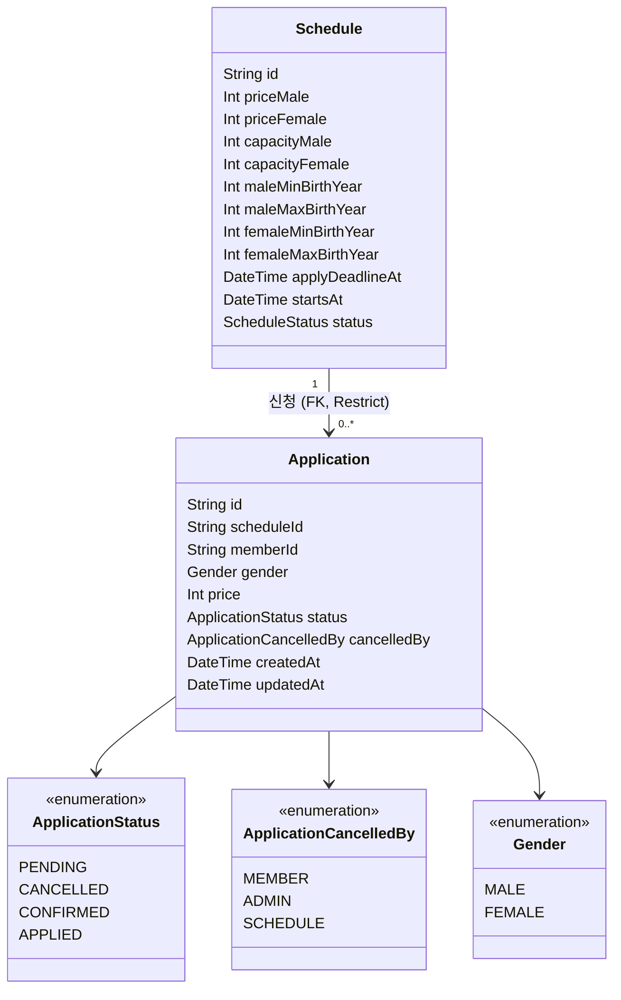
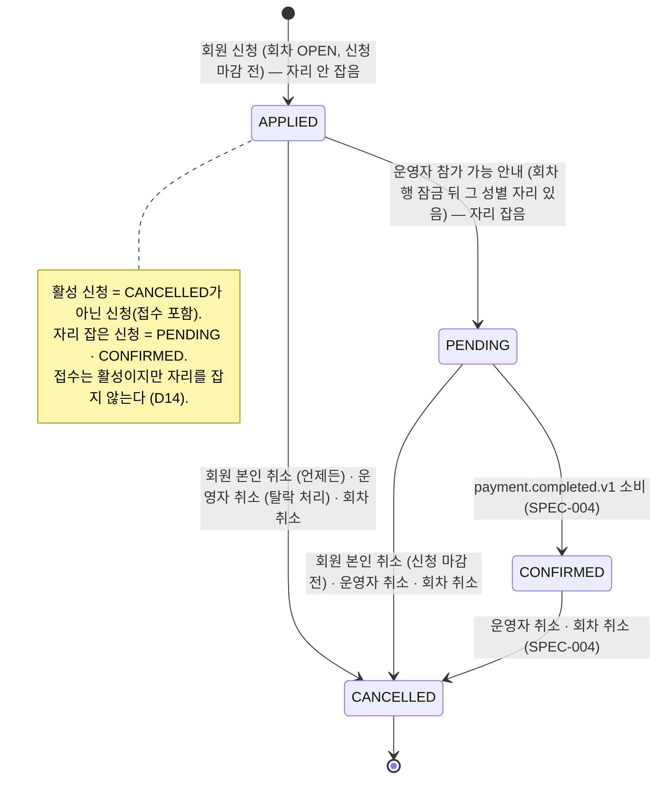
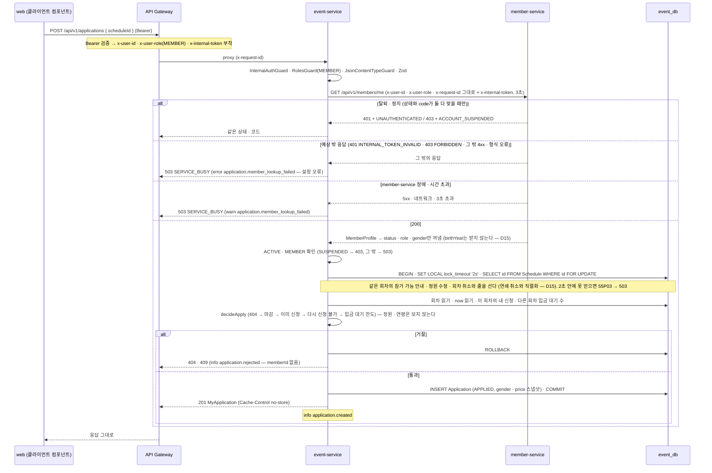
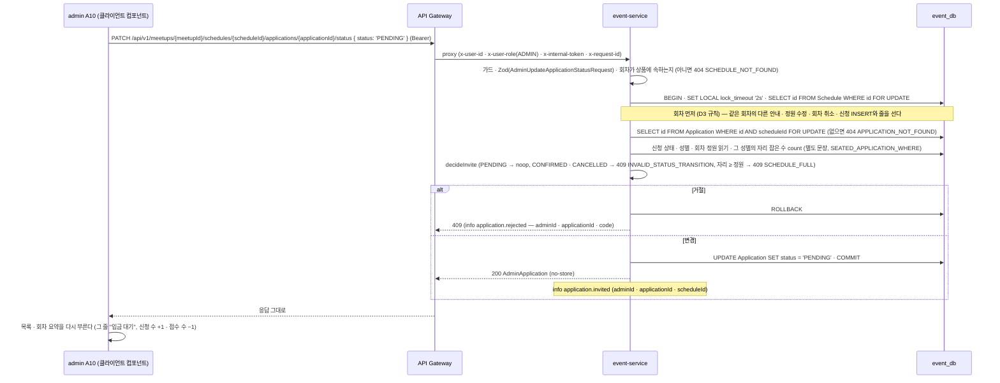
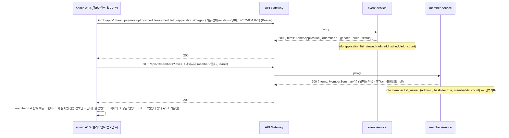
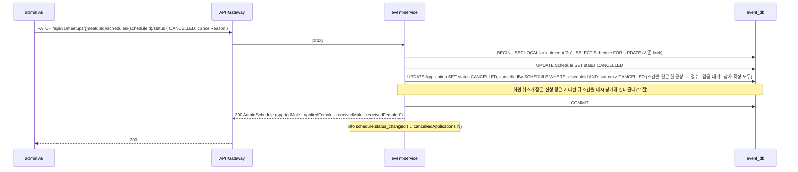

# SPEC-003 참가 신청 — 신청 · 취소, 성별 정원 동시성, 신청 뒤 회차 변경

## 0. 메타

| 항목        | 값                                                                                                                                                                                                                                                                                                                                                                                                                                                                                                                                                                                                                                                                                                                                                                                                                                                                                                                                                                                                                                                                                                                                                                                                                                                                                                                                                                                                                                                                                                                                                                                                                                                                                                                                                                                                                                                                                                                                                                                                                                                                                                                                                                                                                                                                                                                                                                                                                                     |
| ----------- | -------------------------------------------------------------------------------------------------------------------------------------------------------------------------------------------------------------------------------------------------------------------------------------------------------------------------------------------------------------------------------------------------------------------------------------------------------------------------------------------------------------------------------------------------------------------------------------------------------------------------------------------------------------------------------------------------------------------------------------------------------------------------------------------------------------------------------------------------------------------------------------------------------------------------------------------------------------------------------------------------------------------------------------------------------------------------------------------------------------------------------------------------------------------------------------------------------------------------------------------------------------------------------------------------------------------------------------------------------------------------------------------------------------------------------------------------------------------------------------------------------------------------------------------------------------------------------------------------------------------------------------------------------------------------------------------------------------------------------------------------------------------------------------------------------------------------------------------------------------------------------------------------------------------------------------------------------------------------------------------------------------------------------------------------------------------------------------------------------------------------------------------------------------------------------------------------------------------------------------------------------------------------------------------------------------------------------------------------------------------------------------------------------------------------------------- |
| 번호        | SPEC-003                                                                                                                                                                                                                                                                                                                                                                                                                                                                                                                                                                                                                                                                                                                                                                                                                                                                                                                                                                                                                                                                                                                                                                                                                                                                                                                                                                                                                                                                                                                                                                                                                                                                                                                                                                                                                                                                                                                                                                                                                                                                                                                                                                                                                                                                                                                                                                                                                               |
| 상태        | 확정 (2026-10-15 개정 확정 — 0.1 "개정 확인 요청" ★S1~S7 전부 기본안, 17절 "개정 기록". 그 전: 2026-10-14 개정 초안, 2026-09-24 운영자 답변 반영으로 확정)                                                                                                                                                                                                                                                                                                                                                                                                                                                                                                                                                                                                                                                                                                                                                                                                                                                                                                                                                                                                                                                                                                                                                                                                                                                                                                                                                                                                                                                                                                                                                                                                                                                                                                                                                                                                                                                                                                                                                                                                                                                                                                                                                                                                                                                                             |
| 작성자      | Claude(초안) / 검토 Yongjae Kwon                                                                                                                                                                                                                                                                                                                                                                                                                                                                                                                                                                                                                                                                                                                                                                                                                                                                                                                                                                                                                                                                                                                                                                                                                                                                                                                                                                                                                                                                                                                                                                                                                                                                                                                                                                                                                                                                                                                                                                                                                                                                                                                                                                                                                                                                                                                                                                                                       |
| 작성일      | 2026-09-23                                                                                                                                                                                                                                                                                                                                                                                                                                                                                                                                                                                                                                                                                                                                                                                                                                                                                                                                                                                                                                                                                                                                                                                                                                                                                                                                                                                                                                                                                                                                                                                                                                                                                                                                                                                                                                                                                                                                                                                                                                                                                                                                                                                                                                                                                                                                                                                                                             |
| 최종 갱신   | 2026-10-15 — **개정 확정**: 0.1 개정 확인 요청 ★S1 · ★S2 · S3 · S4 · S5 · S7 모두 기본안(사용자 답). 본문 변경 없음 — 구현은 SPEC-004 4번 PR(15절 "개정 PR 순서" 2번). 그 전: 2026-10-14 — **개정 초안**(운영 중 사이트 onulsai.site의 참가 흐름에 맞춤 — [site-facts](../overview/site-facts.md) 1절 8 · 9번, 2026-10-14 결정 Q1 · Q3 · Q4). 접수 상태 `APPLIED`를 `PENDING` 앞에 두고 자리 점유 시점을 운영자 "참가 가능 안내"로 옮겼다(D2 → D14, D3 일부 → D15 · D16). 신청 판정에서 정원 검사를 빼고 연령 조건은 남녀 공통 · 경고로(D7 → D15, ★S1), 운영자 동작 "참가 가능 안내"(`PATCH .../status { status: 'PENDING' }`, D16), 운영자 응답에 접수 수 `receivedMale` · `receivedFemale` · 공개 응답에서 `maleFull` · `femaleFull` 제거(D10 → D17, ★S2), 화면(D12 → D18), 마이그레이션 · 롤아웃은 SPEC-004 4번 PR과 합침(D19). 0.1에 "개정 확인 요청 (2026-10-14)" ★S1~S7, 리드 결정 기록에 D14~D19, 3절에 "개정으로 고칠 행", 15절에 "개정 PR 순서", 17절에 "개정 기록". 본문(1~15절)은 개정 뒤 모습으로 고쳐 썼다(바뀐 곳은 "(개정 2026-10-14)" 표시) — 설계서만 고쳤고 코드 · 마이그레이션 · contracts · 화면은 손대지 않았다. 사람 확인 뒤 머지되면 다시 확정. 같은 날 그 전: 16절 메모만: 자리 점유 시점 행을 더해 2026-10-14 결정(운영자 "참가 가능 안내" 때 자리 점유, 접수 상태 `APPLIED` 추가 — 개정 PR 예정)을 기록하고, 입금 기한 · 확정 뒤 취소 행에 운영 중 사이트(onulsai.site)의 공개 문구를 적었다(`docs/overview/site-facts.md`). 그 전: 2026-10-01 — 16절 결정 내용 — SPEC-004 확정: Step 4로 넘긴 항목(참가 확정 · 입금 기한 · 확정 뒤 취소와 환불 · 입금 계좌 · 입금 대조 화면 · 확정자 장소 화면 · 이벤트 발행과 outbox · 호출자 문맥 없는 호출 · 탈퇴 회원 신청 · `Participant` · A10 다시 불러오기 실패 문구)의 "결정 내용"에 SPEC-004의 답을 적었다. 입금 대조 화면은 J-1 답을 바꿨다(A10만 — SPEC-004 H). 그 전: 2026-09-29 — 17절에 디자인 확인(13절 디자인 행 통과)을 적고 Step 3 완료를 표시했다. 그 전: 2026-09-28 — 16절 `rose` 포커스 외곽선 대비를 해결됨으로 — 사람 결정 `rose-ink`. 같은 날: 16절 확인 창 버튼 순서를 해결됨으로 — 사람 결정 [확인][닫기], 파운데이션 5절 · 참가자 웹 확인 창 셋. 같은 날: 17절에 수동 확인(13절 수동 행 셋 통과)을 적고 남은 확인을 디자인 담당 확인 · 16절 두 행으로 줄였다. 같은 날: 16절에 A10 운영자 취소 뒤 목록 다시 불러오기 실패 문구 행(PR #30 질문). 그 전: 2026-09-25 — 17절에 3 · 5a · 5b · 5c · 7 · 8번 PR 확인. 2026-09-24 — 운영자 답변으로 확정 |
| 관련 Step   | Step 3                                                                                                                                                                                                                                                                                                                                                                                                                                                                                                                                                                                                                                                                                                                                                                                                                                                                                                                                                                                                                                                                                                                                                                                                                                                                                                                                                                                                                                                                                                                                                                                                                                                                                                                                                                                                                                                                                                                                                                                                                                                                                                                                                                                                                                                                                                                                                                                                                                 |
| 관련 ADR    | ADR-004(서비스 경계 — 신청의 원자성), ADR-005(동기 vs 비동기 — 결정 1 · 3), ADR-006(Kafka — 이번 Step 발행 없음), ADR-007(Database per Service), [ADR-009 인증 방식](../adr/ADR-009-authentication.md)(내부 헤더 · 내부 토큰), [ADR-010 플랫폼 패키지](../adr/ADR-010-platform-packages.md), [ADR-011 서비스 간 호출](../adr/ADR-011-service-to-service-calls.md)(호출자 본인 데이터의 위임 읽기 — D5, 5b PR #27)                                                                                                                                                                                                                                                                                                                                                                                                                                                                                                                                                                                                                                                                                                                                                                                                                                                                                                                                                                                                                                                                                                                                                                                                                                                                                                                                                                                                                                                                                                                                                                                                                                                                                                                                                                                                                                                                                                                                                                                                                      |
| 주요 서비스 | event-service / member-service(위임 호출 대상 `GET /api/v1/members/me`, 운영자 목록의 `ids` 필터) / web / admin (+ `packages/contracts`, `packages/api-client`)                                                                                                                                                                                                                                                                                                                                                                                                                                                                                                                                                                                                                                                                                                                                                                                                                                                                                                                                                                                                                                                                                                                                                                                                                                                                                                                                                                                                                                                                                                                                                                                                                                                                                                                                                                                                                                                                                                                                                                                                                                                                                                                                                                                                                                                                        |
| 리뷰어      | Yongjae Kwon (1인 개발 셀프 리뷰 — `docs/guides/pull-requests.md` 4절의 예외)                                                                                                                                                                                                                                                                                                                                                                                                                                                                                                                                                                                                                                                                                                                                                                                                                                                                                                                                                                                                                                                                                                                                                                                                                                                                                                                                                                                                                                                                                                                                                                                                                                                                                                                                                                                                                                                                                                                                                                                                                                                                                                                                                                                                                                                                                                                                                          |

## 0.1 확인 요청 사항

**2026-10-14 개정.** 아래 "개정 확인 요청 (2026-10-14)"의 ★S1~S7이 열려 있다 — 본문(1~15절)은 각 항목의 **기본안**대로 쓰여 있고, 다른 안을 고르면 "바뀌면"의 절을 고친다. 그 아래 "운영자 확인 결과" · "개발 승인"은 2026-09-24 확정 때의 기록이다.

**답변 완료** — 구현 전에 답이 필요했던 아래 여섯 개(본문의 [착수 전] 표시)를 포함해 모든 확인 요청이 운영자 답변(2026-09-24, Yongjae Kwon)으로 정해졌다. 모두 추천안이다.

- [★A 참가 확정은 언제 생기고, 신청 기능은 언제부터 실제 운영에 쓰나요?](#q-a)
- [★B 자리를 잡는 시점과 입금 기한](#q-b)
- [C 회원 본인 취소](#q-c)
- [F 한 사람이 잡을 수 있는 자리와 다시 신청](#q-f)
- [L 화면 문구](#q-l)
- [★O 신청한 뒤 입금 방법은 어떻게 알리나요?](#q-o)

사람만 정할 수 있는 것이었다. 팜플렛 · 운영 메시지 · SPEC-001 · SPEC-002의 운영자 답변에 근거가 없는 제품 규칙은 리드가 정하지 않고 여기에 올렸고, 운영자가 2026-09-24에 **모든 항목을 추천안(초안의 기본값)으로** 답했다. C · L의 하위 확인도 추천대로이고, 개발 승인 N도 승인되었다. 개발 승인 Q(브라우저 e2e 테스트)는 같은 날 따로 정해 승인되었다. 그래서 아래 "결정"은 제품 사실이며 **본문(1~16절)은 모두 이대로 쓰여 있다.** "채택하지 않은 대안"과 "바뀌면"(나중에 결정을 바꿀 때 고칠 절)은 기록으로 남긴다. 체크된 기록이며 지우지 않는다(템플릿 규칙).

- ★는 설계 전체에 영향이 큰 항목이다.
- **[착수 전]** 표시(★A · ★B · C · F · L · ★O — 맨 위 목록)는 구현을 시작하기 전에 답이 있어야 했던 항목이다. 모두 답을 받았다.
- 운영자 항목은 화면에서 보이는 모습으로 썼다. 코드 · 상태 코드 · 절 번호는 "바뀌면" 줄에 모았다.

### 개정 확인 요청 (2026-10-14)

운영 중 사이트 onulsai.site의 공개 문구가 운영 방침의 원천이 되면서([site-facts](../overview/site-facts.md) 머리말, AGENTS.md 3장 원칙 8) 본문을 개정했다. **방침**(접수 → 운영자 "참가 가능 안내" → 결제 안내 · 입금 → 참가 확정, site-facts 1절 8 · 9번. 참가 조건은 남녀 공통, 1절 4번)과 **구조**(접수 상태 `APPLIED`, 자리 점유 = 참가 가능 안내 때, 자리 집계는 `PENDING` · `CONFIRMED`만, 공개 화면은 마감 표시 없이 접수)는 2026-10-14 결정(Q1 · Q3 · Q4, site-facts 3절)으로 정해졌다. 아래는 그 결정을 **어떤 규칙 · 응답 · 문구로** 둘지의 선택이다 — 사람이 고른다. **2026-10-15 답: 아래 항목 모두 기본안으로 확정했다(사용자 답 "전부 기본안대로"). 본문은 이미 기본안대로이므로 바뀐 절이 없다.** ★는 마이그레이션 · 계약 · 에러 코드에 닿는 항목이다. 운영자 내부 흐름(선별 기준 · 안내 수단 · 탈락 안내)은 site-facts 2절 1 · 2번의 답이 오기 전까지 **[추정]**이고 본문에 쓰지 않았다.

- [x] **★S1 신청 때 연령 조건 — 경고로만 두나, 막나** — **답변(2026-10-15): 기본안.** 조건은 남녀 공통이 되었고(2026-10-14 결정, 열은 SPEC-002 개정 D16 — 성별마다 출생연도 범위 두 쌍), 사이트는 출생연도 선택지에 "기타 (00년생 이후)"를 두고 "안내된 출생연도 및 직장인 참가 조건에 해당하시나요?" 동의로 처리한다(site-facts 1절 4번) — 범위 밖도 접수는 된다.
  - 기본안 **(a) 경고** — 신청을 막지 않는다. `decideApply`에서 연령 판정(지금 D7 (6) 409 `BIRTH_YEAR_OUT_OF_RANGE`)과 web W9 (h)를 **뺀다**. 운영자 신청 목록(A10)이 그 줄의 출생연도 옆에 "연령대 밖"을 보인다 — admin이 이미 받는 회원 출생연도(`GET /members?ids=`)와 회차의 그 성별 범위(`AdminSchedule`의 SPEC-002 개정 열)로 화면에서 판정한다. 서버 · DB 변경 없음. 운영자가 보고 취소(탈락)하거나 그대로 안내한다. 에러 코드 `BIRTH_YEAR_OUT_OF_RANGE`는 쓰는 곳이 없어지므로 개정 2번 PR에서 코드 · 상수를 지운다(참조 0 확인).
  - 대안 **(b) 차단** — 지금처럼 409로 막되 남녀 공통으로 넓힌다(`outsideMaleBirthYears` → 성별에 맞는 쌍을 본다, web (h)도 같이). 범위 밖 사람은 신청 자체를 못 하므로 사이트의 "기타 (00년생 이후)" 접수와 다르다. **(c)** 둘 다 — 막지 않되 참가자 화면에도 "이 일정의 연령대가 아닙니다" 경고를 보인다(문구가 사이트에 없다).
  - 바뀌면: D15, 2 · 4 · 7 · 10 · 12 · 13절. (b)면 `decideApply` (6)이 남녀 공통으로 남고 참가자 오류 문구 표에 `BIRTH_YEAR_OUT_OF_RANGE` 행이 돌아온다.
- [x] **★S2 공개 응답의 `maleFull` · `femaleFull`** — **답변(2026-10-15): 기본안.** 공개 화면은 마감 표시 없이 접수만 받는다(2026-10-14 결정 Q1 — 사이트 일정 목록에 마감 표시가 없다는 관찰, site-facts 2절 1번 [추정]). 참가자 화면이 쓰지 않을 값이다.
  - 기본안 **(a) 공개 응답에서 뺀다** — `PublicScheduleSchema`에서 두 필드를 지우고 `AdminScheduleSchema`(공개를 넓힌 스키마)에만 둔다. 공개 목록 · 상세 서비스는 `Application`을 더 읽지 않는다(`seatCountsBySchedule` 호출 제거 — 공개 조회가 신청 테이블과 다시 분리된다, 12절 노출 범위). web W8 · W9의 자리 마감 표시와 (i) "자리가 모두 찼습니다"를 지운다.
  - 대안 **(b)** 응답에 남겨 두고 화면에서만 안 쓴다 — 코드 변경은 web뿐이지만, 보이지 않을 값을 공개 API에 계속 싣는다(다른 신청자에 대한 정보 노출, 12절).
  - 바뀌면: D17, 4 · 7 · 10 · 12 · 13절, web `lib/format.ts`(자리 마감 문구) · `applyAreaState`.
- [x] **S3 접수 상태의 본인 취소 — 언제까지** — **답변(2026-10-15): 기본안.** 접수는 자리를 잡지 않는다.
  - 기본안 **(a) 언제든** — 신청 마감이 지나도, 회차가 CLOSED여도 본인이 취소할 수 있다(`decideCancel`: `APPLIED`면 시각 조건 없이 변경). 자리를 돌려줄 일이 없어 C의 이유("마감 뒤 빈자리를 새 신청으로 채울 수 없다")가 접수에는 없고, 운영자가 아직 고르지 않은 사람이 빠지는 것은 운영자에게 손해가 아니다. 참가자 화면에는 접수 카드에 늘 "신청 취소"가 보인다.
  - 대안 **(b) 신청 마감 전까지** — 입금 대기와 같은 조건(C). 마감 뒤에는 "신청 마감이 지나 취소할 수 없습니다. 오늘사이에 문의해 주세요."가 보인다. 규칙이 하나로 단순하지만, 마감 뒤 운영자 안내를 기다리는 사람이 빠지려면 문의해야 한다.
  - 바뀌면: D14, 4 · 6 · 7 · 13절, web `canCancelMine`.
- [x] **S4 운영자가 접수 상태에서 취소(탈락 처리)한 회차에 다시 신청할 수 있나** — **답변(2026-10-15): 기본안.** 2026-10-14 결정 Q3: 탈락은 새 상태 없이 운영자 취소(`CANCELLED` · `ADMIN`)다. 지금 규칙 F는 "운영자가 취소한 일정에는 다시 신청할 수 없다"(409 `REAPPLY_NOT_ALLOWED`)다.
  - 기본안 **(a) 그대로 적용** — 접수 단계의 운영자 취소도 F다. 뜻에 맞고(운영자가 거른 사람이 바로 다시 접수하는 것을 막는다), 코드 변경이 없다. 되돌려야 하면 J-2 되살리기(개발자).
  - 대안 **(b) 접수 단계의 운영자 취소는 재신청 허용** — 취소 주체로는 가를 수 없어(둘 다 `ADMIN`) 새 취소 주체 값(예: `ADMIN_REVIEW`)이나 "취소 당시 상태" 열이 필요하다. enum 값 하나가 더 늘고(되돌릴 수 없다, SPEC-004 15절) 화면 문구도 갈라진다.
  - 바뀌면: D14, 4 · 6 · 7 · 9 · 13절, 운영자 취소 확인 창 문구("취소하면 이 회원은 이 회차에 다시 신청할 수 없습니다").
- [x] **S5 입금 대기 한도(F)와 접수** — **답변(2026-10-15): 기본안.** 한도의 뜻은 "한 사람이 입금 대기로 잡아 둘 수 있는 신청은 한 번에 하나"(남용 방지, 불변식 아님 — 11절)다.
  - 기본안 **(a) 접수는 세지 않고, 참가 가능 안내 때 한도를 보지 않는다** — 신청 판정 (5)는 지금처럼 다른 시작 전 회차의 `PENDING`만 센다(접수는 자리를 잡지 않으므로 여러 회차에 접수해 두어도 남용이 아니다 — 사이트도 접수를 제한하지 않는다, [추정] site-facts 2절 1번). 운영자가 안내할 때 그 회원에게 다른 회차의 입금 대기가 있어도 막지 않는다 — 운영자 판단이고(J-2 되살리기 확인 3과 같은 태도), 막으면 운영자가 먼저 다른 회차 신청을 취소해야 한다. 접수 상태에서 회원이 다른 회차에 접수하는 것도 막지 않는다.
  - 대안 **(b)** 접수도 한도에 센다(한 사람이 한 번에 한 회차에만 접수 — 사이트보다 좁다) / **(c)** 안내 때 다른 회차 입금 대기가 있으면 409 `PENDING_APPLICATION_LIMIT`(운영자 화면에 문구가 하나 더 생긴다).
  - 바뀌면: D15 · D16, 4 · 6 · 7 · 11 · 13절, `pendingElsewhere` 조회 조건.
- S6 — **리드 결정으로 옮김**(사람이 고를 제품 규칙이 아니라 기술 선택이다 — TEMPLATE 0.1 안내). "참가 가능 안내 시각" 열은 두지 않는다(D14) — 안내는 로그 `application.invited`에 남고 입금 대기 행의 `updatedAt`이 곧 안내 시각이다. `invitedAt` 열의 기각 이유는 16절 "검토한 대안". 번호는 비워 둔다(S7 그대로).
- [x] **S7 화면 문구 · 배지** — **답변(2026-10-15): 기본안.** 담당: 운영자(문구) · 디자인 담당(배지). 사이트 정책 문장 · 알림톡 원문 · 지금 코드 문구에서만 조합했다 — 원문 그대로인 문장은 없고, 조합한 새 문장(접수 카드 · 안내 확인 창 · 409 둘)이 있다. 4절 표의 기본안을 쓴다.
  - 참가자 웹 접수 카드(W9 (e) · W10): 제목 "참가 신청이 접수되었습니다."(지금 (e) 제목 그대로) + 배지 "접수" + "참가비 N원" + **"참가 가능 여부는 따로 안내드릴게요."**(사이트의 단계 이름 "참가 가능 안내"(site-facts 1절 9번) + 운영자 화면의 "따로 안내해 주세요" 어투). ★O(2026-09-24 — "문서에 근거가 없는 약속('따로 안내드릴게요')은 쓰지 않는다")가 배제한 모양이지만, 지금은 site-facts 1절 9번("참가 가능 안내를 받은 분께 … 개별 안내드립니다")이 근거가 되어 되살린다 — 사람 확인. 입금 계좌 안내는 입금 대기 카드에만(SPEC-004 ★D). 대안: 사이트 문장을 그대로 더한다 — "참가 가능 안내를 받은 뒤 참가비 입금이 확인되면 참가가 확정됩니다."(site-facts 1절 8번을 저장소 용어로 바꾼 것 — 사이트의 "참가 확정 안내"는 입금 전이라 글자 그대로 옮기면 뜻이 어긋난다, 용어 사전 "최종 참가 확정").
  - 본인 취소 확인 창: **"참가 신청을 취소할까요?"** — 지금 창의 둘째 문장 "취소한 뒤에는 자리가 남아 있을 때만 다시 신청할 수 있습니다."는 개정 뒤 사실이 아니라(접수는 정원과 무관하고 자리는 안내 때 정해진다) 뺀다. 접수 · 입금 대기 같은 창.
  - 운영자 "참가 가능 안내" 확인 창: **"{이름}님께 참가 가능 안내를 할까요? 안내하면 {성별} 자리를 하나 잡고 신청이 입금 대기로 바뀝니다. 안내 메시지는 따로 보내 주세요."** 버튼 [참가 가능 안내][닫기]. 이름을 모르면 "이 신청에 참가 가능 안내를 할까요? …".
  - 운영자 409 `SCHEDULE_FULL`(안내 때): **"{성별} 자리가 모두 찼습니다. 자리 잡은 신청을 취소하거나 정원을 늘린 뒤 다시 안내해 주세요."** 409 `INVALID_STATUS_TRANSITION`: **"접수 상태의 신청만 안내할 수 있습니다. 목록을 새로 고쳐 주세요."**
  - 운영자 목록의 연령 표시(★S1 (a)): 출생연도 옆 보조 글자 **"연령대 밖"**. 접수 수 문구: **"접수 남 2 · 여 1"**(예시, "신청 남 3/7 · 여 5/7" 뒤에).
  - 배지 "접수": 파운데이션 5절 `Badge` 톤 중 **`neutral`**("그 밖의 중립 상태"). 대안 `mauve`(대기자용으로 예약된 톤 — 대기자가 없으므로 비어 있다, D). 입금 대기 `warning` · 참가 확정 `success`(SPEC-004) · 취소 `danger`는 그대로.
  - 바뀌면: 4절 문구 표, web `lib/applications.ts` 상수, admin `lib/applications.ts` 상수, 파운데이션 5절 `Badge` 행.

### 운영자 확인 결과 (A~M, O, P — 2026-09-24)

- [x] <a id="q-a"></a>**★A 참가 확정은 언제 생기고, 신청 기능은 언제부터 실제 운영에 쓰나요?** [착수 전] — **답변(2026-09-24): 추천안.** 신청 기능은 Step 4와 함께 실제 운영에 쓰고, Step 3의 신청 상태는 입금 대기 · 취소 둘이다.
  - 근거: 지금 운영은 "신청 → 계좌이체 → 운영자가 입금을 확인하면 알림톡으로 참가 확정"이다(기능 소개서 4절). 입금 확인 · 참가 확정은 Step 4(SPEC-004 — 4단계 설계서)이고, ADR-005(되돌리기 어려운 기술 결정을 적은 문서) 결정 2는 "결제가 끝나면 이벤트 서비스가 참가를 확정"하는 흐름을 정했다. 용어 사전 '참가 확정'의 상태 이름은 결정 예정(3~4단계)이다. 서버를 운영 환경에 올리는 절차(배포 절차) 자체는 Step 8 "운영 준비"의 일이라(개요 소개서 5장) 결정 예정 (Step 8)이다.
  - 결정: Step 3에는 참가 확정이 없다. 신청은 "입금 대기"와 "취소" 둘뿐이다. **신청 기능은 Step 4(입금 확인 · 참가 확정)와 함께 실제 운영에 내보낸다** — 그 전에는 개발 · 검증 환경에서만 쓴다. 그래서 참가자가 보는 "입금 대기"와 실제 입금 상태가 어긋나는 기간이 없다.
  - 알아 둘 점: "Step 4와 함께"는 신청 기능을 입금 확인 · 참가 확정보다 먼저 운영에 쓰지 않는다는 뜻입니다. 서버를 운영 환경에 올리는 절차는 Step 8에서 정하므로 결정 예정 (Step 8)입니다(15절).
  - 채택하지 않은 대안 (a): Step 3에 운영자 "참가 확정" 버튼을 둔다(입금 기록 없이 상태만 바꾼다. Step 4가 그 계기를 입금 확인으로 옮긴다).
  - 채택하지 않은 대안 (b): Step 3만 먼저 실제 운영에 쓴다. 이렇게 됩니다.
    1. 운영자가 시스템 밖에서 입금을 확인하고 확정 알림톡을 보낸 사람도, 참가자 화면에는 계속 "입금 대기"로 보입니다. 그래서 신청 화면 문구를 "입금 확인 전이거나 확인 중입니다. 확정되면 알림톡으로 알려드릴게요."로 바꿉니다.
    2. 운영자 신청 목록에는 입금 여부를 적는 칸이 없어서, 입금 대조는 지금처럼 시스템 밖 명단으로 합니다.
  - 바뀌면: (a) 2 · 4 · 5 · 6 · 7 · 9 · 12 · 13 · 15절과 D2(확정 상태 · 운영자 전이 · 확정자 장소 화면). (b) 4절 W9 (e) · W10 문구, 15절, O(입금 방법 안내가 필요해진다), 기능 소개서(입금 대조는 시스템 밖 명단).
- [x] <a id="q-b"></a>**★B 자리를 잡는 시점과 입금 기한** [착수 전] — **답변(2026-09-24): 추천안.** 신청하는 즉시 자리를 잡는다. 입금 기한 · 자동 취소는 Step 4에서 정한다.
  - 근거: 용어 사전 '정원' "신청이 한꺼번에 몰려도 정원을 넘기지 않는 것이 3단계의 핵심 과제", ADR-004(기술 결정 기록) "남은 자리 확인 → 자리 차감 → 신청 레코드(저장된 신청 한 건) 생성이 원자적(셋이 한꺼번에 되거나 하나도 안 되거나)이어야 한다", ADR-004 Trade-offs(장단점 절) "결제 대기 신청의 만료 처리, 결제 실패 시 자리 반환". 입금 기한은 어느 문서에도 없다.
  - 결정: "참가 신청"을 누르는 순간 그 성별의 자리를 하나 잡고, 신청이 취소되면 돌려준다. 입금 기한과 자동 취소는 Step 3에 없다 — 입금하지 않은 신청은 운영자가 신청 목록에서 취소한다(J). 기한 · 자동 취소는 결정 예정 (Step 4).
  - 알아 둘 점: 기한이 없으면 한 사람이 입금하지 않고 자리를 잡아 둘 수 있습니다. 이를 막는 수단은 F의 결정(입금 대기 신청은 한 사람당 하나, 운영자가 취소한 일정에는 다시 신청할 수 없음)과 회원 정지입니다.
  - 채택하지 않은 대안: (a) 입금이 확인된 사람만 자리로 센다(입금했는데 자리가 없는 사람이 생길 수 있다). (b) 신청 뒤 N시간 또는 신청 마감 시각에 입금 대기 신청을 자동 취소한다(예약 작업이 새로 필요하다 — SPEC-002 D8은 예약 작업을 두지 않았다).
  - 바뀌면: (a) 3 · 5 · 6 · 9 · 11 · 13절, D2 · D3("활성 신청"의 정의). (b) 6 · 11 · 14 · 15절, 새 예약 작업.
- [x] <a id="q-c"></a>**C 회원 본인 취소** [착수 전] — **답변(2026-09-24): 추천안.** 신청 마감 시각 전까지 본인이 취소할 수 있다. 하위 확인도 추천대로다(아래).
  - 근거: 로드맵 3단계 "신청·취소"(개요 소개서 5장), 운영자 여정 2 "들어온 신청을 확인하고 취소·정원 초과를 처리합니다"(3장). 환불 규정은 문서에 없다.
  - 결정: **신청 마감 시각 전까지** 회원이 일정 상세나 "내 신청"에서 직접 취소할 수 있다(자리가 돌아간다). 마감이 지나면 "신청 마감이 지나 취소할 수 없습니다. 오늘사이에 문의해 주세요."가 보인다. 운영자는 입금 대기 신청을 언제든 취소할 수 있다. 확정 뒤의 취소와 환불은 결정 예정 (Step 4).
  - 알아 둘 점: Step 3에는 확정 상태가 없어서(A), 이미 입금한 사람도 마감 전이면 버튼 한 번으로 취소할 수 있고 운영자에게 알림이 가지 않습니다(알림은 Step 7). 운영자는 신청 목록의 "취소" · "전체" 필터에서 취소 시각과 누가 취소했는지(본인 · 운영자 · 회차 취소)를 봅니다. 마감 뒤에는 본인 취소가 막히므로, 새 신청으로 채울 수 없는 당일 가까운 빈자리 때문에 남녀 인원이 어긋나는 일이 줄어듭니다.
  - 알아 둘 점: 취소 조건은 신청 마감 시각 하나라서, 운영자가 신청 마감 시각 전에 모집을 마감한 일정에서도 신청 마감 시각까지는 본인 취소가 됩니다. 이렇게 생긴 빈자리는 모집을 다시 열지 않으면 새 신청으로 채울 수 없습니다. 신청 마감 시각을 바꾸면 본인 취소 가능 기간도 함께 바뀝니다(H).
  - 하위 확인: 운영자가 모집을 마감한 일정에서도 신청 마감 시각 전이면 본인 취소를 허용할까요? — **답변(2026-09-24): 추천안 — 허용한다.** 취소 조건은 신청 마감 시각 하나이고, 운영자가 모집을 마감(CLOSED)한 일정도 신청 마감 시각 전이면 본인이 취소할 수 있다(D4). 바뀌면: D4, 4절 W9 (e) · W10, 6절 취소 전이 표, 13절.
  - 채택하지 않은 대안: (a) 운영자만 취소한다(회원은 문의). (b) 일정 시작 전까지 본인 취소(마감 뒤 생긴 빈자리는 다시 채울 수 없다).
  - 바뀌면: 4 · 6 · 7 · 13절(취소 가능 조건 · 문구).
- [x] **D 대기자 명단** — **답변(2026-09-24): 추천안.** 대기자 명단은 두지 않는다.
  - 근거: 문서에 대기자 규칙이 없다. 디자인 파운데이션 5절 `Badge`의 "대기자"와 ADR-004의 "노쇼 시 자리를 대기자에게 넘긴다"는 예시로만 나온다. 운영자 여정의 "정원 초과를 처리"가 대기자를 뜻하는지는 확인이 필요했다(D의 답 — 대기자 없음).
  - 결정: 대기자 없음. 참가자 화면에서는 내 성별 자리가 찼으면 "남성 자리가 모두 찼습니다."가 보이고 신청 버튼이 없다. "정원 초과 처리"는 "시스템이 정원을 넘는 신청을 받지 않고, 운영자가 신청을 취소할 수 있다"로 읽었다.
  - 채택하지 않은 대안: 운영자가 손으로 올리는 대기자, 자리가 나면 자동으로 올리는 대기자(순번 · 대기자 안내가 필요하다 — 안내는 Step 7과 엮인다).
  - 바뀌면: 2 · 5 · 6 · 7 · 9 · 11 · 13절, 새 상태.
- [x] **E 남은 자리 표시** — **답변(2026-09-24): 추천안.** 숫자 없이 "남성 자리 마감" · "여성 자리 마감" · "남녀 자리 모두 마감"으로 보인다.
  - 근거: "남은 자리 표시는 결정 예정 (Step 3)"(기능 소개서 `meetup-schedule.md` 4절, SPEC-002 4절 W8). 참가자 공개 화면은 최대 30초 늦게 반영된다(SPEC-002 D11).
  - 결정: 숫자는 보이지 않는다. 참가자 일정 목록 · 상세에서 한 성별이 차면 "남성 자리 마감"(또는 "여성 자리 마감"), 둘 다 차면 "남녀 자리 모두 마감"이 보인다. "모집 마감"(운영자가 마감했거나 신청 마감 시각이 지난 일정)과는 다른 말을 쓴다 — 용어 사전의 "모집 마감" 뜻을 바꾸지 않고, 운영자 화면의 "모집 중" 배지와도 헷갈리지 않게 한다. 최대 30초 늦게 보일 수 있고, 그 사이에 누른 신청에는 "남성 자리가 모두 찼습니다."로 정확히 답한다.
  - 채택하지 않은 대안: (a) 성별 남은 자리 수("남 2자리"). (b) 아무것도 보이지 않는다(신청을 눌러야 안다). (c) 둘 다 차면 "모집 마감"으로 보인다 — 용어 사전 '모집 중 / 모집 마감 (표시)'와 `meetup-schedule.md` 3절 배지 표를 고치고, 운영자 화면에 "정원 참(참가자 화면: 모집 마감)"을 함께 보인다.
  - 바뀌면: 4 · 7 · 10 · 13절, D10. (c)면 3절 표에 용어 사전 · 기능 소개서 행을 더한다.
- [x] <a id="q-f"></a>**F 한 사람이 잡을 수 있는 자리와 다시 신청** [착수 전] — **답변(2026-09-24): 추천안.** 일정마다 한 사람의 신청은 하나, 입금 대기 신청은 한 사람당 하나다. 본인이 취소한 일정은 다시 신청할 수 있고, 운영자가 취소한 일정에는 다시 신청할 수 없다.
  - 근거: 여성은 "본인이 원하는 그룹(회차)으로 지원"한다(SPEC-002 — 2단계 설계서의 두 번째 운영자 답변 4). 한 사람이 여러 일정을 함께 신청할 수 있는지, 취소한 뒤 다시 신청할 수 있는지는 문서에 없다.
  - 위험: 가입은 IP당 분당 10회까지이고 성별 · 출생연도는 가입 때 본인이 적는 값이다. B가 기한 없음이고 신청 수에 제한이 없으면, 계정 14개(남 7 · 여 7)로 열린 일정 전부의 자리를 입금 없이 무기한 잡아 둘 수 있다. 운영자가 취소해도 같은 계정이 바로 다시 잡는다. 한 사람이 같은 시각의 두 일정을 함께 잡아 둘 수도 있다.
  - 결정:
    1. 한 일정에는 한 사람의 신청이 하나다(같은 일정을 두 번 신청할 수 없다).
    2. **입금 대기 신청은 한 사람당 한 번에 하나다**(아직 시작하지 않은 일정 기준). 다른 일정에 입금 대기 신청이 있으면 "입금 대기 중인 다른 신청이 있습니다. 그 신청이 확정되거나 취소된 뒤에 신청해 주세요. 오늘사이에 문의해 주세요."가 보인다(L의 하위 확인). 확정된 신청(Step 4)은 세지 않는다. 시각이 겹치는 두 일정을 함께 잡는 일도 이것으로 막힌다.
    3. 본인이 취소한 일정은 자리가 있으면 다시 신청할 수 있다. **운영자가 취소한 일정에는 다시 신청할 수 없다** — "이 일정은 다시 신청할 수 없습니다. 오늘사이에 문의해 주세요."가 보인다.
    4. 자리만 잡는 계정은 운영자가 정지한다(정지된 회원은 신청할 수 없다, K).
  - 알아 둘 점: 2는 서로 다른 일정에 거의 같은 순간(ms 단위)에 보낸 신청이 겹치면 드물게 둘 다 받아질 수 있습니다. 남용을 막는 규칙이라 받아들이고, 이를 없애는 회원 단위 잠금은 두지 않습니다(11절).
  - 알아 둘 점: 2와 C의 결정(신청 마감 뒤에는 본인 취소 불가)이 겹치면, 신청 마감이 지난 일정에 입금 대기 신청이 있는 회원은 그 일정이 시작할 때까지 다른 일정을 신청할 수도, 그 신청을 직접 취소할 수도 없습니다. 오늘사이에 문의하는 것 말고는 방법이 없고, 운영자가 취소하면 그 일정에는 다시 신청할 수 없습니다(3). 그래서 입금 대기 한도 문구에 "오늘사이에 문의해 주세요."를 더했습니다(L의 하위 확인).
  - 채택하지 않은 대안: (a) 제한 없음(초안 첫 판의 기본값). (b) 입금 대기 신청 한도를 2개 이상으로. (c) 시작 시각이 겹치는 일정만 함께 신청할 수 없다(제품 리뷰가 검토를 권한 안 — 2가 이 경우를 함께 막는다). (d) 운영자가 취소한 뒤에도 다시 신청할 수 있다.
  - 바뀌면: 4 · 6 · 7 · 9 · 11 · 12 · 13절, D7(판정 순서 · 오류 코드).
- [x] **G 남성 연령 검사** — **답변(2026-09-24): 추천안.** 연령대 밖 남성의 신청은 받지 않는다.
  - 근거: 연령 조건은 남성에게만 건다(SPEC-002 D5). 출생연도는 회원이 고칠 수 없고 운영자가 수동으로 정정한다(SPEC-001 D11). 최종 확인은 현장 신분증이다(SPEC-001 12절).
  - 결정: 범위 밖 남성이 신청을 누르면 "이 일정은 남성 1990~1995년생(예시)만 신청하실 수 있습니다."가 보이고 신청되지 않는다(버튼도 미리 숨긴다). 신청 뒤에 운영자가 연령대를 바꾸거나 출생연도를 정정해도 이미 한 신청은 그대로다 — 필요하면 운영자가 취소한다. 여성은 출생연도로 거르지 않는다.
  - 채택하지 않은 대안: 범위 밖도 받고 운영자 신청 목록에 표시만 한다(운영자가 검토해 취소).
  - 바뀌면: 4 · 6 · 7 · 13절.
- [x] **H 신청이 생긴 뒤의 일정 변경** — **답변(2026-09-24): 추천안.** 정원은 신청 수 아래로 줄일 수 없고, 참가비는 신청에 스냅샷으로 남는다. 일시 · 신청 마감 · 장소는 바꿀 수 있고 신청자가 있으면 저장 전에 안내를 확인한다. 연령대는 바꿀 수 있고 기존 신청은 그대로다.
  - 근거: SPEC-002 D8 "OPEN 이후의 가격 · 일시 · 정원 · 연령대 변경은 … 신청이 생기는 Step 3에서 제한 규칙을 정한다", D3 "신청자가 낼 금액은 신청자 성별의 값".
  - 결정: (1) 정원 — 운영자 화면에서 정원을 지금 신청 수보다 작게 저장하면 "정원을 지금 신청 수(N명)보다 작게 줄일 수 없습니다. 신청을 먼저 취소해 주세요."가 보이고 저장되지 않는다. (2) 참가비 — 바꿀 수 있고, 이미 한 신청은 신청할 때의 금액 그대로다. (3) 일시 · 신청 마감 · 장소 — 바꿀 수 있다. 신청자가 있으면 저장 전에 "신청자 N명이 있습니다. 바뀐 내용은 신청자에게 따로 안내해 주세요."를 한 번 묻는다(안내 알림은 Step 7). (4) 연령대 — 바꿀 수 있고 기존 신청은 그대로다(G).
  - 알아 둘 점: 신청 마감 시각을 바꾸면 신청자가 직접 취소할 수 있는 기간도 함께 바뀝니다(C). 앞당기면 이미 신청한 사람도 새 마감 시각부터는 직접 취소할 수 없습니다. 그래서 신청 마감 시각을 바꿀 때는 저장 전 안내에 이 점을 한 줄 더합니다(4절 A8).
  - 채택하지 않은 대안: 신청자가 있으면 참가비 · 일시 변경을 막는다. 참가비를 바꾸면 기존 신청에도 새 금액을 쓴다.
  - 바뀌면: 4 · 5 · 7 · 9 · 11 · 13절, D8.
- [x] **I 일정을 취소했을 때의 신청** — **답변(2026-09-24): 추천안.** 일정을 취소하면 그 일정의 신청도 함께 취소된다.
  - 근거: SPEC-002 16절 "취소된 회차의 신청자 처리 · 환불 · 취소 안내(Step 3 · 4 · 7)".
  - 결정: 운영자가 일정을 취소하면 그 일정의 신청이 모두 함께 취소된다. 참가자의 "내 신청"에는 "일정이 취소되었습니다."가 보인다. 운영자의 취소 확인 창에 "신청 N건도 함께 취소됩니다. 취소한 뒤 신청 목록에서 연락처를 확인할 수 있습니다."가 보이고, 취소된 일정의 상세에 남는 "신청 목록 보기"는 취소된 신청(이름 · 휴대폰 포함)을 바로 보여 준다. 환불은 결정 예정 (Step 4), 신청자 안내는 Step 7 전까지 운영자가 직접 한다.
  - 채택하지 않은 대안: 신청을 그대로 두고 운영자가 하나씩 취소한다.
  - 바뀌면: 4 · 6 · 10 · 11 · 13절, D8.
- [x] **J 운영자 신청 관리의 범위와 보이는 개인정보** — **답변(2026-09-24): 추천안.** 일정마다 신청 목록(아래 필드)과 운영자 취소를 만들고, 대리 신청은 만들지 않는다.
  - 근거: 운영자 여정 2(위 C), 운영자는 회원 조회를 "신청 · 입금을 대조할 때" 쓴다(`admin-member-management.md` 2절). 이름 · 휴대폰은 회원 서비스에만 있다(SPEC-001).
  - 결정: 일정마다 신청 목록(신청 순) — 신청 시각, 이름, 성별, 출생연도, 휴대폰, 계정 상태(정지 · 탈퇴일 때), 참가비, 신청 상태와 누가 취소했는지 · 취소 시각 — 과 운영자 취소. 이메일은 보이지 않는다. 대리 · 오프라인 신청 추가, 일정 사이 옮기기는 만들지 않는다(결정 예정 — 요청이 생길 때).
  - 채택하지 않은 대안: 휴대폰은 목록에서 빼고 회원 상세에서만 본다. 운영자 대리 신청을 더한다.
  - 바뀌면: 4 · 7 · 12 · 13절.
- [x] **J-1 입금 대조에 어느 화면을 쓰나요?** — 계좌 입금은 입금자 이름으로 들어오는데, 신청 목록은 일정 하나씩만 보이고 회원 상세에는 그 회원의 신청이 보이지 않는다. 열린 일정이 여러 개면 입금 한 건마다 목록을 여러 번 열어야 한다. **답변(2026-09-24): 추천안.** 입금 대조 화면은 Step 4에서 만든다. → 2026-10-01 [SPEC-004](SPEC-004-payment.md) H로 바뀜: 새 대조 화면을 만들지 않고 회차별 신청 목록(A10)의 입금 대기 줄에 "입금 확인"을 둔다(16절).
  - 결정: (a) 지금대로 일정별 목록만 만든다. 입금 대조 화면은 입금 확인과 함께 결정 예정 (Step 4) — A의 답대로 신청 기능을 Step 4와 함께 운영에 내보내므로 대조 화면이 없는 운영 기간이 없다.
  - 채택하지 않은 대안: (b) 회원 상세에 그 회원의 신청 목록을 보인다(운영자 조회 경로가 하나 는다).
  - 바뀌면: (b) 4 · 7 · 12 · 13절, 15절 5c · 8번 PR.
- [x] **J-2 잘못 취소한 신청을 되살릴 수 있어야 하나요?** — 취소는 되돌릴 수 없고 운영자 대리 신청도 없다(J). 다시 신청하는 것도 마감 뒤나 자리가 찼으면 막힌다. 운영자가 다른 줄의 "취소"를 잘못 누르면 시스템 안에서는 되살릴 방법이 없다. **답변(2026-09-24): 추천안.** 되살리기 화면은 만들지 않고 개발자가 처리한다.
  - 결정: 화면을 만들지 않는다. 드물게 생기면 지금의 성별 · 이름 정정(`admin-member-management.md` 3절)처럼 운영자가 개발자에게 요청하고, 개발자가 DB에서 되살린다 — 되살려도 되는지(일정 상태 · 정원 · 입금 대기 한도) 확인하는 절차를 `docs/database/README.md`에 적는다(6절).
  - 알아 둘 점: 개발자는 일정이 취소되지 않았고 아직 시작 전인지, 그 성별 자리가 남았는지, 그 회원에게 다른 시작 전 일정의 입금 대기 신청이 없는지(F)를 확인한 뒤에만 되살립니다. 다른 입금 대기 신청이 있어도 되살려야 하면 요청하실 때 그렇게 적어 주세요(운영자 판단 — 이 확인만 넘길 수 있습니다). 운영자 취소 확인 창("{이름}님의 신청을 취소할까요?")이 잘못 누르는 것을 먼저 막습니다.
  - 채택하지 않은 대안: 운영자 "되살리기"(제품 리뷰가 기본안으로 권한 안) — 취소된 신청을 다시 입금 대기로 바꾼다. 일정을 잠근 뒤 자리를 보고, 없으면 "자리가 모두 찼습니다"로 막는다. 마감 · 연령은 다시 보지 않는다(운영자 판단).
  - 바뀌면: 대안이면 4 · 6 · 7 · 11 · 13절, D1 · D2(취소가 끝 상태가 아니게 된다 — `updatedAt`을 취소 시각으로 쓰는 것도 함께).
- [x] **J-3 운영자가 신청을 취소할 때 사유를 남기나요?** — 지금은 이유(미입금 · 본인 요청 · 연령 오류 등)를 남길 곳이 없다. 회원 화면에는 "오늘사이에서 취소했습니다."만 보인다. 일정 취소에는 사유가 있다. **답변(2026-09-24): 추천안.** 사유 입력을 두지 않는다.
  - 결정: 사유 없음.
  - 채택하지 않은 대안: 운영자 화면에만 보이는 선택 입력(200자, 일정 취소 사유와 같은 규칙)을 둔다. Step 4 환불 · 분쟁 대응과 B(입금 기한)를 정할 근거 자료가 된다.
  - 바뀌면: 대안이면 4 · 7 · 9 · 12 · 13절(`Application`에 열 하나, 운영자 응답에만).
- [x] **K 정지 · 탈퇴한 회원의 신청** — **답변(2026-09-24): 추천안.** 정지된 회원은 신청할 수 없고, 이미 한 신청은 운영자가 판단해 취소한다.
  - 근거: 정지 · 탈퇴 직후에도 남은 로그인(access token, 최대 15분)이 통한다(SPEC-002 12절). 탈퇴 전 신청 기록의 정리는 `member.withdrawn.v1`(Step 4)로 한다(SPEC-001 12절).
  - 결정: 정지된 회원이 신청을 누르면 "이용이 정지된 계정입니다. 오늘사이에 문의해 주세요."가 보이고 신청되지 않는다(정지 직후에도). 이미 한 신청은 정지 · 탈퇴해도 그대로 남아 자리를 잡고 있다. 운영자 신청 목록에 "정지" · "탈퇴한 회원"이 보이고 운영자가 판단해 취소한다. 탈퇴 때 자동 취소는 결정 예정 (Step 4).
  - 채택하지 않은 대안: 운영자가 회원을 정지할 때 그 회원의 신청도 함께 취소한다(회원 서비스에서 이벤트 서비스를 부르거나 이벤트가 필요하다 — Step 4 전에는 없다).
  - 바뀌면: 4 · 12 · 13절.
- [x] <a id="q-l"></a>**L 화면 문구** [착수 전] — 담당: 운영자(SPEC-002 — 2단계 설계서 16절 "신청 버튼과 신청 방법 문구"). **답변(2026-09-24): 추천안.** 4절의 문구 표(기본안)를 쓰고, 하위 확인도 추천대로 막히는 문구에 "오늘사이에 문의해 주세요."를 더한다. 확인한 것:
  - 버튼 이름 "참가 신청"(디자인 파운데이션 6절 "Application → 참가 신청").
  - 신청 상태 이름 "입금 대기" · "취소"와 누가 취소했는지 문구(참가자: "직접 취소했습니다." · "오늘사이에서 취소했습니다." · "일정이 취소되었습니다.", 운영자: "본인" · "운영자" · "회차 취소").
  - 입금 대기 안내 "입금 확인 전입니다. 확인되면 알림톡으로 알려드릴게요."(디자인 파운데이션 6절 문구 그대로).
  - 자리 마감 표시 "남성 자리 마감" · "여성 자리 마감" · "남녀 자리 모두 마감"(E).
  - 만석 · 모집 마감 · 연령 · 정지 · 취소 확인 · 입금 대기 한도 · 다시 신청 불가 문구(F).
  - 하위 확인: 입금 대기 한도 문구("입금 대기 중인 다른 신청이 있습니다. 그 신청이 확정되거나 취소된 뒤에 신청해 주세요.")에 "오늘사이에 문의해 주세요."를 더할까요? 신청 마감이 지난 일정의 입금 대기 신청은 직접 취소할 수 없어 문의가 유일한 다음 행동입니다(F의 알아 둘 점). 문구의 "확정"은 Step 4에 생기는 상태입니다(A). — **답변(2026-09-24): 추천안 — 더한다.** `PENDING_APPLICATION_LIMIT` 문구는 "입금 대기 중인 다른 신청이 있습니다. 그 신청이 확정되거나 취소된 뒤에 신청해 주세요. 오늘사이에 문의해 주세요."다. 다른 막히는 문구(다시 신청 불가 · 정지 · 마감 뒤 취소)에는 이미 들어 있다(4절 표).
  - 바뀌면: 4절 문구 표.
- [x] **M NEXT 재참가 혜택** — 담당: 운영자. 내용 자체가 결정 예정이다(SPEC-002 D3). **답변(2026-09-24): 추천안.** 결정: Step 3 범위에서 뺀다. 내용이 정해지면 금액 혜택은 Step 4(결제)에서, 신청 조건(예: 먼저 신청하기)이면 이 설계서를 고쳐 더한다. 대상 판정("이번에 인연을 만나지 못했다면")에는 매칭 결과(Step 6)가 필요할 수 있다(추정). 바뀌면: 2 · 5 · 7 · 9절.
- [x] <a id="q-o"></a>**★O 신청한 뒤 입금 방법은 어떻게 알리나요?** [착수 전] — **답변(2026-09-24): 추천안.** A의 답에 따라 입금 방법 안내는 Step 4가 만든다. Step 3 신청 화면에는 계좌 문장이 없다.
  - 근거: 수동 운영의 둘째 단계가 "계좌이체로 입금합니다"(기능 소개서 4절)라 신청자가 계좌를 알아야 한다. 계좌를 화면에 보이는 것은 SPEC-002(2단계 설계서) D3(리드 결정 3번)이 결제 영역(Step 4)으로 두었다. 새 신청을 운영자에게 알리는 수단도 Step 7 전에는 없다 — 운영자가 신청 목록에 직접 들어가서 본다. 문서에 근거가 없는 약속("따로 안내드릴게요")은 쓰지 않는다.
  - 결정: A의 답대로 신청 기능을 Step 4와 함께 운영에 내보내므로, 입금 방법 안내는 Step 4가 만든다. Step 3의 신청 화면에는 입금 방법 문장을 두지 않고 "입금 확인 전입니다. 확인되면 알림톡으로 알려드릴게요."만 보인다.
  - 채택하지 않은 대안 — A를 대안 (b)로 정해 Step 3만 먼저 쓰는 경우에 고를 안이었다(A가 추천안으로 정해져 필요 없다): (1) 운영자가 신청 목록을 보고 휴대폰으로 계좌를 따로 보낸다 — 신청 목록을 확인하는 주기(예: 하루 한 번)를 기능 소개서에 적는다. (2) Step 4 전까지 신청 완료 화면에 운영자가 준 고정 안내 문구(계좌 포함)를 보인다 — SPEC-002 D3("입금 계좌 안내는 payment 영역")도 다시 정해야 했다. (3) 지금 쓰는 신청 채널을 함께 쓰고 거기서 안내한다.
  - 바뀌면: 4절 W9 (e) · 문구 표, 기능 소개서(운영 절차). (2)면 SPEC-002 D3 · 이 문서 7절(문구를 어디에 두는지).
- [x] **P 신청 절차에 단계 표시("1 / 5")를 쓰나요?** — 담당: 디자인. 디자인 파운데이션(확정 v1) 4절 5번은 "여러 단계로 된 흐름(신청 절차, 라운드 진행)"에 "1 / 5" 표기를 쓴다고 적었고, 5절 `StepIndicator`는 "예정 (Step 3)"이었다. 디자인 기준을 바꾸는 일이라 리드가 정하지 않는다(AGENTS.md 9장). **답변(2026-09-24): 추천안.** 신청에 단계 표시를 쓰지 않는다.
  - 결정: 쓰지 않는다. Step 3의 신청은 "참가 신청" → 확인 창의 한 단계라 보여 줄 단계가 없다. 디자인 파운데이션 4절 5번의 예시에서 "신청 절차"를 빼고(라운드 진행은 남는다) 5절 `StepIndicator` 행을 "예정 (쓰는 화면이 생길 때)"으로 고쳤다(설계서 확정 PR, 3절 표).
  - 채택하지 않은 대안: 입금 확인까지 이어지는 신청 절차(신청 → 입금 → 확정)를 단계 표시로 보인다 — 확정이 생기는 Step 4 뒤가 자연스럽다.
  - 바뀌면: 4절 W9 · W10, 3절 표(디자인 파운데이션 행), D12.

### 개발 승인

- [x] **N Prisma 미리보기 기능 `partialIndexes` 사용** — AGENTS.md 9장("지시 없이 … 설정 변경 금지")에 따른 승인 요청. **답변(2026-09-24): 승인.** event-service에서 `partialIndexes` 미리보기를 켠다.
  - 결정: event-service `prisma/schema.prisma`의 generator에 `previewFeatures = ["partialIndexes"]`를 켜고, 중복 신청을 막는 부분 유니크 인덱스를 스키마에 선언한다(D3). 새 의존성 · 빌드 스크립트는 없다 — 설치된 Prisma 7.10 빌드에 이 기능과 `where: raw("...")` 문법이 있다(2026-09-23 `node_modules`의 prisma 빌드에서 확인). 마이그레이션 SQL에 손으로 넣는 방식은 쓰지 않는다 — Prisma는 인덱스를 스키마와 대조하므로 다음 `migrate dev`가 스키마에 없는 인덱스를 지우려 한다.
  - 비용: 미리보기라 안정성 보장이 없다 — 마이너 버전 사이에 문법 · 동작이 바뀌거나 업그레이드 때 `migrate diff`가 드리프트를 낼 수 있다. 그래서 `docs/architecture/tech-stack.md`에 기능과 새 함정("Prisma를 올릴 때 event-service에서 `prisma migrate diff`가 비어 있는지 확인")을 적는다(3절 표). 또 생성된 클라이언트가 부분 유니크를 보통 유니크처럼 다뤄 `scheduleId_memberId` 선택자를 만든다(리뷰에서 확인) — 쓰지 않는다는 규칙을 9 · 10절에 둔다.
  - 채택하지 않은 대안: 인덱스 없이 회차 행 잠금만으로 중복을 막는다(동작은 같고 DB 최종 방어선이 없다). 미리보기가 기대대로 동작하지 않을 때의 대비책으로 남긴다(9절).
  - 바뀌면: 3 · 9 · 13 · 15절.
- [x] **Q 브라우저 e2e 테스트 (`@playwright/test`)** — 새 devDependency와 CI 잡이 생기므로 AGENTS.md 9장("지시 없이 … 의존성 추가 · 설정 파일(CI) 변경 금지")에 따른 승인이 필요했다. **답변(2026-09-24, Yongjae Kwon): 넣는다.** devDependency `@playwright/test`와 CI 잡 `e2e`를 승인한다.
  - 결정: 새 워크스페이스 앱 `apps/e2e`(`@oneul-sai/e2e`)에 Playwright 테스트를 둔다. 범위는 참가자 흐름(로그인 → `/events/[id]` 참가 신청 → 내 신청(W10) → 본인 취소)과 운영자 신청 목록(A10 — 운영자 취소 포함) 두 가지다. Chromium만 쓴다. 화면 비교(`toHaveScreenshot` · 스냅샷 단언)는 쓰지 않고 문구 · 역할 · 주소로 확인한다. 운영자 로그인은 CI env의 CI 전용 더미 seed 계정으로 하고 실제 비밀번호는 쓰지 않는다. 정원 동시성은 vitest 통합 테스트(순서 강제, D13)가 그대로 맡는다. CI는 기존 `ci` · `integration` 잡 뒤에 새 `e2e` 잡이 Postgres와 member · event · gateway · web · admin을 띄워 돈다(13절).
  - 비용: CI 시간이 늘고(브라우저 설치, 앱 다섯 개 빌드 · 기동), 화면 문구를 바꾸면 e2e도 함께 고친다. 기다림은 Playwright의 자동 대기(`expect` 재시도)에만 기대고 고정 대기(`waitForTimeout`)는 쓰지 않는다.
  - 채택하지 않은 대안: 끝에서 끝까지를 지금처럼 수동으로만 확인한다(초안의 13절 수동 행).
  - 바뀌면: 2 · 13 · 15 · 17절, D13, 3절 표(9번 PR 문서 행).

### 리드 결정 기록

기술 결정이다(운영자 확인이 필요 없는 것). 본문은 모두 "결정" 열대로 쓰여 있다. 바꾸려면 "바뀐 절"을 함께 고친다. 채택하지 않은 안은 16절 "검토한 대안"에 있다. **2026-10-14 개정**으로 더한 결정은 D14~D19이고 "(개정 2026-10-14)"로 시작한다 — D2는 D14가, D7은 D15가, D10은 D17이, D12는 D18이 대체한다(원문은 기록으로 남긴다). D3은 집계 · 정원 검사가 D15 · D16으로 옮겨 가고 잠금 규칙 · 부분 유니크 · `lock_timeout`은 그대로다.

| #   | 결정                                                                                                                                                                                                                                                                                                                                                                                                                                                                                                                                                                                                                                                                                                                                                                                                                                                                                                                                                                                                                                                                                                                                                                                                                                                                                                                                                                                                                                                                                                                                                                                                                                                                                                                                                                                                                           | 이유                                                                                                                                                                                                                                                                                                                                                                                                                                                                                                                                                                                                                                                                                                                                                                                                                                                                                                                                                                                                                                                                                                                                                                                                                                                                                                                                                                                                                                                                                                                                                                                                          | 바뀐 절                                                                                                                                                                                                                                                                                                                |
| --- | ------------------------------------------------------------------------------------------------------------------------------------------------------------------------------------------------------------------------------------------------------------------------------------------------------------------------------------------------------------------------------------------------------------------------------------------------------------------------------------------------------------------------------------------------------------------------------------------------------------------------------------------------------------------------------------------------------------------------------------------------------------------------------------------------------------------------------------------------------------------------------------------------------------------------------------------------------------------------------------------------------------------------------------------------------------------------------------------------------------------------------------------------------------------------------------------------------------------------------------------------------------------------------------------------------------------------------------------------------------------------------------------------------------------------------------------------------------------------------------------------------------------------------------------------------------------------------------------------------------------------------------------------------------------------------------------------------------------------------------------------------------------------------------------------------------------------------ | ------------------------------------------------------------------------------------------------------------------------------------------------------------------------------------------------------------------------------------------------------------------------------------------------------------------------------------------------------------------------------------------------------------------------------------------------------------------------------------------------------------------------------------------------------------------------------------------------------------------------------------------------------------------------------------------------------------------------------------------------------------------------------------------------------------------------------------------------------------------------------------------------------------------------------------------------------------------------------------------------------------------------------------------------------------------------------------------------------------------------------------------------------------------------------------------------------------------------------------------------------------------------------------------------------------------------------------------------------------------------------------------------------------------------------------------------------------------------------------------------------------------------------------------------------------------------------------------------------------- | ---------------------------------------------------------------------------------------------------------------------------------------------------------------------------------------------------------------------------------------------------------------------------------------------------------------------- |
| D1  | 모델: event_db에 `Application` 하나를 더한다 — `id`, `scheduleId`(FK → `Schedule`, `onDelete: Restrict`), `memberId`(member_db의 회원 ID, FK 없음), `gender`(신청할 때의 성별 스냅샷), `price`(신청할 때 그 성별의 참가비 스냅샷), `status`, `cancelledBy?`(취소 주체 `MEMBER` · `ADMIN` · `SCHEDULE` — 취소된 신청에만), `createdAt`, `updatedAt`. 출생연도 · 이름 · 휴대폰 · 이메일은 저장하지 않는다. 확정 참가자 모델(`Participant`)은 만들지 않는다(A). 취소 시각은 따로 두지 않고 `updatedAt`을 쓴다 — 취소된 행이 다시 바뀌지 않는다는 전제이므로, 취소된 행을 고치는 Step은 먼저 `cancelledAt` 열을 더한다(9절 "Step 4가 더할 것")                                                                                                                                                                                                                                                                                                                                                                                                                                                                                                                                                                                                                                                                                                                                                                                                                                                                                                                                                                                                                                                                                                                                                                                     | 좌석 집계, 취소할 때 돌려줄 자리의 성별, 낼 금액이 모두 신청 시점의 성별에 묶인다. member_db의 성별이 나중에 `psql`로 정정되면(SPEC-001 D11) 스냅샷 없이 매번 조회한 성별로 세는 방식은 좌석 수가 어긋난다. 참가비 스냅샷은 신청자가 본 금액을 운영자의 나중 수정과 떼어 놓는다(H) — Step 4가 받을 금액이기도 하다. 출생연도는 신청 판정 한 번에만(남성만, SPEC-002 D5) 쓰므로 저장할 이유가 없다 — event_db의 개인정보를 늘리지 않는다. 취소 주체는 "내 신청"(직접 · 오늘사이 · 일정 취소), 운영자 목록, 다시 신청 막기(F)가 쓰는 최소 값이다. 취소는 끝 상태라(J-2) `updatedAt`이 곧 취소 시각이다                                                                                                                                                                                                                                                                                                                                                                                                                                                                                                                                                                                                                                                                                                                                                                                                                                                                                                                                                                                                          | 3 · 5 · 9 · 12                                                                                                                                                                                                                                                                                                         |
| D2  | **(2026-10-14 개정 — D14가 대체. 아래는 2026-09-24 원문)** 상태: `ApplicationStatus` = `PENDING`(입금 대기) · `CANCELLED`(취소). 전이는 `PENDING → CANCELLED` 하나다(본인 · 운영자 · 회차 취소). **활성 신청 = `CANCELLED`가 아닌 신청**이다 — 좌석 집계 · 중복 방지 인덱스 · 신청 수 표시가 모두 이 정의 하나를 쓰고, 코드에서는 applications 모듈의 `ACTIVE_APPLICATION_WHERE` 한 곳이다(10절). F의 입금 대기 한도는 활성이 아니라 `PENDING`(시작 전 회차 — `startsAt > now`, `now`는 잠금 뒤 읽은 앱 시계(D4). `startsAt = now`인 회차는 시작한 것으로 보고 세지 않는다)만 센다 — Step 4의 확정은 한도에 들지 않는다. Step 4가 확정 상태(이름은 Step 4)를 `ALTER TYPE ... ADD VALUE`로 더하면 그 상태는 저절로 활성이 된다. Step 4가 입금 기한 만료처럼 자리를 돌려주는 끝 상태를 더할 때는 `CANCELLED` + 새 취소 주체로 나타내거나, 집계 · 인덱스 조건을 함께 바꾼다(9절 "Step 4가 더할 것")                                                                                                                                                                                                                                                                                                                                                                                                                                                                                                                                                                                                                                                                                                                                                                                                                                                                                                                               | 확정은 입금 확인과 한 몸이고 ADR-005 결정 2가 `payment.completed` 구독으로 정했다(A). Step 3이 확정을 흉내 내면 Step 4가 그 경로를 다시 바꿔야 한다. "활성"을 허용 목록(`IN ('PENDING')`)이 아니라 `<> 'CANCELLED'`로 두면 Step 4의 상태 추가가 인덱스 · 쿼리 변경 없는 한 줄이 된다. 조건이 부분 인덱스 · 집계 · 정원 검사 · 회차 취소 연쇄 · 내 신청 조회에 흩어지지 않도록 상수 하나로 모은다                                                                                                                                                                                                                                                                                                                                                                                                                                                                                                                                                                                                                                                                                                                                                                                                                                                                                                                                                                                                                                                                                                                                                                                                              | 3 · 5 · 6 · 7 · 9 · 10                                                                                                                                                                                                                                                                                                 |
| D3  | **(2026-10-14 개정 — 정원 집계 · 검사는 D15 · D16으로 옮겼고 잠금 규칙 · 부분 유니크 · `lock_timeout`은 그대로. 아래는 2026-09-24 원문)** 좌석 계산은 SPEC-002 9절의 후보 (b)다. 한 트랜잭션에서 (1) 회차 행 잠금 `SELECT "id" FROM "Schedule" WHERE "id" = $1 FOR UPDATE`(기존 `lock()`과 같은 행) → (2) 회차를 읽어 판정(D7) → (3) 같은 회차 · 같은 성별의 활성 신청 수를 **별도 문장**으로 센다 → (4) 정원 미만이면 INSERT. 격리 수준은 기본(READ COMMITTED). 카운터 열 · 재시도 루프 · advisory lock · SERIALIZABLE은 쓰지 않는다. 중복 신청의 최종 방어선은 부분 유니크 인덱스 `Application_active_member_key` = `UNIQUE ("scheduleId", "memberId") WHERE "status" <> 'CANCELLED'`(N). 규칙 하나: **회차와 신청을 함께 건드리는 트랜잭션은 회차 행을 먼저 잠근다**. 잠금 대기에는 상한을 둔다: 회차 · 신청 행을 잠그는 모든 트랜잭션(신청, 본인 · 운영자 취소, 회차 수정 · 상태 · 삭제)은 잠금 문장 바로 앞에 `SET LOCAL lock_timeout = '2s'`를 실행하고, 2초 안에 잠금을 못 얻으면(SQLSTATE 55P03) 503 `SERVICE_BUSY`로 답한다                                                                                                                                                                                                                                                                                                                                                                                                                                                                                                                                                                                                                                                                                                                                                                                           | 회차 수정 · 상태 전이 · 삭제가 이미 같은 행을 `FOR UPDATE`로 잠그므로(SPEC-002 11절) 신청 · 정원 수정 · 모집 마감 · 회차 취소가 코드를 더하지 않아도 한 줄로 선다. 좌석 수의 원천이 `Application` 행 하나라 취소 · 회차 취소 · Step 4 만료가 늘어도 카운터가 어긋날 일이 없다. 한 회차에 성공하는 신청은 성별 최대 50건이고(기본 7), 잠금 구간은 문장 몇 개라 보통 ms 단위다. READ COMMITTED에서 잠금을 기다린 트랜잭션의 **다음** 문장은 새 스냅샷을 쓰므로 앞 트랜잭션이 커밋한 INSERT를 센다 — count를 잠금 문장의 서브쿼리로 넣으면 잠금 대기 전 스냅샷을 읽어 틀린다. 인덱스는 잠금을 거치지 않는 미래 경로(예: 운영자 대리 신청)까지 막는다 — SPEC-001 이메일 unique와 같은 태도. 잠금 대기 상한은 Prisma 대화형 트랜잭션의 `timeout`(5초)이 잠금에 막힌 문장을 끊지 못하고(ROLLBACK이 같은 연결에서 그 문장 뒤에 줄을 선다) `pg.Pool`에도 연결 대기 상한이 없어서 둔다 — 오래 잠금을 쥔 쪽(수동 `psql` 세션, 멈춘 트랜잭션) 하나가 풀 10개를 모두 묶어 공개 목록 · 운영자 화면까지 event-service 전체를 멈출 수 있다. `DATABASE_URL` 옵션으로 두지 않는 이유는 16절 "검토한 대안"                                                                                                                                                                                                                                                                                                                                                                                                                                                                                                                      | 7 · 9 · 10 · 11 · 13 · 14                                                                                                                                                                                                                                                                                              |
| D4  | 시계: event-service의 시각 판정은 **앱 시계 하나**(서비스에 주입하는 `now`)로 한다. 신청 · 취소 판정의 `now`는 잠금을 얻은 뒤에 읽는다. SQL `now()`는 쓰지 않는다 — SPEC-002 9절 예시 SQL의 `"applyDeadlineAt" > now()`는 이 결정으로 대체된다. 신청 가능 조건: `status = OPEN` ∧ `now < applyDeadlineAt`. 본인 취소 가능 조건: `now < applyDeadlineAt`(C). 회차 상태는 보지 않으므로 CLOSED 회차에서도 신청 마감 전이면 취소된다 — C의 하위 확인 답(2026-09-24)대로 허용한다                                                                                                                                                                                                                                                                                                                                                                                                                                                                                                                                                                                                                                                                                                                                                                                                                                                                                                                                                                                                                                                                                                                                                                                                                                                                                                                                                  | Step 2 구현이 이미 앱 시계다(공개 목록 · 공개 전이, SPEC-002 17절 — "판정에 쓰는 `now`도 잠금을 얻은 뒤에 읽는다"). SQL `now()`는 트랜잭션 시작 시각이라 잠금 대기 전의 시각이고, 고정 시각 단위 테스트도 못 한다. 시계 원천이 둘이면 마감 직전에 "공개 화면은 모집 중인데 신청은 마감"처럼 어긋날 수 있다. 서버가 여럿일 때의 시계 차이는 NTP 수준이라 받아들인다. SPEC-002 16절 "시계 통일"의 답                                                                                                                                                                                                                                                                                                                                                                                                                                                                                                                                                                                                                                                                                                                                                                                                                                                                                                                                                                                                                                                                                                                                                                                                            | 6 · 7 · 11 · 16                                                                                                                                                                                                                                                                                                        |
| D5  | 신청자 정보: event-service는 신청 트랜잭션 **전에** member-service의 `GET /api/v1/members/me`를 서비스 포트로 직접 부른다(Gateway를 거치지 않는다). 받은 요청의 `x-user-id` · `x-user-role` · `x-request-id`를 **바꾸지 않고** 싣고 `x-internal-token`을 붙인다 — 호출자 본인이 자기 프로필을 묻는 것을 event-service가 대신 전하는 **위임 호출**이다. 응답은 **(HTTP 상태, `code`) 쌍**으로 해석한다: 401 + `UNAUTHENTICATED`(탈퇴) → 401, 403 + `ACCOUNT_SUSPENDED`(정지) → 403 그대로. 200이면 `status` · `role` · `gender` · `birthYear`만 꺼내고(contracts `MemberProfileSchema.pick`) event-service가 직접 `status === 'ACTIVE'` · `role === 'MEMBER'`를 확인한다(SUSPENDED → 403 `ACCOUNT_SUSPENDED`, 그 밖 → 503). **그 밖의 모든 응답**(401 `INTERNAL_TOKEN_INVALID`, 403 `FORBIDDEN`, 다른 4xx, `code` 없는 응답, 본문 형식 오류)은 503 `SERVICE_BUSY` + **error** 로그(설정 오류 — 즉시 알람), 5xx · 네트워크 · 시간 초과(3초)는 503 + warn 로그다. 성별은 신청에 스냅샷으로 남기고 출생연도는 남성 판정에만 쓰고 버린다. env `MEMBER_SERVICE_URL`(Gateway와 같은 이름) — production에서는 기본값 없이 필수. 호출 코드는 event-service 안(`src/members/member-client.ts`)에 둔다 — service-kit이 아니다(ADR-010 편입 기준 2 · 4). 이 규칙을 새 **ADR-011**로 남기되 범위를 좁힌다: **사용자 요청을 처리하는 동기 경로에서, 호출자 본인의 데이터를, 소유 서비스의 기존 읽기(GET) API로** 읽을 때만 쓴다. 받은 `x-user-*`를 새로 만들거나 바꾸거나 역할을 올리지(특히 ADMIN) 않는다. 호출하는 (서비스, 메서드, 경로)는 ADR · 설계서에 적은 허용 목록뿐이고 경로는 코드에 고정한다. 응답은 쓰는 필드만 남긴다(`pick`). 호출자 문맥이 없는 서비스 간 호출(Step 4 결제 이벤트 소비자, Step 7 알림의 받는 사람 정보)과 변경이 필요한 서비스 간 흐름은 ADR-011 밖이다 — 결정 예정 (Step 4 · 7), 이벤트(ADR-005)나 새 ADR로 | ADR-005 결정 3("동기 경로에서 즉시 필요한 데이터는 소유 서비스의 API를 호출")의 첫 구현이다. member-service에 새 엔드포인트가 필요 없다. `/members/me`는 호출자의 계정 상태를 다시 읽어 탈퇴 401 · 정지 403을 내므로(SPEC-001 7절), 정지 · 탈퇴된 회원의 남은 access token(최대 15분)으로 신청하는 틈이 신청 경로에서는 닫힌다. 상태 · 역할을 event-service가 다시 확인하는 것은 이 차단이 member-service의 암묵적 동작(`assertCallerUsable` — ACTIVE일 때만 200)에만 기대지 않게 하려는 것이다. 상태 코드만으로 가르면, 내부 토큰이 어긋날 때(교체 누락 · 오타) member-service의 401 `INTERNAL_TOKEN_INVALID`가 사용자에게 401로 간다. web은 자격 오류가 아닌 401을 모두 세션 종료로 보므로(`apps/web/lib/errors.ts`) 신청할 때마다 로그아웃되고, 조회 실패로 세지 않아 알람도 울리지 않는다. 토큰 클레임 · 헤더 방식은 ADR-009의 헤더 계약을 바꾸고, 모든 서비스로 가는 모든 요청에 성별 · 출생연도를 싣고, 계정 상태는 알 수 없다. Kafka 복제는 Step 4 전에는 없다. 호출을 트랜잭션 밖에 두어 회차 행 잠금을 네트워크 너머로 잡지 않는다. event-service는 이미 내부 토큰을 가진다 — 새 신뢰가 생기지 않지만, ADR-009 결정 3("서비스가 Gateway를 신뢰한다")의 쓰임이 넓어지므로 ADR로 남긴다. 범위를 좁히는 것은 '위임'이 유일한 규칙이면 남의 데이터가 필요한 다음 호출이 `x-user-role: ADMIN`을 만들어 싣는 길밖에 없고, member-service는 같은 내부 토큰을 받으므로 이를 진짜 운영자와 구별하지 못하기 때문이다(권한 상승 · 대리인 혼동). 비용: 신청이 member-service 가용성에 묶이고, 필요 없는 필드(이메일 · 이름 · 휴대폰)가 응답에 실려 온다 — 메모리에서 떼어 내고 저장 · 로그하지 않는다(16절 대안) | 2 · 5 · 7 · 10 · 11 · 12 · 13 · 14 · 15                                                                                                                                                                                                                                                                                |
| D6  | 경로와 권한: 참가자 경로는 `/api/v1/applications/**`(Gateway 라우팅은 이미 있다), 컨트롤러 클래스 수준 `@Roles('MEMBER')` — `POST /applications`(신청), `GET /applications`(내 신청, `scheduleId?` 필터), `PATCH /applications/:applicationId/status`(본인 취소). 운영자 경로는 기존 규칙 "`/meetups/**`는 전부 ADMIN"에 중첩한다 — `GET /meetups/:meetupId/schedules/:scheduleId/applications`, `PATCH /meetups/:meetupId/schedules/:scheduleId/applications/:applicationId/status`. ADMIN은 신청할 수 없다(403 `FORBIDDEN`). 라우트 목록 테스트(SPEC-002 12절 "기본 거부 확인")에 (d) "`ROLES_KEY = ['MEMBER']`, `@Public` 아님, `/api/v1/applications` 아래"를 더하고 핸들러 수를 14 → 19로 고친다. SPEC-002 16절 "운영자 하위 리소스 경로"의 답은 **중첩 유지**다                                                                                                                                                                                                                                                                                                                                                                                                                                                                                                                                                                                                                                                                                                                                                                                                                                                                                                                                                                                                                                                          | 참가자와 운영자가 청중별 경로로 나뉜다(SPEC-002 D9). 운영자 화면은 늘 회차 상세(`meetupId`를 안다)에서 들어가므로 중첩의 대가가 없고, "`/meetups/**`는 전부 ADMIN" 한 줄 규칙 · Gateway 무변경 · 라우트 목록 테스트 (b)가 그대로 선다. `@Roles('MEMBER')`가 없으면 service-kit 기본값(`@Public` 아님 = 로그인한 아무 역할)이 ADMIN을 통과시키는데, ADMIN은 성별 · 출생연도가 null이다(SPEC-001 9절 CHECK). 취소를 `PATCH .../status`로 두는 것은 회원 · 회차 상태 변경과 같은 모양이다                                                                                                                                                                                                                                                                                                                                                                                                                                                                                                                                                                                                                                                                                                                                                                                                                                                                                                                                                                                                                                                                                                                        | 7 · 12 · 13                                                                                                                                                                                                                                                                                                            |
| D7  | **(2026-10-14 개정 — D15가 대체. 아래는 2026-09-24 원문)** 신청 판정 순서와 에러: 잠금 뒤 순서대로 (1) 회차 없음 · DRAFT · CANCELLED → 404 `SCHEDULE_NOT_FOUND`(공개 상세와 같은 본문) (2) CLOSED 또는 `now ≥ applyDeadlineAt` → 409 `APPLICATION_CLOSED` (3) 이 회원의 활성 신청이 이 회차에 있음 → 409 `ALREADY_APPLIED` (4) 이 회차에 운영자가 취소한 이 회원의 신청이 있음 → 409 `REAPPLY_NOT_ALLOWED`(F) (5) 다른 회차(시작 전)에 이 회원의 입금 대기 신청이 있음 → 409 `PENDING_APPLICATION_LIMIT`(F) (6) 남성이고 출생연도가 남성 연령대 밖 → 409 `BIRTH_YEAR_OUT_OF_RANGE` (7) 같은 성별 활성 신청 수 ≥ 정원 → 409 `SCHEDULE_FULL` (8) INSERT → 201. 판정은 순수 함수 `decideApply`(`now` 주입). `API_ERROR_CODES`에 아홉 개: 위 여섯 + 404 `APPLICATION_NOT_FOUND`, 409 `APPLICATION_NOT_CANCELLABLE`, 409 `CAPACITY_BELOW_APPLICATIONS`. DB 에러는 Prisma 코드가 아니라 기존 `dbErrorFields()`(SQLSTATE · 제약 이름)로 가른다 — 23505 + `Application_active_member_key` → 409 `ALREADY_APPLIED`, 55P03(잠금 대기 2초 초과, D3) → 503 `SERVICE_BUSY`. 연결 대기 · 제한 시간(Prisma `P2028`)도 503 `SERVICE_BUSY`                                                                                                                                                                                                                                                                                                                                                                                                                                                                                                                                                                                                                                                                                                      | 클라이언트는 `code`로 문구를 고른다(SPEC-001 7절). 순서는 "바뀌지 않는 사실 → 내 상태 → 자격 → 남은 자리"다 — 이미 신청한 사람에게 "만석"이 아니라 "이미 신청함"을, 연령이 맞지 않는 사람에게 "만석"이 아니라 연령 문구를 준다. (4) · (5)는 내 상태라 연령 · 자리보다 앞이다. 조사에서 raw 쿼리 경로는 unique 위반도 다른 Prisma 코드로 온다고 확인했으므로 코드에 기대지 않는다. 몰릴 때의 연결 풀 · 잠금 대기가 500이 되면 5xx 알람과 "오류" 화면이 나오므로 "잠시 후 다시"의 503으로 답한다(기존 코드 재사용, kit 필터가 `Retry-After: 1`을 붙인다)                                                                                                                                                                                                                                                                                                                                                                                                                                                                                                                                                                                                                                                                                                                                                                                                                                                                                                                                                                                                                                                        | 6 · 7 · 11 · 13                                                                                                                                                                                                                                                                                                        |
| D8  | 회차 쪽 변경: (1) `PATCH .../schedules/:scheduleId`가 `capacityMale` · `capacityFemale`을 바꾸면 기존 잠금 뒤에 그 성별의 활성 신청 수를 세고, 새 정원이 그보다 작으면 409 `CAPACITY_BELOW_APPLICATIONS`(H). (2) 상태 → CANCELLED는 같은 트랜잭션에서 그 회차의 활성 신청을 모두 `CANCELLED`(`cancelledBy = SCHEDULE`)로 바꾼다(I). 이 일괄 취소는 **조건을 담은 UPDATE 한 문장**(`WHERE "scheduleId" = $1 AND "status" <> 'CANCELLED'`)이어야 한다 — `updateMany`로 쓰고 5a PR에서 생성 SQL을 확인해 17절에 적는다. 한 문장이 아니면 `$executeRaw`로 고정한다. (3) 참가비 · 일시 · 연령대 · 장소 변경은 신청과 무관하게 허용하고 기존 신청을 바꾸지 않는다(G · H). (4) 삭제(DRAFT만)는 그대로다 — DRAFT에는 신청이 생길 수 없다(신청은 OPEN에만, FK `Restrict`가 최종 방어선). SchedulesService는 `Application`을 직접 쿼리하지 않고 applications 모듈의 함수(`countActive` · `cancelActiveForSchedule`)만 부른다(10절)                                                                                                                                                                                                                                                                                                                                                                                                                                                                                                                                                                                                                                                                                                                                                                                                                                                                                                       | SPEC-002 9절이 예고한 "(b)라면 잠금 뒤 집계 검사"다. 잠금 뒤에 세므로 신청과 정원 수정이 직렬화되어 불변식 "활성 신청 수 ≤ 정원"이 어느 순서로 끝나도 선다 — (a) 카운터 방식의 "CHECK 위반 23514 → 409 매핑"은 필요 없다. 회차 취소와 신청 취소를 한 트랜잭션에 두면 "취소된 회차에 활성 신청"이라는 상태가 생기지 않는다. 한 문장이어야 READ COMMITTED가 잠금을 기다린 뒤 조건을 다시 평가해, 먼저 커밋된 회원 취소를 건너뛴다 — id를 먼저 읽고 `id IN (...)`으로 바꾸면 그 행의 `cancelledBy`가 SCHEDULE로 덮이고 `updatedAt`(= 취소 시각)도 바뀐다(11절). 테이블 접근을 한 모듈에 모으는 것은 ADR-004 Trade-offs "meetup/application/rotation 모듈 경계를 코드 수준에서 유지"다                                                                                                                                                                                                                                                                                                                                                                                                                                                                                                                                                                                                                                                                                                                                                                                                                                                                                                                            | 6 · 7 · 10 · 11 · 13                                                                                                                                                                                                                                                                                                   |
| D9  | 이벤트: Step 3에는 Kafka 발행이 없다. `application.created` · `application.cancelled`와 `schedule.cancelled.v1` · `schedule.changed.v1`의 발행 여부 · payload · outbox는 Step 4(Kafka 도입 · outbox 결정)와 Step 7(알림 소비자)에서 정한다. Step 3은 `schedule.changed.v1`도 발행하지 않는다 — 회차 변경 안내는 Step 7 전까지 운영자가 직접 한다(H)                                                                                                                                                                                                                                                                                                                                                                                                                                                                                                                                                                                                                                                                                                                                                                                                                                                                                                                                                                                                                                                                                                                                                                                                                                                                                                                                                                                                                                                                            | 소비자가 없다(결제 · 알림 서비스가 아직 없다). Kafka는 Step 4에 도입한다(ADR-005 · 006). 회차 취소의 신청자 처리는 같은 서비스 · 같은 DB라 이벤트가 필요 없다(D8). SPEC-002 16절 "`schedule.cancelled.v1` · `schedule.changed.v1` 발행 여부 (Step 3 · 7)"의 Step 3 몫에 대한 답 — 둘 다 발행하지 않는다                                                                                                                                                                                                                                                                                                                                                                                                                                                                                                                                                                                                                                                                                                                                                                                                                                                                                                                                                                                                                                                                                                                                                                                                                                                                                                       | 8 · 16                                                                                                                                                                                                                                                                                                                 |
| D10 | **(2026-10-14 개정 — D17이 대체. 아래는 2026-09-24 원문)** 신청 수 반영: 공개 응답 `PublicSchedule`에 `maleFull` · `femaleFull`(그 성별의 활성 신청 수 ≥ 정원)을 더한다(E). 운영자 응답 `AdminSchedule`은 `PublicSchedule`을 넓힌 스키마(`PublicScheduleSchema.extend`)라 이 두 값을 그대로 가지고, `appliedMale` · `appliedFemale`(활성 신청 수)을 더한다 — 운영자 회차 응답 전부(목록 · 상세 · 등록 · 여러 회차 등록 · PATCH · 상태)에 네 값이 실린다. 네 값은 그 페이지의 회차 ID로 `groupBy(scheduleId, gender)` 한 번을 한 결과에서 도우미 하나(`full = applied ≥ capacity`)로 계산한다. 새 회차는 0 · 거짓이다. 공개 데이터 캐시(30초)는 그대로 둔다                                                                                                                                                                                                                                                                                                                                                                                                                                                                                                                                                                                                                                                                                                                                                                                                                                                                                                                                                                                                                                                                                                                                                                     | 숫자는 운영자에게 필요하고, 참가자에게는 E의 답대로 성별 자리 마감만 보인다. 정원은 이미 공개 필드이고 참 · 거짓은 남은 수보다 덜 드러낸다. 캐시를 줄이면 Gateway 부하가 늘고, 늦게 보인 사이의 신청은 서버가 정확히 409로 답한다(원천은 신청 트랜잭션)                                                                                                                                                                                                                                                                                                                                                                                                                                                                                                                                                                                                                                                                                                                                                                                                                                                                                                                                                                                                                                                                                                                                                                                                                                                                                                                                                       | 4 · 7 · 10 · 13                                                                                                                                                                                                                                                                                                        |
| D11 | 운영자 신청 목록의 회원 정보: event-service는 `memberId` · `gender` · `price` · 상태만 준다. admin이 한 페이지의 `memberId`로 member-service `GET /api/v1/members?ids=...`(새 query 필터, 최대 100개)를 한 번 불러 이름 · 출생연도 · 휴대폰 · 계정 상태를 합친다. member-service는 `ids` 조회의 접속기록 `member.list_viewed`에 `hasFilter: true`와 반환된 회원 ID 목록 `memberIds`(식별자만, 최대 100개)를 남긴다                                                                                                                                                                                                                                                                                                                                                                                                                                                                                                                                                                                                                                                                                                                                                                                                                                                                                                                                                                                                                                                                                                                                                                                                                                                                                                                                                                                                             | 이름 · 휴대폰을 event_db에 복사하지 않으면 탈퇴 즉시 익명화(SPEC-001 D10)가 그대로 통하고, 개인정보 열람 기록이 개인정보를 가진 서비스에 남는다(ADR-004 Trade-offs "회원 정보의 참조 비용"을 API 합성으로 치른다). 행마다 `GET /members/:id`를 부르면 요청이 최대 100개가 된다. event-service가 서버에서 합치면 개인정보가 event-service를 지나고 접속기록을 새로 정해야 한다. 지금 `hasFilter`는 query · status · role만 봐서, 특정 신청자 최대 100명의 휴대폰을 본 조회가 필터 없는 전체 목록 조회처럼 남는다 — SPEC-001 12절 접속기록의 "누구의 정보를"(안전성 확보조치 기준 제8조)을 채우려면 반환된 ID가 필요하다                                                                                                                                                                                                                                                                                                                                                                                                                                                                                                                                                                                                                                                                                                                                                                                                                                                                                                                                                                                        | 4 · 7 · 10 · 12 · 13 · 15                                                                                                                                                                                                                                                                                              |
| D12 | **(2026-10-14 개정 — D18이 대체. 아래는 2026-09-24 원문)** 화면: web — W8 목록 · W9 상세에 성별 자리 마감 표시, W9에 클라이언트 컴포넌트 "참가 신청" 영역(서버 렌더 본문은 그대로), 새 W10 "내 신청"(`/me/applications`), 로그인 뒤 보던 일정으로 돌아가기(`/login?next=/events/<UUID>` — 돌아갈 주소는 `/events/<UUID>` 모양만 받는다). admin — A6 회차 목록에 신청 수, A8 회차 상세에 신청 요약 · 정원 409 문구 · 취소 확인 창의 신청 수 · 변경 안내, 새 A10 신청 목록. 신청 상태 배지는 기존 `Badge`의 입금 대기 `warning`, 취소 `danger`(디자인 파운데이션 5절). `StepIndicator`("1 / 5")는 쓰지 않는다(확인 요청 P — 2026-09-24 답변)                                                                                                                                                                                                                                                                                                                                                                                                                                                                                                                                                                                                                                                                                                                                                                                                                                                                                                                                                                                                                                                                                                                                                                                     | 보호 데이터(내 신청 · 신청 버튼 상태)는 클라이언트 컴포넌트에서 조회한다(ADR-009 결정 5, `docs/api/README.md` 5.5절). 공개 상세는 서버 렌더 · 30초 캐시를 그대로 둔다. 신청 목록은 최대 100행이라 회차 상세에 섞지 않고 페이지를 나눈다. 신청하려는 사람 대부분이 일정 상세에서 로그인으로 넘어가므로, 돌아오지 않으면 일정을 다시 찾아야 해 "두 번 눌러 신청"(1절)이 깨진다. 모양 검사 하나로 열린 리디렉트가 막힌다                                                                                                                                                                                                                                                                                                                                                                                                                                                                                                                                                                                                                                                                                                                                                                                                                                                                                                                                                                                                                                                                                                                                                                                         | 2 · 4 · 13 · 15                                                                                                                                                                                                                                                                                                        |
| D13 | 테스트: event-service 통합 테스트는 member-service를 띄우지 않고 가짜 회원 조회(회원 ID → 상태 · 역할 · 성별 · 출생연도)를 `createApp`에 넣는다(`PrismaService`를 넣는 방식과 같다). 실제 호출 코드는 가짜 `fetch`로 단위 테스트한다. 동시성은 `event_test_db`에서 **순서를 강제해** 증명한다 — 테스트가 별도 연결의 트랜잭션으로 회차 행(또는 신청 행)을 잡은 채 요청 N개(앱 연결 풀보다 작게)를 보내고, `pg_locks`로 N개가 모두 잠금을 기다리는 것을 확인한 뒤 잡은 트랜잭션에서 상태를 바꿔 커밋한다. `Promise.all` 몰림 테스트는 500 · 초과 신청이 없는지만 본다(13절). `resetTestDatabase`의 TRUNCATE에 `"Application"`을 더한다. vitest 통합 테스트에는 CI 변경이 없다 — 브라우저 e2e(Q)는 새 CI 잡 `e2e`로 따로 돈다(13절)                                                                                                                                                                                                                                                                                                                                                                                                                                                                                                                                                                                                                                                                                                                                                                                                                                                                                                                                                                                                                                                                                              | 동시성과 판정은 event-service 안의 일이다. 두 서비스를 함께 띄우는 테스트는 CI 설정을 늘린다(원칙 6). 두 서비스 사이는 브라우저 e2e(Q)와 Gateway 경유 수동 확인으로 본다. `Promise.all`만으로는 결과가 요청이 실제로 겹쳤는지에 달려, count를 잠금 문장의 서브쿼리에 넣거나 회차 · `now`를 잠금 전에 읽는 버그가 CI를 통과할 수 있다. 풀보다 많은 요청은 느린 CI에서 연결 대기(2초)를 넘겨 503을 받아 "409 정확히 N"이 흔들린다                                                                                                                                                                                                                                                                                                                                                                                                                                                                                                                                                                                                                                                                                                                                                                                                                                                                                                                                                                                                                                                                                                                                                                               | 1 · 13 · 15                                                                                                                                                                                                                                                                                                            |
| D14 | **(개정 2026-10-14) 상태와 두 집합 — D2를 대체한다.** `ApplicationStatus` = `APPLIED`(접수 — 새 값) · `PENDING`(입금 대기 — 참가 가능 안내됨) · `CONFIRMED`(참가 확정, SPEC-004 D2) · `CANCELLED`(취소). 신청은 **`APPLIED`로 태어나고 자리를 잡지 않는다.** 전이는 `APPLIED → PENDING`(운영자 "참가 가능 안내", D16 — 이때 자리를 잡는다), `PENDING → CONFIRMED`(SPEC-004), 어디서든 `→ CANCELLED`. 집합은 둘이다: **활성 신청** = `status <> 'CANCELLED'`(접수 포함 — `ACTIVE_APPLICATION_WHERE` · `isActive` 그대로. 부분 유니크 인덱스 · 중복 방지 · 재신청 금지 조회 · 회차 취소 연쇄 · 내 신청 영역 · 저장 전 안내 H · 회차 취소 창 I의 "신청자 N명"이 쓴다)과 **자리 잡은 신청** = `status IN ('PENDING', 'CONFIRMED')`(새 상수 `SEATED_APPLICATION_WHERE` · `isSeated` — 정원 집계 · `appliedMale` · `appliedFemale` · `maleFull` · `femaleFull` · `CAPACITY_BELOW_APPLICATIONS` · 9절 점검 쿼리 · J-2 확인 2가 쓴다). 자리 잡는 상태를 더하게 되면 이 상수에만 더한다(허용 목록 — 새 상태가 조용히 자리를 차지하지 않는다). 입금 대기 한도(F)는 그대로 `PENDING`만 센다 — 접수는 세지 않고 안내 때 한도를 보지 않는다(S5 기본안). 접수의 본인 취소는 시각 조건이 없다(S3 기본안). 운영자의 접수 취소(= 탈락 처리, 2026-10-14 결정 Q3)는 보통의 운영자 취소(`CANCELLED` · `ADMIN`)이고 F의 재신청 금지가 그대로 적용된다(S4 기본안). `Application`에 열을 더하지 않는다 — 안내 시각 열 없음(리드 결정 — 안내는 로그 `application.invited`와 입금 대기 행의 `updatedAt`으로 안다, 16절 검토한 대안 `invitedAt`), `@default`만 `APPLIED`로                                                                                                                                                                                                                                                                               | 운영 중 사이트의 참가 흐름이 접수와 입금 사이에 운영자의 "참가 가능 안내"를 두고(site-facts 1절 8 · 9번), 일정 목록에 마감 표시 없이 접수를 받는다(2절 1번 [추정] — 정원과 무관하게 접수하는지도 그 행에서 묻는다). 신청 즉시 자리를 잡는 D2 · D3으로는 7명이 차면 8번째를 409로 거절해 운영자가 고를 풀이 없고, 거르려면 취소해야 해서 그 회원이 재신청 불가가 된다. "활성"을 `<> 'CANCELLED'`로 둔 D2의 이유(상태 추가가 인덱스 · 쿼리 변경 없는 한 줄)는 중복 방지 · 연쇄 취소에는 그대로 맞지만, 자리 집계는 이제 "취소 아님"과 같지 않으므로 집합을 하나 더 둔다. 자리 집계를 허용 목록으로 두는 것은 접수 같은 "자리 없는 상태"가 다시 생겨도 집계가 저절로 틀리지 않게 하기 위해서다                                                                                                                                                                                                                                                                                                                                                                                                                                                                                                                                                                                                                                                                                                                                                                                                                                                                                                                   | 3 · 5 · 6 · 7 · 9 · 10 · 11 · 13                                                                                                                                                                                                                                                                                       |
| D15 | **(개정 2026-10-14) 신청 판정 — D7을 대체한다.** 회차 행 잠금은 **그대로 둔다**(`SET LOCAL lock_timeout = '2s'` → `FOR UPDATE`, D3) — 자리를 세지 않아도 (1) 회차 취소 연쇄(D8)와 직렬화되어 "취소된 회차에 활성 신청 없음"이 서고(잠금 없이 INSERT하면 FK의 KEY SHARE가 회차 취소의 `FOR UPDATE` 뒤에 줄을 섰다가 연쇄 취소가 지나간 뒤 접수 행을 남긴다), (2) `now`를 잠금 뒤에 읽어 마감 경계(D4)가 그대로 서며, (3) 코드 변경이 없다. 잠금 뒤 순서대로 (1) 회차 없음 · DRAFT · CANCELLED → 404 `SCHEDULE_NOT_FOUND` (2) CLOSED 또는 `now ≥ applyDeadlineAt` → 409 `APPLICATION_CLOSED` (3) 이 회차에 내 활성 신청(접수 포함) → 409 `ALREADY_APPLIED` (4) 이 회차에 운영자가 취소한 내 신청 → 409 `REAPPLY_NOT_ALLOWED` (5) 다른 회차(시작 전)에 내 입금 대기(`PENDING`) 신청 → 409 `PENDING_APPLICATION_LIMIT`(입금 대기 중인 회원의 새 접수를 막는 규칙 — 접수끼리는 막지 않는다, S5) (6) INSERT `APPLIED` → 201. **정원 검사(옛 (7) `SCHEDULE_FULL`)와 성별 집계 문장을 신청에서 뺀다** — 접수는 정원과 무관하다. **연령 판정(옛 (6) `BIRTH_YEAR_OUT_OF_RANGE`)도 뺀다**(★S1 기본안 — 경고는 운영자 화면에서). `decideApply`의 인자에서 `activeOfMyGender`와 출생연도가 빠진다(위임 호출의 `birthYear`는 더 쓰지 않으므로 `pick`에서도 뺀다 — 과하게 받지 않는다, 12절). DB 에러 매핑(23505 → 409 `ALREADY_APPLIED`, 55P03 · P2028 → 503)은 그대로                                                                                                                                                                                                                                                                                                                                                                                                                                                                       | 신청이 자리를 잡지 않으니 신청 경로에서 자리 수는 사실이 아니다. 잠금을 빼면 코드가 줄지 않고(잠금 문장 하나) 새 경합이 생긴다. 연령은 사이트가 "기타 (00년생 이후)"를 받고 참가 조건 동의로 처리하므로(site-facts 1절 4번) 막는 것은 방침과 다르다. 출생연도를 더 받지 않으면 신청 경로가 다루는 개인정보가 성별 하나로 준다                                                                                                                                                                                                                                                                                                                                                                                                                                                                                                                                                                                                                                                                                                                                                                                                                                                                                                                                                                                                                                                                                                                                                                                                                                                                                 | 4 · 6 · 7 · 10 · 11 · 12 · 13                                                                                                                                                                                                                                                                                          |
| D16 | **(개정 2026-10-14) 운영자 "참가 가능 안내" = 기존 운영자 상태 변경 경로에 `PENDING`을 허용한다.** `PATCH /api/v1/meetups/:meetupId/schedules/:scheduleId/applications/:applicationId/status { status: 'PENDING' }`(ADMIN, 새 요청 스키마 `AdminUpdateApplicationStatusRequest` = `status: 'PENDING'                                                                                                                                                                                                                                                                                                                                                                                                                                                                                                                                                                                                                                                                                                                                                                                                                                                                                                                                                                                                                                                                                                                                                                                                                                                                                                                                                                                                                                                                                                                           | 'CANCELLED'`. 회원 스키마는 `'CANCELLED'`만 그대로). 트랜잭션: `SET LOCAL lock_timeout`→ **회차 행`FOR UPDATE`**(D3 규칙 — 회차와 신청을 함께 건드리면 회차 먼저) → 신청 행 `FOR UPDATE`(`id`∧`scheduleId`, 없으면 404 `APPLICATION_NOT_FOUND`; 경로의 상품 · 회차는 지금 운영자 취소와 같이 먼저 확인) → 신청 상태 · 회차 정원 읽기 → 그 성별의 **자리 잡은 수**를 별도 문장으로(`countSeated`) → 순수 함수 `decideInvite(current, seatedOfGender, capacity)`: `PENDING`→ 아무것도 바꾸지 않고 200(같은 상태 — 회원 · 회차 상태 변경과 같은 규칙),`CONFIRMED`·`CANCELLED`→ 409`INVALID_STATUS_TRANSITION`(기존 코드 재사용 — 회차 상태 전이와 같은 코드), `APPLIED`이고 자리 잡은 수 ≥ 정원 → 409 `SCHEDULE_FULL`(코드 재사용 — 뜻은 그대로 "그 성별 자리 없음"), 그 밖 → `UPDATE status = 'PENDING'`→ 200`AdminApplication`. 회차 상태 · 시각 조건은 없다(운영자 취소와 같다 — 취소된 회차에는 연쇄 취소로 접수가 남지 않고, DRAFT에는 신청이 없으며, 시작 뒤 안내는 운영자 판단). 다른 회차의 입금 대기는 보지 않는다(S5 기본안). 로그 `application.invited`(adminId · applicationId · scheduleId · requestId), 409는 `application.rejected`(+ adminId · applicationId). 잠금 대기 초과 · 연결 대기는 503 `SERVICE_BUSY`(`application.busy`). 안내 메시지(직업 확인 방법 · 결제 안내 · 계좌)는 운영자가 시스템 밖에서 보낸다 — 화면에 보냄 표시 없음(SPEC-004 ★C 선례)                                                                                                                                                                                                                                     | 새 경로 · 새 리소스 없이 지금 운영자 취소의 경로 · 가드 · 404 규칙 · 트랜잭션 모양을 그대로 쓴다. 자리 집계와 정원 검사는 D3의 "회차 행 잠금 → 별도 문장 집계 → 쓰기"를 신청에서 안내로 옮긴 것이라 11절 동시성 논증과 13절 순서 강제 테스트가 그대로 옮겨 간다. 같은 상태 no-op는 두 번 누름 · 재시도를 안전하게 한다 | 4 · 6 · 7 · 10 · 11 · 12 · 13 · 14 |
| D17 | **(개정 2026-10-14) 응답 — D10을 대체한다.** 운영자 응답 `AdminSchedule`에 **접수 수 `receivedMale` · `receivedFemale`**(그 성별의 `APPLIED` 수 — 이름은 제안)을 더하고, `appliedMale` · `appliedFemale`의 뜻을 **자리 잡은 신청 수**(`PENDING` · `CONFIRMED`)로, `maleFull` · `femaleFull`을 "자리 잡은 수 ≥ 정원"으로 좁힌다(이름 · 타입 그대로 — SPEC-002 개정 D20이 참조만 하기로 한 필드). **공개 응답 `PublicSchedule`에서 `maleFull` · `femaleFull`을 뺀다**(★S2 기본안) — `AdminScheduleSchema`는 공개 스키마를 넓힌 것이므로 두 필드를 운영자 쪽 `extend`로 옮긴다. 공개 목록 · 상세 서비스는 신청 집계를 부르지 않는다. 집계 함수는 `activeCountsBySchedule` → **`seatCountsBySchedule`**(`groupBy(scheduleId, gender, status)` 한 번, `status <> 'CANCELLED'`) → 상태로 자리 잡은 수 · 접수 수를 가른다, `seatsOf`가 여섯 값을 만든다. `countActive` → **`countSeated`**(`SEATED_APPLICATION_WHERE`). 운영자 회차 응답 전부(목록 · 상세 · 등록 · 여러 회차 등록 · PATCH · 상태)에 여섯 값. 새 회차는 0 · 거짓                                                                                                                                                                                                                                                                                                                                                                                                                                                                                                                                                                                                                                                                                                                                                                                                       | 운영자에게는 "자리 잡은 수"와 "고를 수 있는 접수 수"가 둘 다 필요하다. 참가자에게는 Q1 결정대로 아무것도 보이지 않으므로 공개 API에 싣지 않는다 — 보이지 않을 값을 공개하면 다른 신청자에 대한 정보만 샌다(12절). `groupBy`에 `status`를 더하는 것은 쿼리 수가 같다. 채택하지 않은 안: `appliedMale`을 `seatedMale`로 이름 변경(contracts · admin · e2e 픽스처를 모두 손대고 얻는 것은 이름뿐)                                                                                                                                                                                                                                                                                                                                                                                                                                                                                                                                                                                                                                                                                                                                                                                                                                                                                                                                                                                                                                                                                                                                                                                                                | 3 · 4 · 7 · 10 · 12 · 13                                                                                                                                                                                                                                                                                               |
| D18 | **(개정 2026-10-14) 화면 — D12를 대체한다.** web: W9 (e)는 내 **활성** 신청(접수 · 입금 대기 · 참가 확정)이고 상태마다 카드가 다르다(접수 카드는 S7 기본안, 입금 대기 카드는 지금 + SPEC-004 ★D 계좌, 참가 확정 카드는 SPEC-004 4절). (h) 연령 · (i) 자리 마감 · W8 · W9의 자리 마감 표시를 지운다(★S1 · ★S2 기본안). 접수 카드의 "신청 취소"는 늘 보인다(S3), 입금 대기는 지금처럼 마감 전에만. W10 배지 "접수". 취소 확인 창은 "참가 신청을 취소할까요?" 한 문장. 로그인 뒤 돌아가기 · W10 구조는 그대로. admin: A6 · A8 · A10 머리의 "신청 남 a/b · 여 c/d" 뒤에 "접수 남 e · 여 f", A10 상태 필터에 "접수"(기본 필터는 "전체" — SPEC-004 K-1 그대로), 접수 줄의 배지 "접수"(`neutral`)와 버튼 [참가 가능 안내][취소](탈퇴한 회원 줄에는 "취소"만 — 연락할 수 없다, SPEC-004 L-3 선례), 출생연도 옆 "연령대 밖"(★S1 (a)), 안내 확인 창(S7). 저장 전 안내 H · 회차 취소 창 I의 "신청자 N명" · "신청 N건"은 활성 수(자리 잡은 수 + 접수 수)                                                                                                                                                                                                                                                                                                                                                                                                                                                                                                                                                                                                                                                                                                                                                                                                                                                                                   | 참가자에게는 사이트와 같은 경험(접수 → 안내 기다림 → 입금)만 보이고, 운영자에게는 고르는 데 필요한 것(접수 수 · 조건 밖 표시 · 안내 버튼)만 더한다. 새 색 · 새 컴포넌트는 없다                                                                                                                                                                                                                                                                                                                                                                                                                                                                                                                                                                                                                                                                                                                                                                                                                                                                                                                                                                                                                                                                                                                                                                                                                                                                                                                                                                                                                                | 4 · 13                                                                                                                                                                                                                                                                                                                 |
| D19 | **(개정 2026-10-14) 마이그레이션 · 롤아웃.** enum 값 둘(`CONFIRMED` · `APPLIED`)을 **SPEC-004 4번 PR의 마이그레이션 하나**(`add_application_statuses` — `ALTER TYPE "ApplicationStatus" ADD VALUE 'CONFIRMED'; ALTER TYPE "ApplicationStatus" ADD VALUE 'APPLIED';` 두 줄만)로 더한다. 값 순서는 `PENDING · CANCELLED · CONFIRMED · APPLIED`(ADD VALUE는 끝에 붙는다 — `schema.prisma` · contracts `APPLICATION_STATUSES` 배열도 같은 순서). 기본값 변경 `ALTER TABLE "Application" ALTER COLUMN "status" SET DEFAULT 'APPLIED'`는 새 값을 쓰는 문장이라 **별도 마이그레이션 파일** `application_default_applied`에 둔다(PostgreSQL은 같은 트랜잭션에서 더한 enum 값을 쓰지 못한다 — SPEC-004 9절 메모. Prisma가 파일마다 트랜잭션을 따로 여는지 4번 PR에서 확인해 17절에 적고, 한 파일로 합칠 수 있으면 합친다). 이 개정의 코드 · contracts · 화면 · e2e는 모두 그 4번 PR에 들어간다(15절 "개정 PR 순서") — 클라이언트의 `Record<ApplicationStatus, …>` 표를 한 번만 손댄다. 되돌리기: enum 값은 지우지 못하고(SPEC-004 15절) 코드만 되돌린다 — 접수 행이 하나라도 있으면 되돌리지 않는다(옛 코드의 `countActive`(`<> 'CANCELLED'`)가 접수를 자리로 세고 옛 web이 접수를 모른다)                                                                                                                                                                                                                                                                                                                                                                                                                                                                                                                                                                                                                                              | enum 추가는 되돌릴 수 없으니 한 번에 하고(SPEC-004 15절), 소비자가 이미 있는 계약은 값을 만드는 서비스 PR에서 클라이언트 표와 함께 바꾼다(SPEC-004 15절 교훈)                                                                                                                                                                                                                                                                                                                                                                                                                                                                                                                                                                                                                                                                                                                                                                                                                                                                                                                                                                                                                                                                                                                                                                                                                                                                                                                                                                                                                                                 | 9 · 15                                                                                                                                                                                                                                                                                                                 |

## 1. 배경과 목표

지금은 참가 신청을 운영자가 손으로 받는다(기능 소개서 4절). Step 2로 회차마다 성별 정원 · 참가비 · 연령대 · 신청 마감이 생겼으므로(SPEC-002), 회원이 참가자 웹에서 직접 신청 · 취소하고 운영자가 회차별 신청을 보고 정리할 수 있게 한다. 핵심은 "신청이 한꺼번에 몰려도 성별 정원을 넘기지 않는 것"이다(용어 사전 '정원', ADR-004). 입금 확인 · 참가 확정 · 알림톡은 Step 4 · 7이다(A). 신청 기능은 Step 4와 함께 실제 운영에 쓰고(A), 운영 배포 절차 자체는 결정 예정 (Step 8)이다(15절).

**(개정 2026-10-14)** 운영 중 사이트 onulsai.site의 참가 흐름은 "접수 → 운영자 '참가 가능 안내'(직업 확인 안내 포함) → 결제 안내 · 입금 → 참가 확정"이다([site-facts](../overview/site-facts.md) 1절 8 · 9번). 그래서 신청은 **접수**(`APPLIED`)로 들어와 자리를 잡지 않고, 운영자가 **참가 가능 안내**를 할 때 그 성별의 자리를 하나 잡아 **입금 대기**(`PENDING`)가 된다(D14 · D16). 정원을 지키는 지점은 신청이 아니라 참가 가능 안내다. 공개 화면은 마감 표시 없이 접수를 받는다(2026-10-14 결정 Q1). 참가 조건은 남녀 공통이고(1절 4번) 신청을 막지 않는다(★S1 기본안).

목표:

- 남성 정원 7인 회차에 자리 잡은 남성 신청이 6건일 때 운영자가 접수된 남성 신청 여러 건에 동시에 참가 가능 안내를 하면 정확히 1건만 200이고 나머지는 409 `SCHEDULE_FULL`(연결을 얻지 못한 요청만 503 `SERVICE_BUSY`), 500은 0건이며 DB의 자리 잡은 남성 신청은 7건이다. 요청들이 실제로 잠금을 기다리게 만든 순서 강제 통합 테스트로 CI에서 매번 확인한다(13절, 개정 2026-10-14).
- 같은 회원이 같은 회차에 동시에 8번 신청해도 신청은 하나다(201 한 건, 409 `ALREADY_APPLIED` 일곱 건).
- 회원이 일정 상세에서 "참가 신청"과 확인, 두 번 눌러 신청(접수)하고 같은 화면과 "내 신청"에서 취소할 수 있다 — 접수는 언제든(S3), 입금 대기는 신청 마감 전까지(C). 로그인하지 않았으면 로그인한 뒤 같은 일정으로 돌아온다(D12).
- 한 사람이 입금 대기로 잡아 둘 수 있는 신청은 하나이고, 운영자가 취소한 일정에는 다시 신청할 수 없다(F). 입금 대기가 없는 동안 접수는 여러 회차에 둘 수 있다(S5 · D15 (5), 개정 2026-10-14).
- 회차 행을 오래 잡은 쪽이 있어도 신청 · 참가 가능 안내 · 회차 저장은 2초 안에 503으로 끝나고 event-service의 다른 화면은 멈추지 않는다(D3).
- 운영자가 회차 상세에서 성별 신청 수(자리 잡은 수)와 접수 수를 보고, 신청 목록(이름 · 휴대폰 포함)에서 접수된 신청에 참가 가능 안내를 하거나 취소할 수 있다(개정 2026-10-14). 정원을 자리 잡은 수보다 작게 줄이는 저장은 막힌다(D8).
- 정지된 회원은 남은 access token으로도 신청할 수 없다(D5).
- event_db에 이름 · 휴대폰 · 이메일 · 출생연도가 저장되지 않는다 — 9절 스키마와 13절 테스트로 고정한다.
- 공개 응답 · 참가자 화면에는 다른 신청자에 대한 어떤 값(자리 마감 · 신청 수)도 없다(★S2 기본안, 개정 2026-10-14).

## 2. 범위와 비범위

| 범위(만든다)                                                                                                                                                                                                   | 비범위(이번엔 안 만든다)                                                                                                                                                                                                                                                                 |
| -------------------------------------------------------------------------------------------------------------------------------------------------------------------------------------------------------------- | ---------------------------------------------------------------------------------------------------------------------------------------------------------------------------------------------------------------------------------------------------------------------------------------- |
| `Application` 모델 · 마이그레이션 `add_application`(CHECK · 부분 유니크 인덱스). (개정 2026-10-14) enum 값 `APPLIED` — SPEC-004 4번 PR의 마이그레이션에 `CONFIRMED`와 함께(D19)                                | 참가 확정 상태 · 입금 확인 기록 · 결제 → Step 4(SPEC-004, A). 확정 참가자 모델(`Participant`) → Step 4 · 5                                                                                                                                                                               |
| 회원: 신청(`POST /api/v1/applications` — 접수, 자리 안 잡음), 내 신청 목록, 본인 취소(접수는 언제든 — S3, 입금 대기는 신청 마감 전 — C)                                                                        | 입금 기한 · 입금 대기 자동 만료 → 두지 않는다(SPEC-004 D12). 확정 뒤 취소 · 환불 규정 → SPEC-004                                                                                                                                                                                         |
| 성별 정원 동시성: 운영자 "참가 가능 안내"에서 회차 행 잠금 → 판정 → 성별 집계(자리 잡은 수) → UPDATE(D16). 신청은 회차 행 잠금 → 판정 → INSERT(정원 검사 없음, D15). 중복 신청 방지 인덱스, 잠금 대기 상한 2초 | 대기자 명단 → 만들지 않는다(D — 접수가 그 역할을 한다: 운영자가 고른다). 선별 기준 · 자동 선별 → 만들지 않는다(운영자 판단, [추정] site-facts 2절 1번). 대리 · 오프라인 신청, 회차 사이 옮기기 → 결정 예정 (J). 되살리기 화면 → 만들지 않는다(J-2)                                       |
| 참가 조건(남녀 공통 — SPEC-002 개정 D16 열)은 신청을 막지 않고 운영자 신청 목록에 "연령대 밖"으로 표시(★S1 기본안). 신청 시 성별 · 참가비 스냅샷, 입금 대기 한도 · 운영자 취소 뒤 재신청 막기(F)               | "직장인" 조건 판정 → 하지 않는다(문구만, SPEC-002 개정 D17). 신청 폼 항목 확장(키 · 직업 · 직업 확인 방법 · 인스타그램 · 유입 경로 · 동의 5종) · 직업 확인 자료 보관 → SPEC-009(가칭). 신청 뒤 연령대 · 출생연도 변경 시 다시 판정 → 하지 않는다(G). 운영자 취소 사유 → 두지 않는다(J-3) |
| 신청자 정보: member-service `GET /api/v1/members/me` 위임 호출(D5, ADR-011) — 성별 · 계정 상태만 쓴다(출생연도는 더 받지 않는다, D15)                                                                          | 토큰 클레임 · 헤더로 성별 전달, Kafka 회원 복제 → 하지 않는다(16절)                                                                                                                                                                                                                      |
| 회차 쪽: 정원 축소 막기(자리 잡은 수 기준), 회차 취소 시 활성 신청(접수 포함) 함께 취소(D8), 운영자 응답에 신청 수 · 접수 수 · 성별 자리 마감(D17)                                                             | 공개 응답의 성별 자리 마감 → 뺀다(★S2 기본안). 회차 취소 · 변경 안내 알림 → Step 7. 회차 취소 환불 → SPEC-004                                                                                                                                                                            |
| 운영자: 회차별 신청 목록(회원 정보는 member-service `ids` 필터로 합침, D11. 상태 필터에 접수), **참가 가능 안내**(D16), 운영자 취소(접수 단계의 취소 = 탈락 처리, Q3)                                          | 참가 가능 안내 · 결제 안내 메시지의 발송(카카오 · 알림톡) → 운영자가 시스템 밖에서(SPEC-004 ★C 선례), 자동 발송은 Step 7. 정지 · 탈퇴 회원 신청 자동 정리 → 하지 않는다(SPEC-004 L-1). 입금 대조 화면 → A10만(SPEC-004 H)                                                                |
| web: 일정 상세의 참가 신청 영역(접수 · 입금 대기 · 참가 확정 카드), "내 신청"(W10), 로그인 뒤 보던 일정으로 돌아가기(D12)                                                                                      | 목록 · 상세의 성별 자리 마감 표시 → 뺀다(★S2). 확정자에게 장소 · 지도를 보여 주는 화면 → 결정 예정 (Step 7, SPEC-004)                                                                                                                                                                    |
| admin: 회차 목록 · 상세의 신청 수 · 접수 수, 신청 목록 화면(A10 — 접수 필터 · 참가 가능 안내 · 연령대 밖 표시)                                                                                                 | 참가자 앱(`apps/mobile`) 화면 → 해당 없음(앱은 당일 중심, SPEC-005)                                                                                                                                                                                                                      |
| 단위 · 통합 테스트(참가 가능 안내 동시성 포함), 브라우저 e2e(`apps/e2e` · CI `e2e` 잡 — 참가자 신청 · 취소, 운영자 신청 목록 · 참가 가능 안내 · 취소, Q)                                                       | Kafka 발행(`application.*`, `schedule.cancelled.v1` · `schedule.changed.v1`) → Step 7(SPEC-004 D7)                                                                                                                                                                                       |
| —                                                                                                                                                                                                              | NEXT 재참가 혜택 → 결정 예정 (Step 6, SPEC-004). 입금 방법 안내 · 입금 계좌 → 입금 대기 카드에 web 설정 값(SPEC-004 ★D). 실제 운영에 쓰기 → Step 4와 함께(A), 운영 배포 절차 → 결정 예정 (Step 8)                                                                                        |
| —                                                                                                                                                                                                              | Gateway 코드 변경 → 없음(`/api/v1/applications` 라우팅이 이미 있다)                                                                                                                                                                                                                      |

## 3. 용어

이 표의 새 용어는 설계서가 확정될 때 용어 사전(`docs/overview/glossary.md`)에 올린다. 옮길 때 "뜻" 열은 용어 사전의 **"쉬운 설명"** 열에 그대로(존댓말), "코드 식별자" 열은 **"시스템에서의 이름 / 위치"** 열에 서비스 이름과 함께 넣는다. "(개발 용어)"는 용어 사전에 올리지 않는다. 화면 이름("입금 대기" 등)은 확인 요청 L의 답(2026-09-24 — 기본안 그대로)이고, "참가 가능 안내"는 운영 중 사이트의 말이고(site-facts 1절 9번), "접수"는 사이트 흐름을 역추적한 저장소 용어다(site-facts 3절 "자리 점유 · 상태 머신" 행, 개정 2026-10-14). "자리 잡은 신청" 집합의 이름은 S7과 함께 운영자 · 디자인 담당이 본다.

| 용어                         | 코드 식별자                                                                                                                                                        | 뜻                                                                                                                                                                                                                                                                                                                                                                                    |
| ---------------------------- | ------------------------------------------------------------------------------------------------------------------------------------------------------------------ | ------------------------------------------------------------------------------------------------------------------------------------------------------------------------------------------------------------------------------------------------------------------------------------------------------------------------------------------------------------------------------------- |
| 참가 신청                    | `Application`(`ApplicationStatus`) — event-service. 참가자 경로 `/api/v1/applications`, 운영자 경로 `/api/v1/meetups/:meetupId/schedules/:scheduleId/applications` | 회원이 특정 일정에 참가하겠다고 신청하는 것입니다. 신청하면 "접수" 상태로 운영자의 검토를 기다리고, 운영자가 참가 가능 안내를 하면 그 성별의 자리를 하나 잡습니다. 입금 전이므로 아직 확정은 아닙니다. (개정 2026-10-14)                                                                                                                                                              |
| 접수 (신청 상태)             | `ApplicationStatus.APPLIED`                                                                                                                                        | 신청이 들어와 운영자의 검토를 기다리는 상태입니다. 아직 자리를 잡지 않았고 정원과 무관하게 받습니다. 운영자가 참가 가능 안내를 하면 입금 대기로 바뀝니다. 본인은 언제든 취소할 수 있습니다. (개정 2026-10-14)                                                                                                                                                                         |
| 참가 가능 안내 (운영자 동작) | `PATCH /api/v1/meetups/:meetupId/schedules/:scheduleId/applications/:applicationId/status { status: 'PENDING' }` — event-service. 로그 `application.invited`       | 운영자가 접수된 신청을 검토해 "참가할 수 있다"고 정하는 동작입니다. 이때 그 성별의 자리를 하나 잡고 신청이 입금 대기로 바뀝니다. 자리가 없으면 안내할 수 없습니다. 실제 안내 메시지(직업 확인 방법 · 결제 안내)는 운영자가 시스템 밖에서 보냅니다 — 실제 운영 사이트의 "참가 가능 안내를 받은 분께 명함 등 직업 확인 방법을 개별 안내드립니다"(site-facts 1절 9번). (개정 2026-10-14) |
| 입금 대기 (신청 상태)        | `ApplicationStatus.PENDING`                                                                                                                                        | 참가 가능 안내를 받아 자리를 잡았지만 아직 입금이 확인되지 않은 상태입니다. 입금이 확인되면 참가가 확정됩니다(4단계). (개정 2026-10-14)                                                                                                                                                                                                                                               |
| 신청 취소 · 취소 주체        | `ApplicationStatus.CANCELLED`, `Application.cancelledBy`(`MEMBER` · `ADMIN` · `SCHEDULE`)                                                                          | 취소된 신청입니다. 본인이 취소했는지, 운영자가 취소했는지, 일정이 취소되어 함께 취소됐는지를 함께 적어 둡니다. 자리를 잡은 신청을 취소하면 자리가 돌아갑니다. 본인은 접수 상태면 언제든, 입금 대기면 신청 마감 전까지 취소할 수 있고, 운영자가 내 신청을 취소한 일정(접수 단계의 취소 포함)에는 다시 신청할 수 없습니다. (개정 2026-10-14)                                            |
| 입금 대기 한도               | `PENDING_APPLICATION_LIMIT` — 조건 `status = 'PENDING'` ∧ 시작 전 회차(`startsAt > now`)                                                                           | 한 사람이 입금 대기로 잡아 둘 수 있는 신청은 한 번에 하나입니다. 입금이 확인되거나(4단계) 취소되면 다음 일정을 신청할 수 있습니다. 접수 상태의 신청과 이미 시작한 일정의 신청은 세지 않습니다. (개정 2026-10-14)                                                                                                                                                                      |
| 신청 수                      | `AdminSchedule.appliedMale` · `appliedFemale`                                                                                                                      | 일정마다 성별로 센, 자리를 잡은 신청(입금 대기 · 참가 확정)의 수입니다. 정원보다 많아질 수 없습니다. 운영자 화면에만 숫자로 보입니다. (개정 2026-10-14)                                                                                                                                                                                                                               |
| 접수 수                      | `AdminSchedule.receivedMale` · `receivedFemale`                                                                                                                    | 일정마다 성별로 센, 접수 상태 신청의 수입니다. 정원과 무관하게 늘어납니다. 운영자 화면에만 보입니다. (개정 2026-10-14)                                                                                                                                                                                                                                                                |
| 성별 자리 마감 (운영자 표시) | `AdminSchedule.maleFull` · `femaleFull`                                                                                                                            | 한 성별의 신청 수(자리 잡은 수)가 정원에 닿은 상태입니다. 운영자 화면에만 보이고 참가자 화면에는 보이지 않습니다 — 접수는 정원과 무관하게 받습니다. (개정 2026-10-14)                                                                                                                                                                                                                 |
| 신청 참가비                  | `Application.price`                                                                                                                                                | 신청할 때 그 성별의 참가비를 신청에 적어 둔 금액입니다. 운영자가 나중에 참가비를 바꿔도 이미 한 신청의 금액은 그대로입니다.                                                                                                                                                                                                                                                           |
| 활성 신청 (개발 용어)        | 조건 `status <> 'CANCELLED'` — event-service `ACTIVE_APPLICATION_WHERE` · `isActive`                                                                               | 취소되지 않은 신청(접수 · 입금 대기 · 참가 확정). 중복 방지 인덱스 · 재신청 금지 조회 · 회차 취소 연쇄 · 내 신청 영역 · 저장 전 안내의 "신청자 N명"이 쓴다. (개정 2026-10-14)                                                                                                                                                                                                         |
| 자리 잡은 신청 (개발 용어)   | 조건 `status IN ('PENDING', 'CONFIRMED')` — event-service `SEATED_APPLICATION_WHERE` · `isSeated`                                                                  | 자리를 하나 차지한 신청(입금 대기 · 참가 확정). 정원 집계 · 신청 수 · 성별 자리 마감 · 정원 축소 검사 · 점검 쿼리가 쓴다. 자리 잡는 상태를 더하면 이 상수에만 더한다(허용 목록). (개정 2026-10-14)                                                                                                                                                                                    |
| 위임 호출 (개발 용어)        | ADR-011, event-service `src/members/member-client.ts`                                                                                                              | 사용자 요청을 처리하는 동기 경로에서, 서비스가 받은 호출자 헤더(`x-user-*` · `x-request-id`)를 바꾸지 않고 싣고 내부 토큰을 붙여 소유 서비스의 `/api/v1` 읽기(GET) API로 **호출자 본인의** 데이터를 읽는 것. 헤더를 새로 만들거나 역할을 올리지 않는다. 허용 목록은 ADR-011 — Step 3의 event-service → member-service `GET /api/v1/members/me` 하나다(D5).                            |

### 용어 사전 · 개요 소개서 · 규칙 문서에서 고칠 기존 행

"언제"가 "설계서 확정 PR"인 행은 확인 요청의 답(2026-09-24)을 반영해 이 문서를 확정으로 바꾸는 PR에서 함께 고쳤다(초안 PR은 `docs/specs/README.md`의 SPEC-003 행만 고쳤다). 나머지는 적힌 PR(15절 번호)에서 코드와 함께 고친다.

**용어 사전 (`docs/overview/glossary.md`)** — 열 이름은 용어 사전 그대로다. 표에 없는 열은 바꾸지 않는다.

| 행                                 | 열                                   | 지금                                                                                                                                                                    | 고칠 내용                                                                                                                                                                                                                                                                                      | 언제           |
| ---------------------------------- | ------------------------------------ | ----------------------------------------------------------------------------------------------------------------------------------------------------------------------- | ---------------------------------------------------------------------------------------------------------------------------------------------------------------------------------------------------------------------------------------------------------------------------------------------- | -------------- |
| 1장 'NEXT' · '재참가 혜택'         | 시스템에서의 이름 / 위치             | 결정 예정(3 또는 4단계) … 금액 혜택이면 결제(4단계), 신청 조건이면 신청(3단계)과 함께 정합니다                                                                          | M의 답(Step 3 범위 밖)대로 NEXT "재참가 혜택과 함께 결정 예정(금액 혜택이면 4단계, 신청 조건이면 SPEC-003을 고쳐 더함). 3단계 신청에는 혜택이 없습니다(SPEC-003)." · 재참가 혜택 "결정 예정(금액 혜택이면 4단계 결제, 신청 조건이면 SPEC-003 개정). 3단계 신청에는 혜택이 없습니다(SPEC-003)." | 설계서 확정 PR |
| 2장 '참가 신청'                    | 쉬운 설명 · 시스템에서의 이름 / 위치 | 회원이 특정 일정에 참가하겠다고 신청하는 것. 입금 전이므로 아직 확정은 아닙니다. / `Application` — event-service. 게이트웨이 경로 `/api/v1/applications`. 이벤트 후보 … | 3절 표의 '참가 신청' 행 그대로 + "(SPEC-003 기준)". 이벤트 후보는 "(발행은 결정 예정, 4 · 7단계)"를 붙여 남긴다(D9)                                                                                                                                                                            | 설계서 확정 PR |
| 2장 '참가 확정'                    | 시스템에서의 이름 / 위치             | `Application`의 상태 값. 이름 결정 예정(3~4단계)                                                                                                                        | A의 답대로 "`Application`의 상태 값. 이름은 4단계(SPEC-004)에서 입금 확인과 함께 정합니다. 3단계의 신청 상태는 입금 대기 · 취소 둘입니다(SPEC-003)"                                                                                                                                            | 설계서 확정 PR |
| 2장 '정원'                         | 쉬운 설명 · 시스템에서의 이름 / 위치 | … 신청이 한꺼번에 몰려도 정원을 넘기지 않는 것이 3단계의 핵심 과제입니다 / … 남은 자리 계산 · 동시성은 3단계                                                            | "… 신청이 한꺼번에 몰려도 정원을 넘기지 않습니다. 신청이 있는 일정의 정원은 신청 수보다 작게 줄일 수 없습니다." / "… 신청할 때 일정을 잠근 뒤 성별 신청 수를 세어 정원을 지킵니다(SPEC-003)"                                                                                                   | 설계서 확정 PR |
| 2장 '신청 마감 시각'               | 쉬운 설명                            | … 3단계에서 신청 가능 조건에 씁니다.                                                                                                                                    | 겹치던 "이 시각이 지나면"을 합쳐 "… 이 시각이 지나면 참가자 화면에 '모집 마감'으로 보이고 신청할 수 없으며, 본인 취소도 이 시각까지입니다(SPEC-003)."(C)                                                                                                                                       | 설계서 확정 PR |
| 2장 '연령대'                       | 시스템에서의 이름 / 위치             | … 신청 시 검사(남성 신청자만)는 3단계                                                                                                                                   | G의 답대로 "… 신청할 때 남성 신청자의 출생연도를 이 범위와 비교합니다. 신청 뒤에 범위를 바꿔도 이미 한 신청은 그대로입니다(SPEC-003)"                                                                                                                                                          | 설계서 확정 PR |
| 2장 '장소 안내' · '행사 전 안내'   | 쉬운 설명 · 시스템에서의 이름 / 위치 | 보여 주는 화면은 3~4단계 / 확정자에게 보여 주는 화면은 결정 예정(3~4단계)                                                                                               | "보여 주는 화면은 결정 예정(4단계)" / "결정 예정(4단계)" — 확정이 4단계에 생긴다(A)                                                                                                                                                                                                            | 설계서 확정 PR |
| 2장 '성별'                         | 쉬운 설명                            | 성별 정원(3단계)을 계산하기 위해 가입 때 받는 값.                                                                                                                       | "성별 정원을 계산하기 위해 가입 때 받는 값. 신청할 때 신청에도 적어 둡니다(자리 계산 · 참가비). (SPEC-003 기준)"                                                                                                                                                                               | 설계서 확정 PR |
| 2장 '참가자' · 5장 '회원 = 참가자' | 시스템에서의 이름 / 위치 · 이유      | `Participant` — event-service / 참가자는 `Participant`(event-service)                                                                                                   | D1이 `Participant`를 만들지 않으므로 "event-service. 코드 이름 결정 예정(4~5단계) — 확정된 신청(`Application`)으로 나타낼지 `Participant`를 따로 둘지(SPEC-003 16절)" · 5장도 같은 뜻으로                                                                                                      | 설계서 확정 PR |
| 2장 (새 행)                        | 두 열                                | —                                                                                                                                                                       | 3절 표의 새 용어: 입금 대기, 신청 취소 · 취소 주체, 입금 대기 한도, 신청 수, 성별 자리 마감, 신청 참가비                                                                                                                                                                                       | 설계서 확정 PR |
| 3장 'REST API'                     | 쉬운 설명 · 시스템에서의 이름 / 위치 | 지금 바로 답이 필요할 때 쓰는 직접 질문 방식. 앱 → 게이트웨이 → 서비스로 흐릅니다.                                                                                      | + "서비스가 다른 서비스에 직접 묻기도 합니다. 예: 신청을 받을 때 이벤트 서비스가 회원 서비스에 신청한 사람 본인의 성별 · 출생연도 · 계정 상태를 묻습니다." / + "서비스 간 호출 규칙은 ADR-011"                                                                                                 | 5c PR          |
| 3장 '내부 헤더 · 내부 토큰'        | 쉬운 설명                            | … 밖에서 온 같은 이름의 헤더는 게이트웨이가 버립니다.                                                                                                                   | + "서비스가 다른 서비스에 호출자 본인의 정보를 물을 때도 받은 헤더를 바꾸지 않고 내부 토큰과 함께 싣습니다(ADR-011)."                                                                                                                                                                          | 5b PR          |
| 3장 'CI'                           | 쉬운 설명 · 시스템에서의 이름 / 위치 | … 통합 테스트는 실제 데이터베이스를 붙여 따로 돌립니다. / `ci` 잡 · `integration` 잡                                                                                    | + "참가 신청 화면은 브라우저로 직접 눌러 보는 자동 테스트(e2e)로도 확인합니다." / + "`e2e` 잡(Playwright · Chromium, `apps/e2e`)"(Q)                                                                                                                                                           | 9번 PR         |

**그 밖의 문서**

| 문서 · 행                                                                                                                                                                                     | 지금                                                                                                                             | 고칠 내용                                                                                                                                                                                                                                                                                                                                                                                                                                | 언제                                                            |
| --------------------------------------------------------------------------------------------------------------------------------------------------------------------------------------------- | -------------------------------------------------------------------------------------------------------------------------------- | ---------------------------------------------------------------------------------------------------------------------------------------------------------------------------------------------------------------------------------------------------------------------------------------------------------------------------------------------------------------------------------------------------------------------------------------- | --------------------------------------------------------------- |
| `docs/specs/README.md` 6절 SPEC-003 행 · "SPEC-003 참가 신청" 질문 4개                                                                                                                        | 작성 예정 / 질문만                                                                                                               | 행: 초안 PR에서 링크 + "초안"(완료), 확정 PR에서 "확정(2026-09-24)"(완료) + 주요 서비스에 member-service · web · admin. 질문마다 "→ SPEC-003이 답함: …"(동시성 D3 · 11절, 상태 흐름 D2 · A, 성별 · 출생연도 D5 — 회원 정보 중 성별만 스냅샷(참가비도 스냅샷), ADR-011은 5b PR에서 작성, 변경 제한 D8 · H). SPEC-002 NEXT 질문의 답 끝에 "→ SPEC-003(M): Step 3 신청에는 넣지 않았다. 신청 조건이면 SPEC-003을 고쳐 더한다."              | 초안 PR(행) · 설계서 확정 PR(질문)                              |
| SPEC-002 16절 표에서 결정 예정 시점에 Step 3이 든 행 열 개(신청 가능 조건부터 `schedule.cancelled.v1` · `schedule.changed.v1` 발행까지) · SPEC-001 16절 '다른 서비스가 회원 정보를 얻는 방식' | 결정 예정 Step 3                                                                                                                 | "결정 내용" 열에 16절 "넘어온 항목" 표의 답(SPEC-003 절 · D 번호)                                                                                                                                                                                                                                                                                                                                                                        | 설계서 확정 PR                                                  |
| 개요 소개서 2장 여정 2행 '참가 신청'                                                                                                                                                          | … 원하는 일요일 일정을 고르고 신청합니다(신청 기능은 3단계).                                                                     | "… 원하는 일요일 일정을 골라 신청합니다. 신청하면 자리가 잡히고, 입금 전이라 아직 확정은 아닙니다." + C의 답 "신청 마감 전에는 직접 취소할 수 있습니다" + A의 답 "(신청 기능은 3단계에 만들고, 입금 확인 · 참가 확정(4단계)과 함께 실제 운영에 씁니다)."                                                                                                                                                                                 | 설계서 확정 PR                                                  |
| 개요 소개서 3장 운영자 여정 2행 '신청 관리'                                                                                                                                                   | 들어온 신청을 확인하고 취소·정원 초과를 처리합니다.                                                                              | D · J의 답대로 "일정마다 들어온 신청(이름 · 연락처 · 성별 신청 수)을 확인하고 취소합니다. 정원을 넘는 신청은 시스템이 받지 않습니다."                                                                                                                                                                                                                                                                                                    | 설계서 확정 PR                                                  |
| 개요 소개서 2장 12행 · 3장 6행 NEXT                                                                                                                                                           | 결정 예정(3 또는 4단계)                                                                                                          | M의 답대로 "결정 예정(금액 혜택이면 4단계 결제 — 3단계 신청에는 없음)" · "매칭 서비스(NEXT는 결정 예정 — 금액 혜택이면 4단계, 3단계 신청에는 없음)"                                                                                                                                                                                                                                                                                      | 설계서 확정 PR                                                  |
| 개요 소개서 4장 "각 서비스는 자기 장부만 갖는다" 직접 질문 항목                                                                                                                               | 앱 → 게이트웨이 → 서비스 순서로 흐릅니다.                                                                                        | + "서비스끼리도 직접 묻습니다. 예: 신청을 받을 때 이벤트 서비스가 회원 서비스에 신청한 사람 본인의 성별 · 출생연도를 묻습니다."                                                                                                                                                                                                                                                                                                          | 5c PR                                                           |
| `docs/overview/features/README.md` 참가 신청 · NEXT 행                                                                                                                                        | `application.md` 작성 예정 / 결정 예정 (Step 3 또는 Step 4)                                                                      | `application.md` 초안 링크 · "초안" / M의 답대로 "결정 예정 (금액 혜택이면 Step 4 · 신청 조건이면 SPEC-003 개정) — Step 3 신청에는 없음". 운영자 표에 "신청 관리"(같은 문서) 행                                                                                                                                                                                                                                                          | 10번 PR(목록) · 설계서 확정 PR(NEXT)                            |
| `docs/overview/features/meetup-schedule.md` 2절 참가자 행, 3절 W 3 · FAQ, 4절 규칙(참가비 받는 방법 · 남은 자리 · 출생연도 확인 · 확정자 화면 · 신청 후 변경 · 취소 회차)                     | "결정 예정 (Step 3)" · "(Step 3 · 4)" 여러 곳                                                                                    | 이 설계서의 결과로 바꾼다(성별 자리 마감 — "모집 마감"과 다른 표시, 신청 버튼, 정원 축소 막기, 회차 취소 시 신청 취소). 확정자 화면은 "결정 예정 (Step 4)"                                                                                                                                                                                                                                                                               | 10번 PR                                                         |
| `docs/overview/features/admin-member-management.md` 2절 운영자 행 · 3절 끝 문단                                                                                                               | "신청 · 입금을 대조할 때" / 이름 · 성별 · 출생연도 정정은 "개발자가 직접 고칩니다"                                               | 2절: 입금 대조에 쓰는 화면(J-1의 답대로 "일정별 신청 목록(이름 · 휴대폰)에서 대조합니다. 입금 대조 화면은 결정 예정 (Step 4)"). 3절: 개발자에게 맡기는 일에 "잘못 취소한 신청 되살리기"를 더한다(J-2의 답대로 되살릴 수 있는 조건 — 일정이 취소되지 않았고 시작 전, 그 성별 자리가 남음, 다른 입금 대기 신청 없음 또는 운영자가 넘겨도 된다고 적음, 6절)                                                                                 | 10번 PR                                                         |
| `docs/events/README.md` 3절 `application` · `schedule` 행                                                                                                                                     | 이벤트 이름만 / "(Step 3 · 7)"                                                                                                   | `application` 행에 "SPEC-003: Step 3은 발행하지 않는다. 발행 여부 · outbox는 결정 예정 (Step 4 · 7)"(D9). `schedule` 행 "(Step 4 · 7)"                                                                                                                                                                                                                                                                                                   | 설계서 확정 PR                                                  |
| `docs/api/README.md` 3절 `/api/v1/applications` 행                                                                                                                                            | 결정 예정 (Step 3)                                                                                                               | "회원(MEMBER 전용) — 신청 · 내 신청 · 본인 취소. 운영자 신청 관리는 `/api/v1/meetups` 아래"                                                                                                                                                                                                                                                                                                                                              | 5c PR                                                           |
| `docs/api/README.md` 1절 둘째 줄 · `docs/architecture/overview.md` 1장 "마이크로서비스 직접 호출은 로컬 (개발/)디버깅 용도로만"                                                               | 서비스 포트 직접 호출은 로컬 디버깅만                                                                                            | "클라이언트(와 사람)의 서비스 포트 직접 호출은 로컬 디버깅만 허용한다. 서비스 간 동기 호출은 ADR-011(5.6절) 규칙으로만 한다" — 두 문서가 코드와 어긋나지 않게                                                                                                                                                                                                                                                                            | 5b PR                                                           |
| `docs/api/README.md` 5절 (새 5.6절 "서비스 간 호출")                                                                                                                                          | 없음                                                                                                                             | ADR-011 요약: 사용자 요청을 처리하는 동기 경로에서 호출자 본인의 데이터를 소유 서비스의 `/api/v1` 읽기(GET) API로만. 받은 `x-user-*` · `x-request-id`를 바꾸지 않고 싣고 `x-internal-token`을 붙인다. 허용 목록(지금은 event → member `GET /api/v1/members/me` 하나), 응답은 (상태, code) 쌍으로 해석해 예상 밖이면 503, 쓰는 필드만 남김. 호출은 DB 트랜잭션 밖에서, 제한 시간을 둔다. 호출자 문맥이 없는 호출은 결정 예정 (Step 4 · 7) | 5b PR                                                           |
| `docs/api/README.md` 5.1절 끝 문단                                                                                                                                                            | "event-service 등 다른 서비스의 ADMIN 경로는 계정 상태를 모른다 …"                                                               | + "event-service의 신청(`POST /api/v1/applications`)은 member-service 위임 호출로 계정 상태를 확인한다 — 정지 403 · 탈퇴 401(SPEC-003 D5). 그 밖의 event-service 경로(운영자 경로 포함)는 여전히 모른다(결정 예정 (Step 8))"                                                                                                                                                                                                             | 5c PR                                                           |
| `docs/api/README.md` 9.3절 인덱스                                                                                                                                                             | event-service 13행                                                                                                               | 회차 `PATCH`의 409 `CAPACITY_BELOW_APPLICATIONS` · 회차 취소의 신청 연쇄 취소, + 신청 5행(인증 열 회원 3 · ADMIN 2), member-service `GET /api/v1/members` 설명에 `ids`                                                                                                                                                                                                                                                                   | 4번 PR(member) · 5a · 5c PR(event)                              |
| `apps/api-gateway/README.md` 라우팅 표 `/api/v1/applications` 행                                                                                                                              | 결정 예정 (Step 3)                                                                                                               | `docs/api/README.md` 3절과 같은 문구                                                                                                                                                                                                                                                                                                                                                                                                     | 5c PR                                                           |
| `apps/member-service/README.md` API 표 `/members/me` 행                                                                                                                                       | 본인 프로필                                                                                                                      | + "event-service가 신청을 받을 때 내부에서 호출한다(ADR-011). 탈퇴 401 `UNAUTHENTICATED` · 정지 403 `ACCOUNT_SUSPENDED` 동작이 계약이다 — 바꾸려면 event-service `member-client`와 SPEC-003 D5를 함께 고친다"                                                                                                                                                                                                                            | 5b PR                                                           |
| AGENTS.md 3장 "근거" 줄                                                                                                                                                                       | ADR-001~008, 인증은 ADR-009, 플랫폼 패키지는 ADR-010                                                                             | + "서비스 간 호출은 ADR-011". 원본은 AGENTS.md이며 CLAUDE.md는 고치지 않는다(`@AGENTS.md`로 불러온다)                                                                                                                                                                                                                                                                                                                                    | 5b PR                                                           |
| `docs/architecture/overview.md` 현재 구현 범위 · 서비스 상호작용                                                                                                                              | "미구현: Application · 남은 자리 계산(Step 3) … 서비스 간 REST"                                                                  | Step 3 구현 행 추가, "서비스 간 REST"를 미구현에서 빼고 "event → member 위임 호출 하나(ADR-011)"로                                                                                                                                                                                                                                                                                                                                       | 5c PR · 10번 PR                                                 |
| `docs/database/README.md` "event_db에 없는 것"의 NEXT 줄                                                                                                                                      | 혜택 내용은 결정 예정 (Step 3 · 4)                                                                                               | M의 답대로 "결정 예정 (금액 혜택이면 Step 4 · 신청 조건이면 SPEC-003 개정) — Step 3 신청에는 없음"                                                                                                                                                                                                                                                                                                                                       | 설계서 확정 PR                                                  |
| `docs/database/README.md` "event_db에 없는 것" · 새 테이블 절                                                                                                                                 | "신청(`Application`) · 좌석 계산 — Step 3이 같은 `event_db`에 더한다. 방식은 결정 예정 (Step 3)"                                 | 그 줄을 지우고 `Application` 테이블 · 열 · 인덱스 · CHECK 절 · 점검 쿼리를 더한다. "event_db에 없는 것"에 "이름 · 휴대폰 · 출생연도 — 회원 정보는 member-service API로(SPEC-003 D1 · D11)". J-2의 "취소한 신청 되살리기" 절차(6절 — 일정 상태 · 시작 전 · 정원 · 입금 대기 한도 확인, 입금 대기 한도만 운영자가 명시하면 넘길 수 있다)                                                                                                   | 3번 PR                                                          |
| `docs/architecture/tech-stack.md` 1절 Prisma 행 · 2절 함정 · AGENTS.md 4장 "알려진 함정 10개"                                                                                                 | 미리보기 기능 없음 / 함정 10개                                                                                                   | Prisma 행에 "event-service `previewFeatures = ["partialIndexes"]`(부분 유니크, SPEC-003 N)". 새 함정 11 "Prisma 미리보기 `partialIndexes` — 올릴 때 event-service에서 `prisma migrate diff --from-migrations … --to-schema …`가 비어 있는지 확인, 생성된 `scheduleId_memberId` 선택자는 쓰지 않는다". AGENTS.md 4장의 개수 · 목록을 11개로                                                                                               | 3번 PR                                                          |
| `docs/adr/README.md` · 새 `ADR-011-service-to-service-calls.md`                                                                                                                               | ADR-010까지                                                                                                                      | ADR-011 "서비스 간 동기 호출: 호출자 본인 데이터의 위임 읽기" — 결정 · 제한은 D5, 응답 해석 규칙(7절), 대안(내부 전용 경로 · 토큰 클레임 · 이벤트 복제 · 넓은 위임 규칙). Trade-offs에 "event-service → member-service 호출이 ADR-009 경보(`INTERNAL_TOKEN_INVALID` 한 건이라도)의 새 발생원이 된다 — event-service error 로그 `application.member_lookup_failed`(code `INTERNAL_TOKEN_INVALID`)로도 보인다"                             | 5b PR                                                           |
| `apps/web/README.md` 화면 표 `/events/[id]` 행 · 새 `/me/applications` 행 · `/login` 행                                                                                                       | 신청 버튼은 결정 예정 (Step 3)                                                                                                   | 참가 신청 영역(클라이언트 컴포넌트) · W10 · 로그인 `next`(`/events/<UUID>`만)                                                                                                                                                                                                                                                                                                                                                            | 7번 PR                                                          |
| 디자인 파운데이션 4절 5번 · 5절 `Badge` · `StepIndicator` 행                                                                                                                                  | 4절 5번 예시 "(신청 절차, 라운드 진행)" / `Badge` 사용처 "Step 1 계정 상태 · Step 2 회차 상태" / `StepIndicator` "예정 (Step 3)" | P의 답대로 4절 5번 예시에서 "신청 절차"를 빼고 `StepIndicator`는 "예정 (쓰는 화면이 생길 때)"(설계서 확정 PR). `Badge` 사용처에 "Step 3 신청 상태(입금 대기 `warning` · 취소 `danger`)"(7 · 8번 PR). 디자인 담당 확인                                                                                                                                                                                                                    | 설계서 확정 PR(4절 5번 · `StepIndicator`) · 7 · 8번 PR(`Badge`) |
| AGENTS.md 2장 "현재 단계" · 5장 Step 3 행, 개요 소개서 5장, 상황판                                                                                                                            | Step 3 설계 중                                                                                                                   | 설계 확정 · 구현 중 → 구현 완료 · 검증 중(Step 진행에 맞춰)                                                                                                                                                                                                                                                                                                                                                                              | 설계서 확정 PR · 10번 PR(상황판은 각 PR 머지 뒤 갱신)           |
| 루트 README "현재 상태와 Roadmap" 첫 문단 · 상태 표                                                                                                                                           | "Step 3 참가 신청을 설계하고 있습니다" / "미구현"에 참가 신청                                                                    | Step 진행에 맞춰 문장을 고치고, "구현됨 (Step 3)" 행을 더하고 "미구현"에서 참가 신청을 뺀다(`docs/README.md` 4절 Definition of Done "현재 상태")                                                                                                                                                                                                                                                                                         | 설계서 확정 PR · 10번 PR                                        |
| `docs/guides/onboarding.md` 2절 8) 전체 실행 · 4절 자주 겪는 문제, 루트 README "실행 방법"                                                                                                    | 서비스를 하나씩 띄워도 각자 동작한다                                                                                             | "참가 신청은 event-service가 member-service를 부르므로 member-service가 떠 있어야 합니다 — 없으면 신청이 503 `SERVICE_BUSY`('지금 요청이 많습니다')"를 더한다. 자주 겪는 문제 표에 같은 증상 · 원인 · 해결 행(AGENTS.md 7장 "커맨드 · 툴체인")                                                                                                                                                                                           | 5c PR                                                           |
| `docs/architecture/tech-stack.md` 1절 표                                                                                                                                                      | 테스트는 vitest 행 하나                                                                                                          | + 브라우저 e2e 행: `@playwright/test`(설치 버전), Chromium만, `apps/e2e`에서만, 스크린샷 비교 금지(Q)                                                                                                                                                                                                                                                                                                                                    | 9번 PR                                                          |
| AGENTS.md 2장 구조 · 4장 커맨드                                                                                                                                                               | `apps/` 줄에 e2e 없음 / e2e 커맨드 없음                                                                                          | 2장 `apps/` 줄에 `e2e(Playwright)`, 4장에 `pnpm --filter @oneul-sai/e2e test:e2e`(처음 한 번 `pnpm --filter @oneul-sai/e2e exec playwright install chromium`). CLAUDE.md는 고치지 않는다                                                                                                                                                                                                                                                 | 9번 PR                                                          |
| CONTRIBUTING · `docs/guides/onboarding.md` · `docs/guides/pull-requests.md` 셀프 체크 · 루트 README(구조 · 실행 방법 · 상태 표의 CI)                                                          | e2e 없음                                                                                                                         | e2e 로컬 실행(서버 다섯 개 · 브라우저 설치, 개발 DB에 테스트 데이터가 남는다), 화면 · 흐름을 바꾼 PR의 셀프 체크에 `test:e2e`, CI 잡 목록에 `e2e`                                                                                                                                                                                                                                                                                        | 9번 PR                                                          |
| `.github/CODEOWNERS` · `docs/architecture/overview.md` · 새 `apps/e2e/README.md` · 루트 · 앱 `.env.example`                                                                                   | 없음                                                                                                                             | `/apps/e2e/` 행, 앱 목록에 e2e, README(무엇 · 실행 · env 표 `E2E_ADMIN_EMAIL` · `E2E_ADMIN_PASSWORD`), `.env.example`에 같은 변수(비밀번호 값은 적지 않는다) — AGENTS.md 7장 "새 앱 · 패키지" · "환경 변수"                                                                                                                                                                                                                              | 9번 PR                                                          |

**개정으로 고칠 행 (2026-10-14 — `docs/specs/README.md` · `TEMPLATE.md` 행(개정 1번)은 이 PR에서 고쳤고, 나머지는 고치지 않는다)** — 이 개정 PR은 설계서(`docs/specs/`)만 고친다. 아래는 개정이 확정된 뒤 고칠 곳이고(17절 "개정 기록"의 영향 표와 같은 목록), "언제"는 15절 "개정 PR 순서"의 번호다. 이미 확정된 SPEC-004는 본문의 결정 기록을 고치지 않고 17절 "개정 기록"에 적은 줄만 고친다(SPEC-003 확정 선례).

| 문서 · 행                                                                                                                                                                                                               | 지금                                                                                                                       | 고칠 내용                                                                                                                                                                                                                                | 언제                                               |
| ----------------------------------------------------------------------------------------------------------------------------------------------------------------------------------------------------------------------- | -------------------------------------------------------------------------------------------------------------------------- | ---------------------------------------------------------------------------------------------------------------------------------------------------------------------------------------------------------------------------------------- | -------------------------------------------------- |
| 용어 사전 2장 '참가 신청'                                                                                                                                                                                               | "신청하면 그 성별의 자리를 하나 잡고, 취소하면 돌려줍니다."                                                                | 3절 '참가 신청' 행대로(접수 → 참가 가능 안내 때 자리)                                                                                                                                                                                    | 확정 뒤 docs PR(개정 3번)                          |
| 용어 사전 2장 '입금 대기 (신청 상태)'                                                                                                                                                                                   | "신청이 접수되어 자리를 잡았지만 … 개정 뒤에는 접수 상태 `APPLIED` 다음 상태입니다(2026-10-14 결정, 4단계 SPEC-003 개정)." | 3절 '입금 대기' 행대로 — "참가 가능 안내를 받아 자리를 잡았지만", 개정 예고 문장 삭제                                                                                                                                                    | 확정 뒤 docs PR(개정 3번)                          |
| 용어 사전 2장 '참가 가능 안내'                                                                                                                                                                                          | 사이트 사실 기준의 설명(운영자 검토 뒤 보내는 안내, 수단은 [추정])                                                         | 3절 '참가 가능 안내' 행대로 — 운영자 화면의 동작(`PATCH … { status: 'PENDING' }`)과 "이때 자리를 잡는다"를 더한다. 수단 [추정]은 그대로                                                                                                  | 확정 뒤 docs PR(개정 3번)                          |
| 용어 사전 2장 '신청 수' · '입금 대기 한도' · '신청 취소 · 취소 주체'                                                                                                                                                    | "취소되지 않은 신청의 수" / "이미 시작한 일정의 신청은 세지 않습니다" / "본인은 신청 마감 전까지"                          | 3절 행대로 — 자리 잡은 신청 수 / 접수도 세지 않음(S5) / 접수는 언제든(S3) · 접수 단계 운영자 취소도 재신청 불가(S4)                                                                                                                      | 확정 뒤 docs PR(개정 3번)                          |
| 용어 사전 2장 '정원'                                                                                                                                                                                                    | "신청할 때 일정을 잠근 뒤 성별 신청 수를 세어 정원을 지킵니다(SPEC-003)"                                                   | "운영자가 참가 가능 안내를 할 때 일정을 잠근 뒤 자리 잡은 신청 수를 세어 정원을 지킵니다(SPEC-003 개정 2026-10-14). 접수는 정원과 무관하게 받습니다"                                                                                     | 확정 뒤 docs PR(개정 3번)                          |
| 용어 사전 2장 (새 행)                                                                                                                                                                                                   | —                                                                                                                          | 3절 표의 새 용어: 접수, 접수 수. '성별 자리 마감'은 운영자 표시로(참가자 화면에서 뺌 — ★S2)                                                                                                                                              | 확정 뒤 docs PR(개정 3번)                          |
| 용어 사전 2장 '연령대' · 5장                                                                                                                                                                                            | "신청할 때 남성 신청자의 출생연도를 이 범위와 비교합니다"                                                                  | SPEC-002 개정 3절 '연령대' 행 + "신청을 막지 않고 운영자 신청 목록에 '연령대 밖'으로 보입니다(SPEC-003 개정, ★S1)"                                                                                                                       | 확정 뒤 docs PR(개정 3번)                          |
| 기능 소개서 `features/application.md` 4절 흐름(자리 점유 문장 "신청을 누르는 순간 … 자리를 하나 잡습니다" — site-facts 1절 8번이 가리킨 줄) · 운영자 목록(85~88줄) · 본인 취소(10 · 18줄) · 남은 자리 · 연령 문단       | 신청 즉시 자리, 입금 대기 기본 필터, 자리 마감 표시, 남성 연령 409                                                         | 접수 → 참가 가능 안내(운영자 동작 · 안내는 시스템 밖) → 입금 대기, 접수 줄의 버튼, 접수 수, 자리 마감 표시 없음, 연령은 운영자 표시(★S1), 접수 취소는 언제든(S3)                                                                         | 구현 PR(개정 2번) — SPEC-004 8번 PR과 합칠 수 있다 |
| 개요 소개서 2장 여정 2행 '참가 신청' · 3장 운영자 여정 2행 '신청 관리' · 3행(신청 검토 · 참가 가능 안내 — 개정 예정 표시)                                                                                               | "신청하면 자리가 잡히고" / "정원을 넘는 신청은 시스템이 받지 않습니다" / 개정 예정                                         | "신청하면 접수되고, 운영자의 참가 가능 안내를 받으면 자리가 잡힙니다" / "접수된 신청을 검토해 참가 가능 안내를 하고(이때 자리를 잡습니다), 취소합니다. 정원을 넘는 안내는 시스템이 받지 않습니다" / 개정 예정 표시 삭제                  | 확정 뒤 docs PR(개정 3번)                          |
| `docs/specs/README.md` 3절 생명주기 표                                                                                                                                                                                  | 개정 행 없음                                                                                                               | "개정" 행 — 같은 번호 문서를 제자리에서 고친다(상태 "확정 (개정 초안 — 사람 확인 대기)" → 확정), 0.1 개정 확인 요청 · 17절 개정 기록                                                                                                     | 설계서 PR(개정 1번 — 리드)                         |
| `docs/specs/README.md` 6절 SPEC-003 · SPEC-004 행                                                                                                                                                                       | 확정(2026-09-24) / 확정(2026-10-01)                                                                                        | SPEC-003 "개정 초안(0.1 ★S1~S7 · 17절)", SPEC-004 "4번 PR은 SPEC-003 · 002 개정 확정 뒤 재개(`APPLIED` · `CONFIRMED` 한 마이그레이션)". `TEMPLATE.md` 0.1 · 17절 힌트에 개정 모양 한 줄씩                                                | 설계서 PR(개정 1번 — 고쳤다)                       |
| `docs/database/README.md` event_db `Application` 절 · 점검 쿼리 · J-2 되살리기 절차                                                                                                                                     | enum 둘, `status <> 'CANCELLED'` 집계, `SET status = 'PENDING'`                                                            | enum 넷(순서 `PENDING · CANCELLED · CONFIRMED · APPLIED`), 마이그레이션 둘(`add_application_statuses` · `application_default_applied`), 점검 쿼리 `IN ('PENDING', 'CONFIRMED')`, 되살리기는 요청에 적힌 상태로(접수 또는 입금 대기, 6절) | 구현 PR(개정 2번)                                  |
| `docs/api/README.md` 9.3절 신청 5행 · 회차 응답 설명                                                                                                                                                                    | 운영자 `PATCH` "취소" / 공개 응답 `maleFull`                                                                               | 운영자 `PATCH`에 "참가 가능 안내(`PENDING`) · 취소", 409 `SCHEDULE_FULL` · `INVALID_STATUS_TRANSITION` 위치, 공개 응답에서 `maleFull` · `femaleFull` 삭제                                                                                | 구현 PR(개정 2번)                                  |
| `packages/contracts/README.md` · `apps/event-service/README.md` · `apps/web/README.md` · `apps/admin/README.md` · `apps/e2e/README.md`                                                                                  | 상태 둘, 운영자 취소, 배지 둘, 자리 마감 표시                                                                              | 상태 넷 · `AdminUpdateApplicationStatusRequest` · `receivedMale` · `receivedFemale`, 참가 가능 안내, 배지 "접수", (e) 카드 셋, 자리 마감 표시 삭제, e2e 흐름                                                                             | 구현 PR(개정 2번)                                  |
| 디자인 파운데이션 5절 `Badge` 행                                                                                                                                                                                        | "Step 3 신청 상태(입금 대기 `warning` · 취소 `danger`)"                                                                    | + 접수 `neutral`(S7 — 디자인 담당 확인), 참가 확정 `success`는 SPEC-004                                                                                                                                                                  | 구현 PR(개정 2번)                                  |
| SPEC-004 — 6절 소비자 판정표 · 상태도 · 취소 전이 표 · 9절 마이그레이션 이름 · 15절 4번 PR 내용 · 배포 순서 · 되돌리기 · 7번 PR 범위(K-1 앞당김) · 4절 A10 줄 표 · 13절 통합 두 행 · web 단위 행 · "조용히 틀리는 코드" | `add_confirmed_status` 한 줄, 판정표 5줄, A10 줄 표에 접수 없음                                                            | 17절 "개정 기록"의 "SPEC-004에 미치는 영향" 목록대로 — 판정표에 "APPLIED → 바꾸지 않음 + warn" 한 줄, 마이그레이션 둘, 4번 PR 범위 확대, A10 접수 줄(입금 확인 버튼 없음)                                                                | SPEC-004 17절 메모(개정 2번 PR과 함께)             |
| 상황판                                                                                                                                                                                                                  | Step 4 진행 중                                                                                                             | SPEC-003 · 002 개정 초안 → 확정 → 4번 PR 재개                                                                                                                                                                                            | 개정 설계서 PR 머지 때                             |

## 4. 사용자 흐름

이번 Step에도 알림(알림톡 · Push)은 없다. 신청 접수 · 참가 가능 안내 · 취소 · 회차 변경 · 회차 취소를 신청자에게 알리는 것은 Step 7 전까지 운영자가 직접 한다(I · H, SPEC-004 ★C 선례 — 화면에 보냄 표시는 없다). 보호 데이터(내 신청, 신청 버튼의 상태, 운영자 신청 목록)는 SPEC-001 규칙대로 **클라이언트 컴포넌트에서 TanStack Query로** 조회한다. 참가자 공개 페이지의 서버 렌더 · 30초 데이터 캐시(SPEC-002 D11)는 그대로다. 날짜 · 시간 표시는 Asia/Seoul, 형식은 "10/4(일) 14:00"(예시)이다. 아래 화면 문구는 확인 요청 L의 답(2026-09-24)으로 정해졌고, **개정(2026-10-14)으로 더한 문구는 S7의 기본안**이다 — 사이트 정책 문장 · 알림톡 원문 · 지금 코드 문구에서만 조합했다.

### 참가자 웹 (`apps/web`)

1. **W8 일정 목록** (`/events`) — **바뀌는 것이 없다**(개정 2026-10-14). 성별 자리 마감 표시("남성 자리 마감" 등)는 **두지 않는다** — 접수는 정원과 무관하게 받고 공개 응답에 자리 값이 없다(★S2 기본안, Q1). 회차 전체의 "모집 마감"(CLOSED · 신청 마감 지남) 규칙은 SPEC-002 그대로다.
2. **W9 일정 상세** (`/events/[id]`) — 서버 렌더 본문은 SPEC-002(개정) 그대로다(자리 마감 표시 없음). 본문 아래에 클라이언트 컴포넌트 **참가 신청 영역**을 둔다. 위에서부터 먼저 맞는 한 가지를 보인다.
   - (a) 시작 시각이 지난 일정 → 영역 없음(기존 "지난 일정입니다."가 있다).
   - (b) 로그인 상태 확인 중 → 로딩 표시.
   - (c) 로그인하지 않음 → "참가 신청은 로그인한 뒤 할 수 있습니다." + "로그인" 링크(`/login?next=/events/<id>`). 로그인 · 가입 화면은 `next`가 `/events/<UUID>` 모양과 글자 그대로 맞을 때만 로그인 뒤 그 주소로 보내고, 아니면 지금처럼 `/me`로 보낸다(D12). 로그인 화면의 "가입" 링크도 `next`를 이어 붙인다.
   - (d) 운영자 계정 → "운영자 계정으로는 신청할 수 없습니다."
   - (e) 이 일정에 내 **활성** 신청이 있음(`GET /api/v1/applications?scheduleId=<id>`, 접수 · 입금 대기 · 참가 확정 — 개정 2026-10-14) → 상태에 따라 카드가 다르다.
     - **접수**: "참가 신청이 접수되었습니다." + 배지 "접수" + "참가비 N원"(신청의 `price`) + "참가 가능 여부는 따로 안내드릴게요."(S7) + "신청 취소" 버튼(**언제든** — 신청 마감 뒤 · 회차 CLOSED여도, S3 기본안). 입금 계좌 안내는 없다(SPEC-004 ★D — 입금 대기에만).
     - **입금 대기**: "참가 신청이 접수되었습니다." + 배지 "입금 대기" + "참가비 N원" + "입금 확인 전입니다. 확인되면 알림톡으로 알려드릴게요."(디자인 파운데이션 6절 문구, L) + 입금 계좌 안내(SPEC-004 ★D — web 설정 값, 참가비 0원이면 없음) + 신청 마감 전이면 "신청 취소" 버튼(회차가 모집 마감(CLOSED)이어도 — C의 하위 확인 답), 마감 뒤면 버튼 대신 "신청 마감이 지나 취소할 수 없습니다. 오늘사이에 문의해 주세요."(C).
     - **참가 확정**: SPEC-004 4절 W9 (e) 참가 확정 카드 그대로(취소 불가 안내, ★A).
   - (f) 모집 마감(CLOSED이거나 신청 마감 지남) → "모집이 마감되었습니다." 버튼 없음.
   - (g) 이 일정에 운영자가 취소한 내 신청이 있음(같은 조회 결과 — 접수 단계의 취소도 같다, S4) → "이 일정은 다시 신청할 수 없습니다. 오늘사이에 문의해 주세요." 버튼 없음(F).
   - (h) 그 밖 → "참가 신청" 버튼 → 확인 창 "10/4(일) 14:00(예시) 일정에 참가 신청할까요? 참가비는 N원입니다." ("신청" · "닫기", 처음 포커스는 "닫기") → `POST /api/v1/applications { scheduleId }` → 201이면 (e) 접수 카드로 바뀐다(내 신청 쿼리 무효화). 오류는 아래 표. 다른 일정의 입금 대기 신청(F)은 화면이 미리 거르지 않고 서버의 409로 알린다.
   - **지운 것(개정 2026-10-14)**: 옛 (h) "남성이고 출생연도가 남성 연령대 밖 → 신청 불가"(★S1 기본안 — 연령은 운영자 화면에 표시)와 옛 (i) "내 성별의 자리가 참 → 자리가 모두 찼습니다"(★S2 기본안 — 접수는 정원과 무관). 참가 조건 · 연령대 문구 자체는 SPEC-002 개정대로 본문에 보인다(W9 서버 렌더 — `participantCondition` · 남녀 연령대).
   - 취소: (e)의 "신청 취소" → 확인 창 "참가 신청을 취소할까요?"(S7 — 옛 둘째 문장 "취소한 뒤에는 자리가 남아 있을 때만 다시 신청할 수 있습니다."는 개정 뒤 사실이 아니라 뺀다) → `PATCH /api/v1/applications/:applicationId/status { status: 'CANCELLED' }` → 200이면 위 목록을 다시 판정한다.
   - 제출 중에는 버튼을 비활성화한다. 확인 창은 `packages/ui`의 `Dialog`(파운데이션 5절, 17절 7번 PR).
3. **W10 내 신청** (`/me/applications`) — `/me` 화면에 "내 신청" 링크를 둔다. `GET /api/v1/applications?page=N`(최근 신청 먼저, 20개씩). 카드 한 장에 일시, 상품 제목, 지역, 참가비(신청의 `price`), 상태 배지("접수" · "입금 대기" · "참가 확정"(SPEC-004) · "취소"). 카드 안내는 상태로 고른다(개정 2026-10-14): 접수 → "참가 가능 여부는 따로 안내드릴게요." + "신청 취소"(언제든, S3), 입금 대기 → "입금 확인 전입니다. 확인되면 알림톡으로 알려드릴게요." + 입금 계좌(SPEC-004 ★D) + 신청 마감 전이면 "신청 취소"(W9와 같은 확인 창), 마감 뒤면 "신청 마감이 지나 취소할 수 없습니다. 오늘사이에 문의해 주세요."(C), 참가 확정 → SPEC-004 4절 W10, 취소 → 취소 주체에 따라 "직접 취소했습니다." · "오늘사이에서 취소했습니다." · "일정이 취소되었습니다.". 공개 중인 일정만 상세 링크를 건다(취소된 일정의 공개 상세는 404다). 빈 목록이면 "아직 신청한 일정이 없습니다." + "다가오는 일정 보기"(`/events`).

**참가자 화면 오류 문구** (`code`로 분기, 디자인 파운데이션 6절 — "지금 상태"와 "다음 행동"):

| 언제                                        | 문구                                                                                                                                            |
| ------------------------------------------- | ----------------------------------------------------------------------------------------------------------------------------------------------- |
| 409 `APPLICATION_CLOSED`                    | 모집이 마감되었습니다.                                                                                                                          |
| 409 `ALREADY_APPLIED`                       | 이미 신청한 일정입니다. (내 신청을 다시 불러와 (e)를 보인다)                                                                                    |
| 409 `REAPPLY_NOT_ALLOWED`                   | 이 일정은 다시 신청할 수 없습니다. 오늘사이에 문의해 주세요.                                                                                    |
| 409 `PENDING_APPLICATION_LIMIT`             | 입금 대기 중인 다른 신청이 있습니다. 그 신청이 확정되거나 취소된 뒤에 신청해 주세요. 오늘사이에 문의해 주세요. + "내 신청" 링크 (L의 하위 확인) |
| 404 `SCHEDULE_NOT_FOUND`                    | 신청할 수 없는 일정입니다. 일정 목록에서 다시 골라 주세요.                                                                                      |
| 403 `ACCOUNT_SUSPENDED`                     | 이용이 정지된 계정입니다. 오늘사이에 문의해 주세요. (SPEC-001 문구)                                                                             |
| 403 `FORBIDDEN`                             | 운영자 계정으로는 신청할 수 없습니다.                                                                                                           |
| 409 `APPLICATION_NOT_CANCELLABLE`           | 신청 마감이 지나 취소할 수 없습니다. 오늘사이에 문의해 주세요. (C — 입금 대기만. 접수는 이 409가 나지 않는다, S3)                               |
| 409 `APPLICATION_CONFIRMED`                 | SPEC-004 4절(참가 확정은 직접 취소 불가, ★A)                                                                                                    |
| 404 `APPLICATION_NOT_FOUND`                 | 신청을 찾을 수 없습니다. 화면을 새로 고쳐 주세요.                                                                                               |
| 503 `SERVICE_BUSY`                          | 지금 요청이 많습니다. 잠시 후 다시 시도해 주세요. (web 기존 문구)                                                                               |
| 401 `TOKEN_EXPIRED`                         | api-client가 refresh 1회 뒤 원래 요청을 다시 보낸다(기존 동작, `docs/api/README.md` 5.2절). 실패하면 아래                                       |
| 401 `UNAUTHENTICATED` 등 (탈퇴 · 세션 없음) | refresh 없이 로그인 안내(SPEC-001 web 규칙 — 기존 `isSessionEnded`)                                                                             |
| 5xx · 네트워크                              | 요청을 처리하지 못했습니다. 잠시 후 다시 시도해 주세요.                                                                                         |

지운 행(개정 2026-10-14): 409 `SCHEDULE_FULL`(신청에서는 더 나지 않는다 — 운영자 화면 표로 옮김), 409 `BIRTH_YEAR_OUT_OF_RANGE`(★S1 기본안 — 코드 삭제). 내부 토큰이 어긋나는 설정 오류는 사용자에게 401로 오지 않는다 — event-service가 503으로 바꾼다(D5).

### 운영자 웹 (`apps/admin`)

신청 상태 배지는 기존 `Badge`를 쓴다: 접수 `neutral` "접수"(S7 — 디자인 담당 확인), 입금 대기 `warning` "입금 대기", 참가 확정 `success` "참가 확정"(SPEC-004), 취소 `danger` "취소"(옆에 보조 글자로 누가 취소했는지 "본인" · "운영자" · "회차 취소"). 의미는 글자가 전하고 색은 보조다.

1. **A6 상품 상세의 회차 목록** — 한 줄에 "신청 남 3/7 · 여 5/7 · 접수 남 2 · 여 1"(예시 — `appliedMale`/`capacityMale` … `receivedMale` · `receivedFemale`, 개정 2026-10-14. 접수가 0이어도 "접수 남 0 · 여 0"으로 늘 보인다 — 포맷 하나).
2. **A8 회차 상세** — 바뀌는 것:
   - **신청 요약 카드**: "신청 남 3/7 · 여 5/7 · 접수 남 2 · 여 1"(예시) + "신청 목록 보기" → A10. DRAFT 회차에는 "공개한 뒤에 신청을 받습니다." 취소된 회차(읽기 전용)에도 이 카드와 "신청 목록 보기"가 남고, 링크는 A10을 "취소" 필터로 연다(I — 연락처 확인용).
   - **정원 입력**: 그 성별의 **자리 잡은** 신청 수를 필드 옆에 보인다("신청 3명"). 신청 수보다 작게 넣으면 폼이 막지 않는 안내를 보이고(17절 8번 PR), 서버의 409 `CAPACITY_BELOW_APPLICATIONS`는 아래 문구 표. 접수 수는 정원과 무관하다.
   - **저장 전 안내**(H): 활성 신청(자리 잡은 신청 + 접수)이 있는 회차에서 시각(시작 · 종료 · 신청 마감) · 장소 · 참가비를 바꿔 저장하면 "신청자 N명이 있습니다. 바뀐 내용은 신청자에게 따로 안내해 주세요. 참가비를 바꿔도 이미 한 신청의 금액은 그대로입니다. 이대로 저장할까요?"를 한 번 묻는다(경고일 뿐). N은 활성 수(개정 2026-10-14 — 접수된 사람도 안내 대상이다). 신청 마감 시각을 바꿀 때는 "신청 마감 시각을 바꾸면 신청자가 직접 취소할 수 있는 기간도 함께 바뀝니다."를 "이대로 저장할까요?" 앞에 더한다(C · D4 — 입금 대기 신청에 해당).
   - **취소 모달**(I): 활성 신청이 있으면 기존 문구 뒤에 "신청 N건도 함께 취소됩니다. 취소한 뒤 신청 목록에서 연락처를 확인할 수 있습니다. 신청자에게는 따로 안내해 주세요."를 더한다(N은 활성 수 — 접수 포함). SPEC-004 4절의 환불 문장이 뒤에 붙는다.
3. **A10 신청 목록** (`/meetups/[meetupId]/schedules/[scheduleId]/applications`) — 위에 회차 요약(일시 · 지역 · 상태 · "신청 남 a/b · 여 c/d · 접수 남 e · 여 f"). 상태 필터(**접수** · 입금 대기 · 참가 확정(SPEC-004) · 취소 · 전체 — 기본은 **"전체"**(SPEC-004 K-1 — 개정 2번 PR로 앞당긴다, 15절. 지금 코드의 "취소된 회차면 취소" 예외는 없앤다 — A8의 링크가 `?status=CANCELLED`를 명시해 연다)). 필터는 주소의 `?status=`에 둔다. `GET .../applications?status=&page=`(신청 순, 100개씩). 그 페이지의 `memberId`로 `GET /api/v1/members?ids=...`를 한 번 불러 합친다(D11). 표 한 줄: 신청 시각, 이름(누르면 회원 상세 `/members/[id]`), 성별, 출생연도(+ 그 성별의 연령대 밖이면 보조 글자 "연령대 밖" — ★S1 기본안. 범위는 `AdminSchedule`의 SPEC-002 개정 열, 비교는 화면에서. 탈퇴한 회원 · 회원 정보 없음 · 범위 없음이면 표시 없음), 휴대폰, 계정 상태(정지 · 탈퇴일 때만 "정지" · "탈퇴한 회원"), 참가비(신청의 `price`), 신청 상태 배지, 취소된 줄은 취소 시각(`updatedAt`, C). 줄의 버튼은 상태로 정한다(개정 2026-10-14):

| 신청 상태 | 배지                                       | 버튼                                                                                      |
| --------- | ------------------------------------------ | ----------------------------------------------------------------------------------------- |
| 접수      | 접수(`neutral`)                            | **참가 가능 안내** · 취소 (탈퇴한 회원 줄에는 취소만 — 연락할 수 없다, SPEC-004 L-3 선례) |
| 입금 대기 | 입금 대기(`warning`)                       | 취소 (+ SPEC-004의 입금 확인 — SPEC-004 4절 줄 표)                                        |
| 참가 확정 | 참가 확정(`success`)                       | SPEC-004 4절                                                                              |
| 취소      | 취소(`danger`) + 본인 · 운영자 · 회차 취소 | SPEC-004 4절(환불 확인 · 환불 기록 · 결제 없는 취소 줄의 입금 확인)                       |

- **참가 가능 안내**(접수 줄): 확인 창 — "{이름}님께 참가 가능 안내를 할까요? 안내하면 {성별} 자리를 하나 잡고 신청이 입금 대기로 바뀝니다. 안내 메시지는 따로 보내 주세요."(S7, 이름을 모르면 "이 신청에 참가 가능 안내를 할까요? …") 버튼 [참가 가능 안내][닫기](파운데이션 5절 — 주 동작 먼저) → `PATCH .../applications/:applicationId/status { status: 'PENDING' }` → 200이면 목록 · 회차 요약을 새로 부른다 → 그 줄이 "입금 대기", 요약의 신청 수 +1 · 접수 수 −1. 실제 안내(직업 확인 방법 · 결제 안내 · 계좌 — site-facts 1절 8 · 9번, 수단은 [추정] 2절 2번)는 운영자가 이 목록의 이름 · 휴대폰으로 시스템 밖에서 보낸다. 화면에 보냄 표시는 없다(SPEC-004 ★C 선례).
- **취소**(접수 · 입금 대기 줄): 확인 창 "{이름}님의 신청을 취소할까요? 취소하면 이 회원은 이 회차에 다시 신청할 수 없습니다. 신청자에게는 따로 안내해 주세요."(탈퇴한 회원이면 "이 신청을 취소할까요?") → `PATCH .../status { status: 'CANCELLED' }` → 목록 · 요약을 새로 부른다. 접수 줄의 취소가 곧 **탈락 처리**다(2026-10-14 결정 Q3 — 새 상태 · 사유 없음, 탈락 안내는 운영자가 시스템 밖에서 · 문구는 [추정] site-facts 2절 1번).
- 회원 정보 조회가 실패하면 표는 신청 정보만으로 보이고 위에 "회원 정보를 불러오지 못했습니다. 잠시 후 다시 시도해 주세요."를 띄운다. 동작 성공 뒤 다시 불러오기 실패는 SPEC-004 M 문장.

**운영자 화면 오류 문구** (SPEC-002 4절 표에 더한다):

| 언제                                                               | 문구                                                                                                                                                          |
| ------------------------------------------------------------------ | ------------------------------------------------------------------------------------------------------------------------------------------------------------- |
| 409 `CAPACITY_BELOW_APPLICATIONS`                                  | 정원을 지금 신청 수(N명)보다 작게 줄일 수 없습니다. 신청을 먼저 취소해 주세요. (N은 409 뒤 다시 불러온 회차의 `appliedMale` · `appliedFemale` — 자리 잡은 수) |
| 409 `SCHEDULE_FULL`(참가 가능 안내)                                | {성별} 자리가 모두 찼습니다. 자리 잡은 신청을 취소하거나 정원을 늘린 뒤 다시 안내해 주세요. (성별은 그 줄의 신청 성별, S7. 목록 · 요약을 다시 부른다)         |
| 409 `INVALID_STATUS_TRANSITION`(참가 가능 안내 — 접수가 아닌 신청) | 접수 상태의 신청만 안내할 수 있습니다. 목록을 새로 고쳐 주세요. (S7. 목록을 다시 부른다)                                                                      |
| 참가 가능 안내 — 이미 입금 대기(200, 같은 상태)                    | (문구 없이 목록을 새로 부른다)                                                                                                                                |
| 404 `APPLICATION_NOT_FOUND`                                        | 찾을 수 없는 신청입니다. 목록을 새로 고쳐 주세요.                                                                                                             |
| 신청 취소 — 이미 취소된 신청(200, 같은 상태)                       | (문구 없이 목록을 새로 부른다)                                                                                                                                |
| 503 `SERVICE_BUSY`(회차 저장 · 상태 · 참가 가능 안내 · 신청 취소)  | admin 기존 문구 "지금 요청이 많습니다. 잠시 후 다시 시도해 주세요."                                                                                           |
| A10 회원 정보 조회 실패(`GET /members?ids=` 5xx · 네트워크)        | 회원 정보를 불러오지 못했습니다. 잠시 후 다시 시도해 주세요.                                                                                                  |

### 참가자 앱 (`apps/mobile`)

해당 없음. 앱은 행사 당일 중심이며 첫 앱 기능은 SPEC-005다. 신청은 웹에서 한다.

## 5. 도메인 모델

`Application`은 event-service가 소유하고 `event_db`에만 있다. 회원은 ID로만 참조한다(FK 없음, ADR-007). 개정(2026-10-14)으로 바뀐 것은 상태 값 하나(`APPLIED`)와 집합의 뜻이다 — 열은 바뀌지 않는다(D14).



- **스냅샷 두 개(D1).** `gender`는 신청할 때 member-service에서 받은 성별, `price`는 그 성별의 회차 참가비(`priceMale` 또는 `priceFemale`)다. 이후 member_db의 성별 정정이나 회차의 참가비 수정은 이미 한 신청을 바꾸지 않는다(H). 접수 때 적어 두므로 참가 가능 안내 · 확정은 금액을 다시 정하지 않는다.
- **저장하지 않는 것.** 출생연도 · 이름 · 휴대폰 · 이메일. 출생연도는 신청 경로가 더 받지 않는다(D15 — 연령 판정을 하지 않는다, ★S1 기본안). 운영자 화면의 회원 정보는 member-service API로 합친다(D11).
- **두 집합(D14, 개정 2026-10-14).** **활성 신청** = `status <> 'CANCELLED'`(접수 · 입금 대기 · 참가 확정) — 코드에서는 `ACTIVE_APPLICATION_WHERE` · `isActive`. 한 회차 · 한 회원의 활성 신청은 하나다(부분 유니크 인덱스, D3). 회차 취소 연쇄 · 재신청 금지 조회 · 내 신청 영역이 쓴다. **자리 잡은 신청** = `status IN ('PENDING', 'CONFIRMED')` — `SEATED_APPLICATION_WHERE` · `isSeated`. 그 성별의 자리 잡은 신청 수는 정원을 넘지 않는다(참가 가능 안내가 회차 행을 잠근 뒤 집계, D16 · D8). 접수(`APPLIED`)는 활성이지만 자리를 잡지 않는다.
- **입금 대기 한도 · 다시 신청 막기(F, S4 · S5 기본안).** 한 회원의 `PENDING` 신청은 시작 전 회차(`startsAt > now` — `startsAt = now`면 시작한 것으로 본다, D2 원문)를 통틀어 하나다 — 활성이 아니라 `PENDING`만 세므로 접수와 참가 확정은 한도에 들지 않는다. 불변식이 아니라 남용 방지 규칙이다(11절). 같은 회차에 이 회원의 `cancelledBy = ADMIN` 신청이 있으면(접수 단계의 운영자 취소 = 탈락 처리 포함) 새 신청을 받지 않는다.
- **`Gender` enum**은 event_db의 것이다(member_db의 `Gender`와 값이 같다 — `MALE` · `FEMALE`). contracts는 기존 `GenderSchema`를 함께 쓴다.
- **`ApplicationStatus` 값 순서**는 `PENDING · CANCELLED · CONFIRMED · APPLIED`다 — `ADD VALUE`가 끝에 붙기 때문이고(D19), 뜻의 순서(접수 → 입금 대기 → 참가 확정)와 다르다. 화면의 필터 · 배지 순서는 클라이언트 표가 따로 정한다.
- **Step 4(SPEC-004)와의 이음매.** `CONFIRMED`는 자리 잡은 신청이고 입금 대기 한도에 들지 않는다(SPEC-004 D2). 결제는 payment_db에 — `applicationId`로 참조. 확정 참가자(`Participant`)를 따로 둘지는 Step 5가 정한다. `payment.completed.v1`이 접수(`APPLIED`) 신청에 도착하면 바꾸지 않는다(SPEC-004 소비자 판정표에 한 줄 — 17절 "개정 기록").

## 6. 상태 머신

### 신청 상태 `ApplicationStatus`



| 전이                                               | 누가                             | 조건                                                                                                                                                                                                                                              | 부수 효과                                                                                                                      |
| -------------------------------------------------- | -------------------------------- | ------------------------------------------------------------------------------------------------------------------------------------------------------------------------------------------------------------------------------------------------- | ------------------------------------------------------------------------------------------------------------------------------ |
| → APPLIED (개정 2026-10-14)                        | 회원(MEMBER)                     | 7절 판정 순서(D15): 회차가 OPEN이고 `now < applyDeadlineAt`, 이 회차에 내 활성 신청(접수 포함) · 운영자가 취소한 내 신청 없음, 다른 회차(시작 전)에 내 입금 대기(`PENDING`) 신청 없음(F — 접수는 세지 않는다, S5). 정원 · 연령은 보지 않는다(★S1) | 자리 없음. `gender` · `price` 스냅샷. 로그 `application.created`                                                               |
| APPLIED → PENDING (개정 2026-10-14)                | 운영자(ADMIN) — "참가 가능 안내" | 회차 행 잠금 뒤 그 성별의 자리 잡은 신청 수 < 정원(D16). 회차 상태 · 시각 조건 없음(취소된 회차에는 접수가 남지 않는다 — 연쇄 취소). 다른 회차의 입금 대기는 보지 않는다(S5)                                                                      | 자리 하나. 로그 `application.invited`(adminId). 안내 메시지는 운영자가 시스템 밖에서                                           |
| APPLIED → CANCELLED (`MEMBER`) (개정 2026-10-14)   | 회원 본인                        | 자기 신청이면 **언제든**(S3 기본안 — 신청 마감 뒤 · 회차 CLOSED여도)                                                                                                                                                                              | 자리 변동 없음. 로그 `application.cancelled`                                                                                   |
| APPLIED → CANCELLED (`ADMIN`) (개정 2026-10-14)    | 운영자 — 탈락 처리(Q3)           | 없음                                                                                                                                                                                                                                              | 자리 변동 없음. 로그 `application.cancelled`(adminId). 같은 회차 재신청 금지(F, S4)                                            |
| APPLIED → CANCELLED (`SCHEDULE`) (개정 2026-10-14) | 시스템(회차 취소와 한 트랜잭션)  | 회차 → CANCELLED                                                                                                                                                                                                                                  | 그 회차의 활성 신청 전부(접수 포함 — 조건을 담은 UPDATE 한 문장, D8). 로그 `schedule.status_changed`의 `cancelledApplications` |
| PENDING → CONFIRMED                                | 시스템(event-service 소비자)     | SPEC-004 6절 소비자 판정표                                                                                                                                                                                                                        | SPEC-004                                                                                                                       |
| PENDING → CANCELLED (`MEMBER`)                     | 회원 본인                        | 자기 신청이고 `now < applyDeadlineAt`(C). 회차가 CLOSED여도 같다(C의 하위 확인 답)                                                                                                                                                                | 자리 반환. 로그 `application.cancelled`                                                                                        |
| PENDING → CANCELLED (`ADMIN`)                      | 운영자                           | 없음(시작 뒤에도 가능)                                                                                                                                                                                                                            | 자리 반환. 로그 `application.cancelled`(adminId)                                                                               |
| PENDING → CANCELLED (`SCHEDULE`)                   | 시스템(회차 취소와 한 트랜잭션)  | 회차 → CANCELLED                                                                                                                                                                                                                                  | 위와 같은 한 문장                                                                                                              |
| CONFIRMED → CANCELLED                              | 운영자 · 회차 취소               | SPEC-004 6절(본인은 불가 — ★A)                                                                                                                                                                                                                    | SPEC-004                                                                                                                       |
| CANCELLED → 어디로든                               | —                                | 없다. 본인 취소 뒤 다시 신청하면 새 신청(접수)이다. 운영자 취소 뒤에는 같은 회차에 다시 신청할 수 없다(F · S4). 잘못 취소한 신청은 아래 "되살리기"(J-2)                                                                                           | —                                                                                                                              |

같은 상태로의 요청(이미 CANCELLED인 신청에 `CANCELLED`, 이미 PENDING인 신청에 `PENDING`)은 아무것도 바꾸지 않고 200을 준다(회원 · 회차 상태 변경과 같다). 취소 주체도 바꾸지 않는다.

**상태 변경 전이 표 (현재 상태 × 요청)** — 13절 표 기반 테스트가 모두 검사한다. 운영자 `PENDING` 열이 개정(2026-10-14)으로 생겼다.

| 현재 \ 요청 | 회원 `CANCELLED`                                                                            | 운영자 `CANCELLED` | 운영자 `PENDING`(참가 가능 안내)                | 회차 취소             |
| ----------- | ------------------------------------------------------------------------------------------- | ------------------ | ----------------------------------------------- | --------------------- |
| APPLIED     | 200 (언제든, S3)                                                                            | 200                | 200 (자리 잡은 수 < 정원) / 409 `SCHEDULE_FULL` | CANCELLED(`SCHEDULE`) |
| PENDING     | 200 (`now < applyDeadlineAt` — 회차 OPEN · CLOSED 모두) / 409 `APPLICATION_NOT_CANCELLABLE` | 200                | 200 (그대로)                                    | CANCELLED(`SCHEDULE`) |
| CONFIRMED   | 409 `APPLICATION_CONFIRMED`(SPEC-004)                                                       | 200                | 409 `INVALID_STATUS_TRANSITION`                 | CANCELLED(`SCHEDULE`) |
| CANCELLED   | 200 (그대로)                                                                                | 200 (그대로)       | 409 `INVALID_STATUS_TRANSITION`(되살리기는 J-2) | 대상 아님             |

요청 본문 `status`는 회원 경로에서 `CANCELLED`만, 운영자 경로에서 `PENDING` · `CANCELLED`만 받는다(Zod → 그 밖은 400 `VALIDATION_FAILED`). 다른 회원의 신청 · 없는 신청은 회원 경로에서 같은 본문의 404 `APPLICATION_NOT_FOUND`다(존재를 드러내지 않는다). 순수 함수는 둘이다 — `decideCancel(current, memberDeadline)`: `CANCELLED` → noop, `APPLIED` → 변경(시각 조건 없음, S3), 회원 요청이고 `CONFIRMED` → 409 `APPLICATION_CONFIRMED`(SPEC-004 D10), 회원 요청이고 마감 뒤 → 409 `APPLICATION_NOT_CANCELLABLE`, 그 밖 → 변경. `decideInvite(current, seatedOfGender, capacity)`: `PENDING` → noop, `CONFIRMED` · `CANCELLED` → 409 `INVALID_STATUS_TRANSITION`, `APPLIED`이고 `seatedOfGender ≥ capacity` → 409 `SCHEDULE_FULL`, 그 밖 → 변경.

**되살리기 (J-2 — 화면 없음).** 운영자 요청을 받아 개발자가 DB에서 한다. 운영자는 요청에 **되살릴 상태**(접수 또는 입금 대기)를 적는다 — 취소 전 상태는 기록에 없다(개정 2026-10-14). 한 트랜잭션에서 `SET LOCAL lock_timeout = '2s'` → 회차 행 `FOR UPDATE` → 아래를 확인한다 → `UPDATE "Application" SET "status" = <'APPLIED' 또는 'PENDING'>, "cancelledBy" = NULL, "updatedAt" = <지금> WHERE "id" = $1 AND "status" = 'CANCELLED'`. 1 · 2는 하나라도 어긋나면 되살리지 않고(ROLLBACK) 운영자에게 알린다. **3만 명시적 예외다** — 어긋나면 먼저 운영자에게 알리고, 운영자가 한도를 넘겨도 된다고 요청에 명시했을 때만 진행한다(운영자 판단). 명시가 없으면 1 · 2와 같이 ROLLBACK한다.

1. 회차가 OPEN 또는 CLOSED이고 아직 시작 전(`startsAt`이 지금보다 뒤)이다 — 취소된 회차에 되살리면 D8 불변식 "취소된 회차에 활성 신청 없음"이 깨진다. 지난 회차에도 되살리지 않는다.
2. **입금 대기로 되살릴 때만**: 그 신청 성별의 자리 잡은 신청 수 < 정원이다 — 불변식 "자리 잡은 신청 수 ≤ 정원"(9절)이라 운영자도 넘길 수 없다. 접수로 되살릴 때는 보지 않는다(자리를 잡지 않는다).
3. **입금 대기로 되살릴 때만**: 같은 회원의 입금 대기 신청이 다른 시작 전 회차에 없다(F 한도). 불변식이 아니라 남용 방지 규칙이라(11절) 위의 예외가 된다.

같은 회원의 활성 신청이 이 회차에 이미 있으면 부분 유니크 인덱스가 막고, `cancelledBy`는 CHECK가 맞춘다. 신청 마감 · 연령대는 다시 보지 않는다(운영자 판단). 결제가 있는 신청의 "참가 확정으로 되살리기" 분기는 SPEC-004 D6이다. 절차와 9절 점검 쿼리를 `docs/database/README.md`에 적는다(개정 2번 PR).

### 회차 상태 `ScheduleStatus` — 바뀌는 칸

SPEC-002 6절 전이 표는 그대로이고 부수 효과와 필드 규칙 두 가지만 더한다(D8).

| 전이 · 요청                       | 더하는 것                                                                                                                                                                                                                                               |
| --------------------------------- | ------------------------------------------------------------------------------------------------------------------------------------------------------------------------------------------------------------------------------------------------------- |
| DRAFT · OPEN · CLOSED → CANCELLED | 같은 트랜잭션에서 그 회차의 활성 신청(접수 · 입금 대기 · 참가 확정)을 모두 CANCELLED(`SCHEDULE`)로 — 조건을 담은 UPDATE 한 문장(D8). DRAFT에는 신청이 없다                                                                                              |
| OPEN · CLOSED `PATCH` 정원        | 새 `capacityMale` · `capacityFemale`이 그 성별의 **자리 잡은** 신청 수보다 작으면 409 `CAPACITY_BELOW_APPLICATIONS`(잠금 뒤 집계 — `countSeated`, 개정 2026-10-14). 접수 수는 보지 않는다                                                               |
| OPEN → CLOSED, CLOSED → OPEN      | 신청에 영향 없음 — CLOSED 동안은 새 신청만 막힌다(D15). 접수된 신청의 참가 가능 안내는 CLOSED에서도 된다(D16 — 모집 마감은 접수를 막는 것이지 안내를 막는 것이 아니다. 안내는 운영자 동작이라 회차 상태 · 시각 조건을 두지 않는다 — 운영자 취소와 같다) |

## 7. API 변경

공통 규칙은 SPEC-001 · SPEC-002 7절 그대로다(Gateway 경유, 래핑 없는 성공 응답, `ApiErrorResponse` + `code`, strict Zod, 본문 경로 `Content-Type: application/json`, 경로 ID가 UUID가 아니면 400, 목록 `{ items, total, page, pageSize }`, `page` ≤ `PAGE_MAX`). 달라진 것만 적는다. 개정(2026-10-14)으로 바뀐 곳은 표시했다 — 새 경로는 없다.

- **서비스 간 REST가 처음 생긴다(D5).** event-service → member-service `GET /api/v1/members/me` 위임 호출 하나(ADR-011 허용 목록). Gateway를 거치지 않는다. 응답에서 쓰는 필드는 `status` · `role` · `gender`다(개정 2026-10-14 — `birthYear`는 더 받지 않는다, D15).
- 인증: 참가자 신청 컨트롤러는 클래스 수준 `@Roles('MEMBER')`(D6). 운영자 신청 핸들러는 기존 운영자 회차 컨트롤러 옆의 운영자 컨트롤러로, 클래스 수준 `@Roles('ADMIN')` + `NoStoreInterceptor`. 회원 신청 응답에도 `Cache-Control: no-store`를 붙인다(보호 데이터).
- 시각 판정은 앱 시계 `now`(잠금 뒤 읽음, D4).
- 회차 · 신청 행을 잠그는 트랜잭션은 모두 잠금 문장 앞에 `SET LOCAL lock_timeout = '2s'`를 둔다(D3). 55P03 · P2028은 503 `SERVICE_BUSY` + `Retry-After: 1`이다 — 신청 · 취소 · 참가 가능 안내 · 회차 쓰기 모두.

### Gateway 라우팅 표 (`docs/api/README.md` 3절)

| 경로 prefix            | 대상 서비스    | 변경                                                                                               |
| ---------------------- | -------------- | -------------------------------------------------------------------------------------------------- |
| `/api/v1/applications` | event-service  | 코드 변경 없음(이미 `routes.ts`에 있다). 인증 열: "회원(MEMBER 전용) — 신청 · 내 신청 · 본인 취소" |
| `/api/v1/meetups`      | event-service  | 변경 없음. 운영자 신청 관리(목록 · 참가 가능 안내 · 취소)가 이 아래에 있다                         |
| `/api/v1/members`      | member-service | 변경 없음. `GET /api/v1/members`에 `ids` query(D11)                                                |

rate limit 대상(5.4절)에 신청을 넣지 않는다 — 비밀번호 확인이 없고, 자리 붙잡기는 IP가 아니라 계정 단위 규칙(F — 입금 대기 한도 · 운영자 취소 뒤 재신청 막기)과 회원 정지로 막는다. 접수는 자리를 잡지 않으므로 몰려도 정원을 해치지 않는다(개정 2026-10-14). 신청에 IP 제한을 거는 것은 권하지 않는다 — 통신사 CGNAT 뒤의 회원들이 모집 시작 시각에 한 IP 버킷을 나눠 쓰다 429를 받는다(12절).

### 엔드포인트 요약

| 메서드                                         | 경로                                                                                 | 인증                  | 요청                                                                                   | 응답                                                                                                                                                          | 에러                                                                                                 | 호출자         |
| ---------------------------------------------- | ------------------------------------------------------------------------------------ | --------------------- | -------------------------------------------------------------------------------------- | ------------------------------------------------------------------------------------------------------------------------------------------------------------- | ---------------------------------------------------------------------------------------------------- | -------------- |
| POST                                           | `/api/v1/applications`                                                               | MEMBER                | `CreateApplicationRequest`                                                             | 201 `MyApplication`(`status: APPLIED`)                                                                                                                        | 400, 401, 403, 404, 409, 503                                                                         | Web            |
| GET                                            | `/api/v1/applications`                                                               | MEMBER                | query `MyApplicationListQuery`                                                         | 200 `MyApplicationListResponse`                                                                                                                               | 400, 401, 403                                                                                        | Web            |
| PATCH                                          | `/api/v1/applications/:applicationId/status`                                         | MEMBER                | `UpdateApplicationStatusRequest`(`CANCELLED`만)                                        | 200 `MyApplication`                                                                                                                                           | 400, 401, 403, 404, 409, 503                                                                         | Web            |
| GET                                            | `/api/v1/meetups/:meetupId/schedules/:scheduleId/applications`                       | ADMIN                 | query `AdminApplicationListQuery`(`status`에 `APPLIED` 포함)                           | 200 `AdminApplicationListResponse`                                                                                                                            | 400, 401, 403, 404                                                                                   | Admin          |
| PATCH (개정 2026-10-14)                        | `/api/v1/meetups/:meetupId/schedules/:scheduleId/applications/:applicationId/status` | ADMIN                 | `AdminUpdateApplicationStatusRequest`(`PENDING` = 참가 가능 안내 · `CANCELLED` = 취소) | 200 `AdminApplication`                                                                                                                                        | 400, 401, 403, 404, 409(`SCHEDULE_FULL` · `INVALID_STATUS_TRANSITION`), 503                          | Admin          |
| (바뀜 — 개정 2026-10-14) GET                   | `/api/v1/events` · `/api/v1/events/:id`                                              | 공개                  | —                                                                                      | `PublicSchedule` — **`maleFull` · `femaleFull` 없음**(★S2 기본안). 신청 데이터를 읽지 않는다                                                                  | —                                                                                                    | Web(서버 렌더) |
| (바뀜 — 개정 2026-10-14) 운영자 회차 응답 전부 | `/api/v1/meetups/:meetupId/schedules/**`                                             | ADMIN                 | —                                                                                      | `AdminSchedule` + `appliedMale` · `appliedFemale`(자리 잡은 수) · `receivedMale` · `receivedFemale`(접수 수) · `maleFull` · `femaleFull`(자리 잡은 수 ≥ 정원) | + 409 `CAPACITY_BELOW_APPLICATIONS`(PATCH — 자리 잡은 수 기준), + 503(잠금 대기, 수정 · 상태 · 삭제) | Admin          |
| (바뀜) GET                                     | `/api/v1/members` (member-service)                                                   | ADMIN                 | `MemberListQuery` + `ids?`                                                             | 그대로                                                                                                                                                        | 그대로                                                                                               | Admin          |
| (서비스 간) GET                                | `/api/v1/members/me` (member-service, 서비스 포트 직접)                              | 위임(받은 `x-user-*`) | —                                                                                      | `MemberProfile` → `status` · `role` · `gender`만                                                                                                              | 401, 403                                                                                             | event-service  |

- **신청** 처리 순서(개정 2026-10-14 — 집계 문장과 정원 검사가 빠졌다): `JsonContentTypeGuard` → Zod → **위임 호출**(트랜잭션 밖, 3초, D5) → 트랜잭션 { `SET LOCAL lock_timeout` → 회차 행 `FOR UPDATE` → 회차 읽기 → `now` 읽기 → 이 회차의 내 신청 조회(활성 · 운영자 취소, `findMany` — 9절의 생성 선택자는 쓰지 않는다) → 다른 회차(시작 전)의 내 입금 대기(`PENDING`) 수 → `decideApply`(D15) → INSERT(`status` 기본값 `APPLIED`) } → 201. 로그는 커밋 뒤.
- **내 신청 목록**: 이 회원의 신청 전부(모든 상태), 정렬 `createdAt` 내림차순 · `id`, 필터 `scheduleId?`. `pageSize` 기본 20 · 최대 50. 회차 정보는 같은 DB의 조인(공개 필드만 — 정확한 장소는 없다).
- **본인 취소**: 트랜잭션 { `SET LOCAL lock_timeout` → 신청 행 `SELECT ... WHERE id AND memberId FOR UPDATE`(없으면 404) → 회차 `applyDeadlineAt` 읽기 → `now` 읽기 → `decideCancel`(6절 — 접수는 시각 조건 없음, S3) → UPDATE }. 회차 행은 잠그지 않는다(취소는 자리를 줄이기만 한다, 11절).
- **운영자 신청 목록**: `scheduleId`가 `meetupId`에 속하지 않으면 404 `SCHEDULE_NOT_FOUND`. 필터 `status?`(`APPLIED` · `PENDING` · `CONFIRMED` · `CANCELLED`), 정렬 `createdAt` 오름차순 · `id`(신청 순), `pageSize` 기본 100 · 최대 100.
- **운영자 취소**(`status: 'CANCELLED'`): 목록과 같은 규칙으로 경로를 모두 확인한다 — `scheduleId`가 `meetupId`에 속하지 않으면 404 `SCHEDULE_NOT_FOUND`, 신청이 그 회차의 것이 아니면 404 `APPLICATION_NOT_FOUND`(잠금 문장의 조건이 `Application.scheduleId = :scheduleId`). 그 밖의 트랜잭션은 본인 취소와 같다(`memberId` 조건 · 시각 조건 없이). 접수 · 입금 대기 · 참가 확정 모두 취소된다.
- **참가 가능 안내**(`status: 'PENDING'`, 개정 2026-10-14, D16): 같은 경로 확인 뒤 트랜잭션 { `SET LOCAL lock_timeout` → **회차 행 `FOR UPDATE`**(회차와 신청을 함께 건드리므로 회차 먼저 — D3 규칙) → 신청 행 `SELECT ... WHERE id AND scheduleId FOR UPDATE`(없으면 404 `APPLICATION_NOT_FOUND`) → 신청 상태 · 회차 정원 읽기 → 그 신청 성별의 자리 잡은 수를 **별도 문장**으로(`countSeated`) → `decideInvite`(6절) → UPDATE `status = 'PENDING'` } → 200. 같은 상태(이미 `PENDING`)는 아무것도 바꾸지 않고 200. 로그 `application.invited`는 커밋 뒤.
- **공개 조회**(개정 2026-10-14): 신청 테이블을 읽지 않는다(★S2 기본안). 운영자 회차 조회만 페이지의 회차 ID로 `seatCountsBySchedule`(`groupBy(scheduleId, gender, status)` 한 번)을 더해 여섯 값을 채운다(D17). 공개 모듈은 여전히 운영자 select · 스키마를 import하지 않는다.

### 요청 · 응답 필드 (`packages/contracts` `src/event/`)

**enum** (`src/event/enums.ts`, Prisma enum과 값 · 순서가 같아야 한다): `APPLICATION_STATUSES = ['PENDING', 'CANCELLED', 'CONFIRMED', 'APPLIED']`(개정 2026-10-14 — `ADD VALUE` 순서, D19), `ApplicationCancelledBy = 'MEMBER' | 'ADMIN' | 'SCHEDULE'`. 성별은 기존 `GenderSchema`(`src/member/enums.ts`)를 쓴다.

**`CreateApplicationRequest`** (strict): `scheduleId`(UUID). 성별 · 금액 · 회원 ID는 받지 않는다(모르는 필드 → 400) — 서버가 위임 호출과 회차에서 정한다.

**`UpdateApplicationStatusRequest`** (strict, 회원): `status: 'CANCELLED'`. 사유 필드는 없다.

**`AdminUpdateApplicationStatusRequest`** (strict, 운영자 — 개정 2026-10-14): `status: 'PENDING' | 'CANCELLED'`(`ApplicationStatusSchema.extract(['PENDING', 'CANCELLED'])`). `APPLIED` · `CONFIRMED`는 받지 않는다(400) — 접수로 되돌리기 · 확정 만들기는 운영자 동작이 아니다(확정은 `payment.completed.v1`, SPEC-004).

**`MyApplicationListQuery`** (strict): `scheduleId?`(UUID), `page`(기본 1, 최대 `PAGE_MAX`), `pageSize`(기본 20, 최대 50).

**`AdminApplicationListQuery`** (strict): `status?: ApplicationStatus`(네 값), `page`, `pageSize`(기본 100, 최대 100).

**`MyApplication`** (회원 응답):

| 필드                                                                           | 원천                                                                                   |
| ------------------------------------------------------------------------------ | -------------------------------------------------------------------------------------- |
| `id` · `scheduleId` · `status` · `cancelledBy` · `price`                       | `Application`                                                                          |
| `createdAt` · `updatedAt`                                                      | `Application`(UTC `Z`)                                                                 |
| `schedule` = `{ title, startsAt, endsAt, applyDeadlineAt, venueArea, status }` | `Schedule` · `Meetup`(공개 필드만. `status`는 `ScheduleStatus` — 취소된 회차도 보인다) |

`memberId` · `gender`는 싣지 않는다(본인의 것이고 화면이 쓰지 않는다). **`MyApplicationListResponse`** = `{ items: MyApplication[], total, page, pageSize }`.

**`AdminApplication`** (운영자 응답): `id`, `scheduleId`, `memberId`, `gender`, `price`, `status`, `cancelledBy`, `createdAt`, `updatedAt`. 이름 · 휴대폰은 없다(D11). **`AdminApplicationListResponse`** = `{ items, total, page, pageSize }`.

**`PublicSchedule`**(개정 2026-10-14): 신청 관련 필드 **없음** — `maleFull` · `femaleFull`을 뺀다(★S2 기본안). **`AdminSchedule`**은 공개 스키마를 넓힌 것(`PublicScheduleSchema.extend`)에 `appliedMale: number`, `appliedFemale: number`(자리 잡은 수), `receivedMale: number`, `receivedFemale: number`(접수 수), `maleFull: boolean`, `femaleFull: boolean`(자리 잡은 수 ≥ 정원)을 더한다(D17) — 운영자 회차 응답 전부(목록 · 상세 · 등록 · 여러 회차 등록 · PATCH · 상태)에 여섯 값이 실린다. 새 회차는 0 · 거짓이다. SPEC-002 개정 D20의 열(`femaleMinBirthYear` 등)과 같은 PR에서 바뀐다(15절).

**`MemberListQuery`** (member-service) + `ids?`: 쉼표로 이은 UUID 문자열, 1~100개(`MEMBER_LIST_MAX_PAGE_SIZE`), 각각 UUID가 아니면 400. 다른 필터와 AND. 페이지 크기보다 많은 ID는 받지 않는다(`ids` 개수 ≤ `pageSize`, refine).

**위임 호출 응답 해석** (event-service 안, 새 contracts 스키마 없음). (HTTP 상태, `code`) 쌍으로 가르고, 표에 없는 모든 경우는 503이다(D5). 개정(2026-10-14)으로 `birthYear`를 더 꺼내지 않는다 — `pick({ status, role, gender })`.

| member-service 응답                                                                                     | event-service 응답      | 로그(`application.member_lookup_failed`) |
| ------------------------------------------------------------------------------------------------------- | ----------------------- | ---------------------------------------- |
| 200, 본문이 `MemberProfileSchema.pick({ status, role, gender })`에 맞고 `ACTIVE` · `MEMBER` · 성별 있음 | 판정 계속               | 없음                                     |
| 200인데 `status: SUSPENDED`                                                                             | 403 `ACCOUNT_SUSPENDED` | 없음                                     |
| 200인데 그 밖(`WITHDRAWN` · `ADMIN` · `gender` null · 형식 오류)                                        | 503 `SERVICE_BUSY`      | error                                    |
| 401 + `UNAUTHENTICATED`                                                                                 | 401 `UNAUTHENTICATED`   | 없음                                     |
| 403 + `ACCOUNT_SUSPENDED`                                                                               | 403 `ACCOUNT_SUSPENDED` | 없음                                     |
| 그 밖의 4xx(401 `INTERNAL_TOKEN_INVALID`, 403 `FORBIDDEN`, 404, `code` 없음 · 본문 파싱 실패)           | 503 `SERVICE_BUSY`      | **error** (설정 오류 — 즉시 알람)        |
| 5xx · 네트워크 오류 · 3초 초과                                                                          | 503 `SERVICE_BUSY`      | warn                                     |

MEMBER이고 탈퇴가 아니면 성별이 null이 아니다(member_db CHECK). 로그에는 member 응답의 상태 · `code` · 에러 이름 · 걸린 시간 · `requestId`만 남긴다(본문 · 헤더 값 없음).

Swagger: SPEC-001 · SPEC-002 방식 그대로. 태그 `applications`(회원) · `admin-applications`(운영자). 운영자 `PATCH`의 `@ApiOperation`에 두 동작(참가 가능 안내 · 취소)과 409 두 코드를 적는다.

### 에러 코드 표 (이 설계서가 쓰는 코드 — 새 코드 여덟 개와 기존 코드)

| HTTP | `error`             | `code`                        | 언제                                                                                                                                                                                          | 어디서                   |
| ---- | ------------------- | ----------------------------- | --------------------------------------------------------------------------------------------------------------------------------------------------------------------------------------------- | ------------------------ |
| 400  | Bad Request         | `VALIDATION_FAILED`           | Zod 실패(`scheduleId` 형식 · 모르는 필드 · `status`가 허용 값이 아님 — 회원 `CANCELLED`만, 운영자 `PENDING` · `CANCELLED`만 · `ids` 형식 · 개수), 경로 ID가 UUID 아님, `Content-Type`         | 서비스                   |
| 401  | Unauthorized        | `UNAUTHENTICATED`             | 호출자 헤더 없음 · 형식 오류. 신청: 위임 호출이 401 + `UNAUTHENTICATED`(탈퇴 · 행 없음) — 다른 `code`의 401은 503                                                                             | 서비스                   |
| 403  | Forbidden           | `FORBIDDEN`                   | ADMIN이 `/api/v1/applications/**`, MEMBER가 운영자 경로                                                                                                                                       | 서비스                   |
| 403  | Forbidden           | `ACCOUNT_SUSPENDED`           | 신청: 위임 호출이 403 + `ACCOUNT_SUSPENDED`(정지)이거나 200인데 `status`가 SUSPENDED. event-service의 다른 경로에는 없다                                                                      | 서비스(member 응답 전달) |
| 404  | Not Found           | `SCHEDULE_NOT_FOUND`          | 신청: 회차 없음 · DRAFT · CANCELLED(같은 본문). 운영자 목록 · 참가 가능 안내 · 운영자 취소: `scheduleId`가 `meetupId`에 속하지 않음                                                           | 서비스                   |
| 404  | Not Found           | `APPLICATION_NOT_FOUND`       | 취소 · 참가 가능 안내: 신청 없음, 회원 경로에서 남의 신청(같은 본문), 운영자 경로에서 그 회차의 신청이 아님                                                                                   | 서비스                   |
| 409  | Conflict            | `APPLICATION_CLOSED`          | 신청: 회차가 CLOSED이거나 `now ≥ applyDeadlineAt`                                                                                                                                             | 서비스                   |
| 409  | Conflict            | `ALREADY_APPLIED`             | 신청: 이 회차에 내 활성 신청(접수 포함)이 있음(판정 또는 23505 `Application_active_member_key`)                                                                                               | 서비스                   |
| 409  | Conflict            | `REAPPLY_NOT_ALLOWED`         | 신청: 이 회차에 운영자가 취소한 내 신청이 있음(F — 접수 단계의 취소 포함, S4)                                                                                                                 | 서비스                   |
| 409  | Conflict            | `PENDING_APPLICATION_LIMIT`   | 신청: 다른 회차(시작 전)에 내 입금 대기 신청이 있음(F — 접수는 세지 않는다, S5)                                                                                                               | 서비스                   |
| 409  | Conflict            | `SCHEDULE_FULL`               | **참가 가능 안내**(개정 2026-10-14): 그 신청 성별의 자리 잡은 신청 수 ≥ 정원. 신청에서는 더 나지 않는다                                                                                       | 서비스                   |
| 409  | Conflict            | `INVALID_STATUS_TRANSITION`   | **기존 코드 재사용**(회차 상태 전이). 참가 가능 안내: 신청이 `CONFIRMED` · `CANCELLED`(개정 2026-10-14)                                                                                       | 서비스                   |
| 409  | Conflict            | `APPLICATION_NOT_CANCELLABLE` | 본인 취소: 입금 대기이고 신청 마감 뒤(`now ≥ applyDeadlineAt`, C). 접수에는 나지 않는다(S3)                                                                                                   | 서비스                   |
| 409  | Conflict            | `APPLICATION_CONFIRMED`       | 본인 취소: 참가 확정(SPEC-004 D10 — 4번 PR)                                                                                                                                                   | 서비스                   |
| 409  | Conflict            | `CAPACITY_BELOW_APPLICATIONS` | 회차 `PATCH`: 새 정원 < 그 성별의 자리 잡은 신청 수(D8)                                                                                                                                       | 서비스                   |
| 503  | Service Unavailable | `SERVICE_BUSY`                | 신청: 위임 호출 실패(5xx · 네트워크 · 3초 초과 · 예상 밖 응답 — 7절 표). 신청 · 취소 · 참가 가능 안내 · 회차 쓰기: 잠금 대기 2초 초과(55P03) · 연결 대기 · 제한 시간(P2028). `Retry-After: 1` | 서비스                   |

지운 코드(개정 2026-10-14): `BIRTH_YEAR_OUT_OF_RANGE` — 연령 조건은 신청을 막지 않는다(★S1 기본안). 개정 2번 PR에서 `API_ERROR_CODES` · 서버 `MESSAGES` · web 주석에서 지운다(참조 0 확인 — 17절).

### 클라이언트 (`packages/api-client`, 앱)

- `paths.ts`: `APPLICATION_PATHS`(`applications`, `applicationStatus(id)`), `MEETUP_PATHS`에 `applications(meetupId, scheduleId)` · `applicationStatus(meetupId, scheduleId, applicationId)`. 변경 없음.
- 메서드: 회원 `apply(scheduleId)` · `listMyApplications(params)` · `cancelMyApplication(id)`, 운영자 `listScheduleApplications(meetupId, scheduleId, params)` · `cancelApplication(meetupId, scheduleId, applicationId)` · **`inviteApplication(meetupId, scheduleId, applicationId)`**(개정 2026-10-14 — 같은 PATCH 경로에 `{ status: 'PENDING' }`) — 모두 기본(`auth: true`, 401 `TOKEN_EXPIRED`일 때만 refresh 1회). `listMembers`에 `ids` 인자.
- web은 기존 `apps/web/lib/api.ts`(`client: 'WEB'`)로 부른다. 서버용 `public-api.ts`(공개 조회 두 함수)는 바뀌지 않는다 — 신청 데이터는 서버 렌더에 들어가지 않는다(개정 뒤에는 공개 응답에도 없다).
- 표시 도우미: web `lib/applications.ts`(`applyAreaState` — (e)가 활성 신청, `canCancelMine` — 접수는 늘 참 · 입금 대기는 마감 전 · 참가 확정은 거짓, 상태별 카드 문구 상수) · `lib/format.ts`(신청 상태 · 취소 주체 문구 표 네 값. 자리 마감 문구는 지운다 — ★S2). admin `lib/applications.ts`(상태 필터 · 라벨 · 톤 표 네 값, "신청 남 a/b · 여 c/d · 접수 남 e · 여 f" 포맷, 연령대 밖 판정 `outsideBirthYears(schedule, gender, birthYear)` — 성별에 맞는 쌍, 안내 확인 창 문장, `activeApplicationCount` = 자리 잡은 수 + 접수 수). 화면 표현이라 공유 패키지에 넣지 않는다. web 로그인 뒤 돌아갈 주소 검사(`/events/<UUID>`만)는 `lib/`의 순수 함수로 둔다.

## 8. 이벤트

이번 Step에는 Kafka 발행이 없다(D9). 소비자(결제 · 알림)가 없고 Kafka는 Step 4에 도입한다. payload 타입은 발행을 구현할 때 contracts에 넣는다.

| 방향       | 토픽                                                                                                    | 발행/구독 서비스 | 발행 시점                                            | 파티션 키         | payload 요약                                                                                                                                                                                          |
| ---------- | ------------------------------------------------------------------------------------------------------- | ---------------- | ---------------------------------------------------- | ----------------- | ----------------------------------------------------------------------------------------------------------------------------------------------------------------------------------------------------- |
| 발행(후보) | `application.created.v1` · `application.cancelled.v1` · (개정 2026-10-14) `application.invited.v1` 후보 | event-service    | 결정 예정 (Step 7 — 알림 소비자와 함께, SPEC-004 D7) | `scheduleId` 후보 | 결정 예정 (Step 7). 이름 · 휴대폰은 싣지 않는다(소비자가 필요하면 member-service에서). 참가 가능 안내 알림톡의 계기가 되는 이벤트는 Step 7이 정한다                                                   |
| 발행(예약) | `schedule.cancelled.v1`                                                                                 | event-service    | 결정 예정 (Step 7)                                   | `scheduleId`      | Step 3의 신청자 처리는 같은 트랜잭션이라 이 이벤트가 필요 없다(D8)                                                                                                                                    |
| 발행(예약) | `schedule.changed.v1`                                                                                   | event-service    | 결정 예정 (Step 7)                                   | `scheduleId`      | 회차 변경 안내는 Step 7 전까지 운영자가 직접 한다(H, D9)                                                                                                                                              |
| 구독       | `payment.completed.v1`                                                                                  | event-service    | Step 4(SPEC-004 D5 · D6)                             | `applicationId`   | 입금 대기 → 참가 확정. **접수(`APPLIED`) 신청에 도착하면 바꾸지 않음 + warn**(`ProcessedEvent` 기록 여부는 17절 "개정 기록" — SPEC-004 작성자 결정. 개정 2026-10-14 — SPEC-004 소비자 판정표에 한 줄) |
| 구독(후보) | `member.withdrawn.v1`                                                                                   | —                | 발행 · 구독하지 않는다(SPEC-004 L-1)                 | —                 | 탈퇴해도 신청은 남기고 운영자가 판단한다                                                                                                                                                              |

## 9. DB 변경

`apps/event-service/prisma/schema.prisma`에 더하는 것이다. 모든 `DateTime`은 `@db.Timestamptz(3)`(SPEC-002 D7). 개정(2026-10-14)으로 바뀌는 것은 enum 값 하나와 `@default`뿐이다 — 열 · 인덱스 · CHECK는 그대로다(D14).

```prisma
generator client {
  provider        = "prisma-client"
  output          = "../src/generated/prisma"
  previewFeatures = ["partialIndexes"] // 개발 승인 N (2026-09-24) — 부분 유니크 인덱스 (D3)
}

// member_db의 Gender와 값이 같다. 신청 시점 스냅샷에만 쓴다 (D1)
enum Gender {
  MALE
  FEMALE
}

// 활성 신청 = CANCELLED가 아닌 신청(접수 포함). 자리 잡은 신청 = PENDING · CONFIRMED (D14).
// 값 순서는 ADD VALUE 순서다 — PENDING · CANCELLED(init) → CONFIRMED · APPLIED(add_application_statuses, D19)
enum ApplicationStatus {
  PENDING   // 입금 대기 — 참가 가능 안내를 받아 자리를 잡았다
  CANCELLED
  CONFIRMED // 참가 확정 — payment.completed.v1 (SPEC-004 D2)
  APPLIED   // 접수 — 자리를 잡지 않았다 (개정 2026-10-14)
}

enum ApplicationCancelledBy {
  MEMBER
  ADMIN
  SCHEDULE
}

model Schedule {
  // ... SPEC-002(개정) 열 그대로
  applications Application[]
}

// 참가 신청. 회원은 ID로만 참조한다 — FK 없음 (ADR-007). 이름 · 휴대폰 · 출생연도는 저장하지 않는다 (D1)
model Application {
  id          String                  @id @default(uuid())
  scheduleId  String
  memberId    String
  gender      Gender // 신청 시점 스냅샷 (D1)
  price       Int // 신청 시점 그 성별의 참가비 (D1, 확인 요청 H)
  status      ApplicationStatus       @default(APPLIED) // 접수로 태어난다 (D14, 개정 2026-10-14)
  cancelledBy ApplicationCancelledBy? // CANCELLED일 때만 (CHECK)
  createdAt   DateTime                @default(now()) @db.Timestamptz(3)
  updatedAt   DateTime                @updatedAt @db.Timestamptz(3)

  schedule Schedule @relation(fields: [scheduleId], references: [id], onDelete: Restrict)

  // 한 회차 · 한 회원의 활성 신청은 하나 — 최종 방어선 (D3). 접수도 활성이다
  // 생성되는 복합 선택자 scheduleId_memberId는 쓰지 않는다 — CANCELLED 행은 여러 개일 수 있다 (9절)
  @@unique([scheduleId, memberId], map: "Application_active_member_key", where: raw("\"status\" <> 'CANCELLED'"))
  @@index([scheduleId, createdAt])
  @@index([memberId, createdAt])
}
```

- 마이그레이션(Step 3 — 적용됨): `20260925001239_add_application` — CHECK 둘을 손으로 더했다(17절 3번 PR 확인).

  ```sql
  ALTER TABLE "Application"
    -- 신청 참가비는 0 이상 (SPEC-002 Schedule_price_valid와 같은 기준)
    ADD CONSTRAINT "Application_price_valid" CHECK ("price" >= 0),
    -- 취소 주체는 CANCELLED일 때만, 그리고 반드시 (D1)
    ADD CONSTRAINT "Application_cancelled_by"
      CHECK (("status" = 'CANCELLED') = ("cancelledBy" IS NOT NULL));
  ```

- **마이그레이션(개정 2026-10-14 — SPEC-004 4번 PR, D19).** 둘이고 순서대로 적용된다.
  1. `<timestamp>_add_application_statuses` — `ALTER TYPE "ApplicationStatus" ADD VALUE 'CONFIRMED'; ALTER TYPE "ApplicationStatus" ADD VALUE 'APPLIED';` **두 줄만.** SPEC-004 9절의 `add_confirmed_status`를 이 이름으로 바꾸고 `APPLIED`를 더한 것이다. PostgreSQL은 같은 트랜잭션 안에서 `ADD VALUE`로 더한 값을 쓰지 못하므로(SPEC-004 9절 메모) 그 값을 쓰는 문장을 이 파일에 두지 않는다.
  2. `<timestamp>_application_default_applied` — `ALTER TABLE "Application" ALTER COLUMN "status" SET DEFAULT 'APPLIED';` 새 값을 쓰는 문장이라 따로 둔다. Prisma가 마이그레이션 파일마다 트랜잭션을 따로 여는지 4번 PR에서 확인해 17절에 적는다 — 파일 하나로 합칠 수 있으면 합친다. 기존 행은 없거나(개발 DB) 입금 대기 · 취소뿐이라 옮길 데이터가 없다 — 이미 있는 `PENDING` 행은 "참가 가능 안내를 받은 신청"으로 읽는다(자리를 잡고 있다는 뜻이 같다).
  - `prisma migrate dev --create-only`로 만든 뒤 생성 SQL이 위 두 줄(과 `SET DEFAULT`)뿐인지 확인한다 — Prisma가 enum 변경을 "타입 새로 만들어 바꿔 끼우기"로 생성하면 손으로 `ADD VALUE`로 고친다(값 순서 drift 확인은 `prisma migrate diff --from-config-datasource --to-schema prisma/schema.prisma`, 17절).
- **부분 유니크 인덱스(N).** 그대로(`status <> 'CANCELLED'`) — 접수도 활성이라 한 회차 · 한 회원의 접수 + 입금 대기 같은 조합도 막는다. 생성 선택자 `scheduleId_memberId`는 쓰지 않는다(17절 3번 PR 확인, 기술 스택 함정 11).
- **인덱스.** `(scheduleId, createdAt)`은 운영자 목록 · 성별 집계 · FK 조회용, `(memberId, createdAt)`은 내 신청 목록 · 입금 대기 한도(F) 조회용, 부분 유니크는 중복 방지와 "내 활성 신청" 조회용이다. 한 회차의 신청은 수십 행이라 성별 · 상태 집계에 별도 인덱스를 두지 않는다.
- **불변식 "자리 잡은 신청 수 ≤ 정원"(개정 2026-10-14).** 여러 행에 걸친 조건이라 CHECK로 쓸 수 없다. 자리를 잡는 모든 쓰기(참가 가능 안내 `UPDATE`, J-2 되살리기)와 정원 수정이 회차 행을 먼저 잠그는 것(D16 · D8)으로 지키고, 13절 동시성 테스트가 고정한다. 접수 INSERT는 이 불변식과 무관하다. 점검 쿼리(운영 중 확인용)를 `docs/database/README.md`에 적는다(개정 2번 PR에서 조건을 고친다):

  ```sql
  SELECT s."id", a."gender", count(*) AS seated,
         CASE a."gender" WHEN 'MALE' THEN s."capacityMale" ELSE s."capacityFemale" END AS capacity
  FROM "Application" a JOIN "Schedule" s ON s."id" = a."scheduleId"
  WHERE a."status" IN ('PENDING', 'CONFIRMED')
  GROUP BY s."id", a."gender", s."capacityMale", s."capacityFemale"
  HAVING count(*) > CASE a."gender" WHEN 'MALE' THEN s."capacityMale" ELSE s."capacityFemale" END;
  -- 결과는 항상 0행이어야 한다
  ```

- **불변식 "취소된 회차에 활성 신청 없음"(D8).** 접수도 활성이므로 회차 취소의 연쇄 취소 한 문장(`status <> 'CANCELLED'`)이 접수를 함께 취소하고, 신청 INSERT가 회차 행을 잠그는 것(D15)으로 지킨다.
- **FK.** `Application.scheduleId → Schedule`(`Restrict`). 신청이 있는 회차는 지울 수 없다 — 신청은 OPEN에만 생기고 삭제는 DRAFT만이라 정상 경로에서는 부딪히지 않는다. 회원 쪽은 FK가 없다(ADR-007).
- **테스트 DB.** `resetTestDatabase`의 TRUNCATE는 `"Application", "Schedule", "Meetup"`(3번 PR) + `"ProcessedEvent"`(SPEC-004 5번 PR).
- **개인정보.** event_db가 가진 회원과 이어진 값은 `memberId`와 성별 스냅샷이다(12절). 개정으로 늘지 않는다.
- `docs/database/README.md`: event_db 절의 `ApplicationStatus` 값 넷 · 순서, 마이그레이션 둘, 점검 쿼리 조건, J-2 되살리기 절차(되살릴 상태를 요청에 적는다 — 6절)를 개정 2번 PR에서 고친다.

### Step 4가 더할 것 (이음매)

- 확정 상태 `CONFIRMED`: 위 마이그레이션 1에 `APPLIED`와 함께(D19). 활성 조건이 `<> 'CANCELLED'`라 인덱스 · 연쇄 취소는 그대로이고, 자리 잡은 집합(`IN ('PENDING', 'CONFIRMED')`)에 이미 들어 있다(D14).
- 입금 기한 만료는 두지 않는다(SPEC-004 D12). 두게 되면 `CANCELLED` + 새 취소 주체로 나타내면 인덱스 · 집계는 그대로다. 새 끝 상태를 따로 두면 부분 인덱스의 `where`와 `ACTIVE_APPLICATION_WHERE`를 함께 바꾼다.
- 입금 대기 한도(F)는 `PENDING`만 센다 — 접수 · 확정은 한도 밖이다.
- 취소 시각: `updatedAt`을 취소 시각으로 쓴다(D1). 취소된 행이 다시 바뀌지 않는다는 전제다. 입금 대기 행의 `updatedAt`은 참가 가능 안내 시각이기도 하다(D14 — 열 없음). 취소된 행을 고치는 Step은 먼저 `cancelledAt` 열을 더한다.
- `ProcessedEvent`(SPEC-004 D5)는 SPEC-004 9절.
- 결제는 payment_db에 둔다(ADR-004). 결제가 신청을 참조할 때는 `applicationId`와 신청의 `price`를 쓴다.

## 10. 서비스 간 상호작용

### 참가 신청 — 접수 (web 클라이언트 → Gateway → event-service → member-service 위임 호출)



위임 호출은 트랜잭션 밖이다 — 회차 행 잠금과 DB 연결을 네트워크 너머로 잡지 않는다. 호출과 잠금 사이에 회원이 정지되는 경우는 받아들인다(보통 ms, 잠금을 기다려도 `lock_timeout` 2초가 상한 — access token 창 15분보다 훨씬 작다).

### 참가 가능 안내 (admin A10 → Gateway → event-service, 개정 2026-10-14 — D16)



안내 메시지(직업 확인 방법 · 결제 안내 · 계좌)는 운영자가 시스템 밖에서 보낸다 — 이 요청은 상태와 자리만 바꾼다.

### 운영자 신청 목록 (admin이 두 서비스의 응답을 합친다, D11)



SPEC-004 4번 · 7번 PR에서 결제 조회가 하나 더 붙는다(SPEC-004 10절).

### 회차 취소와 신청 (한 트랜잭션, D8)



### event-service 내부 구조(더하는 것 — 개정 2026-10-14로 바뀐 줄은 표시)

| 경로                                                                      | 역할                                                                                                                                                                                                                                                                                                                                                                                                                                                                                                                                                                                                                                                                                  |
| ------------------------------------------------------------------------- | ------------------------------------------------------------------------------------------------------------------------------------------------------------------------------------------------------------------------------------------------------------------------------------------------------------------------------------------------------------------------------------------------------------------------------------------------------------------------------------------------------------------------------------------------------------------------------------------------------------------------------------------------------------------------------------- |
| `src/env.schema.ts`                                                       | `MEMBER_SERVICE_URL` — development · test는 기본 `http://localhost:4001`, production은 기본값 없이 필수                                                                                                                                                                                                                                                                                                                                                                                                                                                                                                                                                                               |
| `src/members/member-client.ts`                                            | 위임 호출 하나(`fetch`, 3초, 받은 헤더를 바꾸지 않고 전달, 경로는 코드에 고정한 `/api/v1/members/me`). 응답은 7절 표대로 (상태, code) 쌍으로 가르고 **`status` · `role` · `gender`로 좁힌다**(개정 — `birthYear` 제외)                                                                                                                                                                                                                                                                                                                                                                                                                                                                |
| `src/applications/application-rules.ts`                                   | 순수 함수: `decideApply`(D15 순서 — 정원 · 연령 없음, 인자에서 `activeOfMyGender` · 출생연도 삭제), `decideCancel`(6절 — `APPLIED`는 시각 조건 없음, `CONFIRMED`는 SPEC-004 D10), **`decideInvite`(새 — D16)**. `now`를 인자로 받는다. `outsideMaleBirthYears`는 지운다(★S1 기본안)                                                                                                                                                                                                                                                                                                                                                                                                   |
| `src/applications/applications.controller.ts` · `applications.service.ts` | 회원 경로 세 개. `apply`는 성별 집계를 부르지 않고 `status` 기본값으로 INSERT. **`inviteByAdmin`(새)** — 회차 행 → 신청 행 잠금 → `countSeated` → `decideInvite` → UPDATE, 로그 `application.invited`                                                                                                                                                                                                                                                                                                                                                                                                                                                                                 |
| `src/applications/admin-applications.controller.ts`                       | 운영자 경로 두 개. `PATCH :applicationId/status`가 `AdminUpdateApplicationStatusRequest`를 받아 `PENDING`이면 `inviteByAdmin`, `CANCELLED`면 `cancelByAdmin`으로 보낸다. Swagger에 두 동작 · 409 두 코드                                                                                                                                                                                                                                                                                                                                                                                                                                                                              |
| `src/applications/application-queries.ts`                                 | `Application` 테이블 접근을 applications 모듈이 소유한다. `ACTIVE_APPLICATION_WHERE` · `isActive`(활성 — 그대로), **`SEATED_APPLICATION_WHERE` · `isSeated`(자리 잡은 — 새, D14)**, **`countSeated(tx, scheduleId, gender)`**(옛 `countActive` — 정원 검사 · 안내가 쓴다), `cancelActiveForSchedule(tx, scheduleId)`(그대로 — 활성 전부), **`seatCountsBySchedule(db, scheduleIds)`**(옛 `activeCountsBySchedule` — `groupBy(scheduleId, gender, status)`, 활성 조건 → 상태로 자리 잡은 수 · 접수 수를 가른다), `seatsOf`(여섯 값). Nest provider가 아니라 함수라 모듈 순환이 없다. SchedulesService · 운영자 회차 서비스는 이 함수만 부르고, **공개 서비스는 더 부르지 않는다**(★S2) |
| `src/schedules/schedules.service.ts`                                      | `update`: 정원이 바뀌면 잠금 뒤 `countSeated`로 검사(D8). `updateStatus`: → CANCELLED면 같은 트랜잭션에서 `cancelActiveForSchedule`. 운영자 응답에 `seatCountsBySchedule` 결과(여섯 값). 공개 서비스에서 집계 호출 삭제                                                                                                                                                                                                                                                                                                                                                                                                                                                               |
| `src/common/db-error.ts` · `db-lock.ts`                                   | 그대로 — 23505 + `Application_active_member_key` → 409, 55P03 · P2028 → 503, `setLockTimeout(tx)`                                                                                                                                                                                                                                                                                                                                                                                                                                                                                                                                                                                     |
| `src/app.ts` · `app.module.ts`                                            | `createApp({ prisma, memberClient })` — 그대로                                                                                                                                                                                                                                                                                                                                                                                                                                                                                                                                                                                                                                        |
| `src/testing/test-database.ts`                                            | TRUNCATE에 `"Application"`(+ SPEC-004 `"ProcessedEvent"`)                                                                                                                                                                                                                                                                                                                                                                                                                                                                                                                                                                                                                             |

## 11. 동시성 · 실패 · 재시도

동시에 몰리는 지점이 개정(2026-10-14)으로 옮겨 갔다 — 신청은 자리를 잡지 않으므로 몰려도 정원을 해치지 않고, 마지막 자리를 다투는 것은 운영자의 **참가 가능 안내**다(한 사람이 운영하므로 보통은 한 번에 하나지만, 두 창 · 두 번 누름 · 재시도가 겹칠 수 있다). 처리 방식은 D3 하나다: **회차 행 잠금 → 판정 → 별도 문장의 성별 집계 → 쓰기**, 격리 수준은 기본 READ COMMITTED, 잠금 대기 상한 `lock_timeout` 2초.

| 지점                                                | 문제                                                                                                                                                                                                                                                     | 처리                                                                                                                                                                                                                                                                                                                                                                                                                            |
| --------------------------------------------------- | -------------------------------------------------------------------------------------------------------------------------------------------------------------------------------------------------------------------------------------------------------- | ------------------------------------------------------------------------------------------------------------------------------------------------------------------------------------------------------------------------------------------------------------------------------------------------------------------------------------------------------------------------------------------------------------------------------- |
| 마지막 자리에 여러 안내 (개정 2026-10-14)           | 두 안내 트랜잭션이 같은 자리 잡은 수(6)를 읽고 둘 다 UPDATE해 정원 7을 넘김                                                                                                                                                                              | 둘 다 먼저 회차 행을 `FOR UPDATE`로 잠근다(D16). 늦은 쪽은 잠금을 얻은 뒤 **다음 문장**(count)을 새 스냅샷으로 실행하므로 앞 쪽이 커밋한 UPDATE를 센다(7) → 409 `SCHEDULE_FULL`. count를 잠금 문장의 서브쿼리로 넣지 않는다. 정원 · 신청 상태도 잠금 뒤에 읽는다. 13절 순서 강제 테스트가 고정한다                                                                                                                              |
| 신청이 몰림 (개정 2026-10-14)                       | 모집 시작 시각에 신청이 한꺼번에 들어옴                                                                                                                                                                                                                  | 접수는 정원과 무관하다 — 모두 201이다(같은 회차 요청은 회차 행에서 ms 단위로 줄을 선다). 자리는 운영자가 안내할 때 하나씩 정해진다. 잠금을 쥐는 시간은 읽기 넷 + INSERT 하나다                                                                                                                                                                                                                                                  |
| 같은 회원이 여러 번 누름                            | 활성 신청 두 개                                                                                                                                                                                                                                          | 같은 회차 요청이라 잠금으로 줄을 선다 → 뒤 요청은 "내 활성 신청(접수) 있음"을 보고 409 `ALREADY_APPLIED`. 잠금을 거치지 않는 경로가 생겨도 부분 유니크 인덱스(23505 → 409)가 막는다. 멱등성 키는 두지 않는다 — 중복 신청 자체가 409로 끝나고 화면은 내 신청을 다시 불러온다                                                                                                                                                     |
| 같은 접수에 안내를 두 번 (개정 2026-10-14)          | 두 번 누름 · 재시도                                                                                                                                                                                                                                      | 회차 행 잠금으로 줄을 선다 → 뒤 요청은 `PENDING`을 보고 아무것도 바꾸지 않고 200(D16). 자리는 하나만 잡힌다                                                                                                                                                                                                                                                                                                                     |
| 정원 수정과 참가 가능 안내의 경합 (개정 2026-10-14) | 운영자가 정원을 줄이는 사이 안내가 들어와 자리 잡은 수 > 정원                                                                                                                                                                                            | 둘 다 회차 행을 잠그므로 직렬화된다. 수정이 먼저면 안내는 줄어든 정원으로 판정, 안내가 먼저면 수정은 늘어난 자리 잡은 수로 판정(409 `CAPACITY_BELOW_APPLICATIONS`). 어느 순서든 불변식이 선다                                                                                                                                                                                                                                   |
| 모집 마감 · 회차 취소와 신청의 경합                 | 마감 · 취소 직후 신청이 통과                                                                                                                                                                                                                             | 같은 행 잠금으로 직렬화(D15 — 자리를 세지 않아도 잠금을 두는 이유). 취소가 먼저면 신청은 404, 신청이 먼저면 회차 취소가 그 접수를 함께 취소한다(D8). 잠금 없이 INSERT하면 FK의 KEY SHARE가 회차 취소의 `FOR UPDATE` 뒤에 줄을 섰다가 연쇄 취소가 지나간 뒤 접수 행이 남는다                                                                                                                                                     |
| 회차 취소와 참가 가능 안내의 경합 (개정 2026-10-14) | 취소 직후 안내가 통과                                                                                                                                                                                                                                    | 같은 회차 행 잠금으로 직렬화. 취소가 먼저면 연쇄 취소가 그 접수를 `CANCELLED`로 바꿔 안내는 409 `INVALID_STATUS_TRANSITION`, 안내가 먼저면 회차 취소가 그 입금 대기를 함께 취소한다                                                                                                                                                                                                                                             |
| 신청 마감 시각 경계                                 | 마감 직전 도착한 요청이 잠금을 기다리다 마감을 넘김                                                                                                                                                                                                      | `now`는 잠금 뒤에 읽는다(D4) → 마감 뒤 판정이면 409 `APPLICATION_CLOSED`. "마감 뒤에 받은 신청"은 생기지 않는다. 입금 대기의 본인 취소 마감 판정도 신청 행 잠금 뒤의 `now`다. 접수의 본인 취소에는 시각 조건이 없다(S3). 대기 시간은 보통 ms, 최대 `lock_timeout` 2초(실제로는 약 4초 — 17절 11 · D3 행)                                                                                                                        |
| 취소와 회차 취소의 경합                             | 회원 취소와 회차 취소가 같은 신청 행을 바꿈                                                                                                                                                                                                              | 취소 트랜잭션은 신청 행만 잠그고 회차 행을 기다리지 않는다. 회차 취소는 회차 행 → 신청 행 순서로 잠근다. 순환이 없어 교착이 없다. 뒤에 온 쪽은 이미 CANCELLED인 행을 보고 아무것도 하지 않는다 — 회차 취소의 일괄 취소가 **조건을 담은 UPDATE 한 문장**이라 READ COMMITTED가 잠금을 기다린 뒤 조건 `status <> 'CANCELLED'`를 다시 평가하기 때문이다. 취소 주체와 `updatedAt`(취소 시각)은 먼저 커밋한 쪽의 것이다(17절 5a 확인) |
| 본인 취소와 참가 가능 안내의 경합 (개정 2026-10-14) | 회원이 접수를 취소하는 순간 운영자가 안내                                                                                                                                                                                                                | 안내는 회차 행 → 신청 행 순서, 취소는 신청 행만 — 순환이 없다. 취소가 먼저면 안내는 `CANCELLED`를 보고 409 `INVALID_STATUS_TRANSITION`(운영자 화면 "접수 상태의 신청만 안내할 수 있습니다"), 안내가 먼저면 취소는 입금 대기 규칙(마감 전만)으로 판정된다 — 마감 뒤였다면 409 `APPLICATION_NOT_CANCELLABLE`. 회원이 "접수"로 보고 누른 취소가 막히는 드문 경우이고, 문의로 푼다                                                  |
| 교착                                                | 잠금 순서가 섞임                                                                                                                                                                                                                                         | 규칙 하나: 회차와 신청을 함께 건드리는 트랜잭션(신청 INSERT · 참가 가능 안내 · 회차 취소 · 정원 수정 · J-2)은 회차 행을 먼저 잠근다(D3). 신청 INSERT의 FK 확인은 회차 행에 KEY SHARE를 거는데 같은 트랜잭션이 이미 `FOR UPDATE`를 가져 충돌하지 않는다. 취소는 자리를 줄이기만 하므로 회차 행을 잠그지 않는다 — 잠금 없이 줄어든 수를 다른 트랜잭션이 늦게 봐도 더 보수적으로(자리가 적게) 판정할 뿐이다                        |
| 잠금을 오래 쥔 쪽 · 몰릴 때의 연결 풀               | 잠금을 기다리는 동안 요청과 풀 연결이 잡혀 있다. 오래 잠금을 쥔 쪽(수동 `psql` 세션, 멈춘 트랜잭션)이 하나 있으면 그 회차 신청 · 안내 10건으로 풀(기본 10)이 다 차고 event-service 전체가 멈춘다                                                         | DB 쪽에 상한을 둔다: 잠금 문장 앞 `SET LOCAL lock_timeout = '2s'`(D3) → 55P03 → 503 `SERVICE_BUSY`(`application.busy` · `schedule.busy`). 연결을 얻는 대기는 Prisma `maxWait` 2초 → P2028 → 503. 실제 상한은 17절(11 · D3 행 — 잠금 약 4초, 최악 약 6초). 13절 "잠금 대기 상한" 테스트가 고정한다. Gateway 프록시 제한 시간은 결정 예정 (Step 8)                                                                                |
| 위임 호출 실패                                      | member-service 장애 · 느림 · scrypt 부하(503), 설정 오류(내부 토큰 · URL)                                                                                                                                                                                | 트랜잭션 전에 3초 제한으로 부른다. 실패면 503 `SERVICE_BUSY`(접수가 생기지 않았다 — 부분 상태 없음). 예상 밖 4xx는 사용자 401로 바꾸지 않고 503 + error 로그다(D5). event-service는 다시 시도하지 않는다 — 회원이 다시 누르면 된다(신청은 409로 중복이 막히므로 재시도가 안전하다). 알람은 14절                                                                                                                                 |
| 위임 호출 뒤 상태 변화                              | 호출과 잠금 사이에 회원이 정지 · 탈퇴                                                                                                                                                                                                                    | 받아들인다(보통 ms, 최대 잠금 대기 — 남은 access token 창 15분보다 훨씬 작다). 이미 한 신청은 K대로 남는다                                                                                                                                                                                                                                                                                                                      |
| 성별 정정                                           | 운영자가 `psql`로 성별을 고침                                                                                                                                                                                                                            | 이미 한 신청은 스냅샷 성별로 계속 센다(D1) — 자리 수가 어긋나지 않는다. 필요하면 운영자가 신청을 취소한다. 운영자 취소 뒤에는 회원이 같은 회차에 다시 신청할 수 없으므로(F), 다시 받아야 하면 정정과 함께 개발자가 처리한다(J-2 절차)                                                                                                                                                                                           |
| 입금 대기 한도(F)                                   | 한 회원이 서로 다른 회차에 거의 동시에 보낸 신청은 서로 다른 행을 잠가 직렬화되지 않지만, 신청은 접수만 만들므로(D15) 이 경합으로는 입금 대기가 둘이 되지 않는다(접수 둘 — S5가 허용). 한도를 넘는 입금 대기는 운영자가 두 회차에 안내할 때만 생긴다(S5) | 받아들인다 — 불변식이 아니라 남용 방지 규칙이고, 접수는 어차피 여러 회차에 둘 수 있으며(S5), 한도를 넘는 입금 대기가 생기는 것은 운영자가 두 회차에 안내했을 때뿐이다(운영자 판단 — 안내 때 한도를 보지 않는다, S5 기본안). 회원 단위 직렬화(advisory lock · 회원 행 잠금)는 두지 않는다(16절). 운영자 취소 뒤 재신청 막기(F)는 같은 회차 잠금 안에서 확인하므로 정확하다                                                       |
| 외부 호출 재시도 · 멱등성 키                        | —                                                                                                                                                                                                                                                        | 위임 호출 하나뿐이고 재시도하지 않는다. 신청 · 취소 · 참가 가능 안내 · 회차 쓰기 모두 한 DB 트랜잭션이라 "절반만 된" 상태가 남지 않는다. 안내의 재시도는 같은 상태 no-op(200)이라 안전하다                                                                                                                                                                                                                                      |

## 12. 보안 · 개인정보

### 인가 매트릭스

| API                                                                                        | 비로그인 | MEMBER                                                | ADMIN                                                        |
| ------------------------------------------------------------------------------------------ | -------- | ----------------------------------------------------- | ------------------------------------------------------------ |
| `POST /api/v1/applications`                                                                | 401      | O(정지 403 · 탈퇴 401 — 위임 호출)                    | 403                                                          |
| `GET /api/v1/applications`, `PATCH /api/v1/applications/:id/status`                        | 401      | O(자기 신청만. 남의 신청은 404. 본문은 `CANCELLED`만) | 403                                                          |
| `/api/v1/meetups/**` 아래 신청 목록 · 참가 가능 안내(`PENDING`) · 운영자 취소(`CANCELLED`) | 401      | 403                                                   | O(경로의 상품 · 회차 · 신청이 서로 속해야 한다 — 아니면 404) |
| `GET /api/v1/members?ids=`                                                                 | 401      | 403                                                   | O(member-service 기존 규칙 — 호출자 상태 확인 · 접속기록)    |
| `GET /api/v1/events` · `:id`                                                               | O        | O                                                     | O(같은 응답 — 신청 관련 값 없음, ★S2)                        |

**기본 거부 확인.** 라우트 목록 테스트의 허용 규칙 (d): `ROLES_KEY = ['MEMBER']`이고 `@Public`이 아니고 경로가 `/api/v1/applications` 또는 그 아래. 핸들러 수는 그대로 19다(개정으로 핸들러가 늘지 않는다 — 운영자 `PATCH` 하나가 두 동작을 받는다).

**운영자 경로의 계정 상태.** 운영자 경로(신청 목록 · 참가 가능 안내 · 신청 취소 · 신청을 함께 취소하는 회차 취소)는 운영자 계정 상태를 확인하지 않는다 — 정지 · 탈퇴된 운영자의 남은 access token(최대 15분)으로 남의 신청을 바꿀 수 있다. Step 8로 미룬다(16절). 참가 가능 안내가 더해져도 같은 종류의 쓰기다(자리를 잡는 것 — 정원은 넘지 못한다).

### 위임 호출의 신뢰 (D5, ADR-011)

- event-service는 이미 `INTERNAL_API_TOKEN`을 가진다. 이 토큰으로 member-service를 부르는 것은 새 비밀도 새 권한도 아니다. 서비스별 자격 증명 · mTLS는 결정 예정 (Step 8).
- **ADR-011의 제한.** (1) 사용자 요청을 처리하는 동기 경로에서 호출자 본인의 데이터를 읽을 때만. (2) 읽기(GET)만. (3) (서비스, 메서드, 경로) 허용 목록 — event-service → member-service `GET /api/v1/members/me` 하나. (4) 받은 `x-user-id` · `x-user-role`을 새로 만들거나 바꾸거나 역할을 올리지 않는다. (5) 응답은 쓰는 필드만(`pick`) — 개정(2026-10-14)으로 `status` · `role` · `gender` 셋이다(`birthYear` 제외, D15). (6) 응답은 (상태, code) 쌍으로 해석하고 예상 밖이면 503(7절 표).
- 헤더(`x-internal-token` · `x-user-*`)와 응답 본문은 로그에 남기지 않는다. 응답의 이메일 · 이름 · 휴대폰 · 출생연도는 파싱 단계에서 떼어 내고 저장 · 로그하지 않는다.
- 위임 호출은 `MEMBER_SERVICE_URL`로만 간다(SSRF 경로 없음). production에서는 이 변수가 없으면 부팅하지 않는다.
- **내부 토큰 불일치.** member-service의 401 `INTERNAL_TOKEN_INVALID`는 사용자에게 401로 가지 않고 503 + error 로그가 된다(D5). ADR-009 Trade-offs의 경보에 event-service → member-service 호출이라는 발생원이 있다(ADR-011 · 14절).

### 개인정보

| 항목                   | 어디                             | 근거                                                                                                                      | 보존                                                                                                                              |
| ---------------------- | -------------------------------- | ------------------------------------------------------------------------------------------------------------------------- | --------------------------------------------------------------------------------------------------------------------------------- |
| `memberId`             | event_db `Application`           | 누가 신청했는가                                                                                                           | SPEC-004 ★F — 탈퇴해도 남고 member_db의 회원 행이 익명화되어 사람과 이어지지 않는다. 보관 기간은 운영 투입 전 법무 확인(SPEC-004) |
| 성별(스냅샷)           | event_db `Application.gender`    | 성별 정원 · 참가비(D1)                                                                                                    | `memberId`와 같음. 탈퇴 뒤 정리는 하지 않는다(SPEC-004 L-1) — 취소된 행을 고치면 먼저 `cancelledAt`(9절)                          |
| 신청 참가비            | event_db `Application.price`     | 낼 금액                                                                                                                   | `memberId`와 같음(개인정보 아님)                                                                                                  |
| 출생연도               | 받지 않음(개정 2026-10-14 — D15) | 연령 판정을 하지 않는다(★S1 기본안). 운영자 화면의 "연령대 밖"은 admin이 member-service에서 받은 값으로 화면에서 비교한다 | event-service를 지나지 않는다                                                                                                     |
| 이름 · 휴대폰 · 이메일 | 저장 안 함                       | —                                                                                                                         | 운영자 화면은 member-service API로 합친다(D11)                                                                                    |

- **탈퇴 즉시 파기(SPEC-001 D10)와의 관계.** 이름 · 휴대폰 · 출생연도를 event_db에 두지 않으므로 탈퇴 익명화가 운영자 신청 목록에 바로 반영된다("탈퇴한 회원"). 남는 것은 `memberId` · 성별 스냅샷 · 금액이다.
- **접속기록.** 운영자가 이름 · 휴대폰 · 출생연도를 보는 것은 member-service의 `member.list_viewed`(`hasFilter: true` · 반환된 `memberIds`)로 남는다(D11). event-service도 신청 목록 조회를 `application.list_viewed`(adminId · scheduleId · count)로 남긴다 — 성별과 회원 ID가 담기기 때문이다. 참가 가능 안내 · 취소는 `application.invited` · `application.cancelled`(adminId)로 남는다.
- **노출 범위(개정 2026-10-14).** 회원에게는 자기 신청만 보인다. 다른 신청자에 대해서는 **아무것도 공개되지 않는다** — 공개 응답에서 `maleFull` · `femaleFull`을 뺐다(★S2 기본안). 누가 신청했는지, 몇 명인지, 자리가 찼는지는 운영자 응답에만 있다. 정확한 장소는 여전히 운영자 응답에만 있다 — 내 신청 응답의 회차 정보도 공개 필드만이다.
- **존재 비노출.** 신청의 404는 "없음"과 "남의 신청"을 같은 본문으로 답한다. 신청 대상 회차의 404는 공개 상세와 같다(없음 · DRAFT · CANCELLED).
- **로그인 뒤 돌아갈 주소.** `next`는 `/events/<UUID>` 모양과 글자 그대로 맞을 때만 쓴다(열린 리디렉트 없음, D12).

### 남용

- **자리 붙잡기(개정 2026-10-14).** 접수는 자리를 잡지 않으므로 신청을 아무리 보내도 정원을 차지하지 못한다 — 자리는 운영자가 안내할 때만 생긴다. 남는 남용은 (1) 접수를 대량으로 넣어 운영자 목록을 어지럽히기 — 운영자가 취소(재신청 불가, F)하고 회원을 정지한다(정지 회원은 신청 시 403, D5), (2) 안내받은 입금 대기를 입금 없이 두기 — 입금 기한이 없으므로(SPEC-004 D12) 운영자가 신청 시각을 보고 취소한다. 계정 단위 규칙(F — 입금 대기 한도, 운영자 취소 뒤 재신청 금지)은 그대로다. 계정을 많이 만드는 것은 분산 rate limit(Step 8)이 다음 단계다.
- **신청에 IP 제한을 걸지 않는다.** 통신사 CGNAT 뒤의 회원들이 모집 시작 시각에 한 IP 버킷을 나눠 쓰다 429를 받는다(7절).
- **신청 · 취소 반복.** 한 번의 신청은 위임 호출 하나 + 트랜잭션 하나다. 본인 취소 → 다시 신청을 반복하면 매번 새 행이 생긴다(취소 행은 지우지 않는다). 접수의 본인 취소에 시각 조건이 없어(S3) 반복이 쉬워지지만, 자리와 무관하고 운영자 목록에 취소 행으로 남는다. 반복이 관측되면(14절 `application.created` · `cancelled` 빈도) 운영자가 정지하고, 제한은 결정 예정 (Step 8).
- **입력.** 회원이 보내는 값은 `scheduleId`(UUID)와 `status: 'CANCELLED'`뿐, 운영자는 `status: 'PENDING' | 'CANCELLED'`뿐이다 — 자유 텍스트가 없어 저장형 XSS 경로가 새로 생기지 않는다.

### 로그 규칙

- 식별은 `memberId` · `adminId` · `scheduleId` · `applicationId`로만 한다. 성별 · 출생연도 · 금액은 로그에 남기지 않는다.
- 결과가 성별을 드러내는 로그에는 `memberId`를 남기지 않는다: 신청의 `application.rejected`는 `scheduleId` · `code` · `requestId`만(개정 뒤 신청 거절 코드에는 성별을 드러내는 것이 없지만 규칙은 그대로 둔다). 참가 가능 안내의 409 `SCHEDULE_FULL`은 그 신청의 성별 자리가 찼다는 뜻이므로 `application.rejected`에 `adminId` · `applicationId` · `code`만 남기고 `memberId`는 남기지 않는다(개정 2026-10-14). 문의 대응에 회원 추적이 필요하면 `applicationId` 또는 `requestId`로 잇는다.
- DB 에러는 기존 규칙대로 `dbErrorFields`만 남긴다(CHECK 위반의 DETAIL에 행 전체가 실린다, SPEC-002 12절).
- 위임 호출 실패 로그는 member 응답의 상태 코드 · `code` · 에러 이름 · 걸린 시간 · `requestId`만 남긴다(응답 본문 · 헤더 값 없음).

## 13. 테스트 계획

SPEC-002 13절의 방식 그대로다: 단위는 vitest, 소스 옆 `*.spec.ts`, 직접 인스턴스화, 최소 가짜 객체, `now` 주입. 통합은 `*.integration.spec.ts`, **`event_test_db`**, Nest 앱을 띄워 `fetch`로 부르고 Gateway가 붙이는 헤더는 테스트가 채운다. 회원 정보는 가짜 회원 조회(회원 ID → 상태 · 역할 · 성별)를 `createApp`에 넣는다(D13). contracts 스키마 테스트는 여전히 event-service에서 돈다(SPEC-002 13절). **개정(2026-10-14)으로 바뀌는 행은 "(개정)"으로, 지워지는 행은 끝의 "지우는 테스트"에 적었다** — 모두 개정 2번 PR(= SPEC-004 4번 PR)에서 함께 바뀐다.

**브라우저 e2e(Q)는 대표 흐름 두 개(아래 표의 e2e 행)만 끝에서 끝까지 본다.** 띄우는 방법 · 데이터 · 확인 방법은 17절 9번 PR 확인과 `apps/e2e/README.md` 그대로다. 보지 않는 것: 정원 동시성 · 잠금 대기(vitest 순서 강제 통합 테스트), 판정 코드 하나하나(단위 · 통합), member-service 장애의 503(수동), 화면 모양(디자인 담당 수동 확인), Chromium 밖의 브라우저.

**동시성은 순서를 강제해 증명한다(D13).** 테스트가 앱과 다른 연결의 트랜잭션으로 회차 행(또는 신청 행)을 `FOR UPDATE`로 잡고, 요청 N개(앱 연결 풀 10보다 작게 — 8)를 보낸 뒤 `pg_locks`(`granted = false`)로 N개가 모두 잠금을 기다리는지 확인하고, 잡은 트랜잭션 안에서 상태를 바꿔 커밋한다(`lock_timeout` 2초보다 짧게). 요청이 실제로 기다렸다는 것이 확인되므로, count를 잠금 문장의 서브쿼리에 넣거나 회차 · 정원 · `now`를 잠금 전에 읽는 구현은 반드시 실패한다. 개정으로 이 증명의 대상이 **신청에서 참가 가능 안내로** 옮겨 간다(마지막 자리 · 정원 축소 · 잠금 대기 상한 — 5c PR의 테스트를 요청만 바꿔 옮긴다). 신청 쪽에는 모집 마감 · 회차 취소 순서 강제만 남는다.

| 종류                                         | 시나리오                                                                                                                                                                                                                                                                                                                                                                                                                                                                                                                                                                                                                                                                                                                                                                                                                                                                                                                                                                                                                                                                                                                                                                                                                                                                                                                                                                                                                             | 기대 결과                                                                                                                                                                                  |
| -------------------------------------------- | ------------------------------------------------------------------------------------------------------------------------------------------------------------------------------------------------------------------------------------------------------------------------------------------------------------------------------------------------------------------------------------------------------------------------------------------------------------------------------------------------------------------------------------------------------------------------------------------------------------------------------------------------------------------------------------------------------------------------------------------------------------------------------------------------------------------------------------------------------------------------------------------------------------------------------------------------------------------------------------------------------------------------------------------------------------------------------------------------------------------------------------------------------------------------------------------------------------------------------------------------------------------------------------------------------------------------------------------------------------------------------------------------------------------------------------ | ------------------------------------------------------------------------------------------------------------------------------------------------------------------------------------------ |
| 단위 (개정)                                  | `decideApply` 표(`it.each`): 회차 없음 · DRAFT · CANCELLED → 404, CLOSED → 409 마감, OPEN이고 `now = applyDeadlineAt` → 409 마감 · `now = 마감 − 1ms` → 통과, 내 활성 신청(접수 · 입금 대기 · 참가 확정) 있음 → `ALREADY_APPLIED`, 이 회차에 운영자 취소 이력 → `REAPPLY_NOT_ALLOWED` · 본인 취소 이력만 → 통과, 다른 회차 입금 대기 1 → `PENDING_APPLICATION_LIMIT` · 다른 회차 접수만 → 통과(S5), **정원이 찬 회차(인자 없음 — 함수가 자리 수를 받지 않는다)와 연령 범위 밖 남성 · 여성 → 통과**(★S1). 여러 사유가 겹치면 D15 순서의 첫 코드(이미 신청 + 재신청 불가 → `ALREADY_APPLIED`, 재신청 불가 + 입금 대기 한도 → `REAPPLY_NOT_ALLOWED`). 반환 `price`가 성별 참가비                                                                                                                                                                                                                                                                                                                                                                                                                                                                                                                                                                                                                                                                                                                                                        | 표와 코드가 한 곳에서 대조된다                                                                                                                                                             |
| 단위 (개정)                                  | `decideCancel`: 6절 전이 표 전부 — **접수 · 회원 · `now ≥ applyDeadlineAt` → 변경**(S3), 접수 · 운영자 → 변경, 입금 대기 · 회원 · `now < applyDeadlineAt` → 변경(회차 OPEN · CLOSED 모두), `now = applyDeadlineAt` → 409 `APPLICATION_NOT_CANCELLABLE`, 참가 확정 · 회원 → 409 `APPLICATION_CONFIRMED`(SPEC-004), 운영자 · 마감 뒤 · 시작 뒤 → 변경, CANCELLED → noop(회원 · 운영자)                                                                                                                                                                                                                                                                                                                                                                                                                                                                                                                                                                                                                                                                                                                                                                                                                                                                                                                                                                                                                                                 | 6절 표                                                                                                                                                                                     |
| 단위 (새)                                    | `decideInvite` 표: 접수 · 자리 잡은 수 6 · 정원 7 → 변경, 7 → `SCHEDULE_FULL`, 0 · 정원 1 → 변경, 입금 대기 → noop, 참가 확정 · 취소 → `INVALID_STATUS_TRANSITION`. 입력은 그 신청 성별의 수 하나뿐이다(여성 만석은 남성 접수에 영향 없음 — 호출자가 성별로 센다)                                                                                                                                                                                                                                                                                                                                                                                                                                                                                                                                                                                                                                                                                                                                                                                                                                                                                                                                                                                                                                                                                                                                                                    | 6절 표                                                                                                                                                                                     |
| 단위 (개정)                                  | `ApplicationsService.apply`(가짜 prisma · 가짜 회원 조회): 호출 순서가 위임 호출 → `$transaction` → `SET LOCAL lock_timeout` → `FOR UPDATE` → 회차 조회 → `now()` → 이 회차의 내 신청 조회 → 다른 회차 입금 대기 수 → create. **성별 count를 부르지 않는다.** 다른 회차 입금 대기 수 조회의 조건이 `status: 'PENDING'` ∧ 회차 `startsAt: { gt: now }`인지 본다. 위임 호출이 실패하면 `$transaction`을 부르지 않는다. create의 `gender` · `price`가 회원 성별 · 그 성별의 참가비이고 `status`를 넘기지 않는다(DB 기본값 `APPLIED`) 또는 `APPLIED`를 넘긴다. 23505 + `Application_active_member_key` → 409 `ALREADY_APPLIED`, 55P03 · P2028 → 503. 로그 `application.created`는 커밋 뒤 한 번, 성별 · 금액 없음. `application.rejected`에 `memberId` 없음                                                                                                                                                                                                                                                                                                                                                                                                                                                                                                                                                                                                                                                                              | D3 · D15 · 12절                                                                                                                                                                            |
| 단위 (새)                                    | `ApplicationsService.inviteByAdmin`(가짜 prisma): 호출 순서가 회차 소속 확인 → `$transaction` → `SET LOCAL lock_timeout` → **회차 행 `FOR UPDATE` → 신청 행 `FOR UPDATE`** → 신청 · 정원 조회 → `countSeated`(`SEATED_APPLICATION_WHERE`, 그 신청의 성별 — **별도 호출**) → update(`status: 'PENDING'`, `cancelledBy` 손대지 않음). 신청 행이 없으면 404, 입금 대기면 update 없이 200, 거절이면 update 없이 409 + `application.rejected`(adminId · applicationId · code, memberId 없음), 성공이면 `application.invited`(adminId · applicationId · scheduleId) 커밋 뒤 한 번. 55P03 · P2028 → 503 + `application.busy`                                                                                                                                                                                                                                                                                                                                                                                                                                                                                                                                                                                                                                                                                                                                                                                                                | D16 · 12절                                                                                                                                                                                 |
| 단위 (개정)                                  | `member-client`(가짜 `fetch`): 7절 표 전부 — 200 ACTIVE · MEMBER → `{ status, role, gender }`만(**`birthYear` 없음**, 이메일 · 이름 · 휴대폰 없음), 200 SUSPENDED → 403, 200 WITHDRAWN · ADMIN · `gender: null` · 형식 오류 → 503 + error, 401 `UNAUTHENTICATED` → 401, 403 `ACCOUNT_SUSPENDED` → 403, 401 `INTERNAL_TOKEN_INVALID` · 403 `FORBIDDEN` · `code` 없는 401 · 404 → 503 + error, 5xx · 네트워크 · 3초 초과 → 503 + warn                                                                                                                                                                                                                                                                                                                                                                                                                                                                                                                                                                                                                                                                                                                                                                                                                                                                                                                                                                                                  | D5 · D15                                                                                                                                                                                   |
| 단위 (개정)                                  | `application-queries`: `SEATED_APPLICATION_WHERE`가 `IN ('PENDING', 'CONFIRMED')`, `isSeated`가 네 값에 대해 `APPLIED` · `CANCELLED`만 거짓, `isActive`는 `CANCELLED`만 거짓. `seatCountsBySchedule`(가짜 `groupBy` 결과 — 회차 하나에 (MALE, APPLIED 2) · (MALE, PENDING 3) · (FEMALE, CONFIRMED 1))이 `appliedMale 3 · receivedMale 2 · appliedFemale 1 · receivedFemale 0`. `seatsOf`가 `maleFull`을 자리 잡은 수로 판정(접수 10 · 자리 0 · 정원 7 → 거짓)                                                                                                                                                                                                                                                                                                                                                                                                                                                                                                                                                                                                                                                                                                                                                                                                                                                                                                                                                                        | D14 · D17                                                                                                                                                                                  |
| 단위 (개정)                                  | `SchedulesService`(가짜 prisma): 정원을 바꾸는 `PATCH`는 잠금 뒤 `countSeated`를 부르고, 새 정원 < 자리 잡은 수 → 409, 같으면 통과. → CANCELLED는 `cancelActiveForSchedule`(활성 조건 — 접수 포함). 운영자 응답 조립이 `seatCountsBySchedule`을 부르고 **공개 응답 조립은 부르지 않는다**(★S2)                                                                                                                                                                                                                                                                                                                                                                                                                                                                                                                                                                                                                                                                                                                                                                                                                                                                                                                                                                                                                                                                                                                                       | D8 · D17                                                                                                                                                                                   |
| 단위 (개정)                                  | contracts(event-service에서): `CreateApplicationRequest` 그대로. `UpdateApplicationStatusRequest`(회원) — `PENDING` · `APPLIED` · 빈 객체 → 실패. **`AdminUpdateApplicationStatusRequest` — `PENDING` · `CANCELLED` 통과, `APPLIED` · `CONFIRMED` · 빈 객체 → 실패.** `AdminApplicationListQuery.status`에 `APPLIED` 통과. `APPLICATION_STATUSES`가 `['PENDING', 'CANCELLED', 'CONFIRMED', 'APPLIED']` 순서. `PublicScheduleSchema`의 키에 **`maleFull` · `femaleFull` · `appliedMale` · `receivedMale`이 없음**, `AdminScheduleSchema`는 공개 키를 모두 포함 + 여섯 값. `API_ERROR_CODES`에 `BIRTH_YEAR_OUT_OF_RANGE` 없음                                                                                                                                                                                                                                                                                                                                                                                                                                                                                                                                                                                                                                                                                                                                                                                                          | `VALIDATION_FAILED`, message에 입력값 없음                                                                                                                                                 |
| 단위                                         | 공개 필드 격리 유지: `MyApplication.schedule`의 키에 `venueName` · `venueAddress` · `venueDirections` · `venueMapUrl` · `cancelReason`이 없음                                                                                                                                                                                                                                                                                                                                                                                                                                                                                                                                                                                                                                                                                                                                                                                                                                                                                                                                                                                                                                                                                                                                                                                                                                                                                        | SPEC-002 12절 구조 보장                                                                                                                                                                    |
| 단위 (개정)                                  | web 도우미: `applyAreaState`(4절 W9 — 비로그인 · 운영자 · 내 활성 신청(접수 · 입금 대기 · 참가 확정 각각 `applied` 상태와 그 `application`) · 모집 마감 · 운영자 취소 이력 · 신청 가능, 위에서부터 첫 번째). **연령 범위 밖 · 자리 마감 입력은 결과에 영향 없음**(인자에서 빠진다 — ★S1 · ★S2). `canCancelMine`: 접수 → 마감 전후 모두 참, 입금 대기 → 마감 전만, 참가 확정 → 거짓. 상태 라벨 · 톤 표 네 값, 취소 주체 문구. 로그인 `next` 검사 그대로                                                                                                                                                                                                                                                                                                                                                                                                                                                                                                                                                                                                                                                                                                                                                                                                                                                                                                                                                                               | 4절 · D18                                                                                                                                                                                  |
| 단위 (개정)                                  | admin 도우미: 필터 목록에 `APPLIED` "접수"(기본값은 "전체" — SPEC-004 K-1), 라벨 · 톤 표 네 값(접수 `neutral`), "신청 남 3/7 · 여 5/7 · 접수 남 2 · 여 1" 포맷, `activeApplicationCount` = 자리 잡은 수 + 접수 수(H · I 문장의 N), 연령대 밖 판정 — 남성은 `maleMin/Max`, 여성은 `femaleMin/Max`(SPEC-002 개정 열) · 경계 포함 · 범위 없음 → 거짓 · 출생연도 null(탈퇴 · 조회 실패) → 거짓, 안내 확인 창 문장(이름 있음 · 없음 · 성별), 접수 줄의 버튼(탈퇴한 회원이면 안내 없음), `mergeApplicants` 그대로                                                                                                                                                                                                                                                                                                                                                                                                                                                                                                                                                                                                                                                                                                                                                                                                                                                                                                                          | 4절 · D18                                                                                                                                                                                  |
| 통합 (개정 — 5c의 신청 테스트를 안내로 옮김) | **참가 가능 안내 마지막 자리(순서 강제)**: OPEN 회차(남 7)에 자리 잡은 남성 6건(PENDING) + 접수 남성 9건. 테스트 트랜잭션이 회차 행을 잡은 채 그중 8건에 각각 안내 요청 → 8건이 잠금 대기인지 `pg_locks`로 확인 → 잡은 트랜잭션에서 요청을 보내지 않은 9번째 접수를 `PENDING`으로 UPDATE하고 커밋                                                                                                                                                                                                                                                                                                                                                                                                                                                                                                                                                                                                                                                                                                                                                                                                                                                                                                                                                                                                                                                                                                                                    | 8건 전부 409 `SCHEDULE_FULL`(요청을 보낸 8건은 아직 `APPLIED`라 `decideInvite`의 같은 상태 no-op(200)에 걸리지 않는다), 500 0, DB 자리 잡은 남성 7 — count가 잠금 뒤 별도 문장일 때만 통과 |
| 통합 (개정)                                  | **정원 축소(순서 강제)**: 같은 방식으로 잡은 트랜잭션에서 `capacityMale`을 지금 자리 잡은 수(6)로 줄이고 커밋                                                                                                                                                                                                                                                                                                                                                                                                                                                                                                                                                                                                                                                                                                                                                                                                                                                                                                                                                                                                                                                                                                                                                                                                                                                                                                                        | 안내 8건 전부 409 `SCHEDULE_FULL` — 정원을 잠금 뒤에 읽을 때만 통과                                                                                                                        |
| 통합 (새)                                    | **안내 몰림(`Promise.all`)**: 정원 7에 자리 0 · 접수 남성 8건 → 8건 동시 안내                                                                                                                                                                                                                                                                                                                                                                                                                                                                                                                                                                                                                                                                                                                                                                                                                                                                                                                                                                                                                                                                                                                                                                                                                                                                                                                                                        | 200 정확히 7, 409 `SCHEDULE_FULL` 1, 500 0, DB 자리 잡은 남성 7(풀 10보다 작아 503이 없어야 한다 — 나오면 로그)                                                                            |
| 통합 (새)                                    | **같은 접수에 안내 두 번 · 취소된 신청에 안내**: 같은 접수에 안내 2건 동시 → 200 둘(한쪽은 no-op), 자리 1. 본인 취소 뒤 안내 → 409 `INVALID_STATUS_TRANSITION`. 입금 대기에 안내 → 200 그대로                                                                                                                                                                                                                                                                                                                                                                                                                                                                                                                                                                                                                                                                                                                                                                                                                                                                                                                                                                                                                                                                                                                                                                                                                                        | D16                                                                                                                                                                                        |
| 통합                                         | **모집 마감(순서 강제)**: (1) 잡은 트랜잭션에서 회차를 CLOSED로 바꾸고 커밋. (2) 신청 마감을 지금 + 0.5초로 두고 1초 잡았다가 아무것도 바꾸지 않고 커밋                                                                                                                                                                                                                                                                                                                                                                                                                                                                                                                                                                                                                                                                                                                                                                                                                                                                                                                                                                                                                                                                                                                                                                                                                                                                              | (1) · (2) 모두 신청 8건 전부 409 `APPLICATION_CLOSED` — 그대로                                                                                                                             |
| 통합 (개정)                                  | **잠금 대기 상한**: 테스트 트랜잭션이 회차 행을 `lock_timeout`보다 오래(4.5초, 17절) 잡은 채 신청 8건 + 안내 1건 + 그 회차 `PATCH` 1건                                                                                                                                                                                                                                                                                                                                                                                                                                                                                                                                                                                                                                                                                                                                                                                                                                                                                                                                                                                                                                                                                                                                                                                                                                                                                               | 10건 전부 503 `SERVICE_BUSY` + `Retry-After`, 500 0. 잠금을 푼 뒤 새 신청 201 · 안내 200 · 공개 목록 200                                                                                   |
| 통합 (개정)                                  | **신청 몰림(`Promise.all`)**: 자리가 찬 회차(남 7 PENDING)에 서로 다른 남성 20명이 동시에 신청                                                                                                                                                                                                                                                                                                                                                                                                                                                                                                                                                                                                                                                                                                                                                                                                                                                                                                                                                                                                                                                                                                                                                                                                                                                                                                                                       | **201 전부**(접수는 정원과 무관), 500 0, 운영자 응답 `receivedMale 20` · `appliedMale 7` · `maleFull true`                                                                                 |
| 통합                                         | **같은 회원 동시 신청**: 같은 회원이 같은 회차에 8번 동시                                                                                                                                                                                                                                                                                                                                                                                                                                                                                                                                                                                                                                                                                                                                                                                                                                                                                                                                                                                                                                                                                                                                                                                                                                                                                                                                                                            | 201 1, 409 `ALREADY_APPLIED` 7, 행 1                                                                                                                                                       |
| 통합 (개정)                                  | **부분 유니크 인덱스(DB 직접)**: 같은 `(scheduleId, memberId)`의 `APPLIED` 행 두 개 → 23505 `Application_active_member_key`, `APPLIED` + `PENDING` → 23505, `CANCELLED` 둘 + `APPLIED` 하나는 허용. CHECK: `price` −1, CANCELLED + `cancelledBy` null, APPLIED + `cancelledBy` 있음 → DB 에러. enum에 네 값, 기본값 `APPLIED`(열 기본값으로 INSERT한 행의 상태)                                                                                                                                                                                                                                                                                                                                                                                                                                                                                                                                                                                                                                                                                                                                                                                                                                                                                                                                                                                                                                                                      | 인덱스 · CHECK · 기본값이 살아 있다                                                                                                                                                        |
| 통합 (개정)                                  | **회차 취소 경합**: OPEN 회차에 취소와 신청을 동시에                                                                                                                                                                                                                                                                                                                                                                                                                                                                                                                                                                                                                                                                                                                                                                                                                                                                                                                                                                                                                                                                                                                                                                                                                                                                                                                                                                                 | (취소 200 + 신청 404) 또는 (신청 201 + 취소 200이고 그 **접수**가 CANCELLED · `SCHEDULE`). 취소된 회차에 활성 신청 0                                                                       |
| 통합                                         | **회원 취소와 회차 취소(순서 강제)**: 테스트 트랜잭션이 신청 행 하나를 `FOR UPDATE`로 잡음 → 회차 취소 요청이 그 행에서 기다리는지 확인 → 테스트 쪽에서 그 행을 CANCELLED(`MEMBER`)로 바꿔 커밋                                                                                                                                                                                                                                                                                                                                                                                                                                                                                                                                                                                                                                                                                                                                                                                                                                                                                                                                                                                                                                                                                                                                                                                                                                      | 회차 취소 200. 그 행의 `cancelledBy`는 MEMBER, 다른 활성 신청(접수 포함)은 `SCHEDULE`                                                                                                      |
| 통합 (개정)                                  | 신청 흐름: 신청 201(`status: APPLIED`, `price` = 성별 참가비) → 내 신청 · `scheduleId` 필터에 보임 → 같은 회차 다시 → 409 `ALREADY_APPLIED` → **다른 회차 신청 201**(접수는 한도 밖, S5) → 운영자 안내 200(`PENDING`, 첫 회차) → 운영자 응답 `appliedMale 1 · receivedMale 0`(첫 회차) → **세 번째 회차 신청 409 `PENDING_APPLICATION_LIMIT`** → 첫 회차(입금 대기)의 `startsAt`을 1초 전으로 두면(DB UPDATE — `applyDeadlineAt` · `endsAt`을 함께 옮겨 CHECK `Schedule_time_order`를 지킨다) 세 번째 회차 신청 201(시작 전 회차 경계, D2 — 첫 회차는 이 뒤로 "이미 시작"이라 한도에 세지 않는다) → 두 번째 회차의 `applyDeadlineAt`을 과거로 두고(DB UPDATE) 그 접수를 본인 취소 200(`MEMBER`, **마감 뒤** — S3) → 같은 취소 다시 200 → 같은 회차 다시 신청 409 `APPLICATION_CLOSED`(마감 뒤, D15 (2)) → 두 번째 회차의 `applyDeadlineAt`을 미래로 되돌린 뒤(DB UPDATE) 다시 신청 201(새 접수) → CANCELLED 행이 먼저 있는 상태에서 내 신청 조회 · 다음 판정이 활성 행을 가리킴(9절 생성 선택자 금지) → 운영자 목록 `?status=APPLIED`에 그 행 → 운영자 취소 200(`ADMIN`, 접수 단계) → 같은 회원 다시 신청 409 `REAPPLY_NOT_ALLOWED`(S4) → 첫 회차의 `startsAt` · `applyDeadlineAt` · `endsAt`을 미래로 되돌린 뒤(DB UPDATE) 그 입금 대기를 **마감 전** 본인 취소 200(`decideCancel`의 `now < applyDeadlineAt`) → `appliedMale 0`. 단계마다 어느 회차의 어떤 시각을 어떻게 두는지는 위 괄호대로. 운영자 회차의 여섯 값이 매 단계 맞음 | D14 · D15 · D16 · 6절 · F                                                                                                                                                                  |
| 통합 (개정)                                  | 판정 끝점: DRAFT · CANCELLED · 없는 회차 → 404 세 개가 `requestId` · `timestamp` · `path`를 뺀 본문이 같음, CLOSED · 신청 마감 지남 → 409 `APPLICATION_CLOSED`, **연령 범위 밖 남성 · 여성 → 201**(★S1 기본안 — 가짜 회원 조회에 출생연도가 없어도 된다), 신청 마감 뒤 입금 대기 본인 취소 → 409 `APPLICATION_NOT_CANCELLABLE` · 접수 본인 취소 → 200 · 운영자 취소 → 200, CLOSED 회차(신청 마감 전)에서 본인 취소 → 200, CLOSED 회차의 접수에 안내 → 200(D16), 남의 신청 취소 → 404                                                                                                                                                                                                                                                                                                                                                                                                                                                                                                                                                                                                                                                                                                                                                                                                                                                                                                                                                 | D15 · D16                                                                                                                                                                                  |
| 통합                                         | 위임 호출 결과(가짜 조회): 정지 → 403 `ACCOUNT_SUSPENDED`, 탈퇴 → 401 `UNAUTHENTICATED`, 조회 실패 → 503 `SERVICE_BUSY` + `Retry-After`. 세 경우 모두 신청 행 0                                                                                                                                                                                                                                                                                                                                                                                                                                                                                                                                                                                                                                                                                                                                                                                                                                                                                                                                                                                                                                                                                                                                                                                                                                                                      | D5                                                                                                                                                                                         |
| 통합 (개정)                                  | 회차 쪽: 자리 잡은 남성 2 · 접수 남성 3인 회차에 `capacityMale: 2` → 200(접수를 세면 5 > 2라 409가 날 입력), `1` → 409 `CAPACITY_BELOW_APPLICATIONS`(접수는 세지 않는다. 정원 0은 contracts의 1~50 검사에서 400이라 쓰지 않는다). 신청 있는 회차 취소 → 활성 신청(접수 · 입금 대기) 전부 CANCELLED(`SCHEDULE`), 운영자 목록 `?status=CANCELLED`에 모두 보임. 참가비 변경 뒤 기존 신청의 `price` 그대로 · 새 신청은 새 금액. 운영자 회차 응답 전부에 여섯 값, **공개 목록 · 상세 응답의 키에 `maleFull` · `femaleFull` 없음**(★S2)                                                                                                                                                                                                                                                                                                                                                                                                                                                                                                                                                                                                                                                                                                                                                                                                                                                                                                    | D8 · D17 · H                                                                                                                                                                               |
| 통합 (개정)                                  | 인가: `/api/v1/applications/**` 헤더 없음 → 401, ADMIN → 403, 운영자 신청 경로 MEMBER → 403, 다른 상품의 회차 ID → 404 `SCHEDULE_NOT_FOUND`(목록 · 안내 · 운영자 취소 모두), 다른 회차의 신청 ID(운영자 — 안내 · 취소) → 404 `APPLICATION_NOT_FOUND`, 회원 경로에 `{ status: 'PENDING' }` → 400 `VALIDATION_FAILED`. 신청 응답(201 · 200)에 `Cache-Control: no-store`                                                                                                                                                                                                                                                                                                                                                                                                                                                                                                                                                                                                                                                                                                                                                                                                                                                                                                                                                                                                                                                                | D6 · D16 · 7절                                                                                                                                                                             |
| 통합                                         | **라우트 목록(기본 거부)**: 등록된 핸들러 19개가 모두 (a) 공개 GET `/api/v1/events` 아래, (b) ADMIN 전용, (c) `/health`, (d) MEMBER 전용 `/api/v1/applications` 아래 중 하나                                                                                                                                                                                                                                                                                                                                                                                                                                                                                                                                                                                                                                                                                                                                                                                                                                                                                                                                                                                                                                                                                                                                                                                                                                                         | 12절                                                                                                                                                                                       |
| 통합                                         | 개인정보: `Application` 테이블의 열 이름에 `name` · `phone` · `email` · `birthYear`가 없음(`information_schema.columns`)                                                                                                                                                                                                                                                                                                                                                                                                                                                                                                                                                                                                                                                                                                                                                                                                                                                                                                                                                                                                                                                                                                                                                                                                                                                                                                             | 1절 목표                                                                                                                                                                                   |
| 통합                                         | member-service: `GET /api/v1/members?ids=a,b` → 두 행만, 접속기록 `member.list_viewed`에 `hasFilter: true` · `memberIds`. `GET /api/v1/members/me`를 서비스 포트로 `x-internal-token` + MEMBER 헤더로 부름 → 200, 정지 → 403, 탈퇴 → 401(위임 호출이 기대는 계약 — 그대로)                                                                                                                                                                                                                                                                                                                                                                                                                                                                                                                                                                                                                                                                                                                                                                                                                                                                                                                                                                                                                                                                                                                                                           | D5 · D11                                                                                                                                                                                   |
| e2e (개정)                                   | **참가자 흐름**(web, `apps/e2e/tests/participant.spec.ts`): 준비 — API로 회원 가입 · OPEN 회차. 비로그인으로 `/events/[id]` → "로그인" → 같은 일정으로 돌아옴 → "참가 신청" → 확인 창 "신청" → "참가 신청이 접수되었습니다." · **"접수"** · 참가비 · "참가 가능 여부는 따로 안내드릴게요." → "내 신청"에 그 일정 카드 **"접수"** → "신청 취소" → 확인 창 "참가 신청을 취소할까요?" → "신청 취소" → 카드가 "취소" · "직접 취소했습니다." (지금 테스트의 "입금 대기" 기대 두 곳(33 · 38줄)이 "접수"로 바뀐다)                                                                                                                                                                                                                                                                                                                                                                                                                                                                                                                                                                                                                                                                                                                                                                                                                                                                                                                          | 각 단계의 문구 · 주소가 4절대로. 위임 호출이 이어진다(D5 · D12)                                                                                                                            |
| e2e (개정)                                   | **운영자 흐름**(admin, `apps/e2e/tests/admin.spec.ts`): 준비 — 한 회원이 신청해 둔 회차(API — 접수). 더미 seed 운영자로 로그인 → A8 신청 요약 **"신청 남 0/7 · 여 0/7 · 접수 남 0 · 여 1"**(지금 24줄의 "신청 남 0/7 · 여 1/7"이 바뀐다) → "신청 목록 보기" → A10(기본 필터 "전체" — SPEC-004 K-1을 개정 2번 PR로 앞당긴다, 15절)에 그 회원의 이름 · 휴대폰 · **"접수"**(지금 32줄의 "입금 대기") → **"참가 가능 안내"** → 확인 창 "{이름}님께 참가 가능 안내를 할까요? …" → [참가 가능 안내] → 그 줄 "입금 대기", 요약 "신청 남 0/7 · 여 1/7 · 접수 남 0 · 여 0" → "취소" → 확인 창 "{이름}님의 신청을 취소할까요? …" → 그 줄이 "취소" · "운영자" · 취소 시각(기본 필터 "전체"라 줄이 사라지지 않는다 — 지금 38줄의 기본 필터 가정과 39~41줄의 `toHaveCount(0)` · "취소" 필터 클릭이 같은 PR에서 바뀐다). 이어서 web에서 그 회원의 "내 신청"에 "오늘사이에서 취소했습니다.", 일정 상세에 "이 일정은 다시 신청할 수 없습니다. 오늘사이에 문의해 주세요."                                                                                                                                                                                                                                                                                                                                                                                                                                                                             | 참가 가능 안내(D16) · 접수 수(D17) · 운영자 취소 · 다시 신청 막기(F · S4)가 화면까지 이어진다                                                                                              |
| 수동                                         | Gateway 경유 실패: member-service를 멈추고 신청 → "지금 요청이 많습니다 …"(503), event-service 로그 `application.member_lookup_failed`(warn) — 그대로                                                                                                                                                                                                                                                                                                                                                                                                                                                                                                                                                                                                                                                                                                                                                                                                                                                                                                                                                                                                                                                                                                                                                                                                                                                                                | 두 서비스 사이 · D5                                                                                                                                                                        |
| 수동 (개정)                                  | web: 접수 카드(취소 버튼이 마감 뒤에도 보임), 운영자가 안내한 뒤 새로 고침 → 입금 대기 카드 + 입금 계좌(SPEC-004 ★D), 연령 범위 밖 계정도 "참가 신청" 버튼이 보이고 신청됨(★S1), 자리가 찬 회차에도 목록 · 상세에 마감 표시 없이 신청됨(★S2), 비로그인 · 운영자 계정 문구, 시작한 일정에는 신청 영역 없음                                                                                                                                                                                                                                                                                                                                                                                                                                                                                                                                                                                                                                                                                                                                                                                                                                                                                                                                                                                                                                                                                                                            | 4절                                                                                                                                                                                        |
| 수동 (개정)                                  | admin: A6 · A8의 접수 수, A10 접수 줄의 [참가 가능 안내][취소] · 연령대 밖 표시 · 안내 확인 창 · 자리가 찬 성별의 접수에 안내 → 409 문구, 입금 대기 줄에는 안내 버튼 없음, A8 정원을 자리 잡은 수 아래로 → 문구(접수 수는 무관), 저장 전 안내의 "신청자 N명"에 접수 포함, 취소 모달의 "신청 N건도 함께 취소됩니다"에 접수 포함, 취소된 회차의 "신청 목록 보기" → A10 "취소" 필터                                                                                                                                                                                                                                                                                                                                                                                                                                                                                                                                                                                                                                                                                                                                                                                                                                                                                                                                                                                                                                                     | 4절                                                                                                                                                                                        |
| 수동                                         | 디자인: 배지 넷(접수 `neutral` · 입금 대기 `warning` · 참가 확정 `success` · 취소 `danger`) 조합, 접수 카드 · 안내 확인 창, 글꼴 · 여백이 디자인 파운데이션을 따름                                                                                                                                                                                                                                                                                                                                                                                                                                                                                                                                                                                                                                                                                                                                                                                                                                                                                                                                                                                                                                                                                                                                                                                                                                                                   | 디자인 담당 확인                                                                                                                                                                           |

**지우는 테스트(개정 2026-10-14).** `decideApply`의 연령 · 만석 행과 `outsideMaleBirthYears` 단위 테스트(★S1), 신청 쪽 "마지막 자리 · 정원 축소 · 빈자리 여러 개 · 남녀 섞기" 순서 강제 · 몰림 테스트(안내 쪽으로 옮긴다 — 위 표), web `applyAreaState`의 `birth-year` · `full` 상태 테스트와 자리 마감 문구 테스트(★S1 · ★S2), 공개 응답의 `maleFull` 단언(★S2), e2e의 "입금 대기" 기대(접수로). `web/lib/applications.spec.ts` · `admin/lib/applications.spec.ts` · `application-rules.spec.ts` · `applications.integration.spec.ts` · `application-queries.integration.spec.ts` · `schedules.integration.spec.ts` · `public-schedules` 테스트가 대상이다 — 개정 2번 PR에서 파일 이름을 17절에 적는다.

## 14. 모니터링 지표

지표 수집기는 Step 8이다. SPEC-001 · SPEC-002와 같이 구조화 로그에 이벤트 이름을 남기고 로그 검색으로 센다.

| 로그 이벤트                             | 레벨             | 필드                                                                                                                                                                                                                                                           | 지표 후보                                                                                                                                                                |
| --------------------------------------- | ---------------- | -------------------------------------------------------------------------------------------------------------------------------------------------------------------------------------------------------------------------------------------------------------- | ------------------------------------------------------------------------------------------------------------------------------------------------------------------------ |
| `application.created`                   | info             | memberId, scheduleId, applicationId, requestId                                                                                                                                                                                                                 | 회차별 · 시간대별 접수 수(몰림의 모양)                                                                                                                                   |
| `application.invited` (개정 2026-10-14) | info             | adminId, applicationId, scheduleId, requestId                                                                                                                                                                                                                  | 접수 → 안내까지 걸린 시간(`createdAt`과 대조), 회차별 안내 수 — 운영자 검토 부담 · 안내 알림 자동화(Step 7)의 근거 자료                                                  |
| `application.rejected`                  | info             | 신청: scheduleId, code(`APPLICATION_CLOSED` · `ALREADY_APPLIED` · `REAPPLY_NOT_ALLOWED` · `PENDING_APPLICATION_LIMIT`), requestId — `memberId` 없음(12절). 참가 가능 안내(개정): + adminId, applicationId, code(`SCHEDULE_FULL` · `INVALID_STATUS_TRANSITION`) | 만석 안내 거절 수 — 정원 · 접수 비율의 근거, 입금 대기 한도 · 다시 신청 불가 거절 수 — F가 너무 빡빡한지                                                                 |
| `application.cancelled`                 | info             | applicationId, scheduleId, by(`MEMBER` · `ADMIN`), memberId 또는 adminId, (SPEC-004) wasConfirmed                                                                                                                                                              | 취소율, 접수 단계 운영자 취소(탈락) 빈도 — 선별 기준의 근거 자료, 본인 취소 → 다시 신청 반복(12절). 취소 당시 상태는 로그에 없다 — 필요해지면 `fromStatus` 필드를 더한다 |
| `application.list_viewed`               | info             | adminId, scheduleId, count                                                                                                                                                                                                                                     | 접속기록(12절)                                                                                                                                                           |
| `application.member_lookup_failed`      | warn / **error** | status, code(member 응답의 `code`), errorName, durationMs, requestId. warn = 5xx · 네트워크 · 시간 초과, error = 예상 밖 4xx · 형식 오류 · 200인데 ACTIVE/MEMBER 아님(D5, 7절 표)                                                                              | 위임 호출 실패 수, 설정 오류                                                                                                                                             |
| `application.busy`                      | warn             | scheduleId 또는 applicationId, cause(`lock_timeout` · `pool`), requestId                                                                                                                                                                                       | 잠금 대기 초과(55P03) · 연결 풀 대기(P2028)로 503 — 신청 · 취소 · 참가 가능 안내                                                                                         |
| `schedule.busy`                         | warn             | meetupId, scheduleId, cause(`lock_timeout` · `pool`), requestId                                                                                                                                                                                                | 회차 수정 · 상태 · 삭제가 같은 이유로 503(D3)                                                                                                                            |
| `schedule.status_changed`               | info             | (기존) + `cancelledApplications`(→ CANCELLED일 때 — 접수 포함)                                                                                                                                                                                                 | 회차 취소로 취소된 신청 수 — 환불 · 안내 부담(SPEC-004 · Step 7)                                                                                                         |
| `schedule.updated`                      | info             | (기존 그대로)                                                                                                                                                                                                                                                  | 신청이 있는 회차의 참가비 · 일시 변경 빈도 — H의 근거 자료                                                                                                               |

- 알람 후보(Step 8에서 확정):
  - `application.member_lookup_failed`가 **error 레벨이면 한 건이라도 즉시** — 설정 오류(내부 토큰 불일치 · `MEMBER_SERVICE_URL`). code가 `INTERNAL_TOKEN_INVALID`면 ADR-009 Trade-offs의 경보와 같은 사건이다(ADR-011).
  - warn 레벨이 5분에 5건 이상 — member-service 장애 · 느림.
  - `SERVICE_BUSY` 응답 비율 1% 초과, 또는 `cause: lock_timeout`이 한 건이라도 몰림 밖 시간에 — 잠금을 오래 쥔 쪽(수동 세션 · 멈춘 트랜잭션)이 있다.
  - 9절 점검 쿼리 결과가 0행이 아님 — 불변식 깨짐(자리 잡은 수 > 정원), 생기면 즉시 사람 확인.
  - 신청 · 참가 가능 안내 경로 p95 1초 초과.
- 살아 있음: 기존 `GET /health`(DB `SELECT 1`) 그대로. member-service 상태는 event-service `/health`에 넣지 않는다.

## 15. 롤아웃 · 되돌리기

### 배포 순서 (PR 단위, 각 PR은 빌드 가능) — Step 3 (2026-09, 모두 머지)

각 PR은 AGENTS.md 7장대로 자기 변경의 문서를 같은 PR에서 고친다(3절 표의 "언제" 열). 순서는 의존 방향(계약 → DB → 서비스 → 화면 → e2e)이다. 소비자가 이미 있는 응답 스키마는 그 필드를 채우는 서비스 PR에서 함께 바꾼다 — 계약만 먼저 바꾸면 필수 필드가 생긴 **타입**을 쓰는 코드의 typecheck가 깨진다. api-client와 web `public-api.ts`는 Zod로 파싱하지 않고 `JSON.parse` 뒤 타입만 붙이므로 실행 중에는 깨지지 않는다.

1. **설계서 PR**(#18) — 이 문서와 `docs/specs/README.md`의 SPEC-003 행, 3절 표의 "설계서 확정 PR" 행 전부.
2. **contracts PR**(#23) — 신청 enum · 요청 · 응답 스키마, `API_ERROR_CODES`에 아홉 개, api-client 경로 · 메서드.
3. **event-service DB PR**(#24) — `schema.prisma`(`partialIndexes`, 세 enum, `Application`), 마이그레이션 `add_application`(CHECK 두 개), `resetTestDatabase`, 인덱스 · CHECK 통합 테스트, `docs/database/README.md` · tech-stack.
4. **member-service PR**(#25) — `MemberListQuery.ids`, 접속기록 `member.list_viewed`의 `hasFilter` · `memberIds`(D11), `listMembers`의 `ids`.
5. event-service 세 PR — **5a 회차 쪽**(#26: `application-queries.ts`, `db-lock.ts`, D8 정원 검사 · 연쇄 취소, 응답 네 값) · **5b 위임 호출**(#27: `member-client.ts`, env, ADR-011) · **5c 신청 API**(#28: `applications` 모듈, 순서 강제 통합 테스트).
6. **api-gateway PR** — 없다.
7. **web 화면 PR**(#29) — W8 · W9 · W10, 참가 신청 영역, 로그인 `next`, 확인 창(`packages/ui` `Dialog`).
8. **admin 화면 PR**(#30) — A6 · A8 · A10, 신청 · 회원 합치기, `describedBy`.
9. **e2e PR**(#31) — `apps/e2e`, CI `e2e` 잡, 13절 e2e 두 흐름.
10. **문서 마무리 PR** — 17절, 기능 소개서 `application.md`, 상태 문서.

로컬 순서: `docker compose up -d` → `pnpm install && pnpm db:generate` → `pnpm --filter @oneul-sai/event-service exec prisma migrate dev` → `pnpm --filter @oneul-sai/event-service test:integration` → `pnpm dev`(member-service가 떠 있어야 신청이 된다 — 없으면 503).

### 개정 PR 순서 (2026-10-14 개정 — 각 PR은 빌드 가능)

개정의 코드는 **SPEC-004 4번 PR(확정 상태 PR)에 합친다**(D19) — enum 값 추가는 되돌릴 수 없고(SPEC-004 15절), 소비자가 이미 있는 계약 `ApplicationStatus`는 값을 만드는 서비스 PR에서 클라이언트 표와 함께 바꿔야 한다(SPEC-004 15절 교훈). 접수로 태어나는 신청을 옛 web이 그리면 "참가 신청" 버튼이 다시 보이고(`applyAreaState`가 `PENDING`만 찾는다) 눌러도 409 `ALREADY_APPLIED`라, 서비스와 web · admin을 PR 하나에 둔다. 커밋은 계약 / DB / 서비스 / web / admin / e2e / 문서로 나눈다(AGENTS.md 8장). SPEC-002 개정의 열 추가(`femaleMinBirthYear` 등 — SPEC-002 15절 "개정 PR 순서" 2번)와는 마이그레이션이 달라 **순서가 없다**(SPEC-002 15절). 다만 admin의 "연령대 밖" 표시(★S1 기본안)의 여성 범위는 그 열이 있어야 하므로, SPEC-002 개정 2번 PR이 뒤에 오면 그때까지 남성 쌍만 보고 그 PR에서 여성 쌍을 더한다.

1. **개정 1번 — 설계서 PR**(이 PR) — SPEC-003 · SPEC-002 개정 초안(0.1 "개정 확인 요청", 리드 결정 D14~D19, 본문, 17절 "개정 기록"), `docs/specs/README.md` 3절 생명주기 표의 "개정" 행 · 6절 SPEC-003 · SPEC-004 행(리드), `TEMPLATE.md` 0.1 · 17절 힌트 한 줄씩. SPEC-002 15절 "개정 PR 순서"가 SPEC-002 쪽 순서다. 사람이 ★S1~S7(SPEC-002는 ★R1~R4)을 고르면 "바뀌면"의 절을 고쳐 **확정**으로 바꾸고 머지한다. 코드 변경 없음.
2. **개정 2번 — 구현 PR = SPEC-004 4번 PR(범위 확대)** — 아래를 한 PR에, 커밋은 나눠서.
   - contracts: `APPLICATION_STATUSES`에 `CONFIRMED` · `APPLIED`(이 순서), `AdminUpdateApplicationStatusRequestSchema`, `AdminScheduleSchema`에 `receivedMale` · `receivedFemale` + `maleFull` · `femaleFull`을 `PublicScheduleSchema`에서 옮김(★S2), `API_ERROR_CODES`에 `APPLICATION_CONFIRMED`(SPEC-004) · `BIRTH_YEAR_OUT_OF_RANGE` 삭제(★S1), api-client `inviteApplication`. SPEC-002 개정의 필드(D20)와 함께.
   - event DB: 마이그레이션 `add_application_statuses`(두 줄) · `application_default_applied`(9절), `schema.prisma` enum 넷 · `@default(APPLIED)`, `prisma migrate diff` 확인(17절).
   - event-service: `SEATED_APPLICATION_WHERE` · `isSeated` · `countSeated` · `seatCountsBySchedule` · `seatsOf`, `decideApply`(D15) · `decideCancel`(S3 · SPEC-004 D10) · `decideInvite`(D16), `inviteByAdmin` + 컨트롤러 분기 · Swagger, `member-client`의 `pick`에서 `birthYear` 제외, 공개 서비스의 집계 호출 삭제, 13절 단위 · 통합 테스트(옮기는 것 · 새것 · 지우는 것).
   - web: `applyAreaState` · `canCancelMine` · 카드 셋 · 취소 창 문구 · 자리 마감 표시 삭제 · 라벨 · 톤 표 네 값 · 입금 계좌 안내(SPEC-004 ★D) · 참가 확정 카드(SPEC-004 4절), 도우미 테스트.
   - admin: 필터 · 라벨 · 톤 표 네 값, **기본 필터 "전체"**(SPEC-004 K-1을 이 PR로 앞당긴다 — `applicationFilterOf` 기본값 한 줄, "취소된 회차면 취소" 예외(`scheduleCancelled` 인자) 삭제), 접수 줄의 [참가 가능 안내][취소] · 확인 창 · 409 문구, 접수 수 포맷(A6 · A8 · A10), "연령대 밖", `activeApplicationCount`, 도우미 테스트. SPEC-004 4번 PR의 "참가 확정" 표시 · 필터.
   - e2e: 참가자 · 운영자 흐름의 문구 · 단계(13절 e2e 행), `admin.spec.ts` 38~41줄의 기본 필터 가정 · 취소 뒤 `toHaveCount(0)`(K-1 앞당김), `api.ts`에 안내 도우미가 필요하면 추가.
   - 문서(3절 "개정으로 고칠 행"의 "구현 PR(개정 2번)" 행): `docs/database/README.md`, `docs/api/README.md` 9.3절, contracts · event-service · web · admin · e2e README, 디자인 파운데이션 `Badge` 행(디자인 담당 확인), SPEC-004 17절 메모(소비자 판정표 `APPLIED` 줄 · 마이그레이션 이름 · 4번 PR 범위), 이 문서 17절 "개정 기록"의 확인 항목.
   - SPEC-004 5~8번 PR은 그 뒤 그대로 — 5번 소비자에 판정표 `APPLIED` 줄(바꾸지 않음 + warn), 7번 admin A10의 접수 줄에는 "입금 확인" 버튼이 없다(K-1 기본 필터 · e2e 38줄 수정은 이 PR에서 끝나 7번에서 빠진다), 8번 문서에 접수 흐름.
3. **개정 3번 — 문서 PR** — 3절 "확정 뒤 docs PR(개정 3번)" 행(용어 사전 · 개요 소개서), 기능 소개서 `application.md`의 접수 흐름(개정 2번과 함께 고쳐도 된다). SPEC-004 8번 문서 마무리 PR과 합칠 수 있다. 상황판은 머지 뒤.

**배포 순서(한 환경에서):** event 마이그레이션 둘 → event-service → **web · admin 바로 이어서**(같은 PR — 옛 web · admin은 `APPLIED`를 모른다: 라벨 표에 없어 배지가 비고, 신청 영역이 버튼을 다시 보인다) → 그 뒤는 SPEC-004 15절 배포 순서(소비자 → payment → admin 7번). 개발 · 검증 환경이라 순서만 지킨다(운영 투입은 Step 8 — SPEC-004 D13 · S). 로컬 순서: `docker compose up -d` → `pnpm install && pnpm db:generate` → `pnpm --filter @oneul-sai/event-service exec prisma migrate dev` → `test:integration` → `pnpm dev`.

기능 플래그: 없다. 배포한 순간부터 새 신청은 접수로 태어난다 — 이미 있는 `PENDING` 행은 "안내받은 신청"으로 읽히고 자리를 계속 잡는다(옮길 데이터 없음, 9절).

### 되돌리기

| 대상                                                                                                                               | 방법                                                                                                                                                                                                                                                                            | 되돌릴 수 없는 지점                                                                                                                                                                                                        |
| ---------------------------------------------------------------------------------------------------------------------------------- | ------------------------------------------------------------------------------------------------------------------------------------------------------------------------------------------------------------------------------------------------------------------------------- | -------------------------------------------------------------------------------------------------------------------------------------------------------------------------------------------------------------------------- |
| 개정 2번 PR(= SPEC-004 4번 PR) 전체                                                                                                | **접수(`APPLIED`) 행이 하나라도 있으면 되돌리지 않는다** — 옛 코드의 `countActive`(`<> 'CANCELLED'`)가 접수를 자리로 세어 정원을 잘못 막고 안내 경로가 사라지며, 옛 web · admin이 접수를 모른다. forward fix. 접수 행이 없으면(배포 직후) `git revert` — enum 값은 남긴다(아래) | **`ALTER TYPE … ADD VALUE`는 사실상 되돌릴 수 없다**(SPEC-004 15절). 값이 남아 있어도 쓰는 곳이 없으면 무해하다 — 코드만 되돌리고 값은 둔다. `SET DEFAULT 'APPLIED'`는 되돌릴 때 `SET DEFAULT 'PENDING'` 마이그레이션 하나 |
| 참가 가능 안내만 막아야 하면                                                                                                       | 컨트롤러 분기에서 `PENDING`을 400으로 — 운영자가 안내할 수 없어 접수가 쌓인다. 신청은 그대로 접수된다. 개발자가 DB에서 `UPDATE … SET status = 'PENDING'`으로 대신한다(6절 되살리기와 같은 확인 — 회차 잠금 · 자리)                                                              | 없음                                                                                                                                                                                                                       |
| 개정 1번 설계서 PR                                                                                                                 | `git revert`(문서만)                                                                                                                                                                                                                                                            | 없음                                                                                                                                                                                                                       |
| web · admin 화면(Step 3) · member-service `ids` · 5a · 5b · 5c · `add_application` · `partialIndexes` · `MEMBER_SERVICE_URL` · e2e | Step 3 되돌리기 표 그대로(17절 2 · 4 · 10번 PR 확인 — 모두 머지된 뒤라 실제로는 forward fix). 개정 2번 PR이 머지된 뒤에는 5a · 5c를 되돌리지 않는다 — 접수 · 안내 규칙이 함께 사라진다                                                                                          | 실제 신청이 들어온 뒤에는 테이블을 지우지 않는다                                                                                                                                                                           |

## 16. 미결 사항

리드가 결정한 항목(D1~D19)은 0.1절 "리드 결정 기록"에, 사람의 확인이 필요했던 항목(A~P, J-1 · J-2 · J-3, 개발 승인 N · Q)은 0.1절 체크 목록에 답과 함께 있다. 아래는 이번 Step 밖으로 넘긴 것과 아직 열려 있는 것이다.

| 항목                                                                                                                                                                                                                                                                                                                                                                           | 결정 예정 시점                                          | 담당                                                                                                                                                           | 결정 내용                                                                                                                                                                                                                                                                                                                                                                                                                                                                                                                                                                                                                                                                                                                                                                                                                                                                                    |
| ------------------------------------------------------------------------------------------------------------------------------------------------------------------------------------------------------------------------------------------------------------------------------------------------------------------------------------------------------------------------------ | ------------------------------------------------------- | -------------------------------------------------------------------------------------------------------------------------------------------------------------- | -------------------------------------------------------------------------------------------------------------------------------------------------------------------------------------------------------------------------------------------------------------------------------------------------------------------------------------------------------------------------------------------------------------------------------------------------------------------------------------------------------------------------------------------------------------------------------------------------------------------------------------------------------------------------------------------------------------------------------------------------------------------------------------------------------------------------------------------------------------------------------------------- |
| 확인 요청 A~P(J-1 · J-2 · J-3 포함), 개발 승인 N · Q (0.1절) — **해결됨**                                                                                                                                                                                                                                                                                                      | Step 3 설계 확정 전 — [착수 전] 표시는 구현 전          | Yongjae Kwon(운영자) · 디자인 담당(P)                                                                                                                          | 2026-09-24 운영자 답변 — 모두 추천안(C · L의 하위 확인 포함), N 승인, Q(브라우저 e2e) 승인. 본문 반영 완료. 남은 확인 요청은 없다                                                                                                                                                                                                                                                                                                                                                                                                                                                                                                                                                                                                                                                                                                                                                            |
| 개정 확인 요청 ★S1~S7 (0.1절 "개정 확인 요청 (2026-10-14)") — **열림**                                                                                                                                                                                                                                                                                                         | SPEC-003 개정 확정 전(개정 2번 PR = SPEC-004 4번 PR 전) | Yongjae Kwon(운영자 — S3 · S4 · S5 · S7 문구) · 디자인 담당(S7 배지) · 리드(★S1 · ★S2는 운영자 확인 뒤 리드 결정으로 닫아도 된다. S6은 리드 결정 D14로 옮겼다) | 본문은 기본안대로 쓰여 있다. 다른 안을 고르면 각 항목의 "바뀌면" 절을 고친다                                                                                                                                                                                                                                                                                                                                                                                                                                                                                                                                                                                                                                                                                                                                                                                                                 |
| 참가 확정 상태의 이름 · 계기(`payment.completed` 구독) · 입금 확인 기록 · 확정 알림톡                                                                                                                                                                                                                                                                                          | Step 4 · 7 (A)                                          | SPEC-004 작성자(확정 알림톡은 SPEC-007 작성자)                                                                                                                 | 2026-10-01 [SPEC-004](SPEC-004-payment.md) D1 · D2 · D3 · D7 · 확인 요청 ★C — 참가 확정은 `ApplicationStatus`의 `CONFIRMED`(D2), 계기는 `payment.completed.v1` 구독(D3 · D7), 입금 확인 기록은 payment_db `Payment`(D1). 확정 알림톡은 Step 7 전까지 운영자가 신청 목록을 다시 불러와 그 줄이 "참가 확정"으로 바뀐 것을 본 뒤 직접 보낸다(★C)                                                                                                                                                                                                                                                                                                                                                                                                                                                                                                                                                |
| 입금 기한 · 입금 대기 자동 만료 · 결제 실패 시 자리 반환(ADR-004 Trade-offs)                                                                                                                                                                                                                                                                                                   | Step 4 (B)                                              | 운영자(기한 · 자동 취소 여부) · SPEC-004 작성자                                                                                                                | 2026-10-01 [SPEC-004](SPEC-004-payment.md) D12 · 확인 요청 ★B — 입금 기한 · 자동 취소를 두지 않는다. 운영자가 신청 목록의 신청 시각을 보고 판단해 취소한다(지금대로). 결제 실패는 PG 단계의 개념이라 수동 입금에는 없다(9절). 2026-10-14 메모 — 운영 중 사이트는 "참가 확정 안내를 받은 후 참가비 입금이 확인되면 최종 참가가 확정됩니다."라 하고 입금 기한은 공개 문구에 없다([site-facts](../overview/site-facts.md) 1절 8번). 기한 · 계좌 전달 수단은 운영자에게 물을 것(2절 2번). 기한을 두지 않는 D12는 그대로                                                                                                                                                                                                                                                                                                                                                                          |
| 확정 뒤 취소 · 환불 규정, 회차 취소 환불                                                                                                                                                                                                                                                                                                                                       | Step 4 (C · I)                                          | 운영자                                                                                                                                                         | 2026-10-01 [SPEC-004](SPEC-004-payment.md) D10 · D11 · 확인 요청 ★A · G — 참가가 확정된 신청은 본인이 취소할 수 없고(409 `APPLICATION_CONFIRMED`) 운영자는 언제든 취소할 수 있다(D10). 환불 규정 계산은 만들지 않는다 — 입금이 확인된 신청이 취소되면 신청 목록에 "환불 확인"이 보이고, 운영자가 시스템 밖에서 돌려준 뒤 "환불 기록"에 금액을 적는다. 돌려주지 않기로 했으면 0원으로 기록해 "환불 없음"으로 닫는다(D11). 회차를 취소하면 확정 신청도 함께 취소되고 그 줄에 "환불 확인"이 보인다. 2026-10-14 메모 — 운영 중 사이트의 공표 환불 규정([site-facts](../overview/site-facts.md) 1절 7번): "참가자 사정으로 취소하는 경우, 행사일 4일 전까지는 참가비 전액을 환불해 드립니다." · 이후에는 환불이 어려움 · 남여 5:5 미달 취소와 주최 측 취소는 전액 환불. 확정 뒤 본인 취소 불가(D10 · SPEC-004 ★A)와 어긋나므로 SPEC-004 ★A를 재질문한다(SPEC-004 16절). 개정 전까지 본문은 그대로 |
| 자리 점유 시점 · 접수 상태 — 운영 중 사이트는 접수와 입금 사이에 운영자가 보내는 "참가 가능 안내"(직업 확인 안내 포함) 단계를 둔다([site-facts](../overview/site-facts.md) 1절 8 · 9번)                                                                                                                                                                                        | SPEC-003 개정 PR(Step 4 4번 PR 전)                      | Yongjae Kwon                                                                                                                                                   | **개정 초안 반영(2026-10-14, 이 PR) — 사람 확인 대기.** 2026-10-14 결정(Q1): 자리 점유 시점 = 운영자 "참가 가능 안내" 때. 접수 상태 `APPLIED`를 `PENDING` 앞에 두고(`APPLIED` → `PENDING` → `CONFIRMED`, 어디서든 `CANCELLED`), 자리 집계는 `PENDING` · `CONFIRMED`(D14). 신청 판정 D15, 운영자 동작 D16, 응답 D17, 화면 D18, 마이그레이션 · 롤아웃 D19(SPEC-004 4번 PR에서 `APPLIED` · `CONFIRMED`를 한 마이그레이션으로). 선별 여부 · 떨어진 분 안내 · 안내 수단은 운영자에게 물을 것(site-facts 2절 1 · 2번) — 본문에는 [추정]으로만. 열린 선택은 0.1 ★S1~S7                                                                                                                                                                                                                                                                                                                              |
| 입금 방법 안내 · 입금 계좌를 화면에 보이기(SPEC-002 D3 "입금 계좌 안내")                                                                                                                                                                                                                                                                                                       | Step 4 (O)                                              | 운영자                                                                                                                                                         | 2026-10-01 [SPEC-004](SPEC-004-payment.md) 확인 요청 ★D — 계좌는 참가자 웹의 빌드 설정 한 줄 `NEXT_PUBLIC_DEPOSIT_ACCOUNT`로 두고, 참가자 웹의 입금 대기 신청(일정 상세의 신청 영역 · 내 신청 카드)에만 보인다. 값이 비어 있으면 숨기고, 참가비 0원 신청에는 보이지 않는다(★E). payment-service에는 계좌 경로를 두지 않는다. SPEC-002 D3에 "표시 값은 참가자 웹 설정" 한 줄을 더했다                                                                                                                                                                                                                                                                                                                                                                                                                                                                                                         |
| 입금 대조 화면                                                                                                                                                                                                                                                                                                                                                                 | Step 4 (J-1)                                            | 운영자                                                                                                                                                         | 2026-10-01 [SPEC-004](SPEC-004-payment.md) 확인 요청 H — **J-1 답을 바꿈: A10만(SPEC-004 H).** 새 화면을 만들지 않고 회차별 신청 목록(A10)의 입금 대기 줄에 "입금 확인"을 둔다(D15). 회차를 가로지르는 운영자 조회 경로는 운영하며 필요가 확인될 때 더한다                                                                                                                                                                                                                                                                                                                                                                                                                                                                                                                                                                                                                                   |
| 확정자에게 장소 · 지도를 보여 주는 화면과 시점(확정 즉시 / 행사 전), 지도 임베드 · 약도 · 좌표 열                                                                                                                                                                                                                                                                              | Step 4 (확정이 생기는 Step)                             | 운영자(보여 줄 시점) · SPEC-004 작성자                                                                                                                         | 2026-10-01 [SPEC-004](SPEC-004-payment.md): 결정 예정 (Step 7) — 행사 전 안내와 함께 정한다. 지도 임베드 · 약도는 새 의존성 · CSP · 파일 저장소라 그때 따로 승인한다                                                                                                                                                                                                                                                                                                                                                                                                                                                                                                                                                                                                                                                                                                                         |
| `application.*` · `schedule.cancelled.v1` · `schedule.changed.v1` 발행 여부 · payload · outbox, `payment.completed` · `member.withdrawn.v1` 구독                                                                                                                                                                                                                               | Step 4 · 7 (D9)                                         | SPEC-004 작성자(outbox · 발행) · SPEC-007 작성자(알림 소비자)                                                                                                  | 2026-10-01 [SPEC-004](SPEC-004-payment.md) D4 · D7 — event-service는 `payment.completed.v1`만 구독한다(D7). outbox를 채택해 payment_db에 둔다(D4, ADR-012). `application.*` · `schedule.cancelled.v1` · `schedule.changed.v1`은 구독자가 없어 발행하지 않는다 → Step 7. `member.withdrawn.v1`은 발행 · 구독하지 않는다 — 탈퇴해도 신청은 남기고 운영자가 판단한다(확인 요청 L-1)                                                                                                                                                                                                                                                                                                                                                                                                                                                                                                             |
| 호출자 문맥이 없는 서비스 간 호출(Step 4 결제 이벤트 소비자가 신청을 찾기, Step 7 알림이 받는 사람의 이름 · 휴대폰을 찾기) — ADR-011 밖                                                                                                                                                                                                                                        | Step 4 · 7                                              | SPEC-004 · SPEC-007 작성자(새 ADR)                                                                                                                             | 2026-10-01 [SPEC-004](SPEC-004-payment.md) D3 — Step 4에는 생기지 않는다. payment-service는 신청을 조회하지 않고, 소비자가 자기 DB(event_db)에서 신청의 존재 · 회원 · 상태를 판정한다. Step 7(알림 받는 사람 정보)만 남는다                                                                                                                                                                                                                                                                                                                                                                                                                                                                                                                                                                                                                                                                  |
| 탈퇴 회원의 신청 행 정리(자동 취소 · 성별 스냅샷 지우기), 법령 보관 대상과의 관계 — 취소된 행을 고치면 먼저 `cancelledAt` 열(9절 "Step 4가 더할 것")                                                                                                                                                                                                                           | Step 4 (K, 12절)                                        | SPEC-004 작성자 · 운영자(보관 기간)                                                                                                                            | 2026-10-01 [SPEC-004](SPEC-004-payment.md) 확인 요청 L · ★F, D2 — 탈퇴해도 입금 대기 · 참가 확정 신청은 남기고 운영자가 판단한다. 참가자 FAQ는 "참가가 확정된 신청이 있으면 탈퇴하기 전에 오늘사이에 문의해 주세요."로 고쳐 환불 연락을 탈퇴 전에 받는다(L-1 · L-2). 탈퇴한 회원 줄에는 "입금 확인"을 보이지 않는다(L-3). 결제 기록(payment_db `Payment`)은 회원 ID · 신청 ID · 받은 금액 · 기록 시각 · 기록한 운영자 · 환불 기록만 두고 탈퇴해도 지우지 않는다 — 보관 기간 · 파기 절차는 법무 확인 뒤, 운영 투입 전(★F 기본안). `cancelledAt`은 Step 4에 더하지 않고, 취소된 행을 고치는 일이 들어올 때 먼저 더한다(D2)                                                                                                                                                                                                                                                                     |
| 회차 변경 · 회차 취소 · 신청 취소를 신청자에게 알리기                                                                                                                                                                                                                                                                                                                          | Step 7 (H · I)                                          | SPEC-007 작성자 · 운영자(안내 문구)                                                                                                                            |                                                                                                                                                                                                                                                                                                                                                                                                                                                                                                                                                                                                                                                                                                                                                                                                                                                                                              |
| 확정 참가자 모델(`Participant`)을 따로 둘지                                                                                                                                                                                                                                                                                                                                    | Step 4 · 5                                              | SPEC-004 · SPEC-005 작성자                                                                                                                                     | 2026-10-01 [SPEC-004](SPEC-004-payment.md) D2 — Step 4는 만들지 않고 확정된 신청(`Application`, `CONFIRMED`)으로 나타낸다. `Participant`를 따로 둘지는 Step 5(SPEC-005)                                                                                                                                                                                                                                                                                                                                                                                                                                                                                                                                                                                                                                                                                                                      |
| 서비스별 자격 증명 · mTLS(내부 토큰 하나를 Gateway와 서비스가 함께 쓴다)                                                                                                                                                                                                                                                                                                       | Step 8 (네트워크 격리와 함께)                           | Step 8 설계서(SPEC-008) 작성자                                                                                                                                 |                                                                                                                                                                                                                                                                                                                                                                                                                                                                                                                                                                                                                                                                                                                                                                                                                                                                                              |
| 신청 · 취소 반복에 대한 rate limit(계정 단위)                                                                                                                                                                                                                                                                                                                                  | Step 8 (분산 rate limit과 함께)                         | Step 8 설계서(SPEC-008) 작성자                                                                                                                                 |                                                                                                                                                                                                                                                                                                                                                                                                                                                                                                                                                                                                                                                                                                                                                                                                                                                                                              |
| Gateway 프록시 제한 시간(지금은 없다 — 잠금 대기는 DB의 `lock_timeout`이 막는다, 11절)                                                                                                                                                                                                                                                                                         | Step 8                                                  | Step 8 설계서(SPEC-008) 작성자                                                                                                                                 |                                                                                                                                                                                                                                                                                                                                                                                                                                                                                                                                                                                                                                                                                                                                                                                                                                                                                              |
| 정지 · 탈퇴된 회원 · 운영자의 남은 access token — 신청 밖의 event-service 경로(내 신청 · 본인 취소 · 운영자 경로)                                                                                                                                                                                                                                                              | Step 8 (ADR-009 거부 목록과 함께)                       | Step 8 설계서(SPEC-008) 작성자(ADR-009 거부 목록)                                                                                                              | **미룬다.** Step 3부터 운영자 경로에 다른 사람 데이터의 파괴적 쓰기(신청 취소 · 신청을 함께 취소하는 회차 취소)가 생기지만, Step 2의 회차 취소 · 삭제도 같은 조건이고, 한 경로에만 위임 호출을 붙이면 나머지 운영자 경로는 그대로라 막힌 것처럼 보일 뿐이다. 운영자 계정은 seed로 만든 소수이고, 창은 최대 15분이다. 모든 경로를 한 번에 막는 거부 목록에서 다룬다(원칙 6, 검토한 대안)                                                                                                                                                                                                                                                                                                                                                                                                                                                                                                      |
| 대리 · 오프라인 신청, 회차 사이 옮기기 (J), 잘못 취소한 신청 되살리기 화면 (J-2), 운영자 취소 사유 (J-3)                                                                                                                                                                                                                                                                       | 요청이 생길 때                                          | 운영자                                                                                                                                                         |                                                                                                                                                                                                                                                                                                                                                                                                                                                                                                                                                                                                                                                                                                                                                                                                                                                                                              |
| 확인 창 버튼 순서 — **해결됨**. 참가자 웹은 [닫기][확인], 운영자 웹은 [확인][닫기]로 달랐다(디자인 파운데이션 5절에 순서 규칙이 없었다)                                                                                                                                                                                                                                        | Step 3 완료 전                                          | 디자인 담당(디자인 파운데이션 5절에 순서 규칙을 정한 뒤 한쪽을 맞춘다)                                                                                         | 2026-09-28 사람 결정: [확인][닫기] — 주 동작이 먼저, "닫기"(또는 "취소")가 뒤. 파운데이션 5절에 규칙을 적고 참가자 웹의 확인 창 셋(신청 · 취소 확인 창, 모든 기기에서 로그아웃, 탈퇴)을 맞췄다. 정렬은 앱마다 그대로(운영자 웹 왼쪽, 참가자 웹 오른쪽)                                                                                                                                                                                                                                                                                                                                                                                                                                                                                                                                                                                                                                       |
| `rose` 포커스 외곽선 · 선택 표시의 비텍스트 대비(3:1) 미달 — **해결됨**. 디자인 파운데이션 2절 `rose` 행이 "결정 예정 (Step 3)"이었다                                                                                                                                                                                                                                          | Step 3 완료 전                                          | 디자인 담당(디자인 파운데이션 2절에서 정한다 — 다음 Step으로 넘기면 파운데이션의 Step 표기도 고친다)                                                           | 2026-09-28 사람 결정: 포커스 외곽선 · 선택 표시(체크 색, 선택된 칸의 테두리)를 `rose-ink`로(`paper` 5.8:1 · `ivory` 5.4:1 · `surface` 6.1:1, 로즈는 2.4~2.7:1). 파운데이션 2절 · 5절과 `packages/ui` Button · Input, 참가자 · 운영자 웹의 포커스 외곽선 · 체크 색 · 선택 테두리(클래스 18곳)를 맞췄다. 링크 밑줄 호버의 `rose`는 장식이라 그대로                                                                                                                                                                                                                                                                                                                                                                                                                                                                                                                                             |
| A10 운영자 취소가 성공한 직후 신청 목록 다시 불러오기가 실패할 때의 안내 문구 — 지금은 표가 취소 전 상태로 남고 위에 일반 오류 문구(`describeEventError` — "서버에 연결할 수 없습니다 …" · "요청을 처리하지 못했습니다 …" 등)만 보여 취소가 안 된 것처럼 읽힐 수 있다. 다시 누르면 이미 취소된 신청의 200이라 문구 없이 목록만 바뀐다(4절 A10 · 17절 8번 PR 확인, PR #30 질문) | Step 4 (신청 기능을 실제 운영에 쓰기 전, A)             | 운영자(문구) · 디자인 담당                                                                                                                                     | 2026-10-01 [SPEC-004](SPEC-004-payment.md) 확인 요청 M — 동작 요청이 성공했는데 다시 불러오기(신청 목록이든 입금 기록이든)가 실패하면 앞의 표를 그대로 두고 표 위에 "처리했습니다. 목록을 새로 불러오지 못했으니 새로 고쳐 주세요."를 보인다. 취소 · 입금 확인 · 환불 기록 모두 같은 문장이고, 동작 자체가 실패하면 지금처럼 코드 문구다(D15)                                                                                                                                                                                                                                                                                                                                                                                                                                                                                                                                                |
| 새 ADR — **해결됨**(5b PR #27에서 ADR-011)                                                                                                                                                                                                                                                                                                                                     | 15절 5b PR                                              | Yongjae Kwon                                                                                                                                                   | **ADR-011 "서비스 간 동기 호출: 호출자 본인 데이터의 위임 읽기"를 쓴다** — ADR-009 결정 3(서비스가 Gateway를 신뢰)의 쓰임을 넓히고 이후 Step(결제 · 알림)의 서비스 간 호출 모양을 제한하므로 되돌리기 어렵다. 범위 · 제한은 D5 · 12절. 그 밖에는 새 ADR을 쓰지 않는다(좌석 계산 · 시계 · 잠금 대기 상한은 이 설계서 안의 결정)                                                                                                                                                                                                                                                                                                                                                                                                                                                                                                                                                               |

### SPEC-002 · SPEC-001에서 넘어온 항목

| 넘어온 곳 · 항목                                                                                                            | 이 설계서의 답                                                                                                                                                                                                                      |
| --------------------------------------------------------------------------------------------------------------------------- | ----------------------------------------------------------------------------------------------------------------------------------------------------------------------------------------------------------------------------------- |
| `docs/specs/README.md` SPEC-003 질문 1 — 정원이 찼을 때 동시에 들어온 신청                                                  | D3 · 11절: 회차 행 잠금(대기 상한 2초) → 판정 → 별도 문장의 성별 집계 → INSERT. 13절 순서 강제 테스트                                                                                                                               |
| 질문 2 — 신청 → 입금 대기 → 참가 확정 → (취소) 흐름                                                                         | D2 · 6절: Step 3은 입금 대기 · 취소. 확정은 Step 4(A). 활성 = `CANCELLED`가 아님                                                                                                                                                    |
| 질문 3 · SPEC-002 16절 · SPEC-001 16절 — 신청자 성별 · 출생연도를 얻는 방법, 스냅샷                                         | D5: member-service `GET /api/v1/members/me` 위임 호출(ADR-011). 성별 · 참가비는 스냅샷, 출생연도는 저장하지 않는다(D1). `member.created.v1`(SPEC-001 8절의 "성별은 Step 3 정원 계산용 후보")은 쓰지 않는다                          |
| 질문 4 · SPEC-002 16절 — 신청 뒤 변경 제한, 정원 축소 막기                                                                  | D8 · H: 정원은 잠금 뒤 집계로 409, 참가비는 스냅샷, 일시 · 신청 마감 · 장소는 허용(신청자가 있으면 저장 전 안내), 연령대도 허용(기존 신청은 그대로)                                                                                 |
| SPEC-002 16절 — 신청 가능 조건 · 남은 자리 계산 · 시계 통일                                                                 | 조건 `OPEN ∧ now < applyDeadlineAt`(D4), 후보 (b)(D3), 앱 시계 하나(D4)                                                                                                                                                             |
| SPEC-002 16절 — 운영자 하위 리소스 경로                                                                                     | D6: `/meetups/:meetupId/schedules/:scheduleId/applications` 중첩 유지. 체크인(Step 5)도 같은 방식을 권한다                                                                                                                          |
| SPEC-002 16절 — 신청 버튼과 신청 방법 문구                                                                                  | 4절 문구 표(L — 2026-09-24 답변: 기본안 그대로, 입금 대기 한도 문구에 "오늘사이에 문의해 주세요." 추가). 입금 방법 안내는 Step 4(O)                                                                                                 |
| SPEC-002 16절 — 확정자 장소 화면, 지도 임베드 · 약도                                                                        | 결정 예정 (Step 4) — 확정이 Step 4에 생기므로(A) 보여 줄 사람이 Step 3에는 없다                                                                                                                                                     |
| SPEC-002 16절 — 취소된 회차의 신청자 처리 · 환불 · 안내                                                                     | 처리: 같은 트랜잭션에서 함께 취소(D8 · I), 운영자는 취소된 회차의 신청 목록에서 연락처를 본다. 환불 Step 4, 안내 Step 7                                                                                                             |
| SPEC-002 16절 — NEXT 혜택 내용 · 입금 계좌 안내                                                                             | NEXT: Step 3 범위 밖, 내용은 결정 예정 (금액 혜택이면 Step 4 · 신청 조건이면 SPEC-003 개정, M). 계좌 안내: Step 4(O)                                                                                                                |
| SPEC-002 16절 — `schedule.cancelled.v1` · `schedule.changed.v1` 발행 여부(Step 3 · 7)                                       | Step 3은 둘 다 발행하지 않는다(D9). Step 4 · 7                                                                                                                                                                                      |
| SPEC-002 12절 — Step 3의 MEMBER 엔드포인트를 라우트 목록 테스트에 명시적으로                                                | D6 · 12절: 허용 규칙 (d), 핸들러 19개                                                                                                                                                                                               |
| 기능 소개서 `meetup-schedule.md` — 낼 금액을 받는 방법 · 남은 자리 · 출생연도 확인 · 확정자 화면 · 신청 뒤 변경 · 취소 회차 | 금액: 신청에 스냅샷(D1), 받는 것은 Step 4. 남은 자리: E. 출생연도: D5 · G. 확정자 화면: Step 4. 변경: H. 취소 회차: I                                                                                                               |
| 디자인 파운데이션 `StepIndicator` "예정 (Step 3)" · 4절 5번 "신청 절차" · `Badge` 신청 상태                                 | `StepIndicator`: 쓰지 않는다(P) — 디자인 파운데이션 4절 5번 예시에서 "신청 절차"를 빼고 `StepIndicator`를 "예정 (쓰는 화면이 생길 때)"으로 고쳤다. 배지: 입금 대기 `warning` · 취소 `danger`(D12). `mauve`(대기자)는 쓰지 않는다(D) |

### 검토한 대안

채택하지 않은 안이다. 다시 검토하려면 새 리뷰 항목으로 올린다.

- **카운터 열 + CHECK + 조건부 UPDATE (SPEC-002 9절 후보 (a))**: 정확하고 잠금 안 문장 수가 적다. 대신 좌석의 원천이 열과 행 둘이 되어 취소 · 회차 취소 · Step 4 만료마다 증감을 맞춰야 하고, 어긋나도 알아챌 방법이 없어 대조 작업이 따로 필요하다. 0행일 때 만석인지 마감인지 가르려면 한 번 더 읽어야 하고, 정원 축소는 23514 → 409 매핑이 필수다. 한 회차에 초당 수백 건이 몰릴 때나 이득이다(D3).
- **SERIALIZABLE + 재시도**: 모든 관련 트랜잭션이 SERIALIZABLE이어야 하고, 마지막 자리에 몰리면 대부분 중단 · 재시도한다. 재시도 헬퍼 · 상한 · 503이 새로 생기고, 술어 잠금이 페이지 단위라 다른 회차 신청까지 거짓 충돌로 중단될 수 있다(D3).
- **advisory lock (`pg_advisory_xact_lock`)**: 직렬화는 같지만 Step 2가 이미 행 잠금을 쓰므로 잠금 체계가 둘이 되고, 한 경로라도 빠지면 깨진다. 잠글 자연스러운 행(회차)이 있다(D3).
- **`lock_timeout`을 `DATABASE_URL`의 `options=-c lock_timeout=2000`으로**: 코드가 한 줄 줄지만, 배포 설정에서 빠뜨리면 보호가 조용히 사라지고, 같은 URL을 쓰는 마이그레이션 · 테스트 DB에도 걸린다. 잠그는 코드 옆에 두어야 리뷰에서 보인다(D3).
- **잠금 대기 상한 없이 Prisma 트랜잭션 `timeout`에 기대기**: 타이머가 잠금에 막힌 문장을 끊지 못해 풀 전체가 묶일 수 있다(11절, 보안 리뷰).
- **입금 대기 한도(F)를 회원 단위 잠금으로 정확히**: 회원 단위 advisory lock이나 회원 행이 event_db에 새로 필요하고 잠금 체계가 둘이 된다. 남용 방지 규칙이라 드문 초과를 받아들인다(11절).
- **신청에 Gateway IP rate limit**: 계정을 여럿 쓰는 남용에는 효과가 작고, 통신사 CGNAT 뒤의 회원들이 모집 시작 시각에 한 IP 버킷을 나눠 쓰다 429를 받는다(12절).
- **부분 유니크 인덱스를 마이그레이션 SQL에 손으로**: CHECK처럼 SQL에만 두면 Prisma가 스키마에 없는 인덱스를 드리프트로 보고 다음 `migrate dev`가 지우려 한다(N).
- **SQL `now()`로 마감 판정 (SPEC-002 9절 예시)**: 트랜잭션 시작 시각이라 잠금 대기 전 시각이고, 고정 시각 단위 테스트를 못 하며, Step 2의 앱 시계와 원천이 둘이 된다(D4).
- **토큰 클레임 + 새 Gateway 헤더(`x-user-gender` · `x-user-birth-year`)**: 네트워크 호출이 없어 가용성 결합이 없다. 대신 ADR-009 헤더 계약 · access token 클레임 · member-service 서명 · Gateway 미들웨어를 바꾸고, Gateway는 경로별로 헤더를 고를 수 없어 모든 서비스로 가는 모든 요청에 성별 · 출생연도가 실린다. 계정 상태가 없어 정지 회원의 15분 창이 남고, 배포 직후 15분 동안 클레임 없는 토큰의 처리를 따로 정해야 한다. `Gender`를 service-kit이 다루려면 인증 헤더 프로토콜에 도메인 enum을 넣어야 한다(ADR-010 기준 3)(D5).
- **member-service에 내부 전용 경로 (`/internal/v1/members/:id`, `@Public` — 내부 토큰만)**: 필요한 세 필드만 주므로 개인정보가 덜 지난다. 대신 member-service에 새 핸들러 모양(호출자 없는 `@Public` + 경로 규칙)과 라우트 목록 허용 규칙이 생기고, Gateway가 그 경로를 절대 프록시하지 않는다는 것(대소문자 · 점 세그먼트 포함)을 따로 보장 · 테스트해야 하며, 계정 상태 판정을 새로 짜야 한다. 위임 호출은 기존 `/members/me`의 인가 · 상태 규칙을 그대로 쓴다. 과하게 받는 필드가 문제가 되면(리뷰) 이 안으로 옮긴다(D5). Step 4 · 7의 호출자 없는 호출도 이 모양이 후보다(ADR-011 밖).
- **ADR-011을 넓은 규칙("서비스 간 동기 호출은 소유 서비스의 `/api/v1` 경로를 호출자 위임으로")으로**: 한 사례에서 일반화된다. 호출자가 없거나 남의 데이터가 필요한 다음 호출(Step 4 · 7)이 `x-user-role: ADMIN`을 만들어 싣는 길로 이어지고, 내부 토큰을 공유하는 member-service는 진짜 운영자와 구별하지 못한다. 변경 경로까지 허용하면 대리인 혼동이 된다(D5, 경계 · 보안 리뷰).
- **위임 호출 응답을 HTTP 상태만으로 가르기**: 코드가 짧지만 내부 토큰 불일치(401 `INTERNAL_TOKEN_INVALID`)가 사용자 401이 되어 web이 신청마다 로그아웃하고, 조회 실패로 세지 않아 알람도 없다(D5).
- **정지 확인을 member-service의 200/403 동작에만 기대기**: 비교 두 개를 아낄 뿐이고, member-service가 나중에 정지 회원에게도 200을 주게 바뀌면(예: web `/me`에 안내를 보이려고) 신청 차단이 조용히 사라진다(D5).
- **운영자 경로(신청 취소 · 목록)에도 위임 호출로 계정 상태 확인 (보안 리뷰 제안)**: 호출 하나로 정지 운영자의 남은 토큰을 막는다. 채택하지 않는다 — Step 2의 회차 취소 · 삭제 등 다른 운영자 쓰기 경로는 그대로라 부분적이고, 운영자 쓰기가 member-service 가용성에 묶인다. 운영자 계정은 seed로 만든 소수이고 창은 최대 15분이다. ADR-009 거부 목록(Step 8)에서 모든 경로를 한 번에 막는다(16절 표).
- **Kafka `member.created.v1`로 회원 복제**: Kafka가 Step 4 전에는 없고, 기존 회원 백필, 운영자 `psql` 정정(이벤트가 없다)의 전파, 가입 직후 이벤트 소비 전 신청을 따로 다뤄야 한다(D5).
- **출생연도도 스냅샷**: 판정을 다시 할 수 있지만 G의 답대로 다시 판정하지 않으므로 쓰는 곳이 없다. event_db의 개인정보만 늘고 탈퇴 익명화가 닿지 않는다(D1).
- **성별을 스냅샷하지 않고 신청마다 · 집계마다 조회**: 집계가 member-service 호출에 묶이고, 성별 정정이 좌석 수를 조용히 바꾼다(D1).
- **이름 · 휴대폰을 신청에 스냅샷**: 운영자 목록이 한 번에 그려지지만 SPEC-001의 최소 수집 · 탈퇴 즉시 익명화와 부딪히고, 접속기록이 개인정보 원천 밖에 생긴다(D11).
- **운영자 목록의 회원 정보를 event-service가 서버에서 합치기**: admin 호출이 하나로 줄지만 개인정보가 event-service를 지나고 접속기록 · 오류 처리 · 서비스 간 호출(ADMIN 위임 — ADR-011이 막는 모양)이 하나 더 생긴다(D11).
- **행마다 `GET /api/v1/members/:id`**: member-service 변경이 없지만 한 페이지에 요청이 최대 100개다(D11).
- **`ids` 조회의 접속기록을 지금처럼 `hasFilter` · `count`만**: 특정 신청자 최대 100명의 휴대폰 조회가 필터 없는 전체 목록 조회처럼 남아 "누구의 정보를"이 빠진다(D11, 보안 리뷰).
- **`application.rejected`에 `memberId`**: 문의 대응이 쉽지만 `SCHEDULE_FULL` · `BIRTH_YEAR_OUT_OF_RANGE`가 그 회원의 성별 · 출생연도 범위를 로그에 남긴다. 지표에는 회원 ID가 필요 없고, 추적은 `requestId`로 한다(12절).
- **참가 확정 버튼을 Step 3에**: 확인 요청 A의 대안 (a). 수동 운영과 시스템 상태가 일찍 맞지만, ADR-005 결정 2의 경로(`payment.completed`)와 다른 확정 경로를 먼저 만들어 Step 4가 옮겨야 한다(D2).
- **운영자 신청 경로를 `scheduleId` 단독(`/api/v1/admin-applications?scheduleId=` 등)으로**: `meetupId`가 필요 없지만 새 prefix(Gateway 라우팅)나 참가자 prefix 안에 운영자 핸들러가 섞인다 — "`/meetups/**`는 전부 ADMIN" 규칙과 라우트 목록 테스트가 복잡해진다(D6).
- **취소를 `DELETE /applications/:id`로**: 행을 지우지 않는데 `DELETE`는 뜻이 어긋나고, 회원 · 회차 상태 변경의 `PATCH .../status` 모양과 다르다(D6).
- **공개 응답에 남은 자리 수**: 확인 요청 E의 대안. 참 · 거짓보다 더 드러내고 30초 늦은 숫자가 틀려 보일 수 있다(D10).
- **두 성별이 다 차면 "모집 마감"으로 표시**: 확인 요청 E의 대안 (c). 표시가 하나로 줄지만 용어 사전 "모집 마감"(CLOSED · 신청 마감 지남)의 뜻이 바뀌고, 참가자 화면은 "모집 마감"인데 운영자 배지는 "모집 중"이라 문의 때 두 화면을 맞춰 보기 어렵다(제품 리뷰).
- **공개 캐시를 신청 수 때문에 줄이거나 없애기**: Gateway 부하가 늘고, 원천은 어차피 신청 트랜잭션의 409다(D10).
- **통합 테스트에서 member-service를 함께 띄우기**: 두 서비스 사이까지 자동으로 보지만 CI 설정 · 테스트 DB · 시드가 늘어난다. 두 서비스 사이는 계약(`MemberProfileSchema`) · member-service 쪽 통합 테스트 · 브라우저 e2e(Q) · 수동 확인으로 본다(D13).
- **동시성을 `Promise.all`로만 증명**: 테스트가 짧지만 결과가 요청이 실제로 겹쳤는지에 달려 잠금 순서 버그가 CI를 통과할 수 있고, 풀보다 많은 요청은 느린 CI에서 흔들린다(D13, 보안 리뷰).
- **P2028 · 55P03을 500 그대로**: 코드가 한 줄 줄지만 몰림(이 Step의 핵심 상황)에서 5xx 알람과 "오류" 화면이 나온다(D7).
- **event-service API를 PR 하나로(초안의 5번 PR)**: PR 수가 줄지만, 되돌리면 남은 신청 행을 지키는 정원 검사 · 연쇄 취소까지 함께 사라지고 리뷰 범위가 크다. 5a · 5b · 5c로 나눈다(15절, 경계 리뷰).
- **로그인 뒤 돌아가기를 미루기**: 로그인 화면 코드가 그대로지만, 신청하려는 사람 대부분이 일정 상세에서 로그인으로 넘어가므로 일정을 다시 찾아야 해 "두 번 눌러 신청"이 깨진다(D12, 제품 리뷰).
- **`StepIndicator`로 신청 절차 "1 / 2"**: 신청이 버튼 · 확인 한 단계라 보여 줄 단계가 없다(확인 요청 P, D12).

**2026-10-14 개정에서 검토한 대안** — 채택하지 않았다.

- **신청 즉시 자리 점유 유지(Q1 (b))**: 코드 변경이 없지만, 7명이 차면 8번째를 409로 거절해 운영자가 고를 풀이 없고, 거르려면 취소해야 해서 그 회원이 재신청 불가(F)가 된다. 사이트의 "접수 → 참가 가능 안내" 흐름과 다르다(D14).
- **입금 확인 때 자리 점유(Q1 (c))**: 안내받은 사람끼리 입금 경쟁이 생기고, 입금했는데 자리가 없는 사람이 생긴다(확인 요청 B의 대안 (a)와 같다)(D14).
- **탈락을 새 상태("참가 불가 안내됨")나 대기 상태로(Q3 (b) · (c))**: enum 값이 하나 더 늘고(되돌릴 수 없다) 화면 · 필터 · 전이 표가 갈라진다. 대기는 D(대기자 없음)를 뒤집는다. 운영자 취소 + 재신청 금지로 같은 뜻이 선다(D14, S4).
- **신청에서 회차 행 잠금 제거**: 자리를 세지 않으니 잠금이 없어도 될 것 같지만, 코드가 줄지 않고(잠금 문장 하나) 회차 취소 연쇄와의 경합이 새로 생긴다 — INSERT의 FK KEY SHARE가 `FOR UPDATE` 뒤에 줄을 섰다가 연쇄 취소가 지나간 뒤 접수 행을 남긴다(D15).
- **자리 잡은 집합을 `NOT IN ('APPLIED', 'CANCELLED')`로**: 새 상태가 저절로 자리를 차지한다. 허용 목록(`IN ('PENDING', 'CONFIRMED')`)이면 새 상태를 더할 때 집계에 넣을지 한 번 정하게 된다(D14).
- **`appliedMale` · `appliedFemale`을 `seatedMale` · `seatedFemale`로 이름 변경**: 뜻은 또렷해지지만 contracts · admin · e2e 픽스처를 모두 손대고, SPEC-002 개정 D20이 이미 이 이름을 참조한다(D17).
- **참가 가능 안내를 새 경로(`POST …/applications/:id/invite`)로**: 기존 `PATCH …/status`의 가드 · 404 규칙 · 트랜잭션 모양을 그대로 쓰는 쪽이 작다. 상태 변경은 모두 `PATCH …/status` 한 모양이다(D6 · D16).
- **참가 가능 안내 때 입금 대기 한도(F)를 검사(S5 (c))**: 운영자가 먼저 다른 회차 신청을 취소해야 하고 운영자 화면 문구가 하나 더 생긴다. 한도는 회원 남용 방지 규칙이지 운영자를 막는 규칙이 아니다(D16).
- **안내 시각 열 `invitedAt`**(D14가 기각 — 0.1 S6 자리에서 리드 결정으로 옮김): 읽는 화면이 없다. 입금 대기 행의 `updatedAt`과 로그 `application.invited`가 같은 사실을 가진다(SPEC-004 D2가 `confirmedAt`을 뺀 이유와 같다)(D14).
- **연령 조건으로 신청을 막기(★S1 (b))**: 사이트가 "기타 (00년생 이후)"를 받고 참가 조건 동의로 처리한다(site-facts 1절 4번). 막으면 사이트와 다른 경험이 된다. 경고는 admin이 이미 받는 값으로 화면에서 되므로 서버 · DB 변경이 없다(D15).
- **공개 응답에 `maleFull` · `femaleFull`을 남기기(★S2 (b))**: web 변경만으로 끝나지만 보이지 않을 값을 공개 API에 계속 싣는다 — 다른 신청자에 대한 정보 노출(12절)(D17).
- **접수 수를 공개 응답에도**: 사이트는 신청 수를 보여 주지 않는다. 참가자에게 "몇 명이 접수했는지"는 사이트에 없는 정보다(D17).

## 17. 실제 구현과의 차이

**구현 후 채운다.** 설계와 다르게 만든 것, 이유, 영향 받은 절. 차이가 없으면 "차이 없음"과 확인 날짜를 적는다. 구현 중 확인해 여기 적기로 한 것:

- 3번 PR: `partialIndexes` 미리보기의 정확한 문법과 `prisma migrate diff` 결과(드리프트 없음), 미리보기가 기대대로 동작하지 않을 때 택한 방법(N). 생성된 클라이언트에 `scheduleId_memberId` 선택자가 있는지(있으면 9 · 10절 규칙대로 쓰지 않는다 — 코드 검색으로 쓰는 곳이 0인지).
- 5a PR: `cancelActiveForSchedule`(`updateMany`)의 생성 SQL이 조건을 담은 UPDATE 한 문장인지(아니면 `$executeRaw`로 고정했는지, D8). `SET LOCAL lock_timeout`이 PrismaPg 대화형 트랜잭션에서 그 트랜잭션에만 걸리는지(풀에 돌아간 연결의 다음 요청에 남지 않는지). 응답 스키마 확장(`maleFull` · `appliedMale` 등)이 web 서버 렌더 캐시 · admin 타입 · 픽스처에 미친 영향.
- 5c PR: 순서 강제 테스트 결과, 몰림(`Promise.all` 20건) 테스트에서 503이 나온 개수, 기본 연결 풀 · 트랜잭션 옵션을 바꿨다면 그 값(11절). 위임 호출의 실제 지연(로컬).
- 9번 PR: 설치한 `@playwright/test` 버전과 빌드 스크립트 유무(`allowBuilds`에 더했는지), `e2e` 잡 소요 시간, `webServer`로 띄운 방식이 13절과 다르면 그 내용.

| 절      | 설계                                                                                                                                         | 실제                                                                                                                                                                                                                                                                                                                                                                                                                            | 이유                                                                                                                                                                                                                                                                                                                                                                                                                                                                                             |
| ------- | -------------------------------------------------------------------------------------------------------------------------------------------- | ------------------------------------------------------------------------------------------------------------------------------------------------------------------------------------------------------------------------------------------------------------------------------------------------------------------------------------------------------------------------------------------------------------------------------- | ------------------------------------------------------------------------------------------------------------------------------------------------------------------------------------------------------------------------------------------------------------------------------------------------------------------------------------------------------------------------------------------------------------------------------------------------------------------------------------------------ |
| 11 · D3 | 잠금 대기는 최대 `lock_timeout` 2초. 11절 '잠금을 오래 쥔 쪽' 행: 최악의 요청은 약 4초(연결 대기 2초 + 잠금 2초) 뒤 503, 풀은 2초마다 풀린다 | 한 번 잠금을 얻으려 할 때마다 2초다. 같은 회차 행을 기다리는 `FOR UPDATE`는 튜플 잠금 → 쥔 트랜잭션 순서로 두 번 기다릴 수 있어, 한 요청의 잠금 대기는 최대 약 4초다. 그래서 최악의 요청은 연결 대기(Prisma `maxWait` 2초) + 잠금 약 4초 = **약 6초** 뒤 503이고, 기다리는 요청 하나가 풀 연결을 쥐는 시간도 최대 약 4초다. 신청의 위임 호출(최대 3초)은 트랜잭션 앞이라 그 위에 더해진다. 무한 대기는 없고 넘으면 503은 그대로 | PostgreSQL은 `lock_timeout`을 잠금 획득 시도마다 따로 센다. 앞 요청이 포기해 넘겨받은 튜플 잠금 뒤에서 2초를 새로 센다 — 5c 구현 중 회차 행을 3초 쥔 채 9건을 보냈을 때 한 건이 풀린 잠금을 얻어 201을 받아 알았다. 커밋한 테스트는 이 경계를 피해 4.5초를 쥐고 9건 모두 503을 확인한다. 트랜잭션 제한 시간(기본 5초)은 BEGIN 뒤부터 세므로 연결 대기는 들어가지 않고, 잠금 약 4초보다 길어 동작은 설계대로다. Step 8에서 Gateway 프록시 제한 시간을 정할 때 이 값(위임 호출 포함 약 9초)을 쓴다 |

**3번 PR 확인 (2026-09-25) — 설계와 차이 없음.**

- 9절의 `@@unique([scheduleId, memberId], map: "Application_active_member_key", where: raw("\"status\" <> 'CANCELLED'"))` 문법이 Prisma 7.10 `partialIndexes`에서 그대로 통과했고, 마이그레이션 `20260925001239_add_application`에 `CREATE UNIQUE INDEX "Application_active_member_key" ON "Application"("scheduleId", "memberId") WHERE ("status" <> 'CANCELLED')`가 생성됐다. N의 대안(인덱스 빼기)은 쓰지 않았다.
- 드리프트: `prisma migrate diff --from-migrations`는 shadow DB 설정(`datasource.shadowDatabaseUrl`)을 요구해, 마이그레이션을 적용한 개발 DB와 스키마를 비교했다 — `prisma migrate diff --from-config-datasource --to-schema prisma/schema.prisma` 결과 "This is an empty migration."(드리프트 없음). 손으로 넣은 CHECK는 Prisma가 비교하지 않는다.
- 생성된 클라이언트에 `ApplicationWhereUniqueInput.scheduleId_memberId`가 **있다**. 9 · 10절 규칙대로 쓰지 않는다 — `git grep scheduleId_memberId -- apps/event-service/src ':!**/generated/**'` 결과 0곳(기술 스택 함정 11).

**5a PR 확인 (2026-09-25) — 설계와 차이 없음.** 리뷰에서 빠진 것을 찾아 같은 PR에서 넣었다: 503으로 바꿀 때 warn `schedule.busy`(14절, cause `lock_timeout` · `pool`). 503은 HttpException이라 예상 밖 에러 필터가 로그를 남기지 않으므로 `busyAsServiceUnavailable`이 원인을 넘겨받아 남긴다. 여러 회차 등록도 회차 쓰기라 P2028이면 503이다(7절 "회차 쓰기 모두") — 이 경우 `schedule.busy`에는 `scheduleId`가 없다.

- `cancelActiveForSchedule`(`updateMany`)의 생성 SQL은 조건을 담은 UPDATE **한 문장**이다: `UPDATE "public"."Application" SET "status" = …, "cancelledBy" = …, "updatedAt" = $3 WHERE ("public"."Application"."scheduleId" = $4 AND "public"."Application"."status" <> CAST($5::text AS "public"."ApplicationStatus"))`. `$executeRaw`로 고정할 필요가 없었다. Prisma 쿼리 로그로 확인하는 통합 테스트를 남겼다(`src/applications/application-queries.integration.spec.ts`).
- `SET LOCAL lock_timeout = '2s'`는 PrismaPg 대화형 트랜잭션 안에서만 걸린다 — 연결 하나짜리 풀에서 트랜잭션 안 `SHOW lock_timeout` = `2s`, 뒤 요청 = `0`(같은 테스트 파일). 잠금 대기 초과(SQLSTATE 55P03)는 기존 `dbErrorFields`로 가를 수 있었다 — 회차 행을 3초 쥔 동안의 `PATCH`가 503 `SERVICE_BUSY` + `Retry-After: 1`로 끝나는 통합 테스트로 확인했다.
- 응답 스키마 확장의 영향: admin은 타입 픽스처 하나(`apps/admin/lib/schedule-form.spec.ts`)에 네 값을 더했다. web은 바꿀 것이 없었다 — 공개 조회는 `JSON.parse` 뒤 타입만 붙이고 새 필드를 아직 쓰지 않으며(7번 PR에서 쓴다), 서버 렌더 캐시(30초)는 그대로다.

**5b PR 확인 (2026-09-25) — 동작은 설계와 같다. 구현 방식 두 가지를 적는다.**

- 10절 `member-client` 행의 `AbortSignal.timeout(3000)` 대신 `AbortController` + `setTimeout`을 썼다 — vitest 가짜 타이머로 3초 초과를 결정적으로 시험하려는 것이다. 같은 신호가 본문 읽기까지 끊는다. 리뷰에서 `redirect: 'manual'`을 더했다 — 3xx를 따라가면 내부 토큰 · 호출자 헤더가 `MEMBER_SERVICE_URL` 밖으로 가므로, 3xx는 7절 표에 없는 응답으로 503 + error가 된다. env `MEMBER_SERVICE_URL`은 http · https URL만 받는다(스킴 없는 `member-service:4001`은 부팅 실패).
- 주입은 `MembersModule`(global, `MemberClient` 토큰)로 한다. `createApp({ memberClient })`가 가짜 `MemberLookup`을 넘기면 그것을, 없으면 env로 만든 `MemberClient`를 쓴다(D13).

**5c PR 확인 (2026-09-25).**

- 순서 강제 통합 테스트(마지막 자리 · 정원 축소 · 모집 마감(CLOSED) · 신청 마감(now))가 모두 통과했다. 회차 · 성별 집계 · `now`를 잠금 앞으로 옮긴 변형을 일부러 넣으면 네 테스트가 모두 실패한다 — 테스트가 순서를 실제로 강제한다.
- 몰림(남 1석에 20명 `Promise.all`): 201 한 건, 나머지 409 `SCHEDULE_FULL`, 503 0건(로컬). 연결 풀(PrismaPg 기본 10) · 트랜잭션 옵션(대화형 기본값)은 바꾸지 않았다.
- 위임 호출의 실제 지연은 통합 테스트가 가짜 회원 조회를 쓰므로 여기서 재지 않았다 — 9번 PR의 e2e(실제 member-service)에서 본다.
- 잠금 대기 상한의 실제 동작은 위 표(11 · D3).
- 리뷰 반영: 본인 취소가 503으로 끝나면 `application.busy`에 `scheduleId` 대신 `applicationId`를 남긴다(14절 표는 scheduleId) — 잠금 문장이 신청 ID와 회원 ID로만 찾아 잠금 전에는 회차를 모른다. 이미 읽은 행의 활성 판정은 `ACTIVE_APPLICATION_WHERE` 옆의 `isActive`로 한다(D2 — 활성 조건을 한곳에). 신청 마감 순서 강제 테스트는 요청이 마감 전에 줄을 섰는지 먼저 확인한다(느린 러너에서 헛되이 통과하지 않게).
- `docs/api/README.md` 9.3절 인증 열: 3절 표의 '회원' 대신 범례에 **MEMBER**(`@Roles('MEMBER')`, ADMIN은 403)를 더해 신청 세 행에 썼다 — 기존 '회원'은 MEMBER · ADMIN 모두를 뜻한다.

**7번 PR 확인 (2026-09-25) — 동작 · 문구는 4절과 같다. 구현 방식과 4절에 없던 경우 둘(W10의 운영자 계정, 화면의 회차가 운영자의 연령대 변경보다 늦을 때의 409)을 적는다.**

- 확인 창: 4절 "두 앱이 함께 쓰게 되면 `packages/ui`로 옮긴다"대로 운영자 웹의 `Dialog`(`data-autofocus`)를 `packages/ui`로 옮겨 두 앱이 함께 쓴다(파운데이션 5절). 참가자 웹의 기존 창(모든 기기 로그아웃 · 탈퇴)은 운영자 웹 창에 맞춰졌다 — 뒤 배경 `ink` 40% → 파운데이션의 `ink-muted` 40%, 너비 `max-w-sm` → `max-w-md`, 제목 아래 간격 `mt-4` → `mt-3`, 본문 `text-sm leading-relaxed`. 참가자 웹의 묻기만 하는 창(참가 신청 · 신청 취소 · 모든 기기 로그아웃)은 질문 문장을 `aria-describedby`로 잇는다(`Dialog`의 `describedBy`, 파운데이션 5절) — 운영자 웹의 묻기만 하는 확인 창 다섯(회차 삭제 · 선택한 회차 공개 · 미리보기 다시 만들기 · 회차 저장 경고 확인 · 여러 회차 등록 경고 확인)은 8번 PR에서 맞춘다(15절 8번). 참가자 웹의 버튼 순서는 기존 창처럼 [닫기][확인]이었다 — 운영자 웹은 [확인][닫기]이고 파운데이션에 순서 규칙이 없었다. 2026-09-28 사람 결정으로 [확인][닫기]로 맞췄다(16절, 파운데이션 5절).
- 참가 신청 영역의 판정은 순수 함수 `applyAreaState`(`apps/web/lib/applications.ts`)로 두고 (d)~(j) 순서를 단위 테스트로 고정했다((g)가 (h) · (i)보다 먼저인 것, 두 성별의 (i) 포함). (a) 지난 일정은 서버 렌더 시각으로 거른다(영역을 렌더하지 않음). 신청 · 취소가 끝나면 성공 · 실패와 관계없이 내 신청 쿼리를 무효화한다 — 409 `ALREADY_APPLIED` · `REAPPLY_NOT_ALLOWED`가 곧바로 (e) · (g)로 바뀐다. 오류 문구는 영역 위에 남아 바뀐 상태와 함께 보이되, 바뀐 상태가 같은 문장을 이미 보이면((f) · (g) · 마감 뒤 취소 불가) 빼서 두 번 보이지 않는다. 영역은 `aria-live="polite"` 한 `section`이라 결과 문구가 읽힌다. 회차 필드(`maleFull` 등)는 서버 렌더 값이라 409 `SCHEDULE_FULL` 뒤에도 버튼은 남고 문구로 알린다(최대 30초 캐시, 원천은 서버). 같은 이유로 409 `BIRTH_YEAR_OUT_OF_RANGE`에는 4절 표의 연령 문장을 쓰지 않는다. 연령대 밖이면 (h)가 버튼을 막으므로, 버튼으로 이 409가 오는 것은 화면의 회차가 운영자의 변경(범위를 넣거나 좁힘)보다 늦을 때뿐이다 — 그때 옛 범위로 만든 문장은 비거나 나와 모순되므로 기본 문구 "요청을 처리하지 못했습니다. 잠시 후 다시 시도해 주세요."를 보인다(캐시가 바뀐 뒤 다시 열면 (h)가 맞는 범위를 보인다). 문구를 지어내지 않는다. 4절 표의 연령 문장은 (h)의 본문으로 쓴다.
- 로그인 뒤 이동: 로그인 · 가입 화면의 `next`는 서버 컴포넌트가 `searchParams`로 검사해 폼(로그인 ↔ 가입 링크)에 넘기고, 이동하는 `RedirectIfAuthenticated`는 effect 안에서 `window.location.search`를 다시 검사한다 — `useSearchParams`는 정적 렌더에서 Suspense 경계를 요구해서다. 검사는 `ScheduleIdSchema`(공개 상세와 같은 UUID 규칙)로 한다.
- `/me`의 "내 신청"은 같은 화면의 "비밀번호 변경"처럼 버튼(`router.push`)이고 회원에게만 보인다. 4절에 없는 경우 하나: 운영자 계정이 참가자 웹의 W10을 열면 신청을 조회하지 않고(403이다) W9 (d)와 같은 "운영자 계정으로는 신청할 수 없습니다."를 보인다. W10은 페이지를 옮기는 동안 이전 페이지를 보이되(`keepPreviousData`) 그 카드로는 취소 창을 열지 않고, 범위 밖 페이지는 빈 목록 문구 대신 이동 줄만 보인다.

**8번 PR 확인 (2026-09-25) — 동작 · 문구는 4절과 같다. 구현 방식과 4절에 없던 경우를 적는다.**

- A6 회차 목록은 "정원" 옆에 "신청" 열을 더해 "남 3/7 · 여 5/7"을 보인다(문장 속에서는 "신청 남 3/7 · 여 5/7" — A8 요약 카드 · A10 머리).
- A8 정원 칸: "폼이 바로 알린다"를 **막지 않는 안내**로 만들었다 — 저장된 정원에서 바꾼 값이 가장 최근에 불러온 그 성별의 신청 수보다 작을 때만, 칸을 벗어난 뒤 문구를 보이고 저장은 막지 않는다. 신청 수는 화면을 연 뒤에도 늘거나 줄어, 화면 값으로 막으면 줄어든 뒤에도 저장할 수 없거나 손대지 않은 칸이 막힌다(리뷰). 판정은 서버의 409 `CAPACITY_BELOW_APPLICATIONS`이고, 409면 회차를 다시 불러와 보낸 정원이 신청 수보다 작은 성별의 수를 N으로 쓴다(둘 다면 남성부터, 다시 불러오기 전 잠깐은 N 없이 같은 문장).
- 저장 전 안내(H) · 회차 취소 창(I)의 신청 수는 새로 읽는다 — 저장할 때 회차를 한 번 더 읽어(그동안 저장 버튼을 잠그고 "처리 중…" — 잠긴 동안 포커스가 빠지므로, 확인 창을 "다시 고치기" · Esc로 닫았는데 돌아갈 곳이 없으면 저장 버튼으로 옮긴다) 안내를 만들고, 취소 창을 열 때 회차를 다시 불러 문장이 새 값으로 바뀐다. 새로 읽기가 실패하면 가진 값을 쓰고 캐시는 건드리지 않는다 — 회차 상세 · 신청 목록(A10)은 가진 회차 · 목록이 있으면 다시 부르기가 실패해도 화면(고치던 입력, 표 · 열린 창)을 그대로 두고, A10은 표 위에 오류 문구를 더한다. H는 기존 확인 창(일요일 아님 · 남녀 정원 다름)에 문장을 더해 한 번만 묻는다. 대상 필드는 시작 · 종료 · 신청 마감 · 지역 · 장소 안내 넷 · 남녀 참가비.
- A10 필터는 링크 셋(`?status=PENDING|CANCELLED|ALL`)이다. 모르는 값 · 없음은 기본값(입금 대기, 취소된 회차면 취소). 회원 정보는 `GET /api/v1/members?ids=`를 한 번(`pageSize`를 ID 수로 — 서버는 ID가 페이지 크기보다 많으면 400)만 부르고, 같은 회원의 여러 신청은 ID를 한 번만 넣는다. 취소 · 페이지 이동으로 ID가 바뀌는 동안에는 이전 결과를 이어 써, 남은 행(같은 회원)의 이름은 비지 않는다(새 페이지의 행은 조회가 끝날 때까지 "—"). 성별은 신청의 스냅샷을 보인다(탈퇴한 회원도 보이게). 신청 시각 · 취소 시각은 4절 머리의 "10/4(일) 14:00" 형식.
- 운영자 취소 확인 창: 탈퇴한 회원은 4절대로 "이 신청을 취소할까요?" 한 문장이다. 회원 정보 조회가 실패해 이름만 모르면 앞 문장을 "이 신청을 취소할까요?"로 바꾸고 뒤 문장은 둔다(4절에 없던 경우). 창은 신청 ID만 쥐고 회원은 그때의 행에서 읽어, 창을 연 뒤 도착한 이름도 들어간다. 취소 뒤에는 성공 · 실패와 관계없이 그 상품의 회차 · 신청을 다시 부르고(이미 취소된 신청의 200은 문구 없이 목록만 바뀐다), 버튼이 사라지므로 창이 닫힌 뒤 포커스를 표로 옮긴다. 이름을 모르는 행의 버튼 · 링크 이름에는 지금 목록의 줄 번호와 신청 시각("3번째 줄(10/4(일) 14:00 신청)")을 넣는다.
- 회원 정보 조회 실패 안내: 5xx · 네트워크는 4절 문구, 403 등 그 밖의 4xx는 코드 문구(SPEC-001 admin 규칙), 401은 세션을 끝낸다.
- 503 `SERVICE_BUSY`는 `describeEventError`를 거치는 운영자 화면(회차 저장 · 상태 버튼 · 여러 회차 등록 · 신청 취소)에서 기존 admin 문구 "지금 요청이 많습니다. 잠시 후 다시 시도해 주세요."로 보인다 — 전에는 모든 5xx가 "요청을 처리하지 못했습니다…"여서 4절 표의 "admin 기존 문구"가 나오지 않았다(리뷰). A6 "선택한 회차 공개"의 행별 결과는 SPEC-002 표의 문구 그대로다.
- 7번 PR에서 넘어온 일: 운영자 웹의 묻기만 하는 확인 창 다섯과 A10 신청 취소 창에 `describedBy`를 달았다.

**9번 PR 확인 (2026-09-28) — 두 흐름은 13절 표의 e2e 행 그대로다. 설치 결과, 잡 소요 시간, 13절이 정하지 않았던 방식을 적는다.**

- 설치: `@playwright/test` `1.63.0`(정확한 버전으로 고정 — CI가 받는 Chromium이 이 버전에 묶인다). `@playwright/test` · `playwright` · `playwright-core` 셋 모두 설치 스크립트와 선택 의존성이 없어 `pnpm-workspace.yaml` `allowBuilds`는 그대로다. 브라우저는 `playwright install chromium`으로 따로 받는다(1.63.0은 Chromium v1243). lockfile에서는 새 앱 `apps/e2e` 외에, `next` 16.3.5의 선택 peer `@playwright/test`가 1.63.0으로 잡히면서 web · admin의 `next` 항목 키만 바뀌었다(web · admin에 새 패키지는 없다).
- 서버 띄우기: `webServer` 다섯 개가 각자의 `start`로 뜨고, member · event · Gateway는 `/health`, web은 `/`, admin은 `/login`(로그인 없이 바로 그리는 화면 — `/`는 `/members`로 보낸다)이 응답할 때까지 기다린다. CI 잡의 env는 서버 다섯이 함께 쓰므로 `DATABASE_URL`은 잡에 두지 않고, `webServer`가 서비스마다 `E2E_MEMBER_DATABASE_URL` · `E2E_EVENT_DATABASE_URL`을 `DATABASE_URL`로 넘긴다. 로컬은 떠 있는 dev 서버를 다시 쓰고, 떠 있지 않은 서버만 빌드 결과를 `start`로 띄우며 그때 이 두 값을 쓴다.
- CI 잡: 마이그레이션(member_db → event_db) → `turbo run build`(서비스 셋 · web · admin, 워크스페이스 의존 패키지와 `db:generate`까지) → `db:seed`(CI 전용 더미 운영자, `E2E_ADMIN_*`와 같은 값) → `playwright install --with-deps chromium` → `test:e2e`. 실패하면 `apps/e2e/test-results/`를 아티팩트 `e2e-traces`(7일)로 올린다. `CI`가 켜지면 서버를 다시 쓰지 않고 `test.only`를 막으며, 재시도는 없다(`retries: 0`).
- 소요 시간(PR #31, 운영자 흐름의 web 부분까지 넣은 실행): `e2e` 잡 약 2분 48초 — 설치 약 15초, 마이그레이션 약 5초, 빌드 약 71초, Chromium 설치 약 24초, 테스트 단계 약 22초(서버 다섯 기동 포함, 운영자 6.5초 · 참가자 3.1초). `needs`로 `ci` · `integration` 뒤에 돌아 CI 전체는 약 9분이다.
- 위임 호출 지연(5c에서 넘어온 일): 성공한 위임 호출만 따로 재는 로그는 없다(실패해 503이 될 때만 `application.member_lookup_failed`에 `durationMs`가 남는다). 위임 호출을 포함한 신청(`POST /api/v1/applications`) 전체가 Gateway 기준 40 · 43ms였다(같은 실행, CI 러너 한 대에 서버 다섯, 2건) — 위임 호출 제한 시간 3초보다 훨씬 짧다.
- 운영자 흐름의 web 부분은 같은 브라우저 페이지에서 web(다른 origin)으로 가서 그 회원으로 로그인한다 — 운영자 웹과 참가자 웹의 refresh 쿠키가 따로라 운영자 세션과 섞이지 않는다(SPEC-001). 일정 상세의 다시 신청 막기 문구와 "참가 신청" 버튼이 없음을 보고, 내 신청 카드의 "오늘사이에서 취소했습니다." · "취소"를 본다. A10의 취소 시각은 9번째 열이 `10/4(일) 14:00` 꼴인지로 본다.
- IP 요청 제한: 한 번 도는 동안 제한 경로(로그인 · refresh · 가입)를 약 14번 부른다. 로컬 기본값 10으로는 모자라 `apps/e2e/README.md`에 로컬 Gateway도 CI처럼 100으로 올리라고 적었다. 한 번 돌 때마다 운영자 세션이 3개 남아(API 로그인 2 · 화면 1), 회원당 10개 한도(SPEC-001)에 따라 로컬 운영자 웹이 로그아웃될 수 있다는 것도 README에 적었다.

**2 · 4 · 10번 PR 확인 (2026-09-28) — 설계와 차이 없음. Step 3 구현 PR은 모두 머지했다: 1번 #18, 2번 #23, 3번 #24, 4번 #25, 5a #26, 5b #27, 5c #28, 7번 #29, 8번 #30, 9번 #31(6번 api-gateway PR은 15절대로 없다, 10번은 이 문서 마무리 PR).**

- 2번 PR은 15절대로 새 계약만 더했다. 그 PR에서 빠진 신청 요청 · 목록 query의 경계값 테스트는 4번 PR이 13절의 "contracts(event-service에서)" 테스트에 더했다.
- 10번 PR(문서 마무리): 기능 소개서 `application.md`(새 — 참가 신청과 신청 관리, C · J-1 · J-2 포함)와 기능 소개서 목록, `meetup-schedule.md` · `admin-member-management.md`의 Step 3 문장, 상태 문서(개요 소개서 5장 · AGENTS.md 2장 · 5장 · 루트 README · 아키텍처 개요 · 설계서 목록)를 "구현 완료 · 검증 중"으로 바꿨다. 3절 표에 없던 `signup-login.md`도 고쳤다 — 7번 PR이 내 프로필에 "내 신청" 버튼과 로그인 · 가입 뒤 보던 일정으로 돌아오기를 더했다.
- Step 3 완료 전에 남은 확인은 없다 — 13절 수동 행(아래 "수동 확인", 2026-09-28), 16절 "Step 3 완료 전" 디자인 결정 둘(확인 창 버튼 순서 PR #36, `rose-ink` 포커스 외곽선 PR #37), 13절 디자인 행(아래 "디자인 확인", 2026-09-29)으로 끝났다. **Step 3 완료(2026-09-29).**
- 13절 수동 행을 고쳤다(리뷰): "event-service의 `INTERNAL_API_TOKEN`만 틀리게 두고 신청 → 로그아웃되지 않고 503"은 코드로 나올 수 없었다. event-service는 받는 요청의 확인(`InternalAuthGuard`)과 member-service로 보내는 위임 호출에 같은 `INTERNAL_API_TOKEN` 하나를 쓴다. 그 값만 틀리면 Gateway 요청이 공개 조회까지 event-service에서 먼저 401 `INTERNAL_TOKEN_INVALID`로 막혀, 새로 열면 일정 화면부터 열리지 않고 이미 열어 둔 화면에서는 web이 로그아웃한다. 위임 호출이 받은 401 `INTERNAL_TOKEN_INVALID` → 503 · error `application.member_lookup_failed`(code `INTERNAL_TOKEN_INVALID`)는 `member-client` 단위 테스트(13절 단위 행)가 이미 보므로 수동 확인에서 뺐다.

**수동 확인 (2026-09-28) — 13절 수동 행 셋 통과.** 로컬(Docker Postgres, 서버 다섯을 dev로)에서 사람이 로그인해 확인했다. 에이전트는 서버를 켜고 끄고 로그를 읽었고, 비밀번호는 입력하지 않았다.

- Gateway 경유 실패: 참가자 웹에 회원으로 로그인해 일정 상세를 열어 둔 채 member-service만 멈추고 "참가 신청" → "신청". 화면에 "지금 요청이 많습니다. 잠시 후 다시 시도해 주세요."가 보였다. Gateway `POST /api/v1/applications`는 503이었고, event-service에는 같은 요청 ID로 warn `application.member_lookup_failed`(`errorName: TypeError` — 연결 실패, `durationMs` 6)가 남았다. 로그아웃되지 않았다(곧이은 `GET /api/v1/applications` 200). member-service를 다시 켠 뒤 신청은 정상이었다.
- web 화면 · admin 화면: 13절 web · admin 수동 행을 사람이 확인했다(사용자 확인 — "다 확인했어").

**디자인 확인 (2026-09-29) — 13절 디자인 행 통과.** 로컬 dev 서버에서 사람이 참가자 웹과 운영자 웹을 차례로 로그인해 봤다(사용자 확인 — "참가자 웹 다 봤어", "운영자 웹도 다 봤어"). 대상은 17절의 남은 확인에 적은 그대로다 — web: 신청 상태 배지 · 자리 마감 표시 · 참가자 웹 확인 창([확인][닫기]) · `rose-ink` 포커스 외곽선 · 글꼴 · 여백, admin: A6 신청 열 · A8 "신청" 부분과 저장 전 안내 창 · A10 배지 · 필터 · 신청 취소 창 · 폼 칸 포커스 외곽선. 고칠 점은 나오지 않았다. 이 PC는 메모리가 빠듯해(페이징 파일 꺼짐) 참가자 웹을 본 뒤 끄고 운영자 웹을 봤다.

### 개정 기록 (2026-10-14)

**왜.** 운영 중 사이트 onulsai.site의 공개 문구가 운영 방침의 원천이 되었다(AGENTS.md 3장 원칙 8, [site-facts](../overview/site-facts.md)). 사이트의 참가 흐름은 "접수 → 운영자 '참가 가능 안내'(직업 확인 안내 포함) → 결제 안내 · 입금 → 참가 확정"이고(site-facts 1절 8 · 9번), 일정 목록에 마감 표시가 없으며(2절 1번 [추정] — 정원과 무관하게 접수하는지도 그 행에서 묻는다), 참가 조건은 "회차별 남여 7:7 · 90년대생 직장인"으로 남녀 공통이고 출생연도 선택지에 "기타 (00년생 이후)"가 있다(1절 4번). 이 설계서(확정 2026-09-24, 구현 완료 2026-09-29)는 신청 즉시 자리를 잡고(D2 · D3) 남성 연령 밖 신청을 막았다(D7 (6)). 2026-10-14 사용자 결정 Q1(자리 점유 = 참가 가능 안내 때, 접수 상태 `APPLIED`) · Q3(탈락 = 운영자 취소) · Q4(참가 조건 남녀 공통)에 따라 **같은 번호의 문서를 제자리에서 개정**했다(새 번호 아님 — 같은 테이블 · 같은 서비스. `docs/specs/README.md` 3절 생명주기 표에 "개정" 행을 더한다). 상태는 "확정 (개정 초안 — 사람 확인 대기)"이고 ★S1~S7을 고르면 확정으로 돌아간다. 이 PR은 설계서만 고쳤고 코드 · 마이그레이션 · contracts · 화면은 손대지 않았다.

**무엇이 바뀌었나(원래 결정 → 새 결정).**

| 절             | 원래(2026-09-24)                                                                                                                                              | 개정(2026-10-14)                                                                                                                                                                                                                                                                           | 결정                       |
| -------------- | ------------------------------------------------------------------------------------------------------------------------------------------------------------- | ------------------------------------------------------------------------------------------------------------------------------------------------------------------------------------------------------------------------------------------------------------------------------------------ | -------------------------- |
| 5 · 6 · 9      | `ApplicationStatus` = `PENDING` · `CANCELLED`, 신청하면 `PENDING`으로 자리를 잡는다. 활성(`<> 'CANCELLED'`) 하나가 집계 · 중복 방지 · 연쇄 취소를 모두 맡는다 | `APPLIED`(접수 — 자리 없음) → `PENDING`(참가 가능 안내됨 — 자리 있음) → `CONFIRMED`(SPEC-004), 어디서든 `CANCELLED`. 집합 둘: 활성(접수 포함 — 중복 방지 · 연쇄 취소 · 내 신청) · 자리 잡은(`IN ('PENDING', 'CONFIRMED')` — 정원 집계). `@default(APPLIED)`. 열 · 인덱스 · CHECK 변경 없음 | D2 → D14                   |
| 7 · 10 · 11    | 신청 판정 (1)~(8): 잠금 → … → 연령(남성만) → 정원 → INSERT. 동시성 증명의 대상은 신청                                                                         | 신청 판정 (1)~(6): 잠금은 그대로(연쇄 취소 · 마감 경계 때문), 연령 · 정원 검사 삭제, INSERT 접수. 출생연도를 더 받지 않는다. 동시성 증명의 대상은 참가 가능 안내                                                                                                                           | D7 → D15, D3 일부          |
| 4 · 6 · 7 · 10 | 운영자 동작은 취소뿐                                                                                                                                          | 운영자 "참가 가능 안내" — 기존 `PATCH …/status`에 `{ status: 'PENDING' }`, 회차 행 → 신청 행 잠금 → 자리 잡은 수 집계 → UPDATE. 409 `SCHEDULE_FULL` · `INVALID_STATUS_TRANSITION`(코드 재사용). 로그 `application.invited`. 안내 메시지는 시스템 밖                                        | D16                        |
| 7 · 12         | 공개 응답에 `maleFull` · `femaleFull`, 참가자 화면에 "남성 자리 마감"                                                                                         | 공개 응답 · 참가자 화면에서 뺀다(★S2 기본안). 운영자 응답에 접수 수 `receivedMale` · `receivedFemale` 추가, `appliedMale` 뜻은 자리 잡은 수                                                                                                                                                | D10 → D17                  |
| 4              | W9 (e) 입금 대기 카드 하나, (h) 연령 밖 · (i) 자리 마감으로 버튼 숨김. A10 입금 대기 줄 "취소"                                                                | W9 (e) 상태별 카드 셋(접수 · 입금 대기 · 참가 확정), (h) · (i) 삭제. A10 접수 줄 [참가 가능 안내][취소] · 필터 "접수" · "연령대 밖" · 접수 수. 접수 취소는 언제든(S3)                                                                                                                      | D12 → D18, 확인 요청 E · G |
| 6              | 본인 취소는 신청 마감 전까지(C)                                                                                                                               | 입금 대기는 그대로, 접수는 언제든(S3 기본안)                                                                                                                                                                                                                                               | C의 접수 몫                |
| 9 · 15         | SPEC-004 4번 PR의 `add_confirmed_status`(한 줄)                                                                                                               | `add_application_statuses`(`CONFIRMED` · `APPLIED` 두 줄) + `application_default_applied`. 개정 코드 전부를 SPEC-004 4번 PR에 합친다                                                                                                                                                       | D19                        |
| 13             | 신청 쪽 순서 강제 · 몰림 테스트                                                                                                                               | 참가 가능 안내 쪽으로 옮기고, 신청 몰림은 "전부 201", `decideInvite` · `inviteByAdmin` · 집합 둘 · 접수 흐름 · e2e 두 흐름의 문구                                                                                                                                                          | D13 그대로                 |

바뀌지 않은 것: 위임 호출(D5 — 받는 필드만 줄었다), 경로 · 권한(D6), 회차 쪽 규칙(D8 — 집계 조건만 자리 잡은 수로), 이벤트 없음(D9), 운영자 목록의 회원 합치기(D11), 테스트 방식(D13), 입금 대기 한도의 뜻(F — 접수는 세지 않는다, S5), 재신청 금지(F — 접수 단계 운영자 취소 포함, S4), 잠금 · `lock_timeout` · 부분 유니크(D3).

**구현에 미치는 영향(개정 2번 PR = SPEC-004 4번 PR — 15절 "개정 PR 순서").**

| 영역                                                                                                                        | 지금(코드)                                                                                                                                                                                                             | 바꿀 것                                                                                                                                                                                                                                                                         | 어느 PR                  |
| --------------------------------------------------------------------------------------------------------------------------- | ---------------------------------------------------------------------------------------------------------------------------------------------------------------------------------------------------------------------- | ------------------------------------------------------------------------------------------------------------------------------------------------------------------------------------------------------------------------------------------------------------------------------- | ------------------------ |
| 마이그레이션                                                                                                                | `add_application`까지                                                                                                                                                                                                  | `add_application_statuses`(두 줄) · `application_default_applied`, `schema.prisma` enum 넷 · `@default(APPLIED)`, `prisma migrate diff` 확인                                                                                                                                    | 개정 2번(= SPEC-004 4번) |
| contracts `src/event/enums.ts` · `requests.ts` · `responses.ts` · `src/http/error-codes.ts`                                 | `APPLICATION_STATUSES` 둘, 운영자 · 회원이 같은 `UpdateApplicationStatusRequest`, `PublicScheduleSchema`에 `maleFull` · `femaleFull`, `AdminScheduleSchema`에 `applied*`                                               | 넷(순서), `AdminUpdateApplicationStatusRequestSchema`, `maleFull` · `femaleFull`을 admin으로, `received*`, `BIRTH_YEAR_OUT_OF_RANGE` 삭제 · `APPLICATION_CONFIRMED` 추가                                                                                                        | 개정 2번                 |
| api-client                                                                                                                  | `cancelApplication`                                                                                                                                                                                                    | + `inviteApplication`                                                                                                                                                                                                                                                           | 개정 2번                 |
| event-service `application-queries.ts`                                                                                      | `ACTIVE_APPLICATION_WHERE` · `isActive` · `countActive` · `activeCountsBySchedule` · `seatsOf`                                                                                                                         | + `SEATED_APPLICATION_WHERE` · `isSeated`, `countActive` → `countSeated`, `activeCountsBySchedule` → `seatCountsBySchedule`(`groupBy`에 `status`), `seatsOf` 여섯 값                                                                                                            | 개정 2번                 |
| event-service `application-rules.ts`                                                                                        | `decideApply`(8단계, `activeOfMyGender` · 출생연도), `outsideMaleBirthYears`, `decideCancel`                                                                                                                           | `decideApply`(6단계), `outsideMaleBirthYears` 삭제, `decideCancel`(접수 무조건 · 확정 409), `decideInvite`                                                                                                                                                                      | 개정 2번                 |
| event-service `applications.service.ts` · `admin-applications.controller.ts`                                                | `apply`가 `countActive`를 부른다. `cancelByAdmin`만                                                                                                                                                                    | `apply`에서 집계 삭제, `inviteByAdmin`, 컨트롤러가 본문 `status`로 분기, Swagger                                                                                                                                                                                                | 개정 2번                 |
| event-service `member-client.ts` · `schedules.service.ts` · 공개 서비스                                                     | `pick({ status, role, gender, birthYear })`, `countActive`, 공개 조회가 집계를 부른다                                                                                                                                  | `birthYear` 제외, `countSeated`, 공개 조회의 집계 삭제                                                                                                                                                                                                                          | 개정 2번                 |
| web `lib/applications.ts` · `lib/format.ts` · `components/apply-area.tsx` · `my-applications-screen.tsx` · 일정 목록 · 상세 | `applyAreaState`가 `PENDING`만, `birth-year` · `full` 상태, `canCancelMine`은 `PENDING` ∧ 마감 전, 라벨 표 둘, 자리 마감 문구, `CANCEL_CONFIRM_MESSAGE` 두 문장, 카드 안내는 `cancelledBy === null`이면 입금 대기 문구 | (e)가 활성 셋, 두 상태 삭제, `canCancelMine` 셋 분기, 라벨 · 톤 표 넷, 자리 마감 문구 삭제, 취소 창 한 문장, 상태별 카드(접수 문구 S7 · 입금 계좌 ★D · 확정 카드 SPEC-004)                                                                                                      | 개정 2번                 |
| admin `lib/applications.ts` · `components/schedule-applications-screen.tsx` · A6 · A8                                       | 필터 셋, 라벨 표 둘, `formatAppliedCounts` 넷 값, 입금 대기 줄 "취소", `activeApplicationCount` = applied 합                                                                                                           | 필터에 "접수" · 기본 "전체"(SPEC-004 K-1 앞당김 — `applicationFilterOf` 기본값 한 줄, `scheduleCancelled` 예외 삭제), 라벨 · 톤 넷, 포맷에 접수 수, 접수 줄 [참가 가능 안내][취소] · 안내 창 · 409 문구, "연령대 밖"(`outsideBirthYears`), `activeApplicationCount`에 접수 포함 | 개정 2번                 |
| e2e `tests/participant.spec.ts` · `tests/admin.spec.ts`                                                                     | "입금 대기" 기대, A8 "신청 남 0/7 · 여 1/7", 취소 뒤 `toHaveCount(0)` + "취소" 필터                                                                                                                                    | "접수" · 안내 단계 · 접수 수 문구 · 기본 필터 "전체" 기대(38~41줄 — K-1 앞당김)(13절 e2e 행)                                                                                                                                                                                    | 개정 2번                 |
| 테스트                                                                                                                      | 13절 Step 3 표                                                                                                                                                                                                         | 13절 "(개정)" · "(새)" 행과 "지우는 테스트"                                                                                                                                                                                                                                     | 개정 2번                 |
| 문서                                                                                                                        | 3절 "개정으로 고칠 행" 표                                                                                                                                                                                              | 그 표대로                                                                                                                                                                                                                                                                       | 개정 2번 · 3번           |

**SPEC-004에 미치는 영향(이 PR에서는 SPEC-004를 고치지 않는다 — 개정 2번 PR에서 17절 메모로).**

- 6절 소비자 판정표에 한 줄: **접수(`APPLIED`) 신청에 `payment.completed.v1`이 도착 → 바꾸지 않음 + warn `application.confirm_skipped` reason `NOT_INVITED`(이름 제안)** — 안내 전 입금은 운영자가 "참가 가능 안내"를 먼저 눌러 입금 대기로 만든 뒤 다시 기록한다(`ProcessedEvent`는 기록되므로 같은 결제 기록으로는 다시 확정되지 않는다 — 운영자가 결제 기록을 지우고 다시 기록하는 I 절차, 또는 소비자가 `NOT_INVITED`면 `ProcessedEvent`를 남기지 않고 "다시 시도"로 두는 안 — SPEC-004 작성자가 정한다). admin A10의 "입금 확인" 버튼은 입금 대기 줄에만 있으므로(접수 줄에는 없다 — 아래) 정상 흐름에서는 생기지 않는다.
- 6절 상태도 · 취소 전이 표: `[*] --> APPLIED: 회원 신청` · `APPLIED --> PENDING: 참가 가능 안내`(지금은 `[*] --> PENDING`), 취소 전이 표에 `APPLIED` 줄(본인 — 시각 조건 없음(S3), 운영자, 회차 취소).
- 9절 event_db: 마이그레이션 `add_confirmed_status` → `add_application_statuses`(두 줄) + `application_default_applied`. enum 주석 · 값 순서.
- 13절: 통합 "확정 뒤 규칙" 행의 "공개 `maleFull` … 에 확정이 셈해짐" — 공개 응답에 `maleFull`이 없다(★S2 기본안), 운영자 `appliedMale` · `maleFull`만. 통합 "마이그레이션: enum 값이 `PENDING` · `CANCELLED` · `CONFIRMED`" — 넷(`APPLIED` 끝에). web 단위 행 "`applyAreaState` — PENDING · CONFIRMED 모두 (e)" — `APPLIED`도 (e).
- 15절 4번 PR의 "아직 확정을 만드는 경로가 없어 동작은 바뀌지 않는다" · 배포 순서 — 개정이 합쳐지면 새 신청이 접수로 태어나 동작이 바뀐다(web · admin을 같은 PR에 — 이 문서 15절 배포 순서).
- 15절 7번 PR · K-1 · D15: 기본 필터 "전체"(`applicationFilterOf` 한 줄)와 e2e `admin.spec.ts` 38~41줄 수정을 4번 PR로 앞당긴다 — 7번 PR 범위에서 빠진다(K-1 결정 자체는 그대로. 지금 코드의 "취소된 회차면 취소" 예외도 그때 없앤다).
- 15절 4번 PR 내용 · 배포 순서 · 되돌리기: 범위 확대(이 문서 15절 "개정 PR 순서" 2번), 되돌리기 조건에 "접수 행이 있으면 되돌리지 않는다".
- 4절 A10 줄 표: **접수 줄 추가 — 배지 "접수", 버튼 [참가 가능 안내][취소], "입금 확인" 없음**(탈퇴한 회원 줄에는 취소만). D15의 필터 목록에 "접수". 13절 "조용히 틀리는 코드" 목록에 `applyAreaState`의 `PENDING` 전용 조회(이미 1~3번에 있다 — `APPLIED`도 같은 틈).
- 3절 표의 `apps/web/README.md` (e) 행: "(e) 내 활성 신청(접수 · 입금 대기 · 참가 확정)".
- ★A(확정 뒤 본인 취소)와 "행사일 4일 전" 환불 규정의 재질문(SPEC-004 16절 메모)은 이 개정과 무관하게 열려 있다.

**SPEC-001 · 기능 소개서 · 용어 사전 · 그 밖에 미치는 영향(목록만 — 3절 "개정으로 고칠 행").** SPEC-001: 변경 없음(Q2 회원제 유지 — 소셜 로그인 · 신청 폼 확장은 SPEC-009 · ADR-013, site-facts 3절). SPEC-002 개정(작성 중)과 맞춘 이름: `femaleMinBirthYear` · `femaleMaxBirthYear`(연령대 밖 판정), `participantCondition` · `priceNote`(W9 본문), `appliedMale` · `appliedFemale` · `maleFull` · `femaleFull`의 뜻(SPEC-002 D20이 이 문서를 가리킨다), `receivedMale` · `receivedFemale`(새 — SPEC-002 D20 · 7절이 이 문서 D17(★S2)을 원천으로 가리킨다). 기능 소개서 `application.md`(4절 흐름 · 운영자 목록 · 본인 취소 · 남은 자리 · 연령), `project-overview.md`(2장 여정 2행 · 3장 운영자 여정 2 · 3행), 용어 사전(참가 신청 · 입금 대기 · 참가 가능 안내 · 신청 수 · 입금 대기 한도 · 신청 취소 · 정원 · 연령대, 새 행 접수 · 접수 수), `docs/database/README.md`, `docs/api/README.md` 9.3절, 앱 README 넷 + e2e README, 디자인 파운데이션 `Badge` 행, 상황판.

**개정 2번 PR에서 확인해 여기 적을 것.**

- Prisma가 마이그레이션 파일마다 트랜잭션을 따로 여는지 — 열면 `add_application_statuses`와 `application_default_applied`를 한 파일로 합칠 수 있는지(9절). `prisma migrate dev --create-only`가 enum 변경을 `ADD VALUE`로 생성하는지(아니면 손으로). `prisma migrate diff --from-config-datasource --to-schema`가 값 순서까지 비어 있는지.
- `BIRTH_YEAR_OUT_OF_RANGE` · `outsideMaleBirthYears` · `activeOfMyGender` · `maleFull`(web) 참조가 0인지(`git grep`).
- 참가 가능 안내 순서 강제 · 몰림 테스트 결과(503 개수), `groupBy(scheduleId, gender, status)`의 생성 SQL이 한 문장인지.
- e2e 소요 시간 변화(단계가 하나 는다).
- 디자인 담당 확인: 배지 "접수" `neutral`, 접수 카드, 안내 확인 창.
