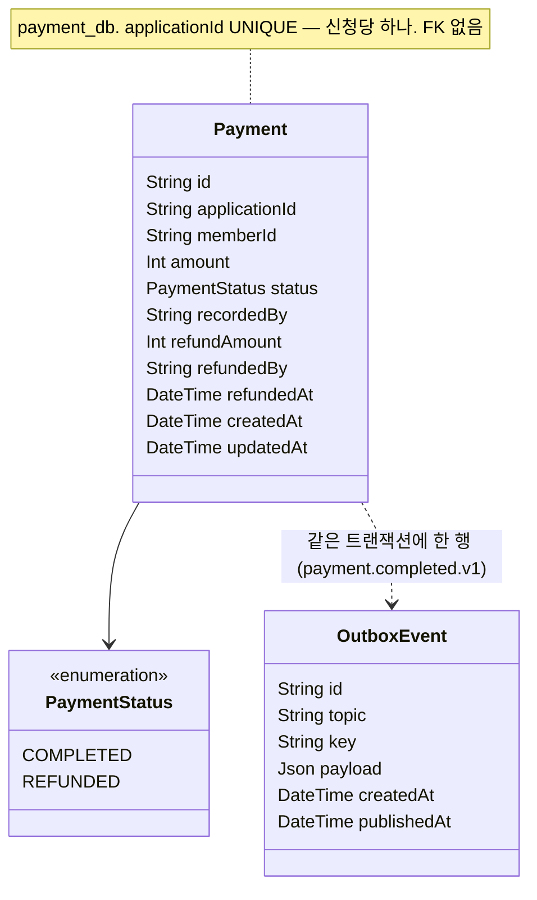
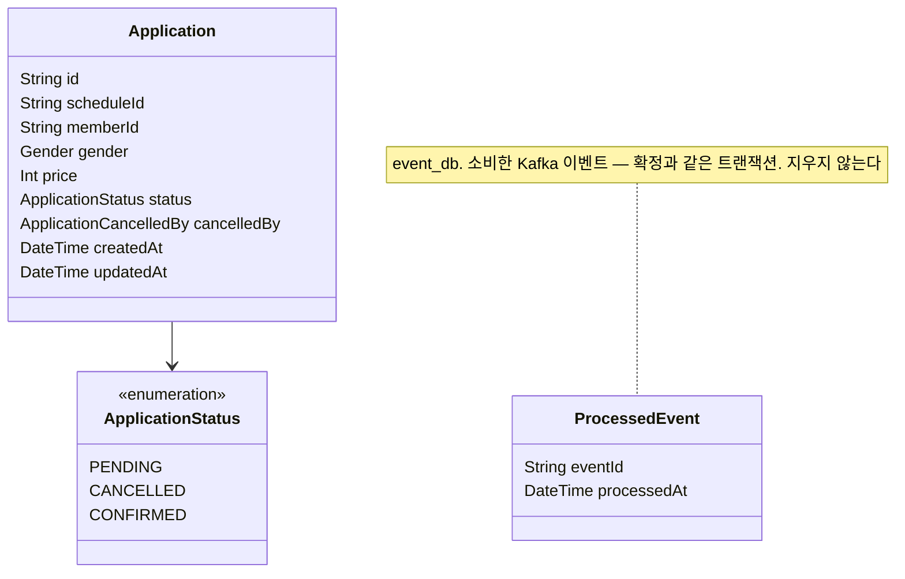
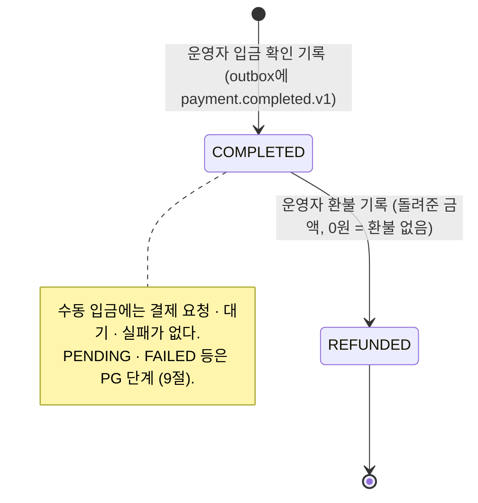
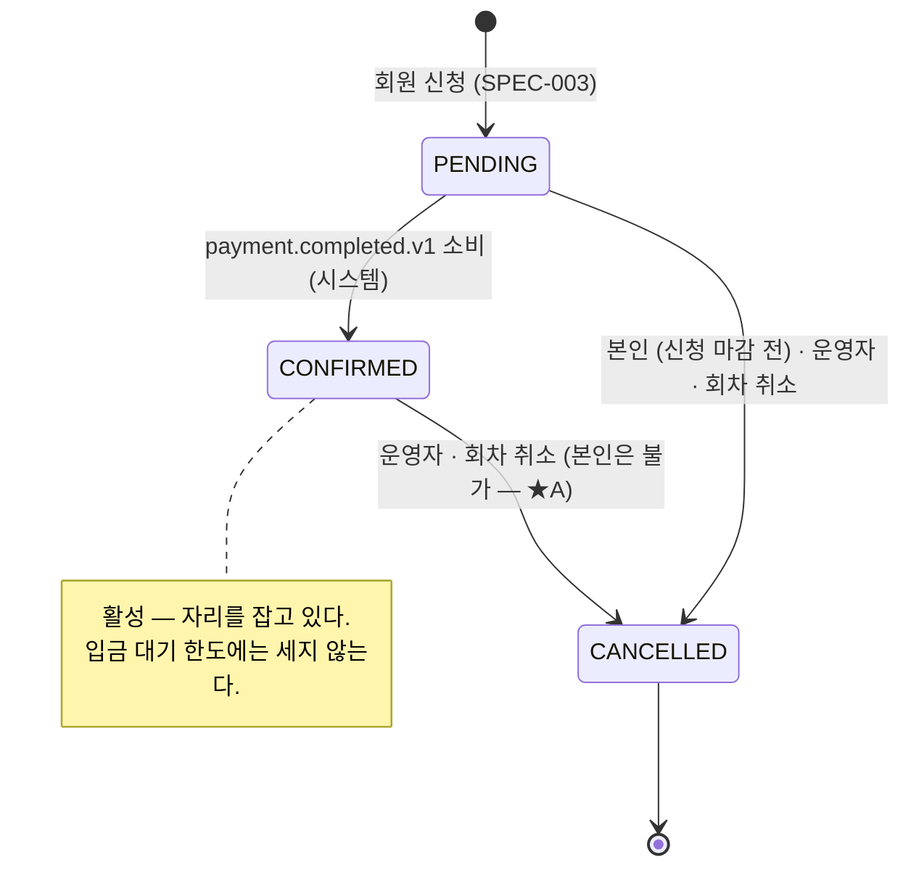
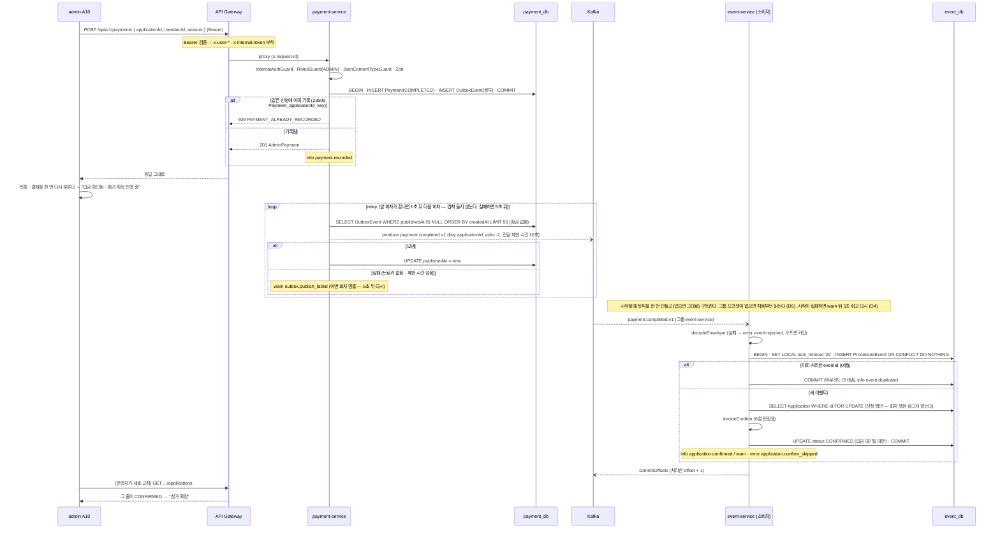
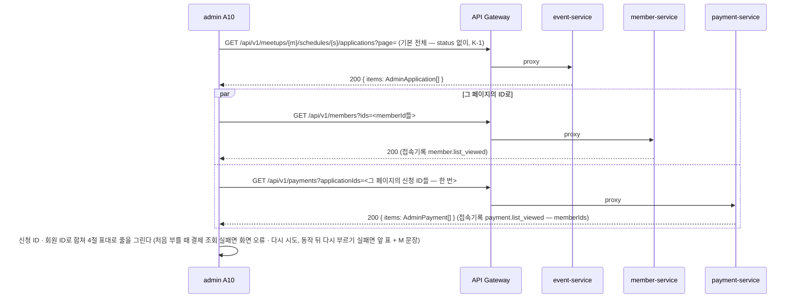

# SPEC-004 결제와 참가 확정 — 입금 확인 기록, 첫 Kafka 이벤트(`payment.completed.v1`)

## 0. 메타

| 항목        | 값                                                                                                                                                                                                                                                                                                                                                                                                                                                                                                                                                                                                                                                                                                                                                                                                                                                                                                                                                                                                                                                                                                                                                                                                                                                                                                                                                                                                                                                                                                                                                                                                                                                                                                                                                                                                                                                                                                                                                                                                                                                                                                                                                                                                                                                                                                                                                                                                                                                                                                                                                                                                                                                                                                                                                                            |
| ----------- | ----------------------------------------------------------------------------------------------------------------------------------------------------------------------------------------------------------------------------------------------------------------------------------------------------------------------------------------------------------------------------------------------------------------------------------------------------------------------------------------------------------------------------------------------------------------------------------------------------------------------------------------------------------------------------------------------------------------------------------------------------------------------------------------------------------------------------------------------------------------------------------------------------------------------------------------------------------------------------------------------------------------------------------------------------------------------------------------------------------------------------------------------------------------------------------------------------------------------------------------------------------------------------------------------------------------------------------------------------------------------------------------------------------------------------------------------------------------------------------------------------------------------------------------------------------------------------------------------------------------------------------------------------------------------------------------------------------------------------------------------------------------------------------------------------------------------------------------------------------------------------------------------------------------------------------------------------------------------------------------------------------------------------------------------------------------------------------------------------------------------------------------------------------------------------------------------------------------------------------------------------------------------------------------------------------------------------------------------------------------------------------------------------------------------------------------------------------------------------------------------------------------------------------------------------------------------------------------------------------------------------------------------------------------------------------------------------------------------------------------------------------------------------- |
| 번호        | SPEC-004                                                                                                                                                                                                                                                                                                                                                                                                                                                                                                                                                                                                                                                                                                                                                                                                                                                                                                                                                                                                                                                                                                                                                                                                                                                                                                                                                                                                                                                                                                                                                                                                                                                                                                                                                                                                                                                                                                                                                                                                                                                                                                                                                                                                                                                                                                                                                                                                                                                                                                                                                                                                                                                                                                                                                                      |
| 상태        | 확정 (2026-10-01 운영자 답변 반영 — 확인 요청 · 개발 승인 모두 추천안)                                                                                                                                                                                                                                                                                                                                                                                                                                                                                                                                                                                                                                                                                                                                                                                                                                                                                                                                                                                                                                                                                                                                                                                                                                                                                                                                                                                                                                                                                                                                                                                                                                                                                                                                                                                                                                                                                                                                                                                                                                                                                                                                                                                                                                                                                                                                                                                                                                                                                                                                                                                                                                                                                                        |
| 작성자      | Claude(초안) / 검토 Yongjae Kwon                                                                                                                                                                                                                                                                                                                                                                                                                                                                                                                                                                                                                                                                                                                                                                                                                                                                                                                                                                                                                                                                                                                                                                                                                                                                                                                                                                                                                                                                                                                                                                                                                                                                                                                                                                                                                                                                                                                                                                                                                                                                                                                                                                                                                                                                                                                                                                                                                                                                                                                                                                                                                                                                                                                                              |
| 작성일      | 2026-09-29                                                                                                                                                                                                                                                                                                                                                                                                                                                                                                                                                                                                                                                                                                                                                                                                                                                                                                                                                                                                                                                                                                                                                                                                                                                                                                                                                                                                                                                                                                                                                                                                                                                                                                                                                                                                                                                                                                                                                                                                                                                                                                                                                                                                                                                                                                                                                                                                                                                                                                                                                                                                                                                                                                                                                                    |
| 최종 갱신   | 2026-10-01 — 운영자 답변 반영으로 확정: 확인 요청 ★A~★F · G · H · I · K(K-1) · L(L-1 · L-2 · L-3) · M · S와 하위 확인(A-1 · E-1)은 모두 추천안, 개발 승인 N · O · P (1) (4) · R (2)는 승인(P (2) (3) · Q · R (1)은 요청하지 않음)이라 0.1절에 답을 적고 본문(1~16절)의 조건부 표현을 결정으로 고쳤다 — ★F의 법무 확인 · 보관 기간 · F-1 · F-2와 I의 정정 기록 · 절차는 운영 투입 전에 남고, 추천에 값이 없는 ★D (1) · (2) · (3) · G (1) · (2) · (6)은 16절에 열린 채로 둔다. 확정자 장소 화면(J)과 이벤트 후보 표의 발행 시점도 이 PR에서 맞췄다. 그 전: 2026-10-01 — 초안. 이벤트 · 토픽 이름 점검(저장소 지식 그래프 + 원문 대조)을 반영했다: 8절 "발행하지 않음" 토픽 칸에 `.v1`, 토픽을 봉투와 같은 contracts 상수로 만든다(7절 입금 확인 · 소비 루프), `decodeEnvelope`가 기대하는 `type` · `version`을 받아 payload보다 먼저 검사하고 reason `UNEXPECTED_TYPE`을 더한다(D8 · 10절 · 13절 · 14절), `buildTopicName`은 입력을 검증하지 않는다, 3절 kafka · contracts README 행. 같은 날 그 수정의 반박 리뷰를 반영했다: 봉투만 먼저 보는 방법(`eventEnvelopeSchema(z.unknown())`)과 근거 문장(10절), `type` 검사 순서 테스트(13절), D8 바뀐 절, 3절 설계서 목록 · 상태 문서 · 상황판 행(착수 PR #41). 2026-09-30 — 초안. 2026-09-29 리뷰(서비스 경계 · 제품 · 보안 · 완결성)를 반영했다: 소비자가 처음부터 읽기와 토픽 준비(D5), 소비 실패의 기본값을 "다시 시도"로(8절), relay 전송 제한 시간과 단일 실행(D4), 순서 문장(8절), `confirmedAt` 삭제(D2), 잘못 누른 입금 확인 절차와 정정 기록(I · 9절), 배포 순서(15절), "환불 필요" → "환불 확인"과 운영자 화면 요약(D15 · G), 운영 투입 · PG · NEXT 확인 요청(S · T · U), 문서 갱신 표 보강(3절). 바뀐 결정은 리드 결정 표의 "리뷰 반영" 문장에 적었다. 같은 날 2차 리뷰(검증 · 단순화)를 반영했다: 소비 실패 분류를 셋으로(8절), A10 기본 필터 "전체"와 요약 · 결과 알림 · 자동 다시 부르기 삭제(D15 · K-1), 정정 기록을 운영 투입 전으로(I · 9절), 환불 응답 한 갈래(D14), relay 점검 타이머 · 열 삭제(D4), payload 금액 삭제(D14), 입금 계좌를 web 설정으로(★D), CI Kafka · e2e를 Step 8로(P), J · T · U를 16절로, PR 여덟 개로(15절). 2026-09-30 3차 리뷰(검증)를 반영했다: 시작할 때의 브로커 연결 · 토픽 만들기 · 구독 실패는 프로세스를 끝내지 않는다(D4), 7번 PR부터 브라우저 e2e에 payment-service(P (4)), F-1이 "지우면 안 된다"일 때 Step 4 모양이 바뀌는 예외(0.1 태그 · I · 9 · 15절), L · S 태그, J-2 분기 문서를 6b PR로. 같은 날 4차 리뷰(검증)를 반영했다: D6 복구 문장을 취소된 경우로 옮기고 신청 없음 · 회원 다름의 길을 따로 적음, 동작 뒤 다시 부르기 실패는 결제 조회여도 M 문장이고 화면 전체 오류는 처음 부를 때만(D15 · 4 · 10 · 13절), 60초 경계를 "60초 이상"으로, 태그 정의의 예외 둘(F-1 · L-1 (나)) · 빠른 목록 태그 · H를 [착수 전]으로(0.1), 문서 표 보강(3 · 15절), SPEC-003 인용 고침 |
| 관련 Step   | Step 4                                                                                                                                                                                                                                                                                                                                                                                                                                                                                                                                                                                                                                                                                                                                                                                                                                                                                                                                                                                                                                                                                                                                                                                                                                                                                                                                                                                                                                                                                                                                                                                                                                                                                                                                                                                                                                                                                                                                                                                                                                                                                                                                                                                                                                                                                                                                                                                                                                                                                                                                                                                                                                                                                                                                                                        |
| 관련 ADR    | ADR-004(서비스 경계 — payment가 결제 상태 · 이력 소유, Trade-offs "신청과 결제가 서비스 경계를 넘는다"), ADR-005(결정 2 `payment.completed` → 참가 확정, Trade-offs 최종 일관성 · 멱등 · 이중 쓰기), ADR-006(Kafka — `packages/kafka`, Outbox 검토 의무), ADR-007(Database per Service), ADR-009(내부 토큰), ADR-010(플랫폼 패키지 — 결정 1 · 6의 목록을 ADR-012가 넓힌다), ADR-011(결정 6 — 호출자 문맥 없는 호출), ADR-001(서술 "환불 → 정원 반환"의 해석), **새 ADR-012 "이벤트 발행 · 소비 신뢰성"**(D4 · D5 · D8)                                                                                                                                                                                                                                                                                                                                                                                                                                                                                                                                                                                                                                                                                                                                                                                                                                                                                                                                                                                                                                                                                                                                                                                                                                                                                                                                                                                                                                                                                                                                                                                                                                                                                                                                                                                                                                                                                                                                                                                                                                                                                                                                                                                                                                                        |
| 주요 서비스 | payment-service(입금 확인 · 환불 기록, outbox · relay) / event-service(`payment.completed.v1` 소비, 참가 확정 상태) / admin / web (+ `packages/contracts` · `packages/kafka` · `packages/api-client` · `packages/service-kit`)                                                                                                                                                                                                                                                                                                                                                                                                                                                                                                                                                                                                                                                                                                                                                                                                                                                                                                                                                                                                                                                                                                                                                                                                                                                                                                                                                                                                                                                                                                                                                                                                                                                                                                                                                                                                                                                                                                                                                                                                                                                                                                                                                                                                                                                                                                                                                                                                                                                                                                                                                |
| 리뷰어      | Yongjae Kwon (1인 개발 셀프 리뷰 — `docs/guides/pull-requests.md` 4절의 예외)                                                                                                                                                                                                                                                                                                                                                                                                                                                                                                                                                                                                                                                                                                                                                                                                                                                                                                                                                                                                                                                                                                                                                                                                                                                                                                                                                                                                                                                                                                                                                                                                                                                                                                                                                                                                                                                                                                                                                                                                                                                                                                                                                                                                                                                                                                                                                                                                                                                                                                                                                                                                                                                                                                 |

## 0.1 확인 요청 사항

**답변 완료** — 운영자(Yongjae Kwon)가 2026-10-01에 확인 요청 ★A · ★B · ★C · ★D · ★E · ★F · G · H · I · K(K-1 포함) · L(L-1 · L-2 · L-3) · M · S와 개발 승인 N · O · P · Q · R에 **모두 추천안으로** 답했다(하위 확인 A-1 · E-1도 추천대로). 답한 것은 기본안과 그 시점이다 — 법무가 필요한 ★F의 법무 확인 · 보관 기간 · F-1 · F-2와, F-1 답 뒤에 만드는 I의 정정 기록 · 절차는 추천대로 **운영 투입 전**에 남는다. 추천에 값이 없던 물음(★D (1) 계좌 값 · (2) 입금자명 규칙 · (3) 지금 계좌를 알리는 방식, G (1) 환불 규정 문장 · (2) 환불 수단 · (6) 입금한 분의 본인 취소 안내 문장)은 항목에 남은 시점을 적고 16절에 열어 둔다.

팜플렛 · 운영 메시지 · SPEC-001~003의 운영자 답에 근거가 없는 제품 규칙은 리드가 정하지 않고 여기에 올렸다. 항목마다 **결정**(답한 추천안 — 본문 1~16절이 이대로 쓰여 있다), 채택하지 않은 대안, 바뀌면 고칠 절을 적었다. "채택하지 않은 대안"과 "바뀌면"(나중에 결정을 바꿀 때 고칠 절)은 기록으로 남긴다. 체크된 기록이며 지우지 않는다(템플릿 규칙).

- ★는 설계 전체에 영향이 큰 항목이다.
- **[착수 전]** — 스키마나 코드의 모양을 가르는 항목이다. 구현 PR(15절 2번 이후)을 시작하기 전에 답이 있어야 한다.
- **[해당 PR 전]** — 모양은 그대로이고 문구 · 화면 · 절차만 갈린다. 적힌 PR 전에 답하면 된다.
- **[운영 투입 전]** — Step 4 구현(15절)의 모양은 그대로이고, 실제 운영에 쓰기 전(S)에 답이 있어야 한다.
- **태그 정의의 예외 셋** — 답에 따라 모양이 바뀌지만 착수를 막지 않고 SPEC-004 개정으로 한다. (1) ★F F-1의 답이 "지우면 안 된다"여서 I가 대안 (b)로 바뀌면 Step 4가 만든 결제 모양이 바뀐다 — Step 4 뒤의 개정(9절 "운영 투입 전에 더할 것"). (2) L-1의 답이 (나)(탈퇴하면 자동 취소)나 (다)(탈퇴 화면에서 먼저 안내)면 member_db outbox와 event-service 두 번째 소비자, 또는 member → event 조회(ADR-011 허용 목록 변경)가 생긴다 — 6b PR 뒤 · 8번 PR 전의 개정(L · 16절). 2026-10-01 답이 (가)라 지금은 해당 없다. (3) ★F의 보관 항목은 법무 확인 전 기본안으로 착수하고, 운영 투입 전 법무 답이 다른 보관 항목을 요구하면 Step 4가 만든 결제 모양을 고친다 — Step 4 뒤의 개정(15절 "Step 4 완료 ≠ 운영 투입").
- 운영자 항목은 화면에서 보이는 모습으로 썼다. 코드 · 상태 코드 · 절 번호는 "바뀌면" 줄에 모았다.

빠른 목록:

- [★A 참가가 확정된 신청은 누가 취소할 수 있나요?](#q-a) [착수 전]
- [★B 입금 기한을 두나요?](#q-b) [착수 전]
- [★C 참가 확정 알림톡은 Step 4에서 시스템이 보내나요?](#q-c) [착수 전]
- [★D 입금 계좌와 입금 방법을 어떻게 알리나요?](#q-d) [착수 전]
- [★E 받은 금액이 참가비와 다를 때, 참가비 0원 회차](#q-e) [착수 전]
- [★F 결제 기록에 무엇을 남기고 얼마나 보관하나요? (법무)](#q-f) [착수 전 — 보관 항목(기본안)] · [운영 투입 전 — 법무 확인 · F-1 · 기간 · F-2, 항목이 바뀌면 예외 (3)]
- [G 환불 규정 · 환불하지 않는 취소 · 취소된 신청에 들어온 입금](#q-g) [착수 전] · [H 입금 대조 화면 (SPEC-003 J-1 답과 다른 추천)](#q-h) [착수 전]
- [I 입금 확인을 잘못 눌렀을 때](#q-i) [운영 투입 전 — F-1 답 뒤. 대안 (a)면 착수 전, (b)면 예외 (1)]
- [K 화면 문구 · 신청 목록 기본 필터](#q-k) [4번 · 7번 PR 전] · [L 탈퇴 · 정지 회원의 신청](#q-l) [L-1 · L-2: 8번 PR 전(L-1 (나)면 예외 (2)), L-2 대안이면 착수 전, L-3: 7번 PR 전] · [M 운영자 동작 직후 목록 다시 불러오기 실패 문구](#q-m) [7번 PR 전]
- [S 실제 운영 투입 시점](#q-s) [설계서 확정 PR 전] · [J · T · U — 확인 요청에서 뺐다](#q-jtu)
- 개발 승인: [N Kafka 클라이언트 의존성](#q-n) · [O 워크스페이스 의존](#q-o) · [P CI 변경](#q-p) · [Q `partialIndexes`](#q-q) · [R compose 변경](#q-r)

### 운영자 확인 결과 (A~I · K~M · S — 2026-10-01)

- [x] <a id="q-a"></a>**★A 참가가 확정된 신청은 누가 취소할 수 있나요?** [착수 전] — **답변(2026-10-01): 추천안.** 참가가 확정된 신청은 본인이 취소할 수 없고 운영자는 언제든 취소할 수 있다. 하위 확인 A-1도 추천대로다(아래).
  - 근거: SPEC-003 C "확정 뒤의 취소와 환불은 결정 예정 (Step 4)". 환불 규정은 어느 문서에도 없다. 지금 서버의 취소 판정(`decideCancel`, `apps/event-service/src/applications/application-rules.ts:110-122`)은 "취소가 아니면 취소할 수 있다"라서, 확정 상태를 더하는 순간 **본인이 신청 마감 전에 확정 신청을 버튼 하나로 취소할 수 있게 된다**(운영자 알림 없음 — 알림은 Step 7). 참가자 웹은 이미 입금 대기에만 취소 버튼을 보인다(`canCancelMine`, `apps/web/lib/applications.ts:67`) — 서버와 화면이 어긋난다.
  - 결정: **참가가 확정된 신청은 본인이 취소할 수 없다.** 참가자 화면(일정 상세 W9 · 내 신청 W10 모두)에는 취소 버튼 대신 "참가가 확정된 신청은 직접 취소할 수 없습니다. 오늘사이에 문의해 주세요."(K)가 보인다. 운영자는 확정 신청도 언제든 취소할 수 있고(자리가 돌아간다), 돌려준 돈은 운영자가 "환불 기록"으로 따로 적는다(G, D11). 정지 · 탈퇴한 회원의 확정 신청도 지금처럼 운영자가 판단한다(SPEC-003 K, 이 문서 L).
  - 이유: 입금한 사람의 취소는 환불과 한 몸인데 환불 규정 · 수단이 아직 없다. 본인 취소를 열면 운영자는 취소를 모른 채 환불 요청을 받게 된다. 운영자 취소는 이미 "언제든"이다(SPEC-003 C).
  - 알아 둘 점: 확정된 분이 문의해 운영자가 대신 취소하면 "운영자 취소"가 되어, 그 회차에는 다시 신청할 수 없고(SPEC-003 F 결정 3) 내 신청 카드에는 "오늘사이에서 취소했습니다."가 보입니다. 입금 대기인 분은 직접 취소하고 다시 신청할 수 있으므로, 신청 마감 전이라도 확정된 분이 더 불리해집니다.
  - 하위 확인 A-1: 본인 요청으로 운영자가 대신 취소한 확정 신청은 그 회차에 다시 신청할 수 있어야 하나요? — **답변(2026-10-01): 추천안.** 지금 규칙대로 다시 신청할 수 없다 — 요청이 생기면 다시 묻는다. 채택하지 않은 대안: 운영자 취소 창에 "본인 요청" 표시를 두어 다시 신청을 막지 않는다(취소 주체 값이나 열이 는다 — 5 · 6 · 9 · 13절, `apps/event-service/src/applications/applications.service.ts:225`, `apps/web/lib/applications.ts:129`).
  - 채택하지 않은 대안: (a) 입금 대기와 같게 신청 마감 전까지 본인 취소(환불 안내 · 운영자 알림 수단이 없다). (b) 행사 N일 전까지 본인 취소(새 기준 시각). (c) 운영자도 확정 신청은 취소할 수 없다(회차 취소로만).
  - 바뀌면: 4 · 6 · 7 · 13절, D10, 서버 `decideCancel`과 web `canCancelMine`을 한 규칙으로, 3절 표의 "직접 취소" 문장들.
- [x] <a id="q-b"></a>**★B 입금 기한을 두나요? 기한이 지나면 자동으로 취소하나요?** [착수 전] — **답변(2026-10-01): 추천안.** 입금 기한과 자동 취소를 두지 않는다 — 입금하지 않은 신청은 지금처럼 운영자가 판단해 취소한다.
  - 근거: SPEC-003 B "입금 기한 · 자동 취소는 결정 예정 (Step 4)". 입금 기한은 어느 문서에도 없다. ADR-004 Trade-offs "결제 대기 신청의 만료 처리". 지금은 입금하지 않은 신청을 운영자가 신청 목록에서 취소한다(`docs/overview/features/application.md:132`).
  - 결정: **두지 않는다**(지금대로). 자리 묶기는 입금 대기 한도(한 사람당 하나)와 회원 정지가 막는다(SPEC-003 F · K). 운영자는 신청 목록의 신청 시각을 보고 판단해 취소한다.
  - 이유: 기한과 자동 취소는 첫 예약 작업(SPEC-002 D8은 예약 작업을 두지 않았다), 새 취소 주체, 만료 직전 입금과의 경합, 참가자 안내(Step 7 전에는 수단이 없다)를 함께 가져온다. 기한 값 자체가 제품 규칙이라 리드가 정할 수 없다.
  - 알아 둘 점: 기한 안내가 없으면 참가자는 언제까지 입금해야 하는지 모르는 채로 미입금 취소를 당할 수 있고, 운영자가 취소한 회차에는 다시 신청할 수 없습니다(SPEC-003 F 결정 3). 자동 취소 없이 기한 안내만 두는 길(아래 (iii))도 있습니다.
  - 채택하지 않은 대안: 기한 (a) 신청 뒤 N시간 (b) 신청 마감 시각까지(신청 마감 기본값이 시작 시각이라 당일까지 미입금 자리가 남는다) (c) 행사 N일 전까지. 기한이 지나면 (i) 자동 취소 (ii) 운영자 화면에 "기한 지남"만 표시 (iii) **참가자 화면에 기한 안내만 두고 자동 취소는 없다** — 기한 문장은 운영자가 주고 ★D 입금 계좌 안내 옆에 한 줄로 보인다. 지나면 지금처럼 운영자가 판단해 취소한다(예약 작업 · 새 취소 주체 없음).
  - 나중에 기한 + 자동 취소를 더하게 되면 그때 설계서를 고친다(D12) — 새 열 · 취소 주체 · 예약 작업이 생기고, 회차 취소 연쇄와 잠금 순서가 엇갈리지 않게 한다(교착). 기한이 지나 취소된 회차에 다시 신청할 수 있는지도 그때 묻는다.
  - 바뀌면: 자동 취소면 5 · 6 · 9 · 11 · 13 · 14 · 15절, D12. (iii)이면 4절(입금 계좌 안내 옆 한 줄 — ★D의 web 설정) · K.
- [x] <a id="q-c"></a>**★C 참가 확정 알림톡은 Step 4에서 시스템이 보내나요?** [착수 전] — **답변(2026-10-01): 추천안.** Step 4는 참가 확정 상태까지 만들고, 확정 알림톡은 Step 7 전까지 운영자가 신청 목록에서 "참가 확정"을 본 뒤 직접 보낸다.
  - 근거: 운영자 여정 3 "계좌 입금을 확인해 신청을 '참가 확정'으로 바꿉니다. 이때 확정 알림톡이 나갑니다."(`docs/overview/project-overview.md` 3장). 참가자 화면이 이미 "입금 확인 전입니다. 확인되면 알림톡으로 알려드릴게요."를 약속한다(디자인 파운데이션 6절, `application.md` 42 · 69줄). 알림 서비스와 정보성 템플릿 전환은 Step 7이다(용어 사전 '알림톡'). 기능 소개서 목록의 참가 확정은 "Step 4, 7"로 나뉘어 있고, Step 4 구간에 누가 보내는지는 어느 문서에도 없다.
  - 결정: **Step 4는 참가 확정 상태까지 만들고, 확정 알림톡은 Step 7 전까지 운영자가 지금처럼 직접 보낸다. 보내는 때는 신청 목록을 다시 불러와(새로 고침) 그 줄이 "참가 확정"으로 바뀐 것을 본 뒤다**(D15). "반영 중" · "바뀌지 않았습니다" · "환불 확인"인 줄에는 보내지 않는다. "알림톡 보냄" 표시는 만들지 않는다.
  - 이유: 참가 확정은 입금 확인 기록과 몇 초 차이로 따로 일어나고(ADR-005 결정 2), 기록 직후 신청이 취소되면 끝내 확정되지 않는다(6절 판정표 3번). 기록하자마자 보내면 확정되지 않은 사람에게 "참가가 확정되었습니다"가 갈 수 있다(ADR-005 Trade-offs "시차를 숨기지 않고 드러낸다"). Step 7 전에는 시스템이 알림톡을 보내지 않으므로, 그동안 시스템에서 확정된 신청의 "알림톡으로 알려드릴게요" 약속은 운영자가 지킨다(실제 운영 투입 시점은 결정 예정 (Step 8) — S).
  - 알아 둘 점: 보냄 표시가 없어서 누구에게 보냈는지는 운영자가 따로 기억해야 합니다. 여러 명을 한꺼번에 확인하면 빠뜨리거나 두 번 보낼 수 있습니다.
  - 채택하지 않은 대안: (a) Step 7의 확정 알림톡 하나를 Step 4로 당긴다 — notification-service 첫 소비자, 카카오 발송 연동 · 템플릿 전환, 받는 사람 이름 · 휴대폰 조회(ADR-011 밖의 호출자 문맥 없는 조회 → 새 ADR)가 함께 온다. (b) A10에 "알림톡 보냄" 체크를 둔다 — 빠뜨림 · 중복을 줄이지만 기록할 곳(event_db 열 또는 새 표) · 운영자 API · 화면이 는다.
  - 바뀌면: 2 · 4 · 8 · 10 · 12 · 15절, 3절 표(SPEC-001 1절 "참가 확정 알림톡(Step 4 · 7)" 문장, 개요 소개서 운영자 여정 3, 기능 소개서 `participation-confirmation.md`).
- [x] <a id="q-d"></a>**★D 신청한 사람에게 입금 계좌와 입금 방법을 어떻게 알리나요?** [착수 전] — **답변(2026-10-01): 추천안.** 계좌는 참가자 웹의 빌드 설정 한 줄 `NEXT_PUBLIC_DEPOSIT_ACCOUNT`로 두고 참가비가 있는 입금 대기 신청에만 보인다. 알아 둘 점 세 가지도 받아들였다. 물을 것은 열어 둔다: (1) 계좌 값은 운영 투입 전에 운영자가 주어 설정으로 넣고, (2) 입금자명 규칙은 추천에 값이 없어 정해질 때까지 입금자명 안내 없이 계좌만 보이며, (3) 지금 신청자에게 계좌를 알리는 방식도 추천에 값이 없어 8번 PR(기능 소개서) 전에 확인한다(16절).
  - 근거: SPEC-003 O "입금 방법 안내는 Step 4가 만든다", SPEC-002 D3 "입금 계좌 안내는 payment 영역". 지금 신청 화면에는 계좌 문장이 없다(`application.md:27` · 134 · 170). 계좌번호 · 은행 · 예금주 값과 입금자명 규칙은 저장소에 없다 — 운영자만 줄 수 있다. 근거 없는 약속("따로 안내드릴게요")은 쓰지 않는다(SPEC-003 O).
  - 물을 것: (1) 계좌 값(은행 · 계좌번호 · 예금주). (2) 입금자명 규칙(실명 그대로 / 실명 + 휴대폰 뒷자리 등 — 동명이인 · 가족 명의 입금 처리). (3) 지금은 신청자에게 계좌를 어떻게 알리는지.
  - 결정: 계좌를 **참가자 웹의 빌드 설정 한 줄 `NEXT_PUBLIC_DEPOSIT_ACCOUNT`**(운영자가 "{은행} {계좌번호} ({예금주})"를 한 문자열로 준다)로 두고, **참가자 웹의 입금 대기 신청**(일정 상세의 신청 영역 · 내 신청 카드)에만 보인다. 값이 비어 있으면 안내를 숨긴다. 참가비 0원 신청에는 보이지 않는다(★E). 문구는 "입금 계좌 {설정 문자열}"과 입금자명 안내(규칙이 정해지면) — K. payment-service에는 계좌 경로를 두지 않는다(결제 경로는 모두 ADMIN).
  - 이유: 표시 전용 값이라 돈 · 확정 경로와 상관이 없고, 계좌를 바꾸려면 어느 쪽에 두든 다시 배포해야 한다. web에는 빌드 시점 공개 설정의 선례가 있다(`NEXT_PUBLIC_API_URL`, `apps/web/lib/api.ts:11-14` — 읽는 곳을 한 곳으로 둔다). 서버 경로로 두면 계좌 한 줄 때문에 payment-service의 첫 회원 경로 · 계약 · api-client 메서드 · 조회 실패 문구 · 라우트 규칙이 는다.
  - 알아 둘 점: (1) SPEC-002 D3 "입금 계좌 안내는 payment 영역"에 "표시 값은 web 설정" 한 줄을 고칩니다. (2) 계좌가 참가자 웹의 공개 파일에 들어가 로그인하지 않은 사람도 읽을 수 있습니다(화면에는 입금 대기 신청에만 보입니다). (3) 계좌를 바꾸려면 설정을 바꿔 참가자 웹을 다시 배포합니다.
  - 채택하지 않은 대안: (a) 로그인한 회원에게만 보인다 — payment-service 회원 전용 `GET /api/v1/payments/deposit-account`, env 한 문자열 `DEPOSIT_ACCOUNT`(구조화 계약 · "셋 다 있거나 없다" 검사 없이 문자열 그대로). 경로 · 컨트롤러 · api-client 메서드 · 조회 실패 문구 · 라우트 목록의 MEMBER 허용 규칙이 늘고, web 조회는 6b PR 뒤에 붙는다. (2)를 받아들일 수 없으면 이것을 고른다. (b) 회차마다 계좌(event `Schedule` 열 · 회차 폼 · 마이그레이션). (c) 화면에 두지 않고 운영자가 신청 목록을 보고 연락한다(연락 주기를 기능 소개서에 적는다 — SPEC-003 O의 대안 (1)).
  - 바뀌면: 4 · 13 · 15절(4번 PR), web env(`.env.example` · README), 3절 용어 '입금 계좌' · SPEC-002 D3 줄. (a)면 7 · 10 · 12 · 13 · 15절(6b PR), payment-service env, 라우트 목록 허용 규칙.
- [x] <a id="q-e"></a>**★E 받은 금액이 참가비와 다를 때, 참가비 0원 회차** [착수 전] — **답변(2026-10-01): 추천안.** 운영자가 받은 금액을 적고, 참가비와 달라도 경고 뒤 기록하면 확정된다. 0원 신청도 같은 "입금 확인"(0원)으로 확정한다. 하위 확인 E-1도 추천대로다(아래).
  - 근거: 낼 금액은 신청할 때 적어 둔 신청 참가비다(SPEC-003 D1 "Step 4가 받을 금액이기도 하다"). 부분 입금 · 초과 입금 규칙은 문서에 없다. 참가비 0원 회차를 만들 수 있다(SPEC-002 D3 — 0 이상 1,000,000 이하).
  - 결정: 운영자가 "입금 확인" 창에 **받은 금액**을 적는다(처음 값은 신청 참가비). 참가비와 다르면 창이 "신청 참가비(N원)와 다릅니다."로 알리고, 그래도 기록할 수 있으며 기록하면 참가가 확정된다 — 판단은 운영자다. 차액 처리(추가 입금 받기 · 일부 돌려주기)는 시스템 밖이다. **0원 신청도 같은 "입금 확인"을 0원으로 기록해 확정한다**(확정 경로가 하나로 남는다). 0원 신청에는 입금 계좌 안내를 보이지 않는다(★D).
  - 이유: 부분 · 초과 입금의 규칙이 문서에 없어 운영자가 판단한다. 확정 경로를 하나(입금 확인 → `payment.completed.v1`)로 두면 소비자 · 대사 점검(9절) · 화면이 0원을 따로 다루지 않는다.
  - 알아 둘 점: (1) 0원 신청자도 운영자가 "입금 확인"(0원)을 누르기 전까지 "입금 대기" 배지와 "입금 확인 전입니다. 확인되면 알림톡으로 알려드릴게요."를 봅니다 — 낼 돈이 없는데 입금을 기다리는 화면입니다. 0원 신청의 안내 문구는 K 답(기본안)대로 따로 두지 않습니다. (2) 운영자는 0원 신청마다 "입금 확인"을 눌러야 합니다. (3) 초과 입금의 일부를 돌려줘도 시스템에는 기록되지 않습니다(환불 기록은 취소된 신청에만 있습니다 — E-1).
  - 하위 확인 E-1: 참가 확정된 신청에 일부 돌려준 돈을 기록해야 하나요? — **답변(2026-10-01): 추천안.** 기록하지 않는다(시스템 밖). 채택하지 않은 대안: 확정 신청에도 "환불 기록"을 열고, "참가 확정 · 환불 기록됨"을 이상이 아닌 정상 표시로 바꾼다(4 · 6 · 7 · 11절).
  - 채택하지 않은 대안: (a) 참가비와 같을 때만 기록할 수 있다(차액을 받은 뒤 기록). (b) 0원 신청은 신청 즉시 확정 — event-service에 결제 없는 두 번째 확정 경로가 생긴다(ADR-005 결정 2와 다른 계기). (c) 0원 회차를 막는다(SPEC-002 D3 개정).
  - 바뀌면: 4 · 6 · 7 · 8 · 13절, D14, 6절 소비자 판정표.
- [x] <a id="q-f"></a>**★F 결제 기록에 무엇을 남기고 얼마나 보관하나요? (법무)** [착수 전 — 보관 항목(기본안)] · [운영 투입 전 — 법무 확인 · F-1 · 기간 · F-2, 항목이 바뀌면 0.1 태그 정의의 예외 (3)] — **답변(2026-10-01): 추천안.** 보관 항목은 기본안(회원 ID · 신청 ID · 받은 금액 · 기록 시각 · 기록한 운영자 · 환불 기록)으로 착수한다. 법무 확인 · 보관 기간 · 파기 절차 · F-1 · F-2는 추천대로 운영 투입 전에 남는다(16절).
  - 근거: SPEC-001 D10 "법령상 보관 대상은 Step 4에서 payment-service가 자기 DB에 분리 보관한다". 회원 서비스는 탈퇴하면 이름 · 휴대폰 · 성별 · 출생연도를 바로 지운다(SPEC-001 12절). 참가자 FAQ가 "결제 기록처럼 법으로 보관해야 하는 항목의 처리 방식은 결정 예정 (Step 4)"이라고 약속했다(`docs/overview/features/signup-login.md:70`). 보관 기간 숫자는 저장소에 없다(SPEC-001 16절 "법무 확인 권장"). 결제 데이터는 감사 요구가 있다(ADR-004:48, ADR-007:30).
  - 결정(기본안 — 법무 확인 전 임시): 결제 기록에는 **회원 ID · 신청 ID · 받은 금액 · 기록 시각 · 기록한 운영자 · 환불 기록**만 둔다. 이름 · 휴대폰 · 입금자명은 두지 않는다. 결제 기록은 탈퇴해도 지우지 않는다. 보관 기간과 파기 절차는 법무 확인 뒤 정한다(16절).
  - 이유: 결제 기록의 최소 사실은 "누구의 어느 신청에서 얼마를 받았고 누가 확인했는가"다. 이름 · 휴대폰의 원천은 member_db 하나로 둔다(SPEC-001 D10). 탈퇴 이벤트를 받아 그때 이름 · 휴대폰을 가져오는 길은 없다 — 탈퇴하면 익명화가 먼저 일어난다(SPEC-001 12절).
  - 알아 둘 점: 이 기본안대로면 탈퇴한 회원의 결제 기록은 누구의 것인지 알 수 없게 되어, 환불이 필요해도 시스템 안에서는 연락처를 찾을 수 없습니다(L-2).
  - 하위 확인(법무) — **운영 투입 전에 남는다**(2026-10-01 답은 아래 기본안과 그 시점이다): **F-1** 잘못 누른 입금 확인의 결제 기록을 지워도 되나요? I 결정은 지우기 전에 결제 DB 안에 정정 기록(지운 행 전체 · 사유 — 요청한 운영자는 사유에 적는다)을 남긴다. 거래 기록을 지우면 안 된다면 I 대안 (b)(지우지 않고 무효 표시)로 바꾼다 — 정정 기록과 절차는 운영 투입 전에 이 답대로 만든다(15절). (b)면 Step 4가 만든 결제 기록의 모양도 Step 4 뒤에 고친다(9절 — 0.1 태그 정의의 예외 (1)). **F-2** 보관 · 파기 규칙이 `Payment` 말고 그 사본에도 같이 적용되나요 — 보낸 이벤트 기록(`OutboxEvent.payload`의 회원 ID), Kafka 토픽 보존분, 정정 기록(`PaymentCorrection`), 로그(`payment.*`, `application.cancelled`의 `wasConfirmed` — 누가 입금한 신청을 취소했는가).
  - 채택하지 않은 대안: (a) 입금 확인 때 운영자가 **입금자명**을 적어 둔다(열 `payerName` — 은행 거래내역과 대조되는 값, 개인정보가 는다). (b) 입금 확인 때 이름 · 휴대폰을 결제 기록에 복사한다(admin이 보낸 값을 저장 — 회원 원천과 어긋날 수 있고 개인정보 원천이 하나 더 생긴다).
  - 바뀌면: 5 · 7 · 9 · 12절, D1, I, `signup-login.md:70`, SPEC-001 16절, L(event_db의 `memberId` · 성별 정리).
- [x] <a id="q-g"></a>**G 환불 규정, 환불하지 않는 취소, 취소된 신청에 들어온 입금** [착수 전] — **답변(2026-10-01): 추천안.** 규정 계산은 만들지 않고, 운영자가 시스템 밖에서 돌려준 뒤 "환불 기록"에 금액을 적는다(돌려주지 않으면 0원 = "환불 없음"). 취소된 신청에 들어온 입금도 같은 "입금 확인"으로 기록한다. 물을 것 (4) · (5) · (7)은 이 결정으로 정해졌고 (3)은 지금대로(사유 없음) 두며, 추천에 값이 없는 (1) 규정 문장 · (2) 환불 수단 · (6) 안내 문장은 열린 채로 둔다(16절).
  - 근거: "환불 규정은 결정 예정 (Step 4)"(`application.md:143` · 186), 회차 취소 환불(SPEC-003 I). 누가 어떻게 돌려주는지, 돌려주지 않는 취소가 있는지는 문서에 없다. 지금 참가자는 입금한 뒤에도 운영자가 확인하기 전이면 신청 마감 전까지 직접 취소할 수 있다(`application.md:143` — ★A 결정은 참가 확정만 막는다). 운영자는 미입금으로 보고 취소한 뒤에 늦은 입금을 받을 수도 있다(★B 결정 — 기한 없음, 운영자가 취소).
  - 결정: 규정 계산(시점별 비율 · 수수료)은 만들지 않는다. 입금이 확인된 신청이 취소되면 신청 목록에 **"환불 확인"** 이 보이고, 운영자가 시스템 밖에서 돌려준 뒤 "환불 기록"에 돌려준 금액을 적는다(D11). **돌려주지 않기로 했으면 0원으로 기록해 "환불 없음"으로 닫는다.** 순서는 신청 취소 → (돌려주기) → 환불 기록. 회차를 취소하면 확정된 신청도 함께 취소되고(SPEC-003 I) 그 줄에 "환불 확인"이 보인다. 취소된 신청에 입금이 들어오면 그 줄의 같은 **"입금 확인"**(창 문장만 다르다)으로 받은 돈을 기록하고, 곧바로 "환불 확인"으로 보인다(소비자는 판정표 3번대로 확정하지 않는다).
  - 이유: 환불 규정 · 수단은 제품 규칙이라 리드가 정할 수 없다. "입금이 확인된 신청이 취소되면 늘 환불한다"는 규칙도 문서에 없어서, 표시는 "환불 필요"가 아니라 규칙 중립적인 "환불 확인"으로 두고 끝내는 방법(0원 기록)을 함께 둔다. 받은 돈의 사실은 신청 상태와 상관없이 payment_db에 남긴다(D1).
  - 물을 것(답: (3)은 추천에 따로 없어 지금대로 둔다 — SPEC-003 J-3(사유 없음), 다르게 원하면 16절 "추천에 값이 없던 물음"으로 옮긴다, (4) 0원 기록 = 환불 없음, (5) 같은 "입금 확인", (7) 개발자 절차 · 409. (1) · (2) · (6)은 열려 있다): (1) 참가자 FAQ의 "환불 규정은 결정 예정 (Step 4)"을 무엇으로 바꿀지(규정 문장). (2) 환불 수단(계좌로 돌려준다면 환불 계좌를 어떻게 받는지). (3) 운영자 취소 사유(SPEC-003 J-3 — 사유 없음)를 환불 때문에 다시 둘지. (4) **환불하지 않는 취소가 있나요?**(노쇼로 시작 뒤 운영자가 취소, 마감 뒤 취소, 본인 사유 등) — 있다면 "0원 기록 = 환불 없음"으로 괜찮은지. (5) **취소된 신청에 입금이 들어오면 어떻게 기록하나요?** 결정은 결제 없는 취소 줄의 같은 "입금 확인"이다. 채택하지 않은 대안은 시스템 밖 기록(결제 사실이 payment_db에 없다). (6) 입금한 분의 본인 취소 안내(`application.md:143` "이미 입금한 분도 신청 마감 전이면 직접 취소할 수 있고, 운영자에게 알림이 가지 않습니다")를 Step 4 뒤 어떻게 고칠지 — 운영자가 확인하기 전의 입금 대기는 여전히 직접 취소된다. (7) 입금 · 환불 금액을 잘못 적었을 때: 결정은 개발자 절차(9절 — 정정 기록을 남긴다. 운영 투입 전에 더한다). 이미 환불을 기록한 결제에 다시 기록하면 409로 알린다(D14).
  - 알아 둘 점: 이 결정대로면 돌려주지 않는 경우에도 "환불 기록"에 0원을 적어야 그 줄이 닫힙니다. 기록하지 않으면 계속 "환불 확인"으로 남습니다.
  - 채택하지 않은 대안: (a) 규정(시점별 비율)을 계산해 금액을 채운다(규정이 없다). (b) 환불을 여러 번 나눠 기록한다(`Refund` 1:N — 규칙이 없다). (c) "환불 안 함"을 새 결제 상태로 둔다(`PaymentStatus` 값이 는다 — (4)의 답이 0원 기록을 받아들이지 않을 때).
  - 바뀌면: 4 · 5 · 6 · 7 · 9 · 13절, D11 · D15, (c)면 `PaymentStatus`, 기능 소개서, (3)이면 SPEC-003 J-3의 대안.
- [x] <a id="q-h"></a>**H 입금 대조를 어느 화면에서 하나요?** (SPEC-003 J-1에서 넘어옴 — **추천은 J-1 답을 바꾸는 안이다**) [착수 전 — (a)면 contracts · event 경로가 는다] — **답변(2026-10-01): 추천안.** 새 대조 화면을 만들지 않고 회차별 신청 목록(A10)의 입금 대기 줄에 "입금 확인"을 둔다 — SPEC-003 J-1 답("Step 4에서 만든다")을 이 답으로 바꿨다.
  - 근거: SPEC-003 J-1 답(2026-09-24) "입금 대조 화면은 Step 4에서 만든다"와 결정 줄 "입금 대조 화면은 입금 확인과 함께 결정 예정 (Step 4) — … 대조 화면이 없는 운영 기간이 없다". J-1이 풀려던 불편은 "열린 일정이 여러 개면 입금 한 건마다 목록을 여러 번 열어야 한다"이다(`application.md:116` · 200).
  - 결정: 새 화면을 만들지 않고, **회차별 신청 목록(A10)의 입금 대기 줄에 "입금 확인"** 을 둔다. 이름 · 휴대폰 · 참가비가 이미 한 줄에 보인다.
  - 이유: 입금 확인 흐름(결제 · 이벤트 · 확정)을 먼저 한 화면에서 세우고, 회차를 가로지르는 운영자 조회 경로는 운영하며 필요가 확인될 때 더한다.
  - 알아 둘 점: 이 결정대로면 입금 한 건마다 그 사람이 신청한 회차를 찾아 목록을 하나씩 여는 일이 계속됩니다 — J-1이 없애려던 불편입니다. 대안 (a)의 비용은 생각보다 작습니다: 입금 대기 신청은 한 사람당 하나라서(SPEC-003 F 결정 2) 입금자 한 명이 모아 보기 목록의 한 줄에 대응하고, 줄 표시와 "입금 확인" 창은 A10 것을 그대로 씁니다. 더할 것은 event-service의 운영자 조회 경로 하나(시작 전 회차의 입금 대기 신청 — 일정 정보 포함)와 admin 화면 하나입니다.
  - 물을 것: 추천(A10만)으로 J-1 답을 바꿀지, 대안 (a)로 J-1 답을 지킬지. — 답: 추천(A10만)으로 J-1 답을 바꾼다.
  - 채택하지 않은 대안: (a) 열린 회차 전체의 입금 대기를 한 목록으로(위 비용. 같은 화면에 "환불 확인"도 모으려면 그 경로가 취소 신청도 줘야 한다). (b) 회원 상세에 그 회원의 신청 목록(SPEC-003 J-1 대안 (b)). (c) 은행 거래내역 파일을 올려 자동 대조(새 기능).
  - 바뀌면: (a)면 4 · 7 · 10 · 12 · 13 · 15절(새 운영자 경로 · 화면 · 라우트 목록 테스트), SPEC-003 16절 행의 결정 내용.
- [x] <a id="q-i"></a>**I 입금 확인을 잘못 눌렀을 때** [운영 투입 전 — ★F(F-1) 답 뒤. 대안 (a)를 고르면 착수 전. 대안 (b)가 되면 0.1 태그 정의의 예외 (1)] — **답변(2026-10-01): 추천안.** 화면을 만들지 않고 개발자가 9절 "결제 기록 고치기"대로 되돌린다. 정정 기록 `PaymentCorrection`과 절차는 추천대로 운영 투입 전에, F-1 답 뒤에 더한다(16절).
  - 근거: 운영자 한 명이 잘못 누르는 것이 가장 흔한 사고다(12절 "남용"). 화면 없는 개발자 절차의 선례가 있다(SPEC-003 J-2 되살리기, `docs/database/README.md` 252-270줄). 결제 기록은 감사 요구가 있다(ADR-004:48, ADR-007:30).
  - 결정: 화면을 만들지 않는다. 운영자가 개발자에게 요청하고 개발자가 9절 "결제 기록 고치기"대로 되돌린다: **그 이벤트가 소비될 때까지 기다린 뒤**(event_db `ProcessedEvent`에 그 eventId가 생긴 뒤) 참가 확정을 입금 대기로 되돌리고(event_db), 결제 행을 지우기 전에 같은 payment_db 트랜잭션에서 **정정 기록 `PaymentCorrection`**(지운 행 전체 · 사유 — 요청한 운영자와 이유를 사유에 적는다)을 남긴다. 되돌린 뒤 운영자가 참가자에게 직접 안내한다. **정정 기록과 절차는 운영 투입 전에 더한다** — Step 4 완료는 개발 · 검증 환경이라(D13) 고칠 실제 결제 기록이 없고, 표 모양이 F-1의 답에 달렸다.
  - 이유: 소비되기 전에 결제를 지우면 남아 있던 이벤트가 뒤에 도착해 결제 없는 참가 확정을 만든다 — relay는 잠금 없이 읽고 보내므로(D4) 발행 직전의 행을 절차로 막을 수 없다. 정정 기록이 있으면 결제 행을 지워도 "누가 무엇을 왜 지웠나"가 결제 DB에 남는다.
  - 알아 둘 점: "반영 중"일 때 잘못을 알아차려도 되돌리기는 반영이 끝난 뒤에 합니다. 그 사이 참가자 화면에 잠깐 "참가 확정"이 보일 수 있고, 확정 알림톡을 이미 보냈을 수도 있습니다 — 되돌린 뒤 운영자가 직접 안내합니다. 결제 기록을 지워도 되는지는 ★F(F-1)의 답이 먼저입니다.
  - 채택하지 않은 대안: (a) 무효 상태(`VOIDED`) + 운영자 "입금 확인 취소" 버튼 + 두 번째 이벤트 `payment.voided.v1`과 소비자의 역전이(확정 → 입금 대기). (b) 결제 행을 지우지 않고 `VOIDED`로 남긴다(개발자 절차, 이벤트 없음) — 같은 신청에 다시 기록하려면 `applicationId` UNIQUE를 "유효 결제 하나" 부분 유니크로 바꿔야 해 `partialIndexes`(Q) 승인이 필요하다. F-1이 "지우면 안 된다"면 결정을 (b)로 바꾼다 — 그때도 정정 기록 표는 금액 정정(G (7))과 무효 표시의 기록용으로 그대로 남는다(삭제만 빠진다). (b)는 Step 4가 만든 모양을 바꾼다 — `PaymentStatus`에 `VOIDED`, `applicationId` UNIQUE → 부분 유니크(Q), D14의 409 판정, 결제 조회의 "신청당 하나" 전제, A10 줄 표. Step 4 뒤의 개정이다(0.1 태그 정의의 예외 (1), 9절).
  - 바뀌면: D1 · D14 · D15 · Q, 4 · 5 · 6 · 7 · 8 · 9 · 13절.
- <a id="q-jtu"></a><a id="q-j"></a><a id="q-t"></a><a id="q-u"></a>**J · T · U — 확인 요청에서 뺐다**(2026-09-29 2차 리뷰). 추천이 모두 "Step 4 범위 밖"이라 운영자가 답할 것이 없다. **J** 확정자에게 정확한 장소를 보여 주는 화면 → 결정 예정 (Step 7) — 공개 약속이 "정확한 장소는 참가가 확정된 분께 행사 전에 안내드릴게요."(`meetup-schedule.md:28`)라 행사 전 안내와 함께 정한다. 지도 임베드 · 약도는 새 의존성 · CSP · 파일 저장소라 그때 따로 승인한다. **T** PG 도입 시점 → AGENTS.md 1장 "PG 연동은 이후 단계"대로 문서 표현만 맞춘다(상태 모델이 PG를 견디는지는 9절 "PG 때 더할 것"). **U** NEXT 재참가 혜택 → 결정 예정 (Step 6) — 내용 · 대상이 정해지지 않았다(`glossary.md:27`). 금액 혜택이면 그때 결제 금액 계산을 SPEC-004 개정으로 더한다. 셋 다 16절 행과 3절 표에 바로 적었다.
- [x] <a id="q-k"></a>**K 화면 문구** [4번 · 7번 PR 전] — 담당: 운영자(문구) · 디자인 담당(배지). **답변(2026-10-01): 추천안.** 4절 문구 표의 기본안을 그대로 쓴다(0원 신청의 안내는 추천에 새 문구가 없어 지금대로 — 계좌만 숨기고 "입금 확인 전입니다 …"는 그대로). 하위 확인 K-1도 추천대로 기본 필터는 "전체"다. 확인한 것: 확정 알림톡 원문에서 가져온 문장은 표에 표시했다("(알림톡 원문)"은 그대로, "(알림톡 원문에서 이름 · 날짜를 뺌)"은 줄인 것). 새로 쓴 문장:
  - 참가 확정 배지 이름 "참가 확정"(용어 사전 '참가 확정', 디자인 파운데이션 5절 `Badge`의 확정 `success`).
  - 확정 안내 "입금이 확인되어 참가가 확정되었습니다."(알림톡 원문에서 이름 · 날짜를 뺌) · "정확한 장소와 준비 사항은 행사 전에 다시 안내드릴게요."(알림톡 원문).
  - 확정 신청의 취소 불가 안내(A — 일정 상세 · 내 신청 모두), 입금 계좌 안내(D). 0원 신청은 새 문장 없이 계좌만 숨긴다(E).
  - 운영자: "입금 확인" 창("기록하면 잠시 뒤 참가 확정으로 바뀝니다" — 결제 없는 취소 줄이면 "취소된 신청입니다. 기록하면 '환불 확인'으로 보입니다.") · 금액 경고, "입금 확인됨 · 참가 확정 반영 중", 60초가 지나도 바뀌지 않았을 때의 "입금 확인은 기록됐지만 참가 확정으로 바뀌지 않았습니다. 개발자에게 알려 주세요." — **이 문구는 늦어지는 경우와 소비자가 거절한 경우(신청 없음 · 회원 다름 — 판정표 1 · 2번)를 함께 덮는다**, "환불 확인", "환불 기록" 창 · "환불 없음" · 받은 금액을 넘는 입력, "받은 금액 N원", "입금 기록 없음", 확정 신청 운영자 취소 창의 한 문장, 회차 취소 창의 한 문장, 결제 조회 실패 화면, 새 오류 코드 문구.
  - 하위 확인 **K-1** 신청 목록(A10)의 기본 필터를 "전체"로 바꿀까요? — **답변(2026-10-01): 추천안 — "전체"를 기본으로 둔다.** 지금(SPEC-003)은 "입금 대기"(취소된 회차면 "취소")가 기본이라, 참가가 확정된 줄과 입금 확인 뒤 취소된 줄(환불 확인)이 기본 화면에서 빠집니다. 한 회차 7+7 규모에서는 신청이 한 화면(최대 100줄)에 모두 보이므로(100줄을 넘는 규모가 되면 다시 본다) 결정: **"전체"를 기본으로 두고** 줄마다 배지 · 보조 글("반영 중" · "환불 확인" · "환불 기록됨")이 상태를 알린다. "입금 대기" · "참가 확정" · "취소" 필터는 그대로 있다. 채택하지 않은 대안: "입금 대기" 기본을 지킨다 — 그때는 표 위에 "환불 확인 N건"(요약 조회 한 번)만 더한다(알림 · 경고 · 자동 다시 부르기 없이).
  - 바뀌면: 4절 문구 표. K-1은 4절 A10 · D15 · 13절, `apps/admin/lib/applications.ts:52-66`과 기존 e2e `apps/e2e/tests/admin.spec.ts:38`(7번 PR).
- [x] <a id="q-l"></a>**L 탈퇴 · 정지한 회원의 신청을 어떻게 하나요?** [L-1 · L-2: 8번 PR 전 — L-1 (나) · (다)면 6b PR 뒤 · 8번 PR 전에 SPEC-004 개정(0.1 태그 정의의 예외 (2))] · [L-2 대안(연락처 보관)을 고르면: 착수 전 — ★F 보관 항목과 같다] · [L-3: 7번 admin 화면 PR 전] — **답변(2026-10-01): 추천안.** L-1 (가) 지금대로 남기고 운영자가 판단한다(FAQ에 탈퇴 전 문의 문장), L-2 탈퇴 전에 문의하게 한다, L-3 탈퇴한 회원 줄에는 "입금 확인"이 없고 정지 회원 줄에는 있다. 그래서 0.1 태그 정의의 예외 (2)는 생기지 않는다.
  - 근거: SPEC-003 K "탈퇴 때 자동 취소는 결정 예정 (Step 4)", SPEC-001 8절 `member.withdrawn.v1` 예약, SPEC-003 12절 "성별 스냅샷의 탈퇴 뒤 정리는 결정 예정 (Step 4)". 탈퇴하면 이름 · 휴대폰이 그 즉시 지워진다(`signup-login.md:44`). 지금은 운영자가 "탈퇴한 회원" 표시를 보고 판단해 취소한다(`signup-login.md:74`). ★A 결정대로 확정 신청은 탈퇴 전에 직접 취소할 수 없다.
  - 물을 것(답은 각 줄의 "결정"):
    - **L-1** 탈퇴할 때 입금 대기 · 참가 확정 신청을 어떻게 하나요? 결정: (가) 지금대로 남기고 운영자가 판단한다. 참가자 FAQ(`signup-login.md:74`)는 "참가가 확정된 신청이 있으면 탈퇴하기 전에 오늘사이에 문의해 주세요."로 고친다. 채택하지 않은 대안: (나) 탈퇴하면 자동 취소 — `member.withdrawn.v1`(member_db outbox + event-service 두 번째 소비자, ADR-012 틀 재사용). (다) 탈퇴 화면에서 활성 신청이 있으면 먼저 안내한다(member 화면이 신청을 알아야 한다 — 새 서비스 간 조회).
    - **L-2** 입금했거나 참가가 확정된 회원이 탈퇴하면 환불 연락은 어떻게 하나요? 탈퇴하면 연락처가 지워지고 ★F 결정(기본안)은 결제 기록에 연락처를 두지 않아 시스템 안에서는 연락할 수 없다. 결정: L-1 (가)의 FAQ 문장으로 탈퇴 전에 문의하게 한다. 채택하지 않은 대안: 입금자명 · 연락처 보관(★F 대안 (a) · (b) — 법무, [착수 전]).
    - **L-3** 탈퇴 · 정지 회원 줄에 "입금 확인"을 보일까요? 결정: 탈퇴한 회원 줄에는 입금 대기 줄이든 결제 없는 취소 줄이든 보이지 않는다(취소 · 환불 기록만) — 로그인할 수 없는 익명 계정에 참가 확정과 새 결제 기록이 생기지 않게 한다. 탈퇴한 회원이 보낸 돈은 시스템 밖에서 돌려준다(L-2). 정지 회원 줄에는 보인다(운영자 판단, SPEC-003 K).
  - 이유(L-1 결정): 자동 취소는 두 번째 발행 서비스와 두 번째 소비자를 가져오고, 확정 신청의 탈퇴는 환불(G)과, 성별 스냅샷 지우기는 `cancelledAt` 선행(SPEC-003 9절)과, 남길 것은 ★F와 걸려 있다. (나)를 고르면 첫 흐름(15절 6b)이 머지된 뒤 8번 PR 전에 SPEC-004를 고쳐 넣는다(16절).
  - 채택하지 않은 대안: L-1 (나) · (다), L-2 연락처 보관, L-3 탈퇴 회원 줄에도 "입금 확인".
  - 바뀌면: 2 · 4 · 8 · 9 · 15 · 16절, 3절 표(`signup-login.md:45` · 74, `application.md:141`, `admin-member-management.md:46`, SPEC-001 16절).
- [x] <a id="q-m"></a>**M 운영자 동작이 성공한 직후 목록 다시 불러오기가 실패할 때의 문구** (SPEC-003 16절에서 넘어옴 — "Step 4 (신청 기능을 실제 운영에 쓰기 전)") [7번 admin 화면 PR 전] — **답변(2026-10-01): 추천안.** 앞의 표를 그대로 두고 표 위에 "처리했습니다. 목록을 새로 불러오지 못했으니 새로 고쳐 주세요." 한 문장을 보인다(취소 · 입금 확인 · 환불 기록 모두).
  - 근거: 지금 A10에서 운영자 취소가 성공한 뒤 목록을 다시 부르지 못하면 표가 취소 전 상태로 남고 위에 일반 오류 문구만 보여 취소가 안 된 것처럼 읽힐 수 있다(SPEC-003 16절, PR #30 질문). Step 4는 같은 모양의 동작 둘("입금 확인" · "환불 기록")을 A10에 더한다.
  - 결정: 동작 요청이 성공(2xx)했는데 다시 불러오기(신청 목록이든 입금 기록이든)가 실패하면 앞의 표를 그대로 두고 표 위에 "처리했습니다. 목록을 새로 불러오지 못했으니 새로 고쳐 주세요." — 취소 · 입금 확인 · 환불 기록 모두 같은 문장이다. 동작 자체가 실패하면 지금처럼 코드 문구다. "입금 기록을 불러오지 못했습니다" 화면(화면 전체)은 목록을 처음 열 때 · [다시 시도] · 새로 고침에서만 보인다.
  - 채택하지 않은 대안: 지금 그대로(일반 오류 문구).
  - 바뀌면: 4절 A10 · 운영자 문구 표, D15, 10절, 13절 admin 도우미 · 수동 테스트.
- [x] <a id="q-s"></a>**S 신청 · 입금 확인 · 참가 확정을 언제 실제 운영에 쓰나요?** [해당 PR 전 — 설계서 확정 PR, 문서 문구] — **답변(2026-10-01): 추천안.** Step 8까지 기다린다 — 실제 운영 투입 시점은 결정 예정 (Step 8)이고, 그동안(Step 5~7) 운영은 지금 방식(시스템 밖)대로 한다.
  - 근거: SPEC-003 A 답 "신청 기능은 Step 4(입금 확인 · 참가 확정)와 함께 실제 운영에 내보낸다"와 그 알아 둘 점 "서버를 운영 환경에 올리는 절차는 Step 8에서 정하므로 결정 예정 (Step 8)". Step 4의 참가 확정은 Kafka를 거치므로 운영 Kafka 브로커 구성(ADR-006 Trade-offs "운영 배포 시점에 다시 결정")도 새 전제가 된다. 기능 소개서 여러 곳이 "입금 확인 · 참가 확정(Step 4)과 함께 실제 운영에 쓰고"라고 적었다(`meetup-schedule.md:18` · 121, `signup-login.md:23`, `admin-member-management.md:17`, `project-overview.md:119`, `application.md:18` · 128).
  - 결정: (a) **Step 8까지 기다린다.** Step 4 완료는 개발 · 검증 환경에서 흐름을 완성한 것이고(D13), 실제 운영 투입 시점은 결정 예정 (Step 8)이다. 그동안(Step 5~7) 신청 · 입금 확인 · 확정 안내는 지금 방식(시스템 밖)대로 한다.
  - 이유: SPEC-003 A가 이미 배포 절차를 Step 8로 두었다. 단일 브로커를 먼저 운영에 올리면 고가용성 · 토픽 인증(ACL/SASL) · 비밀 관리 없이 돈과 좌석이 걸린 흐름을 돌리게 된다(12절 Kafka 신뢰 경계).
  - 알아 둘 점: Step 5~7 동안 운영은 계속 지금 방식입니다. 문서의 "Step 4와 함께 실제 운영" 문장은 "실제 운영에 쓰는 시점은 결정 예정 (Step 8)"으로 바뀝니다.
  - 채택하지 않은 대안: (b) Step 4 뒤에 최소 운영 구성(단일 브로커 · 수동 배포 · 비밀 몇 개)을 Step 8에서 당겨 온다 — 운영을 앞당기지만 SPEC-008의 일부(브로커 · 배포 · 비밀)를 먼저 설계해야 하고, 브로커가 멈추면 확정이 멈춘다(입금 기록은 남는다 — D4).
  - 바뀌면: 1 · 15 · 16절, D13, 3절 표(위 문서 줄).

### 개발 승인 결과 (N~R — 2026-10-01)

AGENTS.md 9장("지시 없이 … 의존성 추가 · 설정 파일(`pnpm-workspace.yaml`, `turbo.json`, CI) 변경 금지")에 따른 승인 요청이었다. 2026-10-01에 모두 추천안으로 답했다 — 추천한 것은 승인, 요청하지 않는다고 한 것(P (2) · (3), Q, R (1))은 요청하지 않음. 설치 · 설정 변경은 사람이 한다.

- [x] <a id="q-n"></a>**N Kafka 클라이언트 의존성** — **승인(2026-10-01): 추천안.** 결정: `@confluentinc/kafka-javascript` **`1.10.1`(정확히 고정)** 을 `packages/kafka` 한 곳에 설치하고(D8), `pnpm-workspace.yaml`의 `allowBuilds`에 `'@confluentinc/kafka-javascript': true` 한 줄을 더한다. Node 하한(22.12, 개발 머신 22.14)은 그대로다.
  - 이유(2026-09-29 조사): 지금 Node 하한에서 도는 **유지보수 중인** 클라이언트는 이것 하나다. librdkafka 2.15.1 기반이라 로컬 `apache/kafka:4.0.0`(KRaft)과 맞는다. 필요한 기능 — 생성 시 `autoCommit: false` + `commitOffsets`, `acks: -1`(기본) — 이 있고 API가 KafkaJS 모양이라 저장소가 적어 둔 계획(`packages/kafka/README.md:3-5`)과 가장 가깝다. v1.10.1에 Node 22용 미리 빌드한 바이너리가 Windows x64 · linux-glibc-x64 · linux-musl-x64에 있다.
  - 비용: 네이티브 애드온이다 — `allowBuilds`가 없으면 pnpm 11 `strictDepBuilds`로 설치가 실패한다. 설치할 때(CI · Docker 빌드 포함) GitHub 릴리스에서 바이너리를 받고, 못 받으면 소스 빌드로 넘어가 도구 없는 alpine 빌더에서 실패한다. README가 pnpm 지원을 "experimental"로 적었다 — 3번 PR에서 Windows · CI · Docker 세 곳의 설치를 확인한다(17절). `docs/architecture/tech-stack.md`에 메시징 행 · 새 함정 12 · 업그레이드 확인 항목을 적는다.
  - 채택하지 않은 대안: (a) Node 하한을 `>=22.22`로 올리고 `@platformatic/kafka@2.12.1`(순수 TS · ESM, 빌드 스크립트 없음 — 툴체인 변경). (b) `kafkajs@2.2.4`(마지막 릴리스 2023-02, 유지보수 멈춤, Kafka 4.0 KRaft 소비자 그룹 실패 보고). (c) `@nestjs/microservices` Kafka transport(내부에서 kafkajs를 불러온다, 추상화가 한 겹 는다).
  - 바뀌면: 3 · 15절, D8, tech-stack. (a)면 루트 `engines` · tech-stack 런타임 행 · onboarding도.
- [x] <a id="q-o"></a>**O 워크스페이스 의존 추가** — **승인(2026-10-01): 추천안.** payment-service에 `@oneul-sai/service-kit` · `@oneul-sai/kafka`, event-service에 `@oneul-sai/kafka`, `packages/kafka`에 `@oneul-sai/contracts` · `@oneul-sai/logger`(`createKafka(config, logger)`의 로그 연결 타입) · `zod`(contracts와 같은 범위 `^4.6.5` — `decodeEnvelope(value, event, payloadSchema)`의 타입. contracts는 zod를 다시 내보내지 않는다), `packages/service-kit`에 `@oneul-sai/logger`(`LoggingHttpExceptionFilter`를 옮기며 로거를 생성자로 받는다 — D9). payment-service의 service-kit은 첫 엔드포인트 전에 **필수**다(D9 — Gateway가 이미 `/api/v1/payments`를 프록시한다).
- [x] <a id="q-p"></a>**P CI 변경** (`.github/workflows/ci.yml`) — **승인(2026-10-01): 추천안.** (1) · (4) 승인, (2) · (3)은 요청하지 않음(결정 예정 (Step 8)).
  - (1) 승인 — `integration` 잡에 payment-service 단계(`turbo run build --filter=@oneul-sai/payment-service` → `TEST_DATABASE_URL=…/payment_test_db` `test:integration`). event-service 단계와 같은 모양이다.
  - (2) 선택 — **요청하지 않음**(추천대로). 두 서비스의 Kafka 왕복 스모크는 `TEST_KAFKA_BROKERS`가 있을 때만 돌므로(13절) 5 · 6b PR에서 로컬 브로커로 한 번 돌리고 결과를 17절에 적는다(3번 PR은 설치 · import · 연결을 로컬에서 확인). 스모크는 실행마다 고유한 토픽 접미사 · 소비자 그룹을 쓴다 — 같은 브로커에 떠 있는 개발용 서비스와 섞이지 않는다. `integration` 잡의 Kafka 서비스 컨테이너(`apache/kafka:4.0.0`, compose와 같은 KRaft 환경 변수, 광고 주소 `localhost:9092`, 준비 확인 `--health-cmd`)는 결정 예정 (Step 8 — 운영 브로커와 함께). 채택하지 않은 안: 지금 둔다 — 네이티브 클라이언트가 실제 브로커와 도는지를 CI가 매번 본다.
  - (3) **요청하지 않는다** — `e2e` 잡에 Kafka를 더한 "운영자 입금 확인 → 참가 확정" 흐름은 결정 예정 (Step 8, 운영 배포와 함께). 그 흐름은 13절 수동 행으로 확인한다. 돈 · 확정의 정확성을 지키는 테스트(`Payment` + outbox 원자성, 동시 8번, `ProcessedEvent` 동시 처리, `pg_locks` 순서 강제 경합)는 모두 (1)의 `integration` 잡에서 Kafka 없이 돈다(D16).
  - (4) **승인(필수) — 7번 PR**: `e2e` 잡에 payment_db `migrate deploy` 단계 · 빌드 필터 `@oneul-sai/payment-service` · env `E2E_PAYMENT_DATABASE_URL`을 더한다(Kafka 없이). 7번 PR부터 A10이 결제 조회를 부르고 조회가 실패하면 화면 전체가 오류라(D15), payment-service가 없으면 A10을 여는 기존 `apps/e2e/tests/admin.spec.ts`가 깨진다. Playwright `webServer`(`apps/e2e/playwright.config.ts:37-46` — 지금 member · event · Gateway · web · admin)와 `apps/e2e/env.ts`에도 payment-service(4005)를 더한다 — CI 설정은 아니지만 같은 PR이다. payment-service는 브로커 없이 뜨고(D4 — 시작할 때의 연결 실패는 warn 뒤 다시), 기존 e2e는 입금 확인을 누르지 않아 relay가 연결할 일도 없다.
  - 비용: (1)은 단계 하나. (4)는 단계 하나 · 빌드 필터 하나 · env 한 줄(띄울 서버가 하나 는다). (2)를 지금 승인하면 CI 시간(Kafka 기동 · 네이티브 설치)과 잡 설정이 는다.
- [x] <a id="q-q"></a>**Q Prisma `partialIndexes` (payment-service)** — **답변(2026-10-01): 추천안 — 요청하지 않음.** 신청당 결제는 하나이고 다시 신청하면 새 신청 ID라(SPEC-003 6절) 보통 `UNIQUE("applicationId")`로 충분하다(D1). I 대안 (b)(무효 표시 뒤 다시 기록)를 고르거나 PG 단계에서 한 신청에 실패한 결제가 여럿 생기면 그때 요청한다(9절 "PG 때 더할 것").
- [x] <a id="q-r"></a>**R compose 변경** (`infra/docker/docker-compose.kafka.yml`) — **승인(2026-10-01): 추천안.** (1)은 요청하지 않음, (2) 승인.
  - (1) Kafka healthcheck — **요청하지 않는다.** 서비스는 Kafka 없이도 뜨고 relay · 소비자가 다시 연결하므로(D4) 로컬 compose에 준비 확인이 필요 없다. CI 서비스 컨테이너를 둘 때(P (2))의 준비 확인은 `--health-cmd`로 한다.
  - (2) 승인(선택) — 포트를 `'127.0.0.1:9092:9092'`로 묶는다. 지금은 `'9092:9092'`(11-12줄)라 모든 인터페이스에 열리고 PLAINTEXT · 인증 없음이어서, 같은 네트워크의 누구든 `payment.completed.v1`에 써서 로컬 event_db의 신청을 확정할 수 있다(12절).

### 리드 결정 기록

기술 결정이다(운영자 확인이 필요 없는 것). **확정**(2026-10-01) — 2026-09-29 · 30 · 10-01 리뷰의 반론을 반영했다. 본문은 모두 "결정" 열대로 쓰여 있다. 바꾸려면 "바뀐 절"을 함께 고친다. 채택하지 않은 안의 자세한 이유는 16절 "검토한 대안". 2026-09-29 · 30 리뷰로 바뀐 결정은 "리뷰 반영" 문장으로 적었다.

| #   | 결정                                                                                                                                                                                                                                                                                                                                                                                                                                                                                                                                                                                                                                                                                                                                                                                                                                                                                                                                                                                                                                                                                                                                                                                                                                                                                                                                                                                                                                                                                                                                                                                                                                                                                                                                                                                                                                                                                                                                                                                                                                                                                                                                                                                                                                                                                                                                                                                                                                                                                          | 이유 (채택하지 않은 안)                                                                                                                                                                                                                                                                                                                                                                                                                                                                                                                                                                                                                                                                                                                                                                                                              | 바뀐 절                             |
| --- | --------------------------------------------------------------------------------------------------------------------------------------------------------------------------------------------------------------------------------------------------------------------------------------------------------------------------------------------------------------------------------------------------------------------------------------------------------------------------------------------------------------------------------------------------------------------------------------------------------------------------------------------------------------------------------------------------------------------------------------------------------------------------------------------------------------------------------------------------------------------------------------------------------------------------------------------------------------------------------------------------------------------------------------------------------------------------------------------------------------------------------------------------------------------------------------------------------------------------------------------------------------------------------------------------------------------------------------------------------------------------------------------------------------------------------------------------------------------------------------------------------------------------------------------------------------------------------------------------------------------------------------------------------------------------------------------------------------------------------------------------------------------------------------------------------------------------------------------------------------------------------------------------------------------------------------------------------------------------------------------------------------------------------------------------------------------------------------------------------------------------------------------------------------------------------------------------------------------------------------------------------------------------------------------------------------------------------------------------------------------------------------------------------------------------------------------------------------------------------------------- | ------------------------------------------------------------------------------------------------------------------------------------------------------------------------------------------------------------------------------------------------------------------------------------------------------------------------------------------------------------------------------------------------------------------------------------------------------------------------------------------------------------------------------------------------------------------------------------------------------------------------------------------------------------------------------------------------------------------------------------------------------------------------------------------------------------------------------------ | ----------------------------------- |
| D1  | **입금 확인 기록 = payment_db `Payment` 행**(payment-service 소유). 운영자의 수동 입금 확인은 "결제 한 건"이고 `COMPLETED`로 태어난다 — 수동 입금에는 "결제 요청" 단계가 없고 신청의 입금 대기가 그 역할을 한다. 열은 `id` · `applicationId`(UNIQUE) · `memberId` · `amount` · `status`(`COMPLETED` · `REFUNDED`) · `recordedBy` · 환불 세 열(`refundAmount` · `refundedBy` · `refundedAt`) · `createdAt` · `updatedAt`뿐이다. PG 확장(결제 수단 · PG사 · PG 거래 ID · 결제 대기 · 실패 상태)은 만들지 않고 9절 "PG 때 더할 것"에 글로 둔다(원칙 6). **신청당 결제는 하나**다 — 다시 신청하면 새 신청 ID이므로(SPEC-003 6절) `@unique`(보통 유니크)로 충분하고 `partialIndexes`가 필요 없다(Q). 잘못 누른 기록 · 금액 정정은 개발자 절차가 결제 DB 안의 추가 전용 정정 기록 `PaymentCorrection`을 남기고 한다 — 표와 절차는 운영 투입 전에 더한다(I · G (7), 9절 · 15절). 한계: 환불까지 기록한 신청을 J-2로 되살려 다시 입금받는 일은 막힌다(같은 신청에 두 번째 기록 → 409) — 그래서 J-2 절차는 결제가 `REFUNDED`인 신청을 되살리지 않는다(9절). 요청이 생기면 부분 유니크로 바꾼다(16절)                                                                                                                                                                                                                                                                                                                                                                                                                                                                                                                                                                                                                                                                                                                                                                                                                                                                                                                                                                                                                                                                                                                                                                                                                                                                                                                                                                                                   | ADR-004 "payment-service: 결제 상태/이력을 소유"와 ADR-005 결정 2를 그대로 따른다. PG가 와도 "돈을 받은 사실"의 원천이 payment_db 하나로 남는다. `memberId`는 "누구에게서 받은 돈인가"라는 결제 기록의 최소 사실이다 — SPEC-001 D10이 payment-service에 분리 보관을 맡겼으므로 event_db에 기대지 않고 자기 DB에 둔다. 소비자가 신청의 회원과 대조한다(D5). 채택하지 않은 안: event_db `Application`에 확인자 · 시각만(가장 짧지만 PG 때 결제 사실이 두 DB로 갈리고 ADR-005 결정 2 · "첫 Kafka"와 어긋남), 둘 다에 기록(같은 사실의 이중 기록), `PENDING`으로 만들고 확인 때 전이(수동에는 요청 단계가 없다), `method` · `provider` · `providerRef`를 지금(늘 한 값 · 늘 null인 확장 포인트 — AGENTS.md 3절 원칙 6), 부분 유니크(무효 상태가 정의되지 않았다 — I 대안 (b)를 고를 때)                                                  | 5 · 6 · 7 · 9                       |
| D2  | **참가 확정 = event-service `ApplicationStatus`에 `CONFIRMED`를 더한다**(`ALTER TYPE … ADD VALUE`, SPEC-003 9절 이음매). 이름은 용어 사전 '참가 확정'과 맞춘다. 활성 신청 정의(`status <> 'CANCELLED'`), 부분 유니크 인덱스, 좌석 집계, 회차 취소 연쇄는 **바꾸지 않는다** — `CONFIRMED`는 저절로 활성이다. 입금 대기 한도는 `PENDING`만 세므로 확정되면 풀린다(SPEC-003 D2). **`Application`에 열을 더하지 않는다** — 확정 시각은 로그 `application.confirmed`와 `Payment.createdAt`에 있다. 확정 참가자 모델(`Participant`)은 만들지 않는다 → Step 5(SPEC-005). `cancelledAt`도 더하지 않는다 — Step 4는 취소된 행을 고치지 않는다(확정 뒤 취소는 `CONFIRMED → CANCELLED` 한 번, J-2 되살리기는 취소 행을 활성으로 바꿀 뿐). 취소된 행을 고치는 일(L — 성별 스냅샷 지우기)이 들어올 때 SPEC-003 9절대로 먼저 더한다. **리뷰 반영**: 초안의 `confirmedAt` 열 · CHECK · 마이그레이션 `add_confirmed_at`을 뺐다 — 응답 계약 · 화면 · 판정 어디서도 읽지 않고(원칙 6), J-2 · I 절차에 챙길 열만 늘렸다. 화면이나 Step 5가 확정 시각을 읽게 되면 더한다(16절)                                                                                                                                                                                                                                                                                                                                                                                                                                                                                                                                                                                                                                                                                                                                                                                                                                                                                                                                                                                                                                                                                                                                                                                                                                                                                                                                                                                                                                    | SPEC-003 D2가 이 한 줄을 위해 활성 조건을 `<> 'CANCELLED'`로 두었다. 좌석 수의 원천이 `Application` 하나로 남는다. "확정 뒤 취소된 신청(환불 대상)"은 결제 기록 × 신청 상태로 가른다(D11 · D15). 채택하지 않은 안: `Participant` 테이블(좌석 집계 원천이 둘 — SPEC-003 D1), 확정을 새 끝 상태 여럿으로(인덱스 · 집계 조건을 함께 바꿔야 함), `confirmedAt`(읽는 곳이 없다)                                                                                                                                                                                                                                                                                                                                                                                                                                                           | 3 · 5 · 6 · 9                       |
| D3  | **흐름은 ADR-005 결정 2 그대로다**: admin → Gateway → payment-service `POST /api/v1/payments`(ADMIN, 본문 `applicationId` · `memberId` · `amount`) → 한 트랜잭션에 `Payment` + `OutboxEvent` → relay → `payment.completed.v1` → event-service 소비자가 `PENDING → CONFIRMED`. 본문의 `memberId`는 결제 기록의 보관 항목(D1 · ★F)이자 소비자가 신청의 회원과 대조하는 값(D6)이다 — admin은 A10 줄의 `AdminApplication.memberId`를 그대로 보낸다. **payment-service는 event_db를 모르고 신청을 조회하지 않는다** — 신청의 존재 · 회원 · 상태 판정은 소비자가 자기 DB에서 한다. 그래서 ADR-011 결정 6의 "호출자 문맥 없는 서비스 간 조회(Step 4 결제 이벤트 소비자)"는 **Step 4에 생기지 않는다** — 관련 문서의 "(Step 4 · 7)"을 "(Step 7)"로 고친다(3절 표). 운영자 화면은 201을 받으면 목록을 한 번 다시 불러 "입금 확인됨 · 참가 확정 반영 중"을 보이고, 확정 반영은 다시 불러올 때(새로 고침) 보인다(ADR-005 Trade-offs "시차를 숨기지 않고 드러낸다", D15). ADR-005 결정 1의 "참가 신청 확정 … 사용자가 응답을 기다리는 경로"(ADR-005:24)와 이 흐름의 관계(= 신청 접수 · 정원 판정은 동기, 입금 확인 뒤의 참가 확정은 결정 2의 비동기)는 새 ADR-012에 해석으로 적는다                                                                                                                                                                                                                                                                                                                                                                                                                                                                                                                                                                                                                                                                                                                                                                                                                                                                                                                                                                                                                                                                                                                                                                                                                                                                                                                       | ADR-005 판단 질문 "이 작업이 실패해도 원래 요청은 성공 응답을 줄 수 있는가" — 돈은 이미 들어왔고 event-service가 멈춰도 입금 사실은 기록돼야 한다. 운영자는 결과를 기다리지만(회색 지대) 시차는 평소 몇 초이고 화면이 드러낸다. 채택하지 않은 안: payment가 커밋 뒤 event를 동기로 호출(ADR-011 결정 1 "변경 경로 금지" 밖 · 재시도 큐가 결국 필요 — ADR-005 대안 기각 사유), event가 확정하고 payment가 따라 기록(결정 2 역전 · PG 흐름과 반대), payment가 event의 운영자 GET으로 미리 검증(호출자 본인 데이터가 아님 → ADR-011 밖, 결제 기록이 event 가용성에 묶임), `application.*` 발행으로 payment가 신청을 복제(두 번째 발행 흐름 — 과함)                                                                                                                                                                                      | 4 · 7 · 8 · 10 · 11                 |
| D4  | **발행 신뢰성 = transactional outbox + 같은 프로세스의 폴링 relay**(at-least-once). payment_db `OutboxEvent`(id = 봉투 `eventId`)를 `Payment`와 한 트랜잭션에 넣는다. relay는 `publishedAt IS NULL`을 오래된 순으로 **잠금 없이** 읽어 보내고(`acks: -1`) 표시한다 — 잠금을 쥔 채 네트워크 전송을 기다리지 않는다(ADR-011 결정 4의 태도). 보낸 뒤 표시 전에 죽으면 다시 보낸다 — 소비자 멱등(D5)이 흡수한다. **한 회차는 앞 회차가 끝난 뒤 `setTimeout`으로 예약한다**(겹쳐 돌지 않는다) — 평소 1초, 실패하면 5초 뒤. 성공하면 `publishedAt`만 쓰고, 실패하면 warn `outbox.publish_failed`(eventId · 에러 이름 · 코드)를 남긴다. **producer 전달 제한 시간은 10초다**(librdkafka `message.timeout.ms` — 기본 5분, 외부 지식 · 3번 PR에서 확인) — 넘으면 실패로 본다. relay · 소비 루프에서 잡히지 않은 에러와 클라이언트의 치명적 에러는 error 로그 뒤 프로세스를 끝내 다시 시작되게 한다(브로커 연결 끊김은 치명적 에러가 아니다 — 클라이언트가 다시 연결한다). **relay와 소비자는 `main.ts`에서만 시작한다** — `createApp`에 넣지 않아 기존 통합 테스트가 Kafka 없이 돈다. 서비스는 Kafka 없이도 뜬다 — **시작할 때의 연결 · `createTopics` · 구독 실패는 치명적 에러가 아니다**: 소비 루프는 warn `event.consumer_start_failed` 뒤 5초 쉬고 시작을 처음부터 다시 하고, relay는 보낼 행이 있을 때 연결하므로 연결 실패가 곧 전송 실패다(warn `outbox.publish_failed` 뒤 5초). 둘 다 프로세스를 끝내지 않고 HTTP는 계속 응답한다(브로커 없는 CI `e2e` 잡 · 기본 `docker compose up -d`). 이 결정과 소비자 멱등 · 처음부터 읽기 · 재시도 분류 · DLQ를 Step 4에 두지 않는 것(outbox가 재생 원천) · 봉투 `requestId` · `packages/kafka`의 역할 · ADR-005 결정 1 해석 · 순서(8절) · 클라이언트 라이브러리를 **새 ADR-012 "이벤트 발행 · 소비 신뢰성"** 에 적는다. **리뷰 반영**: (1차) 전송 제한 시간 · 단일 실행 · 치명적 에러 처리를 더했다 — 없으면 브로커가 멈췄을 때 전송 한 번이 몇 분 걸려 `outbox.publish_failed`가 돌지 않고, `/health`는 DB만 보므로 아무 신호가 없다. (2차) 1차에 더한 따로 도는 `outbox.stale` 타이머 · `attempts` · `lastError` 열 · `kafka.unavailable` · 두 배 간격을 뺐다 — 10초 제한 시간이 장애를 이미 10초 안에 `publish_failed`로 드러내고, 행이 남아 있는 한 relay가 끝없이 다시 보내므로 유실이 없다. 발행 지연 경보는 Step 8(16절). (3차) 시작할 때의 연결 · 토픽 만들기 · 구독 실패를 치명적 에러와 갈랐다 — 글자 그대로면 브로커 없이 뜬 서비스가 곧바로 끝나, CI `e2e` 잡(5번 PR부터 event-service가 브로커 없이 뜬다)과 Kafka 없는 로컬 개발이 막힌다 | ADR-006 결정이 "실제 비즈니스 이벤트를 구현하는 시점에는 Outbox 도입을 반드시 검토, 별도 결정"으로 미뤘고, ADR-005 Trade-offs는 "초기엔 발행 실패 로깅 + 재발행 수단, 유실이 관측되면 outbox"였다. 이 흐름의 유실은 참가자에게 "입금했는데 입금 대기"로 보인다. "무엇이 발행 안 됐나"를 알려면 결국 미발행 표시가 필요한데 그것이 곧 payload 없는 outbox다. 테이블 하나 + 타이머 하나이고 새 인프라가 없으며, `publishedAt = NULL`이 재발행 수단이다. ADR-011 결정 4의 "제한 시간 3초"는 HTTP 호출의 값이고, 브로커 전달은 재시도를 포함하므로 10초로 둔다. 채택하지 않은 안: 커밋 뒤 직접 발행 + 실패 로그(커밋과 발행 사이에 죽으면 표시도 못 남김), CDC(Debezium — 새 인프라), `FOR UPDATE SKIP LOCKED` 안에서 전송(잠금을 네트워크 너머로 쥠), `setInterval` 주기(앞 회차가 안 끝났는데 다음 회차가 겹쳐 같은 행을 두 번 보낸다) | 8 · 9 · 10 · 11 · 13 · 14 · 15 · 17 |
| D5  | **소비자 멱등 = event_db `ProcessedEvent`(`eventId` PK)를 상태 변경과 같은 트랜잭션에** + 상태 검사(비즈니스 판정). 처리 순서: `SET LOCAL lock_timeout = '2s'` → `ProcessedEvent` INSERT(Prisma `createMany({ data: [...], skipDuplicates: true })` = `ON CONFLICT DO NOTHING` — `count`가 0이면 이미 처리한 이벤트, 아무것도 바꾸지 않고 커밋) → 신청 행 `FOR UPDATE` → 판정(6절 표) → UPDATE → 커밋 → 오프셋 커밋. **소비자는 그룹의 커밋된 오프셋이 없으면 처음부터 읽는다**(`fromBeginning: true` = earliest) — 중복은 `ProcessedEvent`가 거른다. **소비 루프는 구독 전에 토픽을 한 번 만든다**(admin `createTopics`, 이미 있으면 그대로). **소비 실패의 기본값은 "커밋하지 않고 다시"다** — 넘기는(커밋하는) 것은 해석할 수 없는 메시지뿐이다(8절 — 코드 결함으로 나는 무결성 위반 `23*`도 다시 시도한다). **회차 행은 잠그지 않는다** — 확정은 좌석 수를 늘리지 않는다(SPEC-003 11절 "취소는 자리를 줄이기만 하므로 회차 행을 잠그지 않는다"와 같은 논리). `Application.paymentId` UNIQUE 같은 세 번째 장치는 두지 않는다. `ProcessedEvent`는 지우지 않는다(9절 — I 절차의 전제). **리뷰 반영**: (1) 라이브러리 기본값(latest — 외부 지식)이면 커밋된 오프셋이 없는 그룹(로컬 브로커 재생성 · 스모크의 새 그룹, 뒤에 CI 브로커 · 운영 첫 배포 — Step 8)은 참가 전에 쌓인 이벤트를 조용히 건너뛰고, outbox는 이미 "보냄"이라 무엇을 재생할지도 모른다. (2) 초안의 "알려진 일시 에러만 다시, 나머지는 넘김"은 목록 밖 일시 에러(57P03 · 53300 · 소켓 에러 등)와 배포 순서 사고(마이그레이션 전 소비자 — 42P01)가 입금 확인을 넘겨 버린다. (3) (2차) 1차의 "무결성 위반은 넘김"을 뺐다 — 소비자가 쓰는 문장(`ProcessedEvent` `ON CONFLICT DO NOTHING`, 입금 대기일 때만 하는 UPDATE)에서 `23*`는 코드 결함으로만 나고, 다른 코드 결함처럼 고쳐 배포하면 손대지 않아도 이어진다. 넘기면 사람의 outbox 재생이 있어야 확정된다                                                                                                                                                                                                                                                                                                                                                                                                                                                                                                                                                                                                                                                                | ADR-005 "모든 컨슈머는 이벤트 ID 기반 멱등 처리"를 글자 그대로 충족하고, 효과가 멱등이 아닌 다음 소비자(L 등)에도 같은 모양이다. 같은 eventId가 동시에 두 번 오면 PK 삽입이 직렬화한다. 상태 검사는 어차피 필요한 판정이다. 소비자는 신청 행만 잠그므로 회차 취소(회차 → 신청 순서)와 순환이 없다. 토픽을 소비자 코드가 만들면 로컬 · 스모크(뒤에 CI · e2e 브로커 — Step 8) 어디서나 같은 한 줄이다. 채택하지 않은 안: 상태 검사만(ADR-005 문구와 다르고 소비자마다 따로 증명), `paymentId` 열 UNIQUE(장치가 셋 — 원칙 6), 모르는 에러를 넘기기(초안 — 확정 유실), 무결성 위반을 넘기기(1차 — 재생이 필요하다), 토픽 준비를 CI 단계 · 온보딩 명령으로(환경마다 손이 간다)                                                                                                                                                            | 6 · 8 · 9 · 10 · 11 · 13            |
| D6  | **소비자 판정표**(6절): 입금 대기 → 참가 확정. 이미 참가 확정 → 그대로. 취소됨(본인 · 운영자 · 회차 취소 모두) → **바꾸지 않고** 기록(`ProcessedEvent`) + warn 로그 — **좌석을 되살리지 않는다**(자리가 이미 다른 사람에게 갔을 수 있다). 운영자 화면에는 그 줄의 "환불 확인"으로 보인다(D15). 이 경우의 복구는 운영자 판단으로 (1) 환불 기록 또는 (2) **J-2 되살리기 절차에 "결제가 있으면 참가 확정으로" 분기를 더해** 개발자가 event_db에서 한 번에 되살린다(9절, `docs/database/README.md`). 결제가 이미 `REFUNDED`면 되살리지 않는다(D1 한계). 신청 없음 · 회원 다름 → 바꾸지 않고 기록 + **error** 로그(14절 즉시 알람). 이 둘은 "환불 확인"으로 보이지 않는다 — 회원 다름은 A10에서 60초 뒤 "바뀌지 않았습니다"로 보이고, 신청 없음은 A10에 나오지 않는다. 위 (1) · (2)는 이 둘에 쓸 수 없다(환불 기록은 취소 + 결제 줄에만 있고, J-2 분기는 취소된 신청만 되살린다). 개발자가 로그와 9절 대사 점검으로 원인을 찾는다. 회원 다름은 운영자가 그 줄을 취소한 뒤 "환불 확인" 줄의 환불 기록으로 닫을 수 있고, 그 밖에는 9절 "결제 기록 고치기"(운영 투입 전에 더한다)로 고친다. 금액은 이벤트에 싣지 않고 판정에도 쓰지 않는다(★E — 제품 규칙 없음, D14). 받은 금액과 참가비의 차이는 A10 "받은 금액 N원"과 9절 대사 점검 (4)가 보인다. **리뷰 반영**: 초안은 세 경우 모두 "환불 필요"로 보인다고 적었지만 화면 표는 취소된 경우만 그렇게 보인다                                                                                                                                                                                                                                                                                                                                                                                                                                                                                                                                                                                                                                                                                                                                                                                                                                                                                                                                                                                                                                                                                                                                          | 되살리기가 입금 대기로만 돌리면(`docs/database/README.md` 252-270줄은 `PENDING`으로만 되돌린다) 그 eventId는 이미 `ProcessedEvent`에 있어 다시 확정할 수단이 없다. 되살리기는 이미 개발자가 회차 행을 잠그고 정원을 보는 절차라, 개발자가 payment_db에서 결제를 읽어 확인한 뒤 같은 트랜잭션에서 `CONFIRMED`로 바꾸면 두 DB를 한 방향으로 한 번만 고친다. 채택하지 않은 안: payment가 새 eventId로 다시 발행(두 DB를 두 번에 걸쳐 손으로 고치고, 입금 대기 한도 확인이 사이에 끼인다), 되살리기 없이 환불만(운영자가 받아 줄 수 없다 — (1)로 남긴다)                                                                                                                                                                                                                                                                                 | 6 · 9 · 11 · 13                     |
| D7  | 토픽 **`payment.completed.v1`**(`docs/events/README.md` 1절 네이밍), 파티션 키 **`applicationId`**, 소비자 그룹은 event-service 이름(스모크는 고유 그룹 — 13절). **Step 4가 발행하는 이벤트는 이것 하나다.** `member.created.v1` · `application.*` · `schedule.*`는 구독자가 없어 발행하지 않는다 — Step 7(알림 소비자)이 정한다. `member.withdrawn.v1`도 발행하지 않는다(L-1 (가) — 요청이 생길 때 다시 묻는다). **토픽 사이의 순서는 없고, 같은 키 안에서도 발행 순서가 커밋 순서와 같다고 보장하지 않는다**(8절 — relay는 커밋 순서대로 보내지 않는다). 소비자는 도착 순서가 아니라 상태로 판정한다. 토픽은 소비 루프가 구독 전에 만든다(D5). 운영 토픽의 명시 생성 · 파티션 수 · 보존 기간 · 인증은 Step 8. **리뷰 반영**: 초안의 "키를 신청으로 두면 뒤에 더할 값도 같은 파티션에 모인다"(순서 근거)를 뺐다                                                                                                                                                                                                                                                                                                                                                                                                                                                                                                                                                                                                                                                                                                                                                                                                                                                                                                                                                                                                                                                                                                                                                                                                                                                                                                                                                                                                                                                                                                                                                                                                                                                                              | 소비자가 필요로 하는 것은 신청을 찾을 키다. 이벤트 종류마다 토픽이 따로라(토픽 = 이벤트 이름 + 버전, `docs/events/README.md` 1절) 키가 같아도 토픽 사이 순서는 없다. 구독자 없는 발행은 payload · outbox · 테스트만 늘린다(원칙 6, events README "구현 시점에만 payload 추가")                                                                                                                                                                                                                                                                                                                                                                                                                                                                                                                                                       | 8 · 16                              |
| D8  | **`packages/kafka`는 플랫폼 코드만 둔다**: 연결 설정 타입 · 클라이언트 만들기(`createKafka` — 브로커 · clientId · 로그 연결), 토픽 이름(`buildTopicName` **하나**로 — 이벤트 이름 + 버전, 두 벌을 두지 않는다), 봉투 직렬화 · Zod 파싱(`encodeEnvelope` · `decodeEnvelope(value, event, payloadSchema)` — 기대하는 `{ type, version }`은 부르는 쪽이 contracts 상수로 넘긴다. 패키지는 값을 비교만 하고 이벤트 종류를 알지 못한다). **payload Zod 스키마 · 이벤트 이름 · 버전 상수는 contracts**(`src/payment/`). outbox 테이블 · relay · 소비 판정은 각 서비스에 둔다(Prisma를 쓰므로 공유 패키지에 둘 수 없다 — ADR-010 기준 1). 클라이언트 의존성(N)은 이 패키지에만 설치한다. **ADR-012가 ADR-010 결정 1 · 6을 넓힌다**: 플랫폼 패키지 목록에 `@oneul-sai/kafka`를 더하고, 편입 기준 1~3을 그대로 적용하며, 기준 4("두 서비스 이상이 같은 동작")는 한 프로토콜의 양 끝(봉투 부호화 · 해석, 같은 연결 설정)을 한 동작으로 본다고 적는다. 같은 3번 PR에서 AGENTS.md 3절 원칙 4 · 9장의 플랫폼 패키지 목록을 고치고, service-kit과 같은 `no-restricted-imports`(Prisma) · `no-restricted-properties`(`process.env`) 규칙을 `packages/kafka/eslint.config.js`에도 두어(service-kit 규칙은 그대로) 기준 1 · 2를 기계로 막는다. ADR 상태 줄은 고치지 않는다 — 뒤집힌 결정이 없다(`docs/adr/README.md`의 상태는 `Superseded by`뿐이다). **리뷰 반영**: 초안은 편입 근거를 ADR-012 안에서 새로 정의했고 원천 규칙 문서(AGENTS.md)와 lint 강제를 빠뜨렸다                                                                                                                                                                                                                                                                                                                                                                                                                                                                                                                                                                                                                                                                                                                                                                                                                                                                                                                                                                                                                                          | ADR-006 결정 "서비스 간 이벤트 발행/구독의 공통 코드는 `packages/kafka`에"(ADR-006:26)를 따르면서, 업무 규칙(무엇을 확정하나)은 넣지 않는다. 라이브러리를 바꿀 때(N 대안) 고칠 곳이 패키지 하나 + 서비스 두 곳(relay · 소비자)이다. 채택하지 않은 안: 래퍼 없이 서비스마다 클라이언트 직접(ADR-006:26과 다른 결정 — 새 ADR 필요), Producer/Consumer 클래스 래퍼(한 서비스씩만 쓰는 동작 — 기준 4), ADR-005 · 006 · 010 상태 줄에 "일부 대체"를 적기(저장소 규칙에 없는 형식)                                                                                                                                                                                                                                                                                                                                                         | 3 · 7 · 10 · 13 · 14 · 15           |
| D9  | **payment-service에 `@oneul-sai/service-kit`을 붙인다** — `InternalAuthGuard`(예외는 `/health` 정확히 일치) → `RolesGuard`, `JsonContentTypeGuard` · `ZodValidationPipe` · 에러 필터. env에 `NODE_ENV` · `INTERNAL_API_TOKEN`(32자 이상) · `KAFKA_BROKERS`. `createApp({ prisma })` 구조와 JSON 전용 본문 파서를 event-service 그대로 따른다. **event-service 안의 `NoStoreInterceptor` · `dbErrorFields` · `LoggingHttpExceptionFilter`를 service-kit으로 옮긴다**(ADR-010 기준 4 — 두 서비스가 쓴다). 뒤 둘은 Prisma를 import하지 않고 에러 모양으로 판정하므로 기준 1을 지키고, 필터는 로거를 생성자로 받는다(service-kit에 `@oneul-sai/logger` 의존 — O). 라우트 목록 테스트(기본 거부)를 둔다. **첫 엔드포인트는 가드와 같은 PR이거나 그 뒤다**(15절 6a · 6b). **리뷰 반영**: 초안은 `NoStoreInterceptor`만 옮겨, payment-service의 23505 판정(D14)과 CHECK 위반 DETAIL의 행 값(회원 ID · 금액)을 로그에 남기지 않는 필터가 복사될 뻔했다                                                                                                                                                                                                                                                                                                                                                                                                                                                                                                                                                                                                                                                                                                                                                                                                                                                                                                                                                                                                                                                                                                                                                                                                                                                                                                                                                                                                                                                                                                                                                | Gateway가 이미 `/api/v1/payments`를 payment-service로 프록시하고(`apps/api-gateway/src/proxy/routes.ts:35`) 인증의 원천은 서비스의 데코레이터다. 가드 없이 엔드포인트를 하나라도 더하면 서비스 포트로 직접 온 요청과 Gateway를 거친 무인증 요청이 그대로 닿는다. ADR-010은 payment가 공용 kit을 쓰는 것을 전제로 했고, 개인정보 보호 코드가 두 벌이면 한쪽만 고쳐진다(ADR-010 Reason "한 곳을 빠뜨리면 그 서비스만 조용히 열린다")                                                                                                                                                                                                                                                                                                                                                                                                   | 7 · 10 · 12 · 15                    |
| D10 | **확정 뒤 취소(★A)**: 본인 취소는 입금 대기만 — 참가 확정이면 409 새 코드 `APPLICATION_CONFIRMED`. 운영자 취소는 참가 확정도 된다(`CANCELLED` · `ADMIN`, 자리 반환). 서버 `decideCancel`과 web `canCancelMine`이 한 규칙이다(web은 이미 입금 대기만). 확정 카드에는 일정 상세(W9) · 내 신청(W10) 모두 취소 불가 안내가 보인다                                                                                                                                                                                                                                                                                                                                                                                                                                                                                                                                                                                                                                                                                                                                                                                                                                                                                                                                                                                                                                                                                                                                                                                                                                                                                                                                                                                                                                                                                                                                                                                                                                                                                                                                                                                                                                                                                                                                                                                                                                                                                                                                                                 | 지금 서버가 확정 신청의 본인 취소를 허용하게 되는 틈을 닫는다(0.1 A). 새 코드는 경합(화면을 연 뒤 확정됨)에서만 보이지만, 기존 `APPLICATION_NOT_CANCELLABLE`의 문구("신청 마감이 지나")는 사실과 다르다                                                                                                                                                                                                                                                                                                                                                                                                                                                                                                                                                                                                                              | 4 · 6 · 7 · 13                      |
| D11 | **환불 = `Payment.status` `REFUNDED` + `refundAmount` · `refundedBy` · `refundedAt`** — 운영자가 돌려준 금액을 적는다(규정 계산은 하지 않는다 — G). 돌려주지 않기로 했으면 0원으로 기록해 "환불 없음"으로 닫는다(G). 환불할 수 없는 결제(이미 환불 · 받은 금액 초과 · 없음)의 환불 기록은 409 `PAYMENT_NOT_REFUNDABLE`(D14), 금액을 잘못 적었으면 개발자 절차(9절 — 정정 기록). 환불 이벤트는 발행하지 않는다(구독자가 없다). **"환불 확인"** 은 admin이 합친 표시다: 결제가 `COMPLETED`인데 신청이 취소됨. 부분 환불 여러 번 · 분할 입금은 규칙이 생길 때 `Refund` 행이나 원장으로(9절). **리뷰 반영**: "환불 필요"를 "환불 확인"으로 — 입금이 확인된 신청의 취소가 늘 환불이라는 규칙은 문서에 없다(G)                                                                                                                                                                                                                                                                                                                                                                                                                                                                                                                                                                                                                                                                                                                                                                                                                                                                                                                                                                                                                                                                                                                                                                                                                                                                                                                                                                                                                                                                                                                                                                                                                                                                                                                                                                                      | 최소 모델이고 PG 때도 같은 상태를 쓴다(PG 취소 결과를 기록). 환불은 event 쪽에 바꿀 것이 없다(신청은 이미 취소됨 — ADR-001:16의 "환불 → 정원 반환"은 서술이고, 정원 반환은 신청 취소가 한다 — ADR-012). 채택하지 않은 안: `Refund` 1:N(규칙 없는 확장), `application.cancelled.v1` 구독으로 "환불 확인" 자동 생성(event_db outbox + 두 번째 흐름), "환불 안 함" 상태(G 대안 (c))                                                                                                                                                                                                                                                                                                                                                                                                                                                     | 5 · 6 · 7 · 9                       |
| D12 | **입금 기한(★B)**: 두지 않는다 — 코드 없음. 나중에 기한 + 자동 취소를 더하게 되면 그때 설계서를 고친다(교착 주의: 회차 취소 연쇄와 잠금 순서). **리뷰 반영**(2차): 추천이 아닌 대안의 잠금 순서 · `SKIP LOCKED` · 40P01 처리 · 새 열을 미리 설계해 두던 것을 뺐다 — 자세한 모양은 그때 쓴다                                                                                                                                                                                                                                                                                                                                                                                                                                                                                                                                                                                                                                                                                                                                                                                                                                                                                                                                                                                                                                                                                                                                                                                                                                                                                                                                                                                                                                                                                                                                                                                                                                                                                                                                                                                                                                                                                                                                                                                                                                                                                                                                                                                                   | 기한은 제품 규칙이다. 기한을 두지 않으면 예약 작업 · 경합 · 참가자 안내가 모두 없다. 교착 주의의 근거: 여러 회차에 걸친 조건부 UPDATE는 회차 취소의 연쇄 취소(`cancelActiveForSchedule`, `apps/event-service/src/applications/application-queries.ts:38-47`)와 같은 행을 다른 순서로 잠글 수 있다                                                                                                                                                                                                                                                                                                                                                                                                                                                                                                                                    | 0.1 B · 11                          |
| D13 | **Step 4 완료 조건 = 개발 · 검증 환경에서 흐름 완성.** 운영 Kafka 브로커 구성(ADR-006 Trade-offs "운영 배포 시점에 다시 결정"), 배포 절차(SPEC-003 A — Step 8), 운영 토픽 · ACL · 비밀 관리는 Step 8이다. **실제 운영 투입 시점은 결정 예정 (Step 8)이다 — 확인 요청 S의 답(2026-10-01)**. 15절에 운영 투입 전에 남는 것을 적는다. **리뷰 반영**: 초안은 운영 투입 시점을 리드 결정으로 정했다 — 운영자에게 영향이 큰 일정이라 S로 옮겼다                                                                                                                                                                                                                                                                                                                                                                                                                                                                                                                                                                                                                                                                                                                                                                                                                                                                                                                                                                                                                                                                                                                                                                                                                                                                                                                                                                                                                                                                                                                                                                                                                                                                                                                                                                                                                                                                                                                                                                                                                                                     | 완료 조건과 운영 조건을 섞으면 Step 4가 Step 8의 일을 끌어온다. SPEC-003 A의 알아 둘 점이 이미 "서버를 운영 환경에 올리는 절차는 Step 8"이라고 적었다                                                                                                                                                                                                                                                                                                                                                                                                                                                                                                                                                                                                                                                                                | 1 · 15 · 16                         |
| D14 | **payment API와 계약**: `POST /api/v1/payments`(ADMIN, strict `{ applicationId, memberId, amount }` — `amount`는 0~1,000,000 정수, SPEC-002 D3 범위) → 201. 같은 신청에 이미 기록이 있으면 **409 `PAYMENT_ALREADY_RECORDED`**(`Payment_applicationId_key` 23505). `GET /api/v1/payments?applicationIds=`(ADMIN, 1~100개) → **`{ items }`** — 페이지 필드가 없다(ID 조회 전용, 7절 공통 목록 형식의 예외). `PATCH /api/v1/payments/:paymentId/status`(ADMIN, `{ status: 'REFUNDED', refundAmount }`) — **조건을 담은 UPDATE 한 문장**(`WHERE id = $1 AND status = 'COMPLETED' AND $refundAmount <= amount`): 1행이면 200, **0행이면 409 `PAYMENT_NOT_REFUNDABLE`** — 다시 읽어 갈래를 나누지 않는다(이미 환불 · 받은 금액 초과 · 없는 ID 모두 409, 결제 ID는 목록에서만 온다). 받은 금액 초과는 admin 창이 입력에서 먼저 막는다. 봉투에 선택 필드 `requestId`를 더하되 **받은 `x-request-id`가 UUID 모양일 때만 싣는다**(Gateway가 만드는 값은 UUID다). 봉투 Zod 스키마(`eventEnvelopeSchema(payload)`)는 contracts에 둔다. payload는 **`{ paymentId, applicationId, memberId }`** — 금액은 싣지 않는다(읽는 소비자가 없다, 돈의 원천은 `Payment.amount` 하나). 새 에러 코드 셋: `PAYMENT_ALREADY_RECORDED` · `PAYMENT_NOT_REFUNDABLE` · `APPLICATION_CONFIRMED`. **리뷰 반영**: (1) 환불의 두 번째 요청을 늘 200으로 받으면 입금 확인에서 거부한 "다른 금액이 조용히 사라짐"이 그대로 남는다 — 0행은 늘 409다. (2) 결제 조회의 `page` · `pageSize` · `total`은 쓰일 일이 없다(원칙 6). (3) `x-request-id`는 Gateway가 클라이언트 값을 검사 없이 넘기므로(`apps/api-gateway/src/middleware/request-id.middleware.ts:10-12`) 긴 값이면 봉투 parse가 실패해 기록이 500이 되고, 임의 문자열이 outbox · Kafka · 로그에 남는다. (4) (2차) 1차의 환불 응답 다섯 갈래(200 · 같은 금액 200 · 다른 금액 409 · 초과 400 · 없음 404)와 0행 뒤 다시 읽기를 두 갈래로 줄이고 새 에러 코드를 다섯에서 셋으로 줄였다 — 운영자는 한 명이고 화면은 제출 중 버튼을 잠근다. payload의 `amount`는 로그 한 필드(`amountMatches`)만 읽어 뺐다 — outbox · 토픽의 금액 사본이 사라져 ★F F-2가 다룰 것도 준다                                                                                                                                                                                                                                                                                                                                                                                                           | 같은 요청의 두 번째를 200으로 돌려주면 다른 금액의 두 번째 기록이 조용히 사라진다 — 화면은 제출 중 버튼을 잠그므로 409는 동시 제출(탭 둘)이거나, 동작 뒤 다시 부르기가 실패해 표가 옛 상태일 때(M) 보이고, 목록을 다시 부르면 된다. 환불 금액의 마지막 방어선은 DB CHECK `Payment_refund_amount_valid`다. payment는 신청을 모르므로 `memberId`는 요청으로 받고 소비자가 대조한다(D5 · D6). 발행 쪽도 같은 스키마로 `parse`한 뒤 outbox에 쓴다(계약이 한 곳). payload는 `z.object`(모르는 키는 떼어 낸다) — events README "하위 호환 필드 추가는 같은 버전"이라 금액이 필요한 소비자가 생기면 같은 버전에 더한다                                                                                                                                                                                                                      | 7 · 8 · 13                          |
| D15 | **화면**: admin A10이 신청 목록(필터) · 회원(member `ids`) · 결제(payment `applicationIds` — 그 페이지의 신청 ID로 한 번, 100개 이하)를 합친다(SPEC-003 D11 방식). **기본 필터는 "전체"**(K-1 — SPEC-003 A10의 기본값 "입금 대기"를 바꾼다)이고 필터에 "참가 확정"을 더한다. 입금 대기 줄에 "입금 확인"(받은 금액 입력), 참가 확정 줄에도 "취소", 취소 + 결제 있음 줄에 "환불 확인" · "환불 기록", 결제 없는 취소 줄에도 같은 "입금 확인"(창 문장만 다르다 — G (5)), 탈퇴 회원 줄에는 "입금 확인"을 두지 않는다(L-3). 받은 금액이 참가비와 다른 줄에는 "받은 금액 N원". 동작(입금 확인 · 취소 · 환불 기록) 뒤 목록 · 결제를 한 번 다시 부르고, 그 밖에는 새로 고침으로 본다 — 자동 다시 부르기 · 타이머가 없다. "반영 중"과 "바뀌지 않았습니다"는 그릴 때 그 결제의 `createdAt`으로 고른다 — 60초 미만이면 "반영 중", 60초 이상이면 "바뀌지 않았습니다". 처음 부를 때([다시 시도] · 새로 고침 포함) 결제 조회가 실패하면 화면 전체를 오류로 보인다(다시 시도). 동작이 성공한 뒤의 다시 부르기에서 목록이나 결제 조회가 실패하면 앞의 표를 그대로 두고 M 문장을 보인다(화면 전체 오류가 아니다). 처음 부를 때의 실패가 화면 전체 오류라 7번 PR부터 브라우저 e2e도 payment-service를 띄운다(P (4)). web은 활성 신청(입금 대기 · 참가 확정)을 신청 영역 (e)로 보이고, 영역의 제목 · 배지 · 안내 · 취소 불가 문구와 내 신청 카드의 안내를 상태로 고른다. 배지: 참가 확정 `success`(디자인 파운데이션 5절). `ponytail:` 한 회차의 신청이 100줄(한 페이지)을 넘으면(정원 상한 50+50에 취소 줄) 필터 기본값과 결제 조회를 다시 본다. **리뷰 반영**: (1차) 초안은 확정된 줄과 확정되지 않고 취소된 줄이 똑같이 기본 목록에서 사라져, 돌려줘야 할 돈이 생긴 것을 운영자가 알 수 없었다. (2차) 1차에 더한 요약 목록 · 표 위 "환불 확인 N건" · 결과 알림 · 같은 회원 경고 · 3초 자동 다시 부르기 · 60초 멈춤 규칙 · 결제 조회 나누기는 모두 "기본 필터가 확정 · 취소 줄을 숨긴다" 하나를 메우는 장치였다 — 한 회차 7+7 규모 · 운영자 한 명이라 숨길 줄이 없도록 기본 필터를 바꾸고 모두 뺐다                                                                                                                                                                                                                                                                                                                                                                                                                                                                                                             | ADR-005 "시차를 드러낸다" — 줄 표시가 드러내고, 소비자가 멈추면 "바뀌지 않았습니다"와 14절 error 로그가 드러낸다. 이중 기록은 서버 UNIQUE(409)가, 취소된 신청의 자리 되살리기는 판정표 3번이 막는다. 같은 회원의 "환불 확인" 줄과 새 입금 대기 줄은 한 화면에 함께 보인다. 운영자 화면이 서버에서 합치지 않는 이유는 SPEC-003 D11과 같다. 채택하지 않은 안: 기본 필터 "입금 대기" + 표 위 요약 · 결과 알림 · 같은 회원 경고 · 자동 다시 부르기(1차 — 16절), 확정 결과 푸시(SSE · 웹소켓 — 새 인프라), 회차별 "환불 확인" 서버 경로(서비스 경계를 넘는 합치기)                                                                                                                                                                                                                                                                        | 4 · 10 · 13 · 15                    |
| D16 | **테스트**: 통합 테스트는 두 서비스를 함께 띄우지 않는다(SPEC-003 D13). event-service 통합 테스트는 소비 처리 함수를 봉투로 **직접** 부르고 순서 강제(`pg_locks`)로 경합을 증명한다. payment-service 통합 테스트는 `payment_test_db`에서 `Payment` + `OutboxEvent` 원자성과 relay(가짜 producer)를 본다. 실제 브로커 왕복은 서비스마다 스모크 하나씩, `TEST_KAFKA_BROKERS`가 있을 때만 — 5 · 6b PR에서 로컬 브로커로 한 번 돌린다(CI 컨테이너는 결정 예정 (Step 8) — P (2)). 실행마다 고유한 토픽 접미사 · 소비자 그룹을 쓴다(소비 루프는 토픽 · 그룹을 인자로 받는다). 브라우저 e2e에는 확정 흐름을 더하지 않는다 — 13절 수동 행으로 보고, 자동화는 결정 예정 (Step 8, P (3)). 다만 A10은 결제 조회 없이 그려지지 않으므로(D15) 7번 PR에서 e2e 서버에 payment-service를 Kafka 없이 더한다(P (4)). **리뷰 반영**(2차): 1차의 CI Kafka 컨테이너 · e2e 확정 흐름을 Step 8로 넘겼다 — Step 4는 운영 투입 전이고, 돈 · 확정의 정확성 테스트는 Kafka 없이 integration에서 돈다                                                                                                                                                                                                                                                                                                                                                                                                                                                                                                                                                                                                                                                                                                                                                                                                                                                                                                                                                                                                                                                                                                                                                                                                                                                                                                                                                                                                                                                                                                                     | 판정 · 멱등 · 경합은 각 서비스 안의 일이다. 브로커는 발행 · 소비의 끝만 보면 된다. 실제 네이티브 클라이언트가 도는지는 스모크가 PR마다 로컬에서 본다. 테스트 DB는 격리돼 있지만 브로커는 개발용 서비스와 같이 쓸 수 있다                                                                                                                                                                                                                                                                                                                                                                                                                                                                                                                                                                                                             | 13 · 15                             |

## 1. 배경과 목표

지금 운영은 "신청 → 계좌이체 → 운영자가 입금을 확인하면 카카오 알림톡으로 참가 확정 안내"다(기능 소개서 목록 4절). Step 3으로 신청은 시스템 안에 들어왔지만 상태는 입금 대기 · 취소 둘뿐이고, 신청 기능은 입금 확인 · 참가 확정과 함께 실제 운영에 쓰기로 했었다(SPEC-003 A — 이 설계서의 S 답으로 실제 운영 투입 시점은 결정 예정 (Step 8)이 되었다). 이 설계서는 운영자의 **입금 확인을 결제 기록으로 남기고, 그 사실을 첫 Kafka 이벤트로 흘려 신청을 참가 확정으로 바꾼다**(ADR-005 결정 2). `docs/specs/README.md`의 질문 셋 — 입금 확인 기록 → 참가 확정, PG로 넘어갈 때 상태 모델, 첫 Kafka 이벤트의 발행 실패와 중복 — 에 답한다(16절).

목표:

- 운영자가 신청 목록에서 "입금 확인"을 기록한 뒤 목록을 다시 불러오면 그 신청이 "참가 확정"으로 보인다(평소 몇 초 — relay 1초 + 소비). 그 사이에는 "입금 확인됨 · 참가 확정 반영 중"이 보인다.
- Kafka나 event-service가 멈춰 있어도 입금 확인 기록은 201로 남고, 복구되면 손대지 않아도 확정된다(outbox). 소비자가 처음 붙는 새 환경에서도 그 전에 발행된 이벤트를 처리한다(처음부터 읽기 — D5). 결제 기록 없이 나간 이벤트("유령 이벤트")는 없다 — 13절 원자성 테스트.
- 같은 이벤트를 몇 번 받아도 참가 확정은 한 번이다. 같은 신청에 입금 확인 기록은 하나다(두 번째는 409). 이미 환불을 기록한 결제에 다시 기록해도 409다.
- 취소된 신청에 도착한 입금 확인은 자리를 되살리지 않고, 운영자의 기본 화면(A10 — 기본 필터 "전체", K-1)의 그 줄에 "환불 확인"으로 보인다.
- 참가 확정된 신청은 본인이 취소할 수 없다(★A — D10).
- payment-service는 내부 토큰이 없는 요청과 운영자가 아닌 요청을 막는다(라우트 목록 테스트로 고정).
- 결제 기록과 참가 확정을 서로 맞춰 볼 수 있다 — 9절 대사 점검(운영 투입 조건, 15절).
- Step 4 완료가 운영 투입은 아니다 — 운영 Kafka · 배포 절차는 Step 8이고, 투입 시점은 결정 예정 (Step 8)이다(S · D13).

## 2. 범위와 비범위

| 범위(만든다)                                                                                                                                                                                                                  | 비범위(이번엔 안 만든다)                                                                                                                     |
| ----------------------------------------------------------------------------------------------------------------------------------------------------------------------------------------------------------------------------- | -------------------------------------------------------------------------------------------------------------------------------------------- |
| payment_db `Payment` · `OutboxEvent`, 마이그레이션 `init_payment`(CHECK)                                                                                                                                                      | PG 연동 · 카드 결제 · Webhook → 이후 단계(AGENTS.md 1장 — 9절 "PG 때 더할 것"에 모양만)                                                      |
| payment-service: service-kit(가드 · DB 에러 판정 · 로그 필터 · no-store) · env · `createApp`, 입금 확인 기록 · 결제 조회 · 환불 기록 API(ADMIN), outbox relay                                                                 | 결제 요청 · 결제창 · 결제 실패 상태 → PG 단계. 환불 규정 계산 → 만들지 않는다(G)                                                             |
| event-service: `ApplicationStatus.CONFIRMED` · `ProcessedEvent`, `payment.completed.v1` 소비자, 확정 신청의 취소 규칙(D10)                                                                                                    | 확정 참가자 모델(`Participant`) · 확정 시각 열 → Step 5(SPEC-005) 또는 읽는 곳이 생길 때(16절)                                               |
| `packages/kafka`(연결 · 토픽 이름 · 봉투 부호화 — 플랫폼 패키지), contracts(봉투 Zod · `requestId`, payment 스키마 · 이벤트 payload, 에러 코드 셋), api-client 결제 경로                                                      | 입금 기한 · 자동 만료 → 두지 않는다(★B)                                                                                                      |
| 새 ADR-012 "이벤트 발행 · 소비 신뢰성"(ADR-010 결정 1 · 6을 넓힌다), AGENTS.md 원칙 4 · 9장                                                                                                                                   | DLQ 토픽 · 재처리 도구 → 외부 부수 효과가 있는 소비자(Step 7 알림)가 생길 때(ADR-012)                                                        |
| admin A10: 결제 합치기, 기본 필터 "전체"(K-1), 입금 확인(결제 없는 취소 줄 포함) · 환불 기록, 참가 확정 필터 · 배지, 반영 중 · 바뀌지 않았습니다 표시, 받은 금액 표시, 확정 신청 운영자 취소, 목록 다시 불러오기 실패 문구(M) | 회차를 가로지르는 입금 대조 화면 → 만들지 않는다(H — SPEC-003 J-1 답을 바꿨다)                                                               |
| web: 참가 확정 표시와 취소 불가 안내(일정 상세 신청 영역 · 내 신청), 입금 계좌 안내(★D — web 빌드 설정)                                                                                                                       | 참가 확정 알림톡 자동 발송 → Step 7(★C — 그 전까지 운영자가 확정을 본 뒤 직접)                                                               |
| 단위 · 통합 테스트(순서 강제 경합 포함), Kafka 왕복 스모크(`TEST_KAFKA_BROKERS`가 있을 때 — 로컬), 브라우저 e2e 서버에 payment-service(Kafka 없이 — 7번 PR, P (4))                                                            | 확정자에게 장소를 보여 주는 화면 · 지도 임베드 · 약도 → 결정 예정 (Step 7 — 행사 전 안내와 함께)                                             |
| 개발자 절차: J-2 되살리기의 "결제가 있으면 참가 확정" 분기, outbox 재생, 결제 ↔ 확정 대사 점검                                                                                                                                | `member.created.v1` · `application.*` · `schedule.*` 발행 → Step 7(구독자가 생길 때, D7). `member.withdrawn.v1` → 요청이 생길 때(L-1 (가))   |
| —                                                                                                                                                                                                                             | NEXT 재참가 혜택 → 결정 예정 (Step 6) — 내용이 정해지지 않았다(용어 사전 '재참가 혜택')                                                      |
| —                                                                                                                                                                                                                             | 결제 정정 기록(`PaymentCorrection`)과 잘못 누른 입금 확인 되돌리기(I) · 금액 정정 절차(G (7)) → 운영 투입 전, ★F F-1 답 뒤(모양은 9절, 15절) |
| —                                                                                                                                                                                                                             | CI Kafka 서비스 컨테이너 · 브라우저 e2e 확정 흐름 → 결정 예정 (Step 8, P (2) · (3)). 확정 흐름은 수동 확인(13절)                             |
| —                                                                                                                                                                                                                             | 운영 Kafka 브로커 · 토픽 생성 · ACL/SASL/TLS · 배포 절차 → Step 8(D13). 실제 운영 투입 시점 → 결정 예정 (Step 8)(S)                          |
| —                                                                                                                                                                                                                             | 운영자 알림(환불 확인 · 새 신청 · 본인 취소) → 결정 예정 (Step 7). 그 전까지는 A10 줄 표시(기본 필터 "전체")                                 |
| —                                                                                                                                                                                                                             | Gateway 코드 변경 → 없다(`/api/v1/payments` 라우팅이 이미 있다)                                                                              |

## 3. 용어

이 표의 새 용어는 설계서가 확정될 때 용어 사전(`docs/overview/glossary.md`)에 올린다. "뜻" 열은 용어 사전의 "쉬운 설명" 열에, "코드 식별자" 열은 "시스템에서의 이름 / 위치" 열에 서비스 이름과 함께 넣는다. "(개발 용어)"는 용어 사전에 올리지 않는다. 화면 이름은 K 답(기본안 그대로)을 따른다.

| 용어                       | 코드 식별자                                                                                                                       | 뜻                                                                                                                                                                             |
| -------------------------- | --------------------------------------------------------------------------------------------------------------------------------- | ------------------------------------------------------------------------------------------------------------------------------------------------------------------------------ |
| 입금 확인 (결제 기록)      | payment-service `Payment`(`payment_db`), `PaymentStatus.COMPLETED`. `POST /api/v1/payments`(ADMIN)                                | 참가자가 계좌이체로 보낸 돈을 운영자가 확인해 결제 기록으로 남기는 일입니다. 신청 하나에 기록 하나이고, 기록하면 잠시 뒤 그 신청이 참가 확정으로 바뀝니다.                     |
| 참가 확정 (신청 상태)      | `ApplicationStatus.CONFIRMED` — event-service. 계기는 Kafka 이벤트 `payment.completed.v1`                                         | 입금이 확인되어 참가가 확정된 신청입니다. 자리를 계속 잡고 있고, 입금 대기 한도에는 세지 않습니다. 확정된 신청은 본인이 직접 취소할 수 없고 오늘사이에 문의합니다(★A).         |
| 참가 확정 반영 중 (표시)   | admin 계산 값 — 신청 `PENDING` × 결제 `COMPLETED`                                                                                 | 입금 확인은 기록됐지만 신청이 아직 참가 확정으로 바뀌지 않은 짧은 사이입니다. 보통 몇 초이고, 운영자 화면에만 보입니다.                                                        |
| 환불 기록                  | `PaymentStatus.REFUNDED`, `Payment.refundAmount` · `refundedBy` · `refundedAt`. `PATCH /api/v1/payments/:paymentId/status`(ADMIN) | 운영자가 돌려준 돈을 결제 기록에 적어 두는 일입니다. 돌려주는 일 자체는 시스템 밖에서 운영자가 합니다. 돌려주지 않기로 했으면 0원으로 적습니다("환불 없음", G).                |
| 환불 확인 (표시)           | admin 계산 값 — 신청 `CANCELLED` × 결제 `COMPLETED`                                                                               | 입금이 확인된 신청이 취소되어, 운영자가 돌려줄지 확인하고 환불 기록을 남겨야 하는 상태입니다. 운영자 화면에만 보입니다.                                                        |
| 입금 계좌 (★D)             | web 빌드 설정 `NEXT_PUBLIC_DEPOSIT_ACCOUNT`                                                                                       | 참가비를 보낼 오늘사이의 계좌입니다. 참가비가 있는 입금 대기 신청의 참가자 화면에만 보입니다.                                                                                  |
| outbox · relay (개발 용어) | payment_db `OutboxEvent`, payment-service `src/outbox/outbox-relay.ts` — ADR-012                                                  | 보낼 이벤트를 결제와 같은 트랜잭션에 행으로 넣어 두고(outbox), 같은 프로세스의 반복 작업(relay)이 커밋 뒤에 Kafka로 보내고 표시한다. 커밋 = 발행 보장, 중복은 소비자가 거른다. |
| 처리한 이벤트 (개발 용어)  | event_db `ProcessedEvent`(`eventId` PK) — ADR-012                                                                                 | 소비자가 반영한 이벤트의 ID. 상태 변경과 같은 트랜잭션에 넣어 같은 이벤트를 두 번 반영하지 않는다. 지우지 않는다.                                                              |
| 봉투 (개발 용어)           | `EventEnvelope` + `eventEnvelopeSchema(payload)` — contracts, `encodeEnvelope` · `decodeEnvelope` — `packages/kafka`              | Kafka 메시지의 공통 겉싸개: `eventId` · `type` · `version` · `occurredAt` · `requestId?` · `payload`.                                                                          |

### 용어 사전 · 개요 소개서 · 규칙 문서에서 고칠 기존 행

"언제"는 15절의 PR 번호다. "언제"가 "설계서 확정 PR"인 행은 0.1절의 답(2026-10-01)을 반영해 이 문서를 확정으로 바꾸는 PR에서 함께 고쳤다(초안 PR은 `docs/specs/README.md`의 SPEC-004 행만 고쳤다). 나머지는 적힌 PR(15절 번호)에서 코드와 함께 고친다. 문장 뒤 괄호의 확인 요청(★A 등)은 그 문장의 근거가 된 답(모두 추천안)이다. 이미 확정된 설계서(SPEC-001~003)는 본문의 결정 기록을 고치지 않고 16절 결정 내용 · 용어 표 · 아래 적은 줄만 고친다(SPEC-003 확정 선례).

**용어 사전 (`docs/overview/glossary.md`)**

| 행                                                           | 열                                   | 지금                                                                                                                            | 고칠 내용                                                                                                                                                                                                                                               | 언제                  |
| ------------------------------------------------------------ | ------------------------------------ | ------------------------------------------------------------------------------------------------------------------------------- | ------------------------------------------------------------------------------------------------------------------------------------------------------------------------------------------------------------------------------------------------------- | --------------------- |
| 2장 '신청 마감 시각' (41줄) · '신청 취소 · 취소 주체' (51줄) | 쉬운 설명                            | "본인 취소도 이 시각까지" / "본인은 신청 마감 전까지 취소할 수 있고"                                                            | "입금 대기 신청의 본인 취소는 이 시각까지입니다. 참가가 확정된 신청은 오늘사이에 문의합니다(SPEC-004)"(★A)                                                                                                                                              | 설계서 확정 PR        |
| 2장 '입금 대기 (신청 상태)' (50줄)                           | 쉬운 설명                            | "입금이 확인되면 참가가 확정됩니다(4단계)"                                                                                      | "입금이 확인되면 참가가 확정됩니다" + "(SPEC-003 · SPEC-004 기준)"                                                                                                                                                                                      | 설계서 확정 PR        |
| 2장 '입금 대기 한도' (52줄)                                  | 쉬운 설명                            | "입금이 확인되거나(4단계) 취소되면"                                                                                             | "참가가 확정되거나 취소되면"                                                                                                                                                                                                                            | 설계서 확정 PR        |
| 2장 '입금 확인' (57줄)                                       | 쉬운 설명 · 시스템에서의 이름 / 위치 | "… 카드 결제(PG 연동)는 4단계 이후" / "payment-service (`payment_db`). 상태 이름 결정 예정(4단계)"                              | 3절 표의 '입금 확인 (결제 기록)' 행 그대로 / "`Payment`(`COMPLETED` · `REFUNDED`) — payment-service(`payment_db`). `POST /api/v1/payments`(ADMIN). 카드 결제(PG)는 이후 단계(AGENTS.md 1장)"                                                            | 설계서 확정 PR        |
| 2장 '참가 신청' (49줄)                                       | 시스템에서의 이름 / 위치             | "이벤트 후보 … (발행은 결정 예정, 4 · 7단계)"                                                                                   | "(발행은 결정 예정(7단계) — 구독자가 생길 때, SPEC-004)"(D7)                                                                                                                                                                                            | 설계서 확정 PR        |
| 2장 '결제' · 'PG' 쉬운 설명 · 시스템 열                      | 쉬운 설명 · 시스템에서의 이름 / 위치 | "PG 연동은 4단계 이후"                                                                                                          | "PG 연동은 이후 단계"(T — AGENTS.md 1장)                                                                                                                                                                                                                | 설계서 확정 PR        |
| 2장 '참가 확정' (58줄)                                       | 시스템에서의 이름 / 위치 · 쉬운 설명 | "`Application`의 상태 값. 이름은 4단계(SPEC-004)에서 … 이벤트 후보 `application.accepted`" / "이때 참가 확정 알림톡이 나갑니다" | "`ApplicationStatus.CONFIRMED` — event-service. Kafka 이벤트 `payment.completed.v1`을 받아 바뀝니다(SPEC-004). `application.accepted`는 발행하지 않습니다(구독자가 생길 때 — 7단계)" / "7단계 전까지는 운영자가 확정을 확인한 뒤 알림톡을 보냅니다"(★C) | 설계서 확정 PR        |
| 2장 '장소 안내' (45줄) · '행사 전 안내' (59줄)               | 쉬운 설명 · 시스템에서의 이름 / 위치 | "보여 주는 화면은 결정 예정(4단계)" · "확정자에게 보여 주는 화면은 결정 예정(4단계)"                                            | "결정 예정(7단계 — 행사 전 안내와 함께)"                                                                                                                                                                                                                | 설계서 확정 PR        |
| 2장 '참가자' (60줄) · 5장 '회원 = 참가자' (142줄)            | 시스템에서의 이름 / 위치 · 이유      | "코드 이름 결정 예정(4~5단계)"                                                                                                  | "확정된 신청(`Application`, `CONFIRMED`)으로 나타냅니다(SPEC-004). `Participant`를 따로 둘지는 5단계(SPEC-005)"                                                                                                                                         | 설계서 확정 PR        |
| 2장 '결제' (64줄)                                            | 시스템에서의 이름 / 위치             | "payment-service. … 이벤트 후보 `payment.completed` / `failed` / `cancelled`"                                                   | "payment-service `Payment`. 발행하는 이벤트는 `payment.completed.v1` 하나(SPEC-004). `failed` · `cancelled`는 PG 단계 후보"                                                                                                                             | 설계서 확정 PR        |
| 1장 'NEXT' (26줄) · '재참가 혜택' (27줄)                     | 시스템에서의 이름 / 위치             | "재참가 혜택과 함께 결정 예정 …" / "결정 예정(금액 혜택이면 4단계 …)"                                                           | "결정 예정(6단계) — 금액 혜택이면 그때 결제 금액 계산을 SPEC-004 개정으로"(0.1 J · T · U)                                                                                                                                                               | 설계서 확정 PR        |
| 2장 (새 행)                                                  | 두 열                                | —                                                                                                                               | 3절 표의 새 용어: 참가 확정 반영 중, 환불 기록, 환불 확인, 입금 계좌(★D — web 설정)                                                                                                                                                                     | 설계서 확정 PR        |
| 3장 '이벤트 (Kafka 이벤트)' (87줄)                           | 쉬운 설명 · 시스템에서의 이름 / 위치 | 게시판 비유 / "현재 구조만 준비, 실제 연결은 4단계"                                                                             | + "첫 사례: 입금 확인이 기록되면 결제 서비스가 '결제가 끝났다'를 붙이고, 이벤트 서비스가 읽어 참가를 확정합니다(SPEC-004)." / "첫 연결: `payment.completed.v1` — payment → event(SPEC-004)"                                                             | 6b PR(발행이 생길 때) |

**그 밖의 문서**

| 문서 · 행                                                                                                                                                                                                                                                             | 지금                                                                                                                                                                                                                                                                          | 고칠 내용                                                                                                                                                                                                                                                                                                                                                                                                                                                                                  | 언제                                                   |
| --------------------------------------------------------------------------------------------------------------------------------------------------------------------------------------------------------------------------------------------------------------------- | ----------------------------------------------------------------------------------------------------------------------------------------------------------------------------------------------------------------------------------------------------------------------------- | ------------------------------------------------------------------------------------------------------------------------------------------------------------------------------------------------------------------------------------------------------------------------------------------------------------------------------------------------------------------------------------------------------------------------------------------------------------------------------------------ | ------------------------------------------------------ |
| `docs/specs/README.md` 6절 SPEC-004 행 · "SPEC-004 결제" 질문 셋 · 96줄 NEXT · 101줄 신청 상태                                                                                                                                                                        | 작성 예정 / 질문만 / "금액 혜택이면 결제(Step 4)"                                                                                                                                                                                                                             | 행: 초안 PR에서 링크 · 주요 서비스(+ web · admin) · "초안"(완료), 확정 PR에서 "확정(2026-10-01)". 질문마다 "→ SPEC-004가 답함: …"(입금 확인 기록 D1 · D3, PG 9절 "PG 때 더할 것", 발행 실패 · 중복 D4 · D5 · ADR-012). 96줄은 SPEC-002 답 뒤의 "→ SPEC-004(U)"에 "결정 예정 (Step 6)", 101줄 끝에 "→ SPEC-004(S)" 실제 운영 투입 시점                                                                                                                                                      | 초안 PR(행) · 설계서 확정 PR(질문 · 96줄)              |
| SPEC-003 16절 행 978 · 979 · 980 · 981 · 982 · 983 · 984 · 985 · 986 · 988 · 996                                                                                                                                                                                      | 결정 내용 빈칸                                                                                                                                                                                                                                                                | "결정 내용" 열에 16절 "넘어온 항목" 표의 답(SPEC-004 절 · D 번호 · 확인 요청). 982(입금 대조)는 "J-1 답을 바꿈: A10만"(H). 0.1 J-1 항목 끝에도 "SPEC-004 H로 바뀜" 한 줄(기록은 지우지 않는다)                                                                                                                                                                                                                                                                                             | 설계서 확정 PR                                         |
| SPEC-002 16절 1036(확정자 화면) · 1037(지도 임베드 · 약도 · 좌표) · 1038(취소된 회차 환불) · 1039(NEXT 내용 · 입금 계좌) · 1040(outbox) 줄, SPEC-001 16절 "`member.created.v1` · `member.withdrawn.v1` 발행, outbox 도입 여부" 행 · "탈퇴 즉시 익명화의 예외 목록" 행 | 결정 예정 Step 4                                                                                                                                                                                                                                                              | 결정 내용: 1036 · 1037 → 결정 예정 (Step 7), 1038 → G · D11, 1039 → 결정 예정 (Step 6)(NEXT) · ★D(계좌), 1040 → D4, SPEC-001 행 → D4 · D7 · L-1 · ★F                                                                                                                                                                                                                                                                                                                                       | 설계서 확정 PR                                         |
| SPEC-001 1절 "참가 확정 알림톡(Step 4 · 7)에는 이름과 휴대폰 번호가 필요" (46줄)                                                                                                                                                                                      | Step 4 · 7                                                                                                                                                                                                                                                                    | "참가 확정 알림톡(Step 7)"(★C) — Step 4에서는 시스템이 보내지 않는다                                                                                                                                                                                                                                                                                                                                                                                                                       | 설계서 확정 PR                                         |
| SPEC-002 3절 용어 표 '장소 안내' "보여 주는 화면은 3~4단계"                                                                                                                                                                                                           | 옛 표기                                                                                                                                                                                                                                                                       | 원천인 용어 사전과 같게(결정 예정 (7단계))                                                                                                                                                                                                                                                                                                                                                                                                                                                 | 설계서 확정 PR                                         |
| SPEC-002 D3 "입금 계좌 안내는 payment 영역"                                                                                                                                                                                                                           | payment 영역                                                                                                                                                                                                                                                                  | "표시 값은 참가자 웹 설정(SPEC-004 ★D)" 한 줄을 더한다                                                                                                                                                                                                                                                                                                                                                                                                                                     | 설계서 확정 PR                                         |
| `docs/events/README.md` 3절 후보 표 member · application · schedule 행                                                                                                                                                                                                | member "(Step 4)" · application "(Step 4 · 7)" · schedule "(Step 4 · 7)"                                                                                                                                                                                                      | member 행 "발행하지 않음(SPEC-004) — `member.created`는 결정 예정 (Step 7), `member.withdrawn`은 요청이 생길 때 다시 묻는다(L-1)", application · schedule 행 "발행하지 않음(SPEC-004) — 결정 예정 (Step 7)"                                                                                                                                                                                                                                                                                | 설계서 확정 PR                                         |
| `docs/events/README.md` 2절 봉투 · 4절 신뢰성                                                                                                                                                                                                                         | `requestId` 없음 / "실제 구현 단계에서 결정"                                                                                                                                                                                                                                  | 봉투에 `requestId?`(UUID). 4절 각 줄에 ADR-012의 결론(멱등 `ProcessedEvent`, 처음부터 읽기, 재시도 분류 — 기본은 다시 시도, DLQ 없음 — outbox 재생, 순서 — 같은 키 안에서도 커밋 순서 보장 없음 · 토픽 사이 순서 없음, outbox 채택)                                                                                                                                                                                                                                                        | 3번 PR                                                 |
| `docs/events/README.md` 머리 상태 · 3절 payment 행 · 5절 로컬 실행                                                                                                                                                                                                    | "어떤 서비스도 아직 Kafka에 연결하지 않으며" / payment 이름만 / —                                                                                                                                                                                                             | 상태: "payment → event `payment.completed.v1` 하나(SPEC-004)". payment 행 "`payment.completed.v1` 발행(SPEC-004), 키 `applicationId`. `failed` · `cancelled`는 PG 단계 후보". 5절: "입금 확인 → 참가 확정을 로컬에서 보려면 `--profile kafka`"                                                                                                                                                                                                                                             | 6b PR(발행이 생길 때)                                  |
| `packages/kafka/README.md` · `eslint.config.js`                                                                                                                                                                                                                       | kafkajs 계획 · 예시 `member.member-joined.v1` · "현재 제공하는 것" 둘 / 기본 규칙뿐                                                                                                                                                                                           | 클라이언트(N) · 제공하는 것(D8) · 규칙 문장 `<domain>.<event>.v<version>`을 새 서명대로 `buildTopicName(type, version)`: `<type>.v<version>`으로, 예시를 `payment.completed.v1`로(`docs/events/README.md` 1절 네이밍) · 편입 기준 네 문장(ADR-010 · ADR-012) · 신뢰성 주제는 ADR-012 링크 / service-kit과 같은 Prisma · `process.env` 금지 규칙을 더한다(service-kit 규칙은 그대로, D8)                                                                                                    | 3번 PR                                                 |
| `packages/contracts/README.md` 9줄 에러 코드 표 목록 · src 표 · 이벤트 후보 목록                                                                                                                                                                                      | "(SPEC-001 · SPEC-002 · SPEC-003 에러 코드 표)" / `src/payment/` 없음 / 후보만                                                                                                                                                                                                | + SPEC-004, `src/payment/` 행, 봉투 Zod · `requestId`. 이벤트 후보 목록은 원천인 `docs/events/README.md` 3절을 가리키는 한 줄 + "구현됨: `payment.completed` v1"로 바꾼다 — 지금 `schedule.cancelled` · `schedule.changed`가 빠져 두 목록이 어긋나 있다                                                                                                                                                                                                                                    | 2번 PR(4번 PR에서 `APPLICATION_CONFIRMED`)             |
| `docs/adr/README.md` · 새 `ADR-012-event-reliability.md`                                                                                                                                                                                                              | ADR-011까지                                                                                                                                                                                                                                                                   | ADR-012(D4 · D5 · D8 · D7의 순서 · N의 클라이언트 · ADR-010 결정 1 · 6 넓힘 · 해석: ADR-005 결정 1 "참가 신청 확정", ADR-005 Trade-offs "확정 대기" · 이중 쓰기 유예, ADR-006 배경 "신청 확정 시 결제 요청", ADR-011 결정 6의 Step 4 몫이 생기지 않음, ADR-001:16 "환불 → 정원 반환")                                                                                                                                                                                                      | 3번 PR                                                 |
| ADR-005 · ADR-006 · ADR-010 · ADR-011 머리 상태 줄                                                                                                                                                                                                                    | Accepted                                                                                                                                                                                                                                                                      | **고치지 않는다** — 뒤집힌 결정이 없고 `docs/adr/README.md`의 상태 규칙은 `Superseded by`뿐이다. 연결은 ADR-012의 "관련 ADR"과 아래 문서들이 한다(D8)                                                                                                                                                                                                                                                                                                                                      | —                                                      |
| AGENTS.md 3절 원칙 4 · 근거 줄 · 9장 `packages/*` 항목                                                                                                                                                                                                                | "플랫폼 패키지(logger · config · service-kit)" / "ADR-001~008 … ADR-011"                                                                                                                                                                                                      | 플랫폼 패키지에 kafka를 더하고 편입 근거에 ADR-012, 근거 줄에 ADR-012                                                                                                                                                                                                                                                                                                                                                                                                                      | 3번 PR                                                 |
| AGENTS.md 2장 "Kafka는 **구조만** 있다"                                                                                                                                                                                                                               | 구조만                                                                                                                                                                                                                                                                        | "첫 흐름 payment → event `payment.completed.v1`(SPEC-004), 운영 브로커는 Step 8"                                                                                                                                                                                                                                                                                                                                                                                                           | 6b PR                                                  |
| `docs/api/README.md` 5.6절 끝 줄 (141줄)                                                                                                                                                                                                                              | "(Step 4 · 7)"                                                                                                                                                                                                                                                                | "(Step 7)"(D3)                                                                                                                                                                                                                                                                                                                                                                                                                                                                             | 3번 PR                                                 |
| `docs/api/README.md` 9.3절 인덱스 — 신청 경로                                                                                                                                                                                                                         | 본인 취소 409 · 운영자 목록 `status`에 확정 없음                                                                                                                                                                                                                              | 신청 본인 취소의 409 `APPLICATION_CONFIRMED`, 운영자 목록 `status`에 `CONFIRMED`, 운영자 취소가 참가 확정에도 200 — event-service 컨트롤러의 Swagger(`@ApiConflictResponse` 등)도 같은 PR                                                                                                                                                                                                                                                                                                  | 4번 PR                                                 |
| `docs/api/README.md` 3절 `/api/v1/payments` 행 (34줄) · 9.3절 payment 행                                                                                                                                                                                              | "결정 예정 (Step 4)" / 없음                                                                                                                                                                                                                                                   | "ADMIN — 입금 확인 · 결제 조회 · 환불 기록" / payment 3행                                                                                                                                                                                                                                                                                                                                                                                                                                  | 6b PR                                                  |
| `apps/api-gateway/README.md` 라우팅 표 payments 행                                                                                                                                                                                                                    | 결정 예정 (Step 4)                                                                                                                                                                                                                                                            | `docs/api/README.md` 3절과 같은 문구                                                                                                                                                                                                                                                                                                                                                                                                                                                       | 6b PR                                                  |
| `docs/architecture/overview.md` 1장 payment 줄 (45줄) · 2절 payment 행 · 3절 Kafka 문장                                                                                                                                                                               | "payment-service는 이벤트 소비 외에 결제 요청/Webhook …" / "결제 요청/승인/검증/취소, Webhook, 결제 상태 관리" / "현재 Kafka는 구조만 준비 단계"                                                                                                                              | "payment-service는 운영자의 입금 확인 · 환불 기록(`/api/v1/payments`, ADMIN)을 받고 `payment.completed.v1`을 발행한다. 소비하는 이벤트는 없다" / "입금 확인 · 환불 기록, `payment.completed.v1` 발행(outbox). PG · Webhook은 이후 단계" / 첫 흐름                                                                                                                                                                                                                                          | 6b PR                                                  |
| `docs/architecture/overview.md` 5장 플랫폼 패키지 줄 (111줄) · 6장 4번 (121줄) · 7장 표 (132줄) · 구현 행                                                                                                                                                             | "플랫폼 패키지(`logger` · `config` · `service-kit`)" / "correlation id를 envelope에 실을지 … 결정" / "호출자 문맥이 없는 서비스 간 호출(Step 4 · 7)" / 미구현                                                                                                                 | "`logger` · `config` · `service-kit` · `kafka` … kafka 편입은 ADR-012"(AGENTS.md 원칙 4와 같게) / "봉투의 `requestId`로 잇는다(ADR-012)" / "(Step 7)" / Step 4 구현 행                                                                                                                                                                                                                                                                                                                     | 3번 PR(111 · 121 · 132줄) · 8번 PR(구현 행)            |
| `docs/architecture/tech-stack.md` 1절 메시징 행 · 2절 함정 · 3절 업그레이드 표, AGENTS.md 4장 "알려진 함정 11개"                                                                                                                                                      | "Kafka … — 현재 구조만" / 함정 11개                                                                                                                                                                                                                                           | 클라이언트 · 버전(N), 새 함정 12 "네이티브 Kafka 클라이언트 — `allowBuilds`, 설치 때 GitHub 바이너리, 소스 빌드로 넘어가면 alpine에서 실패, pnpm 지원 experimental", 업그레이드 표에 "librdkafka 버전 · Node ABI별 바이너리". AGENTS.md 함정 개수 · 목록 12개                                                                                                                                                                                                                              | 3번 PR                                                 |
| `docs/database/README.md` event_db enum 줄 (276줄)                                                                                                                                                                                                                    | `ApplicationStatus`(`PENDING` · `CANCELLED`) … "Step 4가 더한다"                                                                                                                                                                                                              | `CONFIRMED`. "event_db에 없는 것"의 취소 시각 줄은 그대로(D2)                                                                                                                                                                                                                                                                                                                                                                                                                              | 4번 PR                                                 |
| `docs/database/README.md` event_db `ProcessedEvent`                                                                                                                                                                                                                   | 없음                                                                                                                                                                                                                                                                          | 표 설명 · "지우지 않는다"(9절)                                                                                                                                                                                                                                                                                                                                                                                                                                                             | 5번 PR                                                 |
| `docs/database/README.md` 1절 payment_db 행 (18줄) · 4.2절(배포 · CI · 테스트 DB) · 4.4절(처음 세팅 순서) · 새 payment_db 절                                                                                                                                          | "최소 스키마(모델 없음). Step 4" / event_test_db만 / payment 없음                                                                                                                                                                                                             | payment_db `Payment` · `OutboxEvent`(열 · CHECK · 인덱스 · 미발행 점검 쿼리), `payment_test_db`, 처음 세팅에 payment `migrate`                                                                                                                                                                                                                                                                                                                                                             | 6a PR                                                  |
| `docs/database/README.md` 새 절차 — outbox 재생 · J-2 되살리기 절차 (252-270줄)                                                                                                                                                                                       | 없음 / 되살리기는 입금 대기로만                                                                                                                                                                                                                                               | 9절 "outbox 재생"(결제 상태 확인 포함) / J-2 절차에 "결제가 있으면 참가 확정으로" 분기(D6 — 첫 단계가 읽는 payment_db `Payment`는 6a PR에서 생기고, 결제는 6b PR부터 기록된다)                                                                                                                                                                                                                                                                                                             | 6b PR                                                  |
| `docs/database/README.md` 새 절차 — 결제 ↔ 확정 대사 점검 · 282줄 NEXT                                                                                                                                                                                                | 없음 / "금액 혜택이면 Step 4"                                                                                                                                                                                                                                                 | 9절 대사 점검 / "결정 예정 (Step 6)". 결제 기록 고치기(I · G (7))는 정정 기록 표와 함께 운영 투입 전(15절)                                                                                                                                                                                                                                                                                                                                                                                 | 8번 PR(절차) · 설계서 확정 PR(282줄)                   |
| `docs/overview/features/README.md` 41줄 '참가 신청' · 45줄 NEXT · 54-55줄 '입금 확인' · '참가 확정' · 72줄 PG                                                                                                                                                         | "신청 마감 전까지 직접 취소합니다" / "금액 혜택이면 Step 4" / 작성 예정 / "PG 연동은 이후 단계에서 결정합니다 (Step 4)"                                                                                                                                                       | "입금 대기 신청은 신청 마감 전까지 직접 취소합니다. 참가가 확정된 신청은 오늘사이에 문의합니다"(★A) / "결정 예정 (Step 6)" / 문서 링크 · "초안" / "PG 연동은 이후 단계입니다"(AGENTS.md 1장)                                                                                                                                                                                                                                                                                               | 8번 PR(41 · 54-55) · 설계서 확정 PR(45 · 72)           |
| `docs/overview/features/application.md` 10 · 18 · 114 · 142줄(본인 취소)                                                                                                                                                                                              | "신청 마감 전까지 취소할 수 있고" 등, 114줄 '본인 취소 확인하기'의 "이미 입금한 분도 신청 마감 전이면 직접 취소할 수 있습니다"                                                                                                                                                | "입금 대기 신청은 신청 마감 전까지 직접 취소할 수 있습니다. 참가가 확정된 신청은 오늘사이에 문의해 주세요"(★A). 114줄의 입금한 분 문장은 G (6) — 추천에 문장이 없어 8번 PR 전에 정한다(16절)                                                                                                                                                                                                                                                                                               | 8번 PR                                                 |
| `docs/overview/features/application.md` 27 · 134 · 170줄(입금 안내) · 132줄(입금 기한) · 143 · 186 · 154 · 208줄(환불) · 141줄(탈퇴) · 116 · 200줄(입금 대조) · 131줄(시스템 입금 확인 · 참가 확정)                                                                   | 결정 예정 (Step 4) 여러 곳                                                                                                                                                                                                                                                    | 입금 안내는 참가비가 있는 입금 대기 신청에 web 설정 계좌(★D), 입금 기한 · 자동 취소 없음(★B), 환불은 운영자가 시스템 밖에서 돌려준 뒤 "환불 기록" · 0원 = 환불 없음(G — 규정 문장 G (1)과 143줄 G (6)은 16절), 탈퇴는 지금대로 운영자 판단 · 확정 신청은 탈퇴 전 문의(L-1 (가)), 입금 대조는 신청 목록의 "입금 확인"(H), 131줄은 운영자가 신청 목록의 "입금 확인"으로 기록하면 잠시 뒤 참가 확정으로 바뀐다(D1 · D3 — 실제 운영 시점은 S 행), 170줄의 실제 운영 문장은 S 행                | 8번 PR                                                 |
| `docs/overview/features/application.md` 85 · 87 · 88 · 146줄(운영자 목록)                                                                                                                                                                                             | "처음에는 '입금 대기'가, 취소한 회차면 '취소'가 보입니다" / "이메일과 입금 여부는 보이지 않습니다" / "입금 대기 줄의 '취소'" / "운영자는 입금 대기 신청을 언제든"                                                                                                             | 처음에는 "전체"(K-1) / 입금 확인 · 반영 중 · 환불 확인이 보인다(D15) / 참가 확정 줄에도 "취소"(D10) / "입금 대기 · 참가 확정 신청을 언제든"                                                                                                                                                                                                                                                                                                                                                | 8번 PR                                                 |
| `docs/overview/features/application.md` 18 · 128 · 170줄 · `meetup-schedule.md` 18 · 121줄 · `signup-login.md` 23줄 · `admin-member-management.md` 17줄 · `project-overview.md` 34 · 119줄                                                                            | "입금 확인 · 참가 확정(Step 4)과 함께 실제 운영에 쓰고"                                                                                                                                                                                                                       | "실제 운영에 쓰는 시점은 결정 예정 (Step 8)"(S)                                                                                                                                                                                                                                                                                                                                                                                                                                            | 설계서 확정 PR                                         |
| `docs/overview/features/application.md` 158 · 190줄 · `project-overview.md` 44 · 67줄                                                                                                                                                                                 | "금액 혜택이면 Step 4" / "4단계"                                                                                                                                                                                                                                              | "결정 예정 (Step 6)"(application.md) / "결정 예정(6단계)"(project-overview.md)                                                                                                                                                                                                                                                                                                                                                                                                             | 설계서 확정 PR                                         |
| `docs/overview/features/application.md` 157줄 · `meetup-schedule.md` 103 · 117줄(확정자 장소 화면)                                                                                                                                                                    | "결정 예정 (Step 4)"                                                                                                                                                                                                                                                          | "결정 예정 (Step 7)"(J — 행사 전 안내와 함께)                                                                                                                                                                                                                                                                                                                                                                                                                                              | 설계서 확정 PR                                         |
| `docs/overview/features/meetup-schedule.md` 96 · 105 · 106 · 111줄                                                                                                                                                                                                    | "참가비 받는 방법 결정 예정 (Step 4)" · "신청자는 신청 마감 시각까지 직접 취소" · 회차 취소 환불                                                                                                                                                                              | 참가비 받는 방법은 web 설정 계좌 안내(★D), 본인 취소는 입금 대기 신청만 신청 마감 시각까지(★A), 회차 취소 환불은 "환불 확인" · "환불 기록"(G)                                                                                                                                                                                                                                                                                                                                              | 8번 PR                                                 |
| `docs/overview/features/admin-member-management.md` 17 · 46줄                                                                                                                                                                                                         | 입금 대조 결정 예정 (Step 4) · 탈퇴 자동 취소 결정 예정 (Step 4)                                                                                                                                                                                                              | 입금 대조는 일정별 신청 목록의 "입금 확인"(H — 따로 만들지 않음) / 탈퇴 때 자동 취소 없음 — 운영자 판단(L-1 (가))                                                                                                                                                                                                                                                                                                                                                                          | 8번 PR                                                 |
| `docs/overview/features/signup-login.md` 23 · 45 · 70 · 74줄                                                                                                                                                                                                          | "'내 신청'에서는 … 신청 마감 전이면 직접 취소할 수 있습니다" / "탈퇴할 때 … 이 기록의 정리 방식은 결정 예정 (Step 4)" / "결제 기록처럼 법으로 보관해야 하는 항목의 처리 방식은 결정 예정 (Step 4)" / "신청 마감 전이라면 탈퇴하기 전에 '내 신청'에서 직접 취소할 수 있습니다" | "입금 대기 신청은 신청 마감 전이면 직접 취소할 수 있습니다"(★A — 23줄의 실제 운영 문장은 S 행) / 탈퇴해도 신청은 남고 운영자가 판단한다(L-1 (가)), 결제 기록은 회원 ID로만 남고 보관 기간은 운영 투입 전 법무 확인 뒤 정한다(★F) / ★F 기본안(결제 기록에 이름 · 휴대폰을 두지 않고 탈퇴해도 지우지 않는다, 보관 기간 · 파기는 운영 투입 전 법무 확인) / "입금 대기 신청은 탈퇴하기 전에 직접 취소할 수 있고, 참가가 확정된 신청이 있으면 탈퇴하기 전에 오늘사이에 문의해 주세요"(★A · L-1) | 8번 PR                                                 |
| 새 `docs/overview/features/deposit-confirmation.md` · `participation-confirmation.md`                                                                                                                                                                                 | 없음                                                                                                                                                                                                                                                                          | 입금 확인(취소된 신청 포함) · 환불 기록 · 환불 확인 · 신청 목록 기본 필터 "전체"(운영자, K-1), 참가 확정(참가자 · 운영자), 확정 알림톡을 보내는 때(★C — Step 7 전까지 운영자가 목록을 다시 불러와 "참가 확정"을 본 뒤)                                                                                                                                                                                                                                                                     | 8번 PR                                                 |
| `docs/overview/project-overview.md` 2장 여정 2 · 3 · 4 · 3장 운영자 여정 3 · 4장 게시판 예(101줄) · 5장 4단계                                                                                                                                                         | "이때 확정 알림톡이 나갑니다" / "입금이 확인되면 알림 서비스가 그 소식을 읽고 알림톡을 보냅니다" / 예정                                                                                                                                                                       | 여정 2: 입금 대기 신청만 직접 취소 · 확정 신청은 문의(★A), 실제 운영 시점은 결정 예정(8단계)(S) / 여정 3 · 4장 결제 서비스 행 · 용어 사전 '결제' · 'PG': "PG 연동은 이후 단계"(T — AGENTS.md 1장) / 여정 4 · 운영자 여정 3: 확정 알림톡은 7단계 전까지 운영자가 참가 확정을 확인한 뒤 보낸다(★C), 실제 운영 시점은 5장(S) / 101줄: "입금이 확인되면 이벤트 서비스가 그 소식을 읽고 참가를 확정합니다"(첫 소비자는 event-service) / 5장: 구현 내용 · 완료 표시(상태 줄은 아래 상태 행)      | 설계서 확정 PR(여정 · PG) · 6b PR(101줄) · 8번 PR(5장) |
| 디자인 파운데이션 5절 `Badge` 사용처                                                                                                                                                                                                                                  | Step 3 신청 상태(입금 대기 `warning` · 취소 `danger`)                                                                                                                                                                                                                         | + "Step 4 참가 확정 `success`"                                                                                                                                                                                                                                                                                                                                                                                                                                                             | 4번 PR · 디자인 담당 확인                              |
| `apps/web/README.md` 21줄(W10) · 27줄(W9 (e)) · 환경 변수 표, `apps/web/.env.example`                                                                                                                                                                                 | 배지 입금 대기 · 취소 / "(e) 내 입금 대기 신청 있음" / `NEXT_PUBLIC_API_URL`뿐                                                                                                                                                                                                | 참가 확정 배지 · 취소 불가 안내 / "(e) 내 활성 신청(입금 대기 · 참가 확정)" / `NEXT_PUBLIC_DEPOSIT_ACCOUNT`(★D, 선택 — 비어 있으면 안내를 숨긴다)                                                                                                                                                                                                                                                                                                                                          | 4번 PR                                                 |
| `apps/admin/README.md` 28줄(A10)                                                                                                                                                                                                                                      | 필터 입금 대기 · 취소 · 전체, 배지 둘, 입금 대기 행의 "취소"                                                                                                                                                                                                                  | 필터 · 배지에 참가 확정, 참가 확정 줄의 "취소" / 기본 필터 "전체"(K-1) · 결제 합치기 · 입금 확인 · 환불 기록                                                                                                                                                                                                                                                                                                                                                                               | 4번 PR · 7번 PR                                        |
| `apps/e2e/README.md` 17줄(띄울 서버) · 12줄(보지 않는 것) · 30줄(CI) · 환경 변수 표, `apps/e2e/.env.example` · 루트 `.env.example` e2e 절(88-89줄 옆), AGENTS.md 4장 e2e 줄 · 루트 README 108줄 · `docs/guides/onboarding.md` 89줄                                    | 서버 다섯 개(web · admin · Gateway · member · event)                                                                                                                                                                                                                          | 여섯 — payment-service(4005, 브로커 없이 뜬다 — D4)와 `E2E_PAYMENT_DATABASE_URL`(P (4)). 보지 않는 것에 "입금 확인 → 참가 확정(Kafka — 수동, SPEC-004 13절)"                                                                                                                                                                                                                                                                                                                               | 7번 PR                                                 |
| `apps/payment-service/README.md` 책임 · API · env 표, `.env.example`                                                                                                                                                                                                  | "결제 요청/승인/검증/취소, Webhook … 결제 이벤트 발행 예정 (향후)"                                                                                                                                                                                                            | 입금 확인 기반 책임(입금 확인 기록 · 환불 기록 · `payment.completed.v1` 발행 · outbox), PG는 이후 단계 — 격리 원칙 유지, API 3행, env(`NODE_ENV` · `INTERNAL_API_TOKEN` · `KAFKA_BROKERS`) · 테스트 env `TEST_DATABASE_URL` · `TEST_KAFKA_BROKERS`                                                                                                                                                                                                                                         | 6a PR(가드 · env) · 6b PR(API · 스모크)                |
| `apps/event-service/README.md` 15줄 · API · env                                                                                                                                                                                                                       | "참가 확정 · 입금 기한은 Step 4다"                                                                                                                                                                                                                                            | 참가 확정(소비자) · 입금 기한 없음(★B), env `KAFKA_BROKERS` · 테스트 env `TEST_KAFKA_BROKERS`                                                                                                                                                                                                                                                                                                                                                                                              | 4번 · 5번 PR                                           |
| 루트 `.env.example` 47 · 49 · 53줄, `apps/api-gateway/.env.example` 13줄                                                                                                                                                                                              | Kafka "구조만" · `INTERNAL_API_TOKEN` "api-gateway · member-service · event-service가 같은 값"                                                                                                                                                                                | `KAFKA_BROKERS`를 읽는 서비스(payment · event), 내부 토큰에 payment-service, `NEXT_PUBLIC_DEPOSIT_ACCOUNT`(★D — web) · `TEST_KAFKA_BROKERS` 주석                                                                                                                                                                                                                                                                                                                                           | 4번 · 5번 · 6a PR                                      |
| `packages/service-kit/README.md`                                                                                                                                                                                                                                      | `NoStoreInterceptor` · `dbErrorFields` · `LoggingHttpExceptionFilter` 없음                                                                                                                                                                                                    | 옮긴 셋과 필터의 로거 주입(D9)                                                                                                                                                                                                                                                                                                                                                                                                                                                             | 6a PR                                                  |
| AGENTS.md 2장 현재 단계 · 4장 커맨드 · 5장 Step 4 행, 루트 README, `docs/guides/onboarding.md`, CONTRIBUTING                                                                                                                                                          | Step 4 설계 중(착수 PR #41 — 개요 소개서 5장 · AGENTS.md 5장 · README) / payment 커맨드 없음                                                                                                                                                                                  | 단계 상태 "진행 중(설계 확정)"(Step 3 선례 bae6e2a), `pnpm --filter @oneul-sai/payment-service exec prisma migrate dev` · `test:integration`(payment_test_db), "입금 확인 → 참가 확정은 `docker compose --profile kafka up -d`와 payment · event 서비스가 떠 있어야 한다"(자주 겪는 문제 행 포함)                                                                                                                                                                                          | 설계서 확정 PR(상태) · 6a PR(커맨드) · 8번 PR          |
| 상황판                                                                                                                                                                                                                                                                | Step 4 설계 중                                                                                                                                                                                                                                                                | Step 착수 · 설계서 머지 · 구현 머지 · Step 완료 때                                                                                                                                                                                                                                                                                                                                                                                                                                         | 각 PR 머지 뒤                                          |

## 4. 사용자 흐름

**알림은 이번 Step에도 없다.** 참가 확정 알림톡은 Step 7 전까지 운영자가 직접 보낸다 — 신청 목록에서 그 줄이 "참가 확정"으로 바뀐 것을 본 뒤에(★C). 보호 데이터(내 신청 · 운영자 목록 · 결제 기록)는 SPEC-001 규칙대로 클라이언트 컴포넌트에서 TanStack Query로 조회한다. 날짜 · 시간 표시는 Asia/Seoul "10/4(일) 14:00"(예시) 형식이다. **아래 새 문구는 확인 요청 K의 답(2026-10-01 — 기본안 그대로)으로 정했다.** 확정 알림톡 원문(기능 소개서 목록 4절)에서 그대로 가져온 문장은 "(알림톡 원문)", 이름 · 날짜를 빼고 가져온 문장은 "(알림톡 원문에서 이름 · 날짜를 뺌)"으로 표시했다.

### 참가자 웹 (`apps/web`)

1. **W9 일정 상세의 참가 신청 영역** — (e)의 조건이 "이 일정에 내 **입금 대기** 신청이 있음"에서 "이 일정에 내 **활성** 신청(입금 대기 · 참가 확정)이 있음"으로 바뀐다(`applyAreaState`, `apps/web/lib/applications.ts:118` — 지금은 입금 대기만 봐서 확정된 회원이 (f) 이하로 떨어진다, 13절). 그리는 쪽도 상태로 고른다 — 지금 `components/apply-area.tsx`의 `applied` 분기는 제목("참가 신청이 접수되었습니다.") · 배지 색(`warning`) · 안내(`PENDING_NOTE`) · 취소 불가 문구("신청 마감이 지나 …")가 입금 대기 값으로 고정돼 있다(13절 목록 7). 나머지 (a)~(j) 순서는 그대로다.
   - (e) 입금 대기: 지금과 같다 + "입금 확인 전입니다. 확인되면 알림톡으로 알려드릴게요." 아래에 입금 계좌 안내(★D — 아래 표, web 설정 값). 참가비 0원 신청이거나 설정이 비어 있으면 보이지 않는다(★E · ★D).
   - (e) 참가 확정: "입금이 확인되어 참가가 확정되었습니다." + 배지 "참가 확정"(`success`) + "참가비 N원" + "정확한 장소와 준비 사항은 행사 전에 다시 안내드릴게요." 취소 버튼 대신 "참가가 확정된 신청은 직접 취소할 수 없습니다. 오늘사이에 문의해 주세요."(★A) — 신청 마감 전이어도 같다.
2. **W10 내 신청** — 카드의 상태 배지에 "참가 확정"이 더해진다. 카드 안내는 상태로 고른다: 입금 대기 → 지금 문구(+ ★D 계좌), 참가 확정 → "정확한 장소와 준비 사항은 행사 전에 다시 안내드릴게요." + "참가가 확정된 신청은 직접 취소할 수 없습니다. 오늘사이에 문의해 주세요."(W9와 같다), 취소 → 취소 주체 문구(지금과 같다). 지금은 `cancelledBy === null`이면 입금 대기 문구를 보여 확정 카드에도 "입금 확인 전입니다 …"가 붙는다(`apps/web/components/my-applications-screen.tsx:225-227`, 13절). 취소 버튼은 지금처럼 입금 대기 · 신청 마감 전에만(`canCancelMine`).

**참가자 화면 문구 (새 것 — K)**

| 언제                                                           | 문구                                                                                                                 |
| -------------------------------------------------------------- | -------------------------------------------------------------------------------------------------------------------- |
| 신청 상태 배지 — 참가 확정                                     | 참가 확정 (`Badge` `success`)                                                                                        |
| W9 (e) 참가 확정 제목                                          | 입금이 확인되어 참가가 확정되었습니다. (알림톡 원문에서 이름 · 날짜를 뺌)                                            |
| W9 (e) · W10 참가 확정 안내                                    | 정확한 장소와 준비 사항은 행사 전에 다시 안내드릴게요. (알림톡 원문)                                                 |
| W9 (e) · W10 참가 확정 — 취소 대신                             | 참가가 확정된 신청은 직접 취소할 수 없습니다. 오늘사이에 문의해 주세요. (★A)                                         |
| 409 `APPLICATION_CONFIRMED`(화면을 연 뒤 확정되어 취소가 막힘) | 위와 같은 문구. 내 신청을 다시 불러와 (e) 참가 확정을 보인다                                                         |
| W9 (e) · W10 입금 대기 — 입금 계좌 (★D, 참가비 0원이면 없음)   | 입금 계좌 {설정 문자열 — 예: 은행 계좌번호 (예금주)} · 입금자명 안내는 ★D (2) 규칙이 정해지면 더한다(그 전에는 없다) |
| 입금 계좌 설정이 비어 있음                                     | (안내를 보이지 않는다)                                                                                               |

입금 대기 한도 문구("… 그 신청이 확정되거나 취소된 뒤에 신청해 주세요. 오늘사이에 문의해 주세요.")는 그대로다 — "확정"이 이제 실제 상태다.

### 운영자 웹 (`apps/admin`)

1. **A10 신청 목록** — 지금 목록(신청 + 회원 `ids`)에 더해 **결제 조회** `GET /api/v1/payments?applicationIds=`(그 페이지의 신청 ID로 한 번 — 100개 이하)를 불러 신청 ID로 합친다(D15). 필터에 "참가 확정"을 더한다(입금 대기 · 참가 확정 · 취소 · 전체 — 주소 `?status=CONFIRMED`). **기본 필터는 "전체"다**(K-1 — 지금 코드는 입금 대기, 취소된 회차면 취소, `apps/admin/lib/applications.ts:52-66`). 한 회차 7+7 규모에서는 신청이 한 화면(100줄)에 모두 보이므로 확정 · 취소된 줄이 기본 화면에서 빠지지 않고, 줄마다 배지 · 보조 글이 상태를 말한다(100줄을 넘으면 D15 `ponytail:`). 목록 · 결제는 동작(입금 확인 · 취소 · 환불 기록) 뒤 한 번 다시 부르고, 그 밖에는 새로 고침으로 본다 — 자동 다시 부르기는 없다. 처음 부를 때([다시 시도] · 새로 고침 포함) 결제 조회가 실패하면 화면 전체를 오류로 보인다(다시 시도). 동작이 성공(2xx)한 뒤의 다시 부르기에서 목록이나 결제 조회가 실패하면 앞의 표를 그대로 두고 표 위에 M 문장을 보인다.

   줄의 표시는 신청 상태와 결제 기록으로 정한다:

| 신청 상태 | 결제 기록                      | 배지                                       | 보조 글                                                                                                                                                                                                         | 버튼                                                            |
| --------- | ------------------------------ | ------------------------------------------ | --------------------------------------------------------------------------------------------------------------------------------------------------------------------------------------------------------------- | --------------------------------------------------------------- |
| 입금 대기 | 없음                           | 입금 대기(`warning`)                       | —                                                                                                                                                                                                               | 입금 확인 · 취소(탈퇴한 회원이면 취소만 — L-3)                  |
| 입금 대기 | 입금 확인(기록한 지 60초 미만) | 입금 대기                                  | 입금 확인됨 · 참가 확정 반영 중                                                                                                                                                                                 | 취소                                                            |
| 입금 대기 | 입금 확인(기록한 지 60초 이상) | 입금 대기                                  | 입금 확인은 기록됐지만 참가 확정으로 바뀌지 않았습니다. 개발자에게 알려 주세요. (그릴 때 결제 `createdAt`으로 고른다 — 늦어짐 · 소비자 거절 모두, 14절 `outbox.publish_failed` · `application.confirm_skipped`) | 취소                                                            |
| 참가 확정 | 입금 확인                      | 참가 확정(`success`)                       | (받은 금액이 참가비와 다르면) 받은 금액 N원                                                                                                                                                                     | 취소(★A — 운영자는 확정 신청도 취소)                            |
| 참가 확정 | 없음 · 환불                    | 참가 확정                                  | 입금 기록 없음 / 환불 기록됨 (이상 — 개발자 확인, 9절 대사 점검 · 12절)                                                                                                                                         | 취소                                                            |
| 취소      | 없음                           | 취소(`danger`) + 본인 · 운영자 · 회차 취소 | —                                                                                                                                                                                                               | 입금 확인(창 문장이 다르다 — G (5). 탈퇴한 회원이면 없음 — L-3) |
| 취소      | 입금 확인                      | 취소 + 취소 주체                           | 환불 확인                                                                                                                                                                                                       | 환불 기록                                                       |
| 취소      | 환불                           | 취소 + 취소 주체                           | 환불 기록됨 N원 / 환불 없음(0원)                                                                                                                                                                                | —                                                               |

- **입금 확인**: 확인 창 — "{이름}님의 입금을 기록할까요? 기록하면 잠시 뒤 참가 확정으로 바뀝니다."(결제 없는 취소 줄이면 두 번째 문장이 "취소된 신청입니다. 기록하면 '환불 확인'으로 보입니다." — G (5)) + 입력 "받은 금액(원)"(처음 값은 신청의 `price`, 0~1,000,000 정수). 값이 신청 참가비와 다르면 입력 아래 "신청 참가비(N원)와 다릅니다."(막지 않는다, ★E). 버튼 [기록][닫기](파운데이션 5절 — 주 동작 먼저), 처음 포커스는 금액 입력. → `POST /api/v1/payments { applicationId, memberId, amount }` → 201이면 목록 · 결제를 한 번 다시 부른다 → 그 줄이 "입금 확인됨 · 참가 확정 반영 중"(이미 반영됐으면 "참가 확정", 취소된 신청이면 "환불 확인") → 확정은 목록을 새로 고치면 보인다. 기록한 지 60초 이상 입금 대기면 그 줄은 "바뀌지 않았습니다"로 그려진다(D15) — 운영자는 개발자에게 알린다.
- **환불 기록**: 확인 창 — "{이름}님의 환불을 기록할까요? 돌려준 금액을 적어 주세요. 돌려주지 않으면 0원으로 기록합니다." + 입력 "돌려준 금액(원)"(처음 값은 받은 금액, 0 이상 받은 금액 이하 — 넘으면 입력 아래 "받은 금액보다 클 수 없습니다."이고 [기록]을 막는다). [기록][닫기] → `PATCH /api/v1/payments/:paymentId/status { status: 'REFUNDED', refundAmount }` → 목록 · 결제를 다시 부른다. 409 `PAYMENT_NOT_REFUNDABLE`이면 문구를 보이고 다시 부른다.
- **참가 확정 줄의 취소**: 지금 확인 창 문장 뒤에 "입금이 확인된 신청입니다. 취소한 뒤 그 줄의 '환불 기록'으로 환불을 기록해 주세요."를 더한다.
- 이름을 모를 때(탈퇴한 회원 · 회원 정보를 불러오지 못함) 창의 "{이름}님의"는 SPEC-003 운영자 취소 창처럼 "이 신청의"로 바뀐다.
- 확정 알림톡: 그 줄이 "참가 확정"으로 바뀐 것을 본 뒤(새로 고침 또는 "참가 확정" 필터) 운영자가 이 목록의 이름 · 휴대폰으로 지금처럼 보낸다(★C). "반영 중" · "바뀌지 않았습니다" · "환불 확인" 줄에는 보내지 않는다. 화면에 보냄 표시는 없다.

2. **A8 회차 상세의 취소 창** — 활성 신청이 있으면 지금 문장 뒤에 "입금이 확인된 신청이 있으면 취소한 뒤 신청 목록에서 '환불 확인' 줄의 환불을 기록해 주세요."를 더한다(회차 취소는 확정 신청도 함께 취소한다 — SPEC-003 D8). 취소 뒤 A10에서 입금이 확인됐던 줄마다 "환불 확인"이 보인다.

**운영자 화면 문구 (새 것 — K · M)**

| 언제                                                                             | 문구                                                                                                                             |
| -------------------------------------------------------------------------------- | -------------------------------------------------------------------------------------------------------------------------------- |
| 배지 — 참가 확정                                                                 | 참가 확정 (`success`)                                                                                                            |
| 반영 중 보조 글                                                                  | 입금 확인됨 · 참가 확정 반영 중                                                                                                  |
| 기록한 지 60초 이상 바뀌지 않음(늦어짐 · 소비자 거절 모두)                       | 입금 확인은 기록됐지만 참가 확정으로 바뀌지 않았습니다. 개발자에게 알려 주세요.                                                  |
| 취소 + 입금 확인                                                                 | 환불 확인                                                                                                                        |
| 취소 + 환불                                                                      | 환불 기록됨 N원 / 환불 없음                                                                                                      |
| 참가 확정 + 결제 없음                                                            | 입금 기록 없음                                                                                                                   |
| 받은 금액 ≠ 참가비                                                               | 받은 금액 N원                                                                                                                    |
| 입금 확인 창                                                                     | {이름}님의 입금을 기록할까요? 기록하면 잠시 뒤 참가 확정으로 바뀝니다.                                                           |
| 입금 확인 창 — 결제 없는 취소 줄                                                 | {이름}님의 입금을 기록할까요? 취소된 신청입니다. 기록하면 '환불 확인'으로 보입니다.                                              |
| 금액이 참가비와 다름                                                             | 신청 참가비(N원)와 다릅니다.                                                                                                     |
| 환불 기록 창                                                                     | {이름}님의 환불을 기록할까요? 돌려준 금액을 적어 주세요. 돌려주지 않으면 0원으로 기록합니다.                                     |
| 돌려준 금액 > 받은 금액(입력)                                                    | 받은 금액보다 클 수 없습니다.                                                                                                    |
| 409 `PAYMENT_ALREADY_RECORDED`                                                   | 이미 입금 확인을 기록한 신청입니다. 목록을 새로 고쳐 주세요. (목록 · 결제를 다시 부른다)                                         |
| 409 `PAYMENT_NOT_REFUNDABLE`                                                     | 환불을 기록할 수 없습니다. 목록을 새로 고쳐 확인해 주세요. (목록 · 결제를 다시 부른다)                                           |
| 결제 조회 실패(5xx · 네트워크) — 처음 부를 때 · 다시 시도 · 새로 고침, 화면 전체 | 입금 기록을 불러오지 못했습니다. 잠시 후 다시 시도해 주세요. + [다시 시도]                                                       |
| 동작 성공 뒤 목록 · 결제 다시 불러오기 실패(M — 어느 쪽이든)                     | 처리했습니다. 목록을 새로 불러오지 못했으니 새로 고쳐 주세요. (취소 · 입금 확인 · 환불 기록 모두. 앞의 표를 그대로 두고 표 위에) |

### 참가자 앱 (`apps/mobile`)

해당 없음. 앱은 행사 당일 중심이며 첫 앱 기능은 SPEC-005다.

## 5. 도메인 모델

`Payment` · `OutboxEvent`는 payment-service가 소유하고 `payment_db`에만 있다. 신청 · 회원은 ID로만 참조한다(FK 없음, ADR-007). `ProcessedEvent`와 바뀌는 `Application`은 event-service의 `event_db`에 있다.





- **결제 하나 = 신청 하나(D1).** `applicationId` UNIQUE. 다시 신청하면 새 신청 ID이므로 새 결제가 된다.
- **돈의 사실은 payment_db에만(D1).** event_db는 결제 ID · 금액 · 확정 시각을 저장하지 않는다 — 확정 여부(`CONFIRMED`)만 가진다(D2). 운영자 화면이 두 응답을 합친다(D15).
- **활성 신청 정의는 그대로(D2).** `status <> 'CANCELLED'` — `CONFIRMED`는 활성이라 좌석 · 중복 방지 · 신청 수에 든다. 입금 대기 한도는 `PENDING`만 센다.
- **`Participant`는 만들지 않는다(D2).** 참가자 = 참가 확정된 신청이다. Step 5가 체크인과 함께 다시 본다.
- **outbox 행은 결제의 부산물이다(D4).** 감사 원천은 `Payment`다(정정 기록은 운영 투입 전에 더한다 — 9절). outbox 행은 회원 ID의 사본이라 결제 기록의 보관 · 파기 규칙(★F F-2)을 따른다 — 발행 · 소비가 끝나고 재생 기간이 지난 행은 지운다(9절 "보존").

## 6. 상태 머신

### 결제 상태 `PaymentStatus` (payment-service)



| 전이                      | 누가          | 조건                                                                                                                                                                | 부수 효과                                                                                                                  |
| ------------------------- | ------------- | ------------------------------------------------------------------------------------------------------------------------------------------------------------------- | -------------------------------------------------------------------------------------------------------------------------- |
| → COMPLETED               | 운영자(ADMIN) | 이 신청에 결제 기록이 없음(UNIQUE — 있으면 409 `PAYMENT_ALREADY_RECORDED`). 신청 상태는 보지 않는다(payment는 신청을 모른다 — 취소된 신청의 입금도 기록한다, G (5)) | 같은 트랜잭션에 `OutboxEvent`(`payment.completed.v1`). 로그 `payment.recorded`(커밋 뒤)                                    |
| COMPLETED → REFUNDED      | 운영자        | `refundAmount` 0 이상 · 받은 금액 이하(아니면 0행 → 409 `PAYMENT_NOT_REFUNDABLE` — 창이 입력에서 먼저 막는다). 0원은 "환불 없음"(G)                                 | 이벤트 없음(D11). 로그 `payment.refunded`                                                                                  |
| REFUNDED에 다시 환불 기록 | 운영자        | —                                                                                                                                                                   | 0행 → 409 `PAYMENT_NOT_REFUNDABLE`. 금액 정정은 개발자 절차(9절 — 운영 투입 전)                                            |
| 잘못 누른 입금 확인       | 개발자(I)     | 운영자 요청 · 그 이벤트가 소비된 뒤                                                                                                                                 | 9절 "결제 기록 고치기"(운영 투입 전에 더한다) — 확정 되돌리기(event_db) 뒤 정정 기록 + 결제 행 삭제(payment_db). 화면 없음 |
| 입금 · 환불 금액 정정     | 개발자        | 운영자 요청                                                                                                                                                         | 9절 "결제 기록 고치기"(운영 투입 전) — 정정 기록 + `amount` 또는 `refundAmount` 고침. 화면 없음                            |

### 신청 상태 `ApplicationStatus` (event-service) — 바뀐 것



| 전이                               | 누가                               | 조건                                                                                                                  | 부수 효과                                                                                                    |
| ---------------------------------- | ---------------------------------- | --------------------------------------------------------------------------------------------------------------------- | ------------------------------------------------------------------------------------------------------------ |
| PENDING → CONFIRMED                | 시스템(event-service 소비자)       | 아래 "소비자 판정표"                                                                                                  | 자리 수 불변. `ProcessedEvent` 한 행. 로그 `application.confirmed`                                           |
| CONFIRMED → CANCELLED (`ADMIN`)    | 운영자                             | 없음(언제든 — SPEC-003 C와 같다)                                                                                      | 자리 반환. 로그 `application.cancelled`(`wasConfirmed: true`). 운영자 화면 "환불 확인"                       |
| CONFIRMED → CANCELLED (`SCHEDULE`) | 시스템(회차 취소와 한 트랜잭션)    | 회차 → CANCELLED                                                                                                      | 기존 연쇄 취소 한 문장이 활성 전부를 바꾸므로 확정 신청도 함께(취소 코드 변경 없음). 운영자 화면 "환불 확인" |
| CONFIRMED → CANCELLED (`MEMBER`)   | —                                  | 없다(★A) — 409 `APPLICATION_CONFIRMED`                                                                                | —                                                                                                            |
| CONFIRMED → PENDING                | 개발자(I)                          | 잘못 누른 입금 확인 되돌리기                                                                                          | 9절 "결제 기록 고치기"(운영 투입 전). 화면 없음                                                              |
| CANCELLED → CONFIRMED              | 개발자(J-2 되살리기의 새 분기, D6) | 결제 기록이 `COMPLETED`이고 SPEC-003 되살리기 확인 1 · 2가 맞음(확인 3 입금 대기 한도는 보지 않는다 — 확정은 한도 밖) | 9절 절차                                                                                                     |

**취소 전이 표 (현재 상태 × 요청)** — SPEC-003 6절 표에 참가 확정 줄을 더한다. 13절 표 기반 테스트가 모두 검사한다.

| 현재 \ 요청 | 회원 `CANCELLED`                                                   | 운영자 `CANCELLED` | 회차 취소                 |
| ----------- | ------------------------------------------------------------------ | ------------------ | ------------------------- |
| PENDING     | 200 (`now < applyDeadlineAt`) / 409 `APPLICATION_NOT_CANCELLABLE`  | 200                | CANCELLED(`SCHEDULE`)     |
| CONFIRMED   | **409 `APPLICATION_CONFIRMED`**(마감 전후 모두 — 확정을 먼저 본다) | **200**            | **CANCELLED(`SCHEDULE`)** |
| CANCELLED   | 200 (그대로)                                                       | 200 (그대로)       | 대상 아님                 |

`decideCancel(current, memberDeadline)`의 순서: `CANCELLED` → noop, 회원 요청이고 `CONFIRMED` → 409 `APPLICATION_CONFIRMED`, 회원 요청이고 마감 뒤 → 409 `APPLICATION_NOT_CANCELLABLE`, 그 밖 → 변경.

**소비자 판정표 (`payment.completed.v1`)** — 순수 함수 `decideConfirm(current, payload)`. 신청 행을 잠근 뒤 읽은 값으로 판정한다. 판정이 "바꾸지 않음"이어도 `ProcessedEvent`는 기록하고 오프셋을 커밋한다 — 에러가 아니라 업무 판정이다. 도착 순서에 기대지 않고 지금 상태로만 판정한다(8절 "순서").

| 순서 | 신청(잠금 뒤)                                 | 결과                                 | 로그 · 운영자 화면                                                                                     |
| ---- | --------------------------------------------- | ------------------------------------ | ------------------------------------------------------------------------------------------------------ |
| 0    | (그 `eventId`가 이미 `ProcessedEvent`에 있음) | 아무것도 읽거나 바꾸지 않음          | info `event.duplicate`                                                                                 |
| 1    | 없음                                          | 바꾸지 않음                          | **error** `application.confirm_skipped` reason `NOT_FOUND` — A10에 나오지 않는다(로그 · 9절 대사 점검) |
| 2    | `memberId`가 payload와 다름                   | 바꾸지 않음                          | **error** reason `MEMBER_MISMATCH` — A10은 60초 뒤 "바뀌지 않았습니다"                                 |
| 3    | CANCELLED(본인 · 운영자 · 회차 취소)          | 바꾸지 않음 — 좌석을 되살리지 않는다 | warn reason `CANCELLED`(+ `cancelledBy`) — A10 그 줄의 "환불 확인"                                     |
| 4    | CONFIRMED                                     | 바꾸지 않음                          | info reason `ALREADY_CONFIRMED`                                                                        |
| 5    | PENDING                                       | `CONFIRMED`                          | info `application.confirmed`                                                                           |

payload에 금액이 없다 — 금액은 판정에 쓰지 않는다(★E, D14). 받은 금액과 참가비의 차이는 A10 "받은 금액 N원"과 9절 대사 점검 (4)가 보인다. 회차 상태도 보지 않는다 — 회차가 취소되면 연쇄 취소가 신청을 이미 CANCELLED로 바꿨고(3번 줄), 시작한 회차의 입금 대기도 운영자가 기록하면 확정한다(운영자 판단).

## 7. API 변경

공통 규칙은 SPEC-001 · SPEC-002 · SPEC-003 7절 그대로다(Gateway 경유, 래핑 없는 성공 응답, `ApiErrorResponse` + `code`, strict Zod, 본문 경로 `Content-Type: application/json`, 경로 ID가 UUID가 아니면 400, 목록 `{ items, total, page, pageSize }` — 결제 조회는 예외, 아래). 달라진 것만 적는다.

- **payment-service가 처음 엔드포인트를 가진다.** 가드는 service-kit(D9): 내부 토큰(`/health`만 예외) → 역할. 결제 컨트롤러(`payments.controller.ts`) 하나 — 클래스 수준 `@Roles('ADMIN')` + `NoStoreInterceptor`. 회원 경로는 없다(★D — 입금 계좌는 web 설정).
- **서비스 간 REST는 늘지 않는다**(D3). payment → event, event → payment 호출이 없다.
- 시각은 서비스마다 앱 시계 하나(SPEC-003 D4와 같다) — payment-service의 `createdAt` · `refundedAt` · 봉투 `occurredAt`. event-service에는 새 시각 열이 없다(D2).
- payment-service는 행을 잠그지 않는다(INSERT와 조건을 담은 UPDATE뿐). 연결 대기 초과(Prisma P2028)를 503으로 따로 가르지 않는다 — 일반 500이다(운영자 한 명이라 풀이 바닥날 일이 없다, 16절).

### Gateway 라우팅 표 (`docs/api/README.md` 3절)

| 경로 prefix                                | 대상 서비스     | 변경                                                                                             |
| ------------------------------------------ | --------------- | ------------------------------------------------------------------------------------------------ |
| `/api/v1/payments`                         | payment-service | 코드 변경 없음(`routes.ts:35`에 이미 있다). 인증 열: "ADMIN — 입금 확인 · 결제 조회 · 환불 기록" |
| `/api/v1/applications` · `/api/v1/meetups` | event-service   | 변경 없음. 본인 취소에 409 `APPLICATION_CONFIRMED`, 운영자 목록 `status`에 `CONFIRMED`           |

rate limit 대상(`docs/api/README.md` 5.4절)에 결제 경로를 넣지 않는다 — 운영자 전용이고 비밀번호 확인이 없다.

### 엔드포인트 요약

| 메서드             | 경로                                                    | 인증   | 요청                              | 응답                           | 에러                                          | 호출자      |
| ------------------ | ------------------------------------------------------- | ------ | --------------------------------- | ------------------------------ | --------------------------------------------- | ----------- |
| POST               | `/api/v1/payments`                                      | ADMIN  | `CreatePaymentRequest`            | 201 `AdminPayment`             | 400, 401, 403, 409 `PAYMENT_ALREADY_RECORDED` | Admin       |
| GET                | `/api/v1/payments`                                      | ADMIN  | query `AdminPaymentListQuery`     | 200 `AdminPaymentListResponse` | 400, 401, 403                                 | Admin       |
| PATCH              | `/api/v1/payments/:paymentId/status`                    | ADMIN  | `UpdatePaymentStatusRequest`      | 200 `AdminPayment`             | 400, 401, 403, 409 `PAYMENT_NOT_REFUNDABLE`   | Admin       |
| (바뀜) PATCH       | `/api/v1/applications/:applicationId/status`            | MEMBER | 그대로                            | 그대로                         | + 409 `APPLICATION_CONFIRMED`                 | Web         |
| (바뀜) GET · PATCH | `/api/v1/applications` · 운영자 신청 목록 · 운영자 취소 | 그대로 | `status`에 `CONFIRMED`(목록 필터) | `status`에 `CONFIRMED`         | 운영자 취소가 참가 확정에도 200               | Web · Admin |

- **입금 확인 기록** 처리 순서: `JsonContentTypeGuard` → Zod → `$transaction` { `Payment` INSERT(`status: COMPLETED`, `recordedBy` = 호출자) → 봉투 만들기(`eventId` = 새 UUID, `type` · `version` = contracts 상수, `occurredAt` = 앱 시계, `requestId` = 받은 `x-request-id`가 **UUID 모양일 때만**(아니면 뺀다 — 헤더 값 때문에 봉투 parse가 실패하는 경로가 없다), payload) → `eventEnvelopeSchema(PaymentCompletedPayloadSchema).parse` → `OutboxEvent` INSERT(`id` = `eventId`, `topic` = `buildTopicName(PAYMENT_COMPLETED.type, PAYMENT_COMPLETED.version)` — 봉투 `type` · `version`과 같은 상수라 토픽 접미사와 봉투 버전이 어긋나지 않는다, `key` = `applicationId`) } → 201. 23505 + `Payment_applicationId_key` → 409 `PAYMENT_ALREADY_RECORDED`. 로그는 커밋 뒤. payment-service는 신청이 있는지 · 입금 대기인지 모른다 — 소비자가 판정한다(D3).
- **결제 조회**: `applicationIds`(쉼표로 이은 UUID 1~100개)의 결제만 `{ items }`로 준다. 정렬 `createdAt` · `id`. 없는 ID는 빠진다. 페이지가 없다 — 신청당 결제는 하나라 개수가 요청한 ID 수를 넘지 않는다. 접속기록 `payment.list_viewed`(adminId · count · 돌려준 결제의 `memberIds` — UUID만, 최대 100개). SPEC-003 12절(`member.list_viewed`의 `memberIds`)과 같은 기준으로 "누구의 정보를"을 채운다.
- **환불 기록**: `UPDATE "Payment" SET status = 'REFUNDED', refundAmount, refundedBy, refundedAt WHERE id = $1 AND status = 'COMPLETED' AND $refundAmount <= amount`(Prisma `updateMany`) → 1행이면 200(갱신한 행을 읽어 돌려준다), 0행이면 409 `PAYMENT_NOT_REFUNDABLE` — 없는 ID · 이미 환불 · 받은 금액 초과를 가르지 않는다(결제 ID는 목록에서만 오고, 받은 금액 초과는 창이 입력에서 막는다). 잠금이 필요 없다(조건을 담은 한 문장).

### 요청 · 응답 필드 (`packages/contracts`)

**enum** (`src/event/enums.ts`): `APPLICATION_STATUSES = ['PENDING', 'CANCELLED', 'CONFIRMED']` — Prisma enum과 값 · 순서가 같다(`ADD VALUE`가 끝에 붙인다). (`src/payment/enums.ts`, 새): `PAYMENT_STATUSES = ['COMPLETED', 'REFUNDED']`.

**`CreatePaymentRequest`** (strict): `applicationId`(UUID), `memberId`(UUID), `amount`(정수 0~1,000,000 — 0원 신청도 같은 입금 확인으로 기록한다, ★E). 모르는 필드 → 400.

**`UpdatePaymentStatusRequest`** (strict): `status: 'REFUNDED'`, `refundAmount`(정수 0~1,000,000). 받은 금액 이하 검사는 UPDATE 조건(0행 → 409)과 DB CHECK가 한다.

**`AdminPaymentListQuery`** (strict): `applicationIds`(쉼표로 이은 UUID 1~100개 — SPEC-003 `MemberListQuery.ids`와 같은 규칙)뿐이다. 페이지 필드는 없다.

**`AdminPayment`**: `id`, `applicationId`, `memberId`, `amount`, `status`, `recordedBy`, `refundAmount`(nullable), `refundedBy`(nullable), `refundedAt`(nullable), `createdAt`, `updatedAt`. **`AdminPaymentListResponse`** = `{ items }`(공통 목록 형식의 예외 — ID 조회 전용).

**봉투** (`src/events/envelope.ts`): `EventEnvelope`에 선택 필드 `requestId?: string`(하위 호환). 새 `eventEnvelopeSchema(payload)` = `z.object({ eventId: z.uuid(), type: z.string().min(1), version: z.number().int().positive(), occurredAt: IsoDateTime, requestId: z.uuid().optional(), payload })`.

**이벤트** (`src/payment/events.ts`, 새): `PAYMENT_COMPLETED = { type: 'payment.completed', version: 1 } as const`, `PaymentCompletedPayloadSchema = z.object({ paymentId: z.uuid(), applicationId: z.uuid(), memberId: z.uuid() })` — `z.object`라 같은 버전에 더해진 필드는 떼어 내고 받는다(events README 1절). 금액은 싣지 않는다(D14 — 필요한 소비자가 생기면 같은 버전에 더한다).

Swagger: 태그 `payments`(운영자). SPEC-001~003 방식 그대로. event-service의 본인 취소 · 운영자 목록 경로에도 새 409 · `CONFIRMED`를 적는다(4번 PR).

### 에러 코드 표 (새 코드 셋과 이번 Step에 새로 쓰는 기존 코드)

| HTTP | `error`      | `code`                                       | 언제                                                                                                         | 어디서          |
| ---- | ------------ | -------------------------------------------- | ------------------------------------------------------------------------------------------------------------ | --------------- |
| 400  | Bad Request  | `VALIDATION_FAILED`                          | Zod 실패(UUID · 금액 범위 · 모르는 필드 · `applicationIds` 형식 · 개수), 경로 ID가 UUID 아님, `Content-Type` | payment-service |
| 401  | Unauthorized | `UNAUTHENTICATED` · `INTERNAL_TOKEN_INVALID` | 호출자 헤더 없음 · 내부 토큰 없음/틀림(service-kit)                                                          | payment-service |
| 403  | Forbidden    | `FORBIDDEN`                                  | MEMBER가 결제 경로                                                                                           | payment-service |
| 409  | Conflict     | `PAYMENT_ALREADY_RECORDED`                   | **새 코드.** 입금 확인: 이 신청에 결제 기록이 이미 있음(23505 `Payment_applicationId_key`)                   | payment-service |
| 409  | Conflict     | `PAYMENT_NOT_REFUNDABLE`                     | **새 코드.** 환불 기록: 조건을 담은 UPDATE가 0행(이미 환불 · 받은 금액 초과 · 없는 결제)                     | payment-service |
| 409  | Conflict     | `APPLICATION_CONFIRMED`                      | **새 코드.** 본인 취소: 참가 확정된 신청(D10, ★A)                                                            | event-service   |

### 클라이언트 (`packages/api-client`, 앱)

- `paths.ts`: `PAYMENT_PATHS` = `payments`, `paymentStatus(id)`.
- 메서드: 운영자 `recordPayment({ applicationId, memberId, amount })` · `listPayments({ applicationIds })` · `refundPayment(paymentId, refundAmount)`. 모두 기본(`auth: true`, 401 `TOKEN_EXPIRED`일 때만 refresh 1회).
- 표시 도우미: web `lib/format.ts` · `lib/applications.ts`(신청 영역 · 카드 내용 고르기), admin `lib/applications.ts`(상태 × 결제 × 기록 시각 → 줄 표시 — 반영 중 · 바뀌지 않았습니다 · 환불 확인). 화면 표현이라 공유 패키지에 넣지 않는다. api-client는 응답을 검증하지 않고 형 변환만 하므로(`packages/api-client/src/client.ts` `finish()`의 `as T`) 옛 클라이언트는 새 상태를 에러 없이 잘못 그린다 — 15절 배포 순서.

## 8. 이벤트

| 방향          | 토픽                                                                                                                                                      | 발행/구독 서비스                                                        | 발행 시점                                                       | 파티션 키       | payload 요약                             |
| ------------- | --------------------------------------------------------------------------------------------------------------------------------------------------------- | ----------------------------------------------------------------------- | --------------------------------------------------------------- | --------------- | ---------------------------------------- |
| 발행          | `payment.completed.v1`                                                                                                                                    | payment-service                                                         | 커밋 뒤 — outbox에 결제와 한 트랜잭션, relay가 보낸다(D4)       | `applicationId` | `paymentId`, `applicationId`, `memberId` |
| 구독          | `payment.completed.v1`                                                                                                                                    | event-service(그룹 = event-service 이름, 그룹 오프셋이 없으면 처음부터) | —                                                               | —               | 신청을 참가 확정으로(6절 판정표)         |
| 발행하지 않음 | `member.created.v1` · `application.created.v1` · `application.accepted.v1` · `application.cancelled.v1` · `schedule.cancelled.v1` · `schedule.changed.v1` | —                                                                       | 결정 예정 (Step 7 — 알림 소비자가 생길 때)                      | —               | 구독자가 없다(D7)                        |
| 결정 예정     | `member.withdrawn.v1`                                                                                                                                     | member → event                                                          | 요청이 생길 때 다시 묻는다(L-1 (가) — Step 4는 발행하지 않는다) | `memberId`      | SPEC-001 8절 예약 그대로                 |

- **봉투**: `{ eventId, type: 'payment.completed', version: 1, occurredAt, requestId?, payload }`. 이름 · 휴대폰은 싣지 않는다. `requestId`는 입금 확인 요청의 `x-request-id`가 UUID일 때만 — 소비자 로그에 이어 붙인다(ADR-005 Trade-offs "x-request-id를 이벤트 메타데이터에").
- **전달 보장**: at-least-once. 중복은 소비자의 `ProcessedEvent`가 거른다(D5). 유실은 outbox가 막고, 소비자는 그룹의 커밋된 오프셋이 없으면 **처음부터 읽는다**(`fromBeginning: true` = earliest — D5). 그래서 로컬 브로커 재생성 · 스모크의 새 그룹(뒤에 CI 브로커 · 운영 첫 배포 — Step 8)처럼 소비자가 처음 붙기 전에 발행된 이벤트도 처리된다(라이브러리 기본값은 latest라 건너뛴다 — 외부 지식, 5번 PR에서 확인).
- **순서**: 브로커는 파티션 안의 순서를 지키지만 **outbox relay는 커밋 순서대로 발행하지 않는다** — relay는 `createdAt` 순으로 읽는데 `createdAt`은 행을 INSERT할 때 정해지고 커밋 시각이 아니다(시계 원천과 상관없다). 그래서 늦게 커밋된 행이 더 이른 `createdAt`을 가질 수 있고, relay가 먼저 커밋된 행을 보낸 뒤에야 그 행이 보이면 뒤에 나간다. 그래서 같은 키 안에서도 발행 순서가 커밋 순서와 다를 수 있다. **소비자는 도착 순서에 기대지 않고 신청의 지금 상태로 판정한다.** 토픽 사이의 순서도 없다(D7). 지금은 신청당 이벤트가 하나라 해가 없지만, 같은 토픽에 이벤트를 더하는 다음 소비자도 이 규칙을 따른다(ADR-012).
- **소비 실패 분류**(ADR-012, events README 4절 "재시도 불가 에러의 구분"). **기본값은 "커밋하지 않고 다시"** 이고, 넘기는 것은 해석할 수 없는 메시지뿐이다 — 다시 받아도 해석되지 않는다:

| 분류              | 예                                                                                                                                                                                                                                                                                                                                           | 처리                                                                                                                   | 오프셋        |
| ----------------- | -------------------------------------------------------------------------------------------------------------------------------------------------------------------------------------------------------------------------------------------------------------------------------------------------------------------------------------------- | ---------------------------------------------------------------------------------------------------------------------- | ------------- |
| 업무 판정         | 6절 판정표 1~4번                                                                                                                                                                                                                                                                                                                             | 에러 아님 — `ProcessedEvent` 기록 · 로그                                                                               | 커밋          |
| 해석 불가(독)     | JSON 아님 · 봉투/payload Zod 실패 · `type` 다름 · `version`이 1이 아님                                                                                                                                                                                                                                                                       | error `event.rejected`(topic · partition · offset · 읽을 수 있으면 eventId)                                            | 커밋(넘김)    |
| 그 밖의 모든 에러 | 잠금 대기 55P03 · 교착 40P01 · 연결 `08*` · 57P01 · 57P03(DB 재시작 중) · 53300(연결 수 초과), Prisma P1001 · P1008 · P1017 · P2028, SQLSTATE 없는 드라이버 · 소켓 에러(ECONNREFUSED · ECONNRESET · 풀 연결 대기 초과), 마이그레이션보다 먼저 뜬 소비자(42P01 · P2021), 무결성 위반 `23*`(코드 결함), 알 수 없는 예외 — 종류를 가르지 않는다 | 같은 메시지를 그 자리에서 다시 — 5초 간격, 끝없이. warn `event.retrying`, 10번째부터 error(알람). 그 파티션은 기다린다 | 커밋하지 않음 |

- **파티션이 멈추는 대가**: "그 밖" 에러가 코드 결함이면(무결성 위반 `23*` 포함 — 소비자가 쓰는 문장은 `ProcessedEvent` `ON CONFLICT DO NOTHING`과 입금 대기일 때만 하는 UPDATE뿐이라 `23*`는 결함에서만 난다) 고쳐 배포할 때까지 그 파티션의 뒤 메시지도 기다린다. 트랜잭션이 롤백되어 `ProcessedEvent`가 남지 않으므로 고쳐 배포하면 손대지 않아도 이어서 확정된다. 멈춘 동안은 10번째 재시도의 error 알람과 A10 "바뀌지 않았습니다"가 드러낸다. 양이 회차당 14건 수준이라 받아들인다. 넘겨 버리면 입금 확인이 사람 손(재생) 없이는 확정되지 않는다(1절 목표와 어긋난다).
- **DLQ 토픽은 Step 4에 두지 않는다.** 원본이 payment_db outbox에 남아 `publishedAt = NULL`로 재생된다(9절 절차) — outbox가 DLQ 역할을 한다. 외부 부수 효과가 있는 소비자(Step 7 알림)가 생길 때 다시 본다(ADR-012).
- **토픽 준비**: event-service 소비 루프가 **구독 전에** admin `createTopics`로 `payment.completed.v1`을 한 번 만든다(이미 있으면 그대로. 파티션 수는 브로커 기본값 — 외부 지식: 1). 그래서 로컬 · 스모크(뒤에 CI · e2e 브로커 — Step 8)에서 어느 서비스가 먼저 떠도 소비자가 토픽을 곧바로 본다. librdkafka 소비자는 구독만으로 토픽을 만들지 않고, 나중에 생긴 토픽은 메타데이터 새로 고침(기본 5분) 뒤에야 발견할 수 있다(외부 지식 — 5번 PR에서 확인). 로컬 브로커의 자동 생성(`infra/docker/docker-compose.kafka.yml:26`)은 relay가 먼저 보낼 때만 쓰인다. 운영 토픽의 명시 생성 · 자동 생성 끄기 · 이 호출에 필요한 권한(ACL)은 Step 8에서 다시 본다.
- `docs/events/README.md` · `packages/contracts`는 3절 표대로 고친다.

## 9. DB 변경

모든 `DateTime`은 `@db.Timestamptz(3)`(SPEC-002 D7).

### payment_db (`apps/payment-service/prisma/schema.prisma`)

```prisma
generator client {
  provider = "prisma-client"
  output   = "../src/generated/prisma"
}

datasource db {
  provider = "postgresql"
}

// SPEC-004 9절. Prisma가 표현하지 못하는 CHECK는 마이그레이션 SQL(init_payment)에만 있다.

// 입금 확인은 COMPLETED로 태어난다. PG 때 더할 값은 9절 "PG 때 더할 것" (D1)
enum PaymentStatus {
  COMPLETED
  REFUNDED
}

// 입금 확인 기록 — 운영자가 계좌 입금을 확인한 결제 한 건 (D1). 신청 · 회원은 ID로만 참조한다 — FK 없음 (ADR-007)
model Payment {
  id            String        @id @default(uuid())
  applicationId String        @unique // event_db 신청 ID. 신청당 결제 하나 (D1)
  memberId      String // 신청한 회원 — 소비자가 신청의 회원과 대조한다 (D5 · D6)
  amount        Int // 받은 금액(원). 운영자가 적는다 (★E)
  status        PaymentStatus @default(COMPLETED)
  recordedBy    String // 입금을 확인해 기록한 운영자 ID
  refundAmount  Int? // REFUNDED일 때만 (CHECK)
  refundedBy    String?
  refundedAt    DateTime?     @db.Timestamptz(3)
  createdAt     DateTime      @default(now()) @db.Timestamptz(3) // 입금 확인을 기록한 시각
  updatedAt     DateTime      @updatedAt @db.Timestamptz(3)
}

// 보낼 Kafka 이벤트 — 결제와 같은 트랜잭션에 넣고 relay가 커밋 뒤 보낸다 (D4, ADR-012)
// topic · key를 따로 두는 것은 relay가 payload 모양을 모르고 보내게 하려는 것이다 (스모크는 행마다 다른 토픽을 넣는다)
model OutboxEvent {
  id          String    @id // 봉투 eventId (앱이 만든 UUID)
  topic       String // buildTopicName — payment.completed.v1
  key         String // 파티션 키 — applicationId (D7)
  payload     Json // 봉투 전체 (EventEnvelope) — 회원 ID의 사본 (★F F-2)
  createdAt   DateTime  @default(now()) @db.Timestamptz(3)
  publishedAt DateTime? @db.Timestamptz(3)

  @@index([publishedAt, createdAt]) // relay: publishedAt IS NULL ORDER BY createdAt
}
```

- 마이그레이션: `<timestamp>_init_payment` — `prisma migrate dev --create-only --name init_payment`로 만든 뒤 아래 CHECK를 `migration.sql` 끝에 손으로 더하고 적용한다(event-service `init_event`와 같은 절차). 옮길 데이터는 없다. 정정 기록 `PaymentCorrection`은 넣지 않는다 — 운영 투입 전에 더한다(아래 "운영 투입 전에 더할 것").

  ```sql
  ALTER TABLE "Payment"
    -- 받은 금액은 참가비 범위 안 (SPEC-002 D3와 같은 기준, ★E)
    ADD CONSTRAINT "Payment_amount_valid" CHECK ("amount" BETWEEN 0 AND 1000000),
    -- 환불 세 열은 REFUNDED일 때만, 그리고 셋 다 (D11)
    ADD CONSTRAINT "Payment_refund_fields" CHECK (
      ("status" = 'REFUNDED') = ("refundAmount" IS NOT NULL)
      AND ("refundAmount" IS NULL) = ("refundedBy" IS NULL)
      AND ("refundAmount" IS NULL) = ("refundedAt" IS NULL)),
    ADD CONSTRAINT "Payment_refund_amount_valid"
      CHECK ("refundAmount" IS NULL OR "refundAmount" BETWEEN 0 AND "amount");
  ```

- **인덱스.** `Payment_applicationId_key`(UNIQUE)가 중복 방지와 결제 조회(`applicationId IN (...)`)를 함께 맡는다. `OutboxEvent (publishedAt, createdAt)`은 relay의 미발행 조회용이다 — 부분 인덱스(`WHERE "publishedAt" IS NULL`)가 더 작지만 `partialIndexes` 미리보기가 필요해 쓰지 않는다(Q). 행이 적다.
- **테스트 DB.** 새 `payment_test_db` — event-service처럼 globalSetup이 이름 검사(`_test_db`로 끝남) → `prisma migrate deploy`(없으면 만든다)를 하고, `resetTestDatabase`가 `TRUNCATE "OutboxEvent", "Payment"`를 한다.
- **개인정보.** payment_db가 회원과 이어진 값을 처음 가진다: `memberId` · 금액 · 운영자 ID, 그 사본인 `OutboxEvent.payload`(12절, ★F).

### event_db (`apps/event-service/prisma/schema.prisma`)

```prisma
// 활성 신청 = CANCELLED가 아닌 신청. CONFIRMED도 활성이다 (SPEC-004 D2)
enum ApplicationStatus {
  PENDING
  CANCELLED
  CONFIRMED // 참가 확정 — payment.completed.v1을 받아 바뀐다. ADD VALUE는 끝에 붙으므로 끝에 둔다
}

// model Application — 열은 SPEC-003 그대로다. 확정 시각 열은 두지 않는다 (D2)

// 소비한 Kafka 이벤트 — 상태 변경과 같은 트랜잭션에 넣어 같은 이벤트를 두 번 반영하지 않는다 (D5, ADR-012). 지우지 않는다 (9절 "보존")
model ProcessedEvent {
  eventId     String   @id // 봉투 eventId
  processedAt DateTime @default(now()) @db.Timestamptz(3)
}
```

- 마이그레이션 둘:
  1. `<timestamp>_add_confirmed_status`(4번 PR) — `ALTER TYPE "ApplicationStatus" ADD VALUE 'CONFIRMED';` **한 줄만.** PostgreSQL은 `ADD VALUE`로 더한 값을 같은 트랜잭션 안에서 쓰지 못한다(외부 지식 — 4번 PR에서 확인). 그 값을 쓰는 문장을 같은 파일에 두지 않는다.
  2. `<timestamp>_add_processed_event`(5번 PR, 소비자와 함께) — `ProcessedEvent`.
- 기존 CHECK `("status" = 'CANCELLED') = ("cancelledBy" IS NOT NULL)`은 그대로 성립한다(참가 확정은 취소 주체 없음). 부분 유니크 `Application_active_member_key`(`status <> 'CANCELLED'`)와 `ACTIVE_APPLICATION_WHERE`는 바꾸지 않는다(D2).
- 4번 PR에서 `prisma migrate diff --from-config-datasource --to-schema prisma/schema.prisma`가 비어 있는지(enum 값 순서 포함) 확인하고 17절에 적는다.
- **테스트 DB.** `resetTestDatabase`의 TRUNCATE에 `"ProcessedEvent"`를 더한다.
- **`confirmedAt` · `cancelledAt`은 더하지 않는다(D2).**

### PG 때 더할 것 (이음매 — 지금은 만들지 않는다, `docs/specs/README.md` 질문 "PG로 넘어갈 때 상태 모델이 버티는가"의 답)

- `PaymentStatus`에 `PENDING`(결제창 시작) · `FAILED`(실패) · 필요하면 `CANCELLED`(PG 승인 취소)를 `ALTER TYPE … ADD VALUE`로. 신청은 결제가 끝날 때까지 계속 입금 대기이고 event에 보낼 사실이 없다 — 소비자가 보는 사실은 `COMPLETED`(`payment.completed.v1`) 하나라 **계약이 그대로다**.
- 열: `method`(계좌이체 · 카드 …), `provider`(수동 · PG사), `providerRef`(PG 거래 ID, UNIQUE). 기존 행은 계좌이체 · 수동으로 채우는 이전 마이그레이션.
- 한 신청에 실패한 결제가 여럿 생기면 `applicationId` UNIQUE를 "유효 결제 하나" 부분 유니크(`WHERE status IN ('PENDING','COMPLETED')` 등)로 바꾼다 — `partialIndexes` 승인.
- 회원 본인 결제 요청 경로(MEMBER): payment가 낼 금액을 알아야 하므로 ADR-011 허용 목록에 payment → event 본인 신청 GET 위임 읽기 행을 더하는 것이 후보다(호출자 = 회원 본인).
- Webhook 경로(`@Public` + 서명 검증 · 멱등 키) — 라우트 목록 허용 규칙을 더한다.
- 부분 환불 여러 번 · 분할 입금이 규칙이 되면 `Refund` 행(1:N) 또는 원장.

### 점검 쿼리 · 개발자 절차 (`docs/database/README.md`에 적는다)

```sql
-- payment_db: 아직 보내지 못한 이벤트 — 개발자가 필요할 때 손으로 돌린다 (항상 0이거나 몇 초 안의 것만이어야 한다)
SELECT count(*) AS pending, min("createdAt") AS oldest
FROM "OutboxEvent" WHERE "publishedAt" IS NULL;
```

**결제 ↔ 참가 확정 대사 점검.** 두 DB를 조인하지 않는다(ADR-007) — 각자 내보내 밖에서 신청 ID로 맞춰 본다. 운영 투입 전에 한 번 하고(15절), 그 뒤의 주기는 결정 예정 (Step 8). 내보낸 파일에는 회원 ID · 금액이 있으므로 확인한 뒤 지운다.

```sql
-- event_db
\copy (SELECT "id", "memberId", "price", "status", "cancelledBy" FROM "Application") TO 'applications.csv' CSV HEADER
-- payment_db
\copy (SELECT "id", "applicationId", "memberId", "amount", "status" FROM "Payment") TO 'payments.csv' CSV HEADER
```

볼 것 넷: (1) 결제가 없는 참가 확정(위조 이벤트 · 절차 실수), (2) 신청을 찾을 수 없거나 오래 입금 대기로 남은 결제(판정표 1번 · 소비 지연), (3) 결제와 신청의 회원이 다름(판정표 2번), (4) 받은 금액 ≠ 신청 참가비(★E — 운영자 판단이었는지 확인). (1) · (2) · (3)은 개발자가 로그(`eventId` · `requestId`)로 원인을 찾고, (4)는 운영자에게 확인한다.

**J-2 되살리기 — "결제가 있으면 참가 확정" 분기 (D6).** 지금 절차(`docs/database/README.md` 252-270줄) 앞에 한 단계를 더한다: 개발자가 payment_db에서 `SELECT "status" FROM "Payment" WHERE "applicationId" = :'applicationId'`를 읽는다.

- 결과가 `COMPLETED`면 event_db 트랜잭션의 UPDATE를 `SET "status" = 'CONFIRMED', "cancelledBy" = NULL, "updatedAt" = now()`로 한다. 확인 1(회차 OPEN · CLOSED이고 시작 전) · 2(성별 정원)는 그대로 보고, 확인 3(입금 대기 한도)은 보지 않는다 — 참가 확정은 한도 밖이다.
- 결과가 없으면 지금 절차 그대로(입금 대기로).
- 결과가 `REFUNDED`면 **되살리지 않고** 운영자에게 알린다. 입금 대기로 되살려도 같은 신청에 입금 확인을 다시 기록할 수 없다(`Payment_applicationId_key` → 409, D1). 본인 취소였다면 회원이 새로 신청하면 된다(새 신청 ID). 운영자 취소였다면 그 회차에는 다시 신청할 수 없으므로(SPEC-003 F) 16절 행대로 요청이 생길 때 정한다.
- 두 DB는 다른 psql 세션이다. 결제를 먼저 읽고 event_db를 고친다 — 그 사이의 환불 기록은 운영자 요청 흐름상 생기지 않는다.

**outbox 재생.** 소비자가 "해석 불가"로 넘긴 이벤트(8절)를 고친 뒤, 또는 event-service가 브로커 보존 기간보다 오래 멈춰 메시지가 사라졌을 때 다시 보낸다. 먼저 둘을 확인한다: (1) payment_db에서 payload의 `paymentId` 결제가 있고 `COMPLETED`인지 — 없거나(I로 지움) `REFUNDED`면 재생하지 않는다. (2) event_db `ProcessedEvent`에 그 eventId가 없는지 — 있으면 다시 보내도 반영되지 않는다(업무 판정을 다시 해야 하면 J-2 분기를 쓴다). 그 뒤 `UPDATE "OutboxEvent" SET "publishedAt" = NULL WHERE "id" = :'eventId' AND "publishedAt" IS NOT NULL;`.

**보존.** `ProcessedEvent`는 지우지 않는다 — 지우면 브로커에 남은 같은 메시지(보존 기간 동안)나 재생이 되돌린 확정을 다시 만든다(개인정보가 아니고 행이 작다). outbox 행은 결제 기록의 사본이라 ★F(F-2)의 규칙을 따른다: 결제 기록을 파기할 때 그 outbox 행도 함께 지우고, 발행 · 소비가 끝나고 재생 기간이 지난 행은 지운다 — 재생 기간과 정리 주기는 결정 예정 (Step 8).

### 운영 투입 전에 더할 것 — 정정 기록과 "결제 기록 고치기" (I · G (7), ★F F-1 답 뒤)

Step 4 동안에는 고칠 실제 결제 기록이 없으므로(D13) `init_payment`에 넣지 않는다. 운영 투입 전에 F-1의 답대로 마이그레이션 하나와 절차 하나를 더하고, 그때 12절 개인정보 표 · `docs/database/README.md` · 3절 용어 표(정정 기록 — 개발 용어)를 함께 고치고 개발 DB에서 한 번 연습한다(15절). F-1이 "지우면 안 된다"면 아래 삭제 대신 I 대안 (b)의 무효 표시를 쓰고, 정정 기록 표는 금액 정정 · 무효 표시의 기록용으로 그대로 둔다. 이때는 Step 4가 만든 모양도 바뀐다(0.1 태그 정의의 예외 (1)): `PaymentStatus`에 `VOIDED`(`ADD VALUE`), `applicationId` UNIQUE를 "유효 결제 하나" 부분 유니크로(Q 승인), D14의 409 판정(`Payment_applicationId_key` 23505 — 인덱스 이름이 바뀐다), 결제 조회의 "신청당 결제 하나라 페이지 없음" 전제, 4절 A10 줄 표. 모양은 답을 받은 뒤 Step 4 뒤의 SPEC-004 개정으로 쓴다.

```prisma
// 결제 기록을 지우거나 고치기 전의 행과 사유 — 개발자 절차만 쓰는 추가 전용 기록. 결제 행이 지워져도 남도록 FK를 두지 않는다 (I, ★F)
model PaymentCorrection {
  id        String   @id @default(uuid())
  paymentId String
  before    Json // 바꾸기 전 Payment 행 전체
  reason    String // 요청한 운영자 · 한 일 · 이유
  createdAt DateTime @default(now()) @db.Timestamptz(3)
}
```

무엇을 했는지는 `before`와 지금 행(또는 행 없음)이 말한다. 동작 enum · 요청자 · 실행자 열은 두지 않는다 — 1인 운영 · 개발에서는 같은 사람이고, 요청한 운영자는 `reason`에 적는다. 앱 코드는 이 표를 읽지도 쓰지도 않는다.

**결제 기록 고치기.** 운영자가 요청하면 개발자가 한다. 잘못 누른 입금 확인(I — 결제 행을 지운다)이면 0~2단계를 먼저 한다 — 순서가 중요하다(**소비를 기다린 뒤** event_db, 그다음 payment_db). 금액 정정(G (7))이면 3단계만 한다.

0. payment_db: 결제와 그 이벤트를 찾는다 — `SELECT p."id" AS "paymentId", o."id" AS "eventId", o."publishedAt" FROM "Payment" p JOIN "OutboxEvent" o ON o."payload" -> 'payload' ->> 'paymentId' = p."id" WHERE p."applicationId" = :'applicationId' AND p."status" = 'COMPLETED';`
1. **소비를 기다린다**: event_db `SELECT 1 FROM "ProcessedEvent" WHERE "eventId" = :'eventId'`가 한 행이 될 때까지 기다린다(relay · 소비자가 멈춰 있으면 먼저 살린다). 소비되기 전에 결제를 지우면 남은 이벤트가 뒤에 도착해 결제 없는 참가 확정을 만든다 — relay는 잠금 없이 읽고 보내므로(D4) outbox 행을 절차에서 막아도 이미 보내는 중인 것은 멈추지 못한다.
2. event_db: `BEGIN; SET LOCAL lock_timeout = '2s'; SELECT … FROM "Application" WHERE "id" = :'applicationId' FOR UPDATE; UPDATE "Application" SET "status" = 'PENDING', "updatedAt" = now() WHERE "id" = :'applicationId' AND "status" = 'CONFIRMED'; COMMIT;` — 되돌리면 입금 대기 한도에 다시 든다: 같은 회원의 다른 시작 전 입금 대기 신청이 있으면 먼저 운영자에게 알리고 명시가 있을 때만(SPEC-003 J-2 확인 3과 같다). 신청이 취소됐거나(판정표 3번) 입금 대기 그대로면(판정표 1 · 2번) 0행이다 — 그대로 다음 단계.
3. payment_db: `BEGIN;` → 정정 기록을 먼저 남긴다 `INSERT INTO "PaymentCorrection" ("id", "paymentId", "before", "reason") SELECT gen_random_uuid()::text, p."id", to_jsonb(p), :'reason' FROM "Payment" p WHERE p."id" = :'paymentId';` → 고치는 문장 하나: 잘못 누른 입금 확인이면 `DELETE FROM "Payment" WHERE "id" = :'paymentId' AND "status" = 'COMPLETED';`, 받은 금액 정정이면 `UPDATE "Payment" SET "amount" = :newAmount, "updatedAt" = now() WHERE "id" = :'paymentId';`(상태 조건 없음 — `COMPLETED` · `REFUNDED` 모두), 돌려준 금액 정정이면 `UPDATE "Payment" SET "refundAmount" = :newAmount, "updatedAt" = now() WHERE "id" = :'paymentId' AND "status" = 'REFUNDED';` → INSERT와 고치는 문장이 **모두 1행**이면 `COMMIT;`, 아니면 `ROLLBACK;`. 범위는 CHECK가 막는다(`Payment_amount_valid` · `Payment_refund_amount_valid` — 받은 금액을 돌려준 금액보다 작게 고칠 수 없다). 지울 때 outbox 행과 event_db `ProcessedEvent`는 남긴다(보낸 기록 · 같은 이벤트가 다시 와도 반영되지 않게). 같은 신청을 나중에 제대로 확인하면 새 결제 · 새 eventId로 확정된다. 금액을 고쳐도 이미 보낸 이벤트는 그대로다(이벤트에 금액이 없다).
4. 잘못 누른 입금 확인이면 운영자가 참가자에게 직접 안내한다 — 참가자 화면에 잠깐 "참가 확정"이 보였거나 확정 알림톡을 받았을 수 있다.

## 10. 서비스 간 상호작용

### 입금 확인 → 참가 확정 (REST 실선, Kafka 점선)



실패 지점: (1) payment 트랜잭션 실패 → 결제도 이벤트도 없다(부분 상태 없음). (2) Kafka 없음 · 느림 → 201은 그대로, 전송은 10초 안에 실패로 끝나고 outbox에 남아 복구 뒤 보낸다. (3) 보낸 뒤 표시 전에 relay가 죽음 → 다시 보낸다 → 소비자 0번 줄. (4) 소비자 DB 장애 · 알 수 없는 에러 → 오프셋을 커밋하지 않고 다시(8절). (5) DB 커밋 뒤 오프셋 커밋 전에 죽음 → 다시 받는다 → 0번 줄. (6) 소비자가 relay보다 늦게 처음 붙음(새 환경) → 처음부터 읽어 처리한다(D5). (7) 신청이 먼저 취소됨 → 판정표 3번, 운영자 화면의 그 줄에 "환불 확인".

### 운영자 신청 목록 (admin이 세 응답을 합친다, D15)



### 내부 구조 (더하는 것)

| 경로                                                                                     | 역할                                                                                                                                                                                                                                                                                                                                                                                                                                                                                                                                                                                                                                                                                                                                                                                                                                                                                                                                                                                                                                                                                                                                                                                                                               |
| ---------------------------------------------------------------------------------------- | ---------------------------------------------------------------------------------------------------------------------------------------------------------------------------------------------------------------------------------------------------------------------------------------------------------------------------------------------------------------------------------------------------------------------------------------------------------------------------------------------------------------------------------------------------------------------------------------------------------------------------------------------------------------------------------------------------------------------------------------------------------------------------------------------------------------------------------------------------------------------------------------------------------------------------------------------------------------------------------------------------------------------------------------------------------------------------------------------------------------------------------------------------------------------------------------------------------------------------------- |
| `packages/kafka/src/index.ts`                                                            | `KafkaConnectionConfig`, `createKafka(config, logger)`(클라이언트 인스턴스 — 브로커 · clientId · 로그 연결, N의 라이브러리를 이 파일만 import), `buildTopicName(type, version)` → `` `${type}.v${version}` ``(지금 `(domain, event, version)` 서명을 이벤트 이름 하나로 줄인다 — 쓰는 곳이 없다. 입력은 검증하지 않는다 — 입력은 contracts 상수뿐이고 형식은 13절 단위 테스트가 고정한다), `encodeEnvelope(envelope)`, `decodeEnvelope(value, event, payloadSchema)` → `{ ok: true, envelope } \| { ok: false, reason }`(순서: JSON → 봉투 Zod(`eventEnvelopeSchema(z.unknown())` — payload는 아직 보지 않는다) → `type`이 `event.type`과 다르면 `UNEXPECTED_TYPE` → `version`이 `event.version`과 다르면 `UNKNOWN_VERSION` → payload Zod. 실패는 `INVALID_ENVELOPE` — 버전이 오르면 토픽도 `.v2`로 바뀌므로(7절 · 이 표 소비 루프) v1 토픽에서 `type` · `version`이 다른 메시지는 위조 · 결함뿐이다. 그 거부 이유가 payload 실패로 뭉개지지 않게 `type` · `version`을 payload보다 먼저 본다), 타입 별칭 `KafkaProducer` · `KafkaConsumer` · `KafkaAdmin`(라이브러리 타입을 다시 내보낸다 — 앱은 라이브러리를 직접 import하지 않고 의존성에도 두지 않는다). env를 읽지 않고 Prisma를 쓰지 않는다 — `eslint.config.js`가 막는다(D8) |
| `packages/contracts/src/payment/` (새) · `src/events/envelope.ts`                        | 7절 스키마, `PAYMENT_COMPLETED`, `PaymentCompletedPayloadSchema`, `eventEnvelopeSchema`                                                                                                                                                                                                                                                                                                                                                                                                                                                                                                                                                                                                                                                                                                                                                                                                                                                                                                                                                                                                                                                                                                                                            |
| `apps/payment-service/src/env.schema.ts` (새, `env.ts`와 분리)                           | `NODE_ENV` · `PORT` · `DATABASE_URL` · `INTERNAL_API_TOKEN`(32자 이상) · `KAFKA_BROKERS`(쉼표 목록 — development · test 기본 `localhost:9092`, production 필수). event-service `env.schema.ts`와 같은 방식                                                                                                                                                                                                                                                                                                                                                                                                                                                                                                                                                                                                                                                                                                                                                                                                                                                                                                                                                                                                                         |
| `apps/payment-service/src/app.ts` · `app.module.ts`                                      | `createApp({ prisma })` — `bodyParser: false` → `useBodyParser('json')` → service-kit `LoggingHttpExceptionFilter`, `APP_GUARD` `InternalAuthGuard` → `RolesGuard`(event-service 그대로, D9)                                                                                                                                                                                                                                                                                                                                                                                                                                                                                                                                                                                                                                                                                                                                                                                                                                                                                                                                                                                                                                       |
| `apps/payment-service/src/payments/`                                                     | `payments.controller.ts`(`@Roles('ADMIN')` + `NoStoreInterceptor`), `payments.service.ts`(기록 · 조회 · 환불 — 23505 판정은 service-kit `dbErrorFields`)                                                                                                                                                                                                                                                                                                                                                                                                                                                                                                                                                                                                                                                                                                                                                                                                                                                                                                                                                                                                                                                                           |
| `apps/payment-service/src/outbox/outbox-relay.ts`                                        | relay 루프(D4): 앞 회차가 끝난 뒤 `setTimeout`으로 다음 회차(평소 1초, 실패하면 5초 뒤), producer 전달 제한 시간 10초. 성공이면 `publishedAt`만 쓰고, 실패면 warn `outbox.publish_failed` 뒤 이번 회차를 멈춘다. producer는 보낼 행이 있을 때 연결한다(연결되지 않았으면) — 연결 실패도 전송 실패와 같고 프로세스를 끝내지 않는다(D4). 생성자에 producer · prisma · 시계를 받는다 — 단위 테스트가 가짜를 넣는다. `start()`                                                                                                                                                                                                                                                                                                                                                                                                                                                                                                                                                                                                                                                                                                                                                                                                         |
| `apps/payment-service/src/main.ts`                                                       | `createApp` → `listen` → `relay.start()`. 종료 신호에서 `producer.disconnect()`. relay의 잡히지 않은 에러와 클라이언트의 치명적 에러는 error 로그(`outbox.relay_crashed`) 뒤 프로세스를 끝낸다(D4). 브로커 연결 실패는 여기에 들지 않는다(relay가 warn 뒤 다시)                                                                                                                                                                                                                                                                                                                                                                                                                                                                                                                                                                                                                                                                                                                                                                                                                                                                                                                                                                    |
| `apps/payment-service/src/testing/` · `vitest.integration.config.ts`                     | event-service 것을 따른다 — `payment_test_db`, `fileParallelism: false`, `INTERNAL_API_TOKEN` 주입, 스크립트 `test:integration`                                                                                                                                                                                                                                                                                                                                                                                                                                                                                                                                                                                                                                                                                                                                                                                                                                                                                                                                                                                                                                                                                                    |
| `apps/event-service/src/env.schema.ts`                                                   | `KAFKA_BROKERS` 추가(payment와 같은 규칙)                                                                                                                                                                                                                                                                                                                                                                                                                                                                                                                                                                                                                                                                                                                                                                                                                                                                                                                                                                                                                                                                                                                                                                                          |
| `apps/event-service/src/applications/application-rules.ts`                               | `decideCancel`에 `CONFIRMED`(6절 표, D10)                                                                                                                                                                                                                                                                                                                                                                                                                                                                                                                                                                                                                                                                                                                                                                                                                                                                                                                                                                                                                                                                                                                                                                                          |
| `apps/event-service/src/confirmations/confirm-rules.ts` · `payment-completed.handler.ts` | 순수 함수 `decideConfirm`(6절 판정표), 처리 함수 `handlePaymentCompleted(prisma, envelope, now)` — 한 트랜잭션(D5), 결과를 돌려준다(로그는 부른 쪽). 이름을 `confirmations`로 둔다 — `src/events`는 공개 일정 모듈이다                                                                                                                                                                                                                                                                                                                                                                                                                                                                                                                                                                                                                                                                                                                                                                                                                                                                                                                                                                                                             |
| `apps/event-service/src/kafka/consumer.ts`                                               | 소비 루프: 토픽 · 그룹을 인자로 받는다(운영 토픽은 입금 확인과 같은 `buildTopicName(PAYMENT_COMPLETED.type, PAYMENT_COMPLETED.version)`, 스모크는 고유 값을 넣는다). 생성 시 `autoCommit: false` · `fromBeginning: true`(D5), 구독 전 admin `createTopics`(있으면 그대로) → 구독 → `decodeEnvelope(value, PAYMENT_COMPLETED, PaymentCompletedPayloadSchema)` → 처리 함수 → 8절 분류대로: 해석 불가면 커밋, 처리 함수가 던지면 커밋하지 않고 5초 뒤 같은 메시지를 다시(에러 종류를 가르지 않는다). 오프셋은 DB 커밋 뒤 수동 커밋. 시작(연결 · `createTopics` · 구독)이 실패하면 warn `event.consumer_start_failed` 뒤 5초 쉬고 시작을 처음부터 다시 한다 — 프로세스를 끝내지 않는다(D4)                                                                                                                                                                                                                                                                                                                                                                                                                                                                                                                                             |
| `apps/event-service/src/common/db-lock.ts`                                               | HTTP 경로의 503 매핑(55P03 · P2028)은 그대로. `dbErrorFields`는 service-kit에서 가져온다                                                                                                                                                                                                                                                                                                                                                                                                                                                                                                                                                                                                                                                                                                                                                                                                                                                                                                                                                                                                                                                                                                                                           |
| `apps/event-service/src/main.ts`                                                         | `createApp` → `listen` → 소비자 시작(D4 — 시작 재시도를 기다리지 않는다. 브로커가 없어도 HTTP는 응답한다). 종료 신호에서 `consumer.disconnect()` — 롤링 배포 때 그룹이 세션 제한 시간을 기다리지 않고 곧바로 재할당된다. 잡히지 않은 에러 · 치명적 에러는 error 로그(`event.consumer_crashed`) 뒤 프로세스를 끝낸다(시작 실패는 여기에 들지 않는다 — 소비 루프가 warn 뒤 다시). 통합 테스트는 `createApp`만 쓰므로 Kafka가 필요 없다                                                                                                                                                                                                                                                                                                                                                                                                                                                                                                                                                                                                                                                                                                                                                                                               |
| `packages/service-kit`                                                                   | `NoStoreInterceptor` · `dbErrorFields` · `LoggingHttpExceptionFilter`(로거를 생성자로 받는다)를 event-service에서 옮긴다(D9)                                                                                                                                                                                                                                                                                                                                                                                                                                                                                                                                                                                                                                                                                                                                                                                                                                                                                                                                                                                                                                                                                                       |
| `apps/admin/lib/applications.ts` · `apps/web/lib/applications.ts`                        | 순수 함수: admin 줄 표시(상태 × 결제 × 기록 시각 — 반영 중 · 바뀌지 않았습니다 · 환불 확인), web `applyAreaState` · 신청 영역 내용 고르기 · 카드 안내 고르기(13절)                                                                                                                                                                                                                                                                                                                                                                                                                                                                                                                                                                                                                                                                                                                                                                                                                                                                                                                                                                                                                                                                 |

## 11. 동시성 · 실패 · 재시도

두 DB에 걸친 사실(돈 · 확정)은 원자적으로 묶을 수 없다(ADR-004 Trade-offs "이 경계에서 가장 먼저 버그가 날 것"). 처리 원칙은 셋이다: **결제 쪽은 한 트랜잭션(결제 + outbox)**, **확정 쪽은 신청 행 잠금 뒤 지금 상태로 판정 + `ProcessedEvent`**, **두 쪽이 어긋난 결과는 운영자 화면과 대사 점검에 드러낸다**.

| 지점                                     | 문제                                                                                              | 처리                                                                                                                                                                                                                                                                                                                                                                                                                                       |
| ---------------------------------------- | ------------------------------------------------------------------------------------------------- | ------------------------------------------------------------------------------------------------------------------------------------------------------------------------------------------------------------------------------------------------------------------------------------------------------------------------------------------------------------------------------------------------------------------------------------------ |
| 입금 확인과 본인 · 운영자 취소의 경합    | 운영자가 입금 확인을 누른 직후(반영 전) 신청이 취소됨                                             | 소비자와 취소가 같은 신청 행을 `FOR UPDATE`로 잠가 직렬화된다. 취소가 먼저면 소비자는 CANCELLED를 보고 바꾸지 않는다(판정표 3번) → 운영자 화면의 그 줄에 "환불 확인". 확정이 먼저면 본인 취소는 409 `APPLICATION_CONFIRMED`(★A), 운영자 취소는 확정 신청을 취소 → "환불 확인". 13절 순서 강제 테스트                                                                                                                                       |
| 경합 뒤 같은 회원의 다시 신청            | 본인 취소로 확정되지 않은 뒤 같은 회차에 새 신청 → 운영자가 같은 입금으로 새 줄을 또 확인         | 기본 필터 "전체"라 같은 회원의 "환불 확인" 줄과 새 입금 대기 줄이 한 화면에 함께 보인다(D15). 결제 UNIQUE는 신청 단위라 서버는 막지 못한다 — 운영자 판단                                                                                                                                                                                                                                                                                   |
| 입금 확인과 회차 취소의 경합             | 회차 취소의 연쇄 취소와 확정이 같은 신청 행                                                       | 회차 취소는 회차 행 → 신청 행 순서로, 소비자는 신청 행만 잠근다 — 순환이 없어 교착이 없다. 확정이 먼저 커밋되면 연쇄 취소의 조건을 담은 UPDATE가 잠금을 기다린 뒤 조건(`status <> 'CANCELLED'`)을 다시 평가해 확정 신청도 취소한다(SPEC-003 11절). 취소가 먼저면 판정표 3번                                                                                                                                                                |
| 두 운영자 · 이중 클릭                    | 같은 신청에 입금 확인 두 번                                                                       | 화면은 제출 중 버튼을 잠근다. 서버 최종 방어선은 `Payment_applicationId_key` → 409 `PAYMENT_ALREADY_RECORDED`. outbox 행도 한 트랜잭션이라 하나만 생긴다                                                                                                                                                                                                                                                                                   |
| 결제 트랜잭션 실패                       | 결제만 · 이벤트만 남음                                                                            | 둘이 한 트랜잭션이라 둘 다 없거나 둘 다 있다 — 유령 이벤트 없음(ADR-005 "커밋 이후 발행"). 13절 원자성 테스트                                                                                                                                                                                                                                                                                                                              |
| Kafka 없음 · 느림                        | 발행 실패, 전송이 오래 걸림                                                                       | 입금 확인은 201. 전송은 10초 제한 시간 안에 실패로 끝나고(D4) warn `outbox.publish_failed`, relay는 5초 쉬고 끝없이 다시 보낸다 — 브로커가 없으면 한 회차가 최대 약 15초(제한 시간 10초 + 5초)다. 행이 남아 있는 한 유실이 없다. 회차는 겹치지 않는다. 브로커 없이 뜬 서비스도 HTTP에 응답하고, 소비 루프는 warn `event.consumer_start_failed` 뒤 5초 쉬고 다시 시작한다(D4). 운영자 화면은 60초가 지난 뒤 다시 부르면 "바뀌지 않았습니다" |
| relay가 보낸 뒤 표시 전에 죽음           | 같은 이벤트 두 번 발행                                                                            | 소비자 `ProcessedEvent`가 거른다(판정표 0번). at-least-once                                                                                                                                                                                                                                                                                                                                                                                |
| relay · 소비 루프의 잡히지 않은 에러     | 루프가 조용히 멈추고 `/health`는 DB만 봐서 신호가 없음                                            | error 로그 뒤 프로세스를 끝내 다시 시작되게 한다(D4). 로컬 `tsc-watch`는 다시 띄우지 않으므로 개발자가 로그를 보고 다시 띄운다. 시작할 때의 브로커 연결 · 토픽 만들기 · 구독 실패는 여기에 들지 않는다 — warn 뒤 5초 쉬고 다시, 프로세스는 그대로(D4)                                                                                                                                                                                      |
| payment-service 레플리카 여럿            | relay 둘이 같은 행을 읽음                                                                         | 중복 발행이 늘 뿐 정확성은 소비자 멱등이 지킨다. `ponytail:` 잠금 없는 폴링 — 레플리카가 많아져 중복이 문제되면 임대(lease) 열을 더한다(Step 8)                                                                                                                                                                                                                                                                                            |
| 같은 키 안의 발행 순서                   | relay가 커밋 순서대로 보내지 않는다(8절)                                                          | 지금은 신청당 이벤트가 하나다. 소비자는 도착 순서가 아니라 신청의 지금 상태로 판정한다                                                                                                                                                                                                                                                                                                                                                     |
| 소비자 중복 전달 · 동시 처리             | 리밸런스로 같은 메시지가 두 소비자에                                                              | `ProcessedEvent` PK 삽입이 직렬화한다 — 뒤 쪽은 앞 쪽 커밋을 기다린 뒤 충돌(0행) → 아무것도 안 함. 앞 쪽이 롤백하면 뒤 쪽이 처리                                                                                                                                                                                                                                                                                                           |
| 소비자 DB 장애 · 알 수 없는 에러         | 잠금 대기 · 연결 · 풀 · DB 재시작 · 마이그레이션보다 먼저 뜬 소비자 · 코드 결함(무결성 위반 포함) | 8절 "그 밖" — 커밋하지 않고 그 자리에서 다시(5초 간격, 끝없이, 10번째부터 error). `lock_timeout`은 잠금을 얻으려 할 때마다 2초라 한 문장이 최대 약 4초 기다린다(SPEC-003 17절 "11 · D3"). 넘기는 것은 해석 불가뿐                                                                                                                                                                                                                          |
| 소비자가 한 메시지에 오래 막힘           | 파티션 전체 대기, 소비자 폴링 간격 초과                                                           | 양이 매우 적어 받아들인다. 한 메시지에서 오래 재시도하면 클라이언트의 최대 폴링 간격(librdkafka `max.poll.interval.ms`, 기본 5분 — 외부 지식)을 넘겨 그룹에서 빠졌다 다시 들어올 수 있다 → 다시 받아 멱등으로 흡수. 5번 PR에서 동작을 확인한다(17절)                                                                                                                                                                                       |
| 새 환경에서 소비자가 처음 붙음           | 그룹 오프셋이 없어 기본값(latest)이면 앞선 이벤트를 건너뜀                                        | `fromBeginning: true` — 처음부터 읽고 중복은 `ProcessedEvent`가 거른다(D5). 토픽이 아직 없으면 소비 루프가 구독 전에 만든다                                                                                                                                                                                                                                                                                                                |
| DB 커밋 뒤 오프셋 커밋 실패 · 롤링 배포  | 같은 메시지를 다시 받음                                                                           | 판정표 0번. 종료 신호에서는 `consumer.disconnect()`로 그룹을 곧바로 떠난다 — 커밋되지 않은 오프셋은 다시 받아 `ProcessedEvent`가 거른다                                                                                                                                                                                                                                                                                                    |
| 해석 불가                                | 한 메시지가 영원히 막음                                                                           | 넘기고(커밋) error 로그. 원본은 outbox에 있다 → 고친 뒤 재생(9절 — 결제 상태를 먼저 확인)                                                                                                                                                                                                                                                                                                                                                  |
| event-service가 오래 멈춤                | 메시지가 브로커 보존 기간을 넘김                                                                  | 보존 기간은 브로커 기본값(외부 지식 — 7일, Step 8에서 정한다). 넘겨도 outbox에 있다 → 재생                                                                                                                                                                                                                                                                                                                                                 |
| 교착                                     | 잠금 순서                                                                                         | 소비자: `ProcessedEvent` 새 행 → 신청 행. 취소: 신청 행. 회차 취소: 회차 행 → 신청 행. `ProcessedEvent`는 소비자만 쓴다 — 순환 없음. 40P01은 소비자에서 다시 시도                                                                                                                                                                                                                                                                          |
| 환불 기록 경합                           | 두 운영자가 동시에 환불 기록                                                                      | 조건을 담은 UPDATE(`WHERE status = 'COMPLETED'`) 한 문장 — 먼저 커밋한 쪽만 바뀐다. 뒤 쪽은 0행 → 409 `PAYMENT_NOT_REFUNDABLE`(목록을 다시 불러 먼저 기록된 금액을 본다)                                                                                                                                                                                                                                                                   |
| 참가 확정 뒤 환불 기록(확정은 그대로)    | 돈은 돌려줬는데 참가 확정                                                                         | 이벤트가 없으므로 event는 모른다. 화면은 "참가 확정 · 환불 기록됨"(이상)으로 보인다. 순서 안내(G): 취소 → 돌려주기 → 기록. 초과 입금의 일부 반환은 E-1                                                                                                                                                                                                                                                                                     |
| 잘못 누른 입금 확인을 반영 전에 알아차림 | 소비 전에 결제를 지우면 남은 이벤트가 결제 없는 확정을 만든다                                     | I 절차는 소비를 기다린 뒤 되돌린다(9절). outbox 재생 전에는 결제가 `COMPLETED`인지 본다                                                                                                                                                                                                                                                                                                                                                    |
| 입금 기한(★B)                            | —                                                                                                 | 기한이 없어(★B) 경합이 없다. 나중에 기한 + 자동 취소를 더하게 되면 그때 설계한다(D12 — 회차 취소 연쇄와의 잠금 순서). 그때 만료 뒤 도착한 입금 확인은 판정표 3번                                                                                                                                                                                                                                                                           |
| 토픽 사이 순서                           | 뒤에 같은 신청의 다른 토픽 이벤트가 생기면                                                        | 지금은 토픽 하나. 더할 때 소비자가 어느 순서로 와도 맞게 판정해야 한다(D7, ADR-012)                                                                                                                                                                                                                                                                                                                                                        |
| 외부 호출 재시도 · 멱등 키               | —                                                                                                 | 서비스 간 REST가 없다. 입금 확인 POST의 멱등 키는 두지 않는다 — 신청당 하나(UNIQUE)가 곧 멱등이고 두 번째는 409                                                                                                                                                                                                                                                                                                                            |

## 12. 보안 · 개인정보

### 인가 매트릭스

| API                                                                                  | 비로그인                                       | MEMBER               | ADMIN          |
| ------------------------------------------------------------------------------------ | ---------------------------------------------- | -------------------- | -------------- |
| `POST /api/v1/payments`, `GET /api/v1/payments`, `PATCH /api/v1/payments/:id/status` | 401                                            | 403                  | O              |
| 서비스 포트 직접(내부 토큰 없음)                                                     | 401 `INTERNAL_TOKEN_INVALID`(`/health`만 예외) | 같음                 | 같음           |
| `PATCH /api/v1/applications/:id/status`                                              | 401                                            | O(참가 확정이면 409) | 403            |
| 운영자 신청 취소                                                                     | 401                                            | 403                  | O(참가 확정도) |

**기본 거부 확인.** payment-service 라우트 목록 테스트: 등록된 핸들러(health 1 + 결제 3 = 4)가 모두 (a) ADMIN 전용 `/api/v1/payments` 아래, (b) `/health` 중 하나. `@Roles` 없는 핸들러 · `@Public` 핸들러는 실패한다(Webhook은 PG 단계에 규칙을 더한다). event-service 라우트 목록 테스트는 핸들러 수가 그대로다(소비자는 HTTP 핸들러가 아니다).

**payment-service의 인증(D9).** 가드가 붙기 전에는 엔드포인트를 만들지 않는다 — 첫 엔드포인트는 가드와 같은 PR이거나 그 뒤다(15절 6a · 6b). 내부 토큰은 이제 Gateway · member · event · payment 넷이 같은 값이다 — 함께 교체한다(ADR-009 Trade-offs의 `INTERNAL_TOKEN_INVALID` 경보에 payment-service가 새 발생원으로 더해진다). 운영자 계정 상태(정지 · 탈퇴된 운영자의 남은 access token 최대 15분)는 payment 경로에서도 확인하지 않는다 — SPEC-003 16절과 같이 ADR-009 거부 목록(Step 8)에서 모든 경로를 한 번에 막는다. payment-service에도 `/docs`(Swagger)가 생긴다 — 운영 노출은 열린 이슈 #9(Step 8)와 함께.

### Kafka 신뢰 경계

- **`payment.completed.v1` 토픽에 쓸 수 있으면 참가를 확정시킬 수 있다.** 로컬 브로커는 PLAINTEXT이고 인증이 없으며 토픽 자동 생성이 켜져 있다(`infra/docker/docker-compose.kafka.yml:20` · 26). 게다가 포트가 `'9092:9092'`(11-12줄)라 모든 인터페이스에 열려, 같은 네트워크의 누구든 로컬 event_db의 신청을 확정할 수 있다 — `127.0.0.1`에 묶는 compose 변경을 R (2)로 올렸다. 운영 브로커의 ACL(토픽 쓰기는 payment-service만) · SASL/TLS는 결정 예정 (Step 8)이다.
- 그때까지 소비자가 하는 일: 봉투와 payload를 Zod로 검사하고(모르는 `type` · `version`은 넘김), **판정을 다시 한다** — 신청이 있는지, payload의 회원이 신청의 회원인지, 입금 대기인지(판정표). **회원 ID 대조는 결함을 찾는 장치이지 위조 방어가 아니다** — 회원 ID는 비밀이 아니다(운영자 응답 `AdminApplication.memberId`, 이벤트 payload에 그대로 있다). 신청 ID와 회원 ID가 맞는 위조 이벤트는 info `application.confirmed`만 남긴다. payment_db를 읽을 수 없으므로 "결제가 실제로 있는지"는 소비자가 확인하지 못한다.
- 위조 · 결함의 탐지는 **9절 대사 점검**(결제 없는 확정 · 신청 없는 결제 · 회원 불일치 · 금액 불일치)과 운영자 화면("참가 확정 · 입금 기록 없음" — "참가 확정" 필터)이 맡는다. 대사 점검은 운영 투입 조건이다(15절). 위조 방어는 운영 브로커의 ACL(Step 8)이다.
- 이벤트에는 이름 · 휴대폰을 싣지 않는다. 싣는 것은 회원 ID · 신청 ID · 결제 ID와 `requestId`(UUID일 때만)다 — 금액은 싣지 않는다(D14). 브로커 보존 기간 동안 남는다(Step 8에서 보존 기간을 정한다 — ★F F-2).
- 소비자는 이벤트 내용으로 URL을 만들거나 다른 서비스를 부르지 않는다.

### 개인정보

| 항목                     | 어디                                                 | 근거                                                | 보존                                                                                                                                                                                  |
| ------------------------ | ---------------------------------------------------- | --------------------------------------------------- | ------------------------------------------------------------------------------------------------------------------------------------------------------------------------------------- |
| 회원 ID                  | payment_db `Payment.memberId`                        | 누구에게서 받은 돈인가(D1)                          | 탈퇴해도 남는다. 보관 기간 · 파기는 ★F(법무) — 운영 투입 전(S)                                                                                                                        |
| 받은 금액 · 환불 금액    | payment_db `Payment`                                 | 거래 기록                                           | ★F                                                                                                                                                                                    |
| 기록 · 환불한 운영자 ID  | payment_db `Payment.recordedBy` · `refundedBy`       | 누가 확인했는가(감사)                               | ★F                                                                                                                                                                                    |
| 이름 · 휴대폰 · 입금자명 | 저장 안 함(★F 기본안)                                | —                                                   | 운영자 화면은 member-service API로 합친다                                                                                                                                             |
| 이벤트 ID                | event_db `ProcessedEvent`                            | 멱등                                                | 개인정보 아님. 지우지 않는다(9절 "보존")                                                                                                                                              |
| 봉투(회원 ID)            | payment_db `OutboxEvent.payload`, Kafka 토픽         | 발행                                                | 결제 기록의 사본 — ★F F-2의 파기 대상. 결제 기록을 파기할 때 함께 지우고, 발행 · 소비가 끝나고 재생 기간(결정 예정 (Step 8))이 지난 행은 지운다(9절). 토픽은 브로커 보존 기간(Step 8) |
| 감사 로그                | `payment.*`, `application.cancelled`(`wasConfirmed`) | 입금 확인 · 환불 · 입금한 신청의 취소를 누가 했는가 | 로그 보관 기간은 정해지지 않았다 — ★F F-2에서 결제 기록과 같은 기간을 따를지 정한다                                                                                                   |
| 입금 계좌(★D)            | web 빌드 설정 `NEXT_PUBLIC_DEPOSIT_ACCOUNT`          | 입금 안내                                           | 오늘사이의 계좌 — 회원 개인정보 아님. 참가자 웹의 공개 파일에 들어가 로그인 전에도 읽힌다(★D 알아 둘 점 (2))                                                                          |

- **탈퇴와의 관계(★F · L).** ★F 기본안대로 탈퇴 뒤 결제 기록은 회원 ID로만 남아 사람과 이어지지 않는다 — 운영 투입 전 법무 확인에서 법령 보관이 거래 상대의 식별을 요구하면 ★F 대안 (a)로 바꾼다(0.1 태그 정의의 예외 (3)). 환불 연락은 탈퇴 전에 문의하게 한다(L-2). 사용자 FAQ(`signup-login.md:70`)는 ★F 기본안과 L-1 (가)대로 고친다(8번 PR).
- **접속기록.** 결제 조회는 `payment.list_viewed`(adminId · count · 돌려준 결제의 `memberIds` — UUID만, 최대 100개)로 남긴다 — 금액과 회원 ID가 담기므로 SPEC-003 12절처럼 "누구의 정보를"(안전성 확보조치 기준 제8조)을 채운다. 이름 · 휴대폰 열람 기록은 지금처럼 member-service `member.list_viewed`다.
- **노출 범위.** 회원은 자기 신청의 상태(참가 확정)만 본다 — 결제 기록 · 금액 응답은 운영자 전용이다. 정확한 장소는 여전히 운영자 응답에만 있다(확정자 화면은 결정 예정 (Step 7)).

### 로그 규칙

- 식별은 `paymentId` · `applicationId` · `eventId` · `adminId` · `memberId` · `requestId`로만 한다. **금액은 로그에 남기지 않는다**(SPEC-003 12절).
- 발행 실패 · 재시도 로그에는 에러 이름 · 코드(SQLSTATE · Kafka 에러 코드)만 — 메시지 본문 · payload를 남기지 않는다.
- 해석 불가 메시지(`event.rejected`)에는 topic · partition · offset · 읽을 수 있으면 eventId만 — 원문을 남기지 않는다.

### 남용

- 결제 경로는 운영자 전용이고 금액은 CHECK와 Zod로 범위가 묶인다. 운영자 한 명이 잘못 누르는 것이 가장 흔한 사고라 확인 창과 금액 경고를 둔다(4절), 되돌리기는 개발자 절차다(I).
- 참가자 경로는 이 Step에서 늘지 않는다(입금 계좌는 web 설정값).

## 13. 테스트 계획

SPEC-003 13절의 방식 그대로다: 단위는 vitest, 소스 옆 `*.spec.ts`, 직접 인스턴스화, 최소 가짜 객체, `now` 주입. 통합은 `*.integration.spec.ts` — event-service는 `event_test_db`, payment-service는 새 `payment_test_db`. **두 서비스를 함께 띄우지 않는다**(D16). 소비 처리는 함수를 봉투로 직접 부른다. contracts 스키마 테스트는 소비하는 서비스에서 돈다(payment 계약은 payment-service, 봉투 · 이벤트 payload · 신청 상태는 event-service — SPEC-002 13절 선례).

**조용히 틀리는 클라이언트 코드** — `Record` 표는 타입 오류로 드러나지만 아래는 typecheck를 통과한다. api-client는 응답을 검증하지 않으므로(`packages/api-client/src/client.ts` `finish()`의 `as T`) 옛 클라이언트는 새 상태를 에러 없이 잘못 그린다. 4번 PR이 고치고 단위 테스트로 고정한다.

1. web `applyAreaState`(`apps/web/lib/applications.ts:118`) — 입금 대기만 "신청함"으로 본다. 확정된 회원에게 (f) 이하가 나와 "참가 신청" 버튼까지 보일 수 있다(서버는 부분 유니크로 409).
2. web 내 신청 카드(`apps/web/components/my-applications-screen.tsx:225-227`) — `cancelledBy === null`이면 입금 대기 문구. 확정 카드에 "입금 확인 전입니다 …"가 붙는다. 안내 고르기를 `lib/`의 순수 함수로 옮겨 시험한다.
3. admin 신청 목록 기본 필터 · 필터 링크(`apps/admin/lib/applications.ts:52-66`) — 참가 확정 필터가 없어 확정 줄을 볼 방법이 "전체"뿐이다.
4. 다시 신청 막기(`apps/event-service/src/applications/applications.service.ts:225`, `apps/web/lib/applications.ts:129`) — `cancelledBy === 'ADMIN'`만 본다. ★B(기한 없음) · A-1(지금 규칙대로)로 Step 4에는 새 취소 주체가 없다. 뒤에 `EXPIRED`나 "본인 요청" 같은 값을 더하면 기본이 "다시 신청 가능"이 되므로 그때 두 곳을 함께 고치고 시험한다.
5. 서버 `decideCancel`과 web `canCancelMine` — 한 규칙(D10)인지 같은 표로 시험한다.
6. 타입 오류로 드러나는 곳: web `format.ts`의 `APPLICATION_STATUS_LABELS` · `TONES`, admin `applications.ts`의 같은 표.
7. web 신청 영역의 그리는 쪽(`apps/web/components/apply-area.tsx:118-143`의 `applied` 분기) — 제목 "참가 신청이 접수되었습니다.", `<Badge tone="warning">`(`APPLICATION_STATUS_TONES`를 쓰지 않는다), `PENDING_NOTE`, 취소할 수 없으면 `NOT_CANCELLABLE_MESSAGE`("신청 마감이 지나 …", `apps/web/lib/applications.ts:21-22`)가 입금 대기 값으로 고정돼 있다. 1번만 고치면 확정된 회원에게 입금 대기 화면과 틀린 취소 불가 문구가 보인다. 제목 · 배지 색 · 안내 · 취소 불가 문구를 상태로 고르는 순수 함수를 `lib/`에 두고 시험한다.

| 종류                                                                             | 시나리오                                                                                                                                                                                                                                                                                                                                                                                                                                                                                                                                                                                                                                                                                                                                                                                                                                                                                                                                                                                                                                                                                                                                | 기대 결과                                                              |
| -------------------------------------------------------------------------------- | --------------------------------------------------------------------------------------------------------------------------------------------------------------------------------------------------------------------------------------------------------------------------------------------------------------------------------------------------------------------------------------------------------------------------------------------------------------------------------------------------------------------------------------------------------------------------------------------------------------------------------------------------------------------------------------------------------------------------------------------------------------------------------------------------------------------------------------------------------------------------------------------------------------------------------------------------------------------------------------------------------------------------------------------------------------------------------------------------------------------------------------- | ---------------------------------------------------------------------- |
| 단위                                                                             | contracts(payment-service에서): `CreatePaymentRequest` — `amount` −1 · 1,000,001 · 1.5 · 문자열 → 실패, 0 · 1,000,000 통과(★E — 0원도 기록), 모르는 필드(`status`) → 실패, UUID 아님 → 실패. `UpdatePaymentStatusRequest` — `status: 'COMPLETED'` · 빈 객체 → 실패. `AdminPaymentListQuery.applicationIds` — 101개 · UUID 아닌 값 · 빈 문자열 → 실패, `page` 같은 모르는 필드 → 실패                                                                                                                                                                                                                                                                                                                                                                                                                                                                                                                                                                                                                                                                                                                                                    | `VALIDATION_FAILED`, message에 입력값 없음                             |
| 단위                                                                             | contracts(event-service에서): `eventEnvelopeSchema(PaymentCompletedPayloadSchema)` — `requestId` 없음 통과, `requestId` UUID 아님 → 실패, `version` 0 · 1.5 → 실패, `occurredAt` 형식 오류 → 실패, payload에 모르는 키 → 통과하고 떼어 냄. **새 테스트**: `APPLICATION_STATUSES`가 Prisma `ApplicationStatus` 값과 같다(집합으로 비교 — 지금 `event-contracts.spec.ts`에 이런 비교는 없다)                                                                                                                                                                                                                                                                                                                                                                                                                                                                                                                                                                                                                                                                                                                                              | D14 · 8절                                                              |
| 단위                                                                             | `packages/kafka` 부호화(event-service에서): `encodeEnvelope` → `decodeEnvelope` 왕복, JSON 아님 · `null` 값 · Zod 실패 → `INVALID_ENVELOPE`, `type` 다름(`version` · payload도 달라도) → `UNEXPECTED_TYPE`, `version: 2`(payload 모양이 달라도) → `UNKNOWN_VERSION` — 모두 `{ ok: false }`(던지지 않음). `buildTopicName('payment.completed', 1)` = `payment.completed.v1`                                                                                                                                                                                                                                                                                                                                                                                                                                                                                                                                                                                                                                                                                                                                                              | D8                                                                     |
| 단위                                                                             | service-kit `LoggingHttpExceptionFilter`(6a에서 옮긴 것): CHECK 위반(23514)의 DETAIL · message · meta에 든 행 값이 로그 · 응답에 없다 — event-service `src/common/db-error.spec.ts`를 함께 옮긴다(Prisma 클래스 없이 같은 모양의 객체로). 이 필터의 테스트는 이것 하나다                                                                                                                                                                                                                                                                                                                                                                                                                                                                                                                                                                                                                                                                                                                                                                                                                                                                | D9 · 12절                                                              |
| 단위                                                                             | `decideCancel` — 6절 취소 전이 표 전부: 회원 × CONFIRMED(마감 전 · 뒤 모두) → 409 `APPLICATION_CONFIRMED`, 운영자 × CONFIRMED → 변경, 기존 PENDING · CANCELLED 줄 그대로                                                                                                                                                                                                                                                                                                                                                                                                                                                                                                                                                                                                                                                                                                                                                                                                                                                                                                                                                                | 6절 · D10                                                              |
| 단위                                                                             | `decideConfirm` — 판정표 1~5번 전부(`it.each`): 없음 → `NOT_FOUND`, 회원 다름 → `MEMBER_MISMATCH`, CANCELLED(MEMBER · ADMIN · SCHEDULE 각각) → `CANCELLED`, CONFIRMED → `ALREADY_CONFIRMED`, PENDING → 확정. 회원 다름 + CANCELLED면 `MEMBER_MISMATCH`(순서)                                                                                                                                                                                                                                                                                                                                                                                                                                                                                                                                                                                                                                                                                                                                                                                                                                                                            | 6절                                                                    |
| 단위                                                                             | 소비 루프(가짜 소비자 · 가짜 처리 함수 · 가짜 타이머): 소비자를 `fromBeginning: true` · `autoCommit: false`로 만들고 받은 토픽 · 그룹을 쓴다, 구독 전에 `createTopics`(이미 있음 에러는 무시), `createTopics`가 연결 에러로 실패 → 종료하지 않고 warn `event.consumer_start_failed` · 5초 뒤 시작을 다시(다음에 성공하면 구독), 성공 → 처리 함수가 끝난 **뒤** `commitOffsets`(offset + 1). 두 갈래: **해석 불가**(JSON 아님 · `version: 2` · `type` 다름) → 처리 함수를 부르지 않고 커밋 + error `event.rejected`(원문 없음). **던진 에러**(55P03 하나 · 23514 하나) → 커밋하지 않고 5초 뒤 같은 메시지를 다시, 성공하면 offset + 1 커밋                                                                                                                                                                                                                                                                                                                                                                                                                                                                                               | 8절 분류 · D4 · D5                                                     |
| 단위                                                                             | relay(가짜 producer · 가짜 prisma · 가짜 타이머): 미발행 행을 `createdAt` 순으로 보냄, 보낸 값 = 저장된 봉투 · 키 = `applicationId` · 토픽 = 행의 토픽, 성공마다 `publishedAt`. 두 번째 행에서 실패 → 첫 행만 표시 · 이번 회차 멈춤 · warn `outbox.publish_failed`(이름 · 코드만) · 다음 회차는 5초 뒤. **전송이 끝나지 않는 producer → 회차가 겹쳐 시작되지 않는다(다음 회차는 앞 회차가 끝난 뒤 예약)**, producer 설정에 전달 제한 시간이 있다. 보낼 행이 없으면 연결하지 않는다, 연결 실패 → warn `outbox.publish_failed` · 5초 뒤 다시(종료하지 않음). 전송을 기다리는 동안 DB 트랜잭션을 열지 않는다(가짜 prisma 호출 순서)                                                                                                                                                                                                                                                                                                                                                                                                                                                                                                        | D4                                                                     |
| 단위                                                                             | `PaymentsService`(가짜 prisma): 기록은 한 `$transaction` 안에서 `payment.create` → `outboxEvent.create` 순서, 봉투의 `eventId` = outbox `id`, `type` · `version` = 상수, `requestId` = 받은 UUID, **200자 · UUID 아닌 `x-request-id` → 201, 봉투에 `requestId` 없음**, `occurredAt` = 주입 시계, `recordedBy` = 호출자. 23505 + `Payment_applicationId_key` → 409, 다른 제약의 23505 → 그대로. 로그 `payment.recorded`는 커밋 뒤 한 번, 금액 없음. 환불: `updateMany` 1행 → 200, 0행 → 409 `PAYMENT_NOT_REFUNDABLE`(다시 읽지 않는다). 조회 로그 `payment.list_viewed`에 `memberIds`(UUID만, 금액 없음)                                                                                                                                                                                                                                                                                                                                                                                                                                                                                                                                 | D14 · 12절                                                             |
| 단위                                                                             | env: payment-service — production에서 `KAFKA_BROKERS` 없으면 실패, `INTERNAL_API_TOKEN` 31자 → 실패. event-service — production에서 `KAFKA_BROKERS` 없으면 실패. development · test는 기본값                                                                                                                                                                                                                                                                                                                                                                                                                                                                                                                                                                                                                                                                                                                                                                                                                                                                                                                                            | D9                                                                     |
| 단위                                                                             | web 도우미: `applyAreaState` — PENDING · CONFIRMED 모두 (e), CONFIRMED는 `cancellable: false`(마감 전이어도), 같은 일정에 CANCELLED(ADMIN) 옛 행 + CONFIRMED 새 행(J-2 되살리기) → (e). 신청 영역 내용 고르기(목록 7) — PENDING: "참가 신청이 접수되었습니다." · `warning` · 입금 대기 안내 · 마감 문구, CONFIRMED: "입금이 확인되어 참가가 확정되었습니다." · `success` · 장소 안내 · ★A 문구(마감 전이어도). 내 신청 카드 안내 — PENDING · CONFIRMED · CANCELLED(각 주체). `canCancelMine` — CONFIRMED → 거짓. 입금 계좌 안내 — 입금 대기 · 참가비 0원 초과 · 설정 값 있음일 때만(설정 값은 인자로 받는다)                                                                                                                                                                                                                                                                                                                                                                                                                                                                                                                            | 4절 · 13절 목록 1 · 2 · 5 · 7                                          |
| 단위                                                                             | admin 도우미: 4절 줄 표시 표 전부(상태 × 결제 없음 · 입금 확인 · 환불 → 배지 · 보조 글 · 버튼), 탈퇴 회원 줄(입금 대기 · 결제 없는 취소)에 "입금 확인" 없음(L-3), 결제 없는 취소 줄의 "입금 확인" 창 문장(G (5)), 받은 금액 ≠ 참가비 → "받은 금액 N원", 기록한 지 60초 경계(59초 → 반영 중, 60초 이상 → "바뀌지 않았습니다"), 금액 경고(참가비와 다를 때만), 환불 입력 상한(받은 금액), 필터 — `?status=CONFIRMED` 인식 · 기본값 "전체"(K-1), 화면 상태 고르기 — 처음 부를 때 결제 조회 실패 → 화면 전체 오류, 동작 성공 뒤 다시 부르기에서 목록 · 결제 중 하나라도 실패 → 앞의 표 + M 문장(한 문장, 화면 전체 오류가 아니다)                                                                                                                                                                                                                                                                                                                                                                                                                                                                                                           | 4절 · D15 · 13절 목록 3                                                |
| 통합(payment)                                                                    | **원자성**: 기록 201 → `Payment` 1행 · `OutboxEvent` 1행(같은 `applicationId` · 키, payload가 봉투 스키마에 맞음). outbox 삽입을 실패시키면(테스트가 같은 `id`의 행을 미리 넣음) → 500이고 `Payment` 0행                                                                                                                                                                                                                                                                                                                                                                                                                                                                                                                                                                                                                                                                                                                                                                                                                                                                                                                                | 유령 이벤트 · 반쪽 기록 없음(D4)                                       |
| 통합(payment)                                                                    | **중복**: 같은 신청 두 번 → 201 · 409 `PAYMENT_ALREADY_RECORDED`, 행 1 · outbox 1. 같은 신청에 동시 8번(`Promise.all`) → 201 정확히 1, 409 7, 500 0                                                                                                                                                                                                                                                                                                                                                                                                                                                                                                                                                                                                                                                                                                                                                                                                                                                                                                                                                                                     | D14 · 11절                                                             |
| 통합(payment)                                                                    | 조회 · 환불: `applicationIds=a,b` → 두 행만 `{ items }`, 없는 ID는 빠짐, 101개 → 400. 환불 200 → REFUNDED · 세 열, 다시 → 409 `PAYMENT_NOT_REFUNDABLE`, 받은 금액 초과 → 409, 없는 ID → 409, 0원 → 200(환불 없음). 동시 환불 둘 → 200 하나 · 409 하나. CHECK(`$executeRaw`): 금액 −1 · REFUNDED인데 `refundAmount` null · `refundAmount > amount` → DB 에러                                                                                                                                                                                                                                                                                                                                                                                                                                                                                                                                                                                                                                                                                                                                                                             | D11 · D14 · 9절                                                        |
| 통합(payment)                                                                    | 인가 · 라우트 목록: 헤더 없음 → 401, 내부 토큰 없음 → 401 `INTERNAL_TOKEN_INVALID`, MEMBER가 결제 경로 → 403, 응답에 `Cache-Control: no-store`. 등록된 핸들러 4개가 12절 허용 규칙 안, `@Roles` 없는 가상 핸들러 → 허용 규칙이 거부                                                                                                                                                                                                                                                                                                                                                                                                                                                                                                                                                                                                                                                                                                                                                                                                                                                                                                     | 12절 · D9                                                              |
| 통합(payment)                                                                    | relay(가짜 producer, 실제 DB): 미발행 3행 → `publishedAt` 3개, 실패하는 producer → `publishedAt` null 유지 · 다음 성공에 순서대로                                                                                                                                                                                                                                                                                                                                                                                                                                                                                                                                                                                                                                                                                                                                                                                                                                                                                                                                                                                                       | D4                                                                     |
| 통합(event)                                                                      | 처리 함수 흐름: PENDING → CONFIRMED · `ProcessedEvent` 1행. 같은 봉투 다시 → 바뀜 없음 · `ProcessedEvent` 1행(판정표 0번). 다른 eventId · 같은 신청 → 그대로(4번). CANCELLED 신청 → 그대로 · `ProcessedEvent` 기록(3번). 없는 신청 · 회원 다름 → 그대로 · 기록                                                                                                                                                                                                                                                                                                                                                                                                                                                                                                                                                                                                                                                                                                                                                                                                                                                                          | 6절 판정표 · D5                                                        |
| 통합(event)                                                                      | **확정과 본인 취소(순서 강제)**: (1) 테스트 트랜잭션이 PENDING 신청 행을 `FOR UPDATE`로 잡음 → 처리 함수 호출이 그 행에서 기다리는지 `pg_locks`로 확인 → 테스트 쪽에서 CANCELLED(`MEMBER`)로 바꿔 커밋 → 처리 결과 `CANCELLED` 판정, 행은 CANCELLED(MEMBER) 그대로. (2) 같은 방식으로 본인 취소 요청을 기다리게 하고 테스트 쪽에서 CONFIRMED로 바꿔 커밋 → 409 `APPLICATION_CONFIRMED`                                                                                                                                                                                                                                                                                                                                                                                                                                                                                                                                                                                                                                                                                                                                                  | 11절 · D10 — 잠금 뒤에 판정할 때만 통과                                |
| 통합(event)                                                                      | **확정과 회차 취소(순서 강제)**: 테스트 트랜잭션이 신청 행을 CONFIRMED로 바꾼 채 쥠 → 회차 취소가 그 행에서 기다림 확인 → 커밋 → 회차 취소 200, 그 신청은 CANCELLED(`SCHEDULE`)                                                                                                                                                                                                                                                                                                                                                                                                                                                                                                                                                                                                                                                                                                                                                                                                                                                                                                                                                         | 11절 · SPEC-003 D8                                                     |
| 통합(event)                                                                      | **같은 이벤트 동시 처리**: 같은 봉투로 처리 함수 둘을 동시에 → 하나는 확정, 하나는 중복 — CONFIRMED 1번, `ProcessedEvent` 1행, 500 0                                                                                                                                                                                                                                                                                                                                                                                                                                                                                                                                                                                                                                                                                                                                                                                                                                                                                                                                                                                                    | D5                                                                     |
| 통합(event)                                                                      | **잠금 대기 상한**: 테스트가 신청 행을 4.5초 쥠 → 처리 함수가 55P03(다시 시도로 분류)로 끝나고 `ProcessedEvent` 없음 → 풀고 다시 부르면 확정                                                                                                                                                                                                                                                                                                                                                                                                                                                                                                                                                                                                                                                                                                                                                                                                                                                                                                                                                                                            | 8절                                                                    |
| 통합(event)                                                                      | 확정 뒤 규칙: 확정된 회원이 다른 회차 신청 → 201(입금 대기 한도 밖), 같은 회차 다시 신청 → 409 `ALREADY_APPLIED`(활성), 공개 `maleFull` · 운영자 `appliedMale`에 확정이 셈해짐, 운영자 취소 → 200(`ADMIN`, 로그 `wasConfirmed: true`), 운영자 목록 `?status=CONFIRMED` → 확정만                                                                                                                                                                                                                                                                                                                                                                                                                                                                                                                                                                                                                                                                                                                                                                                                                                                         | D2 · D10                                                               |
| 통합(event)                                                                      | 마이그레이션: enum 값이 `PENDING` · `CANCELLED` · `CONFIRMED`, `prisma migrate diff` 빈 결과(17절)                                                                                                                                                                                                                                                                                                                                                                                                                                                                                                                                                                                                                                                                                                                                                                                                                                                                                                                                                                                                                                      | 9절                                                                    |
| 스모크(Kafka — `TEST_KAFKA_BROKERS` 있을 때만, 5 · 6b PR에서 로컬로. CI는 P (2)) | 실행마다 고유한 토픽 접미사 · 소비자 그룹(`-test-<uuid>`)을 쓴다 — 로컬에 떠 있는 개발용 event-service(그룹 event-service · event_db)와 섞이지 않는다. payment-service: 테스트 토픽을 적은 outbox 1행 → relay가 실제 브로커로 보냄 → 테스트 소비자가 키 `applicationId` · 봉투 스키마에 맞는 값을 받음 · `publishedAt` 채워짐. event-service: **토픽이 없는 상태에서 소비 루프를 시작하면 토픽을 만들고 구독한다**, **새 그룹이 처음 붙기 전에 테스트 producer가 보낸 메시지도 처리된다**(처음부터 읽기) → DB CONFIRMED → 같은 그룹으로 소비자를 다시 시작하면 그 메시지를 다시 받지 않음(오프셋 + 1 규약), 해석 불가 메시지 하나 뒤의 정상 메시지가 처리됨                                                                                                                                                                                                                                                                                                                                                                                                                                                                             | 네이티브 클라이언트 · 오프셋 규약 · D5(17절)                           |
| e2e                                                                              | 확정 흐름은 더하지 않는다 — 결정 예정 (Step 8, P (3)), 아래 수동 (6)이 대신한다. 7번 PR에서 e2e 서버에 payment-service를 더한다 — Playwright `webServer` · `env.ts`의 `E2E_PAYMENT_DATABASE_URL`, CI `e2e` 잡의 payment_db `migrate deploy` · 빌드 필터(P (4), Kafka 없이). A10이 결제 조회를 부르고 실패하면 화면 전체가 오류라(D15) 없으면 기존 `admin.spec.ts`가 깨진다. 기존 `apps/e2e/tests/admin.spec.ts:38`(취소 뒤 입금 대기 기본 필터에서 줄이 빠짐)은 기본 필터 "전체"(K-1)에 맞춰 7번 PR에서 고친다. 5번 PR부터 event-service가, 7번 PR부터 payment-service가 e2e에서 브로커 없이 뜬다(D4)                                                                                                                                                                                                                                                                                                                                                                                                                                                                                                                                   | 기존 e2e 초록 — 브로커 없이 뜬 두 서비스가 끝나지 않고 HTTP에 응답한다 |
| 수동                                                                             | 장애 흐름: (1) Kafka를 멈추고 입금 확인 → 201 · "반영 중" · payment 로그 `outbox.publish_failed`(warn — 한 회차가 최대 약 15초: 전달 제한 시간 10초 + 5초 쉼) · 60초 뒤 A10을 새로 고치면 "바뀌지 않았습니다" → Kafka를 켜면 자동 확정(새로 고쳐 확인). (2) event-service를 멈추고 입금 확인 → "반영 중" → 켜면 확정. (3) 입금 확인 직후 참가자가 취소(반영 전) → A10을 새로 고치면(기본 "전체") 그 줄 "환불 확인" → 환불 기록 → "환불 기록됨". (4) 같은 회원이 같은 회차에 다시 신청 → 새 입금 대기 줄과 "환불 확인" 줄이 한 화면에 함께 보인다. (5) 로컬 브로커를 새로 만든 뒤(볼륨 없음) payment를 먼저 띄워 입금 확인 → event-service를 나중에 띄워도 확정. (6) 끝-끝 확정: 운영자 A10 "입금 확인" → 금액 그대로 "기록" → 새로 고치면 "참가 확정" → web에서 그 회원의 내 신청 카드 "참가 확정" · "정확한 장소와 준비 사항은 행사 전에 다시 안내드릴게요." · ★A 문구, 일정 상세에 취소 버튼 없음 · ★A 문구. (7) 브로커 없이(`docker compose up -d`만) 두 서비스를 띄움 → 둘 다 끝나지 않고 `/health` · A10이 응답, event-service에 warn `event.consumer_start_failed`가 되풀이됨 → `--profile kafka`로 브로커를 켜면 소비를 시작한다 | 11절 · D4 · D5 · D15 · P (3)                                           |
| 수동                                                                             | 개발자 절차(개발 DB에서 연습): J-2 "결제가 있으면 참가 확정" 분기와 `REFUNDED`면 되살리지 않는 분기, outbox 재생(해석 불가로 넘긴 이벤트를 다시), 대사 점검 네 항목. 결제 기록 고치기(I — Kafka를 멈춘 채 "반영 중"에서 시작해 소비를 기다린 뒤 되돌림, 금액 정정)는 운영 투입 전에 정정 기록 표와 함께 연습한다(9절)                                                                                                                                                                                                                                                                                                                                                                                                                                                                                                                                                                                                                                                                                                                                                                                                                   | 9절                                                                    |
| 수동                                                                             | web · admin 화면: 4절의 모든 줄 표시 · 창 · 문구, 결제 조회 실패 화면(payment-service를 멈추고 A10), 입금 계좌 안내(★D — 설정이 비어 있으면 숨김), 동작 뒤 다시 불러오기 실패(M — 동작 뒤 Gateway를 멈춤: 목록 · 결제 모두 실패 → 앞의 표 + M 문장이고 화면 전체 오류가 아니다. payment-service를 멈춘 채 운영자 취소 → 취소 200 · 결제 다시 부르기만 실패 → 같은 결과)                                                                                                                                                                                                                                                                                                                                                                                                                                                                                                                                                                                                                                                                                                                                                                 | 4절                                                                    |
| 수동                                                                             | 디자인: 참가 확정 배지(`success`)와 입금 대기 · 취소 배지의 조합, 반영 중 · 바뀌지 않았습니다 · 환불 확인 보조 글, 입금 확인 · 환불 기록 창이 디자인 파운데이션을 따름                                                                                                                                                                                                                                                                                                                                                                                                                                                                                                                                                                                                                                                                                                                                                                                                                                                                                                                                                                  | 디자인 담당 확인                                                       |

## 14. 모니터링 지표

지표 수집기는 Step 8이다. SPEC-001~003과 같이 구조화 로그에 이벤트 이름을 남기고 로그 검색으로 센다.

| 로그 이벤트                   | 서비스  | 레벨                       | 필드                                                                                                                                                   | 지표 후보                                                                                                                            |
| ----------------------------- | ------- | -------------------------- | ------------------------------------------------------------------------------------------------------------------------------------------------------ | ------------------------------------------------------------------------------------------------------------------------------------ |
| `payment.recorded`            | payment | info                       | paymentId, applicationId, adminId, requestId                                                                                                           | 하루 입금 확인 수                                                                                                                    |
| `payment.refunded`            | payment | info                       | paymentId, applicationId, adminId, requestId, `noRefund`(0원 — 참 · 거짓)                                                                              | 환불 수 · 환불 없음 수 — 환불 규정(G)의 근거 자료                                                                                    |
| `payment.list_viewed`         | payment | info                       | adminId, count, memberIds(UUID만, 최대 100개)                                                                                                          | 접속기록(12절)                                                                                                                       |
| `outbox.published`            | payment | info                       | eventId, topic, lagMs(보낸 시각 − 행 `createdAt`)                                                                                                      | 발행 지연                                                                                                                            |
| `outbox.publish_failed`       | payment | warn                       | eventId, topic, errorName, code                                                                                                                        | 브로커 장애 · 연결 실패(전달 제한 시간 10초 안에 찍히고 5초 쉬고 다시 — 최대 약 15초마다)                                            |
| `outbox.relay_crashed`        | payment | **error**                  | errorName, code — 곧 프로세스를 끝낸다                                                                                                                 | relay 결함                                                                                                                           |
| `application.confirmed`       | event   | info                       | applicationId, scheduleId, paymentId, eventId, lagMs(`now − occurredAt`), requestId                                                                    | 입금 확인 → 확정 지연. 금액 불일치 빈도는 9절 대사 점검 (4)로 센다(★E의 근거 자료)                                                   |
| `application.confirm_skipped` | event   | info · warn · **error**    | applicationId, paymentId, eventId, reason(`ALREADY_CONFIRMED` info · `CANCELLED` warn · `NOT_FOUND` · `MEMBER_MISMATCH` error), cancelledBy, requestId | 환불 확인 발생, 위조 · 결함 의심                                                                                                     |
| `event.duplicate`             | event   | info                       | eventId, topic                                                                                                                                         | 중복 전달 빈도                                                                                                                       |
| `event.retrying`              | event   | warn(10번째부터 **error**) | eventId, topic, errorName, code(에러 객체에 있으면), attempt                                                                                           | 소비자 DB 장애 · 결함으로 파티션 멈춤                                                                                                |
| `event.rejected`              | event   | **error**                  | topic, partition, offset, eventId?, reason(`INVALID_ENVELOPE` · `UNEXPECTED_TYPE` · `UNKNOWN_VERSION` — `decodeEnvelope`가 정한다, D8)                 | 넘긴 메시지(재생 대상)                                                                                                               |
| `event.consumer_crashed`      | event   | **error**                  | errorName, code — 곧 프로세스를 끝낸다                                                                                                                 | 소비 루프 결함                                                                                                                       |
| `event.consumer_start_failed` | event   | warn                       | errorName, code                                                                                                                                        | 시작할 때 브로커 연결 · 토픽 만들기 · 구독 실패 — 5초 쉬고 다시(D4). 브로커 없는 환경(CI `e2e` 잡 · 기본 로컬)에서는 되풀이해 찍힌다 |
| `application.cancelled`       | event   | info                       | (기존) + `wasConfirmed`(참 · 거짓)                                                                                                                     | 확정 뒤 취소 수 — 환불 부담                                                                                                          |

- 알람 후보(Step 8에서 확정):
  - `event.rejected`, `application.confirm_skipped`(error), `event.retrying`(error), `*_crashed` **한 건이라도 즉시** — 결함 · 위조 의심 · 파티션 멈춤, 재생 필요.
  - `application.confirmed`의 `lagMs` p95 10초 초과.
  - 환불 부담(`application.cancelled` `wasConfirmed: true` + `confirm_skipped` `CANCELLED`) — 개발자 지표. 회차 취소로 함께 취소된 확정 신청 수는 결정 예정 (Step 8, 지표 수집기와 함께). 운영자에게 알리는 수단(알림)은 결정 예정 (Step 7)이고, 그때까지 운영자는 A10의 "환불 확인" 줄로 본다.
  - 발행 지연 경보(미발행 N분)는 결정 예정 (Step 8, 지표 수집기와 함께 — 16절). 그 전에는 개발자가 9절 점검 쿼리를 손으로 돌린다.
- 살아 있음: 두 서비스의 `/health`는 DB만 본다(그대로). Kafka 상태는 넣지 않는다 — 브로커 장애가 서비스 프로브를 실패시켜 입금 기록 · 신청까지 막지 않게 한다. 대신 `outbox.publish_failed` · `event.consumer_start_failed` · `event.retrying`으로 보고, relay · 소비 루프가 결함으로 멈추면 프로세스를 끝내 재시작으로 드러낸다(D4).

## 15. 롤아웃 · 되돌리기

### PR 순서 (각 PR은 빌드 가능, 자기 변경의 문서를 같은 PR에서 고친다 — 3절 표의 "언제")

순서는 의존 방향(계약 → 플랫폼 → event DB · 규칙 → 소비자 → payment → 화면 → 문서)이다. SPEC-003 교훈대로 **소비자가 이미 있는 계약(`ApplicationStatus`)은 그 값을 만드는 서비스 PR에서 클라이언트 표와 함께** 바꾼다 — 계약만 먼저 바꾸면 web · admin의 `Record<ApplicationStatus, …>`가 typecheck에서 깨진다.

1. **설계서 PR** — 이 문서와 `docs/specs/README.md`의 SPEC-004 행. 확인 요청 · 개발 승인의 답(2026-10-01 — 모두 추천안)을 받아 본문을 고쳐 **확정**으로 바꾸고(2026-10-01), 3절 표의 "설계서 확정 PR" 행을 함께 고쳤다. [착수 전] · [해당 PR 전] 항목과 S는 이 답으로 정해졌다. [운영 투입 전]에 남는 것(★F의 법무 확인 · 보관 기간 · F-1 · F-2, I의 정정 기록 · 절차)과 추천에 값이 없던 물음(★D (1) · (2) · (3), G (1) · (2) · (6) — 16절)은 열린 채 확정했고, 답을 받을 때 본문을 고친다(0.1 태그 정의).
2. **contracts PR** — 새 것만: `src/payment/`(enum · 요청 · 응답 · `PAYMENT_COMPLETED` · payload 스키마), 봉투 `requestId?`(UUID) · `eventEnvelopeSchema`, 에러 코드 둘(`PAYMENT_ALREADY_RECORDED` · `PAYMENT_NOT_REFUNDABLE`), api-client `PAYMENT_PATHS` · 메서드. 기존 소비자에 영향이 없다. 문서: contracts README. 3번 PR(봉투 스키마를 처음 쓰는 곳)과 합쳐도 된다 — 그때도 계약 · 구현 · 문서는 커밋으로 나눈다(AGENTS.md 8장).
3. **`packages/kafka` · ADR-012 PR** — 사람이 N을 설치(`pnpm --filter @oneul-sai/kafka add @confluentinc/kafka-javascript@1.10.1 --save-exact`)하고 `allowBuilds` 한 줄, O의 `packages/kafka` 의존. `createKafka`(전달 제한 시간을 넘길 수 있게) · `buildTopicName` 서명 · `encodeEnvelope` · `decodeEnvelope`, `eslint.config.js`에 service-kit과 같은 규칙(service-kit 규칙은 그대로). Windows · CI · Docker 설치 확인과 로컬 브로커 연결 확인(17절). 문서: 새 ADR-012(ADR-010 결정 1 · 6 넓힘 포함) + `docs/adr/README.md`, AGENTS.md 3절 원칙 4 · 근거 줄 · 9장, `docs/events/README.md` 2 · 4절, `packages/kafka/README.md`, tech-stack · AGENTS.md 함정 12, `docs/api/README.md` 5.6절 · `docs/architecture/overview.md` 121 · 132줄. ADR 상태 줄은 고치지 않는다(D8).
4. **확정 상태 PR (event DB · 규칙 · 표시)** — 마이그레이션 `add_confirmed_status`, contracts `APPLICATION_STATUSES`에 `CONFIRMED` · 에러 코드 `APPLICATION_CONFIRMED`, `decideCancel`(D10), web · admin의 라벨 · 배지 표와 13절 "조용히 틀리는 코드" 1~3 · 5 · 7(`applyAreaState` · 신청 영역 그리기 · 내 신청 안내 · 필터 링크), 4절 참가자 문구(K), W9 (e) · W10의 입금 계좌 안내(★D — `NEXT_PUBLIC_DEPOSIT_ACCOUNT`), 규칙 테스트, event-service 컨트롤러 Swagger(409 `APPLICATION_CONFIRMED` · `CONFIRMED`). 아직 확정을 만드는 경로가 없어 동작은 바뀌지 않는다 — 클라이언트가 확정을 먼저 안다. 문서: `docs/database/README.md` event_db enum 줄, `docs/api/README.md` 9.3절 신청 경로, `apps/event-service/README.md`, `apps/web/README.md` · `apps/admin/README.md`(배지 · (e) · 필터 · web 환경 변수 표), web · 루트 `.env.example`(★D), 디자인 파운데이션 `Badge` 행(디자인 담당 확인).
5. **event 소비자 PR** — 마이그레이션 `add_processed_event`, env `KAFKA_BROKERS`, `confirmations/`(판정 · 처리 함수), `kafka/consumer.ts`(처음부터 읽기 · 구독 전 토픽 만들기 · 시작 실패는 warn 뒤 다시 · 다시 시도가 기본인 분류 · 종료 처리), `main.ts` 시작 · 종료 훅, `resetTestDatabase`, 13절 event 단위 · 통합 테스트, Kafka 스모크(`TEST_KAFKA_BROKERS` — 로컬로 한 번, CI 컨테이너는 P (2)). 문서: `.env.example` · 앱 README env(`TEST_KAFKA_BROKERS` 포함), `docs/database/README.md` `ProcessedEvent`(지우지 않는다).
6. payment-service는 리뷰 크기 때문에만 둘로 나눈다(나누지 않아도 된다). 첫 엔드포인트는 가드와 같은 PR이거나 그 뒤다(D9) — 한 PR에 함께 머지되면 가드 없이 열리는 순간이 없다.
   - **6a 기반 PR** — service-kit으로 `NoStoreInterceptor` · `dbErrorFields` · `LoggingHttpExceptionFilter` 옮기기(event-service가 import를 바꾼다) · `@oneul-sai/kafka` 의존(O), `env.schema.ts`, `createApp` · 가드, `Payment` · `OutboxEvent` 스키마 · 마이그레이션 `init_payment`(CHECK), `test:integration` · `payment_test_db`, CI `integration` 단계(P (1)), 라우트 목록 테스트(핸들러 health 하나). 문서: `apps/payment-service/README.md` · `.env.example`, 루트 `.env.example` 내부 토큰 줄, `docs/database/README.md` 1절 · 4.2 · 4.4절 · payment_db 절, AGENTS.md 4장 · onboarding 커맨드, service-kit README.
   - **6b 입금 확인 API · relay PR** — 결제 컨트롤러 · 서비스, `outbox-relay.ts` · `main.ts`, 13절 payment 단위 · 통합 테스트, relay 스모크(로컬). 문서: `docs/api/README.md` 3절 · 9.3절 payment, `apps/api-gateway/README.md`, `docs/architecture/overview.md` 1장 45줄 · 2절 · 3절, `docs/events/README.md` 머리 상태 · payment 행 · 5절, 용어 사전 3장 '이벤트', AGENTS.md 2장 Kafka 문장, `project-overview.md` 101줄, `docs/database/README.md` outbox 재생 절차 · J-2 "결제가 있으면 참가 확정" 분기(D6).
7. **admin 화면 PR** — 4절 A10(결제 합치기 · 기본 필터 "전체"(K-1) · 줄 표시 · 입금 확인(결제 없는 취소 줄 포함) · 환불 기록 · 참가 확정 줄 취소 · M 문구) · A8 취소 창 문장, 도우미 단위 테스트, 기존 e2e `apps/e2e/tests/admin.spec.ts:38`(기본 필터 가정)을 기본 "전체"(K-1)에 맞게, e2e 서버에 payment-service(Playwright `webServer` · `env.ts`, CI `e2e` 잡의 payment_db `migrate deploy` · 빌드 필터 · `E2E_PAYMENT_DATABASE_URL` — P (4), Kafka 없이). 디자인 담당 확인. G · H · K(K-1) · L-3 · M의 답과 P (4) 승인은 2026-10-01에 받았다(모두 추천안). 문서: `apps/admin/README.md`, `apps/e2e/README.md` · `.env.example` · 루트 `.env.example` e2e 절(`E2E_PAYMENT_DATABASE_URL`), AGENTS.md 4장 · 루트 README · onboarding의 "서버 다섯 개"(3절 표).
8. **문서 마무리 PR** — 17절, 기능 소개서 `deposit-confirmation.md` · `participation-confirmation.md`(새) + 목록, `application.md` · `meetup-schedule.md` · `admin-member-management.md` · `signup-login.md`의 Step 4 문장(3절 표), 개요 소개서 5장 · AGENTS.md 5장 · 루트 README(74 · 127줄의 `kafka` "공통 래퍼"를 "연결 · 토픽 이름 · 봉투 부호화"로) · 아키텍처 개요 구현 행, `docs/database/README.md` 대사 점검 절차. ★D (3)의 계좌 안내 방식과 G (1) · (6)의 문장은 이 PR 전에 정한다(16절).

H는 추천안(A10만)으로 정해져 회차를 가로지르는 운영자 조회 계약 · 경로 · 화면은 만들지 않는다(0.1 H).

**배포 순서(한 환경에서):** event 마이그레이션 → event-service(4번 · 5번 — 확정 규칙 · 소비자) → **web · admin(4번 PR의 클라이언트 — 확정 표시 · 필터)** → payment 마이그레이션 → payment-service(6a · 6b — API · relay) → admin(7번 — 입금 확인 화면). 이유: 확정을 만드는 것은 admin의 "입금 확인"(7번)인데, 그보다 먼저 확정을 보여 줄 web · admin이 CONFIRMED를 알아야 한다 — api-client는 응답을 검증하지 않아(`packages/api-client/src/client.ts` `finish()`의 `as T`) 옛 web은 확정된 회원에게 에러 없이 "참가 신청"과 입금 대기 문구를 보인다(13절 목록 1 · 2 · 7). 소비자가 먼저 떠 있어야 발행된 이벤트가 곧바로 처리된다(payment가 먼저 떠도 소비자는 처음부터 읽으므로 틀리지는 않지만 "반영 중"이 길다 — D5). 로컬 순서: `docker compose --profile kafka up -d` → `pnpm install && pnpm db:generate` → event · payment `prisma migrate dev` → 두 서비스 `test:integration` → `pnpm dev`.

기능 플래그: 없다. 입금 확인 화면 문제는 admin PR revert로, 발행 문제는 6b revert로(이미 쌓인 outbox 행은 남아 다시 켜면 보낸다) 격리한다.

### Step 4 완료 ≠ 운영 투입 (D13, S)

Step 4는 개발 · 검증 환경에서 흐름을 완성하면 끝난다. 실제 운영에 쓰려면 아래가 더 필요하다 — 투입 시점은 결정 예정 (Step 8)이다(확인 요청 S의 답).

- 운영 Kafka 브로커 구성(ADR-006 Trade-offs — 단일 브로커는 고가용성이 없다, Helm — ADR-008).
- 운영 토픽 명시 생성(자동 생성 끄기, 소비 루프의 `createTopics` 권한) · 파티션 수 · 보존 기간 · ACL(토픽 쓰기는 payment만) · SASL/TLS(12절).
- 배포 절차 · 마이그레이션 적용 순서(위 배포 순서) · 비밀 관리(`INTERNAL_API_TOKEN` 넷). 계좌 값은 web 빌드 설정(★D (1) — 운영자가 값을 준다). 입금자명 규칙(★D (2))과 환불 수단(G (2))도 이때까지 정한다(16절).
- 운영자 계정 상태 거부 목록(SPEC-003 16절)과 Swagger 노출(이슈 #9).
- 법무 확인(★F — 보관 항목 · 기간 · 사본의 파기, F-1 · F-2)과 outbox 재생 기간 · 정리 주기(9절 "보존").
- 결제 정정 기록(`PaymentCorrection`)과 "결제 기록 고치기" 절차(되돌리기 I · 금액 정정 G (7)) — ★F F-1 답 뒤(9절 "운영 투입 전에 더할 것", 12절 개인정보 행 · `docs/database/README.md` 절차와 함께, 개발 DB에서 연습). F-1이 "지우면 안 된다"(I 대안 (b))면 `VOIDED` 값 · 부분 유니크 · 409 판정 · 결제 조회 · A10 줄 표가 바뀐다 — Step 4 뒤의 개정(9절).
- 결제 ↔ 참가 확정 대사 점검(9절)을 한 번 돌려 (1)~(3)이 0이고, (4)(받은 금액 ≠ 참가비 — ★E대로 정상 데이터에도 있다)의 줄마다 운영자가 확인했는지 본다.

Step 4 완료(8번 PR)는 ★F의 보관 기간 · F-1 · F-2 답을 요구하지 않는다 — 운영 투입 전에만 필요하다. ★F의 보관 항목(열 모양)은 [착수 전]에 기본안으로 정했고(2026-10-01 답), 법무 확인은 운영 투입 전이다 — 법무 답이 다른 항목을 요구하면 Step 4 뒤에 결제 모양을 고치는 개정이 따른다(0.1 태그 정의의 예외 (3)). F-1의 답이 "지우면 안 된다"여도 같다(예외 (1)).

### 되돌리기

| 대상                                                | 방법                                                                                                                                                                                                                        | 되돌릴 수 없는 지점                                                                                                                                                                                                                            |
| --------------------------------------------------- | --------------------------------------------------------------------------------------------------------------------------------------------------------------------------------------------------------------------------- | ---------------------------------------------------------------------------------------------------------------------------------------------------------------------------------------------------------------------------------------------- |
| web · admin 화면                                    | `git revert`. 4번 PR의 클라이언트 표시는 확정 신청이 하나라도 있으면 되돌리지 않는다(옛 클라이언트가 확정을 잘못 그린다)                                                                                                    | 없음                                                                                                                                                                                                                                           |
| 6b 입금 확인 API · relay                            | `git revert`(admin을 먼저). 미발행 outbox 행은 남는다 — 다시 켜면 보낸다                                                                                                                                                    | 없음(결제 행은 DB에 남는다)                                                                                                                                                                                                                    |
| 6a 기반                                             | `git revert`(6b를 먼저). service-kit으로 옮긴 셋은 event-service가 쓰므로 함께 되돌리지 않는다                                                                                                                              | 결제가 기록된 뒤에는 `init_payment`를 되돌리지 않는다 — 돈을 받은 기록이 사라진다. forward fix                                                                                                                                                 |
| 5 소비자                                            | `git revert` — 발행된 이벤트는 브로커(보존 기간 동안) · outbox에 남아 다시 켜면 처리된다(그룹 오프셋이 남아 있으면 이어서, 없으면 처음부터). 되돌린 동안 운영자 화면은 "반영 중" 뒤 "바뀌지 않았습니다"                     | 없음                                                                                                                                                                                                                                           |
| 4 확정 상태                                         | 확정된 신청이 하나라도 있으면 되돌리지 않는다(취소 규칙 · 클라이언트 표가 사라져 확정 신청이 잘못 보이고 본인 취소가 열린다). forward fix                                                                                   | **`ALTER TYPE … ADD VALUE`는 사실상 되돌릴 수 없다** — PostgreSQL은 enum 값을 지우는 문장이 없어 새 타입을 만들어 바꿔 끼워야 한다(외부 지식 — 확인 필요). 값이 남아 있어도 쓰는 곳이 없으면 무해하므로, 되돌릴 때는 코드만 되돌리고 값은 둔다 |
| 3 `packages/kafka` · 의존성                         | `git revert`(5 · 6b를 먼저) + `allowBuilds` 줄 삭제                                                                                                                                                                         | 없음                                                                                                                                                                                                                                           |
| env `KAFKA_BROKERS` · `NEXT_PUBLIC_DEPOSIT_ACCOUNT` | `KAFKA_BROKERS`: development · test는 기본값이 있어 빠져도 부팅된다. production은 없으면 부팅이 실패한다 — 배포 설정에 먼저 넣는다. `NEXT_PUBLIC_DEPOSIT_ACCOUNT`는 선택(비어 있으면 안내만 숨는다, 바꾸면 web을 다시 빌드) | 없음                                                                                                                                                                                                                                           |
| 브로커의 메시지                                     | 되돌릴 수 없다 — 이미 보낸 이벤트는 소비자가 받는다. 잘못 보낸 것은 I 절차(9절 — 운영 투입 전에 더한다)로 결과를 되돌린다. Step 4(개발 · 검증 환경)에서는 개발 DB를 직접 고친다                                             | 발행                                                                                                                                                                                                                                           |

## 16. 미결 사항

리드가 결정한 항목(D1~D16)은 0.1절 "리드 결정 기록"에, 사람의 확인이 필요했던 항목(A~I · K~M · S)과 개발 승인(N~R)은 0.1절 체크 목록에 답과 함께 있다. 아래는 이번 Step 밖으로 넘긴 것과 아직 열려 있는 것이다.

| 항목                                                                                                                                                                                               | 결정 예정 시점                                                                      | 담당                                                   | 결정 내용                                                                                                                                                                                                                                                 |
| -------------------------------------------------------------------------------------------------------------------------------------------------------------------------------------------------- | ----------------------------------------------------------------------------------- | ------------------------------------------------------ | --------------------------------------------------------------------------------------------------------------------------------------------------------------------------------------------------------------------------------------------------------- |
| 확인 요청 A~I · K~M · S, 개발 승인 N~R (0.1절) — **해결됨**                                                                                                                                        | 2026-10-01 (설계서 확정)                                                            | Yongjae Kwon(운영자 · 법무 확인) · 디자인 담당(K 배지) | 2026-10-01 답변 — 모두 추천안(하위 확인 A-1 · E-1 · K-1 · L-1 · L-2 · L-3 포함), 개발 승인 N · O · P (1) (4) · R (2) 승인, P (2) (3) · Q · R (1)은 요청하지 않음. 본문 반영 완료. 남은 것은 아래 세 행(추천에 값이 없던 물음 · ★F 법무 · I 정정 기록)이다 |
| 추천에 값이 없던 물음 — ★D (1) 계좌 값 · (2) 입금자명 규칙 · (3) 지금 계좌를 알리는 방식, G (1) 환불 규정 문장 · (2) 환불 수단 · (6) 입금한 분의 본인 취소 안내 문장(`application.md` 114 · 143줄) | ★D (3) · G (1) · (6): 8번 PR(기능 소개서) 전. ★D (1) · (2) · G (2): 운영 투입 전(S) | Yongjae Kwon(운영자)                                   | 2026-10-01 답은 방식(추천안)을 정했고 이 값 · 문장은 주지 않았다. 정해질 때까지 입금 계좌 안내에 입금자명 안내는 없고(4절), 기능 소개서의 환불 규정은 지금 문장("결정 예정 (Step 4)")을 그대로 둔다                                                       |
| 거래 기록 보관 기간 · 파기 절차(★F의 기간 부분, 사본 — outbox · 토픽 · 정정 기록 · 감사 로그 포함)                                                                                                 | 운영 투입 전(S) — Step 4 완료 조건은 아니다(15절)                                   | Yongjae Kwon(법무 확인)                                |                                                                                                                                                                                                                                                           |
| 결제 정정 기록(`PaymentCorrection`) · 되돌리기(I) · 금액 정정 절차(G (7))                                                                                                                          | 운영 투입 전 — ★F F-1 답 뒤                                                         | Yongjae Kwon(법무 확인) · 작성자                       | Step 4에는 두지 않는다 — 고칠 실제 결제 기록이 없다. 모양은 9절 "운영 투입 전에 더할 것"                                                                                                                                                                  |
| outbox 재생 기간 · 발행된 outbox 행 정리 주기                                                                                                                                                      | Step 8 (운영 투입 전)                                                               | SPEC-008 작성자 · Yongjae Kwon(★F 기간)                | 지금은 지우지 않는다. 결제를 파기할 때 함께 지운다(9절 "보존")                                                                                                                                                                                            |
| `ProcessedEvent` 정리                                                                                                                                                                              | —                                                                                   | —                                                      | **지우지 않는다** — 지우면 브로커에 남은 메시지나 재생이 되돌린 확정을 다시 만든다(9절). 개인정보가 아니고 행이 작다                                                                                                                                      |
| 결제 ↔ 참가 확정 대사 점검의 주기 · 자동화                                                                                                                                                         | Step 8                                                                              | SPEC-008 작성자                                        | Step 4는 개발자 절차(9절)로 운영 투입 전 한 번                                                                                                                                                                                                            |
| 운영 Kafka 브로커 · 토픽 생성(자동 생성 끄기 · `createTopics` 권한) · 파티션 · 보존 기간 · ACL/SASL/TLS                                                                                            | Step 8                                                                              | SPEC-008 작성자                                        |                                                                                                                                                                                                                                                           |
| 발행 지연 경보(미발행 N분)                                                                                                                                                                         | Step 8 (지표 수집기와 함께)                                                         | SPEC-008 작성자                                        | Step 4는 `outbox.publish_failed`(10초 안) · A10 "바뀌지 않았습니다" · 9절 점검 쿼리(손으로)                                                                                                                                                               |
| CI Kafka 서비스 컨테이너 · 브라우저 e2e 확정 흐름                                                                                                                                                  | Step 8 (운영 배포와 함께)                                                           | SPEC-008 작성자                                        | Step 4는 스모크를 로컬로(P (2)), 확정 흐름은 수동(13절). e2e 서버에는 7번 PR에서 payment-service를 Kafka 없이 더한다(P (4))                                                                                                                               |
| 실제 운영 투입 시점(신청 · 입금 확인 · 참가 확정을 운영에 쓰기)                                                                                                                                    | Step 8                                                                              | 운영자 · SPEC-008 작성자                               | S 답(2026-10-01): Step 8까지 기다린다. 그동안(Step 5~7) 신청 · 입금 확인 · 확정 안내는 지금 방식(시스템 밖)대로 한다                                                                                                                                      |
| 운영자 알림(환불 확인 · 새 신청 · 본인 취소를 운영자에게 알리기)                                                                                                                                   | Step 7                                                                              | SPEC-007 작성자 · 운영자                               | Step 4는 A10 줄 표시(기본 필터 "전체")로 본다(D15)                                                                                                                                                                                                        |
| A10 표 위 요약("환불 확인 N건") · 입금 확인 결과 알림 · 자동 다시 부르기                                                                                                                           | 한 회차 신청이 한 화면(100줄)을 넘거나 운영자가 요청할 때                           | 운영자 · 작성자                                        | Step 4는 기본 필터 "전체"(K-1)와 줄 표시로 본다(D15)                                                                                                                                                                                                      |
| 참가 확정 알림톡 자동 발송                                                                                                                                                                         | Step 7                                                                              | SPEC-007 작성자                                        | Step 4는 운영자가 확정을 본 뒤 직접 보낸다(★C)                                                                                                                                                                                                            |
| 확정자에게 장소 · 지도를 보여 주는 화면과 시점, 지도 임베드 · 약도 · 좌표 열                                                                                                                       | Step 7                                                                              | SPEC-007 작성자 · 운영자(보여 줄 시점)                 | 행사 전 안내와 함께                                                                                                                                                                                                                                       |
| DLQ 토픽 · 재처리 도구                                                                                                                                                                             | Step 7 (외부 부수 효과가 있는 알림 소비자가 생길 때)                                | SPEC-007 작성자                                        | Step 4는 두지 않는다 — outbox 재생(ADR-012)                                                                                                                                                                                                               |
| relay 레플리카 여럿의 중복(임대 열)                                                                                                                                                                | Step 8 (레플리카를 늘릴 때)                                                         | SPEC-008 작성자                                        | 지금은 중복을 소비자 멱등으로 흡수                                                                                                                                                                                                                        |
| 결제 경로 503(연결 대기 초과 P2028 매핑)                                                                                                                                                           | 동시 요청이 생길 때                                                                 | 작성자                                                 | 지금은 일반 500(7절)                                                                                                                                                                                                                                      |
| `payment.completed.v1` payload의 금액                                                                                                                                                              | 금액이 필요한 소비자가 생길 때                                                      | 그 소비자의 설계서 작성자                              | 같은 버전에 필드를 더한다(events README 1절, `z.object`)                                                                                                                                                                                                  |
| 운영자 계정 상태 거부 목록 — payment 경로 포함                                                                                                                                                     | Step 8 (ADR-009 거부 목록과 함께)                                                   | SPEC-008 작성자                                        | SPEC-003 16절과 같은 이유로 미룬다                                                                                                                                                                                                                        |
| `member.withdrawn.v1` · 탈퇴 회원 신청 자동 정리                                                                                                                                                   | 요청이 생길 때 다시 묻는다                                                          | SPEC-004 작성자 · 운영자                               | L-1 답(2026-10-01): (가) 지금대로 — 운영자가 판단해 취소하고, 참가가 확정된 신청이 있으면 탈퇴 전에 문의한다(FAQ). Step 4는 발행하지 않는다                                                                                                               |
| PG 연동(결제 수단 · 결제창 · Webhook · 본인 결제 요청)                                                                                                                                             | 이후 단계 — 요청이 생길 때(AGENTS.md 1장, 새 설계서 또는 SPEC-004 개정)             | 운영자(도입 여부) · 작성자                             | 모양은 9절 "PG 때 더할 것"                                                                                                                                                                                                                                |
| 확정 참가자 모델(`Participant`)                                                                                                                                                                    | Step 5                                                                              | SPEC-005 작성자                                        | Step 4는 확정된 신청(`CONFIRMED`)으로 나타낸다(D2)                                                                                                                                                                                                        |
| 확정 시각 열(`Application.confirmedAt`)                                                                                                                                                            | Step 5 또는 화면이 확정 시각을 읽게 될 때                                           | SPEC-005 작성자                                        | Step 4는 두지 않는다 — 로그 · `Payment.createdAt`에 있다(D2)                                                                                                                                                                                              |
| `member.created.v1` · `application.*` · `schedule.*` 발행                                                                                                                                          | Step 7                                                                              | SPEC-007 작성자                                        | Step 4는 발행하지 않는다(D7)                                                                                                                                                                                                                              |
| 호출자 문맥이 없는 서비스 간 조회(알림 받는 사람 정보)                                                                                                                                             | Step 7                                                                              | SPEC-007 작성자(새 ADR)                                | Step 4 몫은 생기지 않았다(D3)                                                                                                                                                                                                                             |
| NEXT 재참가 혜택                                                                                                                                                                                   | Step 6                                                                              | SPEC-006 작성자 · 운영자                               | 내용이 정해지지 않아 Step 4 범위 밖. 금액 혜택이면 그때 결제 금액 계산을 SPEC-004 개정으로 더한다                                                                                                                                                         |
| 환불까지 기록한 신청을 되살려 다시 입금받기                                                                                                                                                        | 요청이 생길 때 다시 묻는다                                                          | 운영자(필요 여부) · 작성자                             | Step 4는 막는다 — J-2가 `REFUNDED` 신청을 되살리지 않는다(D1 · 9절). 필요해지면 `applicationId` UNIQUE를 "유효 결제 하나" 부분 유니크로(Q, 9절 "PG 때 더할 것"과 같은 모양)                                                                               |

### SPEC-003 · SPEC-002 · SPEC-001에서 넘어온 항목

| 넘어온 곳 · 항목                                                                                                                                                                                                                | 이 설계서의 답                                                                                                                                                                   |
| ------------------------------------------------------------------------------------------------------------------------------------------------------------------------------------------------------------------------------- | -------------------------------------------------------------------------------------------------------------------------------------------------------------------------------- |
| SPEC-003 16절 — 참가 확정 상태의 이름 · 계기 · 입금 확인 기록 · 확정 알림톡                                                                                                                                                     | `CONFIRMED`(D2), `payment.completed.v1` 구독(D3 · D7), payment_db `Payment`(D1). 확정 알림톡은 Step 7 전까지 운영자가 확정을 본 뒤 직접 보낸다(★C)                               |
| SPEC-003 16절 — 입금 기한 · 입금 대기 자동 만료 · 결제 실패 시 자리 반환                                                                                                                                                        | 기한 · 자동 만료 없음(★B — D12). 결제 실패는 PG 단계의 개념 — 수동 입금에는 없다(9절)                                                                                            |
| SPEC-003 16절 — 확정 뒤 취소 · 환불 규정, 회차 취소 환불                                                                                                                                                                        | ★A(본인 불가 · 운영자 가능 — D10), G(규정 계산 없음 · 환불 기록 · 0원 = 환불 없음 · 취소된 신청의 입금 기록 — D11). 회차 취소는 확정 신청도 함께 취소하고 "환불 확인"으로 보인다 |
| SPEC-003 16절 — 입금 방법 안내 · 입금 계좌                                                                                                                                                                                      | ★D(web 빌드 설정 한 줄 — SPEC-002 D3에 "표시 값은 web 설정" 한 줄을 더한다, 3절 표)                                                                                              |
| SPEC-003 16절 — 입금 대조 화면                                                                                                                                                                                                  | H(A10 입금 대기 줄의 "입금 확인" — 2026-10-01 답으로 **J-1 답 "Step 4에서 만든다"를 바꿨다**)                                                                                    |
| SPEC-003 16절 — 확정자 장소 화면과 시점, 지도 임베드 · 약도                                                                                                                                                                     | 결정 예정 (Step 7 — 행사 전 안내와 함께)                                                                                                                                         |
| SPEC-003 16절 — `application.*` · `schedule.*` 발행, outbox, `payment.completed` · `member.withdrawn.v1` 구독                                                                                                                   | `payment.completed.v1`만 구독(D7), outbox 채택(D4, ADR-012). `application.*` · `schedule.*`는 발행하지 않음 → Step 7. `member.withdrawn.v1`도 발행하지 않음(L-1 (가))            |
| SPEC-003 16절 — 호출자 문맥 없는 서비스 간 호출                                                                                                                                                                                 | Step 4에는 생기지 않는다 — 소비자가 자기 DB만 읽는다(D3). Step 7만 남는다                                                                                                        |
| SPEC-003 16절 — 탈퇴 회원 신청 정리 · 법령 보관 대상과의 관계 · `cancelledAt`                                                                                                                                                   | L(L-1 지금대로 + FAQ, L-2 탈퇴 전 문의, L-3 탈퇴 회원 줄에 입금 확인 없음), ★F(보관 항목 기본안 · 사본은 운영 투입 전 법무 확인), `cancelledAt`은 취소된 행을 고칠 때(D2)        |
| SPEC-003 16절 — `Participant`                                                                                                                                                                                                   | Step 5로(D2)                                                                                                                                                                     |
| SPEC-003 16절 — A10 운영자 취소 직후 목록 다시 불러오기 실패 문구                                                                                                                                                               | M(한 문장 — 취소 · 입금 확인 · 환불 기록 모두, 목록 · 결제 어느 쪽의 다시 부르기 실패든)                                                                                         |
| SPEC-003 14절 — `schedule.status_changed.cancelledApplications` "환불 · 안내 부담(Step 4 · 7)"                                                                                                                                  | 환불 부담은 A10 "환불 확인" 줄로 본다. 지표는 결정 예정 (Step 8, 지표 수집기와 함께). 운영자 알림은 Step 7                                                                       |
| SPEC-003 9절 "Step 4가 더할 것" 다섯 줄                                                                                                                                                                                         | 확정 상태 `ALTER TYPE`(9절 — 단독 마이그레이션), 만료는 없음(★B), 한도는 PENDING만(그대로), `cancelledAt`은 더하지 않음(D2), 결제는 payment_db · `applicationId` 참조(D1)        |
| SPEC-003 0.1 P의 채택하지 않은 대안 — "신청 → 입금 → 확정" 단계 표시(`StepIndicator`)                                                                                                                                           | Step 4에도 두지 않는다 — 배지와 안내 한 줄로 상태를 보인다(4절). 대안으로 남긴다                                                                                                 |
| SPEC-003 0.1 K의 채택하지 않은 대안 — 정지 시 신청 함께 취소("이벤트가 필요하다 — Step 4 전에는 없다")                                                                                                                          | Kafka 흐름이 생겼어도 채택하지 않는다 — K 답(운영자 판단)이 그대로이고, 회원 이벤트도 발행하지 않는다(L-1 (가))                                                                  |
| SPEC-002 16절 — 확정자 화면(1036줄) · 지도 임베드 · 약도 · 좌표(1037줄)                                                                                                                                                         | 결정 예정 (Step 7)                                                                                                                                                               |
| SPEC-002 16절 — 취소된 회차의 환불(1038줄), NEXT 내용 · 입금 계좌(1039줄), outbox(1040줄)                                                                                                                                       | G · D11, 결정 예정 (Step 6)(NEXT) · ★D(계좌), D4                                                                                                                                 |
| SPEC-001 16절 — `member.created.v1` · `member.withdrawn.v1` 발행 · outbox                                                                                                                                                       | `member.created.v1` 발행하지 않음(D7), `member.withdrawn.v1`도 발행하지 않음(L-1 (가)), outbox 틀은 ADR-012                                                                      |
| SPEC-001 D10 — 법령 보관 대상을 payment-service가 분리 보관                                                                                                                                                                     | ★F — payment_db `Payment`가 보관 주체. 항목은 기본안(2026-10-01 답), 기간 · 사본은 운영 투입 전 법무 확인                                                                        |
| `docs/specs/README.md` SPEC-004 질문 1 — 입금 확인 기록 → 참가 확정                                                                                                                                                             | D1 · D3 · 6절                                                                                                                                                                    |
| 질문 2 — PG로 넘어갈 때 상태 모델                                                                                                                                                                                               | 9절 "PG 때 더할 것" — 소비자가 보는 사실(`COMPLETED`)과 계약이 그대로다                                                                                                          |
| 질문 3 — 첫 Kafka 이벤트의 발행 실패와 중복                                                                                                                                                                                     | 발행 실패: outbox + relay(D4). 중복: `ProcessedEvent`(D5). 처음부터 읽기 · 분류: D5 · 8절. ADR-012                                                                               |
| 기능 소개서 · 문서의 어긋남(ADR-005 결정 1 · "확정 대기", ADR-006 "신청 확정 시 결제 요청", ADR-001:16 "환불 → 정원 반환", `schedule.changed.v1` 시점, kafka README 예시, SPEC-002 3절 '장소 안내', 기능 소개서 목록의 PG 표현) | ADR-012에 해석(ADR 상태 줄은 그대로 — D8), 3절 표대로 고친다. PG 표현은 AGENTS.md 1장 문장대로("PG 연동은 이후 단계")                                                            |

### 검토한 대안

채택하지 않은 안이다. 다시 검토하려면 새 리뷰 항목으로 올린다.

- **입금 확인을 event_db에만 기록(신청에 확인자 · 시각)**: 트랜잭션 하나 · Kafka 없음으로 가장 짧다. PG가 오면 "돈을 받은 사실"이 event_db(수동)와 payment_db(PG) 둘로 갈리고, ADR-004의 payment 소유 · ADR-005 결정 2와 어긋나며, Step 4의 "첫 Kafka"가 사라진다(D1).
- **payment가 커밋 뒤 event를 동기로 호출해 확정**: 운영자가 곧바로 "확정됨"을 본다. 대신 ADR-011 결정 1(변경 경로 금지) 밖이라 새 ADR이 필요하고, event 장애 때 결국 재시도 큐가 필요하다 — ADR-005가 "브로커를 어설프게 재발명"으로 기각한 모양이다(D3).
- **event가 확정하고 `application.confirmed`로 payment가 기록**: 즉시 확정이지만 결정 2를 뒤집고 PG 흐름(결제 먼저)과 반대라 PG 때 다시 뒤집어야 한다(D3).
- **payment가 입금 확인 전에 event의 운영자 GET으로 신청을 검증**: 운영자에게 즉시 "없는 신청"을 알릴 수 있지만 호출자 본인 데이터가 아니라 ADR-011 밖이고, 결제 기록이 event 가용성에 묶인다(ADR-005 Reason이 피하려던 것)(D3).
- **커밋 뒤 직접 발행 + 실패 로그 + 재발행 도구(ADR-005 Trade-offs의 초기안)**: 테이블이 하나 적다. "무엇이 발행 안 됐나"를 알려면 미발행 표시가 필요해 사실상 payload 없는 outbox가 되고, 커밋과 발행 사이에 죽으면 표시도 못 남긴다(D4).
- **CDC(Debezium)**: 앱 코드가 가장 적지만 새 인프라 · 운영이다(원칙 6)(D4).
- **relay가 `SELECT … FOR UPDATE SKIP LOCKED` 트랜잭션 안에서 전송**: 레플리카 여럿의 중복이 없다. 대신 행 잠금과 DB 연결을 네트워크 너머로 쥔다(ADR-011 결정 4의 태도)(D4).
- **relay를 `setInterval`로 · 전송 제한 시간을 라이브러리 기본값으로**: 코드가 한 줄 짧다. 회차가 겹쳐 같은 행을 두 번 보내고, 브로커가 멈추면 전송 한 번이 몇 분 걸려 `outbox.publish_failed`가 몇 분 늦는다(D4).
- **relay에 따로 도는 미발행 점검 타이머(`outbox.stale`) · `attempts` · `lastError` 열 · `kafka.unavailable` · 두 배 간격(1차 리뷰안)**: 발행이 멈춘 것을 따로 알린다. 10초 제한 시간이 장애를 이미 `publish_failed`로 드러내고, 행이 남아 있는 한 relay가 끝없이 다시 보내 유실이 없다 — 발행 지연 경보는 Step 8(D4).
- **소비자 멱등을 상태 검사만으로**: 테이블이 없다. ADR-005 "이벤트 ID 기반 멱등"의 문구와 다르고, 다음 소비자마다 따로 증명해야 한다(D5).
- **소비자를 라이브러리 기본값(latest)으로**: 설정이 없다. 그룹 오프셋이 없는 새 환경에서 앞선 이벤트를 조용히 건너뛰고, outbox는 이미 "보냄"이라 재생 대상을 모른다(D5).
- **알려진 일시 에러만 다시 시도하고 나머지는 넘김(초안)**: 파티션이 멈추지 않는다. 목록 밖 일시 에러 · 마이그레이션보다 먼저 뜬 소비자가 입금 확인을 넘겨 버려 사람 손 없이는 확정되지 않는다(D5 · 8절).
- **무결성 위반(`23*`)을 넘김(1차 리뷰안)**: 파티션이 멈추지 않는다. 재생이 필요하고, 다른 코드 결함과 다르게 다룰 이유가 없다 — 고쳐 배포하면 손대지 않아도 이어진다(D5 · 8절).
- **토픽 준비를 CI 단계 · 온보딩 명령으로**: 코드가 없다. 환경마다(로컬 · 스모크, 뒤에 CI · e2e · 운영 — Step 8) 손이 가고 빠뜨리면 첫 확정이 늦거나 사라진다(D5).
- **`Application.paymentId` UNIQUE**: 확정 계기 추적 · 중복 방어. `ProcessedEvent` · 상태 검사와 함께 장치가 셋이 된다(D5, 원칙 6).
- **`Application.confirmedAt` + CHECK**: 확정 시각의 원천을 event_db에 둔다. 응답 · 화면 · 판정 어디서도 읽지 않고, J-2 · I 절차에 챙길 열만 는다(D2).
- **확정 · 만료 트랜잭션이 회차 행을 먼저 잠금**: SPEC-003의 규칙 "회차와 신청을 함께 건드리는 트랜잭션"에 해당하지 않는다 — 확정은 좌석 수를 바꾸지 않고 만료는 줄이기만 한다(D5, SPEC-003 11절).
- **J-2 대신 payment가 새 eventId로 다시 발행**: 소비자 경로를 그대로 쓴다. 대신 두 DB를 두 번에 걸쳐 손으로 고치고(되살리기 → 재발행) 사이에 입금 대기 한도 확인이 끼인다(D6).
- **잘못 누른 입금 확인에서 발행 전 outbox 행을 막고 바로 결제를 지움**: 기다리지 않는다. relay는 잠금 없이 읽고 보내므로 막는 순간 이미 보내는 중일 수 있어, 결제 없는 참가 확정이 생길 수 있다(I · 9절).
- **잘못 누른 입금 확인에서 결제 행을 정정 기록 없이 지움(초안)**: 테이블이 없다. 누가 무엇을 왜 지웠는지가 결제 DB에 남지 않는다 — 결제 데이터의 감사 요구(ADR-004:48, ADR-007:30)와 어긋난다(I).
- **정정 기록을 첫 마이그레이션에 · 동작 enum · 요청자 · 실행자 열로(1차 리뷰안)**: Step 4 안에서 절차를 연습한다. Step 4는 개발 · 검증 환경이라 고칠 실제 결제가 없고, 표 모양이 F-1 답에 달렸으며, 1인 운영 · 개발에서 요청자와 실행자는 같은 사람이다 — 운영 투입 전에 더한다(I · 9절).
- **`Payment`에 `method` · `provider` · `providerRef`를 지금**: PG 대비 확장 포인트 — 늘 한 값 · 늘 null이다(D1, 원칙 6).
- **결제 부분 유니크(`WHERE status <> '<무효>'`)**: 무효 상태가 정의되지 않았고 `partialIndexes` 승인이 필요하다. 신청당 하나는 보통 UNIQUE로 된다(D1, Q). I 대안 (b)를 고르면 다시 본다.
- **같은 신청의 두 번째 입금 확인 · 같은 결제의 다른 금액 환불을 200으로**: SPEC-003의 "같은 상태 요청 200" 선례와 같다. 금액이 다른 두 번째 기록이 조용히 사라진다(D14).
- **환불 응답을 갈래로 나누기 — 같은 금액 200 · 다른 금액 409 · 초과 400 · 없음 404(1차 리뷰안)**: 원인을 정확히 알린다. 0행 뒤 다시 읽는 분기와 에러 코드 셋이 는다. 운영자는 한 명이고 화면은 제출 중 버튼을 잠그며, 초과는 창이 입력에서 막는다 — 409 하나로 충분하다(D14).
- **payload에 `amount`**: 소비자 로그가 참가비와 같은지 남긴다. 판정에 쓰지 않고, outbox · 토픽에 금액 사본이 생겨 ★F F-2가 다룰 것이 는다 — 불일치는 A10 · 대사 점검 (4)로 본다(D14).
- **결제 조회에 `page` · `pageSize` · `total`**: 다른 목록과 모양이 같다. 신청당 결제는 하나라 2쪽 이후는 늘 비어 있다(D14).
- **파티션 키 `scheduleId`**(SPEC-003 8절 후보): 회차 단위로 모인다. 소비자가 찾는 것은 신청이고, 한 회차의 이벤트 순서가 필요한 소비자가 없다(D7).
- **`packages/kafka`에 래퍼를 두지 않고 서비스마다 클라이언트를 직접**: 패키지가 가볍다. ADR-006 결정("공통 코드는 `packages/kafka`", ADR-006:26)과 달라 새 ADR이 필요하고, 라이브러리를 바꿀 때 두 서비스를 따로 고친다(D8).
- **토픽 이름 상수를 contracts에도**: `buildTopicName`과 두 벌이 된다(D8).
- **ADR-005 · 006 · 010 · 011 상태 줄에 "일부 대체 · 해석"을 적기**: 어느 ADR에서 무엇이 바뀌었는지 한눈에 보인다. `docs/adr/README.md`의 상태 규칙(`Superseded by`뿐)에 없는 형식이고 뒤집힌 결정도 없다 — 연결은 ADR-012와 문서들이 한다(D8).
- **Kafka 상태를 `/health`에**: 브로커 장애가 프로브 실패 → 재시작으로 번져 입금 기록 · 신청까지 막는다(14절).
- **시작할 때의 브로커 연결 실패도 프로세스를 끝내기**: 재시작 반복이 장애를 드러낸다. 브로커 없는 CI `e2e` 잡 · 기본 로컬(`docker compose up -d`)에서 서비스가 뜨지 못하고, 로컬 `tsc-watch`는 다시 띄우지 않는다(D4).
- **운영자 목록 기본 필터를 "입금 대기"로 두고 표 위 요약 · 결과 알림 · 같은 회원 경고 · 3초 자동 다시 부르기로 메우기(1차 리뷰안)**: 할 일(입금 대기)만 먼저 보인다. 요약용 두 번째 조회 · 화면 상태 추적 · 폴링과 60초 멈춤 규칙이 모두 "기본 필터가 확정 · 취소 줄을 숨긴다"를 메우는 장치다 — 한 회차 신청이 한 화면에 모두 보이는 규모라 기본 필터 "전체"(K-1)로 대신한다. "환불 확인"을 서버 필터로 만들 수는 없다(두 서비스의 값을 합친 것)(D15).
- **확정 반영을 SSE · 웹소켓으로 밀어 주기**: 새 인프라 · Gateway 변경. 몇 초 시차에는 목록 다시 부르기로 충분하다(D15).
- **결제 조회 실패를 줄 단위 표시로("입금 기록을 불러오지 못함") — e2e에 payment-service를 띄우지 않으려고**: CI 변경(P (4))이 없다. 2차 리뷰가 뺀 줄 모드를 되살려 결제를 모르는 줄마다 배지 · 버튼 규칙이 늘고, e2e가 늘 결제 조회 실패 화면으로 A10을 보게 된다(D15).
- **입금 계좌를 payment-service 회원 경로 + env 셋(1차 리뷰안)**: 로그인한 회원에게만 보이고 SPEC-002 D3 "payment 영역"을 그대로 둔다. 계좌 한 줄을 위해 첫 회원 경로 · 컨트롤러 · env 셋과 `superRefine` · 계약 · api-client 메서드 · 조회 실패 문구 · 라우트 규칙 · PR 하나가 는다. 값이 바뀌면 어느 쪽이든 다시 배포한다(★D — 로그인 전용이 필요하면 대안 (a)).
- **통합 테스트에서 payment · event · Kafka를 함께 띄우기**: 끝에서 끝까지 자동으로 보지만 CI 설정 · 시드가 늘어난다. 서비스 경계는 계약 테스트 · 스모크 · 수동 흐름으로 본다(D16).
- **Testcontainers로 Kafka**: 새 의존성이다. CI 서비스 컨테이너(Step 8, P (2))로 충분하다.
- **CI에 Kafka 서비스 컨테이너 · e2e 확정 흐름을 지금(1차 리뷰안)**: 끝-끝 경로를 매번 자동으로 본다. CI 설정 · 시간 · 승인과 PR 하나가 늘고, 돈 · 확정의 정확성 테스트는 Kafka 없이 integration에서 이미 돈다 — Step 4는 운영 투입 전이다(P, D16).
- **`kafkajs` · `@nestjs/microservices`**: N의 대안 (b) · (c).

## 17. 실제 구현과의 차이

**구현 후 채운다.** 설계와 다르게 만든 것, 이유, 영향 받은 절. 차이가 없으면 "차이 없음"과 확인 날짜를 적는다. 구현 중 확인해 여기 적기로 한 것:

- 3번 PR: `@confluentinc/kafka-javascript` 1.10.1이 Windows(개발 머신 Node 22.14) · GitHub Actions · `node:22-alpine` Docker 빌드에서 소스 빌드로 넘어가지 않고 설치되는지, ESM에서 `import { KafkaJS } from '@confluentinc/kafka-javascript'`가 런타임과 `tsc`(TS 6)에서 되는지(안 되면 default import 뒤 `.KafkaJS`). `allowBuilds`에 더한 줄. 로컬 브로커로 produce · consume 한 번. KafkaJS 호환 API에서 producer 전달 제한 시간(`message.timeout.ms`)과 소비자 `fromBeginning`을 넘기는 자리(외부 지식 — 생성 시 설정인지 구독 시 설정인지).
- 4번 PR: `ALTER TYPE … ADD VALUE`를 다른 문장과 같은 마이그레이션에 둘 수 없는지(Prisma가 마이그레이션을 트랜잭션으로 감싸는지 포함), enum 값 순서와 `prisma migrate diff` 결과(드리프트 없음).
- 5번 PR: 오프셋 커밋 값의 규약(처리한 offset + 1)과 재시작 뒤 다시 받지 않음, **그룹 오프셋이 없을 때 처음부터 읽는지(`fromBeginning: true`)와 구독 전 `createTopics`로 토픽이 없는 상태에서도 곧바로 소비하는지**(라이브러리 기본값 · 메타데이터 새로 고침 간격 — 외부 지식), 한 메시지를 오래 재시도할 때의 그룹 이탈(`max.poll.interval.ms`) 동작, 로컬 스모크 결과(P (2)), 로컬 확정 지연(`lagMs`), 브로커 없이 띄우면 `event.consumer_start_failed`가 찍히고 프로세스가 끝나지 않는지 · 브로커를 켜면 소비를 시작하는지(KafkaJS 호환 API의 `connect()`가 브로커 없을 때 실패로 끝나는지 — 외부 지식).
- 6a PR: `NoStoreInterceptor` · `dbErrorFields` · `LoggingHttpExceptionFilter`를 옮긴 방식(필터의 로거 주입), payment-service 라우트 목록 테스트의 허용 규칙.
- 6b PR: relay의 실제 지연(`outbox.published` `lagMs`), **브로커를 멈췄을 때 `outbox.publish_failed`가 전달 제한 시간(10초) 안에 찍히는지**, 실패 뒤 5초 쉬고 다시 보내는지(브로커가 없으면 최대 약 15초마다), 브로커 없이 띄운 서비스가 입금 확인의 연결 실패를 `outbox.publish_failed`로 남기고 끝나지 않는지, 회차가 겹치지 않는지, 로컬 스모크 결과(P (2)), 치명적 에러에서 프로세스가 끝나는지.

| 절   | 설계                                       | 실제                                                                                                                       | 이유                                                                                                    |
| ---- | ------------------------------------------ | -------------------------------------------------------------------------------------------------------------------------- | ------------------------------------------------------------------------------------------------------- |
| 10절 | `decodeEnvelope` → `{ ok: false, reason }` | `{ ok: false, reason, eventId? }` — `eventId`는 봉투까지 읽혔을 때만(`UNEXPECTED_TYPE` · `UNKNOWN_VERSION` · payload 실패) | 14절 `event.rejected`가 "읽을 수 있으면 eventId"를 남긴다 — 소비자가 JSON을 다시 파싱하지 않게 (3번 PR) |

**3번 PR 확인 (2026-10-07 · 2026-10-12) — 확인 항목 모두 통과.** 설계와 다른 점은 위 표(10절 행)뿐이다. Docker가 필요한 확인(alpine 빌드 · 로컬 브로커)은 2026-10-12에 했다.

| 확인 항목                                      | 결과                                                                                                                                                                                                                                                                                                                                                                                                                                                                                                                                                                                                                                                   |
| ---------------------------------------------- | ------------------------------------------------------------------------------------------------------------------------------------------------------------------------------------------------------------------------------------------------------------------------------------------------------------------------------------------------------------------------------------------------------------------------------------------------------------------------------------------------------------------------------------------------------------------------------------------------------------------------------------------------------ |
| 설치 — Windows(개발 머신, Node 22.14)          | 미리 빌드한 바이너리로 설치됐다 — `build/Release`에 `confluent-kafka-javascript.node` · DLL(librdkafka · OpenSSL 등) · 디버그 기호(`.pdb`)만 있고, 파일 시각이 릴리스 빌드 시각(2026-09-10)이다. 소스 빌드 흔적이 없다                                                                                                                                                                                                                                                                                                                                                                                                                                 |
| 설치 — GitHub Actions                          | 미리 빌드한 바이너리로 설치됐다 — PR CI(`ci` 잡, Node 22.23.3 · linux x64)의 `pnpm install --frozen-lockfile`에서 `node-pre-gyp install --fallback-to-build`가 릴리스의 `linux-glibc-x64` 묶음을 받아 풀고 1초 안에 끝났다. 컴파일 단계가 없다                                                                                                                                                                                                                                                                                                                                                                                                         |
| 설치 — `node:22-alpine` Docker 빌드            | 미리 빌드한 바이너리로 설치되고 돈다 — `apps/event-service/Dockerfile`(alpine 3.24, Node 22.23.3)에서 `linux-musl-x64` 묶음을 받아 풀고 2초 안에 끝났고 이미지 빌드가 성공했다. 그 이미지 안에서 아래 produce · consume을 한 번 더 돌려 통과했다. 컨텍스트는 커밋된 파일만(`git archive HEAD                                                                                                                                                                                                                                                                                                                                                           | docker build … -`) 넘겼다 — 루트에 `.dockerignore`가 없어 Windows 작업 폴더를 그대로 넘기면 pnpm 링크에서 `archive/tar: unknown file mode`로 깨진다(이 PR 범위 밖, #45 — Step 8) |
| `allowBuilds`에 더한 줄                        | `pnpm-workspace.yaml`의 `'@confluentinc/kafka-javascript': true`. `packages/kafka/package.json`은 `"@confluentinc/kafka-javascript": "1.10.1"`(정확히)                                                                                                                                                                                                                                                                                                                                                                                                                                                                                                 |
| librdkafka 버전                                | 2.15.1(라이브러리 `package.json`의 `librdkafka` · `librdkafka_win`)                                                                                                                                                                                                                                                                                                                                                                                                                                                                                                                                                                                    |
| ESM 이름 import — 런타임                       | `import { KafkaJS } from '@confluentinc/kafka-javascript'`가 된다(default import 대안은 쓰지 않는다)                                                                                                                                                                                                                                                                                                                                                                                                                                                                                                                                                   |
| ESM 이름 import — `tsc`(TS 6)                  | 된다 — `packages/kafka` build · typecheck와 event-service typecheck가 이름 import로 통과(NodeNext, 2026-10-07). default import 대안은 쓰지 않는다                                                                                                                                                                                                                                                                                                                                                                                                                                                                                                      |
| 로컬 브로커로 produce · consume 한 번          | 통과 — 로컬 `apache/kafka:4.0.0`(`docker compose --profile kafka up -d`)에 `packages/kafka`의 `createKafka`로 admin `createTopics`(`payment.completed.v1`, 파티션 1) → producer가 `encodeEnvelope` 봉투 한 건을 key `applicationId`로 보냄 → consumer(생성 설정 `kafkaJS: { groupId, fromBeginning: true, autoCommit: false }`)가 받아 `decodeEnvelope(…, PAYMENT_COMPLETED, PaymentCompletedPayloadSchema)`로 같은 `eventId`를 풀고 `commitOffsets`(offset + 1). type을 바꾼 봉투는 `UNEXPECTED_TYPE`과 `eventId`로 거른다. Windows 호스트와 alpine 이미지에서 한 번씩. 확인 스크립트는 커밋하지 않았다 — 실제 소비자 · relay는 5 · 6b PR이 다시 본다 |
| 전달 제한 시간 · `fromBeginning`을 넘기는 자리 | 라이브러리 타입 정의 · 소스로 확인했다. `message.timeout.ms`는 producer **생성 설정의 최상위 키**다(`ProducerConstructorConfig` ⊃ `ProducerTopicConfig`, 기본 300000). `fromBeginning` · `autoCommit`은 consumer **생성 설정의 `kafkaJS` 블록**이고 생성할 때 `auto.offset.reset`(earliest · latest)으로 바뀐다. `subscribe`에 `fromBeginning`을 주면 `ERR__INVALID_ARG`로 던진다. 실제 동작(처음부터 읽기 · 10초 안의 실패)은 5 · 6b PR 확인 항목                                                                                                                                                                                                     |
