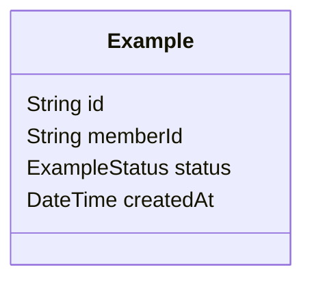
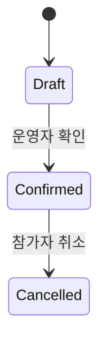
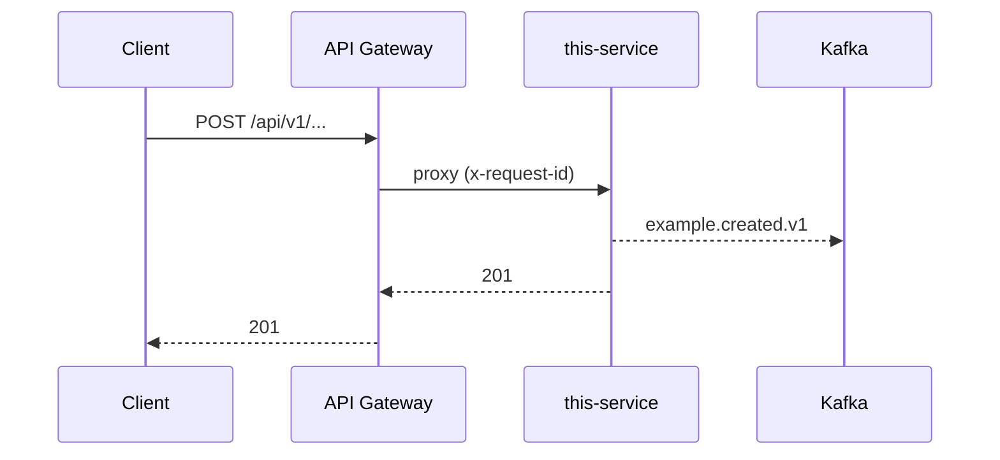

# SPEC-000 기능 이름

> 이 파일을 `SPEC-00N-kebab-slug.md`로 복사해 쓴다. 각 절의 인용문(`>`)은 작성 힌트이므로 채운 뒤 지운다. 해당 없는 절은 지우지 말고 "해당 없음"이라고 쓴다. 미정은 "결정 예정"이라고 쓰고 어느 Step에서 정할지 적는다.

## 0. 메타

| 항목 | 값 |
| --- | --- |
| 번호 | SPEC-000 |
| 상태 | 초안 |
| 작성자 | |
| 작성일 | YYYY-MM-DD |
| 최종 갱신 | YYYY-MM-DD |
| 관련 Step | Step N |
| 관련 ADR | ADR-00X, ... |
| 주요 서비스 | member-service / event-service / ... |
| 리뷰어 | |

## 1. 배경과 목표

> 이 기능이 왜 지금 필요한지 3문장 안으로. 팜플렛이나 운영 방침의 어느 부분에서 왔는지 적는다. 목표는 측정할 수 있게 쓴다(예: "운영자가 입금 확인 후 1분 안에 참가 확정 알림을 보낼 수 있다").

## 2. 범위와 비범위

> 이번 설계서에서 만드는 것과 만들지 않는 것을 나란히 적는다. 비범위에는 어느 Step으로 넘기는지 쓴다.

| 범위(만든다) | 비범위(이번엔 안 만든다) |
| --- | --- |
| | → Step N에서 |

## 3. 용어

> 이 문서에 처음 나오는 용어를 정의한다. 용어 사전(`docs/overview/glossary.md`)에 없는 용어는 거기에도 추가한다. 코드 식별자(영어)를 함께 적는다.

| 용어 | 코드 식별자 | 뜻 |
| --- | --- | --- |
| | | |

## 4. 사용자 흐름

> 참가자와 운영자가 각각 무엇을 보고 무엇을 하는지 순서대로. 화면 단위로 번호를 붙인다. 알림을 받는 시점도 흐름에 넣는다.

1. 참가자: …
2. 운영자: …

## 5. 도메인 모델

> 이 기능이 소유하는 엔티티와 관계. 다른 서비스의 데이터는 ID로만 참조한다(FK 금지). Mermaid classDiagram으로 그린다.



## 6. 상태 머신

> 상태를 가진 엔티티마다 하나씩. 전이마다 누가(참가자/운영자/시스템) 무엇을 하면 바뀌는지 적는다. 되돌아가는 전이도 빠뜨리지 않는다.



## 7. API 변경

> Gateway를 거치는 외부 API와 서비스 간 REST를 나눠 적는다. 경로는 `/api/v1/...`. 에러는 `ApiErrorResponse` 규약을 따른다. 구현 후 Swagger가 원천이 되므로 여기서는 계약의 뼈대만 적는다.

| 메서드 | 경로 | 요청 | 응답 | 에러 | 호출자 |
| --- | --- | --- | --- | --- | --- |
| POST | `/api/v1/...` | | 201 | 400, 409 | Web/Mobile |

## 8. 이벤트

> 발행하는 이벤트와 구독하는 이벤트를 나눠 적는다. 토픽 이름은 `domain.event.vN`. payload는 `packages/contracts`에 정의한다. 발행 시점(DB 커밋 전/후)과 파티션 키를 적는다.

| 방향 | 토픽 | 발행/구독 서비스 | 발행 시점 | 파티션 키 | payload 요약 |
| --- | --- | --- | --- | --- | --- |
| 발행 | `example.created.v1` | this-service | 커밋 후 | memberId | |
| 구독 | | | | | |

## 9. DB 변경

> Prisma 모델 추가·변경과 마이그레이션 이름. 인덱스와 유니크 제약도 적는다. 기존 데이터 이전이 필요하면 절차를 쓴다.

```prisma
model Example {
  id        String   @id @default(uuid())
  memberId  String
  createdAt DateTime @default(now())

  @@index([memberId])
}
```

- 마이그레이션: `YYYYMMDDHHMMSS_add_example`

## 10. 서비스 간 상호작용

> 요청 하나가 어떤 서비스를 거치는지 시간 순으로. REST는 실선, Kafka는 점선으로 구분한다. 실패 지점을 표시한다.



## 11. 동시성·실패·재시도

> 동시에 몰리는 지점(정원, 결제, 선택)과 처리 방식(트랜잭션, 유니크 제약, 락). 외부 호출 실패 시 재시도 정책과 멱등성 키. 부분 실패 후 상태가 어떻게 남는지.

## 12. 보안·개인정보

> 인증·인가 규칙(누가 어떤 API를 부를 수 있나). 저장하는 개인정보 항목과 보존 기간. 로그와 응답에서 가려야 할 값. 상대방에게 노출되는 정보 범위.

## 13. 테스트 계획

> 단위·통합·수동 테스트로 나눠 무엇을 검증할지. 11절의 동시성·실패 시나리오는 반드시 포함한다.

| 종류 | 시나리오 | 기대 결과 |
| --- | --- | --- |
| 단위 | | |
| 통합 | | |
| 수동 | | |

## 14. 모니터링 지표

> 이 기능이 살아 있음을 어떻게 아는가. 로그에 남길 이벤트, 카운트할 지표, 알람 조건.

## 15. 롤아웃·되돌리기

> 배포 순서(마이그레이션 → 서비스 → 프론트), 기능 플래그 여부, 문제 시 되돌리는 절차와 되돌릴 수 없는 지점(데이터 이전 등).

## 16. 미결 사항

> 아직 정하지 못한 것. 각 항목에 "누가, 언제(어느 Step)까지" 결정하는지 적는다. 해결되면 지우지 말고 결정 내용을 옆에 적는다.

| 항목 | 결정 예정 시점 | 담당 | 결정 내용 |
| --- | --- | --- | --- |
| | Step N | | |

## 17. 실제 구현과의 차이

> **구현 후 채운다.** 설계와 다르게 만든 것, 이유, 영향 받은 절 번호. 차이가 없으면 "차이 없음"과 확인 날짜를 적는다.

| 절 | 설계 | 실제 | 이유 |
| --- | --- | --- | --- |
| | | | |
